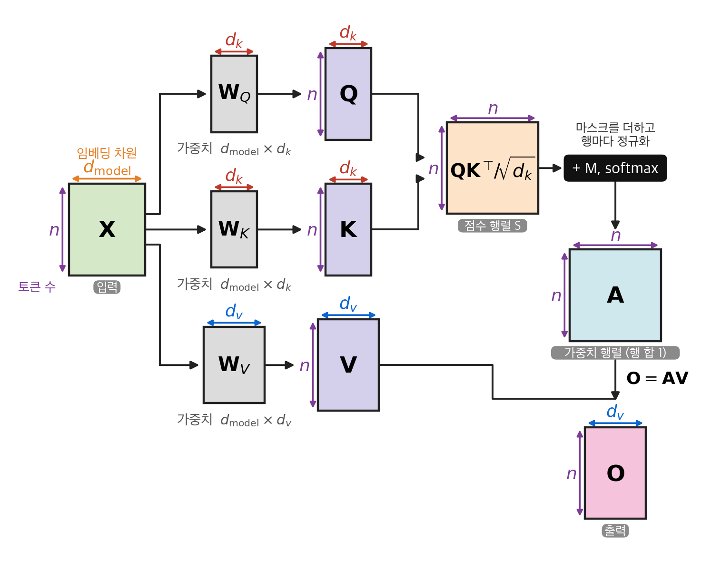
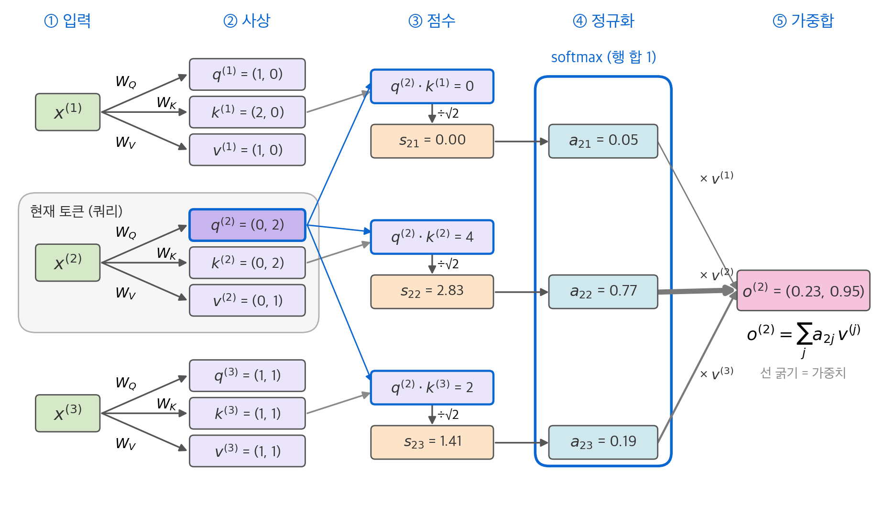
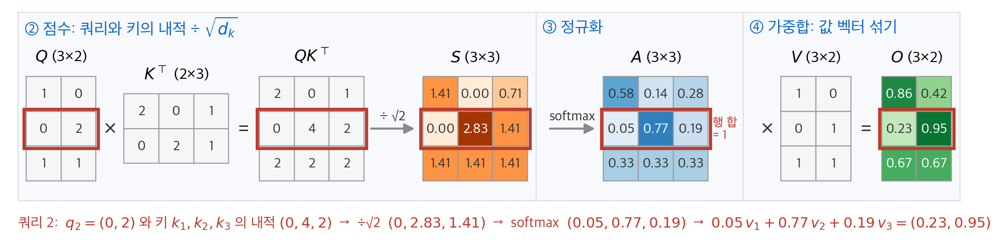
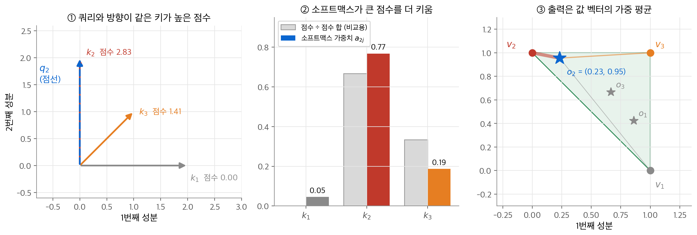
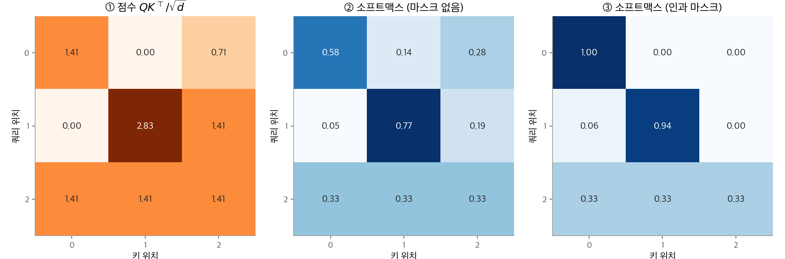
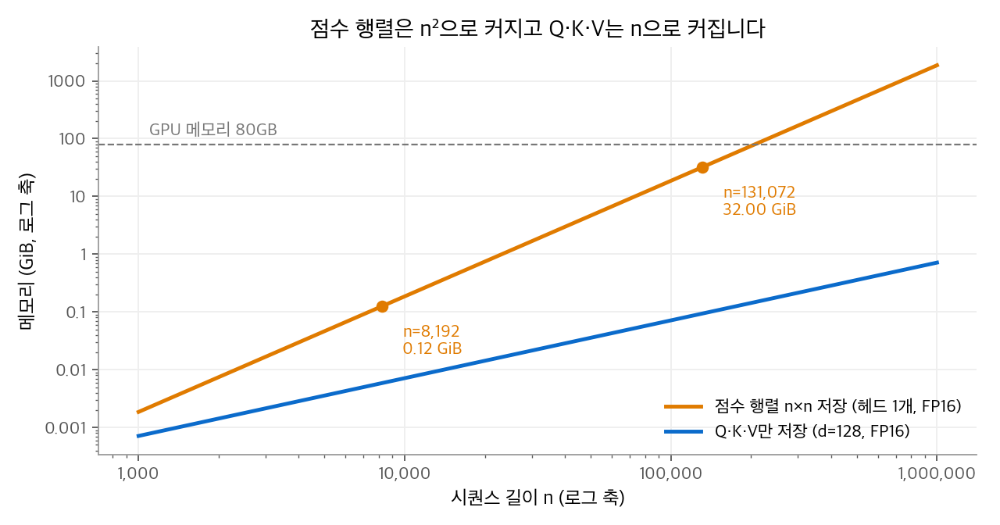
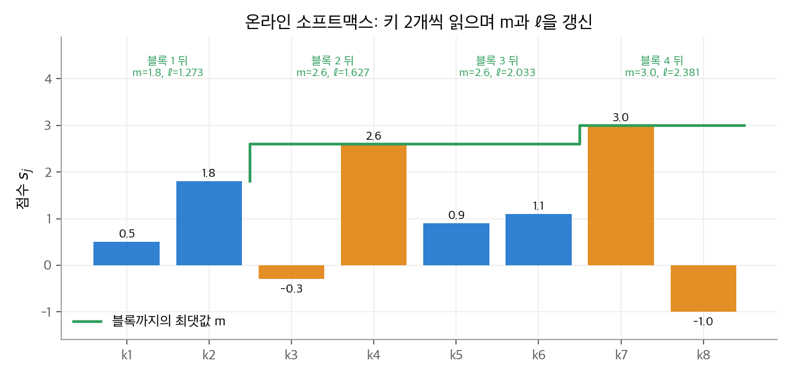
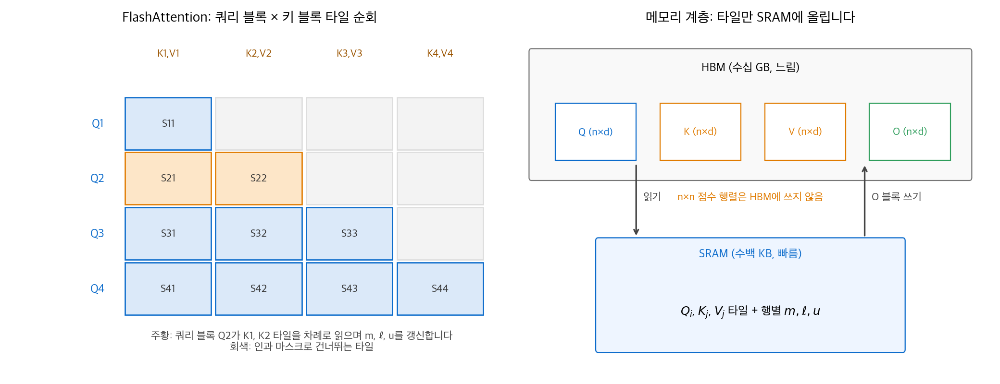

# 1. 스케일드 내적 어텐션

이 장은 모든 어텐션 변형의 출발점인 식 하나를 다룹니다.
세 토큰짜리 예제로 점수, 소프트맥스, 가중합을 직접 계산하고, 인과 마스크가 결과를 어떻게 바꾸는지 확인합니다.
그다음 이 식이 긴 문맥에서 왜 비싼지 계산량과 메모리로 따져 봅니다.
마지막으로 같은 결과를 점수 행렬 없이 계산하는 온라인 소프트맥스와 FlashAttention, 그리고 생성 단계의 KV 캐시를 설명합니다.

!!! info "이 장의 위치"
    쿼리·키·값의 유래와 $\sqrt{d}$ 스케일의 분산 계산은 [신경망 기초 8장](../d2l/08-attention-transformer.md)에서 유도했습니다.
    이 장은 그 결과를 전제로, 실제 LLM에서 이 식이 어떻게 계산되는지에 집중합니다.

## 1. 식

길이 $n$ 인 입력 $\mathbf{X} \in \mathbb{R}^{n \times d_{\text{model}}}$ 을 세 행렬로 사상합니다.

$$
\mathbf{Q} = \mathbf{X}\mathbf{W}_Q,\quad
\mathbf{K} = \mathbf{X}\mathbf{W}_K,\quad
\mathbf{V} = \mathbf{X}\mathbf{W}_V
$$

| 기호 | 모양 | 역할 |
| --- | --- | --- |
| $\mathbf{Q}$ (쿼리) | $n \times d_k$ | "나는 어떤 정보를 찾는가" |
| $\mathbf{K}$ (키) | $n \times d_k$ | "나는 어떤 정보를 가졌는가" |
| $\mathbf{V}$ (값) | $n \times d_v$ | 실제로 전달하는 내용 |

**스케일드 내적 어텐션(scaled dot-product attention)**은 다음 식입니다.

$$
\operatorname{Attention}(\mathbf{Q}, \mathbf{K}, \mathbf{V})
= \operatorname{softmax}\!\left(\frac{\mathbf{Q}\mathbf{K}^\top}{\sqrt{d_k}} + \mathbf{M}\right)\mathbf{V}
$$

$\mathbf{M}$ 은 마스크입니다. 볼 수 있는 위치는 0이고, 가릴 위치는 $-\infty$ 입니다.
소프트맥스는 행마다 계산합니다. 그래서 쿼리 $i$ 의 출력은 값 벡터의 가중 평균입니다.

$$
\mathbf{o}_i = \sum_{j} a_{ij}\,\mathbf{v}_j,\qquad
a_{ij} = \frac{\exp(s_{ij})}{\sum_{l}\exp(s_{il})},\qquad
s_{ij} = \frac{\mathbf{q}_i^\top \mathbf{k}_j}{\sqrt{d_k}} + M_{ij}
$$

$a_{ij} \ge 0$ 이고 $\sum_j a_{ij} = 1$ 입니다. 이 "합이 1"이라는 제약은 [8장](08-attention-sink-gating.md)에서 다시 문제가 됩니다.

## 2. 작동 원리: 네 단계

어텐션 한 번은 다음 네 단계로 이루어집니다.

1. **사상**: 입력 토큰마다 쿼리, 키, 값 벡터를 만듭니다.
2. **점수**: 쿼리 $i$ 와 모든 키 $j$ 의 내적을 계산하고 $\sqrt{d_k}$ 로 나눕니다. 결과는 $n \times n$ 행렬 $\mathbf{S}$ 입니다.
3. **정규화**: 마스크를 더한 뒤 행마다 소프트맥스를 적용합니다. 결과 $\mathbf{A}$ 의 각 행은 확률 분포입니다.
4. **가중합**: $\mathbf{A}\mathbf{V}$ 로 값 벡터를 섞습니다.

<figure markdown>

<figcaption markdown>
<span class="fig-title"><b>Figure 1.</b> 행렬 단위로 본 스케일드 내적 어텐션의 전체 흐름</span>

입력에서 출력까지 행렬 모양을 따라간 그림입니다. 문맥이 길어지면 $n \times n$ 점수 행렬과 가중치 행렬이 가장 빨리 커집니다(6절).
</figcaption>
</figure>

<figure markdown>

<figcaption markdown>
<span class="fig-title"><b>Figure 2.</b> 토큰 하나의 관점에서 본 스케일드 내적 어텐션의 흐름</span>

쿼리 2 하나가 모든 키와 내적하고, 소프트맥스 가중치로 값을 섞는 과정입니다. 선 굵기는 가중치 크기입니다.
</figcaption>
</figure>

그림은 쿼리 하나만 그렸습니다. 실제로는 모든 쿼리가 이 과정을 동시에 거칩니다. 쿼리 $n$ 개의 점수를 한 번에 모으면 $n \times n$ 행렬 $\mathbf{S} = \mathbf{Q}\mathbf{K}^\top / \sqrt{d_k}$ 가 되고, 출력을 모으면 $\mathbf{O} = \mathbf{A}\mathbf{V}$ 가 됩니다. 3절에서 이 행렬 계산을 숫자로 확인합니다.

## 3. 세 토큰으로 직접 계산하기

$d_k = d_v = 2$ 로 두고, 사상이 끝난 $\mathbf{Q}, \mathbf{K}, \mathbf{V}$ 를 바로 줍니다.

$$
\mathbf{Q} = \begin{pmatrix} 1 & 0 \\ 0 & 2 \\ 1 & 1 \end{pmatrix},\quad
\mathbf{K} = \begin{pmatrix} 2 & 0 \\ 0 & 2 \\ 1 & 1 \end{pmatrix},\quad
\mathbf{V} = \begin{pmatrix} 1 & 0 \\ 0 & 1 \\ 1 & 1 \end{pmatrix}
$$

**1단계: 점수.** $\mathbf{Q}\mathbf{K}^\top$ 을 계산하고 $\sqrt{2} \approx 1.414$ 로 나눕니다.

$$
\mathbf{Q}\mathbf{K}^\top = \begin{pmatrix} 2 & 0 & 1 \\ 0 & 4 & 2 \\ 2 & 2 & 2 \end{pmatrix}
\;\Rightarrow\;
\mathbf{S} = \begin{pmatrix} 1.414 & 0 & 0.707 \\ 0 & 2.828 & 1.414 \\ 1.414 & 1.414 & 1.414 \end{pmatrix}
$$

**2단계: 소프트맥스.** 첫 행을 예로 계산합니다. 수치 안정성을 위해 행의 최댓값 1.414를 먼저 뺍니다. 최댓값을 빼도 분자와 분모에 같은 $e^{-1.414}$ 가 곱해지므로 결과는 같습니다.

$$
\exp(0,\,-1.414,\,-0.707) = (1,\,0.243,\,0.493),\quad
\text{합} = 1.736
\;\Rightarrow\;
\mathbf{a}_1 = (0.576,\,0.140,\,0.284)
$$

나머지 행도 같은 방법으로 계산합니다.

$$
\mathbf{A} = \begin{pmatrix} 0.576 & 0.140 & 0.284 \\ 0.045 & 0.768 & 0.187 \\ 0.333 & 0.333 & 0.333 \end{pmatrix}
$$

**3단계: 가중합.** 첫 행은 $0.576(1,0) + 0.140(0,1) + 0.284(1,1) = (0.860,\,0.424)$ 입니다.

$$
\mathbf{O} = \mathbf{A}\mathbf{V} = \begin{pmatrix} 0.860 & 0.424 \\ 0.232 & 0.955 \\ 0.667 & 0.667 \end{pmatrix}
$$

<figure markdown>

<figcaption markdown>
<span class="fig-title"><b>Figure 3.</b> 세 토큰 예제의 행렬 계산</span>

세 단계를 행렬로 한 번에 계산한 결과입니다. 행 $i$ 가 쿼리 $i$ 의 계산이고, 빨간 테두리가 쿼리 2의 행입니다.
</figcaption>
</figure>

쿼리 2는 $(0, 2)$ 방향을 찾습니다. 키 2가 같은 방향이므로 가중치 0.768을 받고, 출력은 $\mathbf{v}_2 = (0,1)$ 에 가깝습니다.
쿼리 3은 세 키와의 내적이 모두 2입니다. 그래서 세 값을 똑같이 평균합니다.

<figure markdown>

<figcaption markdown>
<span class="fig-title"><b>Figure 4.</b> 쿼리와 키의 방향, 가중치, 출력의 위치</span>

쿼리와 방향이 같은 $\mathbf{k}_2$ 가 가장 높은 점수를 받습니다. 가중치의 합이 1이므로 출력은 값 벡터가 만드는 삼각형 안에 놓입니다.
</figcaption>
</figure>

## 4. 인과 마스크

언어 모델은 다음 토큰을 예측합니다. 그래서 토큰 $i$ 는 $j > i$ 인 토큰을 보면 안 됩니다.
**인과 마스크(causal mask)**는 대각선 위쪽을 $-\infty$ 로 채웁니다. $\exp(-\infty) = 0$ 이므로 가려진 위치의 가중치는 정확히 0입니다.

$$
\mathbf{M} = \begin{pmatrix} 0 & -\infty & -\infty \\ 0 & 0 & -\infty \\ 0 & 0 & 0 \end{pmatrix}
$$

| 쿼리 | 마스크 없음 $\mathbf{a}_i$ | 인과 마스크 $\mathbf{a}_i$ | 인과 마스크 출력 $\mathbf{o}_i$ |
| --- | --- | --- | --- |
| 1 | (0.576, 0.140, 0.284) | (1, 0, 0) | (1, 0) |
| 2 | (0.045, 0.768, 0.187) | (0.056, 0.944, 0) | (0.056, 0.944) |
| 3 | (0.333, 0.333, 0.333) | (0.333, 0.333, 0.333) | (0.667, 0.667) |

쿼리 2는 키 3을 볼 수 없게 되었습니다. 남은 두 점수 $(0, 2.828)$ 의 소프트맥스는 $(0.056, 0.944)$ 입니다.

<figure markdown>

<figcaption markdown>
<span class="fig-title"><b>Figure 5.</b> 세 토큰 예제의 점수와 어텐션 가중치</span>

왼쪽부터 점수, 마스크 없는 가중치, 인과 마스크 가중치입니다. 쿼리 1은 자기 자신만 보므로 가중치 1을 받습니다.
</figcaption>
</figure>

마스크는 "어디를 볼 수 있는가"를 정합니다.
[4장](04-sliding-window.md)의 슬라이딩 창과 [6장](06-sparse-attention.md)의 희소 선택은 모두 이 $\mathbf{M}$ 을 다르게 만드는 방법입니다.

## 5. $\sqrt{d_k}$ 로 나누는 이유

$\mathbf{q}, \mathbf{k}$ 의 성분이 서로 독립이고 평균 0, 분산 1이면 다음이 성립합니다.

$$
\operatorname{Var}(\mathbf{q}^\top\mathbf{k}) = \sum_{l=1}^{d_k}\operatorname{Var}(q_l k_l) = d_k
$$

$d_k = 128$ 이면 점수의 표준편차가 약 11.3입니다. 점수 차이가 이만큼 크면 소프트맥스가 거의 원-핫이 되고, 가장 큰 항을 뺀 나머지 항의 기울기가 사라집니다.
$\sqrt{d_k}$ 로 나누면 분산이 1로 돌아옵니다.

실제 모델은 학습 중에 이 가정이 깨집니다. $\mathbf{q}$ 와 $\mathbf{k}$ 의 노름이 커지면 점수가 폭주합니다.
소프트 캡핑, QK-Norm 같은 대응은 [LLM 핵심 기법 3장](../llm-techniques/03-normalization.md)에서 다룹니다.

## 6. 계산량과 메모리

헤드 하나의 계산량은 다음과 같습니다. 곱셈-덧셈 한 번을 2 FLOPs로 셉니다.

| 단계 | 연산 | FLOPs |
| --- | --- | --- |
| 사상 | $\mathbf{X}\mathbf{W}_{Q,K,V,O}$ | $8n\,d_{\text{model}}\,d_k$ |
| 점수 | $\mathbf{Q}\mathbf{K}^\top$ | $2n^2 d_k$ |
| 가중합 | $\mathbf{A}\mathbf{V}$ | $2n^2 d_v$ |

사상은 $n$ 에 비례하고, 점수와 가중합은 $n^2$ 에 비례합니다.
문맥이 짧으면 사상과 FFN이 계산을 지배합니다. 문맥이 길어지면 $n^2$ 항이 지배합니다.

메모리는 더 빨리 문제가 됩니다. 점수 행렬을 그대로 저장하면 헤드 하나에 $n^2$ 개의 값이 필요합니다.

$$
n = 131{,}072,\ \text{FP16} \;\Rightarrow\; 131{,}072^2 \times 2\ \text{B} = 32\ \text{GiB}
$$

<figure markdown>

<figcaption markdown>
<span class="fig-title"><b>Figure 6.</b> 시퀀스 길이에 따른 점수 행렬과 Q·K·V의 메모리</span>

점수 행렬의 메모리는 $n^2$ 으로 커집니다. 128K 토큰에서는 헤드 하나만으로 32GiB가 필요합니다.
</figcaption>
</figure>

이 문제에 대한 답은 두 갈래입니다.

1. **같은 결과를 더 적은 메모리로 계산합니다.** 점수 행렬을 저장하지 않는 FlashAttention이 이 방법입니다. 7~8절에서 다룹니다.
2. **식 자체를 바꿔서 볼 토큰 수나 저장할 값의 크기를 줄입니다.** 이 교재의 3~7장이 이 방법입니다.

## 7. 온라인 소프트맥스

소프트맥스는 행 전체의 최댓값과 합이 필요해 보입니다. 하지만 키를 조각으로 나눠 읽으면서 세 값만 갱신해도 결과가 같습니다.

| 값 | 뜻 |
| --- | --- |
| $m$ | 지금까지 본 점수의 최댓값 |
| $\ell$ | 지금까지의 $\sum \exp(s_j - m)$ |
| $\mathbf{u}$ | 지금까지의 $\sum \exp(s_j - m)\,\mathbf{v}_j$ (정규화하지 않은 출력) |

새 조각 $B$ 를 읽으면 최댓값이 바뀔 수 있습니다. 이전 합은 옛 최댓값 기준이므로, 보정 계수 $e^{m - m'}$ 을 곱해 새 기준으로 바꿉니다.

$$
m' = \max\!\left(m,\ \max_{j \in B} s_j\right),\quad
\ell' = \ell\,e^{m - m'} + \sum_{j \in B} e^{s_j - m'},\quad
\mathbf{u}' = \mathbf{u}\,e^{m - m'} + \sum_{j \in B} e^{s_j - m'}\mathbf{v}_j
$$

마지막 조각까지 읽은 뒤 $\mathbf{o} = \mathbf{u} / \ell$ 로 나눕니다.

**예제 1: 3절의 쿼리 1.** 키 두 조각 $\{1, 2\}$, $\{3\}$ 으로 나눠 계산합니다. 점수는 $(1.414,\ 0,\ 0.707)$ 입니다.

| 단계 | $m$ | $\ell$ | $\mathbf{u}$ |
| --- | --- | --- | --- |
| 조각 1 ($s = 1.414, 0$) | 1.414 | $1 + e^{-1.414} = 1.243$ | $1\cdot(1,0) + 0.243\cdot(0,1) = (1,\ 0.243)$ |
| 조각 2 ($s = 0.707$) | 1.414 (그대로) | $1.243 + e^{-0.707} = 1.736$ | $(1, 0.243) + 0.493\cdot(1,1) = (1.493,\ 0.736)$ |
| 정규화 | | | $(1.493, 0.736)/1.736 = (0.860,\ 0.424)$ |

결과는 3절의 $\mathbf{o}_1 = (0.860, 0.424)$ 와 같습니다.

**예제 2: 최댓값이 바뀌는 경우.** 점수 8개 $(0.5, 1.8, -0.3, 2.6, 0.9, 1.1, 3.0, -1.0)$ 을 2개씩 읽습니다.

| 블록 | 읽은 점수 | $m$ | 보정 계수 $e^{m - m'}$ | $\ell$ |
| --- | --- | --- | --- | --- |
| 1 | 0.5, 1.8 | 1.8 | (처음) | $e^{-1.3} + 1 = 1.273$ |
| 2 | −0.3, 2.6 | 2.6 | $e^{-0.8} = 0.449$ | $1.273 \times 0.449 + e^{-2.9} + 1 = 1.627$ |
| 3 | 0.9, 1.1 | 2.6 | 1 | $1.627 + e^{-1.7} + e^{-1.5} = 2.033$ |
| 4 | 3.0, −1.0 | 3.0 | $e^{-0.4} = 0.670$ | $2.033 \times 0.670 + 1 + e^{-4} = 2.381$ |

한 번에 계산한 $\sum_j e^{s_j - 3.0}$ 도 2.381입니다.

<figure markdown>

<figcaption markdown>
<span class="fig-title"><b>Figure 7.</b> 온라인 소프트맥스의 블록별 갱신</span>

블록을 읽을 때마다 최댓값 $m$ 을 갱신합니다. 최댓값이 바뀌는 블록 2와 4에서만 이전 합 $\ell$ 에 보정 계수를 곱합니다.
</figcaption>
</figure>

## 8. FlashAttention: 타일 단위로 계산하기

GPU 메모리는 두 층으로 나뉩니다. 용량이 큰 **HBM**(수십 GB)은 느리고, 연산기 옆의 **SRAM**(수백 KB)은 빠릅니다.
표준 구현은 점수 행렬 $\mathbf{S}$ 와 $\mathbf{A}$ 를 HBM에 쓰고 다시 읽습니다. 어텐션은 연산보다 이 읽기·쓰기에 시간을 씁니다.

**FlashAttention**은 7절의 온라인 소프트맥스를 타일 단위로 실행합니다.

1. $\mathbf{Q}$ 를 $B_r$ 행씩, $\mathbf{K}, \mathbf{V}$ 를 $B_c$ 행씩 블록으로 나눕니다.
2. 쿼리 블록 $\mathbf{Q}_i$ 하나를 SRAM에 올리고, 행별 $m, \ell, \mathbf{u}$ 를 초기화합니다.
3. 키·값 블록 $\mathbf{K}_j, \mathbf{V}_j$ 를 차례로 SRAM에 올립니다. 타일 점수 $\mathbf{S}_{ij} = \mathbf{Q}_i\mathbf{K}_j^\top/\sqrt{d_k}$ 를 SRAM 안에서 계산하고, $m, \ell, \mathbf{u}$ 를 갱신합니다.
4. 인과 마스크가 있으면 $j > i$ 인 타일은 건너뜁니다. 대각선 타일 안에서만 원소별 마스크를 적용합니다.
5. 모든 키 블록을 읽은 뒤 $\mathbf{O}_i = \mathbf{u}/\ell$ 을 HBM에 한 번 씁니다.

<figure markdown>

<figcaption markdown>
<span class="fig-title"><b>Figure 8.</b> FlashAttention의 타일 순회와 메모리 계층</span>

타일 단위로 SRAM에서 계산하고, 인과 마스크로 가린 타일은 건너뜁니다. $n \times n$ 점수 행렬은 HBM에 한 번도 쓰지 않습니다.
</figcaption>
</figure>

결과는 표준 구현과 수치적으로 같습니다. 근사가 아닙니다.
메모리는 $O(n^2)$ 에서 $O(n)$ 으로 줄지만, FLOPs는 여전히 $O(n^2)$ 입니다.
역전파에서는 $\mathbf{A}$ 를 저장하는 대신, 저장해 둔 행별 $m, \ell$ 로 타일 점수를 다시 계산합니다. 연산이 조금 늘지만 HBM 접근이 줄어 전체 시간은 짧아집니다.

FLOPs까지 줄이려면 식을 바꿔야 합니다. 이것이 3~7장의 주제입니다.

```python
import torch

def online_attention(q, K, V, block=2):
    """q: (d,), K: (n, d), V: (n, dv). 점수 행렬을 만들지 않고 조각 단위로 계산합니다."""
    m, l = torch.tensor(float("-inf")), torch.tensor(0.0)
    u = torch.zeros(V.shape[1])
    for s in range(0, K.shape[0], block):
        scores = K[s:s + block] @ q / q.shape[0] ** 0.5
        m_new = torch.maximum(m, scores.max())
        scale = torch.exp(m - m_new)          # 옛 최댓값 기준의 합을 새 기준으로 바꿉니다
        p = torch.exp(scores - m_new)
        l = l * scale + p.sum()
        u = u * scale + p @ V[s:s + block]
        m = m_new
    return u / l

Q = torch.tensor([[1., 0.], [0., 2.], [1., 1.]])
K = torch.tensor([[2., 0.], [0., 2.], [1., 1.]])
V = torch.tensor([[1., 0.], [0., 1.], [1., 1.]])
print(online_attention(Q[0], K, V))                                   # tensor([0.8600, 0.4240])
print(torch.softmax(Q[0] @ K.T / 2 ** 0.5, -1) @ V)                   # 같은 값
```

PyTorch의 `torch.nn.functional.scaled_dot_product_attention` 은 조건이 맞으면 FlashAttention 커널을 자동으로 고릅니다.

## 9. 생성 단계와 KV 캐시

학습과 프롬프트 처리(**프리필**, prefill)는 $n$ 개 토큰을 한꺼번에 계산합니다.
생성(**디코드**, decode)은 토큰을 하나씩 만듭니다. $t$ 번째 단계에서 새로 생기는 쿼리는 $\mathbf{q}_t$ 하나뿐입니다.
그런데 $\mathbf{q}_t$ 는 이전의 모든 키와 값이 필요합니다.

$$
\mathbf{o}_t = \operatorname{softmax}\!\left(\frac{\mathbf{q}_t^\top [\mathbf{k}_1, \ldots, \mathbf{k}_t]}{\sqrt{d_k}}\right)[\mathbf{v}_1, \ldots, \mathbf{v}_t]^\top
$$

이전 토큰의 키와 값은 바뀌지 않습니다. 인과 마스크 때문에 뒤에 온 토큰이 앞 토큰의 표현에 영향을 주지 않기 때문입니다.
그래서 한 번 계산한 $\mathbf{k}_j, \mathbf{v}_j$ 를 저장해 두고 다시 씁니다. 이 저장소가 **KV 캐시**입니다.

KV 캐시는 계산을 줄이지만 메모리를 씁니다. 생성 단계는 행렬-벡터 곱이므로 연산보다 메모리 읽기가 병목입니다.
매 단계 KV 캐시 전체를 HBM에서 읽어야 하므로, **KV 캐시의 크기가 생성 속도와 동시 처리량을 정합니다.**
KV 캐시의 크기 계산과 동작은 [3장](03-mqa-gqa.md)에서 자세히 다룹니다. 3장 이후의 변형은 대부분 이 크기를 줄이는 방법입니다.

| 변형 | 줄이는 대상 | 다루는 장 |
| --- | --- | --- |
| MQA, GQA, 층 간 KV 공유, K=V | 저장하는 KV 헤드 수, 층 수, 텐서 수 | [3장](03-mqa-gqa.md) |
| 슬라이딩 창 | 저장하는 토큰 수 | [4장](04-sliding-window.md) |
| MLA | 토큰당 KV의 차원 | [5장](05-mla.md) |
| DSA, IndexShare, CSA·HCA | 읽는 토큰 수, 시퀀스 길이 | [6장](06-sparse-attention.md) |
| 선형 어텐션 (Gated DeltaNet) | KV 캐시 자체를 고정 크기 상태로 대체 | [7장](07-linear-attention.md) |

## 정리

- 어텐션은 $\operatorname{softmax}(\mathbf{Q}\mathbf{K}^\top/\sqrt{d_k} + \mathbf{M})\mathbf{V}$ 이고, 출력은 값 벡터의 가중 평균입니다.
- 마스크 $\mathbf{M}$ 은 볼 수 있는 위치를 정합니다. 인과 마스크는 대각선 위쪽을 가립니다.
- 점수 계산은 $O(n^2)$ 입니다. 온라인 소프트맥스는 최댓값 $m$ 과 합 $\ell$ 을 조각마다 보정하며 갱신해서, 점수 행렬 없이 같은 결과를 냅니다.
- FlashAttention은 이 갱신을 SRAM 안에서 타일 단위로 실행해 메모리를 $O(n)$ 으로 줄입니다. FLOPs는 줄지 않습니다.
- 생성 단계는 KV 캐시를 읽는 속도에 묶입니다.

## 참고 자료

- Vaswani et al., [Attention Is All You Need](https://arxiv.org/abs/1706.03762), 2017.
- Milakov and Gimelshein, [Online normalizer calculation for softmax](https://arxiv.org/abs/1805.02867), 2018.
- Dao et al., [FlashAttention: Fast and Memory-Efficient Exact Attention with IO-Awareness](https://arxiv.org/abs/2205.14135), 2022.
- Dao, [FlashAttention-2: Faster Attention with Better Parallelism and Work Partitioning](https://arxiv.org/abs/2307.08691), 2023.
