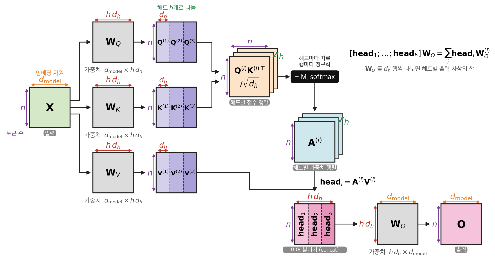
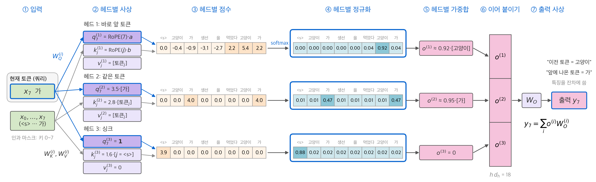
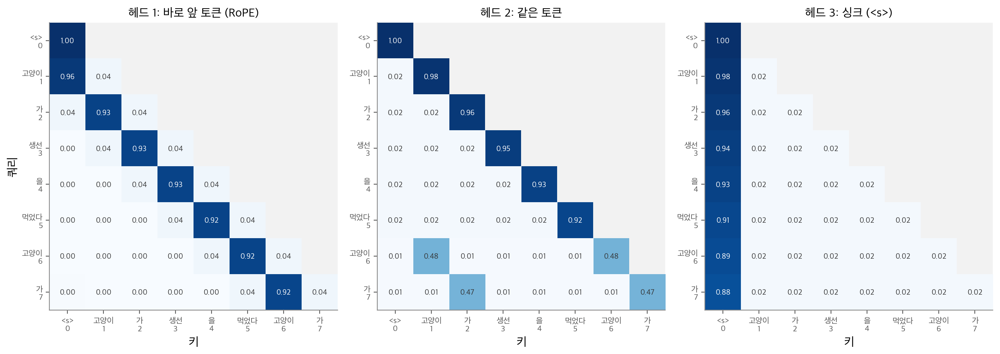
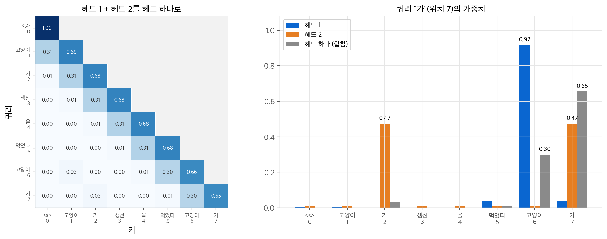
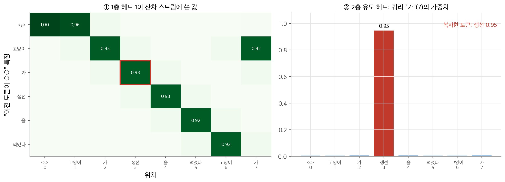

# 2. 멀티헤드 어텐션

[1장](01-scaled-dot-product.md)의 어텐션은 헤드가 하나였습니다. 헤드 하나는 쿼리마다 하나의 확률 분포만 만듭니다.
그런데 한 토큰은 동시에 여러 관계를 봐야 합니다. 바로 앞 토큰, 문법적으로 짝이 되는 토큰, 같은 대상을 가리키는 토큰이 모두 필요합니다.
**멀티헤드 어텐션(multi-head attention, MHA)**은 표현 공간을 여러 부분 공간으로 나누고, 부분 공간마다 따로 어텐션을 계산합니다.
이 장은 텐서 모양을 단계별로 따라가고, 헤드마다 다른 패턴이 생기는 예제를 직접 만들어 봅니다.

## 1. 식

$h$ 개의 헤드를 둡니다. 헤드 $i$ 는 자기만의 사상 행렬로 쿼리, 키, 값을 만듭니다.

$$
\mathbf{head}_i = \operatorname{Attention}\!\left(\mathbf{X}\mathbf{W}_Q^{(i)},\ \mathbf{X}\mathbf{W}_K^{(i)},\ \mathbf{X}\mathbf{W}_V^{(i)}\right),\qquad
\operatorname{MHA}(\mathbf{X}) = [\mathbf{head}_1; \ldots; \mathbf{head}_h]\,\mathbf{W}_O
$$

$\mathbf{W}_Q^{(i)}, \mathbf{W}_K^{(i)}, \mathbf{W}_V^{(i)} \in \mathbb{R}^{d_{\text{model}} \times d_h}$ 이고, $\mathbf{W}_O \in \mathbb{R}^{h d_h \times d_{\text{model}}}$ 입니다.
원 논문은 $d_h = d_{\text{model}} / h$ 로 두었습니다. $d_{\text{model}} = 512$, $h = 8$ 이면 헤드마다 64차원입니다.

출력 사상 $\mathbf{W}_O$ 를 헤드별 블록 $\mathbf{W}_O^{(i)} \in \mathbb{R}^{d_h \times d_{\text{model}}}$ 으로 나누면, 이어 붙이고 사상하는 것은 헤드별 출력을 사상해서 더하는 것과 같습니다.

$$
[\mathbf{head}_1; \ldots; \mathbf{head}_h]\,\mathbf{W}_O = \sum_{i=1}^{h} \mathbf{head}_i\,\mathbf{W}_O^{(i)}
$$

즉 멀티헤드 어텐션은 **서로 다른 어텐션 $h$ 개의 결과를 더한 것**입니다. 각 헤드는 자기 분포로 값을 섞고, 자기 출력 사상으로 잔차 스트림에 씁니다.

## 2. 작동 원리: 텐서 모양 따라가기

구현은 헤드마다 따로 행렬 곱을 하지 않습니다. 큰 사상 한 번으로 모든 헤드의 쿼리를 만든 뒤, 마지막 차원을 헤드 수로 쪼갭니다.
배치 $B = 1$, 길이 $n = 7$, $d_{\text{model}} = 512$, $h = 8$, $d_h = 64$ 로 모양을 따라갑니다.

| 단계 | 연산 | 모양 |
| --- | --- | --- |
| 1. 입력 | $\mathbf{X}$ | (1, 7, 512) |
| 2. 사상 | $\mathbf{X}\mathbf{W}_Q$ (모든 헤드를 한 번에) | (1, 7, 512) |
| 3. 헤드 분할 | `view(B, n, h, d_h)` | (1, 7, 8, 64) |
| 4. 축 교환 | `transpose(1, 2)` | (1, 8, 7, 64) |
| 5. 점수 | $\mathbf{Q}\mathbf{K}^\top / \sqrt{d_h}$ (헤드 축은 배치처럼 처리) | (1, 8, 7, 7) |
| 6. 가중합 | $\operatorname{softmax}(\cdot)\,\mathbf{V}$ | (1, 8, 7, 64) |
| 7. 축 복원 | `transpose(1, 2)` | (1, 7, 8, 64) |
| 8. 헤드 결합 | `reshape(B, n, h·d_h)` | (1, 7, 512) |
| 9. 출력 사상 | $\cdot\,\mathbf{W}_O$ | (1, 7, 512) |

<figure markdown>

<figcaption markdown>
<span class="fig-title"><b>Figure 1.</b> 행렬 단위로 본 멀티헤드 어텐션의 전체 흐름</span>

헤드마다 $n \times n$ 점수 행렬이 하나씩 생깁니다. $h d_h = d_{\text{model}}$ 이면 매개변수와 FLOPs는 헤드 하나와 같고, 점수 메모리만 $h$ 배가 됩니다.
</figcaption>
</figure>

<figure markdown>

<figcaption markdown>
<span class="fig-title"><b>Figure 2.</b> 쿼리 하나의 관점에서 본 멀티헤드 어텐션의 흐름</span>

같은 쿼리라도 헤드마다 다른 토큰에 가중치를 모읍니다. 헤드 1은 "고양이", 헤드 2는 두 "가", 헤드 3은 `<s>` 를 봅니다.
</figcaption>
</figure>

5단계에서 헤드 축은 배치 축처럼 취급됩니다. 그래서 $h$ 개 헤드의 어텐션이 배치 행렬 곱 한 번으로 계산됩니다.
점수 텐서는 (1, 8, 7, 7)입니다. 헤드마다 $7 \times 7$ 어텐션 지도가 하나씩 있습니다.

## 3. 예제: 헤드마다 다른 패턴

학습된 LLM에서 자주 관찰되는 헤드 세 종류를 손으로 만듭니다.

| 헤드 | 관찰되는 패턴 | 하는 일 |
| --- | --- | --- |
| 1 | 바로 앞 토큰 헤드(previous-token head) | 토큰 $i$ 가 $i-1$ 을 봅니다. 위치 정보만 씁니다. |
| 2 | 중복 토큰 헤드(duplicate-token head) | 같은 토큰이 앞에 나온 위치를 봅니다. 토큰 내용만 씁니다. |
| 3 | 싱크 헤드(sink head) | 모든 쿼리가 첫 토큰 `<s>` 를 봅니다. 출력에는 거의 아무것도 쓰지 않습니다. |

문장은 "`<s>` 고양이 가 생선 을 먹었다 고양이 가"입니다. "고양이 가"가 두 번 나옵니다. 이 반복이 있어야 헤드 2가 할 일이 생기고, 다음 층의 유도 헤드도 보일 수 있습니다.

!!! note "토큰과 입력에 대한 가정"
    - 실제 토크나이저(BPE 등)는 "고양이가"를 이렇게 형태소 단위로 나누지 않을 수 있습니다. 읽기 쉽도록 토큰을 형태소 단위로 둡니다.
    - 입력 $\mathbf{x}_i \in \mathbb{R}^{18}$ 은 토큰 임베딩뿐입니다. 품사 같은 라벨은 넣지 않습니다. 서로 다른 토큰 6개의 임베딩은 서로 직교하는 단위 벡터로 둡니다.
    - 위치 정보는 입력에 더하지 않습니다. 최근 LLM처럼 쿼리와 키를 회전하는 RoPE로 넣습니다. RoPE는 [4장](04-sliding-window.md) 5절에서 다룹니다.
    - $d_{\text{model}} = 18$, $h = 3$, $d_h = 6$ 이므로 $h d_h = d_{\text{model}}$ 입니다. 점수는 모두 $\sqrt{d_h}$ 로 나눕니다.

### 헤드 세 개 만들기

**헤드 1: RoPE만으로 바로 앞 토큰 보기.** RoPE는 쿼리와 키의 2차원 쌍 $m$ 을 위치에 비례하는 각도로 돌립니다. 위치 $i$ 의 회전을 $\mathbf{R}(i)$ 라고 씁니다. 쿼리 내용 $\mathbf{a}$ 는 모든 토큰에 같게 두고, 키 내용은 $\mathbf{a}$ 를 한 칸 더 돌린 $\mathbf{b} = \mathbf{R}(1)\mathbf{a}$ 로 둡니다.

$$
\mathbf{q}_i = \mathbf{R}(i)\,\mathbf{a},\quad \mathbf{k}_j = \mathbf{R}(j)\,\mathbf{b}
\;\Rightarrow\;
\mathbf{q}_i^\top\mathbf{k}_j = \mathbf{a}^\top\mathbf{R}(j - i + 1)\,\mathbf{a} = \sum_{m=1}^{3} |\mathbf{a}_m|^2 \cos\big((j - i + 1)\,\theta_m\big)
$$

회전 행렬은 $\mathbf{R}(i)^\top\mathbf{R}(j) = \mathbf{R}(j-i)$ 를 만족합니다. 그래서 점수는 절대 위치가 아니라 거리 $j - i$ 에만 의존합니다. 코사인 세 개가 모두 1이 되는 곳은 $j = i - 1$ 뿐입니다. toy 주파수 $\theta = (\pi/2, \pi/3, \pi/4)$, $|\mathbf{a}_m|^2 = 4.4$ 로 두면 점수는 다음과 같습니다.

| 거리 $j - i$ | $-1$ (바로 앞) | $0$ 또는 $-2$ | $-3$ | $-4$ | $-5$ |
| --- | --- | --- | --- | --- | --- |
| 점수 | $3 \times 4.4 / \sqrt{6} = 5.39$ | 2.17 | $-2.69$ | $-3.07$ | $-0.90$ |

**헤드 2: 같은 토큰 찾기.** 쿼리와 키가 모두 토큰의 원-핫 좌표입니다. $\mathbf{q}_i = 3.5\,[\text{토큰}_i]$, $\mathbf{k}_j = 2.8\,[\text{토큰}_j]$ 이므로 같은 토큰이면 점수가 $3.5 \times 2.8 / \sqrt{6} = 4.0$ 이고 다르면 0입니다.

**헤드 3: 싱크.** 쿼리는 모든 토큰에서 같은 벡터 $\mathbf{1}$ 입니다. 키는 `<s>` 에서만 $1.6 \cdot \mathbf{1}$ 이고 나머지는 0입니다. `<s>` 의 점수는 $6 \times 1.6 / \sqrt{6} = 3.92$ 입니다.

RoPE는 실제로 모든 헤드에 적용됩니다. 헤드 2와 3은 회전이 아주 느린 낮은 주파수 쌍에 쿼리·키를 둔다고 가정하고 회전을 생략합니다. 실제 RoPE의 주파수 $\theta_m = 10000^{-2m/d_h}$ 는 쌍마다 크게 다르므로, 위치용 쌍과 내용용 쌍이 자연스럽게 나뉩니다.

**손계산: 쿼리 "가"(위치 7).** 인과 마스크 때문에 키 0~7을 모두 봅니다.

| 헤드 | 점수가 큰 키 | 가중치 |
| --- | --- | --- |
| 1 | 고양이(6): 5.39, 먹었다(5)와 가(7): 2.17 | 고양이 0.917, 먹었다와 가 각 0.037 |
| 2 | 가(2), 가(7): 각 4.0 | 각 0.474, 나머지 각 0.009 |
| 3 | `<s>`: 3.92 | `<s>` 0.878, 나머지 각 0.017 |

헤드 2는 앞에 나온 "가"(2)와 자기 자신(7)에 반씩 줍니다. 자기 자신도 같은 토큰이기 때문입니다. 실제 중복 토큰 헤드는 위치 정보를 함께 써서 자기 위치를 덜 보도록 학습됩니다.

<figure markdown>

<figcaption markdown>
<span class="fig-title"><b>Figure 3.</b> 헤드 세 개의 어텐션 가중치 행렬</span>

사상 행렬만 다른 세 헤드가 서로 다른 패턴을 봅니다. 헤드 1은 바로 앞 토큰, 헤드 2는 반복된 토큰, 헤드 3은 `<s>` 입니다.
</figcaption>
</figure>

### 값과 출력 사상: 헤드가 잔차 스트림에 쓰는 것

가중치만으로는 멀티헤드의 출력이 보이지 않습니다. 값과 $\mathbf{W}_O$ 까지 정합니다. 18차원 잔차 스트림을 서로 직교하는 6차원 부분 공간 세 개로 나눕니다. 첫째는 토큰 임베딩이 놓이는 공간이고, 둘째와 셋째는 헤드 1과 2가 쓸 빈 공간입니다.

| 헤드 | 값 $\mathbf{v}_j$ | 출력 사상 $\mathbf{W}_O^{(i)}$ | 쿼리 "가"(7)의 출력 |
| --- | --- | --- | --- |
| 1 | 토큰 $j$ 의 원-핫 | "이전 토큰이 ○○" 공간에 씀 | "이전 토큰 = 고양이" 0.92 |
| 2 | 토큰 $j$ 의 원-핫 | "앞에 나온 토큰이 ○○" 공간에 씀 | "앞에 나온 토큰 = 가" 0.95 |
| 3 | 0 | 0 | 아무것도 쓰지 않음 |

헤드 2의 출력 0.95는 "가"(2)와 "가"(7)의 가중치 0.474를 더하고, 다른 토큰들의 작은 가중치를 섞은 값입니다. 헤드 3은 가중치 0.878을 `<s>` 에 쓰지만 그 값이 0입니다. 이렇게 어디에 쓸지 모를 때 가중치를 버리는 헤드가 실제 모델에서도 관찰됩니다. 이 현상은 [8장](08-attention-sink-gating.md)에서 다룹니다.

1절의 식대로, 출력 $\mathbf{y}_7 = \sum_i \mathbf{o}^{(i)}\mathbf{W}_O^{(i)}$ 는 헤드별 기록의 합입니다. 헤드마다 다른 부분 공간에 쓰므로 정보가 섞이지 않습니다.

### 헤드 하나로 합치면

두 기준을 헤드 하나에 넣으면 어떻게 될까요. 헤드 1과 헤드 2의 쿼리와 키를 이어 붙여 헤드 하나로 만들면 점수가 더해집니다.

$$
[\mathbf{q}^{(1)}; \mathbf{q}^{(2)}]^\top [\mathbf{k}^{(1)}; \mathbf{k}^{(2)}] = \mathbf{q}^{(1)\top}\mathbf{k}^{(1)} + \mathbf{q}^{(2)\top}\mathbf{k}^{(2)}
$$

쿼리 "가"(7)에서 "고양이"(6)는 5.39점, 자기 자신 "가"(7)는 $2.17 + 4.0 = 6.17$ 점, 앞의 "가"(2)는 $-0.90 + 4.0 = 3.10$ 점이 됩니다.
소프트맥스는 자기 자신에 0.655, "고양이"에 0.30, 앞의 "가"에 0.031을 줍니다. 바로 앞 토큰도, 앞에 나온 같은 토큰도 분명하게 읽지 못합니다. 두 기준이 동시에 맞는 자기 자신에게 가중치가 몰립니다.

<figure markdown>

<figcaption markdown>
<span class="fig-title"><b>Figure 4.</b> 두 기준을 헤드 하나에 합친 결과</span>

두 기준을 헤드 하나에 합치면 가중치가 섞입니다. 쿼리 "가"는 자기 자신 0.65, "고양이" 0.30으로 나뉩니다.
</figcaption>
</figure>

소프트맥스는 한 행에 분포 하나만 만듭니다. 그래서 서로 다른 관계를 동시에 읽으려면 분포가 여러 개 있어야 합니다. 이것이 헤드를 나누는 이유입니다.

### 다음 층에서: 유도 헤드

헤드 1이 쓴 "이전 토큰" 정보는 다음 층에서 쓰입니다. 2층에 쿼리는 "현재 토큰"을, 키는 "이전 토큰이 ○○" 공간을 읽는 헤드를 둡니다. 이 헤드는 "현재 토큰이 바로 앞에 왔던 위치"를 찾습니다.

쿼리 "가"(7)는 "이전 토큰 = 가"가 기록된 위치를 찾습니다. 그 위치는 "생선"(3)입니다. 앞 문장에서 "가" 다음에 "생선"이 왔기 때문입니다. 가중치는 0.946이고, 값으로 토큰을 복사하면 다음 토큰 예측은 "생선" 0.946입니다.

이 두 층 회로를 **유도 헤드(induction head)**라고 합니다. "A B … A"를 보면 다음에 B가 온다고 예측하는 회로이고, 문맥 내 학습의 핵심 회로로 보고되었습니다(Olsson et al. 2022). 1층의 바로 앞 토큰 헤드가 없으면 2층 헤드가 찾을 정보가 없습니다. 층 안에서는 헤드가 나눠 일하고, 층 사이에서는 헤드가 이어서 일합니다.

<figure markdown>

<figcaption markdown>
<span class="fig-title"><b>Figure 5.</b> 바로 앞 토큰 헤드의 출력을 쓰는 2층 유도 헤드</span>

1층이 기록한 "이전 토큰 = 가" 특징을 2층 유도 헤드가 찾습니다. "생선"에 0.95가 모여 다음 토큰으로 "생선"을 예측합니다.
</figcaption>
</figure>

실제 모델의 헤드는 이렇게 깔끔하게 한 가지 일만 하지 않습니다. 특징도 서로 직교하는 부분 공간에 나뉘지 않고 겹쳐 놓입니다. 그래도 바로 앞 토큰 헤드, 중복 토큰 헤드, 싱크 헤드, 유도 헤드는 학습된 모델에서 반복해서 관찰되는 패턴입니다.

## 4. 구현

```python
import torch
from torch import nn

class MultiHeadAttention(nn.Module):
    def __init__(self, d_model, n_heads, d_head=None):
        super().__init__()
        self.h = n_heads
        self.dh = d_head or d_model // n_heads
        self.W_q = nn.Linear(d_model, self.h * self.dh, bias=False)
        self.W_k = nn.Linear(d_model, self.h * self.dh, bias=False)
        self.W_v = nn.Linear(d_model, self.h * self.dh, bias=False)
        self.W_o = nn.Linear(self.h * self.dh, d_model, bias=False)

    def forward(self, x):                                   # x: (B, n, d_model)
        B, n, _ = x.shape
        split = lambda t: t.view(B, n, self.h, self.dh).transpose(1, 2)   # (B, h, n, dh)
        q, k, v = split(self.W_q(x)), split(self.W_k(x)), split(self.W_v(x))
        o = nn.functional.scaled_dot_product_attention(q, k, v, is_causal=True)  # (B, h, n, dh)
        o = o.transpose(1, 2).reshape(B, n, self.h * self.dh)                    # (B, n, h·dh)
        return self.W_o(o)

mha = MultiHeadAttention(d_model=512, n_heads=8)
print(mha(torch.randn(1, 7, 512)).shape)                   # torch.Size([1, 7, 512])
print(sum(p.numel() for p in mha.parameters()))            # 1048576 = 4 × 512²
```

3절 예제의 헤드 1(RoPE로 바로 앞 토큰 보기)은 다음처럼 재현합니다.

```python
import numpy as np
toks  = ["<s>", "고양이", "가", "생선", "을", "먹었다", "고양이", "가"]
n, dh = len(toks), 6
theta = np.array([np.pi / 2, np.pi / 3, np.pi / 4])     # toy RoPE 주파수 (쌍 3개)

def rope(M, pos):                                       # 행 i 를 pos[i]·theta 만큼 회전
    out = M.copy()
    for m, th in enumerate(theta):
        c, s = np.cos(pos * th)[:, None], np.sin(pos * th)[:, None]
        x0, x1 = M[:, [2 * m]], M[:, [2 * m + 1]]
        out[:, [2 * m]], out[:, [2 * m + 1]] = c * x0 - s * x1, s * x0 + c * x1
    return out

a = np.tile([np.sqrt(4.4), 0.0], 3)                     # 모든 토큰에 같은 쿼리 내용
b = rope(a[None], np.array([1]))[0]                     # 키 내용 = a 를 한 칸 더 돌린 것
pos = np.arange(n)
Q = rope(np.tile(a, (n, 1)), pos)                       # q_i = R(i) a
K = rope(np.tile(b, (n, 1)), pos)                       # k_j = R(j) b
S = Q @ K.T / np.sqrt(dh)                               # 점수는 j - i 에만 의존
S[np.triu_indices(n, 1)] = -np.inf                      # 인과 마스크
A = np.exp(S - S.max(1, keepdims=True)); A /= A.sum(1, keepdims=True)
print(A[7].round(3))   # [0.004 0.003 0.002 0.    0.    0.037 0.917 0.037]
```

## 5. 매개변수 수와 헤드 수 선택

### 매개변수

$h d_h = d_{\text{model}}$ 이면 네 사상 행렬의 매개변수는 합해서 $4 d_{\text{model}}^2$ 입니다. 헤드 수를 바꿔도 매개변수와 FLOPs는 그대로이고, 분포의 수만 바뀝니다.
헤드를 늘리면 헤드 차원 $d_h$ 가 줄어듭니다. $d_h$ 가 너무 작으면 헤드 하나가 표현할 수 있는 유사도가 단순해집니다.
헤드 $i$ 의 값-출력 경로 $\mathbf{W}_V^{(i)}\mathbf{W}_O^{(i)}$ 는 $d_{\text{model}} \times d_{\text{model}}$ 행렬이지만 랭크가 $d_h$ 이하입니다.

### 최근 모델의 선택

최근 모델은 $h d_h = d_{\text{model}}$ 을 꼭 지키지 않습니다. 헤드 차원은 대부분 128로 고정하고, 헤드 수를 따로 정합니다.

| 모델 | $d_{\text{model}}$ | 쿼리 헤드 × $d_h$ | 쿼리 차원 / $d_{\text{model}}$ |
| --- | --- | --- | --- |
| Qwen3-235B-A22B | 4,096 | 64 × 128 | 2.0 |
| GLM-4.5 (355B) | 5,120 | 96 × 128 | 2.4 |
| Gemma 3 27B | 5,376 | 32 × 128 | 0.76 |
| Gemma 4 31B (로컬층 / 전역층) | | 32 × 256 / 32 × 512 | |

### GLM-4.5: 헤드를 2.5배로

GLM-4.5는 은닉 차원 5,120에 쿼리 헤드를 96개 둡니다. $h d_h = d_{\text{model}}$ 을 지키는 설계라면 40개입니다. 보고서는 이것을 "헤드 2.5배"라고 표현합니다.
층 하나의 어텐션 매개변수는 다음과 같습니다. KV 헤드는 8개입니다([3장](03-mqa-gqa.md)의 GQA).

| 사상 | 40헤드 설계 | GLM-4.5 (96헤드) |
| --- | --- | --- |
| $\mathbf{W}_Q$ | $5120 \times 5120 = 26.2$M | $5120 \times 12288 = 62.9$M |
| $\mathbf{W}_K$, $\mathbf{W}_V$ | 각 $5120 \times 1024 = 5.2$M | 각 5.2M |
| $\mathbf{W}_O$ | 26.2M | 62.9M |
| 합 (층 하나) | 62.9M | 136.3M |
| 합 (92층) | 5.8B | 12.5B |

KV 헤드 수는 그대로이므로 KV 캐시는 늘지 않습니다. 늘어나는 것은 쿼리·출력 사상의 매개변수와 점수 계산량입니다.
GLM-4.5 보고서에 따르면 헤드를 늘려도 학습 손실은 낮아지지 않았습니다. 그런데 MMLU, BBH 같은 추론 벤치마크 점수는 꾸준히 올랐습니다. 저자들도 이 결과를 "직관에 반한다"고 표현했습니다.

반대 사례도 있습니다. GLM-5는 [5장](05-mla.md)의 MLA로 바꾸면서 헤드를 64개로 줄이고 헤드 차원을 키웠습니다. MLA에서는 생성 단계의 비용이 헤드 수에 비례하기 때문입니다.
헤드 수는 정답이 정해진 값이 아니라, 어텐션 방식과 비용 구조에 따라 정하는 값입니다.

## 정리

- 멀티헤드 어텐션은 표현 공간을 $h$ 개의 부분 공간으로 나눠, 쿼리마다 분포 $h$ 개를 만듭니다. 출력은 헤드별 출력을 사상해서 더한 것입니다.
- 구현은 사상 한 번 뒤 `view` 와 `transpose` 로 헤드 축을 만들고, 헤드 축을 배치처럼 처리합니다.
- 소프트맥스 분포 하나에 두 관계를 넣으면 섞여서 흐려집니다. 헤드를 나누면 각 관계를 분명하게 읽습니다.
- 최근 모델은 헤드 차원을 고정하고 헤드 수를 따로 정합니다. GLM-4.5는 KV 캐시를 늘리지 않고 쿼리 헤드만 늘렸습니다.

## 참고 자료

- Vaswani et al., [Attention Is All You Need](https://arxiv.org/abs/1706.03762), 2017.
- Michel et al., [Are Sixteen Heads Really Better than One?](https://arxiv.org/abs/1905.10650), 2019.
- Olsson et al., [In-context Learning and Induction Heads](https://arxiv.org/abs/2209.11895), 2022.
- GLM-4.5 Team, [GLM-4.5: Agentic, Reasoning, and Coding (ARC) Foundation Models](https://arxiv.org/abs/2508.06471), 2025.
