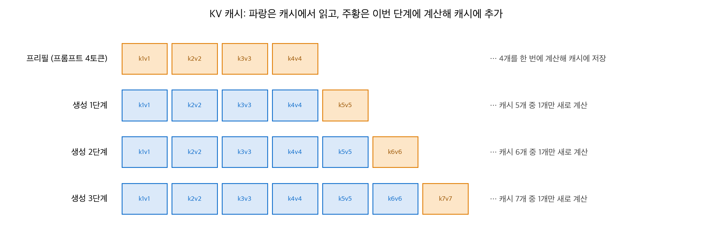
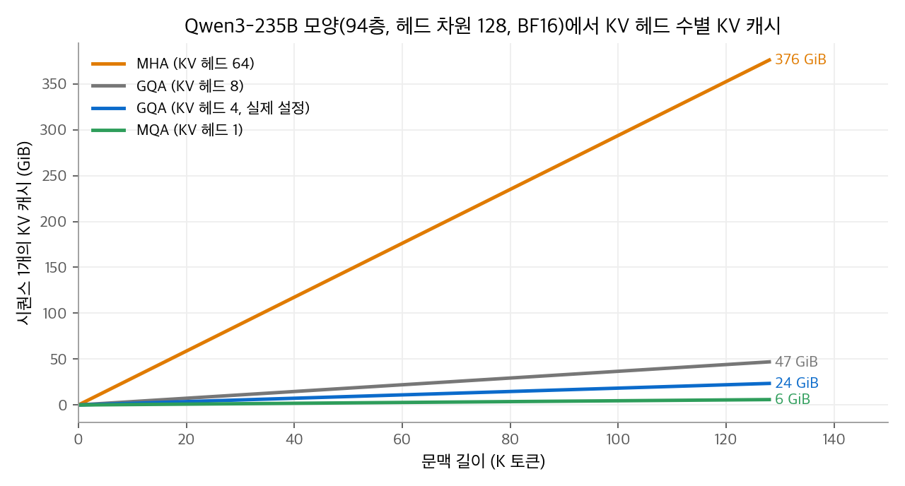
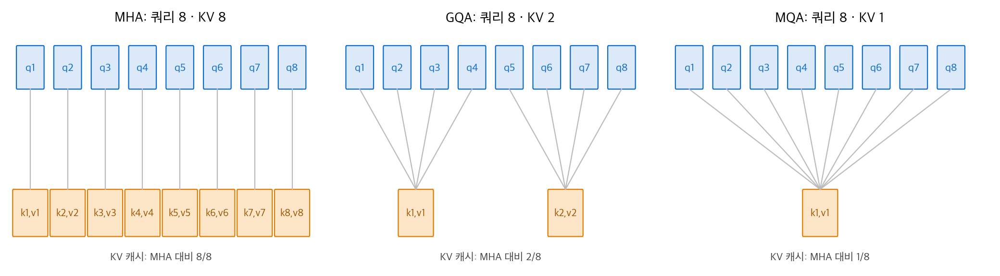
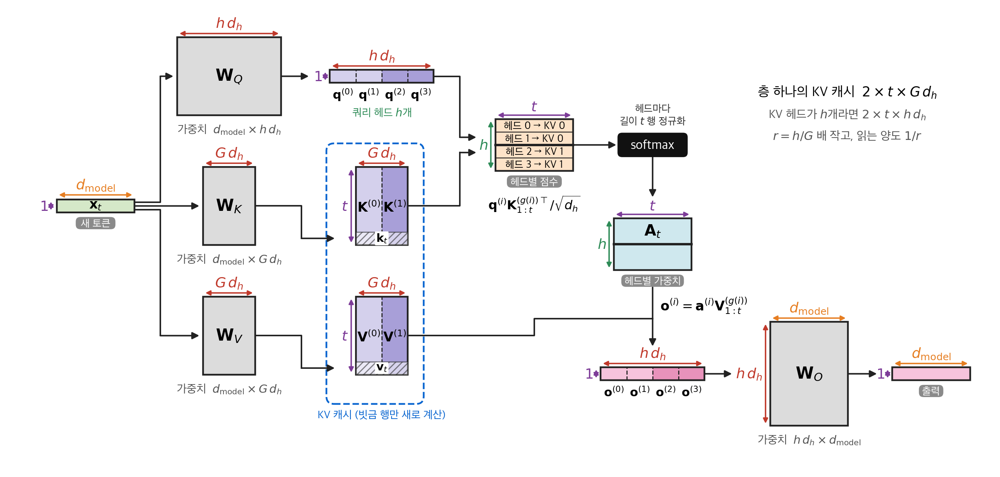
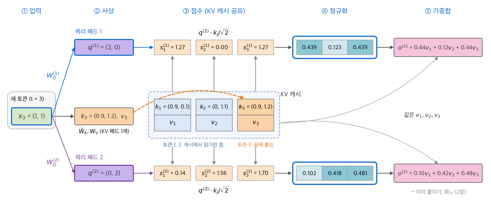
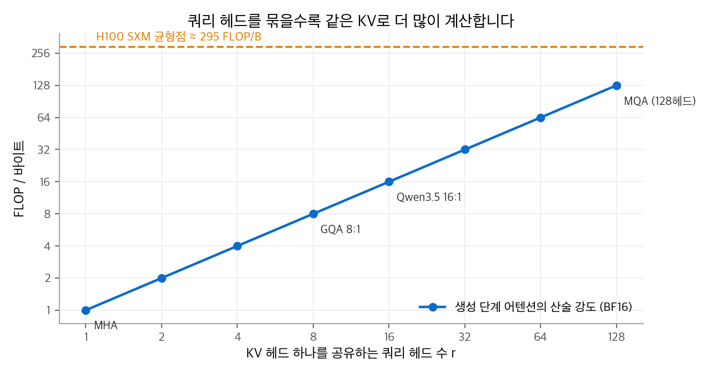
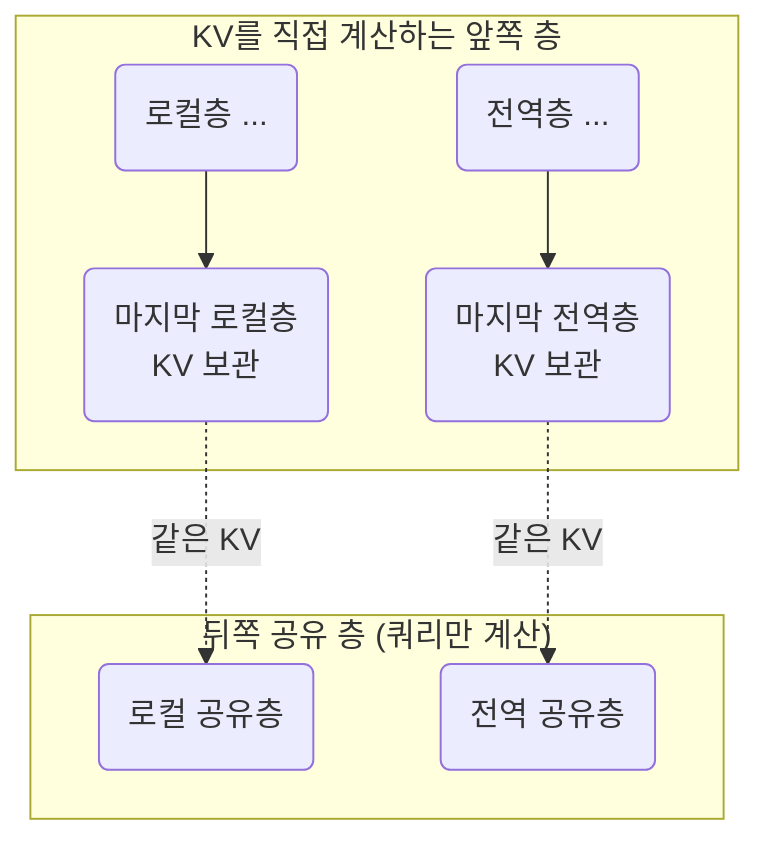

# 3. KV 캐시, MQA, GQA

[1장](01-scaled-dot-product.md) 9절에서 생성 단계는 KV 캐시를 읽는 속도에 묶인다고 했습니다.
이 장은 KV 캐시가 실제로 얼마나 큰지 공개 모델의 설정값으로 계산하고, 그 크기를 줄이는 가장 기본적인 방법을 다룹니다.
쿼리 헤드는 그대로 두고 키·값 헤드만 공유하는 MQA와 GQA, 층 사이에서 KV를 다시 쓰는 KV 공유, 키와 값을 한 사상으로 만드는 K=V입니다.

## 1. 생성 단계의 작동 원리

생성은 두 단계로 나뉩니다.

1. **프리필(prefill)**: 프롬프트 $n_0$ 개 토큰을 한꺼번에 계산합니다. 층마다 모든 토큰의 키와 값을 만들어 캐시에 저장합니다. 행렬-행렬 곱이므로 연산기가 바쁘게 돕니다.
2. **디코드(decode)**: 토큰을 하나씩 만듭니다. 단계마다 새 토큰 하나의 쿼리, 키, 값만 계산합니다. 새 키·값은 캐시 끝에 붙이고, 새 쿼리는 캐시 전체와 어텐션을 계산합니다.

<figure markdown>

<figcaption markdown>
<span class="fig-title"><b>Figure 1.</b> 프리필과 디코드 단계의 KV 캐시</span>

디코드 단계는 새 토큰의 키·값만 계산하지만, 캐시 전체를 읽습니다.
</figcaption>
</figure>

디코드 한 단계에서 층 하나가 하는 일은 다음과 같습니다.

$$
\mathbf{k}_t, \mathbf{v}_t \leftarrow \mathbf{x}_t\mathbf{W}_K,\ \mathbf{x}_t\mathbf{W}_V,\qquad
\text{캐시} \leftarrow [\text{캐시};\ (\mathbf{k}_t, \mathbf{v}_t)],\qquad
\mathbf{o}_t = \operatorname{softmax}\!\left(\frac{\mathbf{q}_t^\top\mathbf{K}_{1:t}^\top}{\sqrt{d_h}}\right)\mathbf{V}_{1:t}
$$

```python
import torch

def decode_step(x_t, W_q, W_k, W_v, cache):
    """x_t: (d,) 새 토큰 하나. cache: {"K": (t-1, dh), "V": (t-1, dh)}."""
    q, k, v = x_t @ W_q, x_t @ W_k, x_t @ W_v
    cache["K"] = torch.cat([cache["K"], k[None]])        # 새 키를 캐시 끝에 붙입니다
    cache["V"] = torch.cat([cache["V"], v[None]])
    a = torch.softmax(cache["K"] @ q / q.shape[0] ** 0.5, dim=0)
    return a @ cache["V"]                                 # 캐시 전체를 읽습니다

d, dh = 16, 8
W_q, W_k, W_v = (torch.randn(d, dh) for _ in range(3))
cache = {"K": torch.empty(0, dh), "V": torch.empty(0, dh)}
for t in range(5):
    o = decode_step(torch.randn(d), W_q, W_k, W_v, cache)
print(cache["K"].shape)                                   # torch.Size([5, 8])
```

## 2. KV 캐시의 크기

시퀀스 하나의 KV 캐시는 다음 식으로 계산합니다.

$$
\text{KV 캐시 (바이트)} = 2 \times L \times n_{\text{kv}} \times d_h \times n \times b
$$

| 기호 | 뜻 |
| --- | --- |
| 2 | 키와 값 |
| $L$ | 층 수 |
| $n_{\text{kv}}$ | 키·값 헤드 수 |
| $d_h$ | 헤드 차원 |
| $n$ | 문맥 길이 (토큰 수) |
| $b$ | 원소 하나의 바이트 수 (BF16은 2) |

**예제 1: Qwen3-235B-A22B.** 공개 설정은 $L = 94$, 쿼리 헤드 64개, $n_{\text{kv}} = 4$, $d_h = 128$ 입니다.

$$
2 \times 94 \times 4 \times 128 \times 2\ \text{B} = 192{,}512\ \text{B} \approx 188\ \text{KiB / 토큰}
$$

32K 토큰이면 약 5.9GiB이고, 128K 토큰이면 약 23.5GiB입니다.
같은 모델이 KV 헤드를 64개 모두 가졌다면 16배인 약 376GiB가 필요합니다.

**예제 2: GLM-4.5.** $L = 92$, 쿼리 헤드 96개, $n_{\text{kv}} = 8$, $d_h = 128$ 입니다.
토큰당 $2 \times 92 \times 8 \times 128 \times 2\ \text{B} = 368\ \text{KiB}$ 이고, 128K 토큰이면 46GiB입니다.
KV 헤드도 96개였다면 552GiB입니다.

| 모델 | 토큰당 KV | 128K 토큰 | KV 헤드를 쿼리 헤드만큼 두었다면 |
| --- | --- | --- | --- |
| Qwen3-235B-A22B | 188KiB | 23.5GiB | 376GiB |
| GLM-4.5 | 368KiB | 46.0GiB | 552GiB |

<figure markdown>

<figcaption markdown>
<span class="fig-title"><b>Figure 2.</b> Qwen3-235B 모양에서 KV 헤드 수별 KV 캐시</span>

KV 헤드 수만 바꿔 계산한 KV 캐시입니다. 파란선이 실제 설정(KV 헤드 4개)입니다.
</figcaption>
</figure>

생성 속도도 계산할 수 있습니다. H100 SXM의 HBM 대역폭은 약 3.35TB/s입니다.
Qwen3-235B가 32K 문맥에서 토큰 하나를 만들려면 KV 캐시 5.9GiB를 읽어야 하므로, KV 읽기만으로 약 1.9ms가 걸립니다. 모델 가중치 읽기는 따로입니다.
동시 사용자가 늘면 사용자마다 캐시가 따로 있으므로 이 비용이 사용자 수만큼 늘어납니다.

## 3. MQA와 GQA: KV 헤드 공유

KV 캐시를 줄이는 가장 직접적인 방법은 $n_{\text{kv}}$ 를 줄이는 것입니다.

- **MQA(multi-query attention)**: 쿼리 헤드는 $h$ 개를 유지하고, 키와 값은 헤드 1개를 모든 쿼리 헤드가 공유합니다. KV 캐시가 $1/h$ 로 줄지만 품질이 떨어질 수 있습니다.
- **GQA(grouped-query attention)**: 쿼리 헤드를 $G$ 개 그룹으로 나누고, 그룹마다 KV 헤드 1개를 공유합니다. $G = h$ 이면 MHA이고, $G = 1$ 이면 MQA입니다.

### 헤드 매핑

그룹 크기를 $r = h / G$ 로 둡니다. 쿼리 헤드 $i$ (0부터 셈)가 쓰는 KV 헤드 번호는 다음과 같습니다.

$$
g(i) = \left\lfloor \frac{i}{r} \right\rfloor,\qquad
\mathbf{head}_i = \operatorname{softmax}\!\left(\frac{\mathbf{Q}^{(i)}\,\mathbf{K}^{(g(i))\top}}{\sqrt{d_h}}\right)\mathbf{V}^{(g(i))}
$$

**예제.** $h = 8$, $G = 2$ 이면 $r = 4$ 입니다. 쿼리 헤드 0~3은 KV 헤드 0을, 쿼리 헤드 4~7은 KV 헤드 1을 씁니다.
같은 그룹의 쿼리 헤드 네 개는 같은 키를 보지만, 쿼리가 다르므로 어텐션 분포는 서로 다릅니다.

<figure markdown>

<figcaption markdown>
<span class="fig-title"><b>Figure 3.</b> MHA, GQA, MQA의 헤드 공유 구조</span>

GQA는 쿼리 헤드 여러 개가 KV 헤드 하나를 공유합니다. KV 캐시는 KV 헤드 수에 비례합니다.
</figcaption>
</figure>

<figure markdown>

<figcaption markdown>
<span class="fig-title"><b>Figure 4.</b> 행렬 단위로 본 GQA 디코드 단계의 전체 흐름</span>

디코드 단계의 점수는 헤드마다 $1 \times t$ 한 줄입니다. 캐시는 $t \times G d_h$ 이므로 읽는 바이트가 MHA의 $1/r$ 로 줄어듭니다.
</figcaption>
</figure>

<figure markdown>

<figcaption markdown>
<span class="fig-title"><b>Figure 5.</b> 디코드 단계에서 쿼리 헤드 두 개가 KV 캐시 하나를 읽는 흐름</span>

쿼리 헤드 두 개가 같은 키·값 캐시를 읽습니다. 쿼리가 다르므로 가중치는 헤드마다 다릅니다.
</figcaption>
</figure>

| 모델 | 쿼리 헤드 | KV 헤드 | 그룹 크기 $r$ |
| --- | --- | --- | --- |
| Qwen3-235B-A22B | 64 | 4 | 16 |
| GLM-4.5 | 96 | 8 | 12 |
| Gemma 3 27B | 32 | 16 | 2 |
| Gemma 4 31B 전역층 | 32 | 4 | 8 |
| Qwen3.5-397B 게이트 어텐션층 | 32 | 2 | 16 |

```python
import torch

def gqa(Q, K, V, causal=True):
    """Q: (B, h, n, d), K·V: (B, G, n, d). 쿼리 헤드 r = h/G개가 KV 헤드 하나를 공유합니다."""
    r = Q.shape[1] // K.shape[1]
    K = K.repeat_interleave(r, dim=1)                    # (B, h, n, d): 헤드 i는 KV 헤드 i // r
    V = V.repeat_interleave(r, dim=1)
    return torch.nn.functional.scaled_dot_product_attention(Q, K, V, is_causal=causal)

Q = torch.randn(1, 8, 5, 64); K = torch.randn(1, 2, 5, 64); V = torch.randn(1, 2, 5, 64)
print(gqa(Q, K, V).shape)                                # torch.Size([1, 8, 5, 64])
```

실제 커널은 `repeat_interleave` 로 메모리를 복사하지 않습니다. 같은 KV 타일을 SRAM에 한 번 올리고 여러 쿼리 헤드가 읽습니다.

## 4. 산술 강도: GQA가 빠른 이유

디코드 단계에서 KV 헤드 하나를 HBM에서 읽는 데이터는 $2 n d_h b$ 바이트입니다.
이 KV 헤드를 쓰는 쿼리 헤드가 $r$ 개이면, 읽은 데이터로 계산하는 FLOPs는 약 $4 r n d_h$ 입니다(점수 $2nd_h$, 가중합 $2nd_h$).
바이트당 연산량, 즉 **산술 강도(arithmetic intensity)**는 다음과 같습니다.

$$
\text{산술 강도} \approx \frac{4 r n d_h}{2 n d_h b} = \frac{2r}{b}
$$

BF16($b = 2$)이면 산술 강도는 $r$ FLOP/바이트입니다.

**예제.** $n = 32{,}768$, $d_h = 128$, $r = 8$ 이면 KV 헤드 하나에서 16MiB를 읽고 약 1억 3,400만 FLOPs를 계산합니다. 바이트당 8 FLOP입니다.

GPU는 바이트당 수백 FLOP을 처리할 수 있습니다. H100 SXM의 BF16 밀집 연산 성능(약 989 TFLOPS)을 HBM 대역폭(약 3.35TB/s)으로 나누면 약 295입니다.
산술 강도가 이 값보다 작으면 연산기가 데이터를 기다리며 놉니다.

<figure markdown>

<figcaption markdown>
<span class="fig-title"><b>Figure 6.</b> 그룹 크기에 따른 디코드 단계 산술 강도</span>

쿼리 헤드를 묶을수록 산술 강도가 오릅니다. MQA로 128헤드를 묶어도 균형점에 닿지 않아, 디코드는 메모리 대역폭에 묶입니다.
</figcaption>
</figure>

GQA는 품질 손실을 작게 유지하면서 KV 캐시와 읽기량을 $1/r$ 로 줄입니다. 그래서 최근 모델은 거의 모두 GQA나 그 변형을 씁니다.

## 5. MHA 체크포인트를 GQA로 바꾸기

GQA 논문은 이미 학습한 MHA 모델을 GQA로 바꾸는 방법도 제안했습니다.

1. 그룹 안의 KV 헤드 사상 행렬을 **평균**해서 하나로 합칩니다.
2. 원래 사전학습 계산량의 약 5%로 추가 학습(**업트레이닝**, uptraining)합니다.

**예제.** 입력 2차원, 헤드 차원 2인 KV 헤드 두 개를 합칩니다. 토큰 3개의 입력은 $\mathbf{x}_1 = (1, 0)$, $\mathbf{x}_2 = (0, 1)$, $\mathbf{x}_3 = (1, 1)$ 이고, 키는 $\mathbf{k}_j = \mathbf{x}_j\mathbf{W}_K$ 입니다.

$$
\mathbf{W}_K^{(1)} = \begin{pmatrix} 1 & 0 \\ 0 & 1 \end{pmatrix},\quad
\mathbf{W}_K^{(2)} = \begin{pmatrix} 0.8 & 0.2 \\ 0 & 1.2 \end{pmatrix}
\;\Rightarrow\;
\bar{\mathbf{W}}_K = \frac{\mathbf{W}_K^{(1)} + \mathbf{W}_K^{(2)}}{2} = \begin{pmatrix} 0.9 & 0.1 \\ 0 & 1.1 \end{pmatrix}
$$

쿼리 헤드 1은 $\mathbf{q} = (2, 0)$, 쿼리 헤드 2는 $\mathbf{q} = (0, 2)$ 입니다. 합치기 전과 후의 어텐션 가중치는 다음과 같습니다.

| 쿼리 헤드 | 원래 키로 계산한 가중치 | 평균한 키로 계산한 가중치 |
| --- | --- | --- |
| 1 | (0.446, 0.108, 0.446) | (0.439, 0.123, 0.439) |
| 2 | (0.095, 0.389, 0.516) | (0.102, 0.418, 0.481) |

두 KV 헤드가 비슷하면 평균해도 분포가 거의 그대로입니다. 남은 작은 차이를 업트레이닝이 메웁니다.
두 헤드가 많이 다르면 어떻게 될까요. $\mathbf{W}_K^{(2)}$ 를 두 축을 바꾼 행렬 $\begin{pmatrix} 0 & 1 \\ 1 & 0 \end{pmatrix}$ 로 두면, 쿼리 헤드 1의 가중치는 (0.446, 0.108, 0.446)에서 (0.248, 0.248, 0.503)으로 크게 바뀝니다.
평균 풀링은 헤드가 서로 비슷할 때 잘 동작합니다. 최근 모델은 이 변환 대신 처음부터 GQA로 학습합니다.

## 6. 층 간 KV 공유

GQA는 한 층 안에서 헤드끼리 KV를 공유합니다. **층 간 KV 공유(cross-layer KV sharing)**는 층끼리 KV를 공유합니다.
뒤쪽 층은 키·값 사상 없이, 앞쪽 층이 만든 키와 값을 그대로 씁니다. 쿼리는 층마다 새로 계산합니다.

Gemma 4의 기기용 모델 E2B와 E4B가 이 방법을 씁니다.

| 모델 | 층 수 | KV를 직접 계산하는 층 | 앞 층의 KV를 재사용하는 층 |
| --- | --- | --- | --- |
| E2B | 35 | 앞쪽 15층 | 뒤쪽 20층 |
| E4B | 42 | 앞쪽 24층 | 뒤쪽 18층 |

작동 원리는 Hugging Face Transformers의 `modeling_gemma4.py` 에서 확인할 수 있습니다.

1. 설정의 `num_kv_shared_layers` 가 뒤쪽 공유 층의 수를 정합니다.
2. 공유 층에는 `k_proj`, `v_proj` 가 없습니다. 매개변수도 줄어듭니다.
3. 공유하지 않는 층 가운데, 로컬층과 전역층 각각의 **마지막 층**이 자기 키·값을 보관합니다.
4. 공유 층은 자기와 같은 종류(로컬 또는 전역)의 보관된 키·값을 가져와 자기 쿼리로 어텐션을 계산합니다.



KV를 저장하는 층이 E2B는 35개에서 15개로, E4B는 42개에서 24개로 줄어듭니다.
외부 분석(Raschka)에 따르면 128K 문맥, BF16 기준으로 E2B는 약 2.7GB, E4B는 약 6GB를 절약합니다.
대가로 모델의 표현력이 줄어듭니다. 층 간 KV 공유를 제안한 연구는 작은 모델에서 손실이 작다고 보고했습니다.

## 7. K=V: 키 사상을 값으로도 쓰기

Gemma 4의 전역층은 값 사상 행렬 $\mathbf{W}_V$ 가 없습니다(설정 `attention_k_eq_v: true`). 키 사상의 결과를 값으로도 씁니다.
다만 키와 값은 그 뒤에 서로 다른 처리를 거칩니다.

$$
\mathbf{P} = \mathbf{X}\mathbf{W}_K,\qquad
\mathbf{K} = \operatorname{RoPE}\big(\operatorname{RMSNorm}_{\gamma_k}(\mathbf{P})\big),\qquad
\mathbf{V} = \operatorname{RMSNorm}(\mathbf{P})
$$

키는 학습 가능한 배율 $\gamma_k$ 를 가진 RMSNorm과 위치 회전(RoPE)을 거칩니다. 값은 배율이 없는 RMSNorm만 거칩니다.
RoPE는 [LLM 핵심 기법 1장](../llm-techniques/01-rope.md), RMSNorm은 [3장](../llm-techniques/03-normalization.md)에서 다룹니다.

| 항목 | 효과 |
| --- | --- |
| 매개변수 | 전역층의 $\mathbf{W}_V$ 가 없어집니다. |
| 사상 계산 | 키·값 사상이 한 번으로 줄어듭니다. |
| KV 캐시 | 추론 엔진에 따라 다릅니다. Hugging Face 구현은 RoPE를 적용한 키와 정규화한 값을 따로 캐시합니다. $\mathbf{P}$ 하나만 저장하고 읽을 때 정규화와 RoPE를 다시 계산하면 절반으로 줄일 수 있습니다. |
| 제약 | "무엇을 찾을지"와 "무엇을 전달할지"가 같은 사상에서 나옵니다. 출력 사상 $\mathbf{W}_O$ 가 값에서 필요한 정보를 다시 골라냅니다. |

**Gemma 4 31B의 KV 캐시.** 전역층 10개는 KV 헤드 4개, $d_h = 512$ 입니다. 키와 값을 따로 저장하면 토큰당 층마다 $2 \times 4 \times 512 \times 2\ \text{B} = 8\ \text{KiB}$, 10층이면 80KiB입니다.
128K 토큰에서 전역층의 캐시는 10GiB입니다. $\mathbf{P}$ 만 저장하면 5GiB입니다. 로컬층의 캐시는 [4장](04-sliding-window.md)에서 계산합니다.

## 정리

- 디코드 단계는 새 토큰의 키·값을 캐시에 붙이고, 캐시 전체를 읽어 어텐션을 계산합니다.
- KV 캐시는 $2 L n_{\text{kv}} d_h n b$ 바이트입니다. Qwen3-235B는 128K 토큰에서 23.5GiB, GLM-4.5는 46GiB입니다.
- GQA는 쿼리 헤드 $r$ 개가 KV 헤드 하나를 공유해서 KV 캐시를 $1/r$ 로 줄이고, 디코드 단계의 산술 강도를 $r$ 배로 높입니다.
- 층 간 KV 공유는 뒤쪽 층이 앞쪽 층의 KV를 다시 씁니다. K=V는 키 사상을 값으로도 씁니다. 둘 다 Gemma 4가 씁니다.

## 참고 자료

- Shazeer, [Fast Transformer Decoding: One Write-Head is All You Need](https://arxiv.org/abs/1911.02150), 2019.
- Ainslie et al., [GQA: Training Generalized Multi-Query Transformer Models from Multi-Head Checkpoints](https://arxiv.org/abs/2305.13245), 2023.
- Brandon et al., [Reducing Transformer Key-Value Cache Size with Cross-Layer Attention](https://arxiv.org/abs/2405.12981), 2024.
- Pope et al., [Efficiently Scaling Transformer Inference](https://arxiv.org/abs/2211.05102), 2022.
- Qwen3-235B-A22B [config.json](https://huggingface.co/Qwen/Qwen3-235B-A22B/blob/main/config.json), GLM-4.5 [config.json](https://huggingface.co/zai-org/GLM-4.5/blob/main/config.json), Gemma 4 31B [config.json](https://huggingface.co/google/gemma-4-31B/blob/main/config.json).
- Hugging Face Transformers [modeling_gemma4.py](https://github.com/huggingface/transformers/blob/main/src/transformers/models/gemma4/modeling_gemma4.py).
- Sebastian Raschka, [Recent Developments in LLM Architectures: KV Sharing, mHC, and Compressed Attention](https://magazine.sebastianraschka.com/p/recent-developments-in-llm-architectures), 2026.
