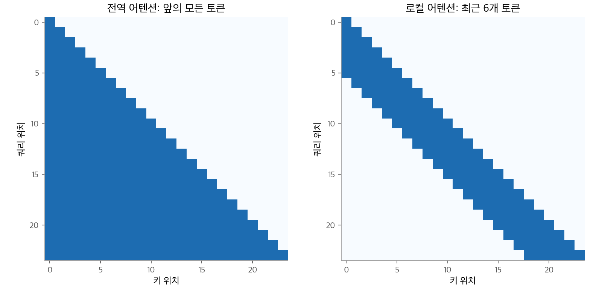
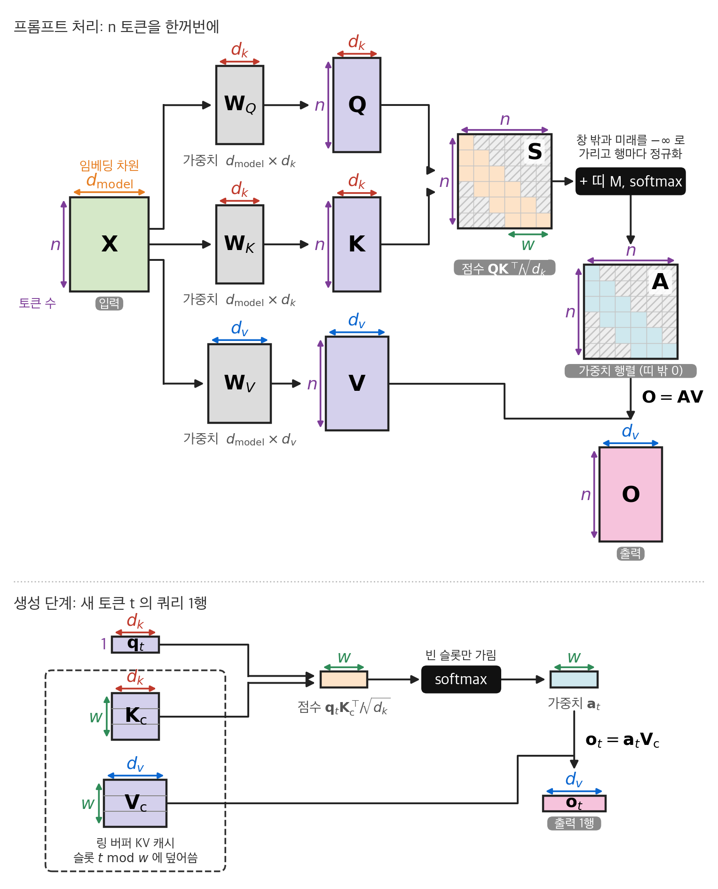
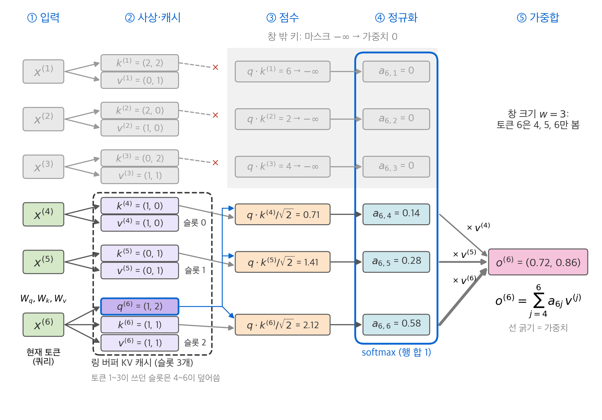
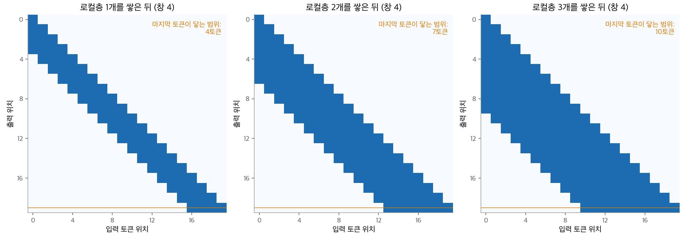
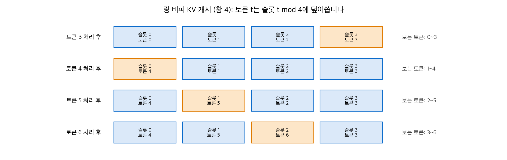
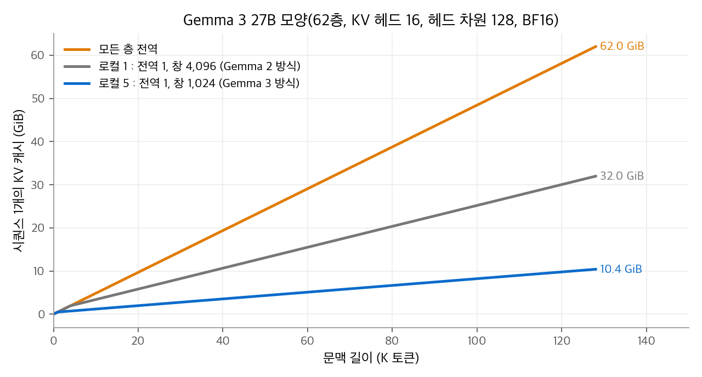
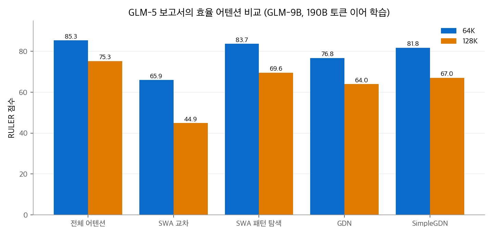

# 4. 슬라이딩 창과 로컬·전역 교차

[3장](03-mqa-gqa.md)의 GQA는 KV 헤드 수를 줄였습니다. 하지만 KV 캐시는 여전히 문맥 길이에 비례합니다.
이 장의 방법은 **보는 범위**를 줄입니다. 대부분의 층은 최근 토큰 $w$ 개만 보고, 일부 층만 문맥 전체를 봅니다.
창 마스크의 모양, 층을 쌓을 때 정보가 퍼지는 범위, 고정 크기 링 버퍼 캐시의 작동 원리를 차례로 확인합니다.
그다음 Gemma 2, 3, 4의 공개 설정값으로 KV 캐시를 계산합니다.

## 1. 슬라이딩 창 마스크

**슬라이딩 창 어텐션(sliding window attention, SWA)**은 쿼리 $i$ 가 자기 자신을 포함한 최근 $w$ 개 토큰만 보게 하는 마스크입니다.

$$
M_{ij} = \begin{cases} 0 & i - w < j \le i \\ -\infty & \text{그 밖} \end{cases}
$$

[1장](01-scaled-dot-product.md)의 인과 마스크에서 왼쪽 아래를 추가로 가린 모양입니다. 이 장에서는 창을 쓰는 층을 **로컬층**, 앞의 모든 토큰을 보는 층을 **전역층**이라고 부릅니다.

<figure markdown>

<figcaption markdown>
<span class="fig-title"><b>Figure 1.</b> 전역 어텐션과 로컬 어텐션의 마스크</span>

로컬 어텐션은 대각선 근처의 띠(창 크기 6)만 남깁니다.
</figcaption>
</figure>

로컬층 하나의 비용은 다음과 같습니다.

| 항목 | 전역층 | 로컬층 (창 $w$) |
| --- | --- | --- |
| 쿼리 하나가 보는 키 | $i$ 개 (최대 $n$) | 최대 $w$ 개 |
| 점수 계산량 | $O(n^2 d)$ | $O(n w d)$ |
| 층 하나의 KV 캐시 | $n$ 토큰분 | $\min(n, w)$ 토큰분 |

로컬층의 KV 캐시는 문맥이 아무리 길어도 $w$ 토큰분에서 멈춥니다. 이것이 슬라이딩 창의 핵심입니다.

```python
import torch

def sliding_window_mask(n, w):
    """True인 위치를 가립니다. 쿼리 i는 i-w+1 ~ i만 봅니다."""
    i = torch.arange(n)[:, None]; j = torch.arange(n)[None, :]
    return (j > i) | (j <= i - w)

print((~sliding_window_mask(6, 3)).int())
# tensor([[1, 0, 0, 0, 0, 0],
#         [1, 1, 0, 0, 0, 0],
#         [1, 1, 1, 0, 0, 0],
#         [0, 1, 1, 1, 0, 0],
#         [0, 0, 1, 1, 1, 0],
#         [0, 0, 0, 1, 1, 1]])
```

<figure markdown>

<figcaption markdown>
<span class="fig-title"><b>Figure 2.</b> 행렬 단위로 본 슬라이딩 창 어텐션의 전체 흐름</span>

점수는 폭 $w$ 의 띠 안쪽만 계산하므로 $O(nwd)$ 입니다. 생성 단계의 캐시는 문맥 길이와 관계없이 $w$ 토큰분입니다.
</figcaption>
</figure>

<figure markdown>

<figcaption markdown>
<span class="fig-title"><b>Figure 3.</b> 창 크기 3인 슬라이딩 창 어텐션의 흐름</span>

쿼리 6은 창 안의 키 4~6과만 내적합니다. $\mathbf{k}^{(1)}$ 의 내적이 6으로 가장 크지만 출력에 들어가지 않습니다.
</figcaption>
</figure>

## 2. 수용 영역: 층을 쌓으면 범위가 넓어집니다

로컬층 하나는 $w$ 토큰만 봅니다. 그런데 층을 쌓으면 정보가 간접적으로 더 멀리 전달됩니다.
층 1에서 토큰 $i$ 의 표현에는 $i-w+1$ 까지의 정보가 들어 있습니다. 층 2에서 토큰 $i$ 는 토큰 $i-w+1$ 의 층 1 표현을 보므로, $i - 2(w-1)$ 까지의 정보를 받습니다.
일반적으로 로컬층 $L$ 개를 쌓으면 토큰 $i$ 는 다음 범위까지 닿습니다.

$$
j \ge i - L(w - 1)
\quad\Rightarrow\quad
\text{닿는 범위} = L(w-1) + 1 \text{ 토큰}
$$

**예제.** $w = 4$ 이면 층 1에서 4토큰, 층 2에서 7토큰, 층 3에서 10토큰입니다.
도달 행렬은 마스크 행렬의 불리언 거듭제곱입니다. $\mathbf{R}^{(L)} = (\mathbf{B}^L > 0)$ 이고, $\mathbf{B}$ 는 1절 마스크에서 볼 수 있는 위치를 1로 둔 행렬입니다.

<figure markdown>

<figcaption markdown>
<span class="fig-title"><b>Figure 4.</b> 로컬층을 쌓을 때 넓어지는 수용 영역</span>

로컬층이 하나 늘 때마다 수용 영역이 3칸씩 넓어집니다(창 4).
</figcaption>
</figure>

```python
import numpy as np
n, w = 20, 4
B = np.tril(np.ones((n, n), int)) * (np.subtract.outer(np.arange(n), np.arange(n)) < w)
R = np.eye(n, dtype=int)
for L in range(1, 4):
    R = ((B @ R) > 0).astype(int)
    print(L, R[-1].sum())        # 1 4 / 2 7 / 3 10
```

실제 모델의 수치로 보면 다음과 같습니다.

| 구성 | 계산 | 닿는 범위 |
| --- | --- | --- |
| Mistral 7B: 32층 모두 로컬, 창 4,096 | $32 \times 4095 + 1$ | 약 131K 토큰 |
| Gemma 3: 전역층 사이의 로컬층 5개, 창 1,024 | $5 \times 1023 + 1$ | 5,116 토큰 |

이론상 범위는 넓지만, 정보는 층을 거칠 때마다 다른 정보와 섞여 희석됩니다. 멀리 있는 특정 토큰을 정확히 꺼내는 데는 불리합니다.
그래서 Gemma는 일정 간격으로 전역층을 넣어 먼 토큰을 직접 보게 합니다.

## 3. 링 버퍼 KV 캐시

로컬층은 최근 $w$ 개 토큰의 키·값만 필요합니다. 그래서 캐시를 크기 $w$ 의 **링 버퍼(ring buffer)**로 만듭니다.

1. 슬롯 $w$ 개짜리 배열을 미리 잡습니다.
2. 토큰 $t$ 의 키·값은 슬롯 $t \bmod w$ 에 씁니다. 그 슬롯에 있던 토큰 $t - w$ 의 키·값은 덮어써집니다.
3. 어텐션은 슬롯 $w$ 개를 모두 읽습니다. 버퍼가 아직 다 차지 않았으면 빈 슬롯은 가립니다.

<figure markdown>

<figcaption markdown>
<span class="fig-title"><b>Figure 5.</b> 창 4의 링 버퍼 KV 캐시</span>

토큰 4가 슬롯 0의 토큰 0을 덮어씁니다. 버퍼에는 항상 최근 4토큰만 남습니다.
</figcaption>
</figure>

슬롯 순서가 토큰 순서와 달라도 결과는 같습니다. 소프트맥스와 가중합은 키의 순서와 무관하기 때문입니다.
위치 정보는 키에 이미 들어 있습니다. RoPE는 키를 캐시에 저장하기 **전에** 위치만큼 회전하므로, 슬롯 번호와 관계없이 원래 위치가 유지됩니다.

```python
import torch

class RingKVCache:
    def __init__(self, w, d):
        self.w, self.K, self.V, self.t = w, torch.zeros(w, d), torch.zeros(w, d), 0
    def append(self, k, v):
        self.K[self.t % self.w], self.V[self.t % self.w] = k, v    # 가장 오래된 슬롯을 덮어씁니다
        self.t += 1
    def attend(self, q):
        valid = min(self.t, self.w)                               # 아직 안 찬 슬롯은 제외합니다
        a = torch.softmax(self.K[:valid] @ q / q.shape[0] ** 0.5, 0)
        return a @ self.V[:valid]

cache = RingKVCache(w=4, d=2)
for t in range(7):
    cache.append(torch.tensor([float(t), 0.]), torch.tensor([float(t), 1.]))
print(cache.K[:, 0])        # tensor([4., 5., 6., 3.]): 슬롯 0~3에 토큰 4, 5, 6, 3
```

## 4. 로컬·전역 비율과 KV 캐시

로컬층 $L_L$ 개와 전역층 $L_G$ 개를 섞으면 KV 캐시는 다음과 같습니다.

$$
\text{KV 캐시} = 2\,n_{\text{kv}}\,d_h\,b\,\big(L_G \cdot n + L_L \cdot \min(n, w)\big)
$$

문맥이 길면 둘째 항은 상수이므로, **전역층의 수가 전체 크기를 정합니다.**

### Gemma 2: 1 : 1, 창 4,096

Gemma 2 27B는 46층을 로컬과 전역으로 번갈아 쌓았습니다. KV 헤드 16개, $d_h = 128$, 창 4,096, 최대 문맥 8,192입니다.
층 하나, 토큰 하나의 KV는 $2 \times 16 \times 128 \times 2\ \text{B} = 8\ \text{KiB}$ 입니다.

- 46층 모두 전역: $46 \times 8\ \text{KiB} \times 8192 = 2.88\ \text{GiB}$
- 실제 (전역 23층 + 로컬 23층): $23 \times 8\ \text{KiB} \times (8192 + 4096) = 2.16\ \text{GiB}$

창이 최대 문맥의 절반이므로 절감은 25%에 그칩니다.

### Gemma 3: 5 : 1, 창 1,024

Gemma 3은 로컬층 5개마다 전역층 1개를 넣고, 창을 1,024로 줄였습니다. 27B는 62층이므로 전역 10층, 로컬 52층입니다. KV 헤드와 헤드 차원은 Gemma 2와 같습니다. 128K 토큰에서 계산합니다.

| 배치 | 전역층 | 로컬층 | 합계 |
| --- | --- | --- | --- |
| 62층 모두 전역 | 62GiB | 없음 | 62.0GiB |
| 1 : 1, 창 4,096 (Gemma 2 방식) | 31층 → 31GiB | 31층 × 4,096토큰 → 0.97GiB | 32.0GiB |
| 5 : 1, 창 1,024 (Gemma 3) | 10층 → 10GiB | 52층 × 1,024토큰 → 0.41GiB | 10.4GiB |

<figure markdown>

<figcaption markdown>
<span class="fig-title"><b>Figure 6.</b> Gemma 3 27B 모양에서 배치별 KV 캐시</span>

로컬층의 캐시는 창 크기에서 멈춥니다. 긴 문맥에서는 전역층의 수가 전체 크기를 정합니다.
</figcaption>
</figure>

5 : 1 배치는 전부 전역일 때보다 KV 캐시를 약 1/6로 줄입니다. Gemma 3 보고서는 이 배치와 창 크기가 퍼플렉서티에 주는 영향이 작다고 보고했습니다.

### Gemma 4: 층 종류별로 다른 모양

Gemma 4 31B는 5 : 1 배치와 창 1,024를 유지하면서, 로컬층과 전역층의 헤드 모양을 다르게 정했습니다.

| 항목 | 로컬층 (50개) | 전역층 (10개) |
| --- | --- | --- |
| KV 헤드 × $d_h$ | 16 × 256 | 4 × 512 |
| 토큰 하나의 KV (층 하나) | 16KiB | 8KiB (키·값 따로 저장 시) |
| 128K 토큰에서 | $50 \times 16\ \text{KiB} \times 1024 = 0.8\ \text{GiB}$ | $10 \times 8\ \text{KiB} \times 131072 = 10\ \text{GiB}$ |

로컬층은 캐시가 창 크기에서 멈추므로 KV 헤드를 16개로 넉넉히 둡니다. 전역층은 캐시가 문맥에 비례하므로 KV 헤드를 4개로 줄이고, 헤드 차원을 512로 키웠습니다. 전역층은 [3장](03-mqa-gqa.md) 7절의 K=V도 씁니다.
합계는 128K 토큰에서 약 10.8GiB, 256K 토큰에서 약 20.8GiB입니다.
60층 모두를 로컬층 모양의 전역층으로 두었다면 128K 토큰에서 120GiB입니다.

기기용 E2B는 창 512에 로컬 4 : 전역 1이고, E4B는 창 512에 5 : 1입니다. 두 모델은 [3장](03-mqa-gqa.md) 6절의 층 간 KV 공유도 씁니다.

## 5. 층 종류별 위치 인코딩

로컬층은 최대 $w$ 토큰 거리만 다루고, 전역층은 문맥 전체 거리를 다룹니다. 그래서 Gemma는 층 종류마다 RoPE 설정을 다르게 둡니다.

| 모델 | 로컬층 | 전역층 |
| --- | --- | --- |
| Gemma 3 | 기저 $10^4$ | 기저 $10^6$, 위치를 8배 선형 보간 (32K → 128K) |
| Gemma 4 31B | 기저 $10^4$, 모든 차원 | 기저 $10^6$, 차원 쌍의 25%에만 적용 (p-RoPE) |

기저 주파수가 무엇이고 왜 키우는지는 [LLM 핵심 기법 1장](../llm-techniques/01-rope.md)에서, 선형 보간은 [2장](../llm-techniques/02-long-context.md)에서 다룹니다.

## 6. 슬라이딩 창은 정보를 잃는가

GLM-5 보고서는 이미 학습한 전체 어텐션 9B 모델을 효율 어텐션으로 바꿔 64K 문맥으로 190B 토큰 이어 학습하고, 긴 문맥 성능을 비교했습니다.

| 방법 | 내용 | RULER 64K | RULER 128K |
| --- | --- | --- | --- |
| 전체 어텐션 | 원래 모델 | 85.35 | 75.28 |
| SWA 교차 | 전체층과 창층을 고정 간격으로 교차 | 65.94 | 44.93 |
| SWA 패턴 탐색 | 어느 층을 창으로 바꿀지 빔 탐색 (1 : 1, 창 4,096) | 83.72 | 69.59 |
| GDN | Gated DeltaNet으로 일부 층 대체 | 76.76 | 64.00 |
| SimpleGDN | 합성곱·게이트를 뺀 GDN | 81.76 | 67.03 |

<figure markdown>

<figcaption markdown>
<span class="fig-title"><b>Figure 7.</b> GLM-5 보고서의 효율 어텐션 비교</span>

모든 대체 방법이 전체 어텐션보다 낮고, 128K에서 차이가 커집니다. 고정 간격 SWA 교차는 44.9로 가장 크게 떨어집니다.
</figcaption>
</figure>

두 가지를 읽을 수 있습니다.

1. **어느 층을 로컬로 바꾸는지가 중요합니다.** 같은 1 : 1 비율이어도 층을 골라 바꾸면 128K 점수가 44.9에서 69.6으로 올라갑니다.
2. **이미 학습된 모델을 짧게 고치는 것과 처음부터 학습하는 것은 다릅니다.** 이 실험은 전체 어텐션으로 학습한 모델을 이어 학습한 결과입니다. 처음부터 로컬·전역 구조로 학습한 Gemma 3의 설계를 평가하는 근거로 쓸 수는 없습니다.

GDN은 [7장](07-linear-attention.md)에서 다룹니다. GLM-5가 이 비교 뒤에 고른 희소 어텐션은 [6장](06-sparse-attention.md)에서 다룹니다.

## 정리

- 슬라이딩 창은 쿼리가 최근 $w$ 개 토큰만 보게 하는 마스크입니다. 로컬층의 KV 캐시는 $w$ 토큰분에서 멈춥니다.
- 로컬층 $L$ 개를 쌓으면 $L(w-1)+1$ 토큰까지 닿지만, 정보가 희석됩니다. 그래서 전역층을 섞습니다.
- 로컬층의 캐시는 링 버퍼로 구현합니다. 토큰 $t$ 는 슬롯 $t \bmod w$ 에 덮어씁니다.
- 긴 문맥의 KV 캐시는 전역층의 수가 정합니다. Gemma 3은 5 : 1 배치로 128K 토큰의 KV 캐시를 62GiB에서 10.4GiB로 줄였습니다.
- Gemma 4는 전역층의 KV 헤드를 줄이고 헤드 차원을 키워, 층 종류마다 비용 구조에 맞는 모양을 씁니다.

## 참고 자료

- Beltagy et al., [Longformer: The Long-Document Transformer](https://arxiv.org/abs/2004.05150), 2020.
- Jiang et al., [Mistral 7B](https://arxiv.org/abs/2310.06825), 2023.
- Gemma Team, [Gemma 2: Improving Open Language Models at a Practical Size](https://arxiv.org/abs/2408.00118), 2024.
- Gemma Team, [Gemma 3 Technical Report](https://arxiv.org/abs/2503.19786), 2025.
- GLM-5 Team, [GLM-5: from Vibe Coding to Agentic Engineering](https://arxiv.org/abs/2602.15763), 2026.
- Gemma 4 31B [config.json](https://huggingface.co/google/gemma-4-31B/blob/main/config.json).
