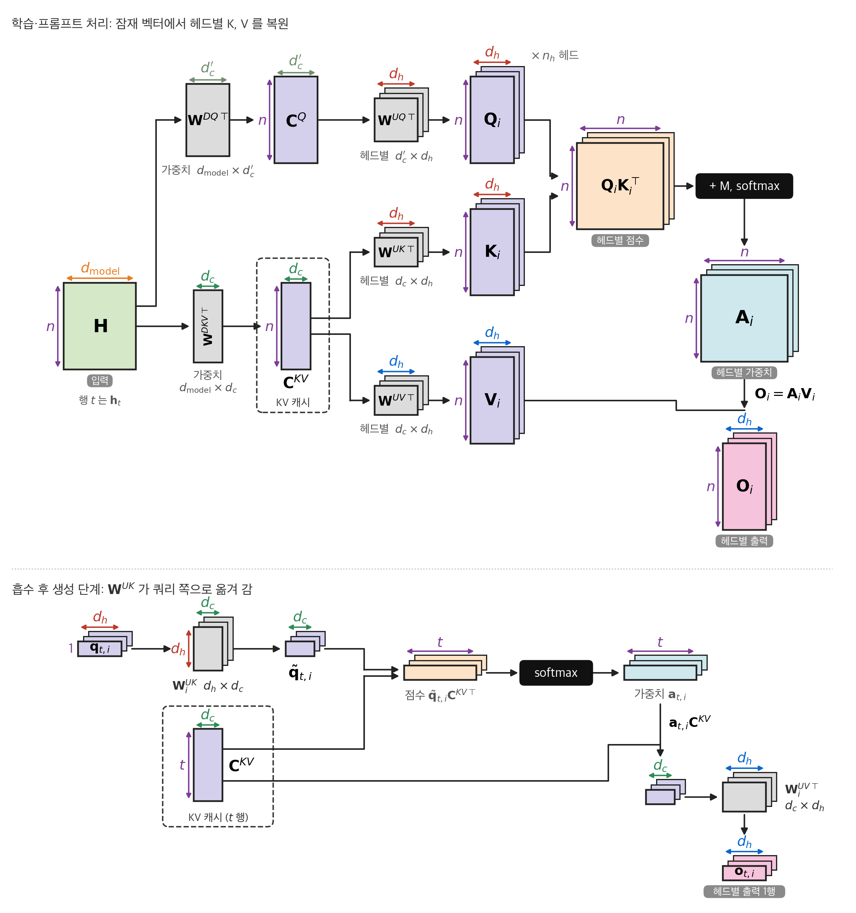
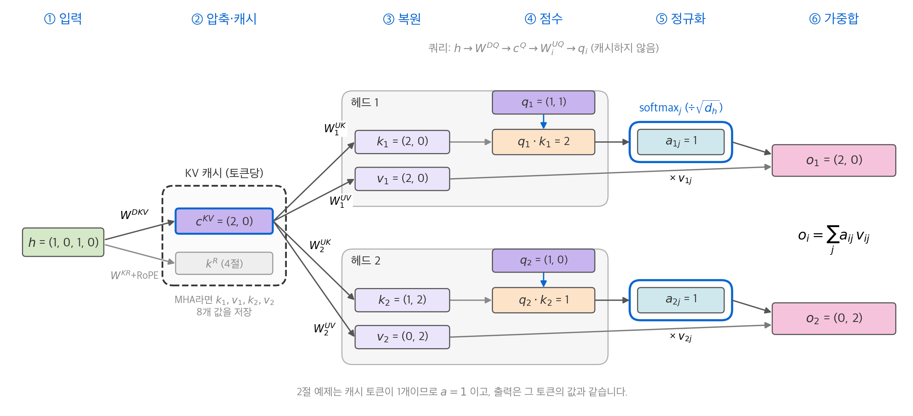
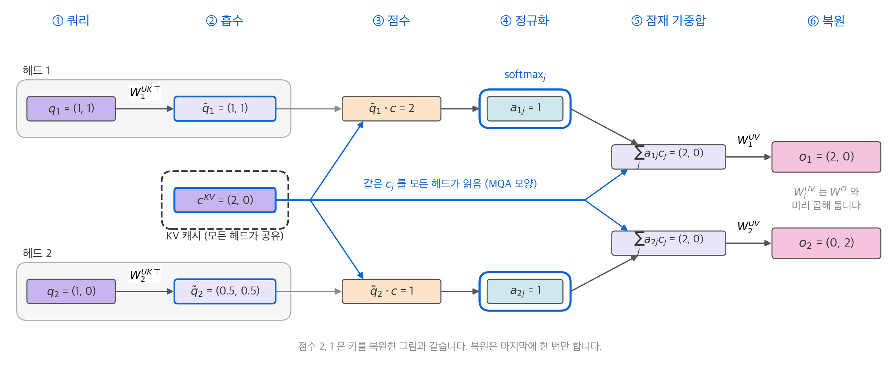
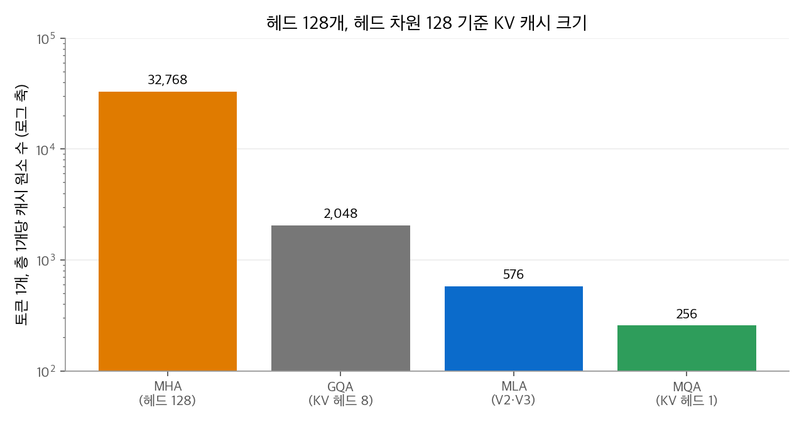
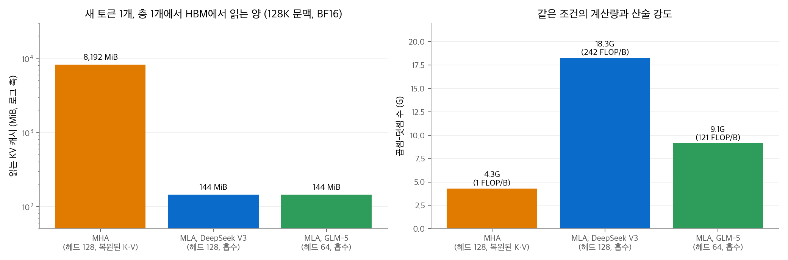

# 5. MLA: 잠재 벡터로 KV 압축하기

[3장](03-mqa-gqa.md)의 GQA는 KV 헤드 수를 줄여서 KV 캐시를 줄였습니다. 대신 여러 쿼리 헤드가 같은 키를 봐야 했습니다.
[4장](04-sliding-window.md)의 슬라이딩 창은 저장하는 토큰 수를 줄였습니다. 대신 먼 토큰을 직접 보지 못했습니다.
이 장의 **MLA(multi-head latent attention)**는 세 번째 방법입니다. 토큰마다 작은 잠재 벡터 하나만 저장하고, 헤드별 키와 값은 그 벡터에서 복원합니다.
DeepSeek-V2에서 처음 나왔고, DeepSeek-V3, V3.2와 GLM-5가 씁니다.

이 장의 질문은 셋입니다.

1. 키와 값을 어떻게 압축하고 복원하는가?
2. 매번 복원하면 계산이 늘어나는데, 어떻게 복원 없이 계산하는가?
3. 위치 인코딩(RoPE)은 이 구조와 어떻게 충돌하고, 어떻게 피하는가?

## 1. 아이디어: 키와 값은 저차원에 있다

MHA는 토큰마다 헤드 수만큼 키와 값을 저장합니다. 헤드 128개, 헤드 차원 128이면 토큰 하나, 층 하나에 $2 \times 128 \times 128 = 32{,}768$ 개 값입니다.
그런데 이 값들은 모두 같은 은닉 상태 $\mathbf{h}_t$ 하나에서 선형 사상으로 나옵니다. 정보의 출처가 하나이므로, 더 작은 공간에 모아 둘 여지가 있습니다.

MLA는 사상을 두 단계로 나눕니다.

1. **압축(down-projection)**: $\mathbf{h}_t$ 를 $d_c$ 차원 잠재 벡터 $\mathbf{c}_t^{KV}$ 로 줄입니다. 이 벡터만 캐시에 저장합니다.
2. **복원(up-projection)**: 헤드 $i$ 의 키와 값은 $\mathbf{c}_t^{KV}$ 에 헤드별 행렬을 곱해 만듭니다.

$$
\mathbf{c}_t^{KV} = \mathbf{W}^{DKV}\mathbf{h}_t \in \mathbb{R}^{d_c},\qquad
\mathbf{k}_{t,i}^{C} = \mathbf{W}_i^{UK}\mathbf{c}_t^{KV} \in \mathbb{R}^{d_h},\qquad
\mathbf{v}_{t,i}^{C} = \mathbf{W}_i^{UV}\mathbf{c}_t^{KV} \in \mathbb{R}^{d_h}
$$

위첨자 $D$ 는 down, $U$ 는 up, $C$ 는 compressed(압축에서 나온 성분)를 뜻합니다.
모든 헤드의 키를 쌓은 행렬 $[\mathbf{W}_1^{UK}; \ldots; \mathbf{W}_{n_h}^{UK}]\,\mathbf{W}^{DKV}$ 는 랭크가 $d_c$ 이하입니다. 그래서 MLA는 키·값 사상에 **저랭크 제약**을 거는 것과 같습니다.

쿼리도 같은 방식으로 저차원 $d_c'$ 을 거칩니다. 쿼리는 캐시에 저장하지 않으므로, 이것은 학습 중 활성값 메모리를 줄이기 위한 장치입니다.

$$
\mathbf{c}_t^{Q} = \mathbf{W}^{DQ}\mathbf{h}_t \in \mathbb{R}^{d_c'},\qquad
\mathbf{q}_{t,i}^{C} = \mathbf{W}_i^{UQ}\mathbf{c}_t^{Q}
$$

<figure markdown>

<figcaption markdown>
<span class="fig-title"><b>Figure 1.</b> 행렬 단위로 본 MLA의 전체 흐름</span>

캐시에는 잠재 행렬 $\mathbf{C}^{KV}$ 만 들어가고, 토큰당 $2 n_h d_h$ 개 값이 $d_c$ 개로 줄어듭니다. 흡수한 생성 단계는 헤드별 키와 값을 만들지 않습니다.
</figcaption>
</figure>

<figure markdown>

<figcaption markdown>
<span class="fig-title"><b>Figure 2.</b> MLA의 압축, 캐시, 복원 흐름</span>

은닉 상태를 잠재 벡터 $\mathbf{c}^{KV}$ 로 압축해 캐시하고, 헤드별 키와 값은 여기서 복원합니다.
</figcaption>
</figure>

그림의 RoPE 키 $\mathbf{k}^R$ 는 4절에서 설명합니다.

## 2. 손으로 따라가는 예제

차원을 아주 작게 잡습니다. $d_{\text{model}} = 4$, 잠재 차원 $d_c = 2$, 헤드 $n_h = 2$, 헤드 차원 $d_h = 2$ 입니다.

**1단계: 압축.** 은닉 상태 $\mathbf{h} = (1, 0, 1, 0)$ 과 압축 행렬을 둡니다.

$$
\mathbf{W}^{DKV} = \begin{pmatrix} 1 & 0 & 1 & 0 \\ 0 & 1 & 0 & 1 \end{pmatrix}
\;\Rightarrow\;
\mathbf{c} = \mathbf{W}^{DKV}\mathbf{h} = (2,\ 0)
$$

캐시에는 이 두 값 $(2, 0)$ 만 들어갑니다.

**2단계: 복원.** 헤드별 복원 행렬로 키와 값을 만듭니다.

| 헤드 | $\mathbf{W}_i^{UK}$ | 키 $\mathbf{k}_i = \mathbf{W}_i^{UK}\mathbf{c}$ | $\mathbf{W}_i^{UV}$ | 값 $\mathbf{v}_i = \mathbf{W}_i^{UV}\mathbf{c}$ |
| --- | --- | --- | --- | --- |
| 1 | $\begin{pmatrix} 1 & 0 \\ 0 & 1 \end{pmatrix}$ | $(2, 0)$ | $\begin{pmatrix} 1 & 1 \\ 0 & 1 \end{pmatrix}$ | $(2, 0)$ |
| 2 | $\begin{pmatrix} 0.5 & 0.5 \\ 1 & -1 \end{pmatrix}$ | $(1, 2)$ | $\begin{pmatrix} 0 & 1 \\ 1 & 0 \end{pmatrix}$ | $(0, 2)$ |

MHA라면 이 토큰에 $\mathbf{k}_1, \mathbf{v}_1, \mathbf{k}_2, \mathbf{v}_2$ 의 8개 값을 저장해야 합니다. MLA는 2개 값만 저장합니다.
두 헤드의 키는 서로 다릅니다. GQA처럼 같은 키를 공유하지 않습니다.

**3단계: 점수.** 쿼리 $\mathbf{q}_1 = (1, 1)$, $\mathbf{q}_2 = (1, 0)$ 으로 점수를 계산합니다.

$$
\mathbf{q}_1^\top\mathbf{k}_1 = 1 \cdot 2 + 1 \cdot 0 = 2,\qquad
\mathbf{q}_2^\top\mathbf{k}_2 = 1 \cdot 1 + 0 \cdot 2 = 1
$$

다음 절에서 같은 점수를 키를 복원하지 않고 계산합니다.

## 3. 흡수: 복원하지 않고 계산하기

### 결합 법칙으로 행렬을 옮기기

생성 단계에서 128개 헤드의 키를 매 토큰 복원하면 계산이 크게 늘어납니다. MLA는 행렬 곱의 결합 법칙으로 복원을 없앱니다.

$$
\mathbf{q}_{t,i}^{C\top}\mathbf{k}_{j,i}^{C}
= \mathbf{q}_{t,i}^{C\top}(\mathbf{W}_i^{UK}\mathbf{c}_j^{KV})
= \underbrace{(\mathbf{W}_i^{UK\top}\mathbf{q}_{t,i}^{C})}_{\tilde{\mathbf{q}}_{t,i}\ \in\ \mathbb{R}^{d_c}}{}^{\top}\,\mathbf{c}_j^{KV}
$$

쿼리를 잠재 공간으로 한 번 옮기면($\tilde{\mathbf{q}}$), 모든 이전 토큰의 잠재 벡터 $\mathbf{c}_j^{KV}$ 와 바로 내적할 수 있습니다.
쿼리도 $\mathbf{q}_{t,i}^C = \mathbf{W}_i^{UQ}\mathbf{c}_t^Q$ 이므로, $\mathbf{W}_i^{UK\top}\mathbf{W}_i^{UQ}$ 를 미리 곱해 하나의 행렬로 둘 수도 있습니다. 이것을 **흡수(absorption)**라고 합니다.

값 쪽도 같습니다. 헤드 출력은 $\sum_j a_{tj}\mathbf{W}_i^{UV}\mathbf{c}_j^{KV} = \mathbf{W}_i^{UV}\sum_j a_{tj}\mathbf{c}_j^{KV}$ 입니다.
잠재 벡터를 먼저 가중합하고, $\mathbf{W}_i^{UV}$ 는 출력 사상 $\mathbf{W}^O$ 와 합쳐 둡니다.

**예제로 확인.** 2절의 헤드 2를 흡수로 다시 계산합니다.

$$
\tilde{\mathbf{q}}_2 = \mathbf{W}_2^{UK\top}\mathbf{q}_2 = \begin{pmatrix} 0.5 & 1 \\ 0.5 & -1 \end{pmatrix}\begin{pmatrix} 1 \\ 0 \end{pmatrix} = (0.5,\ 0.5),\qquad
\tilde{\mathbf{q}}_2^\top\mathbf{c} = 0.5 \cdot 2 + 0.5 \cdot 0 = 1
$$

복원한 키로 계산한 점수 1과 같습니다. 헤드 1은 $\mathbf{W}_1^{UK} = \mathbf{I}$ 이므로 $\tilde{\mathbf{q}}_1 = (1, 1)$, 점수는 2로 같습니다.

<figure markdown>

<figcaption markdown>
<span class="fig-title"><b>Figure 3.</b> 흡수한 MLA의 계산 흐름</span>

쿼리를 잠재 공간으로 옮겨 $\mathbf{c}^{KV}$ 와 바로 내적하므로 키를 복원하지 않습니다. 두 헤드가 같은 캐시를 읽어 MQA와 같은 모양입니다.
</figcaption>
</figure>

```python
import torch
torch.manual_seed(0)
d_model, d_c, d_cq, n_h, d_h = 64, 16, 24, 4, 8
h_t, h_j = torch.randn(d_model), torch.randn(d_model)
W_DKV, W_DQ = torch.randn(d_c, d_model), torch.randn(d_cq, d_model)
W_UK, W_UQ = torch.randn(n_h, d_h, d_c), torch.randn(n_h, d_h, d_cq)

c_kv, c_q = W_DKV @ h_j, W_DQ @ h_t
naive = torch.einsum("hd,hd->h", W_UQ @ c_q, W_UK @ c_kv)          # 키를 복원해서 내적
W_absorb = torch.einsum("hdq,hdc->hqc", W_UQ, W_UK)                # 미리 곱해 둔 행렬
absorbed = torch.einsum("q,hqc,c->h", c_q, W_absorb, c_kv)          # 잠재 벡터와 바로 내적
print(torch.allclose(naive, absorbed, atol=1e-3))                   # True
```

### 생성 단계의 MLA는 MQA와 같은 모양입니다

흡수한 뒤의 계산을 다시 보면, 모든 쿼리 헤드가 **같은** 잠재 벡터 $\mathbf{c}_j^{KV}$ 를 키이자 값으로 씁니다.
헤드마다 다른 것은 쿼리 쪽 행렬뿐입니다. 이것은 [3장](03-mqa-gqa.md)의 MQA, 즉 KV 헤드 하나를 모든 쿼리 헤드가 공유하는 구조와 같은 모양입니다.
차이는 두 가지입니다.

| 항목 | MQA | 흡수한 MLA |
| --- | --- | --- |
| 공유하는 KV의 차원 | 헤드 차원 (예: 128) | 잠재 차원 + RoPE 차원 (예: 576) |
| 헤드별 키의 다양성 | 모든 헤드가 같은 키 | 헤드별 $\mathbf{W}_i^{UK}$ 로 서로 다른 키를 읽음 |

그래서 MLA는 캐시를 MQA에 가깝게 줄이면서, 표현력은 MHA에 가깝게 유지합니다.
DeepSeek-V3.2 보고서는 흡수한 계산 방식을 MLA의 "MQA 모드"라고 부르고, 희소 어텐션을 이 모드 위에 구현했습니다.
학습과 프롬프트 처리처럼 많은 토큰을 한꺼번에 계산할 때는 연산이 병목이므로 복원하는 편이 유리할 수 있습니다. 생성 단계에서는 메모리 읽기가 병목이므로 흡수하는 편이 유리합니다.

## 4. 분리 RoPE: 흡수와 위치 인코딩의 충돌

### 문제

[RoPE](../llm-techniques/01-rope.md)는 위치 $t$ 의 쿼리와 위치 $j$ 의 키를 각각 회전 행렬 $\mathbf{R}_t, \mathbf{R}_j$ 로 돌립니다. 키에 RoPE를 그대로 적용하면 흡수가 깨집니다.

$$
(\mathbf{R}_t\mathbf{q}_{t,i}^C)^\top(\mathbf{R}_j\mathbf{W}_i^{UK}\mathbf{c}_j^{KV})
= \mathbf{q}_{t,i}^{C\top}\,\mathbf{R}_{j-t}\,\mathbf{W}_i^{UK}\,\mathbf{c}_j^{KV}
$$

$\mathbf{R}_{j-t}$ 가 쿼리와 $\mathbf{W}_i^{UK}$ 사이에 끼었습니다. 이 행렬은 상대 거리 $j - t$ 마다 다르므로, $\mathbf{W}_i^{UK}$ 를 쿼리 쪽으로 미리 옮길 수 없습니다.
결국 이전 토큰마다 키를 복원해야 하고, MLA의 이점이 사라집니다.

### 해결: 위치 전용 차원을 따로 두기

DeepSeek은 위치 정보를 별도의 작은 차원 $d_h^R$ 로 분리했습니다.

$$
\mathbf{q}_{t,i}^{R} = \operatorname{RoPE}_t(\mathbf{W}_i^{QR}\mathbf{c}_t^{Q}),\qquad
\mathbf{k}_{t}^{R} = \operatorname{RoPE}_t(\mathbf{W}^{KR}\mathbf{h}_t)
$$

$$
\mathbf{q}_{t,i} = [\mathbf{q}_{t,i}^{C};\ \mathbf{q}_{t,i}^{R}],\qquad
\mathbf{k}_{j,i} = [\mathbf{k}_{j,i}^{C};\ \mathbf{k}_{j}^{R}]
$$

$$
s_{t,j,i} = \frac{\mathbf{q}_{t,i}^{C\top}\mathbf{k}_{j,i}^{C} + \mathbf{q}_{t,i}^{R\top}\mathbf{k}_{j}^{R}}{\sqrt{d_h + d_h^R}}
$$

- **내용 항** $\mathbf{q}^{C\top}\mathbf{k}^{C}$ 은 위치가 없으므로 흡수로 계산합니다.
- **위치 항** $\mathbf{q}^{R\top}\mathbf{k}^{R}$ 은 RoPE를 적용한 작은 벡터끼리 직접 내적합니다.
- RoPE 키 $\mathbf{k}_t^R$ 는 헤드마다 따로 두지 않고 **모든 헤드가 공유**합니다. 그래서 캐시에는 토큰당 $d_h^R$ 개만 더 저장합니다.

DeepSeek V3의 공개 설정은 $d_h = 128$ (`qk_nope_head_dim`), $d_h^R = 64$ (`qk_rope_head_dim`)이므로 점수를 $\sqrt{192}$ 로 나눕니다.
이 방식은 [RoPE 장](../llm-techniques/01-rope.md)의 부분 RoPE와 같은 결과를 냅니다. 헤드 차원의 일부만 위치 정보를 받습니다.

## 5. 캐시 크기

토큰 하나, 층 하나에 저장하는 값은 $d_c + d_h^R$ 개입니다.

| 모델 | $n_h$ | $d_c$ (`kv_lora_rank`) | $d_c'$ (`q_lora_rank`) | 쿼리·키 차원 (내용 + RoPE) | 값 차원 | 층 | 토큰당 캐시 |
| --- | --- | --- | --- | --- | --- | --- | --- |
| DeepSeek V3, V3.2 | 128 | 512 | 1,536 | 128 + 64 | 128 | 61 | 576 × 61 |
| GLM-5 | 64 | 512 | 2,048 | 192 + 64 | 256 | 78 | 576 × 78 |

BF16으로 계산하면 다음과 같습니다.

| 모델 | 토큰당 | 128K 토큰 | 같은 모양의 MHA (128K) |
| --- | --- | --- | --- |
| DeepSeek V3 | $576 \times 61 \times 2\ \text{B} \approx 68.6\ \text{KiB}$ | 약 8.6GiB | 약 488GiB |
| GLM-5 | $576 \times 78 \times 2\ \text{B} \approx 87.75\ \text{KiB}$ | 약 11.0GiB | |

<figure markdown>

<figcaption markdown>
<span class="fig-title"><b>Figure 4.</b> 헤드 128개 기준 KV 캐시 원소 수</span>

MLA는 토큰당 576개를 저장해 MHA(32,768개)의 약 1/57입니다. 크기만 보면 KV 헤드 2.25개짜리 GQA와 같습니다.
</figcaption>
</figure>

DeepSeek-V2 논문은 MLA가 같은 캐시 크기의 GQA보다 품질이 좋고, MHA보다도 약간 좋다고 보고했습니다.
GLM-5 보고서는 다른 결과도 보고합니다. Muon 옵티마이저로 학습하면 MLA가 GQA-8보다 떨어졌고, 헤드별로 직교화하는 Muon Split을 써서 격차를 없앴습니다. 자세한 내용은 [Muon 장](../llm-techniques/optimizer/03-muon.md)에 있습니다.

## 6. 생성 비용은 헤드 수에 비례합니다

흡수한 MLA로 새 토큰 하나를 만들 때, 층 하나의 비용을 계산합니다. 문맥은 $n$ 토큰입니다.

- **읽는 양**: 잠재 벡터와 RoPE 키, $n \times 576$ 개 값. 헤드 수와 무관합니다.
- **계산량**: 헤드마다 576차원 내적(점수)과 512차원 가중합(출력). 곱셈-덧셈이 $n \times n_h \times (576 + 512)$ 번입니다.

128K 문맥, BF16 기준으로 비교합니다.

| 방식 | 읽는 양 | 곱셈-덧셈 | 산술 강도 |
| --- | --- | --- | --- |
| MHA (헤드 128, $d_h$ 128) | 8,192MiB | 4.3G | 바이트당 1 FLOP |
| MLA, DeepSeek V3 (헤드 128) | 144MiB | 18.3G | 바이트당 242 FLOP |
| MLA, GLM-5 (헤드 64) | 144MiB | 9.1G | 바이트당 121 FLOP |

<figure markdown>

<figcaption markdown>
<span class="fig-title"><b>Figure 5.</b> 흡수한 MLA의 생성 단계 비용</span>

MLA는 읽는 양을 1/57로 줄이고 계산량은 늘립니다. 그래서 생성 단계가 메모리 병목에서 연산 병목 쪽으로 옮겨 갑니다.
</figcaption>
</figure>

산술 강도가 이만큼 높으면 생성 비용을 정하는 것은 메모리 읽기가 아니라 계산량입니다. 그리고 계산량은 헤드 수에 비례합니다.
GLM-5가 쓴 **MLA-256**은 이 점을 이용합니다. 헤드 차원을 192에서 256으로 키우고 헤드 수를 1/3 줄였습니다(공개 설정 64개).
GLM-5 보고서는 이 변경이 학습 계산량과 매개변수 수를 유지하면서 생성 단계의 계산을 줄인다고 설명합니다.
같은 보고서의 실험에서 MLA-256 + Muon Split은 MMLU 62.0, GSM8K 47.5, HumanEval 36.6으로 GQA-8(61.2, 47.6, 38.5)과 비슷했습니다.

[3장](03-mqa-gqa.md)의 GQA에서는 반대였습니다. GQA는 산술 강도가 낮아서 쿼리 헤드를 늘려도 생성 비용이 거의 늘지 않습니다. 그래서 GLM-4.5는 쿼리 헤드를 96개로 늘렸습니다.
같은 회사가 GQA에서는 헤드를 늘리고, MLA에서는 헤드를 줄였습니다. 두 선택 모두 각 구조의 병목에 맞춘 것입니다.

## 7. 구현 개요

흡수한 MLA의 생성 단계를 짧게 구현합니다. 실제 커널은 RoPE 부분과 정밀도 처리, 배치를 더 다룹니다.

```python
import torch

def mla_decode(c_q, cache_c, cache_kr, q_rope, W_UQ, W_UK, W_UV, scale):
    """
    c_q:      (d_cq,)          현재 토큰의 쿼리 잠재 벡터
    cache_c:  (n, d_c)         이전 토큰의 KV 잠재 벡터 (캐시)
    cache_kr: (n, d_r)         이전 토큰의 공유 RoPE 키 (캐시, 이미 회전됨)
    q_rope:   (n_h, d_r)       현재 토큰의 헤드별 RoPE 쿼리 (이미 회전됨)
    W_UQ: (n_h, d_h, d_cq), W_UK: (n_h, d_h, d_c), W_UV: (n_h, d_h, d_c)
    """
    q_c = torch.einsum("hdq,q->hd", W_UQ, c_q)          # (n_h, d_h)
    q_lat = torch.einsum("hdc,hd->hc", W_UK, q_c)        # (n_h, d_c): 쿼리를 잠재 공간으로
    scores = q_lat @ cache_c.T + q_rope @ cache_kr.T     # (n_h, n): 내용 항 + 위치 항
    attn = torch.softmax(scores * scale, dim=-1)
    ctx_lat = attn @ cache_c                             # (n_h, d_c): 잠재 벡터를 먼저 가중합
    return torch.einsum("hdc,hc->hd", W_UV, ctx_lat)     # (n_h, d_h): 마지막에 값으로 복원

n, d_c, d_r, d_cq, n_h, d_h = 10, 16, 4, 24, 4, 8
out = mla_decode(torch.randn(d_cq), torch.randn(n, d_c), torch.randn(n, d_r), torch.randn(n_h, d_r),
                 torch.randn(n_h, d_h, d_cq), torch.randn(n_h, d_h, d_c), torch.randn(n_h, d_h, d_c),
                 scale=(d_h + d_r) ** -0.5)
print(out.shape)   # torch.Size([4, 8])
```

`cache_c @` 로 시작하는 두 줄이 핵심입니다. 모든 헤드가 같은 `cache_c` 를 읽습니다. 그래서 헤드 수가 늘면 읽는 양은 그대로이고 계산만 늘어납니다.

## 정리

- MLA는 토큰마다 $d_c$ 차원 잠재 벡터와 공유 RoPE 키만 저장합니다. DeepSeek V3와 GLM-5는 토큰당 576개 값입니다.
- 흡수로 복원 계산을 없앱니다. 생성 단계의 MLA는 576차원 KV 하나를 모든 헤드가 공유하는 MQA처럼 동작합니다.
- RoPE는 흡수와 충돌하므로, 위치 정보만 64차원의 별도 성분으로 분리했습니다.
- 흡수한 MLA는 산술 강도가 높아서 생성 비용이 헤드 수에 비례합니다. GLM-5는 헤드 수를 줄이고 헤드 차원을 키웠습니다.

[6장](06-sparse-attention.md)은 MLA 위에서 읽는 토큰 수 자체를 줄이는 희소 어텐션을 다룹니다.
MLA를 쓰는 모델의 전체 구조는 트렌드의 [DeepSeek](../../trends/posts/2026-10-20-llm-deepseek.md)과 [GLM](../../trends/posts/2026-10-20-llm-glm.md) 글에 있습니다.

## 참고 자료

- DeepSeek-AI, [DeepSeek-V2: A Strong, Economical, and Efficient Mixture-of-Experts Language Model](https://arxiv.org/abs/2405.04434), 2024.
- DeepSeek-AI, [DeepSeek-V3 Technical Report](https://arxiv.org/abs/2412.19437), 2024.
- DeepSeek-AI, [DeepSeek-V3.2: Pushing the Frontier of Open Large Language Models](https://arxiv.org/abs/2512.02556), 2025.
- GLM-5 Team, [GLM-5: from Vibe Coding to Agentic Engineering](https://arxiv.org/abs/2602.15763), 2026.
- DeepSeek-V3.2 [config.json](https://huggingface.co/deepseek-ai/DeepSeek-V3.2/blob/main/config.json), GLM-5 [config.json](https://huggingface.co/zai-org/GLM-5/blob/main/config.json).
