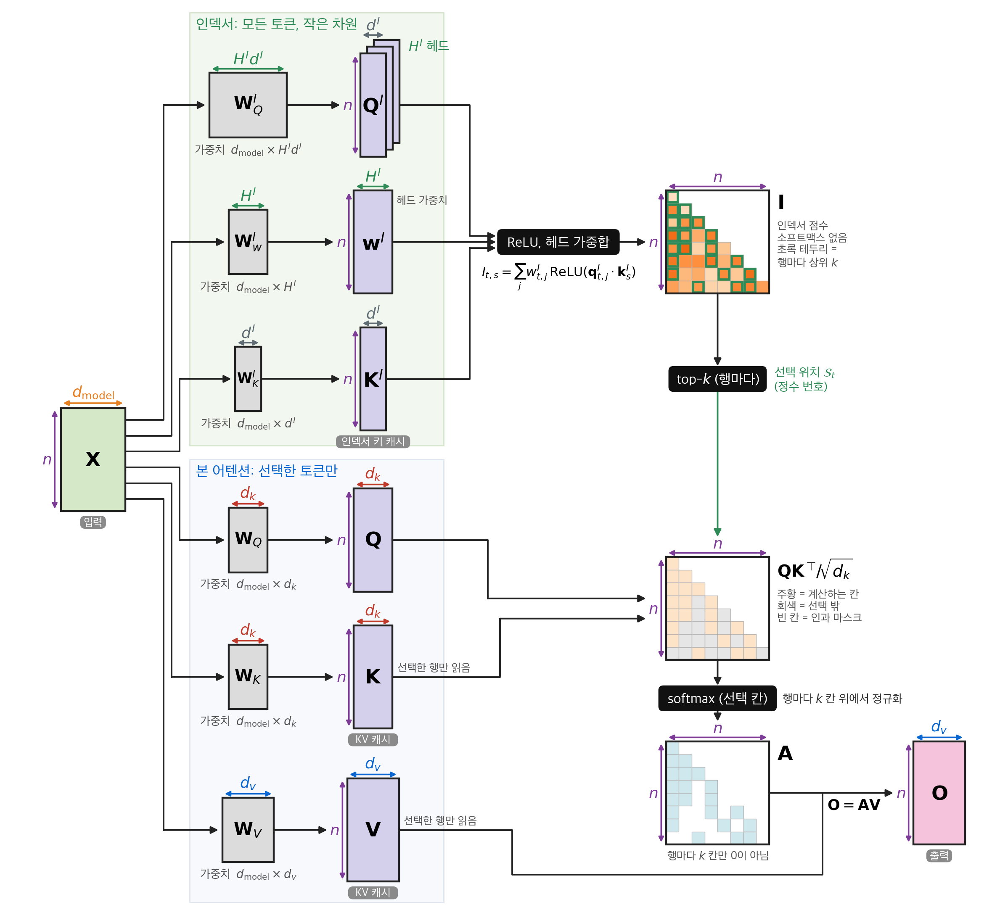
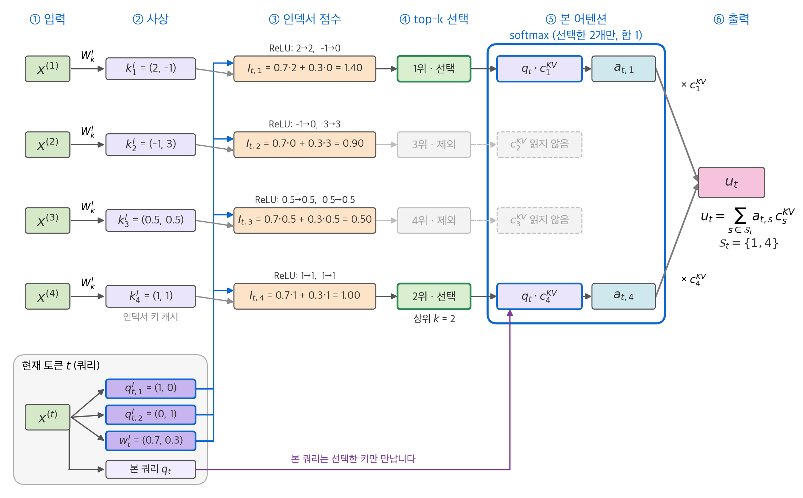
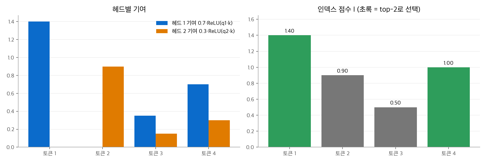
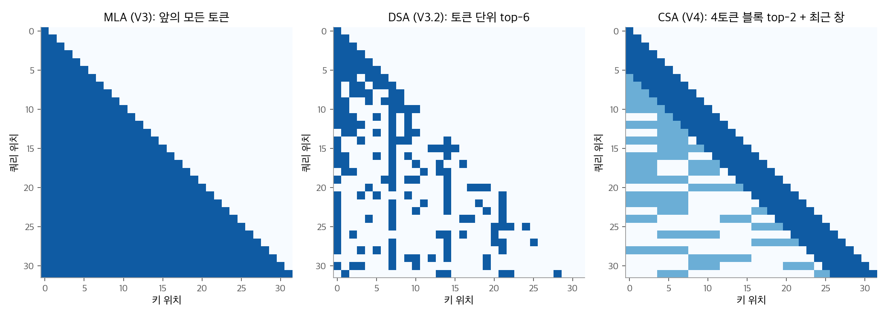
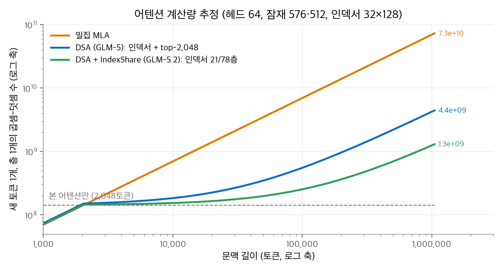
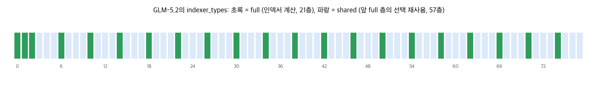
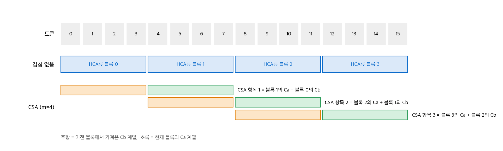
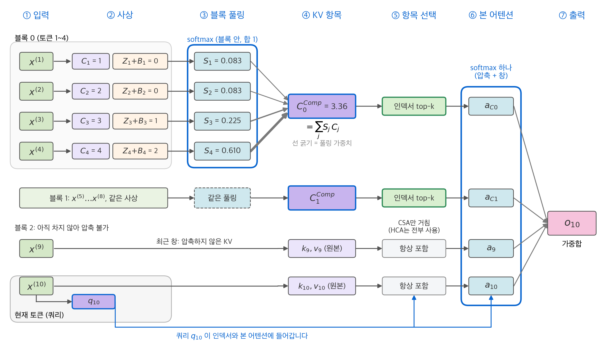
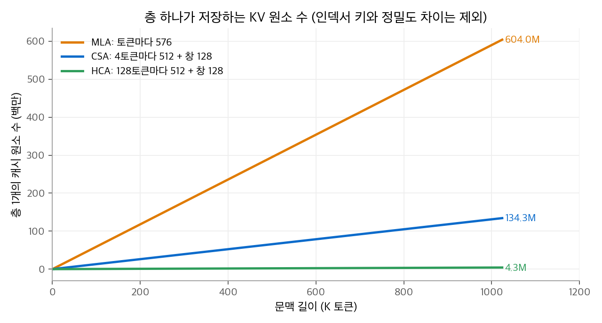

# 6. 희소 어텐션: DSA, IndexShare, 압축 어텐션

[5장](05-mla.md)의 MLA는 토큰 하나를 저장하는 크기를 줄였습니다. 하지만 쿼리는 여전히 앞의 모든 토큰을 봅니다.
128K 문맥이면 새 토큰 하나가 13만 개 잠재 벡터를 모두 읽고 계산합니다. 어텐션은 여전히 $O(n^2)$ 입니다.
이 장은 **읽는 토큰 수**를 줄이는 방법을 다룹니다.

| 방법 | 모델 | 줄이는 대상 |
| --- | --- | --- |
| DSA (DeepSeek Sparse Attention) | DeepSeek-V3.2, GLM-5 | 쿼리마다 상위 $k$ 개 토큰만 봄 |
| IndexShare | GLM-5.2 | 토큰을 고르는 계산을 여러 층이 공유 |
| CSA·HCA (압축 어텐션) | DeepSeek-V4 | 여러 토큰을 KV 항목 하나로 묶음 |

[4장](04-sliding-window.md)의 슬라이딩 창도 읽는 토큰 수를 줄이지만, 어떤 토큰을 볼지가 위치로 미리 정해집니다.
이 장의 방법은 **내용에 따라** 볼 토큰을 고릅니다.

## 1. DSA의 구조

DSA는 두 부분으로 이루어집니다.

1. **라이트닝 인덱서(lightning indexer)**: 작고 빠른 별도 어텐션입니다. 쿼리 토큰과 이전 모든 토큰 사이의 관련도 점수를 계산합니다.
2. **토큰 선택**: 관련도가 높은 상위 $k$ 개 토큰만 골라, 그 토큰의 KV로 본 어텐션을 계산합니다.

<figure markdown>

<figcaption markdown>
<span class="fig-title"><b>Figure 1.</b> 행렬 단위로 본 DSA의 전체 흐름</span>

인덱서가 행마다 상위 $k$ 토큰을 고르고, 본 어텐션은 그 칸만 계산합니다. 본 어텐션은 $O(nk)$ 이지만 인덱서 점수는 여전히 $n \times n$ 입니다.
</figcaption>
</figure>

<figure markdown>

<figcaption markdown>
<span class="fig-title"><b>Figure 2.</b> DSA에서 쿼리 하나가 거치는 흐름</span>

인덱서 점수 상위 2개인 토큰 1과 4만 본 어텐션으로 갑니다. 토큰 2와 3의 KV는 읽지 않습니다.
</figcaption>
</figure>

### 인덱서 수식

$$
I_{t,s} = \sum_{j=1}^{H^I} w_{t,j}^{I}\cdot\operatorname{ReLU}\!\left(\mathbf{q}_{t,j}^{I}\cdot\mathbf{k}_{s}^{I}\right),\qquad
\mathcal{S}_t = \{\, s \mid I_{t,s} \in \operatorname{Top\text{-}k}(I_{t,:}) \,\}
$$

| 기호 | 뜻 | DeepSeek-V3.2 | GLM-5 |
| --- | --- | --- | --- |
| $H^I$ | 인덱서 헤드 수 (`index_n_heads`) | 64 | 32 |
| $\mathbf{q}_{t,j}^I$ | 인덱서 쿼리 (헤드별) | 128차원 | 128차원 |
| $\mathbf{k}_s^I$ | 인덱서 키 (모든 헤드가 공유) | 128차원 | 128차원 |
| $w_{t,j}^I$ | 쿼리 토큰이 정하는 헤드별 가중치 | | |
| $k$ | 고르는 토큰 수 (`index_topk`) | 2,048 | 2,048 |

본 어텐션과 다른 점이 세 가지 있습니다.

- **소프트맥스가 없습니다.** 점수의 순위만 필요하므로 정규화하지 않습니다. 대신 ReLU로 음수를 0으로 자릅니다.
- **헤드 가중치 $w$ 가 쿼리마다 다릅니다.** 어떤 인덱서 헤드의 의견을 얼마나 믿을지 쿼리 토큰이 정합니다.
- **정밀도가 낮습니다.** DeepSeek-V3.2는 인덱서를 FP8로 계산합니다.

인덱서 키 $\mathbf{k}_s^I$ 는 키 헤드가 하나이므로, MQA처럼 토큰당 128개 값만 캐시에 더 저장합니다.

## 2. 손으로 따라가는 예제

인덱서 헤드 2개, 이전 토큰 4개, 고를 개수 $k = 2$ 로 둡니다.

- 헤드 가중치 $w = (0.7,\ 0.3)$
- 인덱서 쿼리 $\mathbf{q}_1 = (1, 0)$, $\mathbf{q}_2 = (0, 1)$
- 인덱서 키 $\mathbf{k}_1 = (2, -1)$, $\mathbf{k}_2 = (-1, 3)$, $\mathbf{k}_3 = (0.5, 0.5)$, $\mathbf{k}_4 = (1, 1)$

**1단계: 헤드별 ReLU 점수.**

| 토큰 $s$ | $\mathbf{q}_1\cdot\mathbf{k}_s$ | ReLU | $\mathbf{q}_2\cdot\mathbf{k}_s$ | ReLU |
| --- | --- | --- | --- | --- |
| 1 | 2 | 2 | −1 | 0 |
| 2 | −1 | 0 | 3 | 3 |
| 3 | 0.5 | 0.5 | 0.5 | 0.5 |
| 4 | 1 | 1 | 1 | 1 |

**2단계: 헤드 가중합.** $I_{t,s} = 0.7a + 0.3b$ 입니다.

$$
I_{t,1} = 1.40,\quad I_{t,2} = 0.90,\quad I_{t,3} = 0.50,\quad I_{t,4} = 1.00
$$

**3단계: 선택.** 상위 2개는 토큰 1(1.40)과 토큰 4(1.00)입니다. 본 어텐션은 이 두 토큰의 KV만 읽습니다.

<figure markdown>

<figcaption markdown>
<span class="fig-title"><b>Figure 3.</b> 인덱서 예제의 헤드별 기여와 선택 결과</span>

토큰 2는 헤드 2의 점수가 높지만, 헤드 가중치가 0.3이라 0.90에 그쳐 선택되지 않습니다.
</figcaption>
</figure>

ReLU가 하는 일도 보입니다. 토큰 1에 대한 헤드 2의 내적은 −1이지만 0으로 잘립니다. 한 헤드가 강하게 반대해도 다른 헤드의 찬성을 깎지 않습니다.

```python
import torch

def indexer_scores(q_idx, w, k_idx):
    """q_idx: (H_I, d_I), w: (H_I,), k_idx: (n, d_I) -> (n,)"""
    return (w[:, None] * torch.relu(q_idx @ k_idx.T)).sum(0)

def sparse_attention(q, K, V, scores, k):
    """본 어텐션: 인덱스 점수 상위 k개 토큰만 봅니다. q: (d,), K·V: (n, d)"""
    top = scores.topk(min(k, len(scores))).indices
    s = K[top] @ q / q.shape[0] ** 0.5
    return torch.softmax(s, -1) @ V[top], top

w = torch.tensor([0.7, 0.3])
q_idx = torch.eye(2)
k_idx = torch.tensor([[2., -1.], [-1., 3.], [0.5, 0.5], [1., 1.]])
I = indexer_scores(q_idx, w, k_idx)
print(I)                                  # tensor([1.4000, 0.9000, 0.5000, 1.0000])
print(I.topk(2).indices.sort().values)    # tensor([0, 3]) -> 토큰 1과 4
```

## 3. 선택한 토큰으로 본 어텐션 계산하기

본 어텐션은 [5장](05-mla.md)의 흡수한 MLA(MQA 모드)입니다. 모든 쿼리 헤드가 같은 잠재 벡터를 공유하므로, **선택도 쿼리 토큰 하나에 한 번만** 하면 됩니다.
헤드마다 다른 토큰을 고르면 헤드마다 다른 메모리 위치를 읽어야 하지만, MQA 모드에서는 고른 2,048개 잠재 벡터를 한 번 읽어 모든 헤드가 씁니다.

$$
\mathbf{u}_t = \operatorname{Attn}\!\left(\mathbf{h}_t,\ \{\mathbf{c}_s^{KV} \mid s \in \mathcal{S}_t\}\right)
$$

문맥이 $k$ 보다 짧으면 모든 토큰이 선택되므로 밀집 어텐션과 같습니다. 문맥이 $k$ 를 넘을 때부터 희소해집니다.

<figure markdown>

<figcaption markdown>
<span class="fig-title"><b>Figure 4.</b> MLA, DSA, CSA의 어텐션 범위</span>

DSA의 선택은 슬라이딩 창과 달리 대각선 근처에 묶이지 않습니다. 선택 위치는 설명을 위해 만든 값입니다.
</figcaption>
</figure>

## 4. 학습 절차: 인덱서를 어떻게 가르치나

인덱서는 처음에 무엇을 골라야 할지 모릅니다. 무작위로 고르면 본 어텐션이 중요한 토큰을 놓칩니다.
DeepSeek-V3.2는 밀집 어텐션으로 학습한 모델에서 출발해 두 단계로 학습했습니다.

**1단계: 밀집 워밍업.** 본 어텐션은 밀집으로 두고, 인덱서 외의 모든 매개변수를 고정합니다.
본 어텐션의 분포를 헤드 방향으로 더한 뒤 정규화해 목표 분포 $p_{t,:}$ 로 삼고, 인덱서의 분포가 이것을 따라가도록 KL 발산을 줄입니다.

$$
\mathcal{L}^{I} = \sum_t D_{\mathrm{KL}}\!\left(p_{t,:}\ \big\|\ \operatorname{Softmax}(I_{t,:})\right),\qquad
p_{t,s} \propto \sum_{h} a_{t,s}^{(h)}
$$

**2단계: 희소 학습.** top-$k$ 선택을 켜고 모델 전체를 학습합니다.
인덱서는 선택된 토큰 집합 $\mathcal{S}_t$ 위에서만 KL 손실을 계속 받습니다. 인덱서 입력은 주 계산 그래프에서 분리(detach)해서, 인덱서 손실이 본 모델로 흐르지 않게 합니다.

| 단계 | DeepSeek-V3.2 | GLM-5 |
| --- | --- | --- |
| 밀집 워밍업 | 1,000스텝 × 128K 시퀀스 16개 ≈ 2.1B 토큰 | 1,000스텝 × 202,752토큰 시퀀스 14개 ≈ 2.8B 토큰 |
| 희소 학습 | 15,000스텝 × 128K 시퀀스 480개 ≈ 943.7B 토큰 | 20B 토큰 |

GLM-5는 중간 학습(mid-training)이 끝난 밀집 MLA 모델에 DSA를 붙였고, DeepSeek의 약 1/47 토큰만 썼습니다.
GLM-5 보고서의 128K 평가에서 DSA는 밀집 MLA와 비슷했습니다(MV-NIAH 97.0 대 95.5, SQuAD 86.0 대 79.7, HotpotQA 63.0 대 66.3).

같은 보고서는 두 단계가 모두 필요하다는 소규모 실험도 실었습니다. GLM-4.7-Flash에서 128K RULER 점수는 다음과 같았습니다.

| 설정 | RULER (128K) |
| --- | --- |
| 밀집 기준 모델 | 79.21 |
| 워밍업만 (인덱서만 학습, 1,000스텝) | 71.35 |
| 워밍업 + 희소 학습 (150B 토큰) | 78.86 |

인덱서만 맞춰서는 부족합니다. 본 모델도 "고른 토큰만 보는" 조건에 적응해야 합니다.
강화 학습 단계에서 GLM-5는 인덱서를 고정하고, top-$k$ 를 결정적으로 계산합니다(`torch.topk`). 같은 입력이면 항상 같은 토큰을 고릅니다.

## 5. 계산량 분석

새 토큰 하나, 층 하나의 곱셈-덧셈 수를 대략 계산합니다. 흡수한 MLA는 헤드마다 576차원 내적과 512차원 가중합을 합니다.

$$
\text{밀집 MLA} = n \cdot n_h \cdot 1088,\qquad
\text{DSA} = \underbrace{n \cdot H^I \cdot 128}_{\text{인덱서}} + \underbrace{k \cdot n_h \cdot 1088}_{\text{본 어텐션}}
$$

| 설정 | 문맥 | 밀집 MLA | DSA | 비율 |
| --- | --- | --- | --- | --- |
| DeepSeek-V3.2 ($n_h = 128$, $H^I = 64$) | 128K | $1.83 \times 10^{10}$ | $1.07 \times 10^{9} + 2.85 \times 10^{8} = 1.36 \times 10^{9}$ | 13.4배 |
| GLM-5 ($n_h = 64$, $H^I = 32$) | 1M | $7.30 \times 10^{10}$ | $4.29 \times 10^{9} + 1.43 \times 10^{8} = 4.44 \times 10^{9}$ | 16.5배 |

이 추정에는 정밀도 차이(인덱서는 FP8), 사상, FFN이 빠져 있습니다. GLM-5 보고서는 긴 시퀀스에서 어텐션 계산이 약 1.5~2배 줄어든다고 추정했습니다.
위 표보다 훨씬 작은 이유는 보고서의 수치가 사상과 FFN처럼 줄지 않는 비용을 포함하기 때문으로 보입니다.

표에서 중요한 것은 두 항의 비율입니다. GLM-5에서 100만 토큰이면 **인덱서가 본 어텐션의 30배**입니다.
DSA는 본 어텐션을 $O(nk)$ 로 줄였지만, 인덱서는 여전히 $O(n^2)$ 입니다. 문맥이 길수록 인덱서가 비용을 지배합니다.

<figure markdown>

<figcaption markdown>
<span class="fig-title"><b>Figure 5.</b> 문맥 길이별 어텐션 계산량 추정</span>

약 2,000토큰 이후 본 어텐션 비용은 고정되고, DSA의 증가분은 모두 인덱서에서 나옵니다(GLM-5 설정 추정).
</figcaption>
</figure>

## 6. IndexShare: 인덱서를 층 사이에서 공유하기

### 관찰: 인접한 층은 비슷한 토큰을 고릅니다

IndexCache 연구는 인접한 DSA 층이 고르는 토큰이 70~100% 겹친다고 측정했습니다.
층마다 인덱서를 따로 계산해도 결과가 거의 같다면, 한 층에서 계산하고 나머지 층은 그 결과를 다시 써도 됩니다.

### 작동 방식

GLM-5.2의 **IndexShare**는 층을 full 층과 shared 층으로 나눕니다.

$$
\mathcal{S}_t^{(\ell)} =
\begin{cases}
\operatorname{Top\text{-}k}\big(I_{t,:}^{(\ell)}\big) & \ell \text{이 full 층} \\
\mathcal{S}_t^{(\ell')} & \ell \text{이 shared 층}, \ \ell' = \ell \text{ 앞의 가장 가까운 full 층}
\end{cases}
$$

1. full 층은 자기 인덱서로 top-2,048을 계산합니다.
2. shared 층은 인덱서를 계산하지 않고, 앞 full 층이 고른 **토큰 번호**를 그대로 씁니다.
3. shared 층도 자기 쿼리, 자기 KV, 자기 출력 사상으로 본 어텐션을 계산합니다. 공유하는 것은 정수 번호뿐입니다.

<figure markdown>

<figcaption markdown>
<span class="fig-title"><b>Figure 6.</b> GLM-5.2의 층별 인덱서 배치</span>

78층 중 21층만 인덱서를 계산합니다. 처음 세 층 뒤로는 full 하나, shared 셋이 반복됩니다.
</figcaption>
</figure>

### 계산량

인덱서 비용이 21/78로 줄어듭니다. 5절의 식에 대입하면 100만 토큰에서 층 평균은 다음과 같습니다.

| 방식 | 층 평균 곱셈-덧셈 수 (새 토큰 1개) |
| --- | --- |
| 밀집 MLA | $7.3 \times 10^{10}$ |
| DSA (GLM-5) | $4.4 \times 10^{9}$ |
| DSA + IndexShare (GLM-5.2) | $4.29 \times 10^9 \times \tfrac{21}{78} + 1.43 \times 10^8 \approx 1.3 \times 10^{9}$ |

어텐션만 보면 DSA 대비 약 3.4배 줄어듭니다. Z.ai는 100만 토큰에서 토큰당 FLOPs가 2.9배 줄었다고 발표했습니다. 줄지 않는 다른 비용이 포함되어 차이가 나는 것으로 보입니다.

IndexShare에는 한계도 있습니다.

- **KV 캐시는 줄지 않습니다.** 모든 층이 여전히 자기 KV와 인덱서 키를 가집니다. 계산을 줄이는 방법입니다.
- **학습 중에 넣어야 합니다.** GLM-5.2는 128K 시퀀스로 중간 학습을 이어 가면서 IndexShare를 넣었습니다. 학습된 모델에 추론 때만 붙인 것이 아닙니다.

별도 모델(30B, 200K 문맥)로 인덱서의 1/4만 남긴 IndexCache 실험은 프롬프트 처리 최대 1.82배, 생성 최대 1.48배 속도 향상을 보고했습니다.

## 7. 압축 어텐션의 동기

DSA는 토큰 단위로 고릅니다. DeepSeek-V4는 다른 방향을 택했습니다. **여러 토큰을 KV 항목 하나로 묶어서** 시퀀스 길이 자체를 줄입니다.
MLA가 토큰 하나의 표현(차원)을 압축했다면, V4는 시퀀스 방향을 압축합니다. 두 종류의 층을 교차합니다.

| 층 | 압축 비율 | 어텐션 방식 | 최근 창 |
| --- | --- | --- | --- |
| **CSA** (Compressed Sparse Attention) | $m = 4$ 토큰 → 1항목, 이웃 블록과 겹침 | 인덱서로 압축 항목 top-$k$ 선택 (V4-Pro $k = 1{,}024$) | 128토큰 |
| **HCA** (Heavily Compressed Attention) | $m' = 128$ 토큰 → 1항목, 겹침 없음 | 압축 항목 전체를 밀집으로 봄 | 128토큰 |

V4-Pro 설정의 `compress_ratios` 는 61층 중 처음 두 층을 HCA(128)로 두고, 그 뒤로 CSA(4)와 HCA(128)를 번갈아 둡니다.

## 8. 압축 연산과 최근 창

### HCA: 겹치지 않는 가중 풀링

토큰마다 KV 후보 $\mathbf{C}_j$ 와 압축 가중치 $\mathbf{Z}_j$ 를 사상으로 만듭니다.
블록 안 $m'$ 개 토큰에 대해 채널마다 소프트맥스를 취하고 가중합합니다. $\mathbf{B}$ 는 블록 안 위치별로 학습하는 편향입니다.

$$
\mathbf{S}_{m'i:m'(i+1)-1} = \operatorname{Softmax}_{\text{row}}\!\left(\mathbf{Z}_{m'i:m'(i+1)-1} + \mathbf{B}\right),\qquad
\mathbf{C}_i^{\text{Comp}} = \sum_{j=m'i}^{m'(i+1)-1}\mathbf{S}_j\odot\mathbf{C}_j
$$

**예제.** 블록 크기 4, 스칼라 KV $\mathbf{C} = (1, 2, 3, 4)$, 가중치 $\mathbf{Z} + \mathbf{B} = (0, 0, 1, 2)$ 로 둡니다.

$$
\operatorname{softmax}(0, 0, 1, 2) = (0.083,\ 0.083,\ 0.225,\ 0.610),\qquad
\mathbf{C}^{\text{Comp}} = 0.083 + 0.166 + 0.674 + 2.440 \approx 3.36
$$

단순 평균이면 2.5입니다. 가중치를 학습하므로, 블록 안에서 중요한 토큰을 더 많이 남길 수 있습니다.

### CSA: 이웃 블록과 겹치는 풀링

CSA는 KV 계열을 두 개($\mathbf{C}^a, \mathbf{C}^b$) 만들고, 블록 $i$ 의 항목을 **현재 블록의 $\mathbf{C}^a$ 와 이전 블록의 $\mathbf{C}^b$** 에서 함께 모읍니다. 소프트맥스는 $2m$ 개 항목 위에서 계산합니다.

$$
[\mathbf{S}^a_{mi:m(i+1)-1};\ \mathbf{S}^b_{m(i-1):mi-1}] = \operatorname{Softmax}_{\text{row}}\!\left([\mathbf{Z}^a_{mi:m(i+1)-1} + \mathbf{B}^a;\ \mathbf{Z}^b_{m(i-1):mi-1} + \mathbf{B}^b]\right)
$$

$$
\mathbf{C}^{\text{Comp}}_i = \sum_{j=mi}^{m(i+1)-1}\mathbf{S}^a_j\odot\mathbf{C}^a_j + \sum_{j=m(i-1)}^{mi-1}\mathbf{S}^b_j\odot\mathbf{C}^b_j
$$

**예제.** $m = 2$ 로 줄입니다. 블록 1(토큰 2, 3)의 항목은 $\mathbf{C}^a_2 = 3$, $\mathbf{C}^a_3 = 4$ 와 블록 0(토큰 0, 1)의 $\mathbf{C}^b_0 = 10$, $\mathbf{C}^b_1 = 20$ 을 모읍니다.
가중치가 모두 같으면 소프트맥스는 각 1/4이고, 항목은 $(3 + 4 + 10 + 20)/4 = 9.25$ 입니다.

<figure markdown>

<figcaption markdown>
<span class="fig-title"><b>Figure 7.</b> HCA와 CSA의 블록 구성</span>

CSA 항목은 현재 블록과 이전 블록을 함께 봐서 8개 토큰에 걸칩니다. 그래서 블록 경계의 정보가 덜 잘립니다.
</figcaption>
</figure>

압축이 끝나면 CSA는 2절과 같은 구조의 인덱서로 압축 항목을 고릅니다. V4 보고서에 따르면 이 인덱서는 FP4로 계산합니다.

### 최근 창

쿼리는 자기 토큰이 속한 블록이 다 차기 전에는 그 블록의 압축 항목을 볼 수 없습니다. 바로 앞 몇 토큰을 못 보면 문장을 이어 쓸 수 없습니다.
그래서 두 층 모두 최근 128토큰의 **압축하지 않은** KV를 함께 봅니다(`sliding_window: 128`). 압축 항목과 창 항목은 한 소프트맥스 안에서 함께 계산합니다.
[4장](04-sliding-window.md)의 로컬 어텐션과 같은 역할이지만, 별도 층이 아니라 같은 층의 한 갈래입니다.

<figure markdown>

<figcaption markdown>
<span class="fig-title"><b>Figure 8.</b> 압축 어텐션에서 쿼리 하나가 거치는 흐름</span>

블록 4토큰이 가중 풀링으로 항목 하나(3.36)가 되고, 압축 항목과 최근 창 항목이 소프트맥스 하나에 함께 들어갑니다.
</figcaption>
</figure>

### 공유 KV와 캐시 크기

V4의 압축 항목 하나(512차원)는 128개 쿼리 헤드가 키와 값으로 함께 씁니다(`num_key_value_heads: 1`). [5장](05-mla.md)의 흡수한 MLA처럼 MQA 모양입니다.
층 하나가 저장하는 원소 수를 비교합니다.

$$
\text{MLA} = 576\,n,\qquad
\text{CSA} = 512\left\lceil \tfrac{n}{4} \right\rceil + 512 \cdot \min(n, 128),\qquad
\text{HCA} = 512\left\lceil \tfrac{n}{128} \right\rceil + 512 \cdot \min(n, 128)
$$

<figure markdown>

<figcaption markdown>
<span class="fig-title"><b>Figure 9.</b> 층 하나가 저장하는 KV 원소 수</span>

100만 토큰에서 층 하나의 저장 원소는 MLA 약 6억 개, CSA 약 1억 3천만 개, HCA 약 430만 개입니다.
</figcaption>
</figure>

V4 보고서는 100만 토큰 문맥에서 DeepSeek-V3.2 대비 다음과 같이 보고합니다.

| 모델 | 토큰 하나 생성 FLOPs | KV 캐시 |
| --- | --- | --- |
| V4-Pro | 27% | 10% |
| V4-Flash | 10% | 7% |

BF16, KV 헤드 8개, 헤드 차원 128인 GQA와 비교하면 KV 캐시가 약 2%입니다.
다만 보고서에는 CSA와 HCA 각각의 효과를 분리한 절제 실험이 없습니다. 어느 장치가 얼마나 기여했는지는 공개 자료로 판단하기 어렵습니다.
V4는 이 밖에도 쿼리·KV RMSNorm, 헤드별 싱크 로짓, 출력 쪽 부분 RoPE를 씁니다. 싱크 로짓은 [8장](08-attention-sink-gating.md), 정규화는 [정규화 장](../llm-techniques/03-normalization.md)에서 다룹니다.

## 9. 세 방법 비교

| 질문 | DSA | DSA + IndexShare | CSA·HCA |
| --- | --- | --- | --- |
| 무엇을 고르나 | 토큰 단위 top-2,048 | 토큰 단위, 4층마다 한 번 계산 | 압축 블록 단위 (CSA) 또는 전체 블록 (HCA) |
| 본 어텐션 비용 | $O(nk)$ | $O(nk)$ | CSA $O(nk)$, HCA $O(n^2/128)$ |
| 고르는 비용 | $O(n^2)$ 인덱서, 모든 층 | $O(n^2)$ 인덱서, 21/78층 | CSA는 $O(n^2/4)$ 인덱서 |
| KV 캐시 | 줄지 않음 (+인덱서 키) | 줄지 않음 | 4배·128배 압축 |
| 원래 토큰을 그대로 보나 | 예 (고른 토큰은 손실 없음) | 예 | 아니요 (압축 항목) + 최근 128토큰 |

GLM-5 보고서는 DSA를 고른 이유로 마지막 줄을 들었습니다. 인덱서가 맞는 토큰을 고르기만 하면, 본 어텐션은 원래 KV를 그대로 보므로 정보 손실이 없습니다.
V4는 압축으로 손실을 감수하는 대신 KV 캐시까지 줄였습니다.

## 정리

- DSA는 작은 인덱서(ReLU 점수, 헤드 가중합)로 쿼리마다 2,048개 토큰을 고르고, 본 어텐션은 그 토큰만 계산합니다.
- 인덱서는 밀집 어텐션 분포를 KL 발산으로 따라가도록 학습하고, 이어서 희소 조건에서 모델 전체를 적응시킵니다.
- 긴 문맥에서는 $O(n^2)$ 인덱서가 비용을 지배합니다. IndexShare는 인접 층의 선택이 비슷하다는 점을 이용해 인덱서를 21/78층에서만 계산합니다.
- DeepSeek-V4의 CSA·HCA는 시퀀스 방향으로 4배·128배 압축하고, 최근 128토큰은 압축하지 않은 채로 봅니다.

[7장](07-linear-attention.md)은 KV 캐시 자체를 고정 크기 상태로 바꾸는 선형 어텐션을 다룹니다.
이 방법들을 쓰는 모델은 트렌드의 [DeepSeek](../../trends/posts/2026-10-20-llm-deepseek.md)과 [GLM](../../trends/posts/2026-10-20-llm-glm.md) 글에서 정리합니다.

## 참고 자료

- DeepSeek-AI, [DeepSeek-V3.2: Pushing the Frontier of Open Large Language Models](https://arxiv.org/abs/2512.02556), 2025.
- DeepSeek-AI, [DeepSeek-V4: Towards Highly Efficient Million-Token Context Intelligence](https://arxiv.org/abs/2606.19348), 2026.
- GLM-5 Team, [GLM-5: from Vibe Coding to Agentic Engineering](https://arxiv.org/abs/2602.15763), 2026.
- Sebastian Raschka, [GLM-5.2 and IndexShare for Long-Context Sparse Attention](https://www.sebastianraschka.com/blog/2026/glm-5-2-indexshare.html), 2026.
- DeepSeek-V3.2 [config.json](https://huggingface.co/deepseek-ai/DeepSeek-V3.2/blob/main/config.json), DeepSeek-V4-Pro [config.json](https://huggingface.co/deepseek-ai/DeepSeek-V4-Pro/blob/main/config.json), GLM-5 [config.json](https://huggingface.co/zai-org/GLM-5/blob/main/config.json), GLM-5.2 [config.json](https://huggingface.co/zai-org/GLM-5.2/blob/main/config.json).
