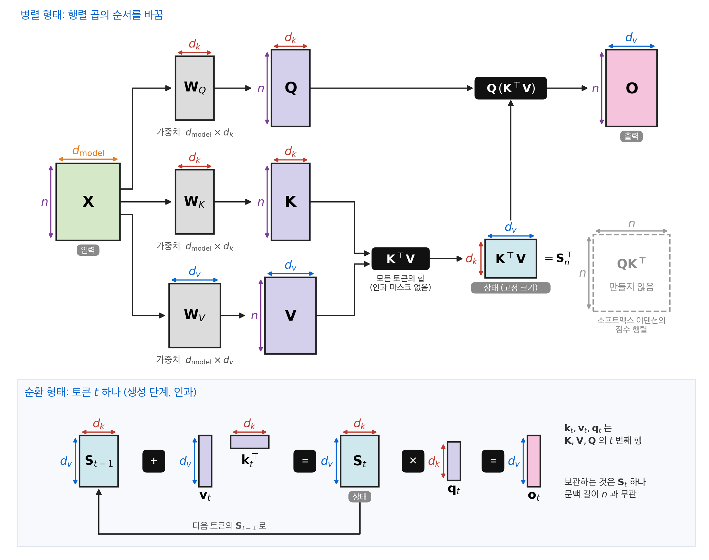
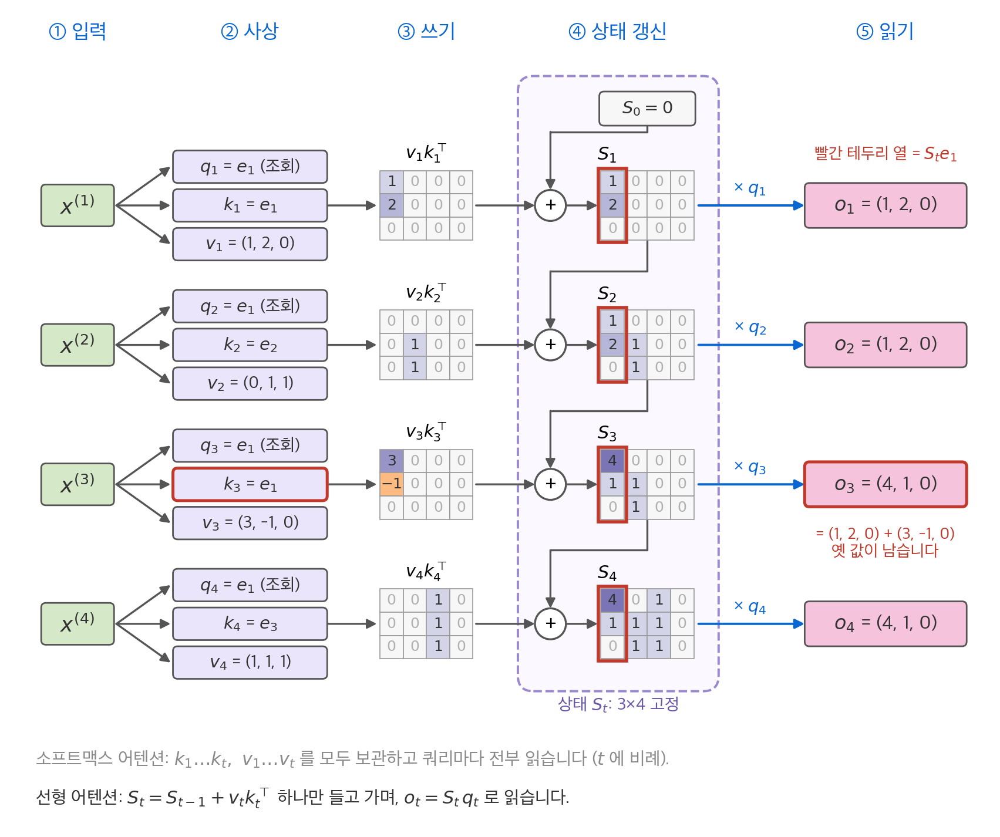
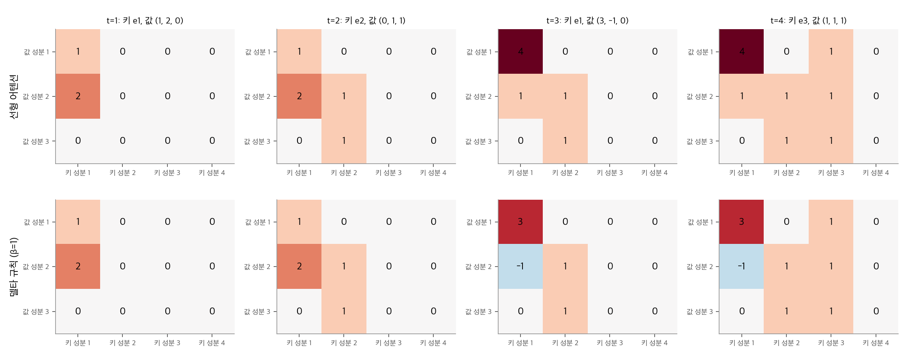
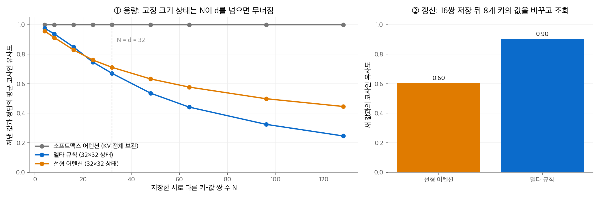
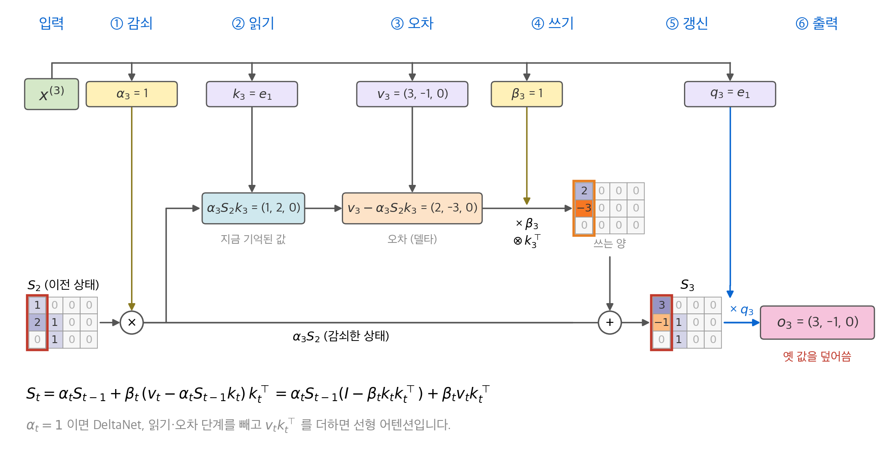
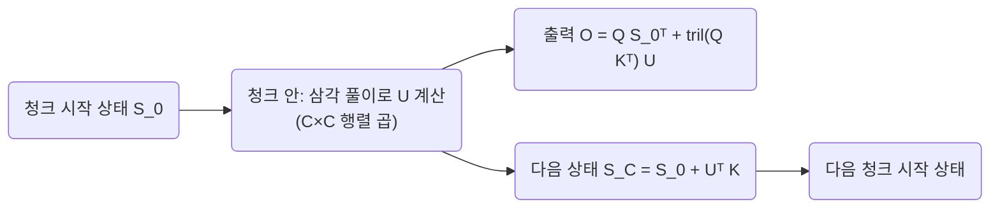
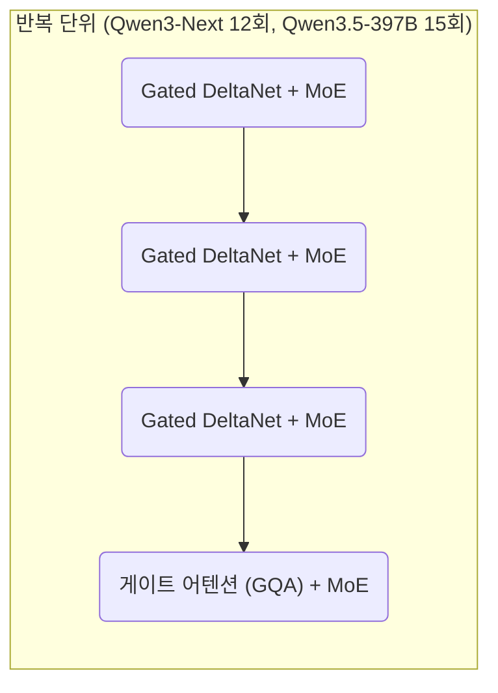
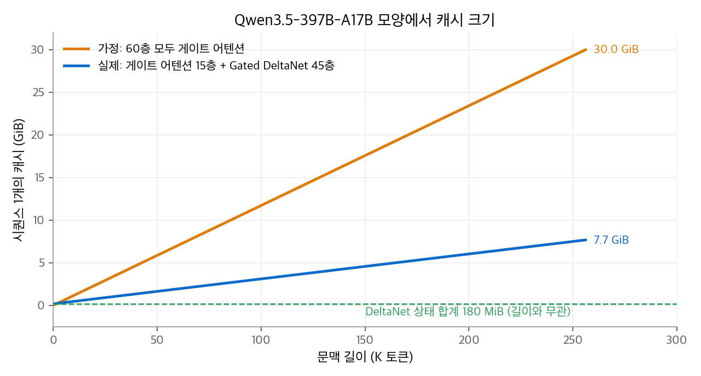

# 7. 선형 어텐션과 Gated DeltaNet

[3장](03-mqa-gqa.md)부터 [6장](06-sparse-attention.md)까지의 방법은 모두 KV 캐시를 **작게** 만들었습니다. 하지만 캐시는 여전히 문맥 길이에 비례해 자랍니다.
이 장은 캐시를 **고정 크기 상태 하나**로 바꾸는 방법을 다룹니다. 소프트맥스를 빼면 어텐션은 순환 신경망(RNN)처럼 다시 쓸 수 있습니다.
여기에 "덮어쓰기"를 가능하게 하는 델타 규칙과 망각 게이트를 더한 것이 **Gated DeltaNet**입니다. Qwen3-Next와 Qwen3.5는 층의 3/4을 Gated DeltaNet으로 씁니다.

## 1. 소프트맥스를 빼면 순환이 됩니다

[1장](01-scaled-dot-product.md)의 인과 어텐션 출력은 다음과 같습니다.

$$
\mathbf{o}_t = \sum_{j \le t} a_{tj}\,\mathbf{v}_j,\qquad a_{tj} = \frac{\exp(\mathbf{q}_t^\top\mathbf{k}_j/\sqrt{d})}{\sum_{l \le t}\exp(\mathbf{q}_t^\top\mathbf{k}_l/\sqrt{d})}
$$

소프트맥스는 $\mathbf{q}_t$ 와 $\mathbf{k}_j$ 를 지수 함수 안에서 묶습니다. 그래서 $\mathbf{q}_t$ 가 정해져야 합을 계산할 수 있고, 이전 키를 모두 보관해야 합니다.
소프트맥스를 빼고 점수를 $\mathbf{q}_t^\top\mathbf{k}_j$ 그대로 쓰면 식을 다시 묶을 수 있습니다.

$$
\mathbf{o}_t = \sum_{j \le t} \mathbf{v}_j\,(\mathbf{k}_j^\top\mathbf{q}_t) = \Big(\underbrace{\sum_{j \le t} \mathbf{v}_j\mathbf{k}_j^\top}_{\mathbf{S}_t}\Big)\mathbf{q}_t
$$

괄호 안은 $\mathbf{q}_t$ 와 무관합니다. 그래서 한 토큰씩 갱신할 수 있습니다.

$$
\mathbf{S}_t = \mathbf{S}_{t-1} + \mathbf{v}_t\mathbf{k}_t^\top,\qquad \mathbf{o}_t = \mathbf{S}_t\,\mathbf{q}_t
$$

$\mathbf{S}_t \in \mathbb{R}^{d_v \times d_k}$ 는 크기가 고정된 **상태(state)**입니다. 이것이 **선형 어텐션(linear attention)**입니다.

<figure markdown>

<figcaption markdown>
<span class="fig-title"><b>Figure 1.</b> 행렬 단위로 본 선형 어텐션의 전체 흐름</span>

선형 어텐션은 $n \times n$ 점수 행렬 대신 $d_v \times d_k$ 상태 하나를 씁니다. 그래서 메모리와 토큰당 계산량이 문맥 길이와 무관합니다.
</figcaption>
</figure>

<figure markdown>

<figcaption markdown>
<span class="fig-title"><b>Figure 2.</b> 선형 어텐션의 순환 흐름</span>

토큰마다 $\mathbf{v}_t\mathbf{k}_t^\top$ 를 상태에 더하고, 쿼리는 상태만 읽습니다. 같은 키에 새 값을 쓰면 옛 값과 더해집니다.
</figcaption>
</figure>

| 항목 | 소프트맥스 어텐션 | 선형 어텐션 |
| --- | --- | --- |
| 생성 단계에 보관하는 것 | 이전 모든 토큰의 K, V ($O(n)$) | 상태 $\mathbf{S}$ 하나 ($d_v \times d_k$) |
| 토큰 하나의 비용 | $O(n d)$ | $O(d_k d_v)$, 문맥 길이와 무관 |
| 학습 때 계산 | $O(n^2 d)$ | 병렬 형태 $O(n^2 d)$ 또는 순환 형태 $O(n d^2)$ |

같은 결과를 두 형태로 계산할 수 있습니다. 병렬 형태는 인과 마스크를 건 $(\mathbf{Q}\mathbf{K}^\top)\mathbf{V}$ 이고, 순환 형태는 위 갱신식입니다.

```python
import torch
torch.manual_seed(0)
n, dk, dv = 6, 4, 3
Q, K, V = torch.randn(n, dk), torch.randn(n, dk), torch.randn(n, dv)

# 병렬 형태: 인과 마스크를 건 (Q K^T) V, 소프트맥스 없음
O_par = torch.tril(Q @ K.T) @ V

# 순환 형태: 상태 S (dv x dk)를 한 토큰씩 갱신
S, O_rec = torch.zeros(dv, dk), []
for t in range(n):
    S = S + torch.outer(V[t], K[t])
    O_rec.append(S @ Q[t])
print(torch.allclose(O_par, torch.stack(O_rec), atol=1e-5))   # True
```

### 커널 관점

소프트맥스 어텐션은 유사도 함수 $\operatorname{sim}(\mathbf{q}, \mathbf{k}) = \exp(\mathbf{q}^\top\mathbf{k}/\sqrt{d})$ 로 가중 평균을 내는 것입니다.
유사도를 특징 사상 $\phi$ 의 내적 $\phi(\mathbf{q})^\top\phi(\mathbf{k})$ 로 바꾸면 같은 재배열이 가능합니다.

$$
\mathbf{o}_t = \frac{\sum_{j \le t}\mathbf{v}_j\,\phi(\mathbf{k}_j)^\top\phi(\mathbf{q}_t)}{\sum_{j \le t}\phi(\mathbf{k}_j)^\top\phi(\mathbf{q}_t)}
= \frac{\mathbf{S}_t\,\phi(\mathbf{q}_t)}{\mathbf{z}_t^\top\phi(\mathbf{q}_t)},\qquad
\mathbf{z}_t = \sum_{j \le t}\phi(\mathbf{k}_j)
$$

Katharopoulos et al.(2020)은 $\phi(x) = \operatorname{elu}(x) + 1$ 을 써서 가중치가 양수가 되게 했습니다.
지수 함수는 무한 차원 특징 사상에 해당하므로 유한한 $\phi$ 로는 정확히 흉내 낼 수 없습니다. 선형 어텐션은 처음부터 다른 함수입니다.
최근 방법(Gated DeltaNet 포함)은 분모를 없애고, 대신 쿼리와 키를 L2 정규화해 크기를 맞춥니다.

## 2. 문제: 덮어쓰지 못하는 기억

상태 $\mathbf{S} = \sum_j \mathbf{v}_j\mathbf{k}_j^\top$ 는 키-값 쌍을 저장하는 **연상 기억(associative memory)**으로 볼 수 있습니다.
키가 서로 직교하고 길이가 1이면, $\mathbf{S}\mathbf{k}_i = \mathbf{v}_i$ 로 정확히 꺼낼 수 있습니다.
문제는 더하기만 한다는 점입니다. 같은 키로 새 값을 저장해도 옛 값이 지워지지 않습니다.

**예제.** $d_k = 4$, $d_v = 3$, $\mathbf{S}_0 = \mathbf{0}$ 입니다. 키는 표준 기저 $\mathbf{e}_1, \mathbf{e}_2, \mathbf{e}_1, \mathbf{e}_3$ 순서로 들어옵니다. 세 번째 토큰은 첫 번째와 **같은 키**에 새 값을 저장합니다.

| $t$ | 키 | 값 | 선형 어텐션의 $\mathbf{S}_t\mathbf{e}_1$ |
| --- | --- | --- | --- |
| 1 | $\mathbf{e}_1$ | $(1, 2, 0)$ | $(1, 2, 0)$ |
| 2 | $\mathbf{e}_2$ | $(0, 1, 1)$ | $(1, 2, 0)$ |
| 3 | $\mathbf{e}_1$ | $(3, -1, 0)$ | $(4, 1, 0)$ |
| 4 | $\mathbf{e}_3$ | $(1, 1, 1)$ | $(4, 1, 0)$ |

3단계 뒤 $\mathbf{e}_1$ 로 조회하면 $(4, 1, 0) = (1, 2, 0) + (3, -1, 0)$ 이 나옵니다. 최신 값 $(3, -1, 0)$ 이 아니라 두 값의 합입니다.

## 3. 델타 규칙: 오차만큼 고치기

**DeltaNet**은 저장하기 전에 현재 상태가 이 키로 무엇을 돌려주는지 먼저 봅니다. 그리고 목표 값과의 차이(델타)만큼만 고칩니다.

$$
\mathbf{S}_t = \mathbf{S}_{t-1} + \beta_t\,(\mathbf{v}_t - \mathbf{S}_{t-1}\mathbf{k}_t)\,\mathbf{k}_t^\top
= \mathbf{S}_{t-1}\big(\mathbf{I} - \beta_t\mathbf{k}_t\mathbf{k}_t^\top\big) + \beta_t\mathbf{v}_t\mathbf{k}_t^\top
$$

$\beta_t \in (0, 1)$ 은 토큰이 정하는 쓰기 강도입니다.

### 경사 하강 해석

상태 $\mathbf{S}$ 가 "키 $\mathbf{k}_t$ 를 넣으면 $\mathbf{v}_t$ 를 내놓는" 선형 함수가 되기를 원한다고 봅니다. 손실을 다음처럼 둡니다.

$$
\mathcal{L}_t(\mathbf{S}) = \tfrac{1}{2}\,\|\mathbf{S}\mathbf{k}_t - \mathbf{v}_t\|^2,\qquad
\nabla_{\mathbf{S}}\mathcal{L}_t = (\mathbf{S}\mathbf{k}_t - \mathbf{v}_t)\,\mathbf{k}_t^\top
$$

학습률 $\beta_t$ 로 경사 하강 한 단계를 밟으면 $\mathbf{S}_t = \mathbf{S}_{t-1} - \beta_t\nabla\mathcal{L}_t(\mathbf{S}_{t-1})$ 이고, 이것이 정확히 델타 규칙입니다.
선형 어텐션은 손실 $-\mathbf{v}_t^\top\mathbf{S}\mathbf{k}_t$ 에 대한 경사 하강과 같습니다. 이 손실은 이미 맞게 기억한 쌍도 계속 키우려 합니다.

### 같은 예제를 델타 규칙으로

$\beta = 1$ 로 2절의 예제를 다시 계산합니다. 3단계에서 오차를 먼저 구합니다.

$$
\mathbf{S}_2\mathbf{e}_1 = (1, 2, 0),\qquad
\mathbf{v}_3 - \mathbf{S}_2\mathbf{e}_1 = (3, -1, 0) - (1, 2, 0) = (2, -3, 0)
$$

이 오차를 $\mathbf{e}_1$ 열에 더하면 열이 $(3, -1, 0)$ 이 됩니다. 옛 값을 덮어썼습니다.

<figure markdown>

<figcaption markdown>
<span class="fig-title"><b>Figure 3.</b> 선형 어텐션과 델타 규칙의 상태 변화</span>

$t = 3$ 에서 선형 어텐션은 첫째 열이 $(4, 1, 0)$ 으로 쌓이고, 델타 규칙은 $(3, -1, 0)$ 으로 덮어씁니다.
</figcaption>
</figure>

키가 직교하지 않으면 한 쌍을 고칠 때 다른 쌍도 조금 흔들립니다. 그래도 델타 규칙은 매번 "지금 키에 대한 오차"를 줄이므로, 최근에 쓴 값을 정확히 꺼내는 데 강합니다.

<figure markdown>

<figcaption markdown>
<span class="fig-title"><b>Figure 4.</b> 연상 회상 실험</span>

저장한 쌍이 $d = 32$ 를 넘으면 고정 크기 상태의 정확도가 떨어집니다. 값을 고쳐 쓰면 델타 규칙(0.90)이 선형 어텐션(0.60)보다 정확합니다.
</figcaption>
</figure>

왼쪽 그림에서 $N > d$ 일 때 델타 규칙의 평균이 더 낮은 점도 봐 둡니다. 델타 규칙은 최근 쌍을 정확히 남기는 대신 오래된 쌍을 더 많이 지웁니다.
어느 쪽이든 $d_k \times d_v$ 상태에 담을 수 있는 정보에는 한계가 있습니다. 이것이 6절의 하이브리드 구조가 필요한 이유입니다.

## 4. Gated DeltaNet: 망각 게이트 더하기

델타 규칙은 지금 키 방향의 기억만 고칩니다. 문맥이 바뀌어 기억 전체를 비워야 할 때는 느립니다.
**Gated DeltaNet**(Yang et al., 2024)은 Mamba2의 감쇠 게이트 $\alpha_t \in (0, 1)$ 를 더합니다.

$$
\mathbf{S}_t = \alpha_t\,\mathbf{S}_{t-1}\big(\mathbf{I} - \beta_t\mathbf{k}_t\mathbf{k}_t^\top\big) + \beta_t\mathbf{v}_t\mathbf{k}_t^\top,\qquad
\mathbf{o}_t = \mathbf{S}_t\mathbf{q}_t
$$

| 게이트 값 | 동작 |
| --- | --- |
| $\alpha_t \to 0$ | 기억 전체를 빠르게 지웁니다. |
| $\alpha_t \to 1$, $\beta_t \to 0$ | 기억을 그대로 둡니다. |
| $\alpha_t \to 1$, $\beta_t \to 1$ | 키 $\mathbf{k}_t$ 자리만 $\mathbf{v}_t$ 로 정확히 덮어씁니다. |

<figure markdown>

<figcaption markdown>
<span class="fig-title"><b>Figure 5.</b> Gated DeltaNet의 한 토큰 갱신 흐름</span>

감쇠, 읽기, 오차 계산, 쓰기 순서로 갱신합니다. 오차만큼 고쳐 써서 첫째 열이 $(3, -1, 0)$ 으로 덮어써집니다.
</figcaption>
</figure>

### Qwen3-Next 구현의 세부

Hugging Face Transformers의 `modeling_qwen3_next.py` 에서 Gated DeltaNet층의 계산 순서를 확인할 수 있습니다.

1. 입력을 사상해 $\mathbf{q}, \mathbf{k}, \mathbf{v}$ 와 출력 게이트 $\mathbf{z}$, 게이트용 스칼라 $a, b$ 를 만듭니다.
2. $\mathbf{q}, \mathbf{k}, \mathbf{v}$ 에 길이 4의 **인과 깊이별 합성곱**(`linear_conv_kernel_dim: 4`)과 SiLU를 적용합니다. 바로 앞 몇 토큰의 정보를 섞는 짧은 지역 연산입니다.
3. 쿼리와 키를 **L2 정규화**하고, 쿼리를 $\sqrt{d_k}$ 로 나눕니다. 키의 길이가 1이므로 $\mathbf{I} - \beta\mathbf{k}\mathbf{k}^\top$ 의 고윳값이 $1 - \beta$ 와 1이 되어, 상태가 폭주하지 않습니다.
4. 쓰기 강도는 $\beta_t = \sigma(b_t)$ 입니다. 감쇠는 로그 공간에서 $g_t = -e^{A}\cdot\operatorname{softplus}(a_t + \Delta)$, $\alpha_t = e^{g_t}$ 로 계산합니다. $A$ 와 $\Delta$ 는 헤드별 학습 매개변수입니다.
5. 위 갱신식으로 출력을 만든 뒤, 게이트 RMSNorm을 적용합니다. $\operatorname{RMSNorm}(\mathbf{o}) \odot \operatorname{SiLU}(\mathbf{z})$ 입니다.
6. 출력 사상으로 은닉 차원에 돌려놓습니다.

키 헤드보다 값 헤드가 많습니다(Qwen3.5-397B: 키 헤드 16, 값 헤드 64). 쿼리·키 헤드 하나를 값 헤드 4개가 공유하므로, [3장](03-mqa-gqa.md)의 GQA와 비슷한 공유 구조입니다.

```python
import torch

def gated_delta_step(S, q, k, v, alpha, beta):
    """S: (dv, dk). 토큰 하나를 처리하고 새 상태와 출력을 돌려줍니다."""
    S = alpha * (S - beta * torch.outer(S @ k, k)) + beta * torch.outer(v, k)
    return S, S @ q

S = torch.zeros(3, 4)
e = torch.eye(4)
for k, v in [(e[0], [1., 2, 0]), (e[1], [0., 1, 1]), (e[0], [3., -1, 0]), (e[2], [1., 1, 1])]:
    S, o = gated_delta_step(S, k, k, torch.tensor(v), alpha=1.0, beta=1.0)
print(S @ e[0])   # tensor([ 3., -1.,  0.])
```

### KDA: 채널별 망각 게이트

Gated DeltaNet의 $\alpha_t$ 는 헤드마다 스칼라 하나라서, 상태의 모든 키 채널을 같은 비율로 지웁니다.
Moonshot AI의 **KDA(Kimi Delta Attention)**는 이 스칼라를 채널별 벡터로 바꿉니다: $\mathbf{S}_t = \mathbf{S}_{t-1}\operatorname{Diag}(\boldsymbol{\alpha}_t)(\mathbf{I} - \beta_t\mathbf{k}_t\mathbf{k}_t^\top) + \beta_t\mathbf{v}_t\mathbf{k}_t^\top$.
채널마다 반감기가 달라지므로, 자주 바뀌는 정보는 빨리 지우고 오래 남길 정보는 유지할 수 있습니다.
Kimi Linear와 Kimi K3는 KDA를 MLA와 3 : 1로 섞습니다. 갱신식, 손계산, 구현, 청크 계산, 캐시 계산은 [9장 KDA](09-kda.md)에서 다룹니다.

## 5. 청크 병렬 학습

### 왜 필요한가

순환 형태는 토큰을 하나씩 처리하므로 GPU의 병렬성을 쓰지 못합니다. 병렬 형태는 $n \times n$ 행렬이 필요하고, 델타 규칙은 $\mathbf{S}_{t-1}$ 에 의존하므로 단순한 병렬 형태도 없습니다.
그래서 시퀀스를 길이 $C$ 의 청크로 나눕니다. **청크 안은 행렬 곱으로 한 번에, 청크 사이만 순환으로** 계산합니다. Qwen3-Next의 참조 구현은 $C = 64$ 를 씁니다.

### 유도 ($\alpha = 1$)

청크 시작 상태를 $\mathbf{S}_0$ 로 둡니다. 델타 규칙의 갱신량을 $\mathbf{u}_t = \beta_t(\mathbf{v}_t - \mathbf{S}_{t-1}\mathbf{k}_t)$ 로 부르면, 청크 안의 상태는 $\mathbf{S}_t = \mathbf{S}_0 + \sum_{i \le t}\mathbf{u}_i\mathbf{k}_i^\top$ 입니다.
이것을 $\mathbf{u}_t$ 의 정의에 다시 넣습니다.

$$
\mathbf{u}_t = \beta_t\Big(\mathbf{v}_t - \mathbf{S}_0\mathbf{k}_t - \sum_{i < t}\mathbf{u}_i\,(\mathbf{k}_i^\top\mathbf{k}_t)\Big)
$$

청크 안의 토큰을 행으로 쌓은 행렬 $\mathbf{U}, \mathbf{V}, \mathbf{K}$ 로 쓰면 하삼각 연립방정식이 됩니다.

$$
\big(\mathbf{I} + \operatorname{diag}(\boldsymbol{\beta})\,\operatorname{tril}_{-1}(\mathbf{K}\mathbf{K}^\top)\big)\,\mathbf{U} = \operatorname{diag}(\boldsymbol{\beta})\,(\mathbf{V} - \mathbf{K}\mathbf{S}_0^\top)
$$

$\operatorname{tril}_{-1}$ 은 대각선 아래만 남기는 연산입니다. 왼쪽 행렬은 대각 성분이 1인 하삼각 행렬이므로, 전진 대입으로 $\mathbf{U}$ 를 풉니다.
$\mathbf{U}$ 를 구하면 출력과 다음 청크의 시작 상태는 행렬 곱입니다.

$$
\mathbf{O} = \mathbf{Q}\mathbf{S}_0^\top + \operatorname{tril}(\mathbf{Q}\mathbf{K}^\top)\,\mathbf{U},\qquad
\mathbf{S}_C = \mathbf{S}_0 + \mathbf{U}^\top\mathbf{K}
$$

연산은 $C \times C$ 행렬 곱, $C \times C$ 삼각 풀이, 그리고 청크 수만큼의 상태 갱신입니다. 문헌은 이 방법을 WY 표현 또는 UT 변환이라고 부릅니다.
게이트 $\alpha_t$ 가 있으면 청크 안의 누적 감쇠 $\prod_{i \le t}\alpha_i$ 를 각 항에 곱합니다. 참조 구현은 감쇠를 로그 공간에서 누적합해서 계산합니다.



```python
import torch
torch.manual_seed(0)
T, C, dk, dv = 8, 4, 4, 3
K = torch.nn.functional.normalize(torch.randn(T, dk), dim=-1)
V, Q, beta = torch.randn(T, dv), torch.randn(T, dk), torch.rand(T)

# 기준: 토큰 단위 순환 (델타 규칙, alpha = 1)
S, out = torch.zeros(dv, dk), []
for t in range(T):
    S = S + beta[t] * torch.outer(V[t] - S @ K[t], K[t])
    out.append(S @ Q[t])
O_rec = torch.stack(out)

# 청크 단위: 청크 안은 행렬 곱과 삼각 풀이, 청크 사이만 순환
S0, chunks = torch.zeros(dv, dk), []
for c in range(0, T, C):
    Kc, Vc, Qc, bc = K[c:c+C], V[c:c+C], Q[c:c+C], beta[c:c+C]
    A = torch.eye(C) + torch.diag(bc) @ torch.tril(Kc @ Kc.T, -1)
    U = torch.linalg.solve_triangular(A, torch.diag(bc) @ (Vc - Kc @ S0.T), upper=False)
    chunks.append(Qc @ S0.T + torch.tril(Qc @ Kc.T) @ U)
    S0 = S0 + U.T @ Kc
print(torch.allclose(torch.cat(chunks), O_rec, atol=1e-5), torch.allclose(S0, S, atol=1e-5))   # True True
```

## 6. 하이브리드 구조

### 왜 섞는가

3절의 회상 실험처럼, 고정 크기 상태는 먼 과거의 특정 정보를 정확히 꺼내는 능력이 약합니다.
그래서 Qwen3-Next와 Qwen3.5는 4층마다 1층을 소프트맥스 어텐션으로 남겼습니다(`full_attention_interval: 4`).
남은 어텐션층은 [8장](08-attention-sink-gating.md)의 게이트 어텐션입니다.



### 캐시 크기 계산

게이트 어텐션층은 일반 KV 캐시를, Gated DeltaNet층은 값 헤드마다 $d_k \times d_v$ 상태를 가집니다. 상태는 FP32로 저장한다고 가정합니다. BF16이면 절반입니다.

| 항목 | Qwen3-Next-80B-A3B | Qwen3.5-397B-A17B |
| --- | --- | --- |
| 층 구성 | 게이트 어텐션 12 + Gated DeltaNet 36 | 게이트 어텐션 15 + Gated DeltaNet 45 |
| 어텐션층 KV 헤드, $d_h$ | 2, 256 | 2, 256 |
| 어텐션층 KV (토큰당) | $2 \times 12 \times 2 \times 256 \times 2\ \text{B} = 24\ \text{KiB}$ | $2 \times 15 \times 2 \times 256 \times 2\ \text{B} = 30\ \text{KiB}$ |
| DeltaNet 값 헤드, 헤드 차원 | 32, 128 | 64, 128 |
| DeltaNet 상태 (길이와 무관) | $36 \times 32 \times 128^2 \times 4\ \text{B} = 72\ \text{MiB}$ | $45 \times 64 \times 128^2 \times 4\ \text{B} = 180\ \text{MiB}$ |

짧은 합성곱도 최근 3토큰분의 입력을 상태로 들고 있지만, 층당 수십 KiB 수준이라 무시할 수 있습니다.

Qwen3.5-397B로 문맥별 합계를 계산합니다.

| 문맥 | 어텐션 KV | DeltaNet 상태 | 합계 | 60층 모두 어텐션이라면 |
| --- | --- | --- | --- | --- |
| 32K | 0.94GiB | 0.18GiB | 1.1GiB | 3.8GiB |
| 262K (최대) | 7.5GiB | 0.18GiB | 7.7GiB | 30.0GiB |

<figure markdown>

<figcaption markdown>
<span class="fig-title"><b>Figure 6.</b> Qwen3.5-397B-A17B 모양에서 캐시 크기</span>

하이브리드 구조는 캐시를 약 1/4로 줄입니다. DeltaNet 상태(초록 점선)는 문맥 길이와 무관합니다.
</figcaption>
</figure>

## 7. 회상 능력의 한계: GLM-5 보고서의 비교

GLM-5 보고서는 9B 전체 어텐션 모델을 64K 문맥으로 190B 토큰 이어 학습하면서, 일부 층을 효율 어텐션으로 바꾼 결과를 비교했습니다.

| 방법 | RULER 64K | RULER 128K | RepoQA 64K | RepoQA 128K |
| --- | --- | --- | --- | --- |
| 전체 어텐션 | 85.35 | 75.28 | 69.00 | 65.83 |
| SWA 교차 | 65.94 | 44.93 | 50.33 | 39.33 |
| SWA 패턴 탐색 | 83.72 | 69.59 | 62.33 | 51.17 |
| GDN (Gated DeltaNet) | 76.76 | 64.00 | 65.50 | 56.17 |
| SimpleGDN | 81.76 | 67.03 | 65.50 | 58.50 |

SimpleGDN은 합성곱과 명시적 게이트를 빼고, 기존 어텐션의 Q·K·V 가중치를 재사용한 변형입니다.

<figure markdown>

<figcaption markdown>
<span class="fig-title"><b>Figure 7.</b> GLM-5 보고서의 효율 어텐션 비교</span>

모든 대체 방법이 전체 어텐션보다 낮습니다. GDN 계열은 고정 간격 SWA보다 낫지만 세밀한 검색에서 손실이 남습니다.
</figcaption>
</figure>

이 결과는 해석에 주의가 필요합니다. **처음부터 하이브리드로 학습한 모델이 아니라, 전체 어텐션 모델을 짧게 이어 학습한 경우**입니다.
Qwen3-Next와 Qwen3.5는 처음부터 하이브리드 구조로 학습했습니다. 그래서 이 표는 "이미 학습한 밀집 모델을 선형 어텐션으로 바꾸면 회상 능력이 줄어든다"로 읽는 것이 정확합니다.
3절의 실험과 같은 방향의 결과입니다. 고정 크기 상태는 저장 용량에 한계가 있고, 하이브리드 구조는 남은 소프트맥스 층으로 이 한계를 보완합니다.

## 정리

- 소프트맥스를 빼면 어텐션은 $\mathbf{S}_t = \mathbf{S}_{t-1} + \mathbf{v}_t\mathbf{k}_t^\top$ 인 순환 형태가 되고, 생성 단계의 메모리가 문맥 길이와 무관해집니다.
- 선형 어텐션은 같은 키에 새 값을 덮어쓰지 못합니다. 델타 규칙은 오차만큼 고쳐서 덮어쓰고, 이것은 $\tfrac{1}{2}\|\mathbf{S}\mathbf{k} - \mathbf{v}\|^2$ 에 대한 경사 하강 한 단계입니다.
- Gated DeltaNet은 감쇠 게이트 $\alpha_t$ 로 기억 전체를 지울 수 있게 합니다. 학습은 청크 안의 삼각 풀이와 행렬 곱으로 병렬화합니다.
- 고정 크기 상태에는 저장 용량의 한계가 있습니다. Qwen3-Next와 Qwen3.5는 4층에 1층을 소프트맥스 어텐션으로 남겨 캐시를 약 1/4로 줄입니다.

[8장](08-attention-sink-gating.md)은 하이브리드 구조에 남은 어텐션층의 출력 게이트와, 그 게이트가 해결하는 어텐션 싱크를 다룹니다.
이 구조를 쓰는 모델은 트렌드의 [Qwen](../../trends/posts/2026-10-20-llm-qwen.md) 글에서 정리합니다.

## 참고 자료

- Katharopoulos et al., [Transformers are RNNs: Fast Autoregressive Transformers with Linear Attention](https://arxiv.org/abs/2006.16236), 2020.
- Schlag, Irie, and Schmidhuber, [Linear Transformers Are Secretly Fast Weight Programmers](https://arxiv.org/abs/2102.11174), 2021.
- Yang et al., [Parallelizing Linear Transformers with the Delta Rule over Sequence Length](https://arxiv.org/abs/2406.06484), 2024.
- Yang, Kautz, and Hatamizadeh, [Gated Delta Networks: Improving Mamba2 with Delta Rule](https://arxiv.org/abs/2412.06464), 2024.
- GLM-5 Team, [GLM-5: from Vibe Coding to Agentic Engineering](https://arxiv.org/abs/2602.15763), 2026.
- Hugging Face Transformers [modeling_qwen3_next.py](https://github.com/huggingface/transformers/blob/main/src/transformers/models/qwen3_next/modeling_qwen3_next.py).
- Qwen3-Next-80B-A3B [config.json](https://huggingface.co/Qwen/Qwen3-Next-80B-A3B-Instruct/blob/main/config.json), Qwen3.5-397B-A17B [config.json](https://huggingface.co/Qwen/Qwen3.5-397B-A17B/blob/main/config.json).
