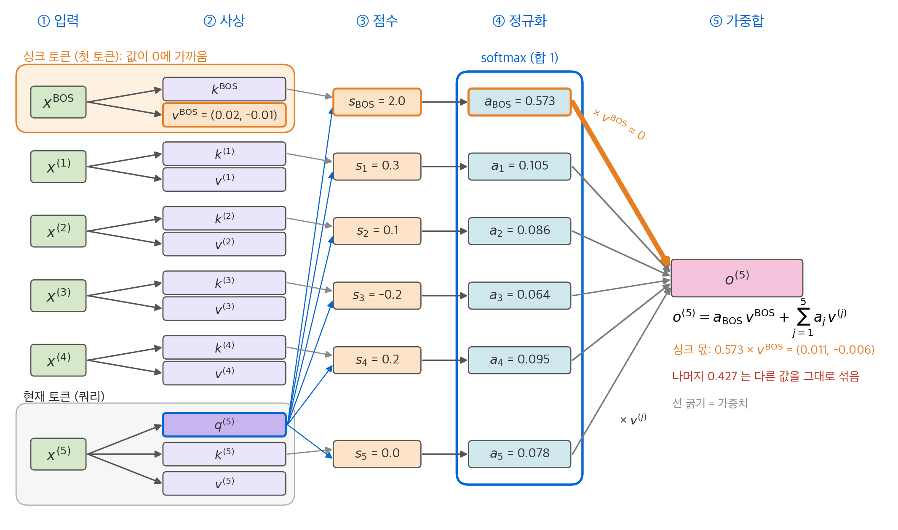
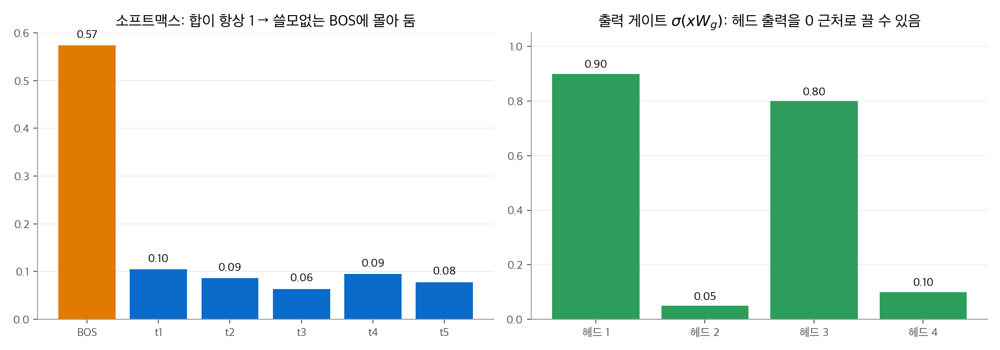
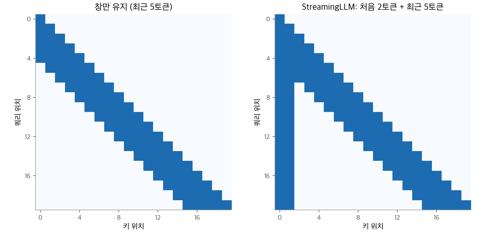
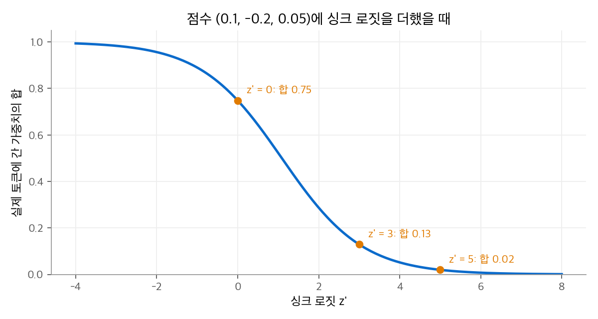
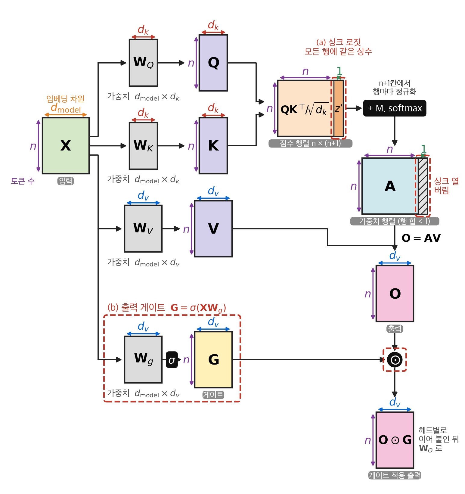
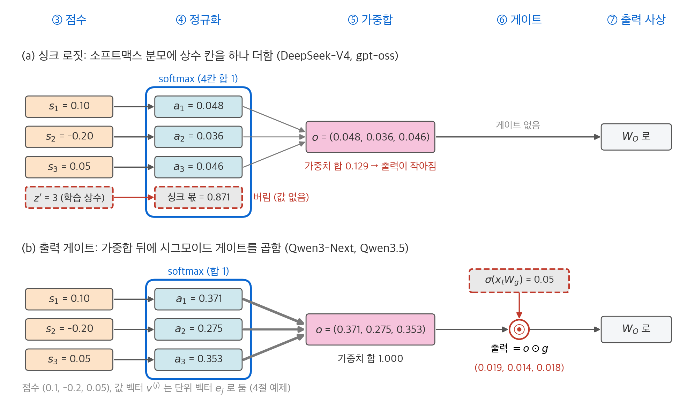
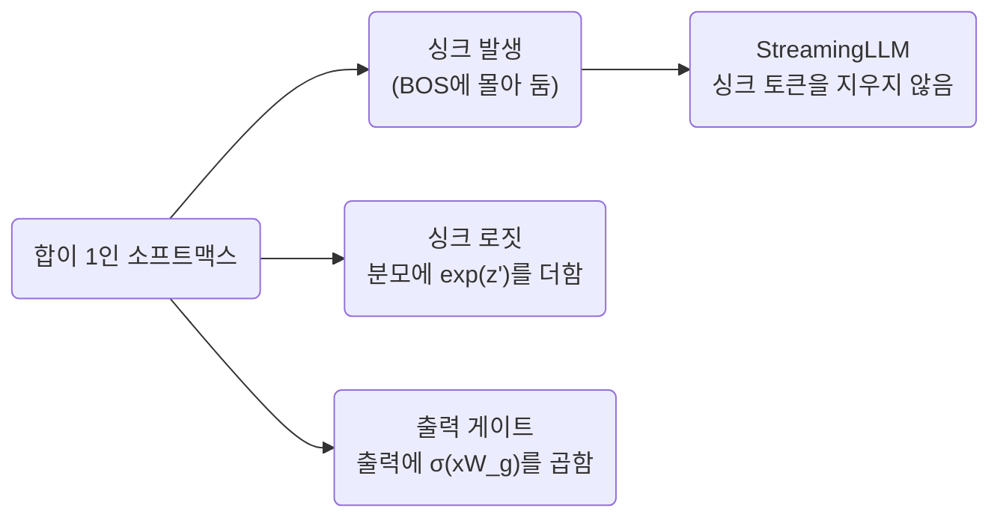

# 8. 어텐션 싱크와 게이트 어텐션

[1장](01-scaled-dot-product.md)에서 어텐션 가중치는 $a_{ij} \ge 0$, $\sum_j a_{ij} = 1$ 이라고 했습니다.
이 "합이 1"이라는 제약 때문에, 가져올 정보가 없는 헤드도 어딘가에 가중치를 줘야 합니다. 학습된 모델은 흔히 첫 토큰에 가중치를 몰아 둡니다.
이 현상을 **어텐션 싱크(attention sink)**라고 합니다.
이 장은 싱크가 생기는 원리와 부작용, 그리고 세 가지 대응 방법을 다룹니다.

| 방법 | 쓰는 곳 | 작동 위치 |
| --- | --- | --- |
| 싱크 토큰 보존 | StreamingLLM (추론 기법) | KV 캐시에서 첫 토큰을 지우지 않음 |
| 싱크 로짓 | DeepSeek-V4, gpt-oss | 소프트맥스 분모에 학습 상수를 더함 |
| 출력 게이트 | Qwen3-Next, Qwen3.5 | 어텐션 출력에 시그모이드 게이트를 곱함 |

## 1. 싱크가 생기는 원리

### 합이 1이면 "아무것도 보지 않음"을 표현할 수 없습니다

어떤 헤드가 특정 문법 관계만 찾는다고 합니다. 지금 토큰에 그 관계가 없으면, 이상적인 출력은 0입니다.
하지만 출력은 값 벡터의 볼록 결합 $\mathbf{o}_i = \sum_j a_{ij}\mathbf{v}_j$ 이므로, 가중치를 모두 0으로 둘 수 없습니다.
모델이 찾은 해법은 이렇습니다.

1. 특정 토큰 하나(보통 첫 토큰 BOS)를 "버림 칸"으로 정합니다.
2. 그 토큰의 값 벡터를 0에 가깝게 만듭니다.
3. 할 일이 없는 헤드는 가중치를 거의 전부 그 토큰에 줍니다.

그러면 출력은 $a_{i,\text{BOS}}\mathbf{v}_{\text{BOS}} + (\text{나머지}) \approx \mathbf{0}$ 에 가까워집니다.

### 수치 예제

BOS와 다른 토큰 5개의 점수가 $(2.0,\ 0.3,\ 0.1,\ -0.2,\ 0.2,\ 0.0)$ 이라고 둡니다.

$$
\operatorname{softmax} = (0.573,\ 0.105,\ 0.086,\ 0.064,\ 0.095,\ 0.078)
$$

가중치의 57%가 BOS로 갑니다. 하지만 나머지 43%는 여전히 다른 토큰의 값을 섞습니다.
출력을 거의 0으로 만들려면 BOS 가중치가 0.99쯤 되어야 합니다. 다른 5개 토큰의 점수가 0이면 필요한 BOS 점수는 다음과 같습니다.

$$
\frac{e^{s}}{e^{s} + 5} = 0.99 \;\Rightarrow\; e^{s} = 495 \;\Rightarrow\; s \approx 6.2
$$

점수 6.2를 입력과 상관없이 늘 만들려면, BOS 쪽 키나 쿼리의 특정 성분이 늘 크게 유지되어야 합니다.

<figure markdown>

<figcaption markdown>
<span class="fig-title"><b>Figure 1.</b> 싱크 토큰이 남는 가중치를 흡수하는 흐름</span>

BOS는 가중치 0.573을 받지만 값이 0에 가까워 출력에 거의 더하지 않습니다.
</figcaption>
</figure>

<figure markdown>

<figcaption markdown>
<span class="fig-title"><b>Figure 2.</b> 어텐션 싱크와 출력 게이트</span>

소프트맥스는 합이 1이라 쓸모없는 BOS에 57%를 몰아 둡니다. 출력 게이트가 0.05이면 헤드 출력이 거의 0이 됩니다.
</figcaption>
</figure>

## 2. 싱크의 부작용

### 거대 활성값

Sun et al.(2024)은 LLM 안의 극히 일부 활성값이 다른 값보다 매우 크다는 것을 보고했습니다. 논문의 예에서는 약 10만 배입니다.
이 값은 입력과 거의 무관하게 일정하고, 편향 항처럼 동작하며, 해당 토큰에 어텐션 확률을 몰아 줍니다. 1절에서 본 "늘 큰 점수"를 만드는 장치입니다.

거대 활성값은 두 가지 비용을 만듭니다.

- **양자화가 어려워집니다.** 값 범위를 이상치 하나에 맞추면 나머지 값의 해상도가 떨어집니다.
- **학습이 불안정해질 수 있습니다.** 특정 차원이 매우 커지면 로짓과 기울기의 크기도 함께 흔들립니다.

### 창 어텐션과의 충돌

[4장](04-sliding-window.md)의 슬라이딩 창으로 무한히 긴 스트림을 처리한다고 합니다. 창이 첫 토큰을 지나치면 싱크 토큰이 KV 캐시에서 지워집니다.
싱크에 기대던 헤드는 갑자기 가중치를 줄 곳을 잃고, 원래 의미 없는 토큰들에 가중치를 나눠 줍니다. Xiao et al.(2023)은 이때 언어 모델의 성능이 무너지는 것을 보였습니다.

## 3. 대응 1: 싱크 토큰 보존 (StreamingLLM)

**StreamingLLM**은 학습을 바꾸지 않는 추론 기법입니다. KV 캐시에서 **처음 몇 토큰은 지우지 않고**, 그 뒤로 최근 창만 유지합니다.

<figure markdown>

<figcaption markdown>
<span class="fig-title"><b>Figure 3.</b> 창만 유지할 때와 StreamingLLM의 마스크</span>

StreamingLLM은 최근 창과 함께 처음 몇 토큰을 항상 봅니다. 논문은 처음 4개 토큰을 보존하는 설정을 주로 씁니다.
</figcaption>
</figure>

논문은 Llama-2, MPT, Falcon, Pythia에서 이 방법으로 400만 토큰 이상을 안정적으로 처리했고, 창 안을 매번 다시 계산하는 방법보다 최대 22.2배 빨랐다고 보고했습니다.
같은 논문은 학습할 때 전용 싱크 토큰을 하나 넣어 두면, 추론 때 그 토큰 하나만 보존해도 된다는 실험도 실었습니다.

이 방법은 싱크를 없애지 않습니다. 싱크가 있다는 사실을 받아들이고, 그 토큰을 지우지 않을 뿐입니다.

## 4. 대응 2: 싱크 로짓

### 수식

싱크 토큰이 하는 일은 "소프트맥스 분모에 큰 항을 하나 더하는 것"입니다. 그렇다면 토큰 대신 **학습하는 상수 하나**를 분모에 직접 더하면 됩니다.
DeepSeek-V4는 헤드 $h$ 마다 싱크 로짓 $z'_h$ 를 학습합니다.

$$
a_{h,i,j} = \frac{\exp(z_{h,i,j})}{\sum_k \exp(z_{h,i,k}) + \exp(z'_h)}
$$

이제 $\sum_j a_{h,i,j} < 1$ 이 될 수 있습니다. 남은 몫은 아무 값도 가져오지 않습니다.
$z'_h = 0$ 이면 분모에 1을 더하는 것과 같습니다. 이 형태는 "softmax에 1을 더하자"는 제안(Evan Miller, 2023)과 같습니다.

### 수치 예제

점수가 $(0.1,\ -0.2,\ 0.05)$ 일 때 싱크 로짓에 따른 가중치입니다.

| $z'_h$ | 가중치 | 합 |
| --- | --- | --- |
| 없음 | (0.371, 0.275, 0.353) | 1.000 |
| 0 | (0.278, 0.206, 0.264) | 0.748 |
| 3 | (0.048, 0.036, 0.046) | 0.129 |
| 5 | (0.007, 0.005, 0.007) | 0.020 |

토큰 사이의 비율은 그대로이고, 전체 크기만 줄어듭니다.

<figure markdown>

<figcaption markdown>
<span class="fig-title"><b>Figure 4.</b> 싱크 로짓에 따른 가중치 합</span>

싱크 로짓이 커질수록 실제 토큰에 가는 가중치 합이 줄어듭니다. $z' = 3$ 이면 합이 0.13입니다.
</figcaption>
</figure>

### 구현

싱크 로짓을 점수 행렬의 열 하나로 붙이고 소프트맥스를 계산한 뒤, 그 열을 버립니다. Hugging Face의 gpt-oss 구현도 헤드별 학습 매개변수 `sinks` 를 같은 방식으로 씁니다.

```python
import torch

def attn_with_sink(scores, V, sink_logit):
    """scores: (n,), V: (n, d). 싱크 로짓을 분모에만 더합니다."""
    logits = torch.cat([scores, sink_logit.view(1)])
    p = torch.softmax(logits, dim=0)[:-1]      # 싱크 열은 버림: 합이 1보다 작아짐
    return p @ V, p

scores = torch.tensor([0.1, -0.2, 0.05])
V = torch.eye(3)
for z in [-1e9, 0.0, 3.0]:
    out, p = attn_with_sink(scores, V, torch.tensor(z))
    print(z, p.numpy().round(3), round(p.sum().item(), 3))
# -1e9 [0.371 0.275 0.353] 1.0
# 0.0  [0.278 0.206 0.264] 0.748
# 3.0  [0.048 0.036 0.046] 0.129
```

싱크 로짓의 한계는 **쿼리와 무관한 상수**라는 점입니다. 헤드마다 "얼마나 자주 쉬는가"를 정할 수 있지만, 지금 쿼리에 맞춰 쉴지 말지를 바꾸는 것은 점수 $z_{h,i,j}$ 의 몫입니다.

## 5. 대응 3: 출력 게이트

### 수식

Qiu et al.(2025)은 소프트맥스 어텐션에 게이트를 다는 30가지 변형을 비교했습니다. 15B MoE 모델과 1.7B 밀집 모델을 3.5T 토큰으로 학습했습니다.
가장 좋았던 형태는 **스케일드 내적 어텐션 출력 바로 뒤에, 헤드별·원소별 시그모이드 게이트**를 두는 것이었습니다.

$$
\mathbf{o}_{t,i} = \operatorname{Attention}(\mathbf{q}_{t,i}, \mathbf{K}, \mathbf{V}) \odot \sigma\!\left(\mathbf{x}_t\mathbf{W}_g^{(i)}\right),\qquad
\mathbf{u}_t = [\mathbf{o}_{t,1}; \ldots; \mathbf{o}_{t,h}]\,\mathbf{W}_O
$$

게이트는 지금 토큰 $\mathbf{x}_t$ 가 정합니다. 그래서 쿼리마다, 헤드마다, 성분마다 다른 값을 가집니다.

### 세 가지 효과

**1. 비선형성.** 게이트가 없으면 헤드 $i$ 의 출력이 은닉 상태에 기여하는 경로는 다음과 같습니다.

$$
\mathbf{W}_O^{(i)}\sum_j a_{tj}\mathbf{W}_V^{(i)}\mathbf{x}_j = \sum_j a_{tj}\,\underbrace{\mathbf{W}_O^{(i)}\mathbf{W}_V^{(i)}}_{\text{랭크} \le d_h}\,\mathbf{x}_j
$$

$\mathbf{W}_O^{(i)}\mathbf{W}_V^{(i)}$ 는 랭크가 $d_h$ 이하인 선형 사상 하나입니다. 게이트는 두 행렬 사이에 입력에 따라 바뀌는 비선형성을 넣습니다.

**2. 희소성.** 논문은 학습된 게이트 값이 대부분 0 근처라고 보고했습니다. 헤드가 쿼리에 따라 출력을 끄는 데 게이트를 씁니다.

**3. 싱크 제거.** 헤드가 출력을 끄고 싶으면 게이트를 0에 가깝게 두면 됩니다. BOS에 가중치를 몰아 둘 이유가 사라집니다.
논문은 이 게이트가 어텐션 싱크를 줄이고, 학습을 안정시켜 더 큰 학습률을 허용하며, 긴 문맥 외삽도 개선한다고 보고했습니다.

### 수치 예제

1절의 소프트맥스(BOS 0.573)에서 출발합니다. 값 벡터를 2차원으로 두고, BOS의 값은 $(0.02, -0.01)$, 나머지 다섯 토큰의 값은 무작위로 정했습니다.
헤드 출력은 $(0.111,\ 0.075)$ 이고 크기는 0.134입니다. BOS에 57%를 몰아도 나머지 43%가 섞여 들어옵니다.
게이트를 0.05로 두면 출력은 $(0.0055,\ 0.0037)$ 이 되고 크기는 0.0067입니다. 소프트맥스 분포와 무관하게 출력이 꺼집니다.

### 구현

Qwen3-Next의 구현(`modeling_qwen3_next.py`)은 쿼리 사상의 출력 차원을 두 배로 늘려서, 절반은 쿼리로, 절반은 게이트로 씁니다(`attn_output_gate: true`).
게이트는 출력 사상 직전에 원소별로 곱합니다.

```python
import torch
from torch import nn

class GatedAttention(nn.Module):
    """Qwen3-Next 방식: 쿼리 사상의 출력을 두 배로 늘려 절반을 게이트로 씁니다."""
    def __init__(self, d_model, n_heads, d_head):
        super().__init__()
        self.h, self.d = n_heads, d_head
        self.q_proj = nn.Linear(d_model, n_heads * d_head * 2, bias=False)
        self.k_proj = nn.Linear(d_model, n_heads * d_head, bias=False)
        self.v_proj = nn.Linear(d_model, n_heads * d_head, bias=False)
        self.o_proj = nn.Linear(n_heads * d_head, d_model, bias=False)

    def forward(self, x):                                   # x: (B, n, d_model)
        B, n, _ = x.shape
        q, gate = self.q_proj(x).view(B, n, self.h, 2 * self.d).chunk(2, dim=-1)
        k = self.k_proj(x).view(B, n, self.h, self.d)
        v = self.v_proj(x).view(B, n, self.h, self.d)
        q, k, v = (t.transpose(1, 2) for t in (q, k, v))    # (B, h, n, d)
        o = nn.functional.scaled_dot_product_attention(q, k, v, is_causal=True)
        o = o.transpose(1, 2).reshape(B, n, -1)
        o = o * torch.sigmoid(gate.reshape(B, n, -1))      # 헤드별·원소별 게이트
        return self.o_proj(o)

layer = GatedAttention(d_model=64, n_heads=4, d_head=16)
print(layer(torch.randn(2, 10, 64)).shape)   # torch.Size([2, 10, 64])
```

설명을 위해 KV 헤드를 쿼리 헤드와 같게 두었습니다. 실제 Qwen3-Next는 [3장](03-mqa-gqa.md)의 GQA(쿼리 16, KV 2)를 쓰고, 쿼리와 키에 [QK-Norm](../llm-techniques/03-normalization.md)을 적용합니다.

**비용.** 게이트는 쿼리 사상의 출력만큼 매개변수를 더합니다. Qwen3.5-397B는 은닉 4,096, 쿼리 헤드 32개, 헤드 차원 256이므로 층마다 $4096 \times 8192 \approx 3{,}355$만 개, 어텐션 15층에서 약 5억 개입니다. 전체 397B의 0.13% 정도입니다.
[7장](07-linear-attention.md)의 Gated DeltaNet층도 출력에 $\operatorname{SiLU}(\mathbf{z})$ 게이트를 곱합니다. 하이브리드의 두 종류 층이 모두 출력 게이트를 가집니다.

## 6. 세 방법 비교

| 질문 | 싱크 토큰 보존 | 싱크 로짓 | 출력 게이트 |
| --- | --- | --- | --- |
| 학습을 바꾸나 | 아니요 (추론 기법) | 예 | 예 |
| "보지 않음"의 단위 | 없음 (싱크 토큰에 기댐) | 헤드 하나, 학습 상수 | 헤드 안 성분별, 쿼리 토큰마다 |
| 가중치 합 | 1 | 1보다 작을 수 있음 | 1 (대신 출력을 줄임) |
| 거대 활성값 | 그대로 | 줄어들 것으로 기대 | 논문이 감소를 보고 |
| 추가 매개변수 | 없음 | 헤드당 1개 | 쿼리 사상만큼 |

<figure markdown>

<figcaption markdown>
<span class="fig-title"><b>Figure 5.</b> 행렬 단위로 본 싱크 로짓과 출력 게이트</span>

싱크 로짓은 점수 행렬에 열 하나를 붙이고, 출력 게이트는 출력에 원소별 게이트를 곱합니다. 두 방법 모두 KV 캐시 크기를 바꾸지 않습니다.
</figcaption>
</figure>

<figure markdown>

<figcaption markdown>
<span class="fig-title"><b>Figure 6.</b> 싱크 로짓과 출력 게이트가 끼어드는 위치</span>

싱크 로짓은 정규화 단계에서 가중치 합을 0.129로 줄이고, 출력 게이트는 가중합 뒤에 0.05를 곱합니다.
</figcaption>
</figure>



## 정리

- 소프트맥스 가중치는 합이 1이므로, 헤드는 "아무것도 보지 않음"을 표현하려고 첫 토큰에 가중치를 몰아 둡니다. 이것이 어텐션 싱크입니다.
- 싱크는 거대 활성값을 만들고, 창 어텐션에서 싱크 토큰이 지워지면 성능이 무너집니다.
- StreamingLLM은 싱크 토큰을 보존하고, DeepSeek-V4와 gpt-oss는 분모에 싱크 로짓을 더하며, Qwen3-Next와 Qwen3.5는 출력에 시그모이드 게이트를 곱합니다.
- 출력 게이트는 쿼리마다 다르게 작동하고, 값 사상과 출력 사상 사이에 비선형성을 넣는 효과도 있습니다.

게이트 어텐션을 쓰는 모델은 트렌드의 [Qwen](../../trends/posts/2026-10-20-llm-qwen.md) 글, 싱크 로짓을 쓰는 모델은 [DeepSeek](../../trends/posts/2026-10-20-llm-deepseek.md) 글에서 정리합니다.

## 참고 자료

- Xiao et al., [Efficient Streaming Language Models with Attention Sinks](https://arxiv.org/abs/2309.17453), 2023.
- Sun et al., [Massive Activations in Large Language Models](https://arxiv.org/abs/2402.17762), 2024.
- Qiu et al., [Gated Attention for Large Language Models: Non-linearity, Sparsity, and Attention-Sink-Free](https://arxiv.org/abs/2505.06708), 2025.
- Evan Miller, [Attention Is Off By One](https://www.evanmiller.org/attention-is-off-by-one.html), 2023.
- DeepSeek-AI, [DeepSeek-V4: Towards Highly Efficient Million-Token Context Intelligence](https://arxiv.org/abs/2606.19348), 2026.
- Hugging Face Transformers [modeling_qwen3_next.py](https://github.com/huggingface/transformers/blob/main/src/transformers/models/qwen3_next/modeling_qwen3_next.py), [modeling_gpt_oss.py](https://github.com/huggingface/transformers/blob/main/src/transformers/models/gpt_oss/modeling_gpt_oss.py).
