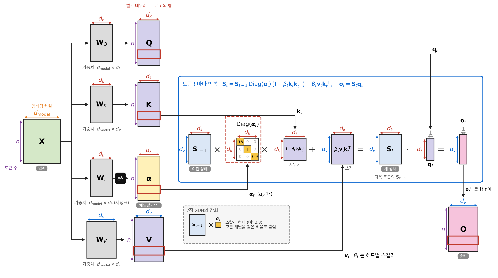
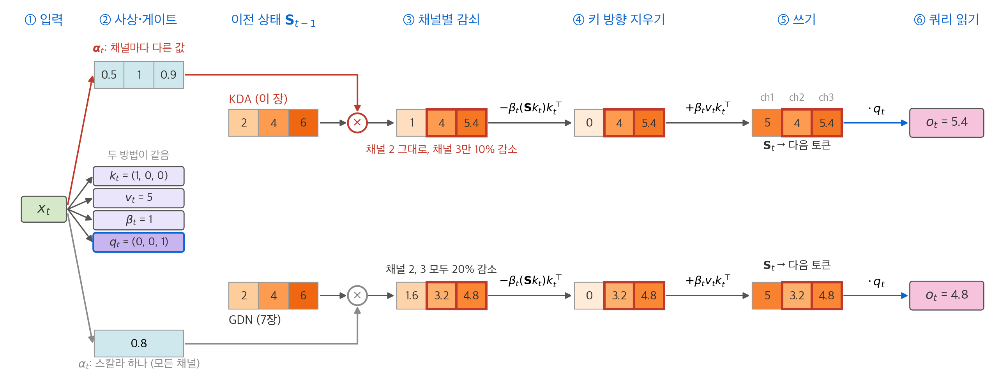
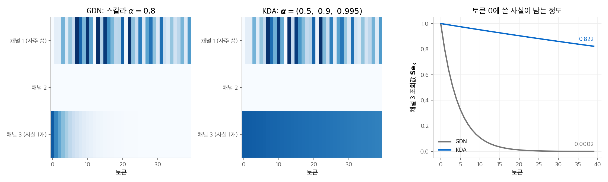
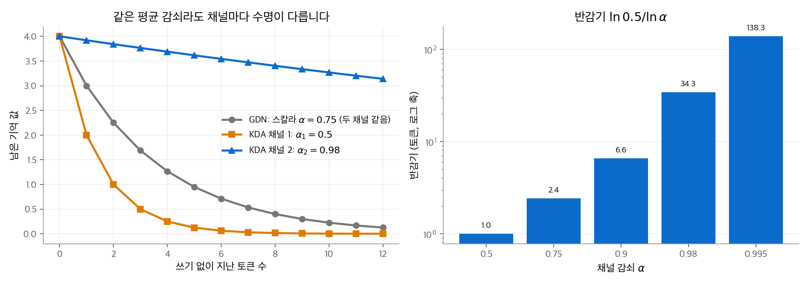
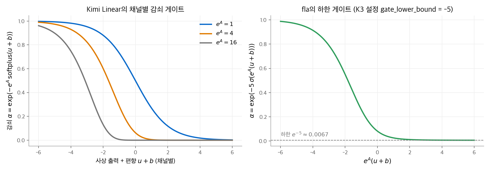
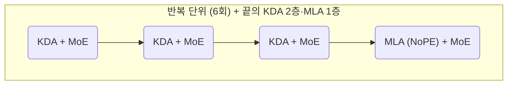
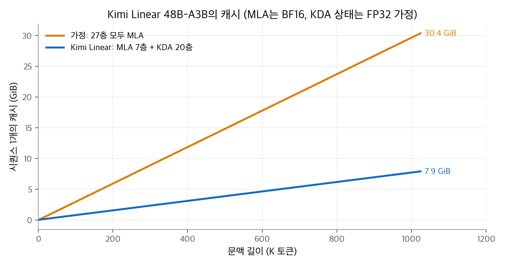

# 9. KDA: Kimi Delta Attention

[7장](07-linear-attention.md)의 Gated DeltaNet은 망각 게이트 $\alpha_t$ 하나로 상태 전체를 같은 비율로 지웁니다.
**KDA(Kimi Delta Attention)**는 이 스칼라를 키 채널마다 다른 값으로 바꿉니다. 자주 바뀌는 정보는 빨리 지우고, 오래 남길 정보는 거의 지우지 않을 수 있습니다.
Moonshot AI는 KDA를 MLA와 3 : 1로 섞은 Kimi Linear(48B, 활성 3B)를 2025. 10. 공개했고, 같은 구조를 Kimi K3(2.8T)까지 키웠습니다.
이 장은 KDA의 갱신식, 구현 세부, 청크 병렬 계산, Kimi Linear의 구성과 보고된 결과를 다룹니다.

!!! info "자료"
    - Kimi Team, [Kimi Linear: An Expressive, Efficient Attention Architecture](https://arxiv.org/abs/2510.26692), 2025.
    - 공식 구현: Kimi-Linear-48B-A3B-Instruct의 [modeling_kimi.py](https://huggingface.co/moonshotai/Kimi-Linear-48B-A3B-Instruct/blob/main/modeling_kimi.py), [config.json](https://huggingface.co/moonshotai/Kimi-Linear-48B-A3B-Instruct/blob/main/config.json)
    - 커널: [flash-linear-attention](https://github.com/fla-org/flash-linear-attention)의 `fla/ops/kda`
    - 이 장의 수치 예시와 코드는 PyTorch로 직접 실행해 확인했습니다.

## 1. 출발점: Gated DeltaNet의 한계

7장의 표기를 그대로 씁니다. 상태는 $\mathbf{S}_t \in \mathbb{R}^{d_v \times d_k}$ 이고, 키 $\mathbf{k}_t$ 는 길이 1로 정규화되어 있습니다.

$$
\textbf{GDN:}\quad \mathbf{S}_t = \alpha_t\,\mathbf{S}_{t-1}\big(\mathbf{I} - \beta_t\mathbf{k}_t\mathbf{k}_t^\top\big) + \beta_t\mathbf{v}_t\mathbf{k}_t^\top,\qquad \alpha_t \in [0, 1]
$$

$\alpha_t$ 는 헤드마다 스칼라 하나입니다. 그래서 다음 두 요구가 충돌합니다.

- 지금 쓰고 있는 키 방향의 오래된 내용을 빨리 지우고 싶습니다. 그러면 $\alpha_t$ 를 낮춰야 합니다.
- 다른 키 방향에 저장한 장기 정보는 남기고 싶습니다. 그러면 $\alpha_t$ 를 1 가까이 둬야 합니다.

델타 규칙은 현재 키 방향만 고치므로 첫 요구를 어느 정도 해결합니다. 하지만 $\alpha_t < 1$ 인 순간 상태의 **모든** 채널이 함께 줄어듭니다.

## 2. KDA의 갱신식

KDA는 스칼라 $\alpha_t$ 를 벡터 $\boldsymbol{\alpha}_t \in [0, 1]^{d_k}$ 로 바꾸고, 대각 행렬로 곱합니다.

$$
\textbf{KDA:}\quad \mathbf{S}_t = \mathbf{S}_{t-1}\operatorname{Diag}(\boldsymbol{\alpha}_t)\big(\mathbf{I} - \beta_t\mathbf{k}_t\mathbf{k}_t^\top\big) + \beta_t\mathbf{v}_t\mathbf{k}_t^\top,\qquad
\mathbf{o}_t = \mathbf{S}_t\mathbf{q}_t
$$

계산 순서는 세 단계입니다.

1. **채널별 감쇠**: $\mathbf{S}_{t-1}\operatorname{Diag}(\boldsymbol{\alpha}_t)$. 상태의 $j$ 번째 열(키 채널 $j$)에 $\alpha_{t,j}$ 를 곱합니다.
2. **현재 키 방향 지우기**: 감쇠한 상태에서 $\beta_t(\mathbf{S}\mathbf{k}_t)\mathbf{k}_t^\top$ 를 뺍니다.
3. **쓰기**: $\beta_t\mathbf{v}_t\mathbf{k}_t^\top$ 를 더합니다.

$\boldsymbol{\alpha}_t = \alpha_t\mathbf{1}$ 이면 $\operatorname{Diag}(\boldsymbol{\alpha}_t) = \alpha_t\mathbf{I}$ 이므로 GDN과 같습니다. KDA는 GDN을 포함하는 일반화입니다.

Kimi Linear 보고서는 상태를 $\mathbf{S} \in \mathbb{R}^{d_k \times d_v}$ 로 써서 $\mathbf{S}_t = (\mathbf{I} - \beta_t\mathbf{k}_t\mathbf{k}_t^\top)\operatorname{Diag}(\boldsymbol{\alpha}_t)\mathbf{S}_{t-1} + \beta_t\mathbf{k}_t\mathbf{v}_t^\top$ 로 적습니다. 위 식을 전치한 것입니다. $\operatorname{Diag}(\boldsymbol{\alpha}_t)$ 와 $\mathbf{I} - \beta_t\mathbf{k}_t\mathbf{k}_t^\top$ 가 대칭이므로 두 표기는 같습니다.

<figure markdown>

<figcaption markdown>
<span class="fig-title"><b>Figure 1.</b> 행렬 단위로 본 KDA의 전체 흐름</span>

KDA는 GDN의 스칼라 감쇠 대신 채널마다 다른 대각 감쇠를 곱합니다. 상태 크기와 갱신 비용의 차수는 GDN과 같습니다.
</figcaption>
</figure>

### 손계산: 세 채널 상태

$d_v = 1$, $d_k = 3$ 이고, 이전 상태가 $\mathbf{S}_{t-1} = (2,\ 4,\ 6)$ 입니다. 채널마다 다른 기억이 들어 있습니다.
이번 토큰은 $\mathbf{k}_t = (1, 0, 0)$, $\mathbf{v}_t = 5$, $\beta_t = 1$ 로 채널 1을 덮어씁니다.
GDN은 $\alpha = 0.8$, KDA는 $\boldsymbol{\alpha} = (0.5,\ 1.0,\ 0.9)$ 로 둡니다. 두 게이트의 평균은 0.8로 같습니다.

| 단계 | GDN ($\alpha = 0.8$) | KDA ($\boldsymbol{\alpha} = (0.5, 1.0, 0.9)$) |
| --- | --- | --- |
| 1. 감쇠 | $0.8 \cdot (2, 4, 6) = (1.6,\ 3.2,\ 4.8)$ | $(2 \cdot 0.5,\ 4 \cdot 1.0,\ 6 \cdot 0.9) = (1,\ 4,\ 5.4)$ |
| 2. 채널 1 지우기 | $(0,\ 3.2,\ 4.8)$ | $(0,\ 4,\ 5.4)$ |
| 3. 쓰기 $+\,5\,\mathbf{k}^\top$ | $(5,\ 3.2,\ 4.8)$ | $(5,\ 4,\ 5.4)$ |

채널 1은 두 방법 모두 새 값 5가 됩니다. 차이는 건드리지 않은 채널 2와 3입니다.
GDN은 두 채널을 모두 20% 줄였습니다. KDA는 채널 2를 그대로 두고 채널 3만 10% 줄였습니다.

<figure markdown>

<figcaption markdown>
<span class="fig-title"><b>Figure 2.</b> 토큰 하나에서 KDA와 GDN의 상태 갱신 흐름</span>

두 방법의 차이는 감쇠 게이트 하나입니다. KDA는 채널별 (0.5, 1, 0.9), GDN은 스칼라 0.8을 곱해 출력이 5.4와 4.8로 달라집니다.
</figcaption>
</figure>

### 여러 토큰에 걸친 효과

같은 차이가 쌓이면 결과가 크게 갈립니다. 다음 실험은 토큰 0에서 채널 3에 사실 하나($v = 1$)를 쓰고, 이후 39토큰 동안 채널 1에만 무작위 값을 계속 씁니다.

<figure markdown>

<figcaption markdown>
<span class="fig-title"><b>Figure 3.</b> 스칼라 감쇠와 채널별 감쇠의 상태 변화</span>

GDN은 채널 1을 덮어쓰는 동안 채널 3도 함께 지웁니다. 39토큰 뒤 채널 3의 조회값은 GDN 0.0002, KDA 0.822입니다.
</figcaption>
</figure>

GDN이 사실을 지키려면 $\alpha$ 를 1 가까이 둬야 합니다. 그러면 모든 채널의 감쇠가 함께 약해집니다.
KDA는 채널마다 반감기를 따로 정합니다. 반감기는 $\ln 0.5 / \ln\alpha$ 이므로 $\alpha = 0.5$ 이면 1토큰, $\alpha = 0.995$ 이면 약 138토큰입니다.

<figure markdown>

<figcaption markdown>
<span class="fig-title"><b>Figure 4.</b> 스칼라 감쇠와 채널별 감쇠의 수명</span>

평균 감쇠가 같아도 채널별 감쇠는 일부 채널을 오래 남깁니다. 감쇠 0.98의 반감기는 약 34토큰입니다.
</figcaption>
</figure>

보고서는 채널별 게이트를 RoPE와 연결해 설명합니다. RoPE가 차원 쌍마다 다른 주파수로 위치를 표현하듯이([RoPE](../llm-techniques/01-rope.md)), KDA는 채널마다 다른 감쇠 속도로 최근성을 표현합니다.

## 3. 구현 세부

공식 구현 `KimiDeltaAttention` 의 계산 순서는 다음과 같습니다. 괄호 안은 Kimi Linear 48B의 설정값입니다(KDA 헤드 32개, 헤드 차원 128).

1. **사상**: 입력 $\mathbf{x}_t$ 에서 $\mathbf{q}, \mathbf{k}, \mathbf{v}$ 를 만듭니다. 편향은 없습니다.
2. **짧은 합성곱**: 세 텐서에 각각 길이 4의 인과 깊이별 합성곱과 SiLU를 적용합니다(`short_conv_kernel_size: 4`).
3. **채널별 감쇠**: 저랭크 사상 $\mathbf{u}_t = \mathbf{W}_f^{\uparrow}\mathbf{W}_f^{\downarrow}\mathbf{x}_t$ 를 만듭니다. $\mathbf{W}_f^{\downarrow}$ 는 은닉 차원을 헤드 차원 128로 줄이고, $\mathbf{W}_f^{\uparrow}$ 는 다시 $32 \times 128$ 채널로 늘립니다. 로그 공간에서 감쇠를 계산합니다.

    $$
    g_{t,j} = -e^{A_h}\operatorname{softplus}(u_{t,j} + b_j),\qquad \alpha_{t,j} = e^{g_{t,j}}
    $$

    $A_h$ 는 헤드별 학습 매개변수입니다(초깃값 $e^{A_h} \sim U(1, 16)$). $b_j$ 는 채널별 편향입니다.
4. **쓰기 강도**: 헤드별 스칼라 $\beta_t = \sigma(\mathbf{w}_\beta^\top\mathbf{x}_t)$ 입니다. 감쇠와 달리 채널별이 아닙니다.
5. **갱신**: 커널 안에서 $\mathbf{q}, \mathbf{k}$ 를 L2 정규화하고 2절의 갱신식을 계산합니다. 학습과 긴 프리필은 청크 커널(`chunk_kda`), 64토큰 이하의 짧은 입력과 생성은 순환 커널(`fused_recurrent_kda`)을 씁니다.
6. **출력 게이트**: 헤드별 RMSNorm 뒤에 저랭크 시그모이드 게이트를 곱합니다. $\operatorname{RMSNorm}(\mathbf{o}_t) \odot \sigma(\mathbf{W}_g^{\uparrow}\mathbf{W}_g^{\downarrow}\mathbf{x}_t)$
7. **출력 사상**으로 은닉 차원에 돌려놓습니다.

<figure markdown>

<figcaption markdown>
<span class="fig-title"><b>Figure 5.</b> KDA의 채널별 감쇠 게이트</span>

사상 출력이 클수록 감쇠가 0에 가까워집니다. 하한 게이트를 쓰면 감쇠가 $e^{-5} \approx 0.0067$ 아래로 내려가지 않습니다.
</figcaption>
</figure>

### 7장 Qwen3-Next 구현과의 비교

| 항목 | Gated DeltaNet (Qwen3-Next·3.5) | KDA (Kimi Linear) |
| --- | --- | --- |
| 감쇠 $\alpha$ | 헤드별 스칼라, $-e^{A}\operatorname{softplus}(a_t + \Delta)$ | 채널별 벡터, $-e^{A_h}\operatorname{softplus}(u_{t,j} + b_j)$, 저랭크 사상 |
| 쓰기 강도 $\beta$ | 헤드별 스칼라 $\sigma(b_t)$ | 헤드별 스칼라 $\sigma(\cdot)$ |
| 짧은 합성곱 | 길이 4 + SiLU | 길이 4 + SiLU |
| Q·K 정규화 | L2 | L2 |
| 출력 게이트 | $\operatorname{RMSNorm}(\mathbf{o}) \odot \operatorname{SiLU}(\mathbf{z})$ | $\operatorname{RMSNorm}(\mathbf{o}) \odot \sigma(\text{저랭크 사상})$ |
| 헤드 구성 | 키 헤드 < 값 헤드 (Qwen3.5-397B: 16 / 64) | 키 헤드 = 값 헤드 (32 / 32) |
| 상태 크기 (헤드당) | $128 \times 128$ | $128 \times 128$ |

감쇠를 채널별로 늘려도 상태 크기는 같습니다. 늘어나는 것은 게이트 사상의 매개변수와, 청크 계산의 복잡도입니다.

### 절제 실험

보고서의 작은 모델 실험(16헤드, 16층, 같은 FLOPs)에서 검증 퍼플렉서티는 다음과 같습니다.

| 변형 | 검증 PPL |
| --- | --- |
| 최종 구성 (KDA : MLA = 3 : 1) | 5.65 |
| 출력 게이트 제거 | 5.67 |
| 시그모이드 대신 Swish 출력 게이트 | 5.81 |
| 짧은 합성곱 제거 | 5.70 |

채널별 게이트와 스칼라 게이트를 직접 비교한 퍼플렉서티 절제는 보고서에 없습니다. 보고서는 합성 과제(Palindrome, MQAR, Stack)에서 KDA가 GDN보다 빠르게 수렴하고 가장 높은 정확도를 냈다고 설명합니다. 이 그림의 정확한 수치는 표로 공개되지 않았습니다.

## 4. 청크 병렬 계산: 대각 감쇠를 다루는 방법

7장 5절처럼 학습은 토큰을 청크로 묶어 병렬로 계산합니다. KDA에서는 감쇠가 채널마다 다르므로 GDN보다 다루기 어렵습니다.

### 전이 행렬은 대각 + 저랭크

보고서 표기($\mathbf{S}^\top$)로 한 스텝을 쓰면 다음과 같습니다.

$$
\mathbf{S}_t^\top = \underbrace{\big(\operatorname{Diag}(\boldsymbol{\alpha}_t) - \beta_t\mathbf{k}_t(\boldsymbol{\alpha}_t \odot \mathbf{k}_t)^\top\big)}_{\mathbf{M}_t}\,\mathbf{S}_{t-1}^\top + \beta_t\mathbf{k}_t\mathbf{v}_t^\top
$$

$\mathbf{M}_t$ 는 대각 행렬에서 랭크 1 행렬을 뺀 **DPLR(Diagonal-Plus-Low-Rank)** 형태입니다. $\mathbf{a}_t = \beta_t\mathbf{k}_t$, $\mathbf{b}_t = \boldsymbol{\alpha}_t \odot \mathbf{k}_t$ 로 두면 $\mathbf{M}_t = \operatorname{Diag}(\boldsymbol{\alpha}_t) - \mathbf{a}_t\mathbf{b}_t^\top$ 입니다.
일반 DPLR은 $\mathbf{a}, \mathbf{b}$ 가 서로 독립인 벡터입니다. KDA는 두 벡터가 같은 키 $\mathbf{k}_t$ 에서 나오도록 묶인 특수한 경우입니다.

### 보고서가 밝힌 효율

- 일반 DPLR 청크 알고리즘은 청크 안의 누적 감쇠 $\prod \boldsymbol{\alpha}$ 의 역수를 다룹니다. 누적 감쇠가 0에 가까우면 역수가 커져 수치적으로 불안정합니다.
- KDA는 $\mathbf{a}, \mathbf{b}$ 가 같은 키에서 나온다는 제약을 이용해 이 역수 계산을 없애고, 청크를 두 번 더 나누는 보조 단계도 없앴다고 설명합니다.
- 보고서는 KDA 커널이 일반 DPLR 커널보다 64K 길이까지 약 2배 빠르다고 보고합니다. 프리필 지연은 GDN 하이브리드(GDN-H)와 거의 같았습니다.

여기서는 커널 유도 대신, 위 DPLR 전이 행렬이 2절의 갱신식과 같다는 점을 코드로 확인합니다.

```python
import torch

def kda_step(S, q, k, v, alpha, beta):
    """S: (dv, dk), alpha: (dk,) 채널별 감쇠, beta: 스칼라. 새 상태와 출력을 돌려줍니다."""
    S = S * alpha                                         # S Diag(alpha)
    S = S - beta * torch.outer(S @ k, k) + beta * torch.outer(v, k)
    return S, S @ q

# 2절 손계산
S0 = torch.tensor([[2., 4., 6.]]); k = torch.tensor([1., 0., 0.]); v = torch.tensor([5.])
print(kda_step(S0, k, k, v, torch.tensor([0.5, 1.0, 0.9]), 1.0)[0])   # [[5.0, 4.0, 5.4]]
print(kda_step(S0, k, k, v, torch.full((3,), 0.8), 1.0)[0])           # [[5.0, 3.2, 4.8]] (GDN)

# DPLR 형태와 같은지 확인
torch.manual_seed(0); dk, dv = 4, 3
S = torch.randn(dv, dk); k = torch.nn.functional.normalize(torch.randn(dk), dim=0)
v = torch.randn(dv); alpha = torch.rand(dk); beta = 0.7
S_new, _ = kda_step(S, k, k, v, alpha, beta)
M = torch.diag(alpha) - torch.outer(beta * k, alpha * k)              # Diag(a) - a_t b_t^T
print(torch.allclose(S_new.T, M @ S.T + beta * torch.outer(k, v), atol=1e-6))   # True

# 감쇠가 모든 채널에서 같으면 GDN과 같은지 확인
gdn = 0.6 * (S - beta * torch.outer(S @ k, k)) + beta * torch.outer(v, k)
print(torch.allclose(kda_step(S, k, k, v, torch.full((dk,), 0.6), beta)[0], gdn, atol=1e-6))   # True
```

## 5. Kimi Linear의 하이브리드 구성

### 층 배치

Kimi Linear 48B-A3B는 27층입니다. 공개 설정의 `linear_attn_config` 는 4, 8, 12, 16, 20, 24, 27층을 전체 어텐션(MLA)으로, 나머지 20층을 KDA로 둡니다.
KDA 3층마다 MLA 1층이고, 마지막 27층은 MLA입니다.



보고서의 비율 절제 실험(검증 퍼플렉서티)은 다음과 같습니다.

| KDA : MLA | 0 : 1 (전체 MLA) | 1 : 1 | **3 : 1** | 7 : 1 | 15 : 1 |
| --- | --- | --- | --- | --- | --- |
| 검증 PPL | 5.77 | 5.66 | **5.65** | 5.70 | 5.82 |

선형층이 너무 적으면 효율이 떨어지고, 너무 많으면 품질이 떨어집니다. 3 : 1은 Qwen3-Next·Qwen3.5(7장 6절)와 같은 비율입니다.

### MLA층의 NoPE

Kimi Linear의 MLA층은 위치 인코딩을 쓰지 않습니다(`mla_use_nope: true`, 공식 구현은 이 값이 참이라고 단언(`assert`)합니다). 위치와 최근성 정보는 KDA층의 감쇠가 맡습니다.
보고서가 든 이유는 두 가지입니다.

- RoPE가 없으면 추론 때 MLA를 순수 MQA 형태로 바꿀 수 있습니다([5장](05-mla.md)의 흡수가 RoPE 분리 없이 성립합니다).
- 문맥을 늘릴 때 RoPE 기저 조정이나 YaRN([긴 문맥 확장](../llm-techniques/02-long-context.md))이 필요 없습니다.

긴 문맥 평가에서 NoPE 판은 평균 54.5, RoPE 판은 51.8이었습니다. RULER는 84.3 대 78.8이었습니다. 짧은 문맥 점수는 비슷했습니다.

### 캐시 계산

MLA층은 토큰마다 잠재 512 + RoPE 키 64 = 576개 값을 저장합니다. 구현이 이 두 부분을 그대로 나눠 캐시하므로, NoPE여도 크기는 같습니다.
KDA층은 헤드마다 $128 \times 128$ 상태를 들고 다닙니다. 상태는 FP32로 가정합니다.

| 항목 | Kimi Linear | 27층 모두 MLA라면 |
| --- | --- | --- |
| 토큰당 KV (BF16) | $7 \times 576 \times 2\ \text{B} \approx 7.9\ \text{KiB}$ | $27 \times 576 \times 2\ \text{B} \approx 30.4\ \text{KiB}$ |
| 1M 토큰 KV | 약 7.9GiB | 약 30.4GiB |
| KDA 상태 (길이와 무관) | $20 \times 32 \times 128^2 \times 4\ \text{B} = 40\ \text{MiB}$ | 없음 |
| 짧은 합성곱 상태 | 층당 최근 3토큰분, 무시할 수준 | 없음 |

<figure markdown>

<figcaption markdown>
<span class="fig-title"><b>Figure 6.</b> Kimi Linear의 캐시 크기</span>

27층 중 7층만 MLA이므로 KV 캐시가 약 74% 줄어듭니다.
</figcaption>
</figure>

### 보고된 결과

보고서는 같은 구조·매개변수·학습 설정(1.4T 토큰, 4,096 문맥, MuonClip, WSD)으로 세 모델을 비교했습니다.

| 지표 | MLA (전체 어텐션) | GDN-H (GDN 하이브리드) | Kimi Linear |
| --- | --- | --- | --- |
| MMLU (사전학습) | 71.6 | 72.2 | 73.8 |
| MMLU (지시 학습) | 75.7 | 75.6 | 77.0 |
| RULER 128K | 81.3 | 80.5 | 84.3 |
| 긴 문맥 평균 | 52.2 | 51.2 | 54.5 |

- 1M 문맥 생성에서 토큰당 시간(TPOT)은 Kimi Linear 1.84ms, MLA 11.48ms로 6.3배 빨랐습니다.
- KV 캐시는 최대 75% 줄었고, 1M 문맥에서 생성 처리량은 최대 6배라고 보고합니다.
- 공개한 체크포인트는 5.7T 토큰으로 학습했고, 문맥은 1M입니다.

이 결과는 회사가 직접 보고한 수치입니다. 같은 조건의 비교라는 점에서 의미가 있지만, 활성 3B 규모의 실험이라는 점도 함께 봐야 합니다.

### Kimi K3로의 확장

Kimi K3의 공개 설정은 93층 중 KDA 69층, MLA 24층(4층마다 1층과 마지막 93층)입니다. KDA 헤드는 96개이고, MLA층은 NoPE이며 출력 게이트를 씁니다(`mla_use_output_gate: true`, [8장](08-attention-sink-gating.md)).
모델 전체의 특징은 트렌드의 [Kimi](../../trends/posts/2026-10-20-llm-kimi.md) 글에서 정리합니다.

## 정리

- KDA는 Gated DeltaNet의 스칼라 감쇠 $\alpha_t$ 를 채널별 감쇠 $\operatorname{Diag}(\boldsymbol{\alpha}_t)$ 로 바꿉니다. 감쇠가 모든 채널에서 같으면 GDN과 같습니다.
- 채널마다 반감기가 달라지므로, 자주 바뀌는 정보와 오래 남길 정보를 한 상태 안에서 함께 다룰 수 있습니다.
- 감쇠는 저랭크 사상과 $-e^{A}\operatorname{softplus}(\cdot)$ 로 만들고, 출력은 RMSNorm과 저랭크 시그모이드 게이트를 거칩니다.
- 한 스텝의 전이 행렬은 DPLR 형태이고, KDA는 두 벡터가 같은 키에서 나온다는 제약으로 청크 계산을 단순화합니다.
- Kimi Linear는 KDA와 NoPE MLA를 3 : 1로 섞어 KV 캐시를 약 74% 줄이고, 같은 조건의 전체 MLA보다 높은 점수를 보고했습니다.

## 참고 자료

- Kimi Team, [Kimi Linear: An Expressive, Efficient Attention Architecture](https://arxiv.org/abs/2510.26692), 2025.
- Yang, Kautz, and Hatamizadeh, [Gated Delta Networks: Improving Mamba2 with Delta Rule](https://arxiv.org/abs/2412.06464), 2024.
- Kimi-Linear-48B-A3B-Instruct [모델 카드](https://huggingface.co/moonshotai/Kimi-Linear-48B-A3B-Instruct), [modeling_kimi.py](https://huggingface.co/moonshotai/Kimi-Linear-48B-A3B-Instruct/blob/main/modeling_kimi.py).
- flash-linear-attention [fla/ops/kda](https://github.com/fla-org/flash-linear-attention/tree/main/fla/ops/kda).
- Kimi-K3 [config.json](https://huggingface.co/moonshotai/Kimi-K3/blob/main/config.json).
