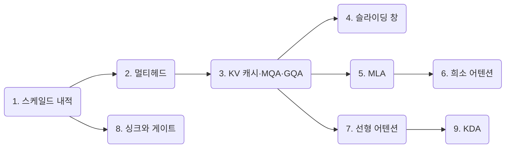

# 어텐션 메커니즘

최근 오픈 LLM은 모두 트랜스포머이지만, 어텐션 층의 모양은 모델마다 다릅니다.
Gemma는 창을 좁힌 로컬 어텐션을 섞고, DeepSeek과 GLM은 KV를 잠재 벡터로 압축하고 토큰을 골라 읽습니다.
Qwen은 어텐션층의 3/4을 선형 순환층으로 바꿨고, Kimi Linear는 그 순환층의 감쇠를 채널별로 나눴습니다.
이 교재는 이런 변형을 하나씩 떼어, 작동 원리와 계산 과정을 손으로 따라갑니다.

각 장은 같은 구성을 따릅니다. 먼저 식을 세우고, 단계별 작동 원리를 설명합니다.
그다음 손으로 계산할 수 있는 작은 예제와 그림으로 식의 의미를 확인하고, 짧은 코드로 구현합니다.
실제 모델의 설정값은 공개된 `config.json` 과 기술 보고서에서 가져왔습니다.

!!! info "선수 지식"
    - 쿼리·키·값의 정의, 나다라야-왓슨 커널 회귀, 트랜스포머 구조는 [신경망 기초 8장](../d2l/08-attention-transformer.md)에 있습니다.
    - 위치 인코딩(RoPE), 정규화, 옵티마이저(Adam, AdamW, Muon), MoE, MTP는 [LLM 핵심 기법](../llm-techniques/index.md)에서 다룹니다.

## 목차

| 장 | 다루는 내용 | 쓰는 모델 |
| --- | --- | --- |
| [1. 스케일드 내적 어텐션](01-scaled-dot-product.md) | Q·K·V, 손계산 예제, 인과 마스크, $\sqrt{d}$ 스케일, 계산량, 온라인 소프트맥스와 FlashAttention, KV 캐시 | 모든 모델 |
| [2. 멀티헤드 어텐션](02-multi-head.md) | 헤드 분할과 재결합의 텐서 모양, 헤드별 패턴, 매개변수 수, 헤드 수 선택 | 모든 모델, GLM-4.5의 96헤드 |
| [3. KV 캐시, MQA, GQA](03-mqa-gqa.md) | 생성 단계, KV 캐시 크기, KV 헤드 공유, 산술 강도, MHA→GQA 변환, 층 간 KV 공유, K=V | Qwen, GLM-4.5, Gemma 4 |
| [4. 슬라이딩 창과 로컬·전역 교차](04-sliding-window.md) | 창 마스크, 수용 영역, 링 버퍼 캐시, 로컬:전역 비율과 KV 캐시 | Gemma 2·3·4 |
| [5. MLA](05-mla.md) | 잠재 벡터 압축, 흡수, 분리 RoPE, 캐시 크기 | DeepSeek V2·V3, GLM-5 |
| [6. 희소 어텐션](06-sparse-attention.md) | DSA의 라이트닝 인덱서, top-$k$ 선택, IndexShare, 시퀀스 압축(CSA·HCA) | DeepSeek V3.2·V4, GLM-5·5.2 |
| [7. 선형 어텐션과 Gated DeltaNet](07-linear-attention.md) | 소프트맥스 제거와 순환 형태, 델타 규칙, 게이트, 하이브리드 구조 | Qwen3-Next, Qwen3.5 |
| [8. 어텐션 싱크와 게이트 어텐션](08-attention-sink-gating.md) | 합이 1인 소프트맥스의 문제, 싱크 로짓, 출력 게이트 | DeepSeek V4, Qwen3-Next, Qwen3.5 |
| [9. KDA: Kimi Delta Attention](09-kda.md) | 채널별 감쇠 게이트, Gated DeltaNet과의 차이, 청크 병렬 계산, KDA·MLA 하이브리드 | Kimi Linear |

## 읽는 순서

1~3장은 이후 모든 장의 바탕입니다. 순서대로 읽는 편이 좋습니다.
3장 이후의 4, 5, 7장은 KV 캐시를 줄이는 서로 다른 세 방향입니다. 각각 "보는 범위", "토큰당 크기", "저장 방식"을 줄입니다. 서로 독립적이므로 어느 것을 먼저 읽어도 됩니다.
6장은 5장의 MLA 위에서 동작하므로 5장 다음에 읽습니다. 9장은 7장의 Gated DeltaNet을 확장하므로 7장 다음에 읽습니다. 8장은 1장의 소프트맥스만 알면 읽을 수 있습니다.

## 장과 모델의 대응

모델별 전체 구조와 특징은 트렌드의 LLM Model 글에 정리했습니다. 각 글은 이 교재의 해당 장으로 연결됩니다.

| 모델 계열 | 어텐션 구성 | 관련 장 | 모델 글 |
| --- | --- | --- | --- |
| Gemma 2·3·4 | GQA + 로컬·전역 교차, K=V, 층 간 KV 공유 | 3, 4장 | [Gemma](../../trends/posts/2026-10-20-llm-gemma.md) |
| DeepSeek V3·V3.2·V4 | MLA, DSA, CSA·HCA, 싱크 로짓 | 5, 6, 8장 | [DeepSeek](../../trends/posts/2026-10-20-llm-deepseek.md) |
| Qwen3·3.5 | GQA, Gated DeltaNet 하이브리드, 출력 게이트 | 3, 7, 8장 | [Qwen](../../trends/posts/2026-10-20-llm-qwen.md) |
| GLM-4.5·5·5.2 | 헤드를 늘린 GQA, MLA + DSA, IndexShare | 2, 3, 5, 6장 | [GLM](../../trends/posts/2026-10-20-llm-glm.md) |
| Kimi K2·Kimi Linear | MLA, KDA·MLA 하이브리드 | 5, 7, 9장 | [Kimi](../../trends/posts/2026-10-20-llm-kimi.md) |

본문의 수치 예시는 모두 NumPy 또는 PyTorch로 직접 계산해 확인했습니다.
