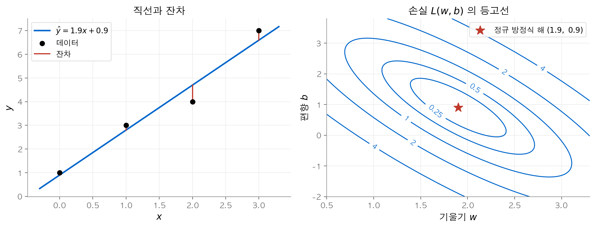
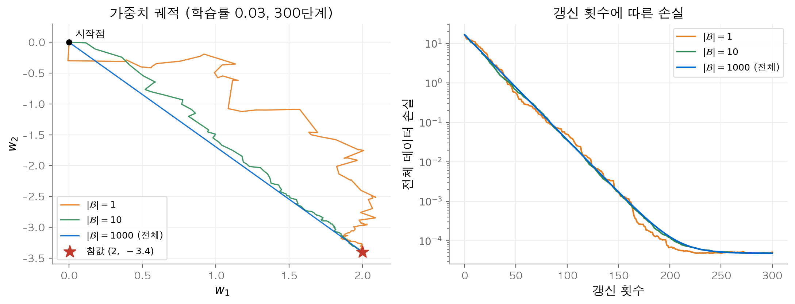
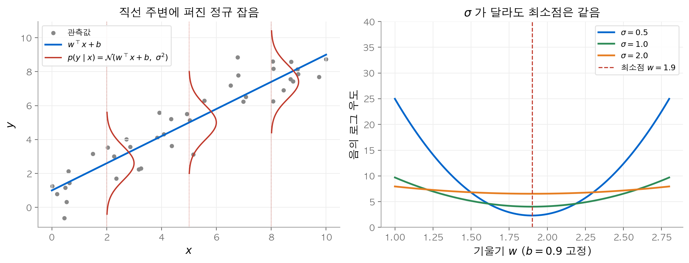
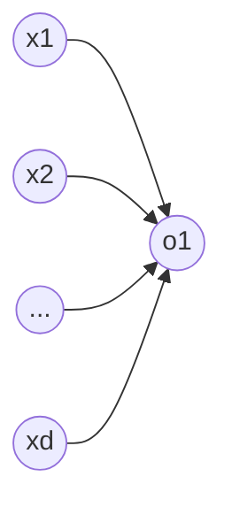
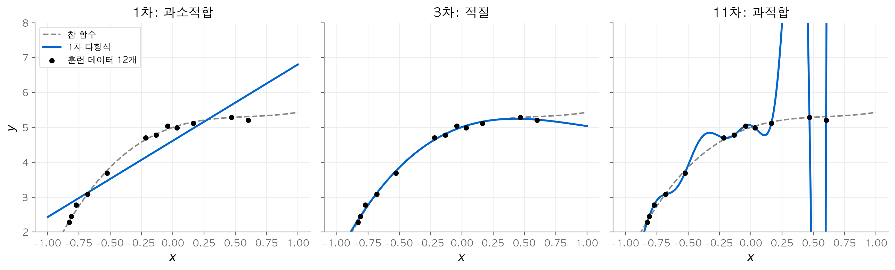
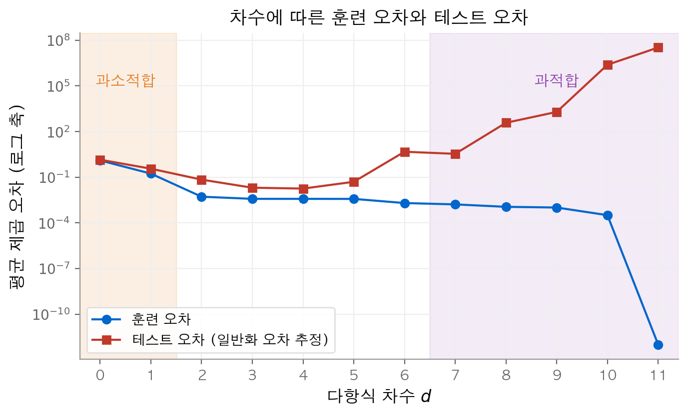
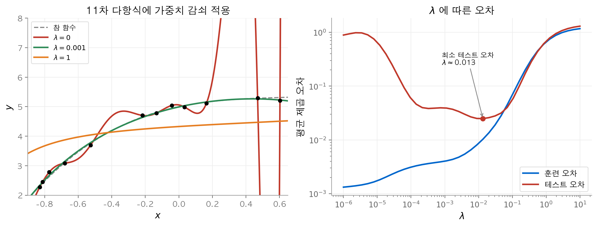

# 1. 선형 회귀

이 장의 질문은 두 가지입니다. 입력의 가중합으로 실수 값을 예측하는 모델을 어떻게 학습할까요?
그리고 학습한 모델이 처음 보는 데이터에서도 잘 맞는지 어떻게 판단할까요?
결론은 다음과 같습니다. 제곱 손실을 쓰는 선형 회귀는 해석해와 미니배치 SGD 두 방법으로 풀 수 있고, 두 방법은 같은 답에 도달합니다.
훈련 오차만 낮추면 과적합이 생기므로, 검증 데이터로 모델 복잡도를 고르고 가중치 감쇠로 가중치의 크기를 제한합니다.

!!! info "원문과 자료"
    - [3. Linear Neural Networks for Regression](https://d2l.ai/chapter_linear-regression/index.html)
    - [3.1 Linear Regression](https://d2l.ai/chapter_linear-regression/linear-regression.html)
    - 구현: [3.2 OO Design](https://d2l.ai/chapter_linear-regression/oo-design.html), [3.3 Synthetic Data](https://d2l.ai/chapter_linear-regression/synthetic-regression-data.html), [3.4 From Scratch](https://d2l.ai/chapter_linear-regression/linear-regression-scratch.html), [3.5 Concise](https://d2l.ai/chapter_linear-regression/linear-regression-concise.html)
    - [3.6 Generalization](https://d2l.ai/chapter_linear-regression/generalization.html)
    - [3.7 Weight Decay](https://d2l.ai/chapter_linear-regression/weight-decay.html)
    - 다음 장: [2. 선형 분류](02-linear-classification.md)

## 1. 선형 모델

**회귀(regression)** 는 입력에서 실수 값 하나를 예측하는 문제입니다.
예측할 값을 **레이블(label)** 또는 목표값이라고 부르고, 입력의 각 성분을 **특성(feature)** 이라고 부릅니다.
예제 하나의 특성을 $\mathbf{x} \in \mathbb{R}^d$ 로 쓰면 **선형 모델(linear model)** 의 예측은 다음과 같습니다.

$$
\hat{y} = \mathbf{w}^\top \mathbf{x} + b
$$

$\mathbf{w} \in \mathbb{R}^d$ 는 **가중치(weight)** 이고, $b$ 는 **편향(bias)** 입니다.
예제 $n$ 개를 행으로 쌓은 **설계 행렬(design matrix)** $\mathbf{X} \in \mathbb{R}^{n \times d}$ 를 쓰면 모든 예측을 한 번에 적을 수 있습니다.

$$
\hat{\mathbf{y}} = \mathbf{X}\mathbf{w} + b
$$

여기서 $b$ 는 브로드캐스팅으로 모든 행에 더해집니다.
위첨자 $(i)$ 는 예제 번호를, 아래첨자 $j$ 는 특성 번호를 뜻합니다. 따라서 $x_j^{(i)}$ 는 $i$ 번째 예제의 $j$ 번째 특성입니다.

가중치 $w_j$ 는 특성 $x_j$ 가 1만큼 늘 때 예측이 얼마나 변하는지를 나타냅니다.
편향 $b$ 는 모든 특성이 0일 때의 예측값입니다.
$d = 1$ 이면 모델은 평면 위의 직선이고, $d = 2$ 이면 3차원 공간의 평면입니다.

### 수치 예시

$\mathbf{w} = (2, -3.4)$, $b = 4.2$ 로 두고 예제 세 개 $(1, 2)$, $(0.5, -1)$, $(3, 0)$ 을 넣어 봅니다.
예측은 각각 $2 - 6.8 + 4.2 = -0.6$, $1 + 3.4 + 4.2 = 8.6$, $6 + 0 + 4.2 = 10.2$ 입니다.
행렬 곱 `X @ w + b` 한 번으로 세 값을 모두 얻습니다.
원문 3.1.2절은 이렇게 예제를 행렬로 묶어 계산하는 **벡터화(vectorization)** 가 파이썬 반복문보다 훨씬 빠르다고 설명합니다.

## 2. 제곱 손실

**손실 함수(loss function)** 는 예측이 레이블에서 얼마나 벗어났는지를 숫자 하나로 나타냅니다.
선형 회귀는 **제곱 오차(squared error)** 를 씁니다.

$$
l^{(i)}(\mathbf{w}, b) = \frac{1}{2}\left(\hat{y}^{(i)} - y^{(i)}\right)^2
$$

계수 $\frac{1}{2}$ 은 미분할 때 지수 2와 상쇄되도록 붙인 관례입니다.
훈련 데이터 전체의 손실은 예제별 손실의 평균입니다.

$$
L(\mathbf{w}, b) = \frac{1}{n}\sum_{i=1}^{n} \frac{1}{2}\left(\mathbf{w}^\top \mathbf{x}^{(i)} + b - y^{(i)}\right)^2
$$

학습의 목표는 이 값을 최소로 만드는 매개변수 $\mathbf{w}^*, b^* = \operatorname{argmin}_{\mathbf{w}, b} L(\mathbf{w}, b)$ 를 찾는 것입니다.

예측과 레이블의 차이 $\hat{y} - y$ 를 **잔차(residual)** 라고 합니다.
제곱 손실은 잔차가 2배가 되면 손실이 4배가 됩니다.
그래서 큰 오차를 강하게 줄이고, 이상치 하나에 영향을 많이 받습니다.

### 수치 예시

앞 절의 예측 $(-0.6, 8.6, 10.2)$ 와 레이블 $(-0.5, 8.5, 10.0)$ 을 비교합니다.
잔차는 $(-0.1, 0.1, 0.2)$ 이고, 예제별 손실은 $(0.005, 0.005, 0.02)$ 입니다.
평균 손실은 $L = 0.01$ 입니다. 잔차가 2배인 세 번째 예제의 손실은 다른 예제의 4배입니다.

## 3. 해석해: 정규 방정식

선형 회귀는 손실을 최소로 하는 매개변수를 식으로 바로 구할 수 있는 드문 모델입니다.
먼저 $\mathbf{X}$ 에 값이 모두 1인 열을 붙이고 $b$ 를 $\mathbf{w}$ 의 마지막 성분으로 넣습니다.
그러면 손실은 $\frac{1}{2n}\|\mathbf{y} - \mathbf{X}\mathbf{w}\|^2$ 이 됩니다.
이 식을 $\mathbf{w}$ 로 미분해 0으로 두면 **정규 방정식(normal equation)** 을 얻습니다.

$$
\mathbf{X}^\top \mathbf{X}\mathbf{w} = \mathbf{X}^\top \mathbf{y}
\quad\Longrightarrow\quad
\mathbf{w}^* = (\mathbf{X}^\top \mathbf{X})^{-1}\mathbf{X}^\top \mathbf{y}
$$

해는 $\mathbf{X}$ 의 열들이 선형 독립일 때, 즉 $\mathbf{X}^\top\mathbf{X}$ 가 역행렬을 가질 때 하나로 정해집니다.

정규 방정식은 $\mathbf{X}^\top(\mathbf{X}\mathbf{w} - \mathbf{y}) = \mathbf{0}$ 과 같습니다.
이 식은 최적점의 잔차 벡터가 $\mathbf{X}$ 의 모든 열과 직교한다는 뜻입니다.
따라서 $\mathbf{X}\mathbf{w}^*$ 는 $\mathbf{y}$ 를 $\mathbf{X}$ 의 열공간에 정사영한 점입니다.

### 수치 예시

점 네 개 $(0, 1), (1, 3), (2, 4), (3, 7)$ 에 직선을 맞춥니다.
$\mathbf{X}^\top\mathbf{X} = \begin{pmatrix} 14 & 6 \\ 6 & 4 \end{pmatrix}$ 이고 $\mathbf{X}^\top\mathbf{y} = (32, 15)$ 입니다.
이 연립방정식을 풀면 $w = 1.9$, $b = 0.9$ 입니다.
잔차는 $(-0.1, -0.2, 0.7, -0.4)$ 이고, 평균 손실은 $L = 0.0875$ 입니다.

```python
import numpy as np
X = np.array([[0., 1.], [1., 1.], [2., 1.], [3., 1.]])  # 마지막 열은 편향용 1
y = np.array([1., 3., 4., 7.])
w = np.linalg.solve(X.T @ X, X.T @ y)  # 역행렬 대신 선형 시스템을 풂
print(w)                       # [1.9 0.9]
print(X.T @ (X @ w - y))       # 약 [-2.7e-15 -8.9e-16]: 잔차는 X의 열과 직교
```

<figure markdown>

<figcaption markdown>
<span class="fig-title"><b>Figure 1.</b> 직선과 잔차, 손실 등고선</span>

잔차(빨간 선분)와 손실 등고선입니다. 등고선 중심(별)이 정규 방정식의 해입니다.
</figcaption>
</figure>

해석해는 쓰임새가 좁습니다. $\mathbf{X}^\top\mathbf{X}$ 는 $d \times d$ 행렬이므로 특성이 많으면 계산 비용이 커집니다.
또 손실이 이차식이 아닌 모델(이후 장의 신경망)에는 이런 닫힌 식이 없습니다.

## 4. 미니배치 확률적 경사 하강법

**경사 하강법(gradient descent)** 은 손실의 기울기 반대 방향으로 매개변수를 조금씩 옮깁니다.
기울기를 훈련 데이터 전체로 계산하면 한 번 갱신하는 데 비용이 큽니다.
**미니배치 확률적 경사 하강법(minibatch stochastic gradient descent, minibatch SGD)** 은 매 단계에서 예제 몇 개를 무작위로 뽑은 **미니배치(minibatch)** $\mathcal{B}_t$ 로 기울기를 추정합니다.

$$
(\mathbf{w}, b) \leftarrow (\mathbf{w}, b) - \frac{\eta}{|\mathcal{B}|}\sum_{i \in \mathcal{B}_t} \partial_{(\mathbf{w}, b)}\, l^{(i)}(\mathbf{w}, b)
$$

$\eta$ 는 **학습률(learning rate)** 입니다. 제곱 손실의 기울기를 대입하면 갱신식은 다음과 같습니다.

$$
\begin{aligned}
\mathbf{w} &\leftarrow \mathbf{w} - \frac{\eta}{|\mathcal{B}|}\sum_{i \in \mathcal{B}_t} \mathbf{x}^{(i)}\left(\mathbf{w}^\top\mathbf{x}^{(i)} + b - y^{(i)}\right) \\
b &\leftarrow b - \frac{\eta}{|\mathcal{B}|}\sum_{i \in \mathcal{B}_t} \left(\mathbf{w}^\top\mathbf{x}^{(i)} + b - y^{(i)}\right)
\end{aligned}
$$

$\eta$ 와 $|\mathcal{B}|$ 는 학습으로 정해지지 않고 사람이 고르는 **하이퍼파라미터(hyperparameter)** 입니다.

각 예제는 자신의 잔차에 특성 벡터를 곱한 만큼 가중치를 끌어당깁니다.
예측이 레이블보다 작으면 잔차가 음수이므로 가중치는 $\mathbf{x}^{(i)}$ 방향으로 움직입니다.
미니배치 기울기는 전체 기울기의 잡음 섞인 추정값입니다.
배치가 작으면 한 번의 갱신은 싸지만 방향이 흔들립니다.

### 수치 예시

원문 3.3절과 같은 방식으로 합성 데이터를 만듭니다.
참값은 $\mathbf{w} = (2, -3.4)$, $b = 4.2$ 이고, 특성은 표준 정규 분포에서, 잡음은 $\mathcal{N}(0, 0.01^2)$ 에서 뽑습니다.
$\mathbf{w} = \mathbf{0}$, $b = 0$ 에서 시작해 예제 4개로 기울기를 구하면 $\mathbf{w}$ 의 기울기는 $(-1.885, -0.989)$, $b$ 의 기울기는 $-3.872$ 입니다.
$\eta = 0.03$ 으로 한 번 갱신하면 $\mathbf{w} = (0.057, 0.030)$, $b = 0.116$ 이 됩니다.
모든 기울기가 음수이므로 세 매개변수가 모두 커지는 방향으로 움직입니다.

```python
import numpy as np
rng = np.random.default_rng(0)
true_w, true_b = np.array([2.0, -3.4]), 4.2
X = rng.normal(size=(1000, 2))
y = X @ true_w + true_b + rng.normal(0, 0.01, 1000)

w, b, lr, batch_size = np.zeros(2), 0.0, 0.03, 10
for epoch in range(3):
    idx = rng.permutation(1000)
    for s in range(0, 1000, batch_size):
        j = idx[s:s + batch_size]
        err = X[j] @ w + b - y[j]            # 미니배치 잔차
        w -= lr * X[j].T @ err / len(j)      # 위의 갱신식
        b -= lr * err.mean()
    loss = 0.5 * np.mean((X @ w + b - y) ** 2)
    print(epoch + 1, f"{loss:.6f}")
# 1 0.035288
# 2 0.000119
# 3 0.000048
print(w.round(4), round(b, 4))   # [ 1.9996 -3.3997] 4.1989
```

데이터 전체를 한 번 훑는 단위를 **에포크(epoch)** 라고 합니다.
3 에포크 뒤의 손실 0.000048은 잡음 분산의 절반 $0.01^2/2 = 0.00005$ 와 거의 같습니다. 잡음은 예측할 수 없으므로 이 값이 손실의 하한입니다.

<figure markdown>

<figcaption markdown>
<span class="fig-title"><b>Figure 2.</b> 미니배치 크기에 따른 SGD 궤적</span>

배치가 작을수록 경로가 흔들리지만, 세 경우 모두 참값에 도착해 손실 약 $5 \times 10^{-5}$ 에서 멈춥니다.
</figcaption>
</figure>

갱신 횟수가 같으면 손실은 비슷합니다(100번째 갱신에서 배치 크기 1, 10, 1000의 손실은 0.050, 0.035, 0.036). 그러나 300번 갱신에 쓰는 예제 수는 300개, 3,000개, 300,000개입니다.
원문은 GPU 병렬 계산과 갱신 횟수의 균형을 위해 배치 크기 32~256을 시작값으로 권합니다.

## 5. 정규 분포 잡음과 최대 우도

제곱 손실을 고른 이유는 확률 모델에서 나옵니다.
레이블이 선형 함수에 **정규 분포(normal distribution)** 잡음이 더해져 생긴다고 가정합니다.

$$
y = \mathbf{w}^\top\mathbf{x} + b + \epsilon, \qquad \epsilon \sim \mathcal{N}(0, \sigma^2)
$$

그러면 $\mathbf{x}$ 가 주어졌을 때 $y$ 의 확률 밀도는 다음과 같습니다.

$$
P(y \mid \mathbf{x}) = \frac{1}{\sqrt{2\pi\sigma^2}}\exp\left(-\frac{1}{2\sigma^2}\left(y - \mathbf{w}^\top\mathbf{x} - b\right)^2\right)
$$

예제들이 독립이면 데이터 전체의 **우도(likelihood)** 는 각 밀도의 곱입니다.
**최대 우도 추정(maximum likelihood estimation)** 은 이 곱을 최대로 하는 매개변수를 고릅니다.
곱을 최대로 하는 것은 **음의 로그 우도(negative log-likelihood)** 를 최소로 하는 것과 같습니다.

$$
-\log P(\mathbf{y} \mid \mathbf{X}) = \sum_{i=1}^{n} \left[\frac{1}{2}\log(2\pi\sigma^2) + \frac{1}{2\sigma^2}\left(y^{(i)} - \mathbf{w}^\top\mathbf{x}^{(i)} - b\right)^2\right]
$$

$\sigma$ 를 고정하면 첫째 항은 상수입니다. 둘째 항은 제곱 손실에 양의 상수 $1/\sigma^2$ 를 곱한 값입니다.
따라서 음의 로그 우도를 최소로 하는 $\mathbf{w}, b$ 는 제곱 손실을 최소로 하는 $\mathbf{w}, b$ 와 같습니다.
즉 제곱 손실을 쓴다는 것은 "잡음이 정규 분포를 따른다"고 가정한다는 뜻입니다.

### 수치 예시

3절의 점 네 개에서 최적 직선의 잔차 제곱합은 $0.7$ 입니다. 여러 $\sigma$ 에서 음의 로그 우도를 계산합니다.

| $\sigma$ | $2\log(2\pi\sigma^2)$ | $0.7 / (2\sigma^2)$ | 음의 로그 우도 |
| --- | --- | --- | --- |
| 0.5 | 0.903 | 1.400 | 2.303 |
| 1.0 | 3.676 | 0.350 | 4.026 |
| 2.0 | 6.448 | 0.088 | 6.536 |

세 경우 모두 최소점은 $w = 1.9$, $b = 0.9$ 입니다. $\sigma$ 는 곡선의 높이와 폭만 바꿉니다.
$\sigma$ 도 함께 추정하면 $\hat{\sigma} = \sqrt{0.7/4} \approx 0.418$ 입니다. 이 값은 잔차의 제곱 평균의 제곱근입니다.

<figure markdown>

<figcaption markdown>
<span class="fig-title"><b>Figure 3.</b> 정규 잡음 모델과 음의 로그 우도</span>

$\sigma$ 가 달라도 음의 로그 우도의 최소점은 $w = 1.9$ 로 같습니다.
</figcaption>
</figure>

## 6. 신경망으로서의 선형 회귀

선형 회귀는 가장 단순한 신경망입니다.
입력 $x_1, \dots, x_d$ 가 출력 뉴런 하나에 모두 연결되고, 그 사이에 다른 층이 없습니다.
입력층은 값을 전달만 하므로 층 수를 셀 때 제외합니다. 따라서 이 모델은 **단층 신경망(single-layer neural network)** 입니다.
모든 입력이 모든 출력에 연결되는 층을 **완전 연결층(fully connected layer)** 또는 밀집층(dense layer)이라고 부릅니다.



원문 3.2절과 3.5절은 이 구조를 모델, 데이터, 학습 루프로 나눠 구현합니다.
프레임워크에서는 완전 연결층, 손실, 옵티마이저를 각각 한 줄로 만듭니다.

```python
import torch
from torch import nn

net = nn.Linear(2, 1)                         # 입력 2개, 출력 1개인 완전 연결층
nn.init.normal_(net.weight, 0, 0.01)
nn.init.zeros_(net.bias)
loss_fn = nn.MSELoss()                        # 평균 제곱 오차 (1/2 계수 없음)
opt = torch.optim.SGD(net.parameters(), lr=0.03)

for X_batch, y_batch in loader:               # 미니배치 반복
    loss = loss_fn(net(X_batch), y_batch)
    opt.zero_grad()
    loss.backward()                           # 자동 미분으로 기울기 계산
    opt.step()                                # 4절의 갱신식 적용
```

`nn.MSELoss` 에는 $\frac{1}{2}$ 계수가 없으므로 기울기가 앞의 식의 2배입니다. 학습률을 절반으로 하면 같은 갱신이 됩니다.

## 7. 훈련 오차와 일반화 오차

지금까지는 훈련 데이터의 손실을 줄였습니다. 그러나 목표는 새 데이터에서 잘 예측하는 것입니다.
**훈련 오차(training error)** 는 훈련 데이터 $n$ 개에서 계산한 평균 손실입니다.

$$
R_\textrm{emp}[\mathbf{X}, \mathbf{y}, f] = \frac{1}{n}\sum_{i=1}^{n} l\left(\mathbf{x}^{(i)}, y^{(i)}, f(\mathbf{x}^{(i)})\right)
$$

**일반화 오차(generalization error)** 는 데이터를 만드는 실제 분포 $p(\mathbf{x}, y)$ 에서 손실의 기댓값입니다.

$$
R[p, f] = E_{(\mathbf{x}, y) \sim P}\left[l(\mathbf{x}, y, f(\mathbf{x}))\right] = \int\int l(\mathbf{x}, y, f(\mathbf{x}))\, p(\mathbf{x}, y)\, d\mathbf{x}\, dy
$$

두 값의 차이를 **일반화 격차(generalization gap)** 라고 합니다.

$p(\mathbf{x}, y)$ 는 알 수 없으므로 $R$ 을 정확히 계산할 수 없습니다.
대신 학습에 쓰지 않은 **테스트 데이터(test set)** 의 평균 손실로 $R$ 을 추정합니다.
모델이 고정되어 있으면 이 추정은 단순한 평균 추정 문제이므로 편향이 없습니다.
반면 훈련 오차는 모델이 바로 그 데이터에 맞춰졌으므로 $R$ 을 낮게 추정합니다.
8절의 11차 다항식은 훈련 오차가 0.0000이지만 테스트 오차는 $3.3 \times 10^7$ 입니다.

## 8. 과소적합과 과적합: 다항식 예

**과소적합(underfitting)** 은 훈련 오차와 검증 오차가 모두 크고 둘의 차이는 작은 상태입니다. 모델이 데이터의 패턴을 표현하지 못합니다.
**과적합(overfitting)** 은 훈련 오차가 검증 오차보다 훨씬 작은 상태입니다. 모델이 훈련 데이터의 잡음까지 외웁니다.
모델의 표현력을 조절하는 예로 $d$ 차 다항식 회귀를 봅니다.

$$
\hat{y} = \sum_{i=0}^{d} x^i w_i
$$

특성 $(1, x, x^2, \dots, x^d)$ 에 대한 선형 회귀이므로 지금까지의 방법을 그대로 씁니다. $d$ 가 커지면 매개변수가 늘고 모델이 복잡해집니다.

차수를 올리면 낮은 차수의 모델을 모두 포함하므로 훈련 오차는 줄거나 같습니다.
서로 다른 점이 $m$ 개 있으면 $m - 1$ 차 다항식은 모든 점을 정확히 지납니다. 이때 훈련 오차는 0이지만, 곡선은 점 사이에서 크게 출렁입니다.

### 수치 예시

참 함수 $y = 5 + 1.2x - 3.4\frac{x^2}{2!} + 5.6\frac{x^3}{3!} + \epsilon$, $\epsilon \sim \mathcal{N}(0, 0.1^2)$ 에서 훈련 점 12개와 테스트 점 1,000개를 뽑습니다.
$x$ 는 $[-1, 1]$ 에서 균등하게 뽑습니다. 이번 표본에서 훈련 점은 $[-0.83, 0.60]$ 에만 있습니다.

| 차수 $d$ | 훈련 MSE | 테스트 MSE | 상태 |
| --- | --- | --- | --- |
| 0 | 1.2607 | 1.4140 | 과소적합 |
| 1 | 0.1719 | 0.3620 | 과소적합 |
| 2 | 0.0052 | 0.0691 | |
| 3 | 0.0038 | 0.0203 | 적절 |
| 5 | 0.0037 | 0.0497 | |
| 8 | 0.0011 | 377.4 | 과적합 |
| 11 | 0.0000 | $3.3 \times 10^7$ | 과적합 |

테스트 오차는 참 함수와 같은 3차에서 가장 작습니다. 11차 다항식은 훈련 점 12개를 정확히 지나지만 테스트 오차는 수천만입니다.
훈련 점이 없는 $x > 0.6$ 구간에서 곡선이 크게 벗어나기 때문입니다.

<figure markdown>

<figcaption markdown>
<span class="fig-title"><b>Figure 4.</b> 차수별 다항식 맞춤</span>

1차는 곡률을 놓치고, 11차는 점 사이와 바깥에서 참 함수(점선)를 크게 벗어납니다.
</figcaption>
</figure>

<figure markdown>

<figcaption markdown>
<span class="fig-title"><b>Figure 5.</b> 차수에 따른 훈련 오차와 테스트 오차</span>

훈련 오차는 계속 줄지만, 테스트 오차는 3~4차에서 최소가 된 뒤 다시 커집니다.
</figcaption>
</figure>

데이터 양도 일반화에 영향을 줍니다. 같은 모델이라도 훈련 데이터가 적으면 과적합이 일찍, 크게 나타납니다.
데이터가 늘면 일반화 오차는 대체로 줄어듭니다. 따라서 모델의 복잡도는 데이터 양에 맞춰 늘려야 합니다.

## 9. 모델 선택과 K겹 교차 검증

차수, 학습률, 정규화 강도처럼 여러 후보 중 하나를 고르는 일을 **모델 선택(model selection)** 이라고 합니다.
테스트 데이터로 후보를 고르면 테스트 데이터에 과적합하게 되고, 일반화 오차를 정직하게 추정할 수단이 사라집니다.
그래서 훈련 데이터의 일부를 떼어 **검증 데이터(validation set)** 로 쓰고, 테스트 데이터는 마지막에 한 번만 씁니다.

데이터가 적으면 검증용으로 떼어 낼 여유가 없습니다.
**K겹 교차 검증(K-fold cross-validation)** 은 훈련 데이터를 겹치지 않는 $K$ 개 부분으로 나눕니다.
그리고 한 부분을 검증에, 나머지 $K - 1$ 개를 훈련에 쓰는 과정을 $K$ 번 반복해 검증 오차를 평균합니다.

모든 예제가 한 번씩 검증에 쓰이므로 데이터를 낭비하지 않습니다. 대신 모델을 $K$ 번 학습해야 하므로 계산 비용이 $K$ 배입니다.

8절의 훈련 점 12개를 3개씩 4겹으로 나누고 차수별 평균 검증 MSE를 계산합니다.

| 차수 | 0 | 1 | 2 | 3 | 4 | 5 | 6 | 7 |
| --- | --- | --- | --- | --- | --- | --- | --- | --- |
| 4겹 검증 MSE | 1.3352 | 0.2668 | 0.0095 | **0.0077** | 0.0178 | 0.0682 | 0.1712 | 4.7904 |

교차 검증은 테스트 데이터를 쓰지 않고도 3차를 고릅니다. 이 선택은 테스트 오차가 가장 작은 차수와 같습니다.

## 10. 가중치 감쇠

차수를 줄이는 방법은 조절 단위가 거칩니다. 특성이 많으면 어떤 특성을 뺄지 고르기도 어렵습니다.
**가중치 감쇠(weight decay)** 는 특성을 그대로 두고 가중치 벡터의 크기에 벌점을 줍니다.
이 방법은 **L2 정규화(L2 regularization)** 라고도 부릅니다.

$$
L(\mathbf{w}, b) + \frac{\lambda}{2}\|\mathbf{w}\|^2
$$

$\lambda \ge 0$ 은 **정규화 상수(regularization constant)** 이고, 검증 데이터로 고르는 하이퍼파라미터입니다.
$\lambda = 0$ 이면 원래 손실과 같습니다. 노름을 제곱하는 이유는 제곱근을 없애 미분을 간단하게 하기 위해서입니다.
편향 $b$ 에는 보통 벌점을 주지 않습니다. 미니배치 SGD 갱신식은 다음과 같이 바뀝니다.

$$
\mathbf{w} \leftarrow (1 - \eta\lambda)\,\mathbf{w} - \frac{\eta}{|\mathcal{B}|}\sum_{i \in \mathcal{B}} \mathbf{x}^{(i)}\left(\mathbf{w}^\top\mathbf{x}^{(i)} + b - y^{(i)}\right)
$$

갱신식의 첫 항은 매 단계에서 가중치를 $(1 - \eta\lambda)$ 배로 줄입니다. "감쇠"라는 이름은 여기서 나왔습니다.
손실의 기울기가 가중치를 키우려 해도 감쇠 항이 계속 0 쪽으로 당깁니다. 그래서 손실을 크게 줄이는 방향의 가중치만 큰 값을 유지합니다.
L2 벌점은 큰 성분에 벌점을 많이 주므로 가중치를 여러 특성에 고르게 나눕니다.
반면 **L1 정규화(L1 regularization)** 는 $\|\mathbf{w}\|_1$ 에 벌점을 주고 많은 가중치를 정확히 0으로 만듭니다. 그래서 특성 선택 효과가 있습니다.

### 수치 예시

$\eta = 0.1$, $\lambda = 0.5$ 이면 감쇠 계수는 $1 - 0.05 = 0.95$ 입니다.
기울기가 0이라면 $\mathbf{w} = (1, -2)$ 는 한 단계 뒤 $(0.95, -1.9)$ 가 됩니다.

8절의 11차 다항식에 가중치 감쇠를 적용합니다.
제곱 손실에 L2 벌점을 더하면 해석해도 바뀝니다. 상수항을 제외한 대각 행렬 $\mathbf{P}$ 를 쓰면 $\left(\frac{1}{n}\mathbf{X}^\top\mathbf{X} + \lambda\mathbf{P}\right)\mathbf{w} = \frac{1}{n}\mathbf{X}^\top\mathbf{y}$ 를 풀면 됩니다.

```python
import numpy as np
rng = np.random.default_rng(3)
def make(m):
    x = rng.uniform(-1, 1, m)
    y = 5 + 1.2*x - 3.4*x**2/2 + 5.6*x**3/6 + rng.normal(0, 0.1, m)
    return x, y
x_tr, y_tr = make(12)
x_te, y_te = make(1000)

def ridge_poly(deg, lam):
    V = np.vander(x_tr, deg + 1, increasing=True)
    P = np.eye(deg + 1)
    P[0, 0] = 0                             # 편향(상수항)은 감쇠하지 않음
    n = len(x_tr)
    return np.linalg.lstsq(V.T @ V / n + lam * P, V.T @ y_tr / n, rcond=None)[0]

for lam in [0, 1e-3, 1e-2, 1]:
    w = ridge_poly(11, lam)
    mse = lambda x, y: np.mean((np.vander(x, 12, increasing=True) @ w - y) ** 2)
    print(lam, f"{mse(x_tr, y_tr):.4f}", f"{mse(x_te, y_te):.4g}")
```

출력을 정리하고 가중치 노름을 더하면 다음 표가 됩니다.

| $\lambda$ | 훈련 MSE | 테스트 MSE | 가중치 노름 (상수항 제외) |
| --- | --- | --- | --- |
| 0 | 0.0000 | $3.3 \times 10^7$ | 47828 |
| 0.001 | 0.0040 | 0.0393 | 2.13 |
| 0.01 | 0.0086 | 0.0248 | 1.85 |
| 1 | 0.6628 | 0.6851 | 0.50 |

작은 $\lambda$ 만으로도 가중치 노름이 47828에서 2.13으로 줄고 테스트 오차가 크게 내려갑니다.
$\lambda = 1$ 은 너무 강해서 곡선이 거의 평평해지고 과소적합이 됩니다.
11차 다항식에 $\lambda = 0.01$ 을 쓴 결과(0.0248)는 3차 다항식의 테스트 오차(0.0203)에 가깝습니다.

<figure markdown>

<figcaption markdown>
<span class="fig-title"><b>Figure 6.</b> 가중치 감쇠의 효과</span>

적당한 $\lambda$ 는 출렁임을 없애고, 테스트 오차는 $\lambda \approx 0.013$ 에서 가장 작습니다.
</figcaption>
</figure>

원문 3.7절은 특성 200개, 훈련 예제 20개인 데이터 $y = 0.05 + \sum_{i=1}^{200} 0.01 x_i + \epsilon$ 으로 같은 현상을 보입니다.
같은 설정(배치 크기 5, 학습률 0.01)을 NumPy로 100 에포크 돌리면 $\lambda = 0$ 에서 훈련 손실 0.0000, 검증 손실 0.0114가 나옵니다.
$\lambda = 3$ 에서는 훈련 손실이 0.0004로 올라가고 검증 손실이 0.0102로 내려갑니다.
특성 수가 예제 수보다 많으면 모델이 훈련 데이터를 완전히 외울 수 있으므로 정규화가 필요합니다.

프레임워크에서는 옵티마이저의 `weight_decay` 인자 하나로 가중치 감쇠를 켭니다. 매개변수 그룹을 나누면 가중치에만 감쇠를 주고 편향에는 주지 않을 수 있습니다.

## 정리

- 선형 회귀의 예측은 $\hat{y} = \mathbf{w}^\top\mathbf{x} + b$ 이고, 제곱 손실의 평균 $L(\mathbf{w}, b)$ 를 최소로 하는 매개변수를 찾습니다.
- 해석해는 정규 방정식 $\mathbf{X}^\top\mathbf{X}\mathbf{w} = \mathbf{X}^\top\mathbf{y}$ 의 해입니다. 최적점의 잔차는 $\mathbf{X}$ 의 모든 열과 직교합니다.
- 미니배치 SGD는 예제 몇 개로 기울기를 추정해 매개변수를 갱신합니다. 학습률과 배치 크기는 하이퍼파라미터입니다.
- 잡음이 정규 분포를 따른다고 가정하면 최대 우도 추정은 제곱 손실 최소화와 같습니다. 해는 $\sigma$ 에 의존하지 않습니다.
- 선형 회귀는 완전 연결층 하나로 된 단층 신경망입니다.
- 훈련 오차는 일반화 오차를 낮게 추정합니다. 일반화 오차는 학습에 쓰지 않은 데이터로 추정합니다.
- 모델이 단순하면 과소적합이, 복잡하면 과적합이 생깁니다. 다항식 예에서 훈련 오차는 차수와 함께 계속 줄지만 테스트 오차는 3차에서 최소입니다.
- 모델 선택은 검증 데이터나 K겹 교차 검증으로 하고, 테스트 데이터는 마지막에만 씁니다.
- 가중치 감쇠는 $\frac{\lambda}{2}\|\mathbf{w}\|^2$ 벌점을 더해 매 단계 가중치를 $(1 - \eta\lambda)$ 배로 줄입니다. 적절한 $\lambda$ 는 고차 모델의 과적합을 막습니다.
