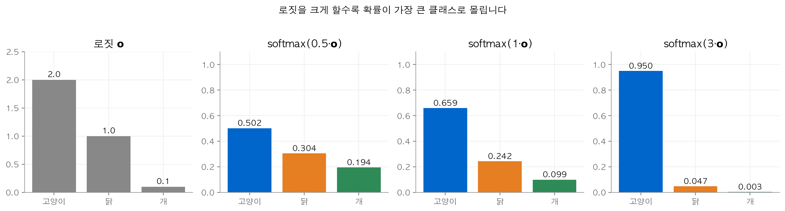
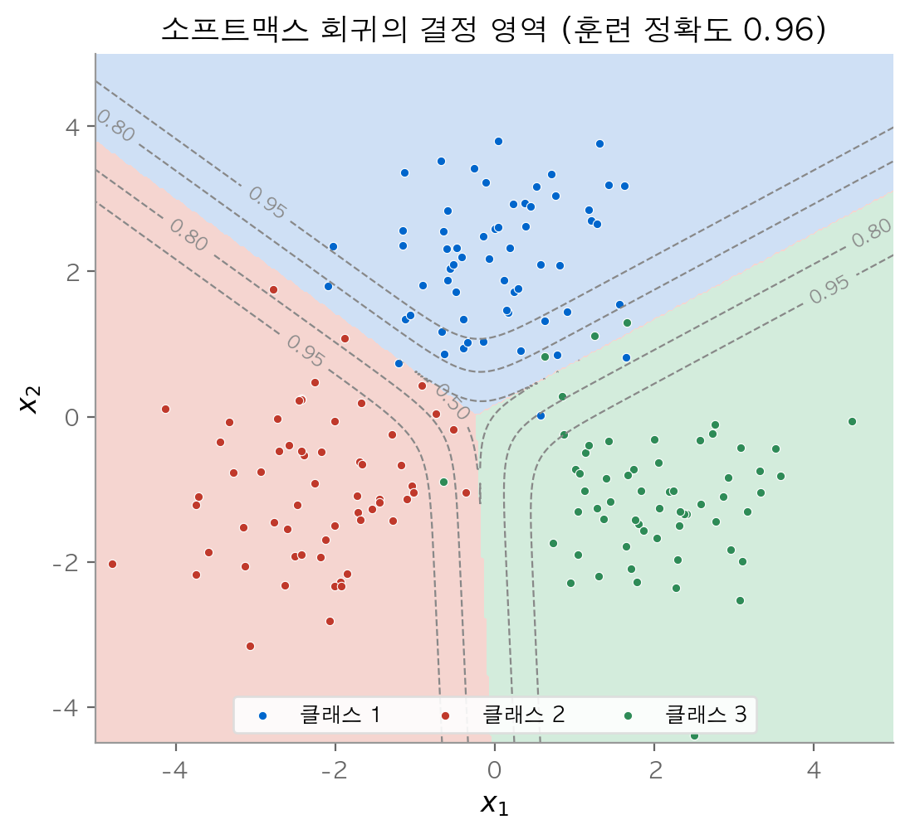
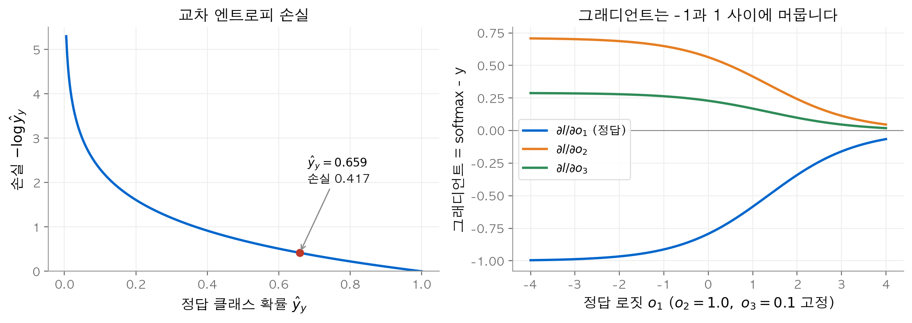
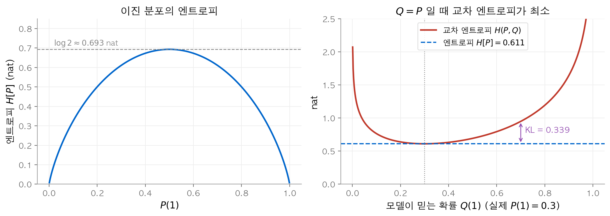
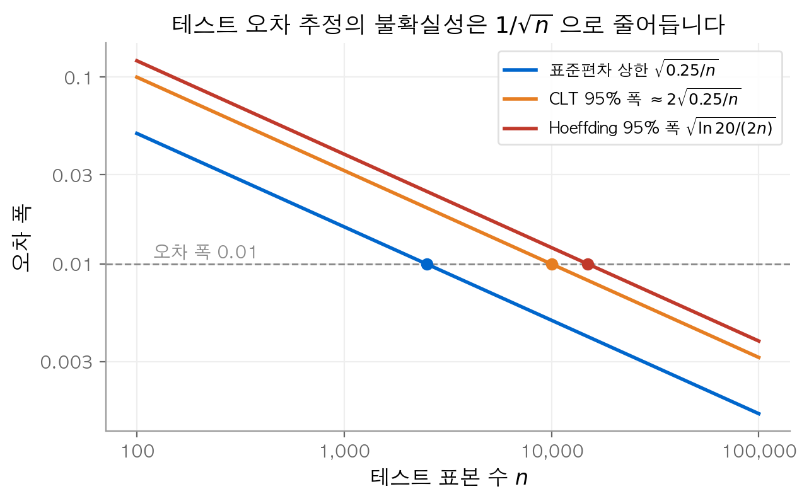
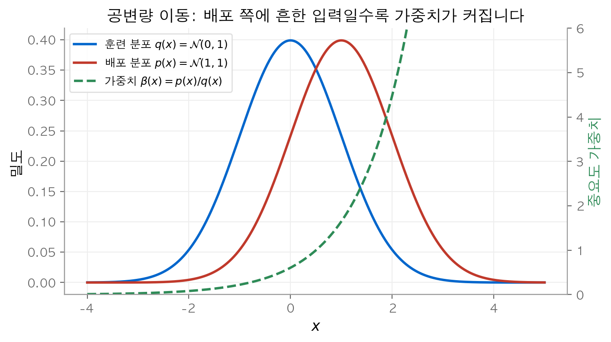

# 2. 선형 분류와 소프트맥스 회귀

[1장](01-linear-regression.md)의 선형 회귀는 "얼마나?"라는 질문에 숫자로 답했습니다. 이 장의 질문은 "어느 범주인가?"입니다. 선형 모델의 출력을 어떻게 확률로 바꾸고, 그 확률을 무엇으로 평가해야 할까요? 이 장의 결론은 다음과 같습니다. 소프트맥스(softmax)가 로짓을 확률 분포로 바꾸고, 교차 엔트로피(cross-entropy)가 그 분포를 평가합니다. 두 연산을 합치면 그래디언트가 "예측 확률 - 정답"이라는 단순한 형태가 됩니다. 마지막으로, 테스트 집합의 점수는 데이터 분포가 바뀌지 않는다는 가정 아래에서만 믿을 수 있다는 점을 확인합니다.

!!! info "원문과 자료"
    - [4. Linear Neural Networks for Classification](https://d2l.ai/chapter_linear-classification/index.html)
    - [4.1 Softmax Regression](https://d2l.ai/chapter_linear-classification/softmax-regression.html)
    - [4.2 The Image Classification Dataset](https://d2l.ai/chapter_linear-classification/image-classification-dataset.html)
    - [4.3 The Base Classification Model](https://d2l.ai/chapter_linear-classification/classification.html)
    - [4.4 Softmax Regression Implementation from Scratch](https://d2l.ai/chapter_linear-classification/softmax-regression-scratch.html)
    - [4.5 Concise Implementation of Softmax Regression](https://d2l.ai/chapter_linear-classification/softmax-regression-concise.html)
    - [4.6 Generalization in Classification](https://d2l.ai/chapter_linear-classification/generalization-classification.html)
    - [4.7 Environment and Distribution Shift](https://d2l.ai/chapter_linear-classification/environment-and-distribution-shift.html)

## 1. 분류 문제와 원-핫 표현

### 하드 할당과 소프트 할당

분류(classification)는 입력이 어느 범주에 속하는지 정하는 문제입니다. 분류기의 답은 두 가지 형태로 나올 수 있습니다.

| 형태 | 출력 | 예 |
| --- | --- | --- |
| 하드 할당(hard assignment) | 클래스 하나 | "개" |
| 소프트 할당(soft assignment) | 클래스별 확률 | (고양이 0.1, 닭 0.2, 개 0.7) |

최종 결정만 필요한 경우에도 대개 소프트 할당 모델을 학습합니다. 확률을 알면 가장 큰 값을 골라 하드 할당을 언제든 얻을 수 있습니다. 반대로 하드 할당에서는 확신의 정도를 되살릴 수 없습니다.

하나의 입력에 레이블이 여러 개 붙을 수도 있습니다. 예를 들어 한 기사가 "경제"와 "우주"를 함께 다룰 수 있습니다. 이런 문제를 다중 레이블 분류(multi-label classification)라고 합니다. 이 장은 정답이 하나뿐인 경우만 다룹니다.

### 원-핫 인코딩

2×2 회색조 이미지를 고양이, 닭, 개로 분류한다고 합시다. 특성은 픽셀 4개 $x_1, \dots, x_4$ 이고 클래스 수는 $q = 3$ 입니다. 레이블을 정수 1, 2, 3 으로 적으면 "고양이 < 닭 < 개" 같은 순서가 생깁니다. 범주 사이에는 순서가 없으므로 이 표현은 맞지 않습니다. 그래서 원-핫 인코딩(one-hot encoding)을 씁니다. 클래스 수만큼의 길이를 갖는 벡터에서 정답 위치만 1, 나머지는 0 으로 둡니다.

$$
y \in \{(1, 0, 0),\ (0, 1, 0),\ (0, 0, 1)\}
$$

원-핫 벡터는 "정답 클래스에 확률 1"을 둔 확률 분포로도 읽을 수 있습니다. 이 해석이 3절의 손실 함수로 이어집니다.

## 2. 선형 모델과 소프트맥스

### 클래스마다 아핀 함수 하나

선형 회귀는 출력이 하나였습니다. 분류에서는 클래스마다 점수 하나를 계산합니다. 이 점수를 로짓(logit) $o_i$ 라고 부릅니다.

$$
\mathbf{o} = \mathbf{W}\mathbf{x} + \mathbf{b}, \qquad \mathbf{W} \in \mathbb{R}^{3 \times 4},\ \mathbf{b} \in \mathbb{R}^{3}
$$

특성 4개와 클래스 3개이므로 가중치 12개와 편향 3개가 필요합니다. 모든 출력이 모든 입력에 연결되므로 이 층을 완전 연결층(fully connected layer)이라고 합니다.


### 소프트맥스의 정의

로짓은 음수일 수 있고 합이 1 이 아닙니다. 그래서 바로 확률로 쓸 수 없습니다. 지수 함수로 모든 값을 양수로 만들고, 합으로 나누어 정규화합니다. 이 연산이 소프트맥스입니다.

$$
\hat{\mathbf{y}} = \mathrm{softmax}(\mathbf{o}), \qquad \hat{y}_i = \frac{\exp(o_i)}{\sum_j \exp(o_j)}
$$

소프트맥스에는 세 가지 성질이 있습니다.

1. 출력은 모두 양수이고 합이 1 입니다. 따라서 확률 분포입니다.
2. 순서를 보존합니다. 따라서 $\operatorname*{argmax}_j \hat{y}_j = \operatorname*{argmax}_j o_j$ 입니다. 예측 클래스만 필요하면 소프트맥스를 계산하지 않아도 됩니다.
3. 모든 로짓에 같은 상수 $c$ 를 더해도 결과가 같습니다. 분자와 분모에 $\exp(c)$ 가 똑같이 곱해지기 때문입니다. 이 성질은 5절의 수치 안정화에 쓰입니다.

**수치 예시.** $\mathbf{o} = (2.0,\ 1.0,\ 0.1)$ 이라고 합시다. 지수값은 $(7.389,\ 2.718,\ 1.105)$ 이고 합은 $11.213$ 입니다. 나누면 $\hat{\mathbf{y}} = (0.659,\ 0.242,\ 0.099)$ 입니다. 모든 로짓에 100 을 더해 $(102,\ 101,\ 100.1)$ 로 바꾸어도 결과는 같은 $(0.659,\ 0.242,\ 0.099)$ 입니다.

<figure markdown>

<figcaption markdown>
<span class="fig-title"><b>Figure 1.</b> 로짓 크기에 따른 소프트맥스 출력</span>

로짓의 차이가 커질수록 확률이 가장 큰 클래스 하나로 몰립니다.
</figcaption>
</figure>

로짓의 차이가 무한히 커지면 출력은 argmax 의 원-핫 벡터에 가까워집니다. 소프트맥스는 그 "max"를 부드럽게 만든 함수입니다. 통계 물리의 볼츠만 분포 $\exp(-E/kT)$ 와 같은 형태이며, 로짓에 곱한 배율은 온도 $T$ 의 역수에 해당합니다.

### 미니배치 벡터화

$n$ 개 예시를 행으로 쌓은 $\mathbf{X} \in \mathbb{R}^{n \times d}$ 를 한 번에 처리합니다. 이때 가중치는 $\mathbf{W} \in \mathbb{R}^{d \times q}$, 편향은 $\mathbf{b} \in \mathbb{R}^{1 \times q}$ 로 둡니다.

$$
\mathbf{O} = \mathbf{X}\mathbf{W} + \mathbf{b}, \qquad \hat{\mathbf{Y}} = \mathrm{softmax}(\mathbf{O})
$$

소프트맥스는 행마다 따로 적용합니다. 계산의 대부분은 행렬 곱 $\mathbf{X}\mathbf{W}$ 하나이며 비용은 $\mathcal{O}(ndq)$ 입니다.

<figure markdown>

<figcaption markdown>
<span class="fig-title"><b>Figure 2.</b> 2차원 데이터에서 소프트맥스 회귀의 결정 영역</span>

두 클래스의 경계는 $o_i = o_j$ 인 직선이므로, 결정 영역이 직선으로 나뉩니다.
</figcaption>
</figure>

결정 경계가 직선인 이유는 간단합니다. 클래스 $i$ 와 $j$ 의 경계는 $\hat{y}_i = \hat{y}_j$ 인 점들입니다. 이 조건은 $o_i = o_j$, 즉 $(\mathbf{w}_i - \mathbf{w}_j)^\top \mathbf{x} + (b_i - b_j) = 0$ 과 같습니다. 이것은 초평면의 식입니다. 따라서 소프트맥스 회귀는 이름에 "회귀"가 붙지만 선형 분류기입니다.

## 3. 교차 엔트로피 손실

### 최대 가능도에서 손실로

소프트맥스 출력 $\hat{\mathbf{y}}$ 를 조건부 확률 $P(y \mid \mathbf{x})$ 의 추정값으로 봅니다. 예시들이 서로 독립이라면 전체 데이터의 가능도는 곱입니다.

$$
P(\mathbf{Y} \mid \mathbf{X}) = \prod_{i=1}^{n} P(\mathbf{y}^{(i)} \mid \mathbf{x}^{(i)})
$$

가능도를 최대화하는 일은 음의 로그 가능도를 최소화하는 일과 같습니다. 로그는 곱을 합으로 바꿉니다.

$$
-\log P(\mathbf{Y} \mid \mathbf{X}) = \sum_{i=1}^{n} l(\mathbf{y}^{(i)}, \hat{\mathbf{y}}^{(i)}), \qquad
l(\mathbf{y}, \hat{\mathbf{y}}) = -\sum_{j=1}^{q} y_j \log \hat{y}_j
$$

$l$ 을 교차 엔트로피 손실(cross-entropy loss)이라고 합니다. $\mathbf{y}$ 가 원-핫이면 정답 클래스 $y$ 의 항 하나만 남습니다. 따라서 손실은 $-\log \hat{y}_y$ 입니다.

직관은 다음과 같습니다. 정답 클래스에 준 확률이 1 이면 손실은 0 입니다. 확률이 0 에 가까워질수록 손실은 무한대로 커집니다. 유한한 가중치로는 소프트맥스 출력이 정확히 1 이 되지 않습니다. 따라서 손실은 0 보다 크며 0 에 다가가기만 합니다.

**수치 예시.** 앞의 $\hat{\mathbf{y}} = (0.659,\ 0.242,\ 0.099)$ 에서 정답별 손실은 다음과 같습니다.

| 정답 클래스 | $\hat{y}_y$ | 손실 $-\log \hat{y}_y$ |
| --- | --- | --- |
| 고양이 | 0.659 | 0.417 |
| 닭 | 0.242 | 1.417 |
| 개 | 0.099 | 2.317 |

모델이 틀린 쪽을 정답으로 볼 때 손실이 크게 늘어납니다. 손실 차이는 로짓 차이와 정확히 같습니다(1.417 - 0.417 = 2.0 - 1.0).

### 소프트맥스와 결합한 그래디언트

소프트맥스 식을 손실에 대입하면 로짓만으로 손실을 적을 수 있습니다.

$$
l(\mathbf{y}, \hat{\mathbf{y}})
= -\sum_{j} y_j \log \frac{\exp(o_j)}{\sum_k \exp(o_k)}
= \log \sum_{k=1}^{q} \exp(o_k) - \sum_{j=1}^{q} y_j o_j
$$

두 번째 등호에서 $\sum_j y_j = 1$ 을 썼습니다. 첫째 항 $\log \sum_k \exp(o_k)$ 를 로그-합-지수(log-sum-exp)라고 부릅니다. 로그-합-지수를 $o_j$ 로 미분하면 소프트맥스가 나옵니다. 따라서 그래디언트는 다음과 같습니다.

$$
\partial_{o_j} l(\mathbf{y}, \hat{\mathbf{y}}) = \frac{\exp(o_j)}{\sum_k \exp(o_k)} - y_j = \mathrm{softmax}(\mathbf{o})_j - y_j
$$

그래디언트는 "예측 확률 - 정답"입니다. 선형 회귀에서 제곱 오차의 그래디언트가 "예측 - 관측"이었던 것과 같은 형태입니다. 이 형태는 우연이 아닙니다. 지수족(exponential family) 분포의 음의 로그 가능도는 모두 이런 그래디언트를 줍니다.

**수치 예시.** $\mathbf{o} = (2.0,\ 1.0,\ 0.1)$, 정답이 고양이라면 그래디언트는 다음과 같습니다.

$$
\hat{\mathbf{y}} - \mathbf{y} = (0.659 - 1,\ 0.242,\ 0.099) = (-0.341,\ 0.242,\ 0.099)
$$

수치 미분(중앙 차분, $h = 10^{-6}$)으로 구한 값도 $(-0.341,\ 0.242,\ 0.099)$ 로 같습니다. 경사 하강법은 그래디언트의 반대 방향으로 움직입니다. 따라서 정답 로짓은 올라가고 나머지 로짓은 확률에 비례해 내려갑니다.

<figure markdown>

<figcaption markdown>
<span class="fig-title"><b>Figure 3.</b> 교차 엔트로피 손실과 그래디언트</span>

그래디언트의 각 성분은 $-1$ 과 $1$ 사이에 있고, 세 성분의 합은 항상 0입니다.
</figcaption>
</figure>

그래디언트의 각 성분은 확률과 0 또는 1 의 차이이므로 절댓값이 1 을 넘지 않습니다. 성분의 합은 $\sum_j \hat{y}_j - \sum_j y_j = 1 - 1 = 0$ 입니다. 정답 확률이 1 에 다가가면 모든 성분이 0 으로 줄어듭니다. 이미 잘 맞힌 예시는 학습에 거의 영향을 주지 않습니다. 정답이 $(0.1,\ 0.2,\ 0.7)$ 같은 분포(소프트 레이블)여도 같은 손실 식과 그래디언트가 그대로 성립합니다.

## 4. 정보 이론으로 본 교차 엔트로피

### 놀람과 엔트로피

확률 $P(j)$ 인 사건 $j$ 를 관측했을 때의 놀람(surprisal)을 $-\log P(j)$ 로 정의합니다. 드문 사건일수록 놀람이 큽니다. 확률 1 인 사건의 놀람은 0 입니다. 엔트로피(entropy)는 놀람의 기댓값입니다.

$$
H[P] = \sum_j -P(j) \log P(j)
$$

엔트로피는 분포 $P$ 에서 나온 데이터를 부호화하는 데 필요한 최소 평균 길이입니다. 자연로그를 쓰면 단위는 냇(nat)이고, 밑이 2 인 로그를 쓰면 비트(bit)입니다. 1 nat 은 $1/\log 2 \approx 1.44$ 비트입니다.

**수치 예시.** $P = (0.5,\ 0.25,\ 0.25)$ 의 엔트로피는 $1.040$ nat, 즉 정확히 $1.5$ 비트입니다. 첫 번째 기호에 1 비트, 나머지 두 기호에 2 비트씩 부호를 주면 평균 길이가 $0.5 \cdot 1 + 0.5 \cdot 2 = 1.5$ 비트가 됩니다.

### 교차 엔트로피와 KL 발산

실제 데이터는 $P$ 에서 나오지만 관찰자는 $Q$ 를 믿는다고 합시다. 이 관찰자가 느끼는 평균 놀람이 교차 엔트로피입니다.

$$
H(P, Q) = \sum_j -P(j) \log Q(j)
$$

교차 엔트로피는 $Q = P$ 일 때 최소이고 그 값은 $H(P, P) = H[P]$ 입니다. 두 값의 차이를 KL 발산(Kullback-Leibler divergence)이라고 합니다.

$$
D_{\mathrm{KL}}(P \| Q) = H(P, Q) - H[P] = \sum_j P(j) \log \frac{P(j)}{Q(j)} \ \ge\ 0
$$

KL 발산은 "$Q$ 를 믿은 대가로 더 쓰게 되는 부호 길이"입니다. 학습에서 $P$ 는 데이터 분포로 고정되어 있습니다. 따라서 $H[P]$ 는 상수이고, 교차 엔트로피를 최소화하는 일은 KL 발산을 최소화하는 일과 같습니다.

**수치 예시.** $P = (0.5,\ 0.25,\ 0.25)$, $Q = (1/3,\ 1/3,\ 1/3)$ 이라고 합시다.

| 양 | 값 (nat) |
| --- | --- |
| $H[P]$ | 1.0397 |
| $H(P, Q) = \log 3$ | 1.0986 |
| $D_{\mathrm{KL}}(P \| Q)$ | 0.0589 |
| $D_{\mathrm{KL}}(Q \| P)$ | 0.0566 |

마지막 두 행이 다릅니다. KL 발산은 대칭이 아니므로 거리 함수가 아닙니다.

<figure markdown>

<figcaption markdown>
<span class="fig-title"><b>Figure 4.</b> 이진 분포의 엔트로피와 교차 엔트로피</span>

교차 엔트로피는 $Q = P$ 에서 최소이고, 곡선과 점선 사이의 높이가 KL 발산입니다.
</figcaption>
</figure>

교차 엔트로피 손실은 두 관점으로 읽을 수 있습니다. 하나는 관측 데이터의 가능도를 최대화하는 관점입니다. 다른 하나는 레이블을 전달하는 데 드는 평균 비트 수를 최소화하는 관점입니다. 두 관점은 같은 목적 함수를 줍니다.

## 5. 구현과 수치 안정성

### 데이터와 정확도

원문은 Fashion-MNIST 데이터셋으로 실습합니다. 이 데이터셋은 10 개 의류 범주의 28×28 회색조 이미지입니다. 훈련 이미지는 60,000 장, 테스트 이미지는 10,000 장입니다. 이미지를 784 차원 벡터로 펼치면 소프트맥스 회귀의 파라미터는 $784 \times 10 + 10 = 7{,}850$ 개입니다.

평가에는 정확도(accuracy)를 씁니다. 각 행에서 argmax 로 예측 클래스를 고르고 정답과 비교한 뒤 평균을 냅니다. 정확도는 미분할 수 없습니다. 그래서 학습은 교차 엔트로피로 하고 평가는 정확도로 합니다.

### 처음부터 구현하기

아래 코드는 소프트맥스, 교차 엔트로피, 정확도를 NumPy 로 직접 구현합니다. 교차 엔트로피는 원-핫 벡터를 만들지 않고 정답 위치의 확률만 인덱싱으로 꺼냅니다.

```python
import numpy as np

def softmax(O):
    O_exp = np.exp(O)
    return O_exp / O_exp.sum(axis=1, keepdims=True)

def cross_entropy(Y_hat, y):
    return -np.log(Y_hat[np.arange(len(y)), y])

O = np.array([[2.0, 1.0, 0.1],
              [0.5, 2.5, 0.0]])
y = np.array([0, 2])
Y_hat = softmax(O)
print(Y_hat.round(3))                       # [[0.659 0.242 0.099]
                                            #  [0.111 0.821 0.067]]
print(cross_entropy(Y_hat, y).round(3))     # [0.417 2.697]
print((Y_hat.argmax(axis=1) == y).mean())   # 0.5
```

두 번째 예시는 정답이 2 번 클래스인데 모델이 1 번 클래스를 골랐습니다. 그래서 손실이 2.697 로 크고 정확도는 0.5 입니다.

### 오버플로와 언더플로

위의 `softmax` 는 로짓이 크면 실패합니다. 단정밀도 실수는 대략 $10^{-38}$ 부터 $10^{38}$ 까지만 표현합니다. $\exp(89)$ 는 이미 단정밀도 범위를 넘어 `inf` 가 됩니다. 로짓이 $(1000,\ 999,\ 990)$ 이면 배정밀도에서도 분자와 분모가 모두 `inf` 이고, 결과는 `nan` 입니다.

해결책은 2절의 세 번째 성질입니다. 최댓값 $\bar{o} = \max_k o_k$ 를 모든 로짓에서 뺍니다.

$$
\hat{y}_j = \frac{\exp(o_j - \bar{o})}{\sum_k \exp(o_k - \bar{o})}
$$

이제 모든 지수는 0 이하입니다. 분자는 1 이하이고 분모는 1 이상 $q$ 이하입니다. 따라서 오버플로가 일어나지 않습니다. 같은 예시에서 결과는 $(0.7310,\ 0.2689,\ 0.0000332)$ 입니다.

언더플로는 남아 있습니다. 로짓 차이가 크면 $\exp(o_j - \bar{o})$ 가 0 으로 반올림됩니다. 예를 들어 단정밀도에서 로짓 $(0,\ -120,\ 5)$ 의 두 번째 확률은 0 이 됩니다. 이 값에 로그를 취하면 $-\infty$ 이고, 역전파에서 `nan` 이 퍼집니다.

### 로그-합-지수 기법

손실은 어차피 확률의 로그를 씁니다. 그래서 소프트맥스와 로그를 한 식으로 합칩니다.

$$
\log \hat{y}_j = (o_j - \bar{o}) - \log \sum_k \exp(o_k - \bar{o})
$$

이 식은 지수를 0 이하에서만 계산합니다. 또 작은 확률의 로그를 확률을 거치지 않고 바로 구합니다. 앞의 단정밀도 예시에서 두 번째 클래스의 로그 확률은 $-\infty$ 대신 약 $-125.01$ 로 나옵니다.

```python
import numpy as np

def log_softmax(O):
    O_bar = O.max(axis=1, keepdims=True)
    S = O - O_bar
    return S - np.log(np.exp(S).sum(axis=1, keepdims=True))

O = np.array([[1000.0, 999.0, 990.0]])
print(np.exp(O) / np.exp(O).sum())    # [[nan nan nan]]  (오버플로 경고)
print(log_softmax(O).round(4))        # [[ -0.3133  -1.3133 -10.3133]]
```

실무 규칙은 하나입니다. 손실 함수에 소프트맥스 확률이 아니라 로짓을 넘깁니다. PyTorch 의 `F.cross_entropy` 는 로짓과 정수 레이블을 받아 내부에서 위 식으로 계산합니다.

```python
import torch
from torch import nn
from torch.nn import functional as F

model = nn.Sequential(nn.Flatten(), nn.LazyLinear(10))   # 784 -> 10
optimizer = torch.optim.SGD(model.parameters(), lr=0.1)

def train_step(X, y):              # X: (256, 1, 28, 28), y: (256,)
    logits = model(X)              # 소프트맥스를 적용하지 않습니다
    loss = F.cross_entropy(logits, y)
    optimizer.zero_grad()
    loss.backward()
    optimizer.step()
    return loss.item()
```

원문은 배치 크기 256, 학습률 0.1, 10 에포크로 학습합니다. 모델에 소프트맥스 층이 없고, 예측 클래스는 로짓의 argmax 로 얻습니다.

## 6. 분류의 일반화

### 테스트 오차는 평균 추정 문제입니다

훈련에 쓰지 않은 테스트 집합 $\mathcal{D}$ 에서 고정된 분류기 $f$ 의 오차를 셉니다. 이 값이 경험적 오차(empirical error)입니다.

$$
\epsilon_\mathcal{D}(f) = \frac{1}{n} \sum_{i=1}^{n} \mathbf{1}\big(f(\mathbf{x}^{(i)}) \neq y^{(i)}\big)
$$

우리가 알고 싶은 값은 모집단 오차(population error) $\epsilon(f) = E_{(\mathbf{x}, y) \sim P}\, \mathbf{1}(f(\mathbf{x}) \neq y)$ 입니다. $f$ 가 테스트 집합과 무관하게 정해졌다면, 경험적 오차는 모집단 오차의 불편 추정량입니다. 문제는 그 추정이 얼마나 정확한가입니다.

각 항은 성공 확률 $\epsilon(f)$ 인 베르누이 변수입니다. 분산은 $\epsilon(f)(1 - \epsilon(f)) \le 0.25$ 입니다. 중심 극한 정리에 따라 경험적 오차의 표준편차는 $\sqrt{0.25 / n}$ 이하입니다. 오차 막대를 절반으로 줄이려면 표본이 4 배 필요합니다.

유한 표본에서도 성립하는 보장은 호에프딩 부등식(Hoeffding's inequality)이 줍니다.

$$
P\big(\epsilon_\mathcal{D}(f) - \epsilon(f) \ge t\big) < \exp(-2nt^2)
$$

**수치 예시.** 오차 폭 $t = 0.01$ 을 목표로 할 때 필요한 표본 수입니다.

| 기준 | 계산 | 필요한 $n$ |
| --- | --- | --- |
| 표준편차 1 개 | $\sqrt{0.25/n} = 0.01$ | 2,500 |
| CLT 약 95% (표준편차 2 개) | $2\sqrt{0.25/n} = 0.01$ | 10,000 |
| 호에프딩 95% | $\exp(-2n \cdot 0.01^2) = 0.05$ | 약 14,979 |

<figure markdown>

<figcaption markdown>
<span class="fig-title"><b>Figure 5.</b> 테스트 표본 수에 따른 오차 폭</span>

로그 축에서 세 직선의 기울기는 모두 $-1/2$ 입니다. 오차 폭은 표본 수의 제곱근에 반비례합니다.
</figcaption>
</figure>

호에프딩 기준이 조금 더 보수적이지만 세 기준은 같은 규모입니다. Fashion-MNIST 의 테스트 이미지 10,000 장은 대략 $\pm 0.01$ 의 정밀도를 줍니다.

### 테스트 집합 재사용의 위험

위 보장은 분류기 하나에만 성립합니다. 같은 테스트 집합으로 분류기 $k$ 개를 평가하면 상황이 달라집니다. 각 평가가 5% 확률로 잘못된 결론을 준다고 합시다. 평가가 서로 독립이라면 적어도 하나가 잘못될 확률은 $1 - 0.95^k$ 입니다.

| $k$ | 1 | 5 | 20 | 100 |
| --- | --- | --- | --- | --- |
| $1 - 0.95^k$ | 0.05 | 0.226 | 0.642 | 0.994 |

이것이 다중 가설 검정(multiple hypothesis testing)의 문제입니다. 더 심각한 문제는 적응적 과적합(adaptive overfitting)입니다. $f_1$ 의 테스트 점수를 보고 $f_2$ 를 설계하면 테스트 집합의 정보가 모델에 스며듭니다. 그 순간 테스트 집합은 더 이상 엄밀한 의미의 테스트 집합이 아닙니다. 실무 지침은 다음과 같습니다.

- 모델 선택과 하이퍼파라미터 조정은 검증 집합으로 합니다.
- 테스트 집합은 가능한 한 적게 봅니다.
- 여러 모델을 비교해 신뢰 구간을 보고할 때는 다중 비교를 보정합니다.
- 벤치마크를 오래 운영하면 새 테스트 집합을 만들고, 오래된 테스트 집합은 검증 집합으로 내립니다.

### 통계적 학습 이론과 VC 차원

훈련 집합으로 고른 모델 $f_\mathcal{S}$ 의 일반화는 더 어려운 문제입니다. 모델을 고르는 데 같은 데이터를 썼기 때문입니다. 통계적 학습 이론은 모델 클래스 $\mathcal{F}$ 의 모든 함수에서 경험적 오차와 참 오차가 동시에 가깝기를 요구합니다. 이를 균등 수렴(uniform convergence)이라고 합니다.

모델 클래스의 복잡도는 VC 차원(Vapnik-Chervonenkis dimension)으로 잽니다. VC 차원은 모델 클래스가 가능한 모든 이진 레이블을 실현할 수 있는 점의 최대 개수입니다. $d$ 차원 입력의 선형 분류기는 VC 차원이 $d + 1$ 입니다. 예를 들어 2 차원 직선은 점 3 개의 모든 레이블을 나눌 수 있지만 점 4 개(XOR 배치)는 나누지 못합니다. 일반화 간격은 $c\sqrt{(\mathrm{VC} - \log\delta)/n}$ 정도로 줄어듭니다. 이 속도도 $\mathcal{O}(1/\sqrt{n})$ 입니다.

심층 신경망은 무작위 레이블도 외울 만큼 VC 차원이 크지만 실제로는 잘 일반화합니다. 고전 이론의 한계는 이 현상 앞에서 지나치게 비관적입니다([3장](03-mlp.md)).

## 7. 환경 변화와 분포 이동

### 세 가지 분포 이동

지금까지는 훈련 데이터와 배포 환경의 데이터가 같은 분포에서 나온다고 가정했습니다. 실제로는 이 가정이 자주 깨집니다. 훈련 분포를 $q$, 배포(목표) 분포를 $p$ 로 적습니다. 아무 가정 없이 두 분포가 달라지면 학습은 불가능합니다. 예를 들어 입력은 그대로이고 모든 레이블만 뒤바뀌면, 그 변화는 데이터만 보고 알아낼 수 없습니다. 그래서 무엇이 바뀌고 무엇이 유지되는지 가정합니다.

| 이동 종류 | 바뀌는 것 | 유지되는 것 | 맞는 상황 |
| --- | --- | --- | --- |
| 공변량 이동(covariate shift) | $p(\mathbf{x})$ | $p(y \mid \mathbf{x})$ | 입력이 레이블의 원인 |
| 레이블 이동(label shift) | $p(y)$ | $p(\mathbf{x} \mid y)$ | 레이블이 입력의 원인 (질병 → 증상) |
| 개념 이동(concept shift) | $p(y \mid \mathbf{x})$ | (없음) | 레이블의 정의가 바뀜 |

실사 사진으로 학습한 분류기를 만화 그림에 쓰면 공변량 이동이 생깁니다. 같은 음료를 지역마다 다른 이름으로 부르는 경우는 개념 이동입니다.

### 공변량 이동의 보정

우리가 최소화하고 싶은 값은 참 위험 $E_{p(\mathbf{x}, y)}[l(f(\mathbf{x}), y)]$ 입니다. 손에 있는 표본은 $q$ 에서 나왔습니다. 공변량 이동에서는 $p(y \mid \mathbf{x}) = q(y \mid \mathbf{x})$ 이므로 다음 등식이 성립합니다.

$$
\iint l(f(\mathbf{x}), y)\, p(y \mid \mathbf{x})\, p(\mathbf{x})\, d\mathbf{x}\, dy
= \iint l(f(\mathbf{x}), y)\, q(y \mid \mathbf{x})\, q(\mathbf{x}) \frac{p(\mathbf{x})}{q(\mathbf{x})}\, d\mathbf{x}\, dy
$$

따라서 각 훈련 예시에 중요도 가중치(importance weight) $\beta_i = p(\mathbf{x}_i) / q(\mathbf{x}_i)$ 를 곱해 가중 경험적 위험을 최소화합니다.

$$
\underset{f}{\text{minimize}} \quad \frac{1}{n} \sum_{i=1}^{n} \beta_i\, l(f(\mathbf{x}_i), y_i)
$$

밀도비는 로지스틱 회귀로 추정합니다. 훈련 표본에 $z = -1$, 배포 표본에 $z = 1$ 을 붙이고 둘을 구분하는 분류기를 학습합니다. 두 표본의 수가 같으면 $P(z = 1 \mid \mathbf{x}) = p(\mathbf{x}) / (p(\mathbf{x}) + q(\mathbf{x}))$ 입니다. 분류기를 $P(z = 1 \mid \mathbf{x}) = 1/(1 + \exp(-h(\mathbf{x})))$ 로 두면 가중치는 $\beta_i = \exp(h(\mathbf{x}_i))$ 가 됩니다. 가중치가 너무 커지지 않도록 $\min(\exp(h(\mathbf{x}_i)),\ c)$ 로 자르기도 합니다. 이 방법은 배포 쪽의 레이블 없는 입력만 있으면 됩니다. 단, $p(\mathbf{x}) > 0$ 인데 $q(\mathbf{x}) = 0$ 인 영역이 있으면 가중치가 무한대가 되어 보정할 수 없습니다.

**수치 예시.** $q = \mathcal{N}(0, 1)$, $p = \mathcal{N}(1, 1)$ 이면 밀도비는 $\exp(x - 0.5)$ 입니다. 즉 이상적인 $h(x) = x - 0.5$ 입니다.

| $x$ | $-1$ | $0$ | $1$ | $2$ |
| --- | --- | --- | --- | --- |
| $\beta(x)$ | 0.223 | 0.607 | 1.649 | 4.482 |

<figure markdown>

<figcaption markdown>
<span class="fig-title"><b>Figure 6.</b> 공변량 이동과 중요도 가중치</span>

배포 분포에서 흔하고 훈련 분포에서 드문 입력일수록 가중치가 커집니다.
</figcaption>
</figure>

### 레이블 이동의 보정

레이블 이동에서는 가중치가 레이블 비율 $\beta_i = p(y_i) / q(y_i)$ 입니다. $q(y)$ 는 훈련 레이블을 세면 됩니다. 어려운 부분은 레이블이 없는 배포 데이터에서 $p(y)$ 를 구하는 일입니다.

먼저 훈련 분포의 검증 집합으로 혼동 행렬(confusion matrix) $\mathbf{C}$ 를 만듭니다. $c_{ij}$ 는 정답이 $j$ 인 예시를 $i$ 로 예측한 비율입니다. 레이블 이동에서는 $p(\mathbf{x} \mid y)$ 가 유지되므로 $\mathbf{C}$ 도 배포 환경에서 그대로 유지됩니다. 배포 데이터에서 예측 레이블의 평균 $\mu(\hat{\mathbf{y}})$ 를 구하면 다음 연립 방정식이 성립합니다.

$$
\mathbf{C}\, p(\mathbf{y}) = \mu(\hat{\mathbf{y}}) \quad \Longrightarrow \quad p(\mathbf{y}) = \mathbf{C}^{-1} \mu(\hat{\mathbf{y}})
$$

```python
import numpy as np

C = np.array([[0.9, 0.2],      # c_ij: 정답 j 를 i 로 예측한 비율
              [0.1, 0.8]])
mu = np.array([0.34, 0.66])    # 배포 데이터에서 예측 레이블의 평균
p_y = np.linalg.solve(C, mu)   # C p(y) = mu
q_y = np.array([0.5, 0.5])     # 훈련 레이블 분포
print(p_y, p_y / q_y)          # [0.2 0.8] [0.4 1.6]
```

예측 레이블만 보면 두 번째 클래스 비율이 0.66 입니다. 혼동 행렬로 보정하면 실제 비율은 0.8 입니다. 따라서 두 번째 클래스 훈련 예시에 가중치 1.6, 첫 번째 클래스 예시에 0.4 를 줍니다. 이 방법은 분류기가 어느 정도 정확하고, $\mathbf{C}$ 가 역행렬을 가지며, 배포 환경에 새 클래스가 없을 때만 씁니다.

### 개념 이동과 학습 문제의 분류

개념 이동은 원리적으로 보정하기 어렵습니다. 변화가 갑작스러우면 새 레이블을 모아 다시 학습해야 합니다. 변화가 점진적이면 기존 가중치에서 시작해 새 데이터로 몇 단계 갱신합니다. 광고 선호도, 카메라 렌즈의 노화, 뉴스 주제의 변화가 그런 예입니다.

환경이 바뀌는 방식에 따라 학습 문제도 나뉩니다. 고정 데이터로 한 번 학습하는 배치 학습(batch learning), 예측 뒤 정답을 받아 계속 갱신하는 온라인 학습(online learning), 그리고 행동이 환경을 바꾸는 밴딧, 제어, 강화 학습이 있습니다.

마지막으로, 배포된 모델의 결정은 사람에게 영향을 줍니다. 정확도 하나가 아니라 오류 종류별 비용을 따져 결정 임곗값을 정해야 합니다. 모델의 결정이 데이터 분포 자체를 바꾸는 되먹임 고리(feedback loop)도 생깁니다. 예를 들어 예측 치안 모델이 순찰을 한 지역에 몰면, 그 지역에서 기록되는 범죄가 늘어 모델의 예측이 다시 강화됩니다.

## 정리

- 분류의 레이블은 원-핫 벡터로 표현합니다. 정수 레이블은 범주 사이에 없는 순서를 만듭니다.
- 소프트맥스 $\hat{y}_i = \exp(o_i) / \sum_j \exp(o_j)$ 는 로짓을 확률 분포로 바꿉니다. 순서를 보존하고 상수 이동에 불변입니다.
- 소프트맥스 회귀의 결정 경계 $o_i = o_j$ 는 초평면입니다. 따라서 소프트맥스 회귀는 선형 분류기입니다.
- 교차 엔트로피 손실은 음의 로그 가능도입니다. 원-핫 레이블에서는 $-\log \hat{y}_y$ 로 줄어듭니다.
- 소프트맥스와 교차 엔트로피를 합친 그래디언트는 $\mathrm{softmax}(\mathbf{o}) - \mathbf{y}$ 입니다. 각 성분은 $[-1, 1]$ 안에 있고 합은 0 입니다.
- 교차 엔트로피 $H(P, Q)$ 는 엔트로피 $H[P]$ 와 KL 발산 $D_{\mathrm{KL}}(P \| Q)$ 의 합입니다. 데이터 분포가 고정되어 있으므로 교차 엔트로피 최소화는 KL 최소화와 같습니다.
- 소프트맥스는 최댓값을 빼서 오버플로를 막습니다. 로그-합-지수로 로그 확률을 직접 계산하면 언더플로도 막습니다. 손실 함수에는 로짓을 넘깁니다.
- 테스트 오차의 불확실성은 $\mathcal{O}(1/\sqrt{n})$ 로 줄어듭니다. 오차 폭 0.01 에는 약 10,000 개의 테스트 표본이 필요합니다.
- 테스트 집합을 여러 번 쓰면 다중 검정과 적응적 과적합 때문에 점수를 믿을 수 없게 됩니다. 모델 선택은 검증 집합으로 합니다.
- 공변량 이동은 $p(\mathbf{x})/q(\mathbf{x})$, 레이블 이동은 $p(y)/q(y)$ 로 가중치를 주어 보정합니다. 개념 이동은 새 데이터로 다시 학습하거나 점진적으로 갱신해야 합니다.
