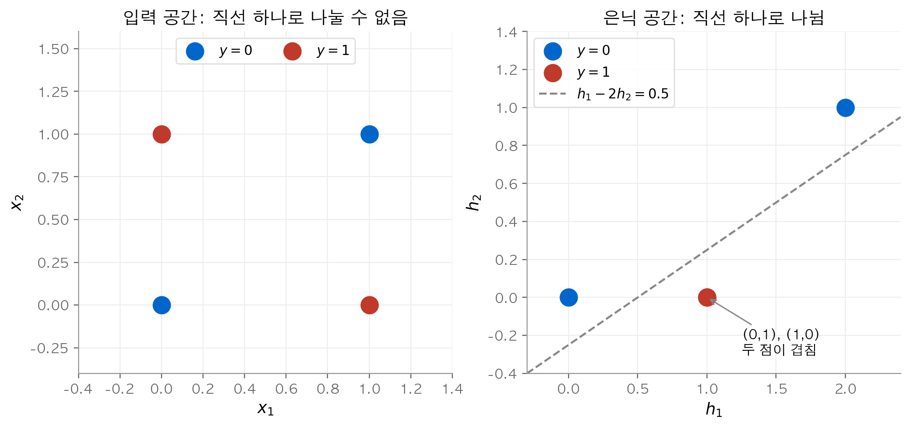
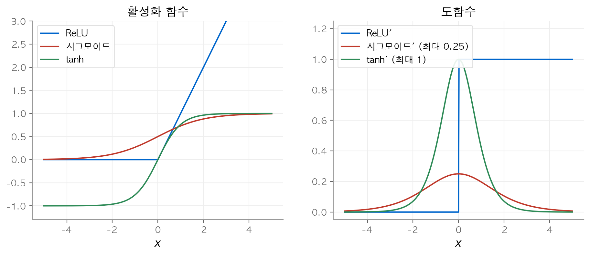
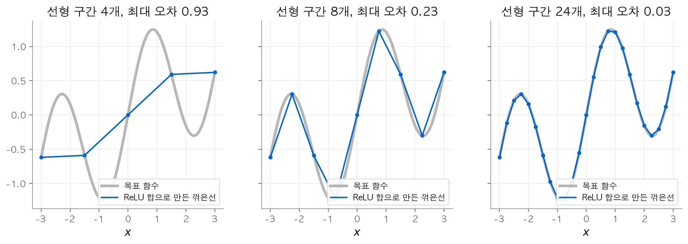
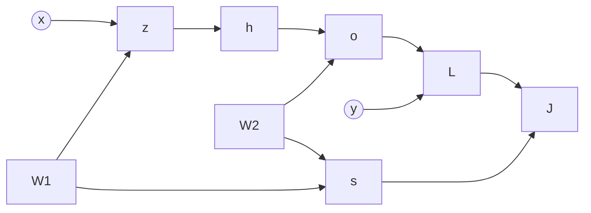
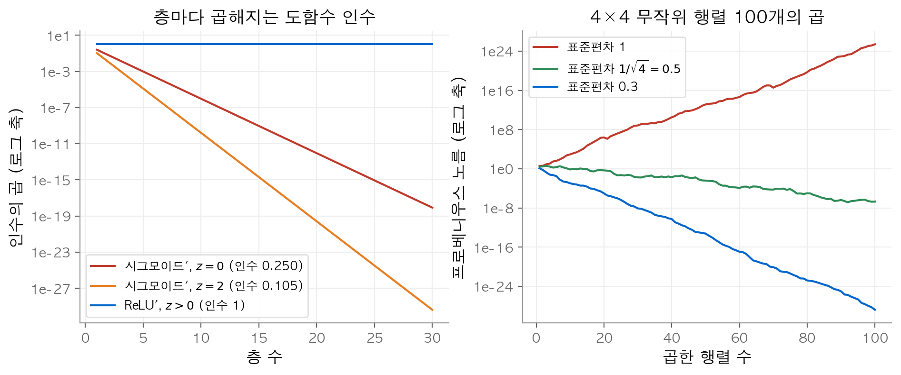
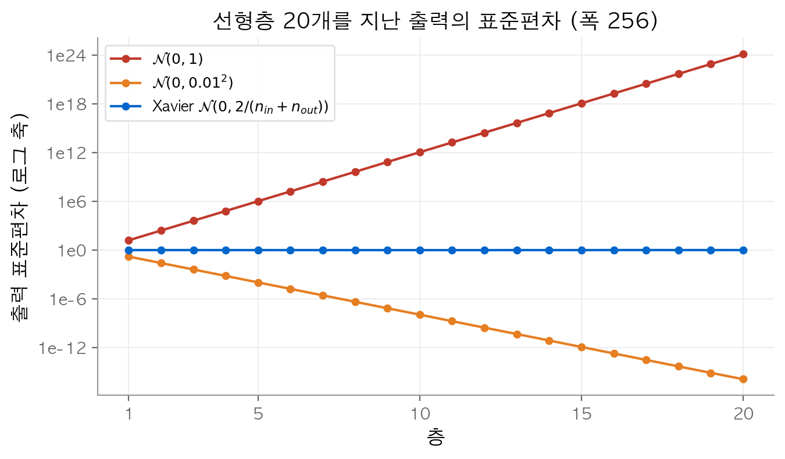
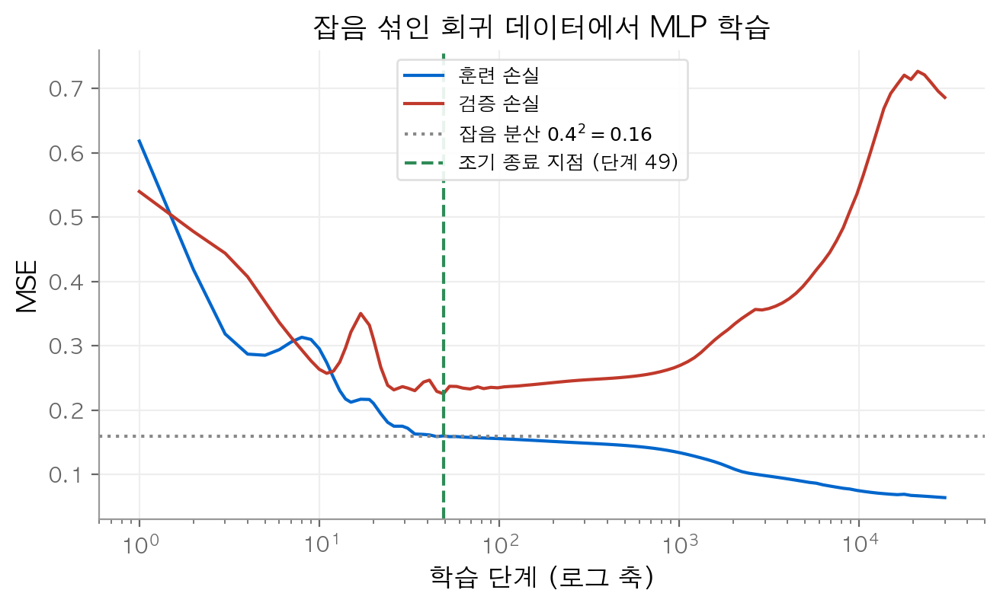

# 3. 다층 퍼셉트론

[2장](02-linear-classification.md)의 소프트맥스 회귀는 입력과 출력 사이에 아핀 변환 하나만 둡니다.
이 장의 질문은 두 가지입니다. 층을 더 쌓으면 무엇이 달라질까요? 깊은 신경망은 어떻게 해야 안정적으로 학습할까요?
결론은 다음과 같습니다. 층 사이에 **비선형 활성화 함수**를 넣어야 표현력이 커집니다.
깊은 신경망을 학습하려면 기울기가 층을 지나며 사라지거나 폭주하지 않도록 **초기화와 정규화**를 함께 설계해야 합니다.

!!! info "원문과 자료"
    - [5. Multilayer Perceptrons](https://d2l.ai/chapter_multilayer-perceptrons/index.html)
    - [5.1 Multilayer Perceptrons](https://d2l.ai/chapter_multilayer-perceptrons/mlp.html)
    - [5.2 Implementation of Multilayer Perceptrons](https://d2l.ai/chapter_multilayer-perceptrons/mlp-implementation.html)
    - [5.3 Forward Propagation, Backward Propagation, and Computational Graphs](https://d2l.ai/chapter_multilayer-perceptrons/backprop.html)
    - [5.4 Numerical Stability and Initialization](https://d2l.ai/chapter_multilayer-perceptrons/numerical-stability-and-init.html)
    - [5.5 Generalization in Deep Learning](https://d2l.ai/chapter_multilayer-perceptrons/generalization-deep.html)
    - [5.6 Dropout](https://d2l.ai/chapter_multilayer-perceptrons/dropout.html)
    - [5.7 Predicting House Prices on Kaggle](https://d2l.ai/chapter_multilayer-perceptrons/kaggle-house-price.html)
    - 참고: [6.4 Parameter Initialization](https://d2l.ai/chapter_builders-guide/init-param.html)

## 1. 은닉층이 필요한 이유

### 선형 모델의 한계

선형 모델은 각 특성이 출력을 한 방향으로만 움직인다고 가정합니다. 이 가정을 **단조성(monotonicity)** 이라고 부릅니다.
많은 문제에서 이 가정은 틀립니다.

| 예 | 단조성이 깨지는 이유 |
| --- | --- |
| 체온과 건강 위험 | 37°C보다 높아도 위험하고 낮아도 위험합니다. |
| 소득과 상환 확률 | 소득이 0에서 5만 달러로 늘 때와 100만 달러에서 105만 달러로 늘 때 효과가 다릅니다. |
| 이미지 분류 | 픽셀 하나의 밝기만으로 고양이인지 판단할 수 없습니다. 주변 픽셀과의 관계가 중요합니다. |

입력을 미리 변환하면 일부 문제는 풀립니다. 예를 들어 체온 대신 $|t - 37|$ 을 특성으로 쓰면 선형 모델로도 충분합니다.
그러나 이미지처럼 어떤 변환이 필요한지 모르는 경우가 많습니다.
**은닉층(hidden layer)** 은 이 변환, 즉 **표현(representation)** 을 데이터에서 학습합니다.

### 층을 쌓아도 선형이면 선형입니다

입력 $\mathbf{X} \in \mathbb{R}^{n \times d}$ 에 은닉층 하나를 둔 모델을 생각합니다. 은닉 유닛 수가 $h$, 출력 수가 $q$ 이면 다음과 같습니다.

$$
\mathbf{H} = \mathbf{X}\mathbf{W}^{(1)} + \mathbf{b}^{(1)}, \qquad \mathbf{O} = \mathbf{H}\mathbf{W}^{(2)} + \mathbf{b}^{(2)}
$$

여기서 $\mathbf{W}^{(1)} \in \mathbb{R}^{d \times h}$, $\mathbf{W}^{(2)} \in \mathbb{R}^{h \times q}$ 입니다. 두 식을 합치면 다음과 같습니다.

$$
\mathbf{O} = \mathbf{X}\underbrace{\mathbf{W}^{(1)}\mathbf{W}^{(2)}}_{\mathbf{W}} + \underbrace{\mathbf{b}^{(1)}\mathbf{W}^{(2)} + \mathbf{b}^{(2)}}_{\mathbf{b}}
$$

결과는 다시 아핀 함수 하나입니다. 층을 몇 개 쌓아도 아핀 변환의 합성은 아핀 변환입니다.

**수치 예시.** $d=2$, $h=3$, $q=1$ 로 두고 다음 값을 씁니다.

$$
\mathbf{W}^{(1)} = \begin{pmatrix} 1 & 0 & -1 \\ 2 & 1 & 0 \end{pmatrix},\quad \mathbf{b}^{(1)} = (0, 1, -1),\quad \mathbf{W}^{(2)} = \begin{pmatrix} 1 \\ -1 \\ 2 \end{pmatrix},\quad b^{(2)} = 0.5
$$

합친 매개변수는 $\mathbf{W} = (-1, 1)^\top$, $b = -2.5$ 입니다.
입력 $(1, 2)$ 와 $(3, -1)$ 에 대해 두 층 모델과 합친 모델 모두 $-1.5$, $-6.5$ 를 출력합니다.
은닉 유닛 3개는 표현력을 하나도 늘리지 못했습니다.

### 비선형 활성화 함수를 넣습니다

해결책은 은닉층 뒤에 원소별 비선형 함수 $\sigma$ 를 넣는 것입니다. 이 함수를 **활성화 함수(activation function)** 라고 부릅니다.

$$
\mathbf{H} = \sigma(\mathbf{X}\mathbf{W}^{(1)} + \mathbf{b}^{(1)}), \qquad \mathbf{O} = \mathbf{H}\mathbf{W}^{(2)} + \mathbf{b}^{(2)}
$$

이제 두 층은 아핀 함수 하나로 합쳐지지 않습니다. 이 구조를 **다층 퍼셉트론(multilayer perceptron, MLP)** 이라고 부릅니다.
층을 더 쌓을 때도 $\mathbf{H}^{(2)} = \sigma(\mathbf{H}^{(1)}\mathbf{W}^{(2)} + \mathbf{b}^{(2)})$ 처럼 같은 규칙을 따릅니다.

### XOR: 선형 모델이 풀지 못하는 가장 작은 문제

XOR은 입력 $(0,0)$, $(1,1)$ 에 0을, $(0,1)$, $(1,0)$ 에 1을 출력합니다. 입력 평면에서 직선 하나로 두 부류를 나눌 수 없습니다.
ReLU 은닉 유닛 2개를 쓰면 이 문제를 정확히 풉니다.

$$
h_1 = \max(0, x_1 + x_2), \quad h_2 = \max(0, x_1 + x_2 - 1), \quad o = h_1 - 2h_2
$$

```python
import numpy as np

X = np.array([[0, 0], [0, 1], [1, 0], [1, 1]], dtype=float)
W1 = np.ones((2, 2)); b1 = np.array([0., -1.])
W2 = np.array([1., -2.])

H = np.maximum(X @ W1 + b1, 0)   # 은닉 표현
print(H)        # [[0,0],[1,0],[1,0],[2,1]]
print(H @ W2)   # [0. 1. 1. 0.]
```

<figure markdown>

<figcaption markdown>
<span class="fig-title"><b>Figure 1.</b> XOR 입력 공간과 은닉 공간</span>

입력 공간에서는 직선으로 나눌 수 없지만, 은닉 공간에서는 점선 하나로 나뉩니다.
</figcaption>
</figure>

은닉층은 입력을 새 좌표계로 옮깁니다. 출력층은 그 좌표계에서 선형 분류만 하면 됩니다.

## 2. 활성화 함수

### 세 가지 대표 함수

| 이름 | 정의 | 도함수 | 도함수의 최댓값 |
| --- | --- | --- | --- |
| **ReLU(rectified linear unit)** | $\max(x, 0)$ | $x>0$ 이면 1, $x<0$ 이면 0 | 1 |
| **시그모이드(sigmoid)** | $\dfrac{1}{1+\exp(-x)}$ | $\text{sigmoid}(x)\,(1-\text{sigmoid}(x))$ | 0.25 ($x=0$) |
| **tanh** | $\dfrac{1-\exp(-2x)}{1+\exp(-2x)}$ | $1 - \tanh^2(x)$ | 1 ($x=0$) |

ReLU는 $x=0$ 에서 미분할 수 없습니다. 실제 구현에서는 이 점의 도함수를 0으로 둡니다.
입력이 정확히 0이 되는 경우는 드물므로 이 선택은 학습에 영향을 주지 않습니다.

<figure markdown>

<figcaption markdown>
<span class="fig-title"><b>Figure 2.</b> 활성화 함수와 도함수</span>

시그모이드와 tanh의 도함수는 $|x|$ 가 크면 0에 가깝고, ReLU의 도함수는 양수 구간에서 1입니다.
</figcaption>
</figure>

### 직관

- **ReLU** 는 음수를 버리고 양수를 그대로 통과시킵니다. 도함수가 0 또는 1이므로 기울기가 층을 지나도 줄지 않습니다. 현재 가장 널리 쓰는 기본값입니다.
- **시그모이드** 는 실수를 $(0, 1)$ 로 압축합니다. 확률처럼 해석할 수 있어 이진 분류의 출력층과 게이트 구조([7장](07-modern-rnn.md))에 씁니다.
- **tanh** 는 실수를 $(-1, 1)$ 로 압축합니다. 원점에 대해 대칭이고 원점 근처에서 기울기가 1입니다.

ReLU의 변형으로 **pReLU(parameterized ReLU)** 가 있습니다. $\text{pReLU}(x) = \max(0, x) + \alpha \min(0, x)$ 이고, 음수 입력에도 작은 기울기 $\alpha$ 를 남깁니다.

### 수치 예시: 포화

입력이 커지면 시그모이드와 tanh의 도함수가 빠르게 작아집니다. 이 현상을 **포화(saturation)** 라고 부릅니다.

| $x$ | $\text{sigmoid}(x)$ | $\text{sigmoid}'(x)$ | $\tanh(x)$ | $\tanh'(x)$ |
| --- | --- | --- | --- | --- |
| 0 | 0.5 | 0.25 | 0 | 1 |
| 2 | 0.881 | 0.105 | 0.964 | 0.0707 |
| 5 | 0.993 | 0.00665 | 0.99991 | 0.00018 |

$x=5$ 에서 tanh의 기울기는 원점의 약 5천분의 1입니다. 포화된 유닛은 매개변수를 거의 갱신하지 못합니다.

## 3. 보편 근사

은닉층 하나에 유닛이 충분히 많으면 MLP는 넓은 종류의 함수를 원하는 정밀도로 근사할 수 있습니다.
이 성질을 **보편 근사 정리(universal approximation theorem)** 라고 부릅니다.
Cybenko(1989)는 시그모이드 활성화로 이를 보였습니다.

ReLU에서는 이 성질을 직접 확인할 수 있습니다. 구간 $[a, b]$ 의 꺾은선 함수는 ReLU의 합으로 정확히 쓸 수 있습니다.

$$
g(x) = c_0 + s_0 x + \sum_{k=1}^{K-1} (s_k - s_{k-1}) \max(0, x - t_k)
$$

여기서 $t_k$ 는 꺾이는 점이고 $s_k$ 는 $k$ 번째 구간의 기울기입니다. 각 ReLU 항은 꺾이는 점에서 기울기를 바꾸는 역할을 합니다.
연속 함수는 구간을 잘게 나눈 꺾은선으로 얼마든지 가깝게 근사할 수 있습니다. 따라서 ReLU 은닉층 하나로 근사할 수 있습니다.

<figure markdown>

<figcaption markdown>
<span class="fig-title"><b>Figure 3.</b> ReLU 합으로 만든 꺾은선 근사</span>

선형 구간을 4, 8, 24개로 늘리면 최대 오차가 0.93, 0.23, 0.03으로 줄어듭니다.
</figcaption>
</figure>

이 정리에는 두 가지 한계가 있습니다.

1. 정리는 근사하는 가중치가 **존재한다**고만 말합니다. 경사 하강법이 그 가중치를 **찾는다**는 보장은 없습니다.
2. 필요한 유닛 수가 매우 클 수 있습니다. 많은 함수는 넓고 얕은 신경망보다 좁고 깊은 신경망으로 더 적은 매개변수를 써서 표현할 수 있습니다.

## 4. 순전파, 역전파, 계산 그래프

### 순전파

은닉층 하나와 $\ell_2$ 정규화를 갖춘 MLP를 예로 듭니다. 편향은 생략합니다. 입력에서 출력과 목적 함수까지 차례로 계산하는 과정을 **순전파(forward propagation)** 라고 부릅니다.

$$
\mathbf{z} = \mathbf{W}^{(1)}\mathbf{x}, \quad \mathbf{h} = \phi(\mathbf{z}), \quad \mathbf{o} = \mathbf{W}^{(2)}\mathbf{h}
$$

$$
L = l(\mathbf{o}, y), \quad s = \frac{\lambda}{2}\left(\|\mathbf{W}^{(1)}\|_F^2 + \|\mathbf{W}^{(2)}\|_F^2\right), \quad J = L + s
$$

이 계산의 의존 관계를 그래프로 그린 것이 **계산 그래프(computational graph)** 입니다.



### 역전파

**역전파(backpropagation)** 는 연쇄 법칙을 출력에서 입력 방향으로 적용해 모든 매개변수의 기울기를 구합니다.
원문은 연쇄 법칙의 곱을 $\text{prod}(\cdot, \cdot)$ 로 씁니다. 이 연산자는 필요한 전치와 순서 바꿈을 포함한 곱을 뜻합니다.

$$
\frac{\partial J}{\partial \mathbf{o}} = \frac{\partial L}{\partial \mathbf{o}}, \qquad
\frac{\partial J}{\partial \mathbf{W}^{(2)}} = \frac{\partial J}{\partial \mathbf{o}}\,\mathbf{h}^\top + \lambda \mathbf{W}^{(2)}
$$

$$
\frac{\partial J}{\partial \mathbf{h}} = {\mathbf{W}^{(2)}}^\top \frac{\partial J}{\partial \mathbf{o}}, \qquad
\frac{\partial J}{\partial \mathbf{z}} = \frac{\partial J}{\partial \mathbf{h}} \odot \phi'(\mathbf{z}), \qquad
\frac{\partial J}{\partial \mathbf{W}^{(1)}} = \frac{\partial J}{\partial \mathbf{z}}\,\mathbf{x}^\top + \lambda \mathbf{W}^{(1)}
$$

각 단계는 위층에서 받은 기울기에 지역 도함수를 곱해 아래층으로 넘깁니다.
$\partial J / \partial \mathbf{z}$ 를 계산하려면 순전파에서 구한 $\mathbf{z}$ 가 필요합니다. 따라서 학습 중에는 순전파의 중간값을 역전파가 끝날 때까지 메모리에 보관해야 합니다.
이 때문에 학습은 추론보다 메모리를 많이 씁니다. 배치 크기와 깊이에 비례해 보관할 값이 늘어납니다.

### 수치 예시와 검증

$\mathbf{x} = (1, 2)$, $y = 1$, ReLU, 제곱 손실 $L = \tfrac12 (o - y)^2$, $\lambda = 0$ 으로 둡니다.

$$
\mathbf{W}^{(1)} = \begin{pmatrix} 0.5 & -1 \\ 1 & 0.5 \end{pmatrix}, \qquad \mathbf{W}^{(2)} = \begin{pmatrix} 1 & -1 \end{pmatrix}
$$

순전파 결과는 $\mathbf{z} = (-1.5, 2)$, $\mathbf{h} = (0, 2)$, $o = -2$, $L = 4.5$ 입니다.
역전파 결과는 $\partial J/\partial o = -3$, $\partial J/\partial \mathbf{h} = (-3, 3)$, $\partial J/\partial \mathbf{z} = (0, 3)$ 입니다.
가중치 기울기는 $\partial J/\partial \mathbf{W}^{(2)} = (0, -6)$, $\partial J/\partial \mathbf{W}^{(1)} = \begin{pmatrix} 0 & 0 \\ 3 & 6 \end{pmatrix}$ 입니다.

$z_1 = -1.5 < 0$ 이므로 ReLU가 첫 유닛의 기울기를 0으로 막습니다. 그래서 $\mathbf{W}^{(1)}$ 의 첫 행은 갱신되지 않습니다.
아래 코드는 이 값을 계산하고 중앙 차분으로 검증합니다.

```python
x = np.array([1., 2.]); y = 1.0
W1 = np.array([[0.5, -1.], [1., 0.5]]); W2 = np.array([[1., -1.]])

z = W1 @ x; h = np.maximum(z, 0); o = W2 @ h   # 순전파
dO = o - y                    # [-3.]  역전파 시작
dW2 = np.outer(dO, h)         # [[0, -6]]
dh = W2.T @ dO                # [-3, 3]
dz = dh * (z > 0)             # [0, 3]
dW1 = np.outer(dz, x)         # [[0, 0], [3, 6]]

def f(W):                     # 중앙 차분 검증용 손실
    return 0.5 * ((W2 @ np.maximum(W @ x, 0))[0] - y) ** 2
eps, num = 1e-6, np.zeros_like(W1)
for i in range(2):
    for j in range(2):
        E = np.zeros_like(W1); E[i, j] = eps
        num[i, j] = (f(W1 + E) - f(W1 - E)) / (2 * eps)
print(num)                    # [[0, 0], [3, 6]]
```

해석적 기울기와 수치 기울기가 일치합니다.

## 5. 수치 안정성과 초기화

### 기울기는 행렬의 곱입니다

$L$ 층 신경망에서 $\mathbf{h}^{(l)} = f_l(\mathbf{h}^{(l-1)})$ 이고 $\mathbf{o} = f_L \circ \cdots \circ f_1(\mathbf{x})$ 라고 합시다.
$l$ 번째 층 가중치에 대한 기울기는 다음 곱입니다.

$$
\partial_{\mathbf{W}^{(l)}} \mathbf{o} = \underbrace{\mathbf{M}^{(L)} \cdots \mathbf{M}^{(l+1)}}_{L-l\text{개 행렬}} \, \mathbf{v}^{(l)}, \qquad \mathbf{M}^{(k)} = \partial_{\mathbf{h}^{(k-1)}} \mathbf{h}^{(k)}
$$

행렬을 많이 곱하면 결과의 크기가 지수적으로 커지거나 작아집니다.
기울기가 0에 가까워지는 현상을 **기울기 소실(vanishing gradient)** 이라고 부릅니다.
기울기가 매우 커지는 현상을 **기울기 폭주(exploding gradient)** 라고 부릅니다.

### 기울기 소실

시그모이드 도함수는 최대 0.25입니다. 각 층의 야코비안에 이 인수가 곱해집니다.
가장 좋은 경우인 $z = 0$ 에서도 10층을 지나면 인수의 곱은 $0.25^{10} \approx 9.5 \times 10^{-7}$ 입니다.
20층이면 $0.25^{20} \approx 9.1 \times 10^{-13}$ 입니다. 아래층 매개변수는 사실상 갱신되지 않습니다. ReLU는 활성 구간의 도함수가 1이므로 이 문제가 줄어듭니다.

### 기울기 폭주

원문은 표준 정규분포에서 뽑은 $4 \times 4$ 행렬 100개를 곱하는 실험을 보입니다.
같은 실험을 직접 해 보면 결과 행렬 원소의 절댓값 최댓값이 약 $1.2 \times 10^{25}$ 입니다.
이 크기의 기울기로는 경사 하강법이 수렴하지 않습니다.

<figure markdown>

<figcaption markdown>
<span class="fig-title"><b>Figure 4.</b> 기울기 소실과 폭주</span>

시그모이드 도함수를 30번 곱하면 $10^{-18}$ 보다 작아집니다. 표준편차 $1/\sqrt{4}$ 의 행렬 곱이 가장 느리게 변합니다.
</figcaption>
</figure>

### 대칭 깨기

한 층의 은닉 유닛들은 서로 순서를 바꿔도 같은 모델이 됩니다. 이 성질을 **순열 대칭(permutation symmetry)** 이라고 부릅니다.
모든 가중치를 같은 상수로 초기화하면 문제가 생깁니다.
모든 은닉 유닛이 같은 값을 출력하고 같은 기울기를 받습니다. 경사 하강법은 이 대칭을 깨지 못합니다.

**수치 예시.** 4절의 예에서 $\mathbf{W}^{(1)}$ 과 $\mathbf{W}^{(2)}$ 의 모든 원소를 0.3으로 둡니다.
은닉 출력은 $\mathbf{h} = (0.9, 0.9)$ 입니다. $\partial J/\partial \mathbf{W}^{(1)}$ 의 두 행은 모두 $(-0.138, -0.276)$ 입니다.
갱신 후에도 두 행은 같습니다. 은닉 유닛 2개가 유닛 1개처럼 동작합니다. 무작위 초기화가 이 대칭을 깹니다.

### Xavier 초기화 유도

활성화 함수가 없는 층 하나를 봅니다. 출력은 $o_i = \sum_{j=1}^{n_\text{in}} w_{ij} x_j$ 입니다.
가중치 $w_{ij}$ 는 평균 0, 분산 $\sigma^2$ 이고 입력 $x_j$ 는 평균 0, 분산 $\gamma^2$ 이라고 가정합니다. 모두 서로 독립입니다.

$$
E[o_i] = \sum_j E[w_{ij}]\,E[x_j] = 0, \qquad \text{Var}[o_i] = E[o_i^2] = \sum_{j=1}^{n_\text{in}} E[w_{ij}^2]\,E[x_j^2] = n_\text{in}\,\sigma^2 \gamma^2
$$

출력 분산을 입력 분산과 같게 유지하려면 $n_\text{in}\sigma^2 = 1$ 이어야 합니다.
역전파에서는 기울기가 $\mathbf{W}^\top$ 을 곱하며 거꾸로 흐릅니다. 같은 논리로 $n_\text{out}\sigma^2 = 1$ 이어야 기울기 분산이 유지됩니다.
두 조건을 동시에 만족할 수는 없습니다. **Xavier 초기화(Xavier initialization)** 는 두 조건의 평균을 택합니다.

$$
\frac{1}{2}(n_\text{in} + n_\text{out})\,\sigma^2 = 1 \quad\Longrightarrow\quad \sigma = \sqrt{\frac{2}{n_\text{in} + n_\text{out}}}
$$

균등분포 $U(-a, a)$ 의 분산은 $a^2/3$ 입니다. 같은 분산을 맞추면 균등분포 형태가 나옵니다.

$$
W \sim U\left(-\sqrt{\frac{6}{n_\text{in} + n_\text{out}}},\ \sqrt{\frac{6}{n_\text{in} + n_\text{out}}}\right)
$$

**수치 예시.** $n_\text{in} = 256$, $n_\text{out} = 128$ 이면 $\sigma = \sqrt{2/384} \approx 0.0722$ 이고 $a = \sqrt{6/384} = 0.125$ 입니다.
유도는 선형층을 가정했지만 비선형 신경망에서도 잘 동작합니다.
ReLU는 입력의 절반을 0으로 만듭니다. 그래서 ReLU 신경망에는 분산을 2배로 키운 He 초기화($\sigma^2 = 2/n_\text{in}$)를 흔히 씁니다.

```python
rng = np.random.default_rng(0)
n_in, n_out = 256, 128
x = rng.normal(0, 1, (n_in, 10000))                 # 분산 1인 입력
W = rng.normal(0, 1, (n_out, n_in))                 # 표준편차 1
print((W @ x).var())                                # 254.9 (약 n_in 배)
W = rng.normal(0, np.sqrt(1 / n_in), (n_out, n_in)) # 분산 1/n_in
print((W @ x).var())                                # 1.0013
a = np.sqrt(6 / (n_in + n_out))
print(rng.uniform(-a, a, 200000).var(), 2 / (n_in + n_out))  # 0.00519 0.00521
```

<figure markdown>

<figcaption markdown>
<span class="fig-title"><b>Figure 5.</b> 층별 출력 표준편차</span>

Xavier 초기화만 20층을 지나도 출력 표준편차를 1 근처로 유지합니다.
</figcaption>
</figure>

## 6. 딥러닝의 일반화

### 고전 이론으로 설명되지 않는 현상

깊은 신경망은 레이블을 무작위로 섞은 데이터도 훈련 오차 0까지 맞춥니다.
VC 차원이나 라데마허 복잡도 같은 고전 복잡도 지표로는 이런 모델이 왜 일반화하는지 설명하기 어렵습니다.
모델 크기를 키우면 테스트 오차가 줄었다가 늘고 다시 줄기도 합니다. 이 현상을 **이중 하강(double descent)** 이라고 부릅니다.

원문은 신경망을 **비모수 모델(nonparametric model)** 처럼 보자고 제안합니다.
1-최근접 이웃은 훈련 오차가 항상 0이지만 데이터가 늘면 일관된 추정량이 됩니다.
과매개변수화된 신경망도 훈련 데이터를 보간합니다. 폭이 무한히 넓은 MLP는 **신경 탄젠트 커널(neural tangent kernel, NTK)** 을 쓰는 커널 방법과 같아집니다.

### 조기 종료

신경망은 깨끗한 레이블을 먼저 맞추고 잘못된 레이블을 나중에 외웁니다.
따라서 검증 오차가 가장 낮을 때 학습을 멈추면 일반화가 좋아집니다. 이 방법을 **조기 종료(early stopping)** 라고 부릅니다.
실무에서는 검증 오차가 정해진 에폭 수 동안 개선되지 않으면 멈춥니다. 이 에폭 수를 **인내(patience)** 라고 부릅니다.
조기 종료는 계산 비용도 줄입니다. 레이블 잡음이 없는 문제에서는 효과가 작습니다. 레이블에 잡음이 많을수록 효과가 큽니다.

<figure markdown>

<figcaption markdown>
<span class="fig-title"><b>Figure 6.</b> 조기 종료</span>

검증 손실은 49단계에서 0.226으로 가장 낮고, 이후 다시 올라갑니다.
</figcaption>
</figure>

훈련 손실이 0.16보다 작아진 시점부터 모델은 잡음을 외웁니다. 49단계에서 멈추면 검증 손실이 마지막 값(0.686)의 약 3분의 1입니다.

### 고전적 정규화

가중치 감쇠([1장](01-linear-regression.md))는 여전히 널리 씁니다.
그러나 흔히 쓰는 강도로는 신경망이 훈련 데이터를 보간하는 것을 막지 못합니다.
원문은 가중치 감쇠의 효과가 용량 제한보다 귀납 편향이나 조기 종료와의 결합에서 온다고 봅니다.
딥러닝에서 무엇이 일반화를 돕는지는 아직 많은 부분이 열린 문제입니다.

### 실전 점검: 주택 가격 예측

5.7절은 Kaggle 주택 가격 데이터에 MLP를 적용합니다. 가격은 상대 오차가 중요하므로 로그 RMSE $\sqrt{\frac1n \sum (\log y_i - \log \hat y_i)^2}$ 로 평가합니다.
10만 달러를 11만 달러로 예측한 오차와 100만 달러를 110만 달러로 예측한 오차는 모두 $\log 1.1 \approx 0.0953$ 입니다.
하이퍼파라미터는 **$K$ 겹 교차 검증($K$-fold cross-validation)** 으로 고릅니다.

## 7. 드롭아웃

### 정의

**드롭아웃(dropout)** 은 학습 중 순전파에서 은닉 유닛의 출력을 확률 $p$ 로 0으로 만듭니다. 남은 유닛은 $1/(1-p)$ 배로 키웁니다.

$$
h' = \begin{cases} 0 & \text{확률 } p \\[2pt] \dfrac{h}{1-p} & \text{확률 } 1-p \end{cases}
$$

기댓값은 $E[h'] = p \cdot 0 + (1-p) \cdot \frac{h}{1-p} = h$ 로 바뀌지 않습니다.

학습 중에 스케일을 맞추는 이 방식을 **역드롭아웃(inverted dropout)** 이라고 부릅니다.
그래서 테스트 때는 드롭아웃을 끄기만 하면 됩니다.

### 직관

Bishop(1995)은 입력에 잡음을 넣고 학습하는 것이 티호노프 정규화와 같다는 것을 보였습니다.
고전 이론은 작은 섭동에 출력이 크게 변하지 않는 매끄러운 함수를 단순한 모델로 봅니다. 드롭아웃은 이 생각을 입력층이 아니라 은닉층에 적용합니다.
Srivastava 등(2014)은 드롭아웃이 유닛들의 **공적응(co-adaptation)** 을 깬다고 설명했습니다. 공적응은 한 유닛이 다른 특정 유닛의 출력 패턴에 의존하는 상태입니다.
원문은 이 설명이 아직 논쟁 중이라고 덧붙입니다.

### 수치 예시

$\mathbf{h} = (1, 2, 3, 4)$, $p = 0.5$ 로 둡니다.
한 번 뽑은 마스크가 $(1, 1, 0, 1)$ 이면 $\mathbf{h}' = (2, 4, 0, 8)$ 입니다.
마스크를 10만 번 뽑아 평균을 내면 $(0.998, 2.004, 2.990, 3.992)$ 입니다. 원래 값 $(1, 2, 3, 4)$ 와 거의 같습니다.

```python
def dropout(h, p, rng):
    mask = (rng.uniform(size=h.shape) > p).astype(float)
    return mask * h / (1 - p)

rng = np.random.default_rng(1)
h = np.array([1., 2., 3., 4.])
print(dropout(h, 0.5, rng))                                      # [2. 4. 0. 8.]
print(np.mean([dropout(h, 0.5, rng) for _ in range(100000)], 0)) # 약 [1. 2. 3. 4.]
```

### 실무 사용법

- 드롭아웃은 은닉층의 활성화 함수 **뒤에** 적용합니다. 입력에 가까운 층에는 작은 $p$ 를 씁니다.
- 테스트 때는 끕니다. 일부 연구는 테스트 때도 켜고 여러 번 예측해 불확실성을 추정합니다.

아래 PyTorch 코드는 ReLU, 드롭아웃, Xavier 초기화를 한 모델에 모읍니다.

```python
import torch
from torch import nn

net = nn.Sequential(
    nn.Flatten(),
    nn.Linear(784, 256), nn.ReLU(), nn.Dropout(0.2),  # 입력 쪽은 작은 p
    nn.Linear(256, 256), nn.ReLU(), nn.Dropout(0.5),
    nn.Linear(256, 10),
)

def init_weights(m):
    if isinstance(m, nn.Linear):
        nn.init.xavier_uniform_(m.weight)   # a = sqrt(6 / (n_in + n_out))
        nn.init.zeros_(m.bias)

net.apply(init_weights)
net.train()   # 드롭아웃 켜기
net.eval()    # 드롭아웃 끄기 (평가와 추론)
```

첫 층은 $n_\text{in} = 784$, $n_\text{out} = 256$ 이므로 균등분포 경계는 $a = \sqrt{6/1040} \approx 0.076$ 입니다.
평가 전에 `net.eval()` 을 호출하지 않으면 평가 때도 드롭아웃이 동작합니다. 흔한 실수입니다.

## 정리

- 아핀 층을 여러 개 쌓아도 아핀 함수 하나와 같습니다. 층 사이에 비선형 활성화 함수가 있어야 은닉층이 표현력을 더합니다.
- ReLU는 양수 구간의 도함수가 1이어서 깊은 신경망의 기본 활성화 함수로 씁니다. 시그모이드와 tanh는 입력이 크면 포화합니다.
- 은닉층 하나로도 연속 함수를 근사할 수 있습니다. 그러나 그 가중치를 학습으로 찾는 일은 별개의 문제입니다. 깊은 신경망이 더 적은 매개변수로 표현하는 경우가 많습니다.
- 역전파는 연쇄 법칙을 출력에서 입력 방향으로 적용합니다. 순전파의 중간값을 보관해야 하므로 학습은 추론보다 메모리를 많이 씁니다.
- 기울기는 층별 야코비안의 곱입니다. 곱이 길어지면 기울기가 소실되거나 폭주합니다.
- 무작위 초기화는 은닉 유닛 사이의 대칭을 깹니다. Xavier 초기화는 순전파와 역전파의 분산 보존 조건을 절충해 $\sigma^2 = 2/(n_\text{in} + n_\text{out})$ 을 씁니다.
- 깊은 신경망은 무작위 레이블도 외웁니다. 조기 종료는 레이블 잡음이 있을 때 일반화를 개선합니다.
- 드롭아웃은 학습 중 유닛을 확률 $p$ 로 끄고 남은 유닛을 $1/(1-p)$ 배로 키웁니다. 기댓값이 보존되므로 테스트 때는 끄기만 합니다.
