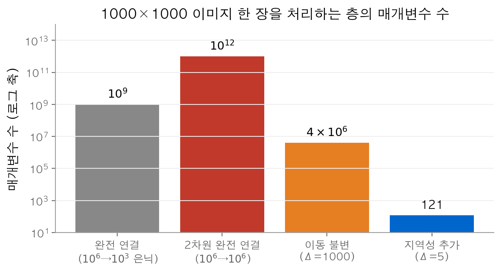
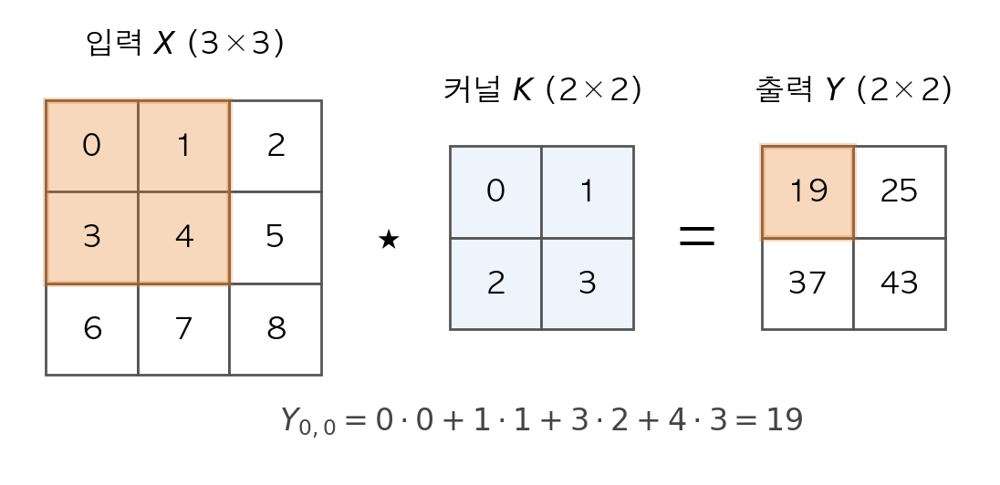
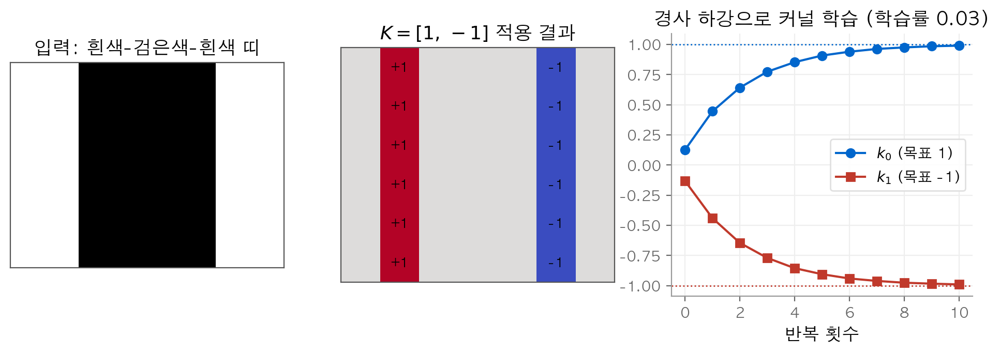
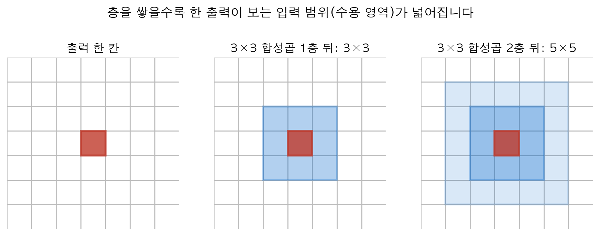
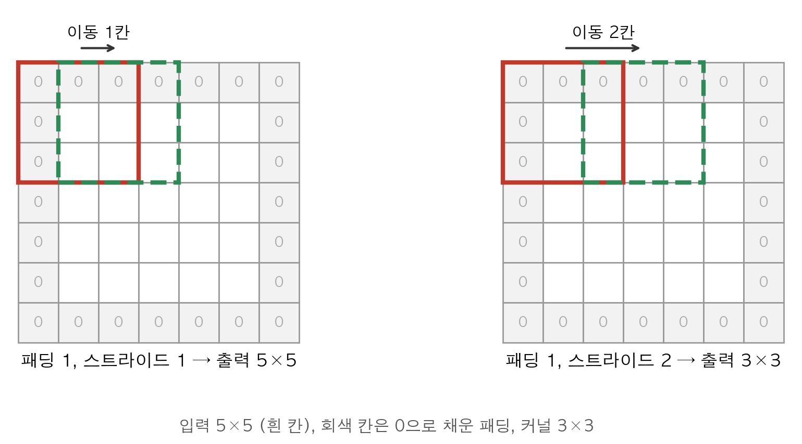
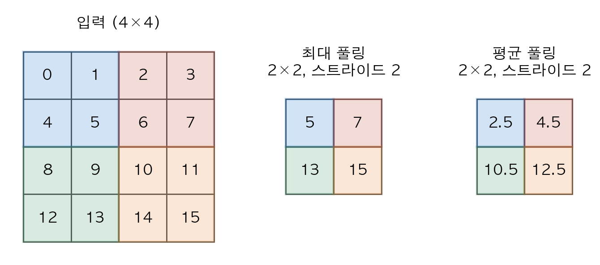
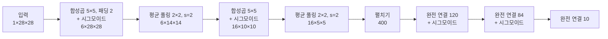

# 4. 합성곱 신경망

[3장](03-mlp.md)의 다층 퍼셉트론은 입력을 길이가 정해진 벡터로 받습니다. 이미지를 한 줄로 펴서 넣으면 픽셀 사이의 위치 관계가 사라지고 매개변수 수가 폭발합니다.
이 장의 질문은 다음과 같습니다. 이미지의 공간 구조를 모델 구조에 어떻게 넣을 수 있을까요?
결론은 **같은 작은 커널을 모든 위치에 공유하는 층**입니다. 이 층 하나가 이동 불변성과 지역성이라는 두 가정을 동시에 구현하고, 매개변수 수를 수십억 개에서 수백 개로 줄입니다.
마지막 절에서는 이 부품을 조립한 첫 번째 실용 모델인 LeNet의 층별 텐서 모양을 따라갑니다.

!!! info "원문과 자료"
    - [7. Convolutional Neural Networks](https://d2l.ai/chapter_convolutional-neural-networks/index.html)
    - [7.1 From Fully Connected Layers to Convolutions](https://d2l.ai/chapter_convolutional-neural-networks/why-conv.html)
    - [7.2 Convolutions for Images](https://d2l.ai/chapter_convolutional-neural-networks/conv-layer.html)
    - [7.3 Padding and Stride](https://d2l.ai/chapter_convolutional-neural-networks/padding-and-strides.html)
    - [7.4 Multiple Input and Multiple Output Channels](https://d2l.ai/chapter_convolutional-neural-networks/channels.html)
    - [7.5 Pooling](https://d2l.ai/chapter_convolutional-neural-networks/pooling.html)
    - [7.6 Convolutional Neural Networks (LeNet)](https://d2l.ai/chapter_convolutional-neural-networks/lenet.html)
    - 함께 읽기: [3. 다층 퍼셉트론](03-mlp.md), [5. 현대 합성곱 신경망](05-modern-cnn.md)

## 1. 완전 연결층에서 합성곱으로

### 완전 연결층의 비용

100만 픽셀(1000×1000) 흑백 이미지를 1000개 은닉 단위로 보내는 완전 연결층을 생각합니다.
가중치 행렬의 크기는 $10^6 \times 10^3$ 이므로 매개변수가 $10^9$ 개입니다.
이 수의 매개변수를 학습하려면 데이터와 계산이 지나치게 많이 필요합니다.

### 2차원 입력에 맞춘 완전 연결층

입력 $\mathbf{X}$ 와 은닉 표현 $\mathbf{H}$ 를 둘 다 2차원 격자로 둡니다. 출력 위치 $(i, j)$ 가 모든 입력 위치를 보는 층은 4차 텐서 가중치로 씁니다.
입력 위치를 출력 위치 기준의 오프셋 $(a, b)$ 로 다시 쓰면 다음 식이 됩니다.

$$
[\mathbf{H}]_{i,j} = [\mathbf{U}]_{i,j} + \sum_a \sum_b [\mathsf{V}]_{i,j,a,b}\, [\mathbf{X}]_{i+a,\, j+b}
$$

여기서 $\mathbf{U}$ 는 편향이고 $\mathsf{V}$ 는 가중치입니다. 출력도 1000×1000이면 가중치는 $10^{12}$ 개입니다.

### 첫 번째 가정: 이동 불변성

**이동 불변성(translation invariance)** 은 같은 패턴이 어디에 나타나든 같은 방식으로 반응해야 한다는 가정입니다.
그림 속에서 고양이의 귀는 왼쪽 위에 있든 오른쪽 아래에 있든 같은 귀입니다. 따라서 귀를 찾는 규칙도 위치마다 달라질 이유가 없습니다.
이 가정을 식에 넣으면 $\mathsf{V}$ 와 $\mathbf{U}$ 가 $(i, j)$ 에 의존하지 않습니다.

$$
[\mathbf{H}]_{i,j} = u + \sum_a \sum_b [\mathbf{V}]_{a,b}\, [\mathbf{X}]_{i+a,\, j+b}
$$

가중치가 오프셋 $(a, b)$ 에만 의존하므로 $(-1000, 1000)$ 범위의 오프셋에 대해 약 $2000 \times 2000 = 4 \times 10^6$ 개가 남습니다.

### 두 번째 가정: 지역성

**지역성(locality)** 은 한 위치의 표현을 만들 때 가까운 픽셀만 보면 충분하다는 가정입니다.
오프셋을 $|a| \le \Delta$, $|b| \le \Delta$ 로 제한하면 다음 식이 됩니다.

$$
[\mathbf{H}]_{i,j} = u + \sum_{a=-\Delta}^{\Delta} \sum_{b=-\Delta}^{\Delta} [\mathbf{V}]_{a,b}\, [\mathbf{X}]_{i+a,\, j+b}
$$

이 식이 **합성곱층(convolutional layer)** 입니다. $\mathbf{V}$ 를 **커널(kernel)** 또는 **필터(filter)** 라고 부릅니다.
$\Delta = 5$ 이면 매개변수는 $(2\cdot5+1)^2 = 121$ 개입니다.

<figure markdown>

<figcaption markdown>
<span class="fig-title"><b>Figure 1.</b> 층 종류별 매개변수 수</span>

가정을 하나씩 더할수록 매개변수 수가 수천 배씩 줄어듭니다(로그 축).
</figcaption>
</figure>

| 층 | 가정 | 매개변수 수 |
| --- | --- | --- |
| 완전 연결 ($10^6 \to 10^3$) | 없음 | $10^9$ |
| 2차원 완전 연결 ($10^6 \to 10^6$) | 없음 | $10^{12}$ |
| 위치 공유 | 이동 불변성 | $4 \times 10^6$ |
| 합성곱 ($\Delta = 5$) | 이동 불변성 + 지역성 | $121$ |

이 두 가정은 **귀납적 편향(inductive bias)** 입니다. 이미지처럼 가정이 맞는 데이터에서는 적은 데이터로도 잘 일반화합니다.
가정이 맞지 않는 데이터에서는 오히려 성능을 떨어뜨릴 수 있습니다.

### 이동하면 출력도 같이 이동합니다

위치를 공유한 층에서는 입력을 한 칸 밀면 출력도 한 칸 밀립니다. 1차원 예로 확인합니다.
$x = (0, 0, 1, 1, 0, 0, 0)$ 에 커널 $(1, -1)$ 을 적용하면 출력은 $(0, -1, 0, 1, 0, 0)$ 입니다.
$x$ 를 오른쪽으로 한 칸 밀면 출력은 $(0, 0, -1, 0, 1, 0)$ 입니다. 출력 값은 그대로이고 위치만 한 칸 밀렸습니다.

## 2. 교차 상관 연산

### 정의

입력 $\mathbf{X}$ 가 $n_h \times n_w$ 이고 커널 $\mathbf{K}$ 가 $k_h \times k_w$ 일 때 출력 $\mathbf{Y}$ 의 각 원소는 다음과 같습니다.

$$
[\mathbf{Y}]_{i,j} = \sum_{a=0}^{k_h-1} \sum_{b=0}^{k_w-1} [\mathbf{K}]_{a,b}\, [\mathbf{X}]_{i+a,\, j+b}
$$

커널을 입력의 왼쪽 위에 올리고, 겹친 원소끼리 곱해 모두 더합니다. 그다음 커널을 한 칸씩 옮기며 같은 계산을 반복합니다.
커널이 입력 안에 완전히 들어가는 위치에서만 계산하므로 출력 크기는 다음과 같습니다.

$$
(n_h - k_h + 1) \times (n_w - k_w + 1)
$$

수학의 **합성곱(convolution)** 은 커널을 뒤집어 $[\mathbf{X}]_{i-a,\, j-b}$ 를 곱합니다. 딥러닝 층은 뒤집지 않으므로 엄밀하게는 **교차 상관(cross-correlation)** 입니다.
커널은 학습으로 정해지므로 뒤집은 커널을 학습하면 결과가 같습니다. 그래서 두 이름을 구분하지 않고 합성곱이라고 부릅니다.

### 손으로 계산하는 예

<figure markdown>

<figcaption markdown>
<span class="fig-title"><b>Figure 2.</b> 교차 상관 계산</span>

2×2 창이 입력 위를 지나며 출력 한 칸씩을 만듭니다. 표시한 위치가 첫 칸 19입니다.
</figcaption>
</figure>

$\mathbf{X} = \begin{bmatrix} 0 & 1 & 2 \\ 3 & 4 & 5 \\ 6 & 7 & 8 \end{bmatrix}$, $\mathbf{K} = \begin{bmatrix} 0 & 1 \\ 2 & 3 \end{bmatrix}$ 이면 출력은 2×2입니다.

| 위치 | 계산 | 값 |
| --- | --- | --- |
| $(0,0)$ | $0\cdot0 + 1\cdot1 + 3\cdot2 + 4\cdot3$ | 19 |
| $(0,1)$ | $1\cdot0 + 2\cdot1 + 4\cdot2 + 5\cdot3$ | 25 |
| $(1,0)$ | $3\cdot0 + 4\cdot1 + 6\cdot2 + 7\cdot3$ | 37 |
| $(1,1)$ | $4\cdot0 + 5\cdot1 + 7\cdot2 + 8\cdot3$ | 43 |

NumPy로 정의를 그대로 옮기면 다음과 같습니다.

```python
import numpy as np

def corr2d(X, K):
    h, w = K.shape
    Y = np.zeros((X.shape[0] - h + 1, X.shape[1] - w + 1))
    for i in range(Y.shape[0]):
        for j in range(Y.shape[1]):
            Y[i, j] = (X[i:i + h, j:j + w] * K).sum()
    return Y

X = np.arange(9.).reshape(3, 3)
K = np.array([[0., 1.], [2., 3.]])
print(corr2d(X, K))
# [[19. 25.]
#  [37. 43.]]
```

합성곱층은 이 연산에 스칼라 편향 $b$ 를 더한 것입니다. 학습할 매개변수는 커널 $\mathbf{K}$ 와 편향 $b$ 뿐입니다.

## 3. 경계 검출 커널과 학습

### 손으로 만든 커널

6×8 이미지를 만듭니다. 0~1열과 6~7열은 1(흰색), 2~5열은 0(검은색)입니다. 커널은 $\mathbf{K} = [1, -1]$ (1×2)입니다.
이 커널은 가로로 이웃한 두 픽셀의 차 $x_{j} - x_{j+1}$ 을 계산합니다.

- 두 픽셀이 같으면 출력은 0입니다.
- 흰색에서 검은색으로 바뀌는 곳(1→0)에서는 출력이 $+1$ 입니다.
- 검은색에서 흰색으로 바뀌는 곳(0→1)에서는 출력이 $-1$ 입니다.

출력은 6×7이고 모든 행이 $(0, 1, 0, 0, 0, -1, 0)$ 입니다. 같은 커널을 전치한 이미지(8×6)에 적용하면 8×5 출력이 모두 0입니다.
이 커널은 세로 방향 경계만 찾습니다.

### 커널을 데이터로 학습하기

입력과 정답 출력 쌍만 주고 커널을 경사 하강으로 찾을 수 있습니다.
손실은 제곱 오차의 합 $L = \sum_{i,j} ([\hat{\mathbf{Y}}]_{i,j} - [\mathbf{Y}]_{i,j})^2$ 입니다.
커널 원소 $k_b$ 에 대한 기울기는 오차와 그 원소가 곱해진 입력의 곱을 모두 더한 값입니다.

$$
\frac{\partial L}{\partial k_b} = \sum_{i,j} 2\,([\hat{\mathbf{Y}}]_{i,j} - [\mathbf{Y}]_{i,j})\, [\mathbf{X}]_{i,\, j+b}
$$

```python
E = np.ones((6, 8))                          # 입력 이미지
E[:, 2:6] = 0
Y = corr2d(E, np.array([[1., -1.]]))         # 정답 출력
rng = np.random.default_rng(0)
W = rng.normal(size=(1, 2))                  # [[ 0.126 -0.132]]
for step in range(10):
    r = corr2d(E, W) - Y
    loss = (r ** 2).sum()
    grad = np.array([[(2 * r * E[:, b:b + 7]).sum() for b in range(2)]])
    W -= 0.03 * grad
print(round(loss, 3), W)
# 0.003 [[ 0.98961487 -0.99029934]]
```

학습률은 0.03입니다. 손실은 2번째 반복에서 3.73, 4번째에서 0.626, 10번째에서 0.003으로 줄어듭니다.
10번 반복 뒤 커널은 $[0.990, -0.990]$ 이고 목표 $[1, -1]$ 에 가깝습니다.

<figure markdown>

<figcaption markdown>
<span class="fig-title"><b>Figure 3.</b> 경계 검출과 커널 학습</span>

$[1,-1]$ 커널이 경계를 검출하고, 학습한 두 커널 원소는 1과 $-1$ 에 다가갑니다.
</figcaption>
</figure>

이 예의 요점은 커널을 사람이 설계하지 않아도 된다는 것입니다. 실제 신경망에서는 수십~수백 개의 커널이 분류 손실을 줄이는 방향으로 동시에 학습됩니다.

## 4. 특성 맵과 수용 영역

합성곱층의 출력을 **특성 맵(feature map)** 이라고 부릅니다. 특성 맵은 입력의 각 위치에서 커널이 찾는 패턴이 얼마나 강하게 나타나는지를 담은 공간 지도입니다.

어떤 층의 원소 $x$ 에 대해, 순전파에서 $x$ 의 값에 영향을 줄 수 있는 앞 층들의 모든 원소를 $x$ 의 **수용 영역(receptive field)** 이라고 합니다.
2절의 예에서 출력 19의 수용 영역은 입력의 왼쪽 위 2×2 원소 4개입니다.
2×2 출력 $\mathbf{Y}$ 에 2×2 커널을 한 번 더 적용해 원소 하나 $z$ 를 만들면, $z$ 의 수용 영역은 $\mathbf{Y}$ 의 4개와 입력의 9개 전부입니다.

스트라이드가 1인 $k \times k$ 합성곱을 $L$ 번 쌓으면 수용 영역의 한 변은 다음과 같습니다.

$$
r_L = 1 + L(k - 1)
$$

3×3 합성곱 한 층의 수용 영역은 3×3이고 두 층은 5×5입니다.

<figure markdown>

<figcaption markdown>
<span class="fig-title"><b>Figure 4.</b> 수용 영역의 성장</span>

3×3 합성곱을 하나 거슬러 오를 때마다 수용 영역이 한 변에 2칸씩 넓어집니다.
</figcaption>
</figure>

수치로 확인합니다. 5×5 입력 $0, 1, \dots, 24$ 에 모든 원소가 1인 3×3 커널을 두 번 적용하면 1×1 출력 972가 나옵니다.
이 값은 입력에 가중치 $w_{a,b} = c_a c_b$, $c = (1, 2, 3, 2, 1)$ 를 곱해 더한 값과 같습니다. 25개 입력이 모두 출력에 영향을 줍니다.
가운데 픽셀의 가중치가 9이고 모서리 픽셀이 1이므로, 수용 영역 안에서도 가운데가 더 큰 영향을 줍니다.

층이 깊어질수록 원소 하나가 보는 범위가 넓어집니다. 그래서 앞쪽 층은 경계 같은 작은 패턴을, 뒤쪽 층은 물체의 부분 같은 큰 패턴을 표현할 수 있습니다.
3×3 두 층은 매개변수 $2 \times 9 = 18$ 개로 5×5 한 층(25개)과 같은 수용 영역을 얻습니다.

## 5. 패딩과 스트라이드

### 패딩

합성곱을 거칠 때마다 출력은 $k - 1$ 만큼 줄어듭니다. 층을 많이 쌓으면 이미지가 빠르게 작아지고 가장자리 픽셀은 계산에 적게 참여합니다.
**패딩(padding)** 은 입력 둘레에 0을 채워 크기를 늘리는 방법입니다. 위아래 합쳐 $p_h$ 행, 좌우 합쳐 $p_w$ 열을 채우면 출력 크기는 다음과 같습니다.

$$
(n_h - k_h + p_h + 1) \times (n_w - k_w + p_w + 1)
$$

$p_h = k_h - 1$, $p_w = k_w - 1$ 로 두면 출력 크기가 입력 크기와 같습니다. 커널 크기를 홀수로 고르면 위아래에 $(k_h - 1)/2$ 행씩 똑같이 나눠 채울 수 있습니다.
그래서 CNN에서는 3, 5, 7 같은 홀수 커널을 주로 씁니다.

### 스트라이드

**스트라이드(stride)** 는 커널을 한 번에 옮기는 칸 수입니다. 세로 스트라이드 $s_h$, 가로 스트라이드 $s_w$ 를 쓰면 출력 크기는 다음과 같습니다.

$$
\left\lfloor \frac{n_h - k_h + p_h + s_h}{s_h} \right\rfloor \times \left\lfloor \frac{n_w - k_w + p_w + s_w}{s_w} \right\rfloor
$$

이 식은 다음처럼 읽습니다. 패딩한 입력에서 커널이 놓일 수 있는 시작 위치의 범위는 $n_h - k_h + p_h$ 칸입니다.
첫 위치 하나에 더해 $s_h$ 칸마다 하나씩 위치가 생기므로 $\lfloor (n_h - k_h + p_h)/s_h \rfloor + 1$ 개입니다. 이 값을 정리하면 위 식이 됩니다.

<figure markdown>

<figcaption markdown>
<span class="fig-title"><b>Figure 5.</b> 패딩과 스트라이드</span>

패딩 1에서 스트라이드 1이면 출력이 5×5, 스트라이드 2이면 3×3입니다.
</figcaption>
</figure>

8×8 입력에 대해 공식을 적용한 값과 NumPy로 직접 계산한 출력 모양이 같습니다.

| 커널 $(k_h, k_w)$ | 패딩 $(p_h, p_w)$ | 스트라이드 $(s_h, s_w)$ | 높이 계산 | 출력 |
| --- | --- | --- | --- | --- |
| (3, 3) | (2, 2) | (1, 1) | $\lfloor (8-3+2+1)/1 \rfloor = 8$ | 8×8 |
| (3, 3) | (2, 2) | (2, 2) | $\lfloor (8-3+2+2)/2 \rfloor = 4$ | 4×4 |
| (5, 3) | (4, 2) | (1, 1) | $\lfloor (8-5+4+1)/1 \rfloor = 8$ | 8×8 |
| (3, 5) | (0, 2) | (3, 4) | $\lfloor (8-3+0+3)/3 \rfloor = 2$ | 2×2 |

마지막 행의 너비는 $\lfloor (8-5+2+4)/4 \rfloor = 2$ 입니다. 같은 패딩($p = k - 1$)을 쓰고 $n$ 이 $s$ 로 나누어떨어지면 출력은 $(n_h/s_h) \times (n_w/s_w)$ 입니다.
스트라이드 2는 해상도를 절반으로 줄이는 가장 간단한 방법입니다.

## 6. 다중 입력 채널과 다중 출력 채널

### 다중 입력 채널

컬러 이미지는 빨강, 초록, 파랑 세 장의 2차원 배열로 이루어진 $3 \times h \times w$ 텐서입니다. 각 장을 **채널(channel)** 이라고 합니다.
입력 채널이 $c_i$ 개이면 커널의 모양도 $c_i \times k_h \times k_w$ 입니다. 채널마다 교차 상관을 계산한 뒤 결과를 모두 더해 2차원 출력 하나를 만듭니다.

$$
[\mathbf{Y}]_{i,j} = \sum_{c=1}^{c_i} \sum_{a,b} [\mathsf{K}]_{c,a,b}\, [\mathsf{X}]_{c,\, i+a,\, j+b}
$$

예를 들어 두 입력 채널이 $\begin{bmatrix} 0&1&2\\3&4&5\\6&7&8 \end{bmatrix}$, $\begin{bmatrix} 1&2&3\\4&5&6\\7&8&9 \end{bmatrix}$ 이고 커널 채널이 $\begin{bmatrix} 0&1\\2&3 \end{bmatrix}$, $\begin{bmatrix} 1&2\\3&4 \end{bmatrix}$ 이라고 합시다.
첫 번째 출력은 $(0\cdot0+1\cdot1+3\cdot2+4\cdot3) + (1\cdot1+2\cdot2+4\cdot3+5\cdot4) = 19 + 37 = 56$ 입니다.
전체 출력은 $\begin{bmatrix} 56 & 72 \\ 104 & 120 \end{bmatrix}$ 입니다.

### 다중 출력 채널

출력 채널마다 별도의 $c_i \times k_h \times k_w$ 커널을 둡니다. 그러면 전체 커널은 4차 텐서 $c_o \times c_i \times k_h \times k_w$ 입니다.
각 출력 채널은 서로 다른 패턴(세로 경계, 가로 경계, 특정 색 등)을 찾는 검출기라고 볼 수 있습니다.
위 커널 $\mathsf{K}$ 에 $\mathsf{K}+1$, $\mathsf{K}+2$ 를 쌓아 $3 \times 2 \times 2 \times 2$ 커널을 만들면 출력은 $3 \times 2 \times 2$ 입니다.

| 출력 채널 | 커널 | 출력 |
| --- | --- | --- |
| 0 | $\mathsf{K}$ | $\begin{bmatrix} 56 & 72 \\ 104 & 120 \end{bmatrix}$ |
| 1 | $\mathsf{K}+1$ | $\begin{bmatrix} 76 & 100 \\ 148 & 172 \end{bmatrix}$ |
| 2 | $\mathsf{K}+2$ | $\begin{bmatrix} 96 & 128 \\ 192 & 224 \end{bmatrix}$ |

계산량은 출력 위치 수, 커널 크기, 입력 채널 수, 출력 채널 수의 곱입니다.

$$
\mathcal{O}(h \cdot w \cdot k^2 \cdot c_i \cdot c_o)
$$

256×256 이미지에 5×5 커널, 입력·출력 채널 128개를 쓰면 곱셈-덧셈 쌍이 $256^2 \cdot 25 \cdot 128^2 \approx 2.68 \times 10^{10}$ 번입니다.
곱셈과 덧셈을 따로 세면 약 537억 번입니다.

## 7. 1×1 합성곱

$k_h = k_w = 1$ 인 커널은 이웃 픽셀을 보지 않습니다. 대신 한 위치의 $c_i$ 개 채널 값을 섞어 $c_o$ 개 값을 만듭니다.
위치 $(i, j)$ 의 채널 벡터를 $\mathbf{x}_{ij} \in \mathbb{R}^{c_i}$ 라고 하면 다음과 같습니다.

$$
\mathbf{y}_{ij} = \mathbf{W} \mathbf{x}_{ij}, \qquad \mathbf{W} \in \mathbb{R}^{c_o \times c_i}
$$

즉 **1×1 합성곱은 모든 픽셀에 같은 완전 연결층을 적용한 것**입니다. 매개변수는 $c_o \times c_i$ 개와 편향입니다.
주로 채널 수를 늘리거나 줄이는 데 씁니다. 같은 256×256, 128→128 채널 예에서 1×1 합성곱의 곱셈-덧셈은 약 $1.07 \times 10^9$ 번이고, 5×5 커널의 1/25입니다.

작은 예로 $c_i = 3$, $c_o = 2$, $\mathbf{W} = \begin{bmatrix} 1 & 0 & -1 \\ 0.5 & 0.5 & 0.5 \end{bmatrix}$ 를 씁니다.
위치 $(0,0)$ 의 채널 벡터가 $(1, 0, 0)$ 이면 출력은 $(1, 0.5)$ 입니다. 위치 $(1,1)$ 의 채널 벡터가 $(2, 2, 1)$ 이면 출력은 $(1, 2.5)$ 입니다.
아래 코드는 채널 축을 행렬 곱으로 처리한 결과와 일반 다중 채널 합성곱의 결과가 같음을 확인합니다.

```python
def corr2d_multi_in(X, K):                      # X: (c_i, h, w), K: (c_i, kh, kw)
    return sum(corr2d(x, k) for x, k in zip(X, K))

def corr2d_multi_in_out(X, K):                  # K: (c_o, c_i, kh, kw)
    return np.stack([corr2d_multi_in(X, k) for k in K])

X = np.array([[[1., 1.], [2., 2.]],
              [[0., 0.], [2., 2.]],
              [[0., 0.], [2., 1.]]])            # (3, 2, 2)
W = np.array([[1., 0., -1.], [0.5, 0.5, 0.5]])  # (2, 3)

Y_mm = (W @ X.reshape(3, -1)).reshape(2, 2, 2)  # 픽셀별 행렬 곱
Y_cv = corr2d_multi_in_out(X, W.reshape(2, 3, 1, 1))
print(Y_mm[:, 0, 0], Y_mm[:, 1, 1], np.allclose(Y_mm, Y_cv))
# [1.  0.5] [1.  2.5] True
```

## 8. 풀링

### 정의

**풀링(pooling)** 층은 고정된 크기의 창을 입력 위로 옮기며 창 안의 값을 하나로 요약합니다. 합성곱과 달리 학습할 매개변수가 없습니다.

- **최대 풀링(max-pooling)**: 창 안의 최댓값을 고릅니다. $[\mathbf{Y}]_{i,j} = \max_{a,b} [\mathbf{X}]_{i+a,\, j+b}$
- **평균 풀링(average pooling)**: 창 안의 평균을 구합니다. $[\mathbf{Y}]_{i,j} = \frac{1}{p_h p_w} \sum_{a,b} [\mathbf{X}]_{i+a,\, j+b}$

2절의 3×3 입력 $0, \dots, 8$ 에 2×2 창을 쓰면 최대 풀링 결과는 $\begin{bmatrix} 4 & 5 \\ 7 & 8 \end{bmatrix}$, 평균 풀링 결과는 $\begin{bmatrix} 2 & 3 \\ 5 & 6 \end{bmatrix}$ 입니다.

### 풀링의 두 역할

첫째 역할은 작은 위치 변화를 흡수하는 것입니다. 4×4 입력에서 값 1이 $(1,1)$ 에 있든 $(1,0)$ 에 있든 2×2, 스트라이드 2 최대 풀링의 출력은 $\begin{bmatrix} 1 & 0 \\ 0 & 0 \end{bmatrix}$ 로 같습니다.
경계가 한 픽셀 흔들려도 다음 층이 받는 값이 바뀌지 않습니다.

둘째 역할은 해상도를 줄이는 것입니다. 해상도가 줄면 계산이 줄고, 다음 층의 수용 영역이 빠르게 넓어집니다.

<figure markdown>

<figcaption markdown>
<span class="fig-title"><b>Figure 6.</b> 최대 풀링과 평균 풀링</span>

겹치지 않는 2×2 창 하나가 출력의 같은 색 칸 하나로 요약됩니다.
</figcaption>
</figure>

### 패딩, 스트라이드, 채널

풀링도 패딩과 스트라이드를 쓰고 출력 크기 공식도 합성곱과 같습니다. 딥러닝 프레임워크는 보통 스트라이드를 창 크기와 같게 기본 설정합니다.
4×4 입력 $0, \dots, 15$ 에 3×3 최대 풀링을 기본 설정(스트라이드 3)으로 적용하면 출력은 값 하나 10입니다.
패딩 1, 스트라이드 2로 바꾸면 출력은 $\begin{bmatrix} 5 & 7 \\ 13 & 15 \end{bmatrix}$ 입니다.

풀링은 채널마다 따로 계산하고 채널끼리 더하지 않습니다. 그래서 출력 채널 수가 입력 채널 수와 같습니다.
대부분의 경우 최대 풀링이 평균 풀링보다 좋은 성능을 냅니다.

## 9. LeNet

### 구조

**LeNet** 은 1990년대에 손글씨 숫자 인식에 쓰인 CNN입니다. 두 부분으로 이루어집니다.

- **합성곱 인코더**: 합성곱, 시그모이드, 평균 풀링으로 이루어진 블록 두 개
- **완전 연결 블록**: 120, 84, 10 단위의 완전 연결층 세 개



당시에는 ReLU와 최대 풀링이 널리 쓰이지 않았습니다. 그래서 활성화 함수는 시그모이드, 풀링은 평균 풀링입니다.
원래 모델의 출력층은 가우스 층이지만 d2l 구현은 소프트맥스 층으로 바꿉니다.

### 층별 텐서 모양과 매개변수 수

28×28 입력 하나(모양 $1 \times 1 \times 28 \times 28$)가 지나갈 때 모양은 다음과 같이 바뀝니다. 매개변수 수는 가중치와 편향을 더한 값입니다.

| 층 | 출력 모양 | 모양 계산 | 매개변수 수 |
| --- | --- | --- | --- |
| 합성곱 1 (6채널, 5×5, 패딩 2) | $6 \times 28 \times 28$ | $28 - 5 + 4 + 1 = 28$ | $6 \cdot (1 \cdot 25) + 6 = 156$ |
| 평균 풀링 (2×2, 스트라이드 2) | $6 \times 14 \times 14$ | $\lfloor (28 - 2 + 2)/2 \rfloor = 14$ | 0 |
| 합성곱 2 (16채널, 5×5) | $16 \times 10 \times 10$ | $14 - 5 + 1 = 10$ | $16 \cdot (6 \cdot 25) + 16 = 2416$ |
| 평균 풀링 (2×2, 스트라이드 2) | $16 \times 5 \times 5$ | $\lfloor (10 - 2 + 2)/2 \rfloor = 5$ | 0 |
| 펼치기 | $400$ | $16 \cdot 5 \cdot 5$ | 0 |
| 완전 연결 1 | $120$ | | $400 \cdot 120 + 120 = 48120$ |
| 완전 연결 2 | $84$ | | $120 \cdot 84 + 84 = 10164$ |
| 완전 연결 3 | $10$ | | $84 \cdot 10 + 10 = 850$ |

전체 매개변수는 61,706개입니다. 784→256→10 다층 퍼셉트론의 203,530개보다 적습니다.
합성곱층 두 개의 매개변수는 2,572개뿐이고 대부분은 완전 연결층에 있습니다.

인코더를 지나면서 공간 크기는 28→14→10→5로 줄고 채널 수는 1→6→16으로 늘어납니다. 이 패턴은 [5장](05-modern-cnn.md)의 현대 CNN에서도 그대로 이어집니다.
마지막 5×5 특성 맵의 원소 하나는 입력의 16×16 영역을 봅니다. 이 값은 $r \leftarrow r + (k-1)\cdot j$, $j \leftarrow j \cdot s$ 를 층마다 적용해 $1 \to 5 \to 6 \to 14 \to 16$ 으로 계산합니다. 여기서 $j$ 는 앞 층들의 스트라이드 곱입니다.

### PyTorch 구현

```python
import torch
from torch import nn

net = nn.Sequential(
    nn.Conv2d(1, 6, kernel_size=5, padding=2), nn.Sigmoid(),
    nn.AvgPool2d(kernel_size=2, stride=2),
    nn.Conv2d(6, 16, kernel_size=5), nn.Sigmoid(),
    nn.AvgPool2d(kernel_size=2, stride=2),
    nn.Flatten(),
    nn.Linear(16 * 5 * 5, 120), nn.Sigmoid(),
    nn.Linear(120, 84), nn.Sigmoid(),
    nn.Linear(84, 10))

X = torch.randn(1, 1, 28, 28)
for layer in net:
    X = layer(X)
    print(layer.__class__.__name__, tuple(X.shape))
```

d2l은 이 모델을 Fashion-MNIST에서 학습합니다. 배치 크기 128, 학습률 0.1, 10 에폭의 미니배치 SGD와 교차 엔트로피 손실을 씁니다. 가중치는 Xavier 균등 분포로 초기화합니다.
LeNet은 [3장](03-mlp.md)의 다층 퍼셉트론과 달리 픽셀의 위치 관계를 구조에 반영합니다. 그러면서도 매개변수 수는 더 적습니다.

## 정리

- 완전 연결층은 이미지에서 매개변수가 지나치게 많습니다. 1000×1000 입력을 1000개 단위로 보내는 데 $10^9$ 개가 필요합니다.
- 이동 불변성은 가중치를 위치마다 공유하게 하고, 지역성은 가중치를 작은 창으로 제한합니다. 두 가정을 합한 결과가 합성곱층입니다.
- 딥러닝의 합성곱은 커널을 뒤집지 않는 교차 상관입니다. 출력 크기는 $(n_h - k_h + 1) \times (n_w - k_w + 1)$ 입니다.
- 커널은 손으로 설계하지 않고 경사 하강으로 학습합니다. 경계 검출 예에서 무작위 커널이 10번 반복 만에 $[0.990, -0.990]$ 이 됩니다.
- 합성곱층의 출력은 특성 맵입니다. 층을 쌓을수록 수용 영역이 넓어지고, 3×3 두 층의 수용 영역은 5×5입니다.
- 패딩과 스트라이드를 쓰면 출력 크기는 $\lfloor (n - k + p + s)/s \rfloor$ 입니다. $p = k - 1$ 이면 크기를 유지하고 $s = 2$ 이면 크기가 절반이 됩니다.
- 커널은 $c_o \times c_i \times k_h \times k_w$ 텐서입니다. 입력 채널은 더해서 합치고, 출력 채널마다 다른 커널을 씁니다.
- 1×1 합성곱은 모든 픽셀에 같은 완전 연결층을 적용한 것이고 채널 수를 조절하는 데 씁니다.
- 풀링은 매개변수 없이 창 안의 값을 요약합니다. 작은 위치 변화를 흡수하고 해상도를 줄이며, 채널마다 따로 계산합니다.
- LeNet은 합성곱 인코더와 완전 연결 블록으로 이루어지고 매개변수는 61,706개입니다. 공간 크기를 줄이며 채널 수를 늘리는 구조는 이후 CNN의 기본 틀이 됩니다.
