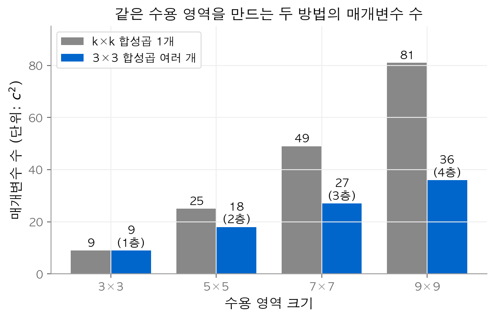
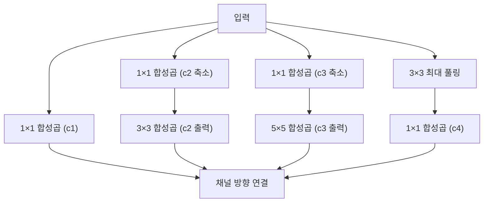
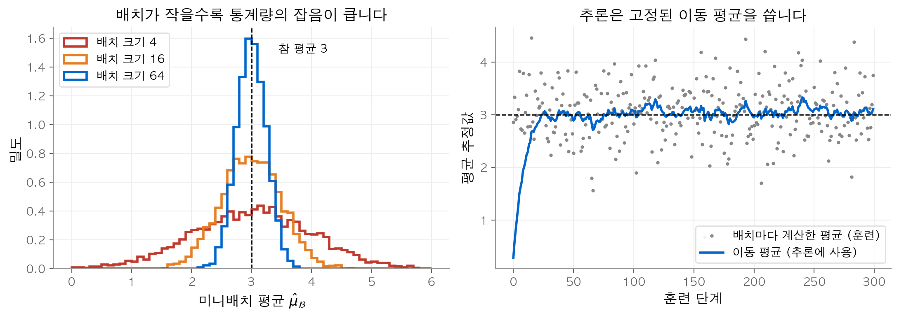
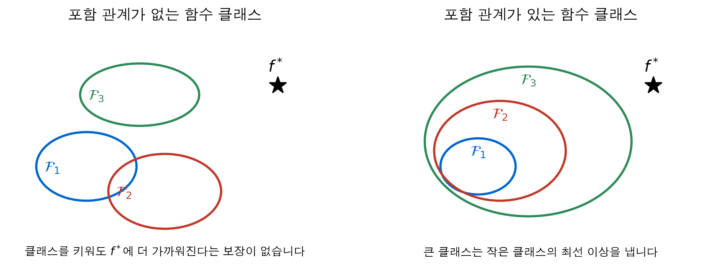
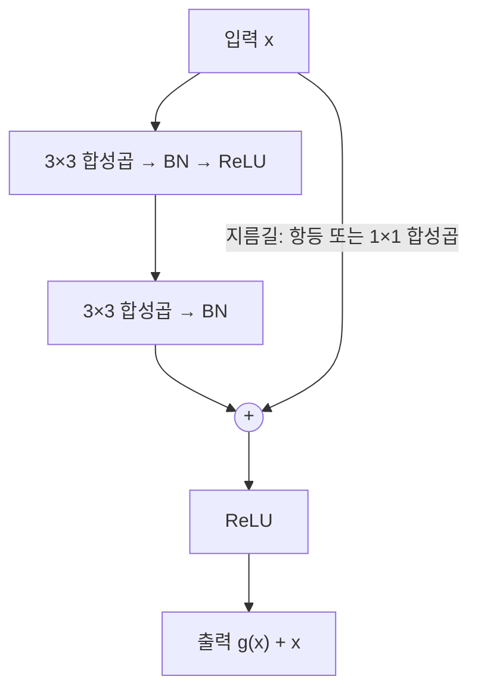
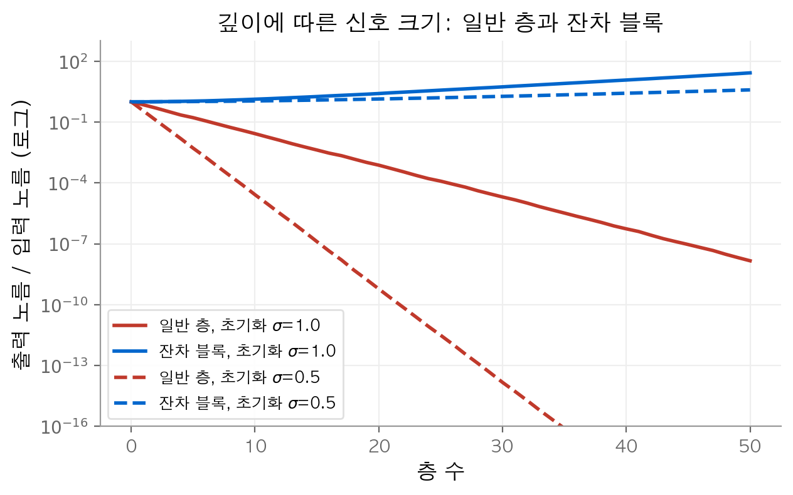
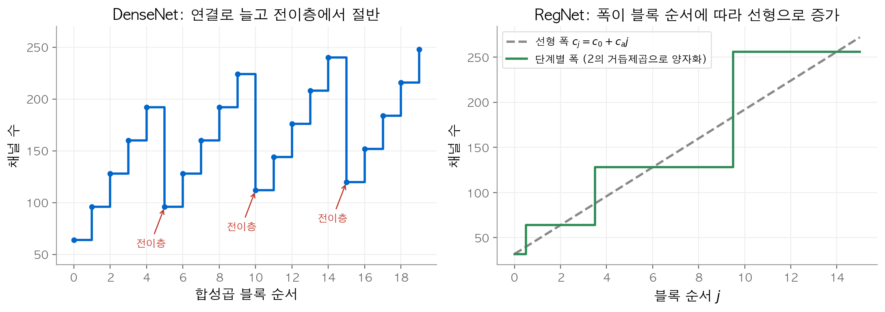
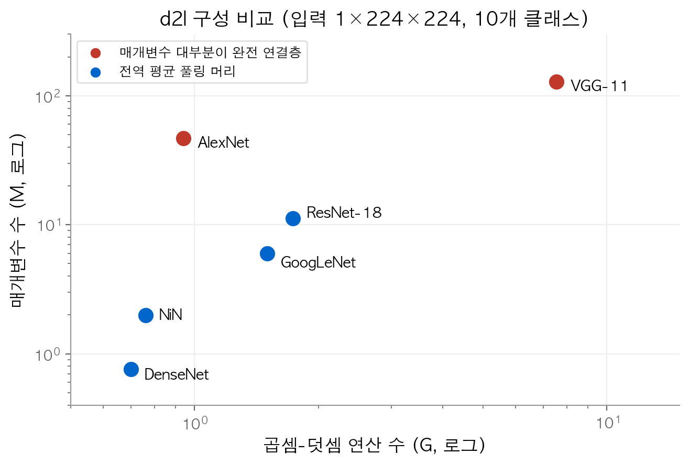

# 5. 현대 합성곱 신경망

[4장](04-cnn.md)의 LeNet은 합성곱 층 2개로 손글씨 숫자를 분류했습니다. 이 장의 질문은 **합성곱 신경망을 어떻게 깊고 효율적으로 쌓는가**입니다.
2012년 AlexNet 이후 10년 동안 나온 구조를 차례로 살펴봅니다. 각 구조는 앞 구조의 한 가지 문제를 고칩니다.
결론은 세 가지입니다. 작은 블록을 반복해 쌓고, 정규화와 잔차 연결로 깊은 망의 훈련을 안정시키고, 개별 망 대신 설계 규칙을 찾는 방향으로 발전했습니다.

!!! info "원문과 자료"
    - 원문: [8. Modern Convolutional Neural Networks](https://d2l.ai/chapter_convolutional-modern/index.html)
    - [8.1 AlexNet](https://d2l.ai/chapter_convolutional-modern/alexnet.html), [8.2 VGG](https://d2l.ai/chapter_convolutional-modern/vgg.html), [8.3 NiN](https://d2l.ai/chapter_convolutional-modern/nin.html), [8.4 GoogLeNet](https://d2l.ai/chapter_convolutional-modern/googlenet.html)
    - [8.5 Batch Normalization](https://d2l.ai/chapter_convolutional-modern/batch-norm.html), [8.6 ResNet and ResNeXt](https://d2l.ai/chapter_convolutional-modern/resnet.html), [8.7 DenseNet](https://d2l.ai/chapter_convolutional-modern/densenet.html), [8.8 Designing CNN Architectures](https://d2l.ai/chapter_convolutional-modern/cnn-design.html)
    - 함께 읽기: [3. 다층 퍼셉트론](03-mlp.md)(드롭아웃), [4. 합성곱 신경망](04-cnn.md), [9. 최적화](09-optimization.md)

## 1. AlexNet: 학습한 특징이 손으로 만든 특징을 이기다

### 배경

2012년 이전의 이미지 분류는 두 단계로 나뉘었습니다. 사람이 SIFT, HOG 같은 **특징 추출기(feature extractor)** 를 설계했습니다. 그다음 그 특징 위에 SVM 같은 분류기를 훈련했습니다.
AlexNet은 특징 추출까지 데이터에서 배웠습니다. 아래층은 경계와 질감을 잡고 위층은 물체의 부분을 잡는 **표현 학습(representation learning)** 이 실제로 일어났습니다.
이 일이 2012년에야 가능했던 이유는 두 가지입니다. 약 100만 장, 1000개 범주의 ImageNet 데이터가 생겼습니다. 그리고 GPU로 합성곱 연산을 빠르게 처리할 수 있었습니다.

### LeNet과 다른 점

AlexNet은 LeNet과 같은 "합성곱 → 풀링 → 완전 연결" 순서를 따릅니다. 차이는 다음 네 가지입니다.

| 항목 | LeNet | AlexNet |
| --- | --- | --- |
| 학습하는 층 | 합성곱 2개, 완전 연결 3개 | 합성곱 5개, 완전 연결 3개 |
| 활성화 함수 | 시그모이드 | ReLU |
| 용량 조절 | 가중치 감쇠 | 드롭아웃(0.5), 데이터 증강 |
| 첫 합성곱 창 | $5\times5$ | $11\times11$, 보폭 4 |

**ReLU** 는 $\max(0, x)$ 입니다. 양수 구간의 기울기가 항상 1입니다. 시그모이드는 입력이 크면 기울기가 0에 가까워집니다. 예를 들어 $x=5$ 에서 시그모이드의 기울기는 $\sigma(5)(1-\sigma(5)) \approx 0.0066$ 입니다. ReLU의 기울기는 1입니다. 층이 깊어지면 이 차이가 곱해져 커집니다.

**드롭아웃(dropout)** 은 훈련 중에 은닉 단위를 확률 $p$ 로 0으로 만들고 남은 값을 $1/(1-p)$ 배 합니다([3장](03-mlp.md)). AlexNet은 4096폭의 완전 연결층 두 개에 $p=0.5$ 를 썼습니다.

**데이터 증강(data augmentation)** 은 훈련 이미지를 뒤집고, 잘라 내고, 색을 바꿔 새 표본을 만듭니다. 라벨은 그대로 둡니다. 모델이 위치나 색의 작은 변화에 무관한 특징을 배우도록 만드는 장치입니다.

### 매개변수는 어디에 있는가

d2l 구성(입력 $1\times224\times224$, 클래스 10개)의 매개변수를 직접 세면 약 4676만 개입니다. 그중 92.0%가 마지막 완전 연결층 3개에 있습니다. 마지막 합성곱 출력 $256\times5\times5 = 6400$ 개 값을 4096개 단위에 연결하는 데만 $6400 \times 4096 \approx 2621$ 만 개가 필요합니다.
이 관찰이 3절 NiN의 출발점입니다.

## 2. VGG: 블록을 반복해 쌓기

### VGG 블록

AlexNet은 층마다 창 크기와 채널 수를 따로 정했습니다. VGG는 같은 모양의 **블록(block)** 을 반복합니다. VGG 블록은 다음 두 부분으로 구성됩니다.

1. $3\times3$ 합성곱(패딩 1)과 ReLU를 $L$ 번 반복합니다. 높이와 너비는 바뀌지 않습니다.
2. $2\times2$ 최대 풀링(보폭 2)으로 높이와 너비를 절반으로 줄입니다.

d2l의 VGG-11은 `((1, 64), (1, 128), (2, 256), (2, 512), (2, 512))` 로 정의합니다. 각 쌍은 (합성곱 수, 출력 채널 수)입니다. 합성곱 8개와 완전 연결층 3개를 합해 11층입니다. 블록마다 해상도가 절반이 되므로 $224 \to 7$ 이 됩니다.

```python
import torch.nn as nn

def vgg_block(num_convs, out_channels):
    layers = []
    for _ in range(num_convs):
        layers += [nn.LazyConv2d(out_channels, kernel_size=3, padding=1), nn.ReLU()]
    layers.append(nn.MaxPool2d(kernel_size=2, stride=2))
    return nn.Sequential(*layers)

arch = ((1, 64), (1, 128), (2, 256), (2, 512), (2, 512))
body = nn.Sequential(*[vgg_block(n, c) for n, c in arch])
```

### 왜 $3\times3$ 을 여러 번 쌓는가

보폭 1인 $3\times3$ 합성곱을 $L$ 번 쌓으면 출력 한 점이 보는 입력 영역, 즉 **수용 영역(receptive field)** 은 $(2L+1)\times(2L+1)$ 입니다.
입력과 출력 채널이 모두 $c$ 이면 매개변수 수(편향 제외)는 다음과 같습니다.

$$
\underbrace{9Lc^2}_{3\times3 \text{ 을 } L \text{ 번}} \qquad \text{대} \qquad \underbrace{(2L+1)^2 c^2}_{(2L+1)\times(2L+1) \text{ 한 번}}
$$

$c = 64$ 로 계산해 보겠습니다. $5\times5$ 한 번은 $102{,}400$ 개입니다. $3\times3$ 두 번은 $73{,}728$ 개입니다. $7\times7$ 한 번은 $200{,}704$ 개이고 $3\times3$ 세 번은 $110{,}592$ 개입니다.
같은 영역을 보면서 매개변수는 적습니다. 층 사이에 ReLU가 들어가므로 비선형성도 늘어납니다.


수용 영역이 커질수록 큰 창 하나($(2L+1)^2$)와 $3\times3$ 쌓기($9L$)의 차이가 벌어집니다. $9\times9$ 에서는 81 대 36입니다.

VGG의 약점은 완전 연결층입니다. d2l VGG-11에서 첫 완전 연결층만 $25{,}088 \times 4{,}096$ 개 가중치를 씁니다. FP32로 약 411MB입니다.

## 3. NiN: 1×1 합성곱과 전역 평균 풀링

### 1×1 합성곱

**NiN(Network in Network)** 은 완전 연결층을 없애면서도 비선형성을 유지하는 방법을 제시했습니다. 핵심 도구는 $1\times1$ 합성곱입니다.
입력이 $\mathsf{X} \in \mathbb{R}^{c_i \times h \times w}$ 일 때 $1\times1$ 합성곱의 출력은 다음과 같습니다.

$$
\mathsf{Y}_{o, i, j} = \sum_{c=1}^{c_i} \mathbf{W}_{o, c}\, \mathsf{X}_{c, i, j} + b_o
$$

공간 위치 $(i, j)$ 마다 채널 벡터 $\mathsf{X}_{:, i, j}$ 에 같은 완전 연결층 $\mathbf{W} \in \mathbb{R}^{c_o \times c_i}$ 를 적용하는 셈입니다. 공간 구조는 그대로 두고 채널끼리만 섞습니다.
NiN 블록은 일반 합성곱 1개 뒤에 $1\times1$ 합성곱 2개를 붙이고 각 층 뒤에 ReLU를 둡니다.

### 전역 평균 풀링

NiN의 마지막 블록은 출력 채널 수를 클래스 수와 같게 둡니다. 그다음 **전역 평균 풀링(global average pooling)** 으로 채널마다 전체 공간 평균을 냅니다.

$$
o_k = \frac{1}{hw} \sum_{i=1}^{h} \sum_{j=1}^{w} \mathsf{Y}_{k, i, j}
$$

$o_k$ 를 클래스 $k$ 의 로짓으로 바로 씁니다. 학습할 매개변수가 없습니다. 아래 코드는 채널 2개, $2\times2$ 입력에 $1\times1$ 합성곱, ReLU, 전역 평균 풀링을 차례로 적용합니다.

```python
import numpy as np

X = np.array([[[1., 2.], [3., 4.]],     # 채널 0
              [[2., 1.], [1., 0.]]])    # 채널 1
w, b = np.array([0.5, -1.0]), 0.1       # 출력 채널 1개짜리 1x1 합성곱

Y = np.einsum('c,chw->hw', w, X) + b    # 위치마다 채널 가중합
print(Y)                    # [[-1.4  0.1] [ 0.6  2.1]]
Z = np.maximum(Y, 0)
print(Z.mean())             # 0.7  (전역 평균 풀링 결과)
```

위치 $(0,0)$ 의 출력은 $0.5\cdot1 - 1\cdot2 + 0.1 = -1.4$ 입니다. ReLU가 이 값을 0으로 만들고 남은 네 값 $0, 0.1, 0.6, 2.1$ 의 평균이 0.7입니다.
d2l의 NiN 구성은 매개변수가 약 199만 개입니다. AlexNet의 약 4.3%입니다. 줄어든 몫은 거의 모두 완전 연결층을 없앤 데서 옵니다.

## 4. GoogLeNet: 여러 크기의 창을 나란히 쓰기

### 인셉션 블록

창 크기를 $1\times1$, $3\times3$, $5\times5$ 중 하나로 정하기 어렵다면 모두 쓰면 됩니다. **인셉션 블록(Inception block)** 은 네 갈래를 나란히 계산하고 출력을 채널 방향으로 이어 붙입니다.



모든 갈래는 패딩으로 높이와 너비를 입력과 같게 맞춥니다. 그래서 채널 방향으로 이어 붙일 수 있습니다.
GoogLeNet 3단계의 첫 블록은 `Inception(64, (96, 128), (16, 32), 32)` 입니다. 출력 채널은 $64 + 128 + 32 + 32 = 256$ 개입니다.

### 1×1 축소의 효과

3갈래와 4갈래 앞의 $1\times1$ 합성곱은 채널 수를 먼저 줄입니다. 입력 채널이 192개이고 $5\times5$ 합성곱으로 32채널을 만드는 경우를 계산해 보겠습니다.

| 방식 | 가중치 수 |
| --- | --- |
| $5\times5$ 를 바로 적용 | $192 \times 32 \times 25 = 153{,}600$ |
| $1\times1$ 로 16채널 축소 후 $5\times5$ | $192 \times 16 + 16 \times 32 \times 25 = 15{,}872$ |

축소를 거치면 가중치가 약 9.7분의 1로 줄어듭니다. 곱셈 수도 같은 비율로 줄어듭니다.
GoogLeNet은 인셉션 블록 9개를 5단계에 나누어 쌓고 NiN처럼 전역 평균 풀링으로 끝냅니다. d2l 구성의 매개변수는 약 598만 개입니다.

## 5. 배치 정규화

### 정의

층이 깊어지면 중간 층 입력의 크기와 분포가 훈련 중에 계속 바뀝니다. **배치 정규화(batch normalization)** 는 미니배치 $\mathcal{B}$ 의 통계로 중간 값을 표준화합니다.

$$
\textrm{BN}(\mathbf{x}) = \boldsymbol{\gamma} \odot \frac{\mathbf{x} - \hat{\boldsymbol{\mu}}_\mathcal{B}}{\hat{\boldsymbol{\sigma}}_\mathcal{B}} + \boldsymbol{\beta}
$$

$$
\hat{\boldsymbol{\mu}}_\mathcal{B} = \frac{1}{|\mathcal{B}|}\sum_{\mathbf{x}\in\mathcal{B}} \mathbf{x}, \qquad
\hat{\boldsymbol{\sigma}}_\mathcal{B}^2 = \frac{1}{|\mathcal{B}|}\sum_{\mathbf{x}\in\mathcal{B}} (\mathbf{x} - \hat{\boldsymbol{\mu}}_\mathcal{B})^2 + \epsilon
$$

$\boldsymbol{\gamma}$ (축척)와 $\boldsymbol{\beta}$ (이동)는 학습하는 매개변수입니다. 표준화로 잃은 크기와 위치의 자유도를 되돌립니다. $\epsilon > 0$ 은 분산이 0일 때 0으로 나누는 일을 막습니다.
배치 정규화는 보통 아핀 변환 뒤, 활성화 함수 앞에 둡니다. 즉 $\mathbf{h} = \phi(\textrm{BN}(\mathbf{W}\mathbf{x} + \mathbf{b}))$ 입니다.

적용 단위는 층 종류에 따라 다릅니다.

| 층 | 통계를 내는 범위 | $\gamma, \beta$ 개수 |
| --- | --- | --- |
| 완전 연결층 | 특징마다 배치 축($m$ 개) | 특징 수 |
| 합성곱층 | 채널마다 배치·높이·너비($m \cdot p \cdot q$ 개) | 채널 수 |

합성곱층에서 채널마다 하나의 $\gamma, \beta$ 를 쓰는 이유는 위치에 무관한 처리를 유지하기 위해서입니다.

### 수치 예시

한 특징의 미니배치 값이 $\{1, 2, 3, 6\}$ 이고 $\gamma = 2$, $\beta = 0.5$ 라고 하겠습니다. 평균은 3이고 분산은 $(4 + 1 + 0 + 9)/4 = 3.5$ 입니다.
표준화 값은 $(-1.069, -0.535, 0, 1.604)$ 입니다. 축척과 이동을 적용하면 $(-1.638, -0.569, 0.5, 3.707)$ 입니다.

### 훈련과 추론의 차이

훈련할 때 출력은 같은 배치의 다른 표본에 따라 달라집니다. 값 3은 배치 $\{1, 2, 3, 6\}$ 에서 0.5가 됩니다. 같은 값 3이 배치 $\{3, 4, 5, 6\}$ 에서는 $2 \cdot (3 - 4.5)/\sqrt{1.25} + 0.5 \approx -2.183$ 이 됩니다.
추론에서는 같은 입력에 항상 같은 출력이 나와야 합니다. 그래서 훈련 중에 평균과 분산의 **이동 평균(moving average)** 을 쌓아 두고 추론에서는 그 고정값을 씁니다.

$$
\hat{\mu} \leftarrow (1 - m)\,\hat{\mu} + m\,\hat{\mu}_\mathcal{B}, \qquad
\hat{\sigma}^2 \leftarrow (1 - m)\,\hat{\sigma}^2 + m\,\hat{\sigma}^2_\mathcal{B}
$$

여기의 $m$ 은 PyTorch 표기의 momentum입니다. 최적화 알고리즘의 모멘텀과는 관계가 없습니다.

```python
import numpy as np

def batch_norm(X, gamma, beta, moving_mean, moving_var, training,
               eps=1e-5, momentum=0.1):
    if training:
        mean, var = X.mean(axis=0), X.var(axis=0)
        moving_mean = (1 - momentum) * moving_mean + momentum * mean
        moving_var = (1 - momentum) * moving_var + momentum * var
    else:
        mean, var = moving_mean, moving_var
    X_hat = (X - mean) / np.sqrt(var + eps)
    return gamma * X_hat + beta, moving_mean, moving_var

X = np.array([[1.], [2.], [3.], [6.]])
Y, mm, mv = batch_norm(X, 2.0, 0.5, np.zeros(1), np.ones(1), training=True)
print(Y.ravel().round(4))   # [-1.6381 -0.569   0.5     3.7071]
print(mm, mv)               # [0.3] [1.25]
Y, _, _ = batch_norm(np.array([[3.]]), 2.0, 0.5, mm, mv, training=False)
print(Y.ravel().round(4))   # [5.3299]
```

이동 평균을 한 번만 갱신했으므로 $\hat{\mu} = 0.3$ 은 참 평균과 아직 멀리 있습니다. 그래서 마지막 출력이 5.33으로 훈련 출력 0.5와 다릅니다. 훈련 단계를 충분히 거치면 이동 평균이 데이터의 평균에 가까워집니다.


왼쪽은 평균 3, 표준편차 2인 데이터에서 뽑은 미니배치 평균의 분포입니다. 배치가 작을수록 넓게 퍼집니다. 오른쪽은 배치 크기 16의 배치 평균(회색 점)과 그 이동 평균(파란 선)입니다. 이동 평균은 점들보다 훨씬 덜 흔들립니다.

### 왜 효과가 있는가

원 논문은 효과의 원인을 **내부 공변량 이동(internal covariate shift)** 의 감소로 설명했습니다. 이 설명은 정의가 모호하고 이후 연구에서 반박되었습니다.
실제로 확인된 효과는 다음과 같습니다. 수렴이 빨라지고 더 큰 학습률을 쓸 수 있습니다. 배치 통계의 잡음은 정규화 효과를 냅니다.
배치 크기가 1이면 완전 연결층에서 모든 값이 0으로 표준화되어 쓸모가 없습니다. 이때는 표본 하나의 특징들로 통계를 내는 **층 정규화(layer normalization)** 를 씁니다. 층 정규화는 훈련과 추론에서 동작이 같습니다.

## 6. ResNet: 잔차 연결

### 함수 클래스의 포함 관계

신경망 구조 하나가 표현할 수 있는 함수의 집합을 $\mathcal{F}$ 라고 하겠습니다. 참 함수를 $f^*$ 라고 하고, $\mathcal{F}$ 안에서 $f^*$ 에 가장 가까운 함수를 $f^*_\mathcal{F}$ 라고 하겠습니다.
층을 추가해 더 큰 클래스 $\mathcal{F}'$ 을 만들었다고 해서 $f^*_{\mathcal{F}'}$ 이 $f^*_\mathcal{F}$ 보다 낫다는 보장은 없습니다. 보장이 생기는 조건은 $\mathcal{F} \subseteq \mathcal{F}'$, 즉 **포함 관계(nested)** 입니다.


왼쪽에서는 클래스를 바꿀 때마다 영역이 옮겨 가므로 $f^*$ 에 더 가까워진다는 보장이 없습니다. 오른쪽에서는 큰 클래스가 작은 클래스를 포함하므로 최선의 근사가 나빠지지 않습니다.

새 층이 **항등 사상(identity mapping)** $f(\mathbf{x}) = \mathbf{x}$ 를 표현할 수 있으면 포함 관계가 성립합니다. 새 층이 아무 일도 하지 않으면 원래 망과 같기 때문입니다.

### 잔차 블록

일반 층이 항등 사상을 배우려면 가중치가 특정한 값에 정확히 맞아야 합니다. **잔차 블록(residual block)** 은 목표 함수 $f(\mathbf{x})$ 를 직접 배우지 않습니다. 대신 **잔차(residual)** $g(\mathbf{x}) = f(\mathbf{x}) - \mathbf{x}$ 를 배웁니다.

$$
f(\mathbf{x}) = g(\mathbf{x}) + \mathbf{x}
$$

항등 사상이 최선이면 $g(\mathbf{x}) = 0$ 이면 됩니다. 가중치를 0 근처로 보내는 일은 쉽습니다. 가중치 감쇠도 같은 방향으로 작용합니다.
예를 들어 $\mathbf{x} = (1, -2, 3)$ 이고 가중치가 모두 0이면 일반 층 $\mathrm{ReLU}(\mathbf{W}\mathbf{x})$ 의 출력은 $(0, 0, 0)$ 입니다. 같은 가중치의 잔차 블록 출력은 $(1, -2, 3)$ 입니다. 입력을 그대로 전달합니다.



채널 수나 해상도가 바뀌는 블록에서는 $\mathbf{x}$ 와 $g(\mathbf{x})$ 의 모양이 다릅니다. 이때 지름길에 $1\times1$ 합성곱(필요하면 보폭 2)을 넣어 모양을 맞춥니다.

```python
import torch.nn as nn
import torch.nn.functional as F

class Residual(nn.Module):
    def __init__(self, num_channels, use_1x1conv=False, strides=1):
        super().__init__()
        self.conv1 = nn.LazyConv2d(num_channels, 3, padding=1, stride=strides)
        self.conv2 = nn.LazyConv2d(num_channels, 3, padding=1)
        self.conv3 = nn.LazyConv2d(num_channels, 1, stride=strides) if use_1x1conv else None
        self.bn1, self.bn2 = nn.LazyBatchNorm2d(), nn.LazyBatchNorm2d()

    def forward(self, X):
        Y = F.relu(self.bn1(self.conv1(X)))
        Y = self.bn2(self.conv2(Y))
        if self.conv3:
            X = self.conv3(X)
        return F.relu(Y + X)
```

### 깊이에 따른 신호 크기

잔차 연결의 효과를 작은 실험으로 확인하겠습니다. 폭 64인 층을 50개 쌓습니다. 가중치는 $\mathcal{N}(0, \sigma^2/64)$ 에서 뽑습니다. 일반 층은 $\mathbf{x} \leftarrow \mathrm{ReLU}(\mathbf{W}\mathbf{x})$ 이고, 잔차 블록은 $\mathbf{x} \leftarrow \mathbf{x} + 0.2\,\mathrm{ReLU}(\mathbf{W}\mathbf{x})$ 입니다.


일반 층을 50번 지나면 출력 노름이 입력의 약 $10^{-8}$ 배($\sigma=1$)와 $10^{-23}$ 배($\sigma=0.5$)로 줄어듭니다. 잔차 블록은 같은 조건에서 약 27배와 3.9배에 머뭅니다. 지름길이 신호를 보존하므로 역전파의 기울기도 같은 길로 전달됩니다.

### ResNet-18

ResNet-18은 $7\times7$ 합성곱(64채널, 보폭 2)과 최대 풀링으로 시작합니다. 그다음 잔차 블록 2개씩으로 된 모듈 4개를 둡니다. 채널은 64, 128, 256, 512이고 두 번째 모듈부터 해상도를 절반으로 줄입니다.
마지막은 전역 평균 풀링과 완전 연결층입니다. 첫 합성곱 1개, 모듈마다 합성곱 4개, 완전 연결층 1개를 합해 18층입니다. d2l 구성의 매개변수는 약 1118만 개입니다.

## 7. ResNeXt: 그룹 합성곱

### 정의

입력 $c_i$ 채널을 출력 $c_o$ 채널로 바꾸는 $k\times k$ 합성곱의 가중치 수는 $c_i c_o k^2$ 입니다. **그룹 합성곱(grouped convolution)** 은 채널을 $g$ 개 그룹으로 나누고 그룹 안에서만 합성곱을 합니다.

$$
\underbrace{c_i \, c_o \, k^2}_{\text{일반 합성곱}} \quad \longrightarrow \quad g \cdot \frac{c_i}{g} \cdot \frac{c_o}{g} \cdot k^2 = \frac{c_i \, c_o \, k^2}{g}
$$

비용과 매개변수가 모두 $g$ 배 줄어듭니다. 대신 서로 다른 그룹의 채널은 이 층에서 섞이지 않습니다.
$c_i = c_o = 256$, $k = 3$, $g = 32$ 이면 일반 합성곱은 $589{,}824$ 개, 그룹 합성곱은 $18{,}432$ 개입니다.

### ResNeXt 블록

ResNeXt 블록은 그룹 사이의 정보 교환을 $1\times1$ 합성곱에 맡깁니다. 구성은 다음과 같습니다.

1. $1\times1$ 합성곱으로 $c$ 채널을 병목 채널 $b$ 개로 바꿉니다. 비용은 $\mathcal{O}(cb)$ 입니다.
2. $g$ 그룹으로 $3\times3$ 그룹 합성곱을 합니다. 비용은 $\mathcal{O}(b^2/g)$ 입니다.
3. $1\times1$ 합성곱으로 $c$ 채널로 되돌리고 잔차 연결로 입력을 더합니다.

인셉션 블록은 갈래마다 다른 연산을 씁니다. ResNeXt는 같은 연산의 갈래 $g$ 개를 그룹 합성곱 하나로 구현합니다. 그래서 설계할 값이 $g$ 와 $b$ 두 개로 줄어듭니다.

## 8. DenseNet: 더하지 않고 이어 붙이기

### 테일러 전개와의 비교

함수의 테일러 전개는 $f(x) = f(0) + x \cdot \left[f'(0) + x \cdot \left[\frac{f''(0)}{2!} + \cdots\right]\right]$ 처럼 차수가 다른 항의 합입니다. ResNet의 $f(\mathbf{x}) = \mathbf{x} + g(\mathbf{x})$ 는 이 전개를 두 항에서 자른 모양입니다.
**DenseNet** 은 더하기 대신 채널 방향 **연결(concatenation)** $[\cdot, \cdot]$ 을 씁니다. 그러면 모든 앞 층의 출력이 뒤 층에 그대로 전달됩니다.

$$
\mathbf{x} \to \left[\mathbf{x},\ f_1(\mathbf{x}),\ f_2([\mathbf{x}, f_1(\mathbf{x})]),\ f_3([\mathbf{x}, f_1(\mathbf{x}), f_2([\mathbf{x}, f_1(\mathbf{x})])]),\ \ldots\right]
$$

### 밀집 블록과 전이층

**밀집 블록(dense block)** 은 "BN → ReLU → $3\times3$ 합성곱" 단위를 여러 번 반복합니다. 각 단위의 출력을 입력에 이어 붙입니다. 단위마다 더해지는 채널 수를 **성장률(growth rate)** 이라고 합니다.
입력 3채널, 성장률 10, 단위 2개이면 출력은 $3 + 10 + 10 = 23$ 채널입니다.

연결만 계속하면 채널이 끝없이 늘어납니다. **전이층(transition layer)** 이 이를 막습니다. 전이층은 "BN → ReLU → $1\times1$ 합성곱"으로 채널을 절반으로 줄입니다. 그다음 보폭 2인 $2\times2$ 평균 풀링으로 높이와 너비를 절반으로 줄입니다.

d2l 구성은 밀집 블록 4개에 단위를 4개씩 두고 성장률은 32입니다. 블록마다 채널이 $4 \times 32 = 128$ 개 늘어납니다. 시작 채널 64는 $64 \to 192 \to 96 \to 224 \to 112 \to 240 \to 120 \to 248$ 로 바뀝니다.


왼쪽은 d2l DenseNet의 합성곱 단위마다 채널 수입니다. 단위마다 32씩 늘고 전이층에서 절반이 됩니다. 오른쪽은 9절의 RegNet 폭 규칙입니다. 선형 폭을 2의 거듭제곱으로 맞추면 계단 모양이 됩니다.

DenseNet은 앞 층 특징을 다시 계산하지 않고 재사용합니다. 그래서 d2l 구성의 매개변수가 약 76만 개로 이 장의 모델 중 가장 적습니다. 대신 연결된 특징맵을 모두 메모리에 두어야 합니다.

## 9. RegNet: 망 하나가 아니라 설계 공간 찾기

### AnyNet 설계 공간

지금까지의 구조는 사람이 직관으로 하나씩 설계했습니다. RegNet 연구는 질문을 바꿉니다. "가장 좋은 망 하나"가 아니라 "좋은 망이 많이 들어 있는 **설계 공간(design space)**"을 찾습니다.
출발점인 **AnyNet** 공간은 세 부분으로 구성됩니다.

- 줄기(stem): 보폭 2인 $3\times3$ 합성곱과 BN입니다.
- 몸통(body): 단계 4개입니다. 각 단계는 ResNeXt 블록을 쌓고 첫 블록에서 해상도를 절반으로 줄입니다.
- 머리(head): 전역 평균 풀링과 완전 연결층입니다.

단계 $i$ 마다 폭 $c_i$, 깊이 $d_i$, 병목 비율 $k_i$, 그룹 수 $g_i$ 를 고릅니다. 줄기 폭 $c_0$ 까지 더하면 자유 변수가 17개입니다.

### 오차 분포로 비교하기

설계 공간 하나에서 망을 무작위로 많이 뽑아 짧게 훈련합니다. 그다음 오차의 **경험적 누적 분포 함수(empirical CDF)** 를 그립니다.

$$
\hat{F}(e) = \frac{1}{n} \sum_{i=1}^{n} \mathbf{1}(e_i < e)
$$

$\hat{F}(e)$ 는 뽑은 망 중 오차가 $e$ 보다 작은 망의 비율입니다. 두 공간의 곡선을 비교해 한 곡선이 다른 곡선 위에 있으면 그 공간이 더 좋은 망을 많이 품고 있다고 판단합니다.
이 방법은 네 가지 가정에 기댑니다. 좋은 설계가 공간에 충분히 많습니다. 짧은 훈련 결과로 최종 성능을 예측할 수 있습니다. 작은 규모의 결론이 큰 규모로 옮겨 갑니다. 설계 요소들을 대략 독립으로 다룰 수 있습니다.

### 제약을 더해 공간 줄이기

다음 제약을 하나씩 더해도 오차 분포는 나빠지지 않았습니다.

| 제약 | 효과 |
| --- | --- |
| 모든 단계가 같은 병목 비율 $k$ 를 씀 | 변수 4개 → 1개 |
| 모든 단계가 같은 그룹 폭 $g$ 를 씀 | 변수 4개 → 1개 |
| 단계마다 폭이 커짐 ($c_i \le c_{i+1}$) | 나쁜 조합 제거 |
| 단계마다 깊이가 커짐 ($d_i \le d_{i+1}$) | 나쁜 조합 제거 |

좋은 망의 폭은 블록 순서 $j$ 에 대해 대략 선형으로 늘었습니다. 즉 $c_j \approx c_0 + c_a j$ 입니다. 실제 망은 단계 안에서 폭이 같아야 하므로 이 선을 계단 함수로 근사합니다.
위 그림 오른쪽은 $c_0 = 32$, $c_a = 16$ 인 선형 폭을 $32 \cdot 2^{u_j}$ 꼴로 반올림한 예입니다. 블록 16개가 폭 32, 64, 128, 256의 네 단계로 나뉩니다.
실험에서는 병목 비율 $k = 1$ 이 가장 좋았습니다. 즉 병목을 쓰지 않는 편이 낫습니다. d2l 예시 RegNetX는 $k=1$, $g=16$, $c_1=32$, $c_2=80$, $d_1=4$, $d_2=6$ 입니다.

## 10. 모델 비교

같은 조건(입력 $1\times224\times224$, 클래스 10개, d2l 구성)에서 각 모델의 매개변수와 곱셈-덧셈 연산 수를 numpy로 직접 셌습니다. 합성곱과 완전 연결층의 곱셈-덧셈만 세고 BN, 풀링, 활성화는 연산 수에서 뺐습니다.

| 모델 | 핵심 아이디어 | 매개변수 | 완전 연결층 비중 | 곱셈-덧셈 |
| --- | --- | ---: | ---: | ---: |
| AlexNet (2012) | ReLU, 드롭아웃, 증강 | 46.76M | 92.0% | 0.94G |
| VGG-11 (2014) | $3\times3$ 블록 반복 | 128.81M | 92.8% | 7.55G |
| NiN (2013) | $1\times1$ 합성곱, 전역 평균 풀링 | 1.99M | 0% | 0.76G |
| GoogLeNet (2014) | 인셉션 블록, $1\times1$ 축소 | 5.98M | 0.2% | 1.50G |
| ResNet-18 (2015) | 잔차 연결, BN | 11.18M | 0.0% | 1.73G |
| DenseNet (2017) | 채널 연결, 전이층 | 0.76M | 0.3% | 0.70G |


빨간 점 두 개(AlexNet, VGG-11)는 매개변수 대부분이 완전 연결층에 있습니다. 전역 평균 풀링으로 끝나는 모델은 매개변수가 한두 자릿수 적습니다. 연산 수는 매개변수 수와 따로 움직입니다. 연산은 합성곱이 큰 해상도에서 얼마나 많이 계산되는지에 달려 있기 때문입니다.

## 정리

- AlexNet은 ReLU, 드롭아웃, 데이터 증강, GPU 훈련으로 학습한 특징이 손으로 만든 특징을 이길 수 있음을 보였습니다. 매개변수의 92%는 완전 연결층에 있었습니다.
- VGG는 "$3\times3$ 합성곱 여러 개 + 풀링" 블록을 반복합니다. $3\times3$ 을 $L$ 번 쌓으면 수용 영역 $(2L+1)^2$ 을 $9Lc^2$ 개 매개변수로 얻습니다.
- NiN의 $1\times1$ 합성곱은 위치마다 적용하는 완전 연결층입니다. 전역 평균 풀링으로 큰 완전 연결층을 없앴습니다.
- GoogLeNet의 인셉션 블록은 크기가 다른 창 네 갈래를 나란히 계산해 이어 붙입니다. $1\times1$ 축소로 비용을 약 10분의 1로 줄였습니다.
- 배치 정규화는 훈련에서 미니배치 통계를, 추론에서 이동 평균을 씁니다. 수렴을 빠르게 하고 큰 학습률을 허용합니다.
- ResNet은 $f(\mathbf{x}) = g(\mathbf{x}) + \mathbf{x}$ 로 잔차를 배웁니다. $g = 0$ 이면 항등 사상이므로 층을 더해도 함수 클래스가 포함 관계를 유지합니다.
- ResNeXt의 그룹 합성곱은 비용을 $g$ 배 줄입니다. DenseNet은 더하기 대신 연결로 특징을 재사용하고 전이층으로 채널 수를 조절합니다.
- RegNet은 망 하나 대신 설계 공간을 오차 분포로 비교합니다. 결론은 단계마다 같은 그룹 폭, 병목 없음, 선형으로 늘어나는 폭입니다.
