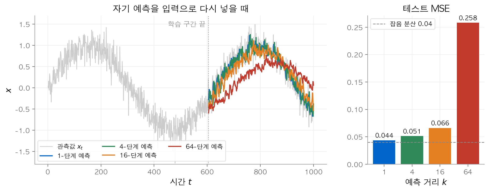
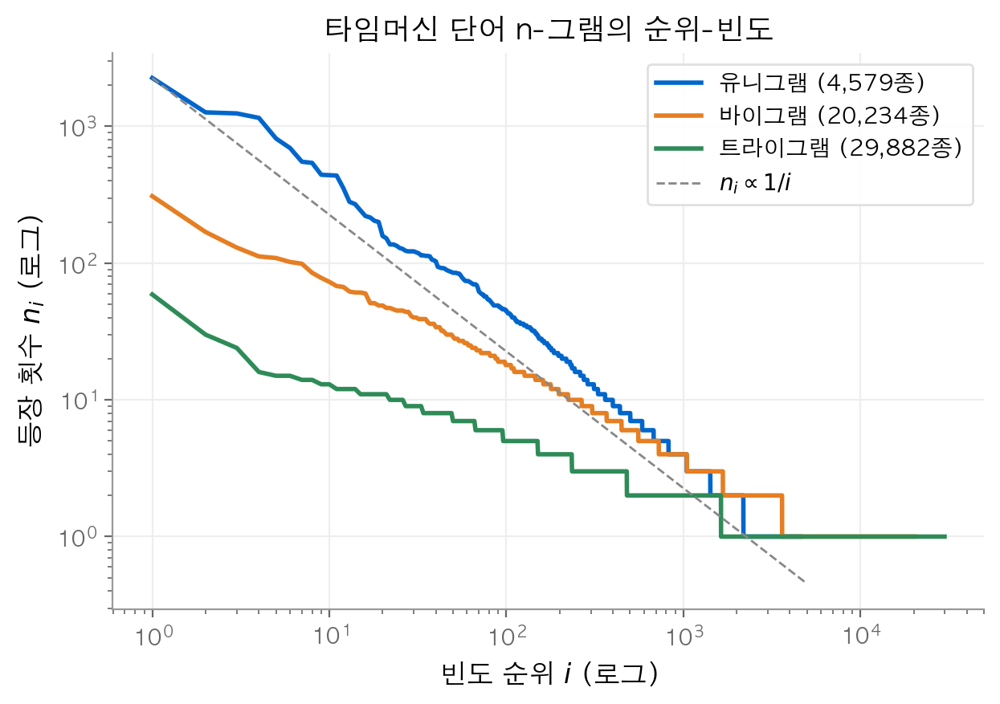
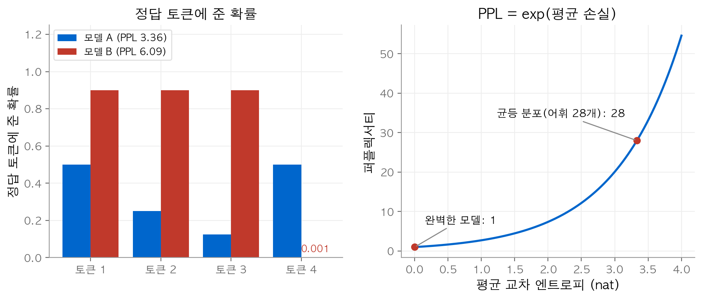
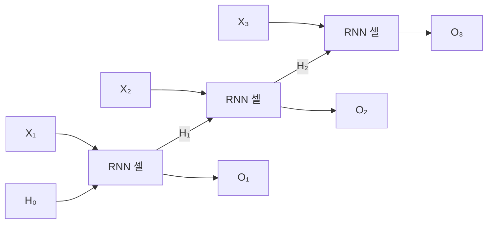
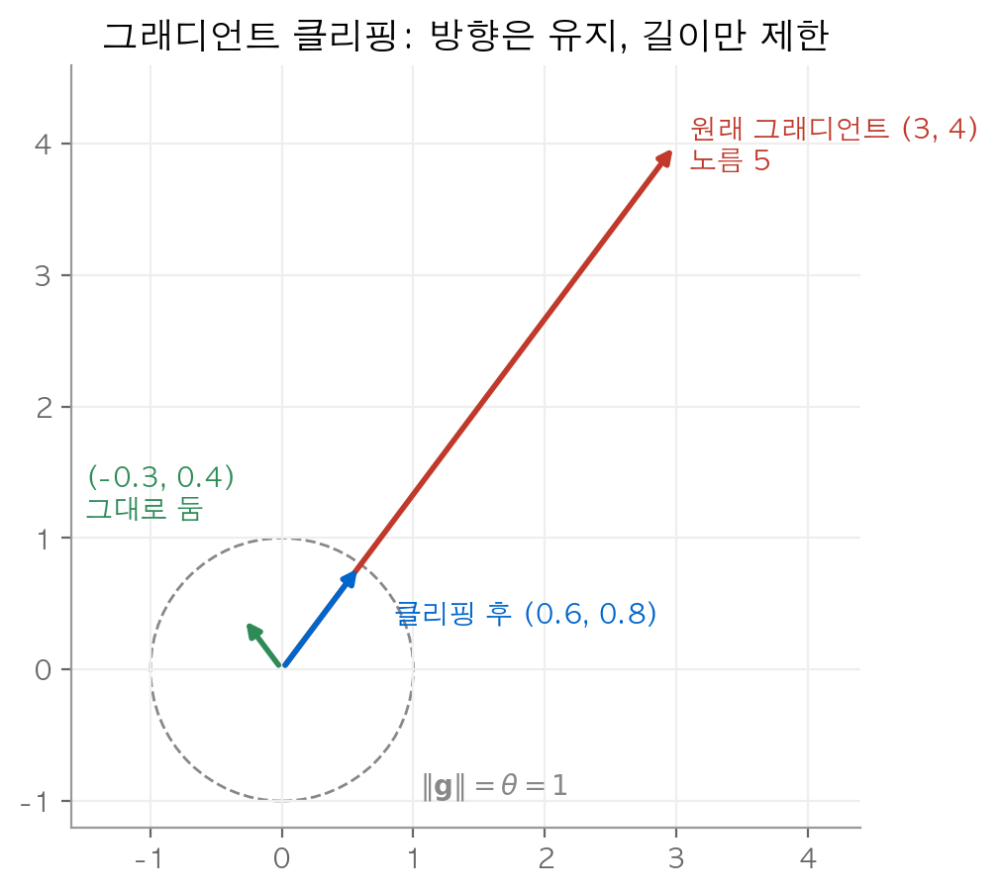
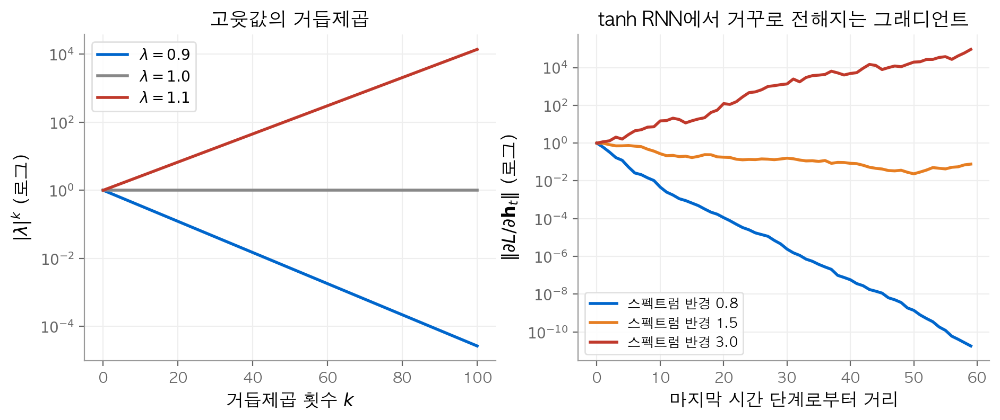

# 6. 순환 신경망

지금까지 다룬 모델은 길이가 고정된 입력을 받았습니다. 문장, 음성, 주가처럼 길이가 변하고 순서가 의미를 가지는 데이터는 다른 방식이 필요합니다. 이 장의 질문은 "과거 전체를 어떻게 고정된 크기로 요약해 다음 값을 예측할까?"입니다. 결론은 **은닉 상태(hidden state)** 하나를 시간마다 갱신하는 것입니다. 같은 가중치를 모든 시간 단계에서 다시 쓰므로 파라미터 수는 시퀀스 길이와 무관합니다. 대가로 그래디언트가 같은 행렬을 여러 번 곱하며 거꾸로 흐르고, 이 거듭제곱이 소실과 폭주를 만듭니다.

!!! info "원문과 자료"
    - 원문: [9. Recurrent Neural Networks](https://d2l.ai/chapter_recurrent-neural-networks/index.html)
    - [9.1 Working with Sequences](https://d2l.ai/chapter_recurrent-neural-networks/sequence.html)
    - [9.2 Converting Raw Text into Sequence Data](https://d2l.ai/chapter_recurrent-neural-networks/text-sequence.html)
    - [9.3 Language Models](https://d2l.ai/chapter_recurrent-neural-networks/language-model.html)
    - [9.4 Recurrent Neural Networks](https://d2l.ai/chapter_recurrent-neural-networks/rnn.html)
    - [9.5 RNN Implementation from Scratch](https://d2l.ai/chapter_recurrent-neural-networks/rnn-scratch.html), [9.6 Concise Implementation](https://d2l.ai/chapter_recurrent-neural-networks/rnn-concise.html)
    - [9.7 Backpropagation Through Time](https://d2l.ai/chapter_recurrent-neural-networks/bptt.html)
    - 함께 읽기: [3. 다층 퍼셉트론](03-mlp.md), [7. 현대적 순환 신경망](07-modern-rnn.md)

## 1. 시퀀스 모델

### 자기회귀 모델

시간 순서로 관측값 $x_1, x_2, \ldots, x_T$ 가 있습니다. 목표는 지금까지의 값으로 다음 값을 예측하는 것입니다.

$$
\hat{x}_t \approx \mathbb{E}[x_t \mid x_{t-1}, \ldots, x_1]
$$

자기 자신의 과거 값으로 자신을 예측하므로 이 모델을 **자기회귀 모델(autoregressive model)** 이라고 합니다. 문제는 조건에 들어가는 값의 개수가 $t$ 에 따라 늘어난다는 점입니다. 입력 크기가 변하면 보통의 신경망에 넣을 수 없습니다. 해결책은 두 가지입니다.

| 방법 | 식 | 특징 |
| --- | --- | --- |
| 창 자르기 | $\hat{x}_t = f(x_{t-\tau}, \ldots, x_{t-1})$ | 최근 $\tau$ 개만 봅니다. 입력 크기가 고정됩니다. |
| 잠재 자기회귀 | $h_t = g(h_{t-1}, x_{t-1})$, $\hat{x}_t = P(x_t \mid h_t)$ | 과거를 요약한 $h_t$ 를 갱신합니다. $h_t$ 는 관측되지 않습니다. |

두 번째 방법을 **잠재 자기회귀 모델(latent autoregressive model)** 이라고 합니다. 4절의 RNN이 이 방법을 신경망으로 구현합니다.

### 연쇄 법칙과 마르코프 가정

확률의 연쇄 법칙으로 시퀀스 전체의 확률을 조건부 확률의 곱으로 나눌 수 있습니다.

$$
P(x_1, \ldots, x_T) = P(x_1) \prod_{t=2}^{T} P(x_t \mid x_{t-1}, \ldots, x_1)
$$

이 식은 근사가 아닙니다. 항상 성립합니다. 근사는 조건을 줄일 때 생깁니다. 최근 $\tau$ 개만 보면 충분하다고 가정하는 것을 **마르코프 가정(Markov assumption)** 이라고 합니다. $\tau = 1$ 이면 1차 마르코프 모델입니다.

$$
P(x_1, \ldots, x_T) = P(x_1) \prod_{t=2}^{T} P(x_t \mid x_{t-1})
$$

직관은 이렇습니다. 바로 앞의 상태가 과거의 정보를 모두 담고 있다면, 그보다 오래된 값은 새 정보를 더하지 않습니다. 실제 텍스트에서 이 가정은 근사로만 성립합니다. 다만 문맥을 늘려서 얻는 이득은 빠르게 줄어듭니다.

순서를 거꾸로 뒤집어 $P(x_T) \prod P(x_t \mid x_{t+1}, \ldots)$ 로 써도 수학적으로는 같습니다. 그래도 왼쪽에서 오른쪽으로 예측하는 쪽을 씁니다. 사람이 읽는 순서와 같고, 새 토큰이 들어올 때 모델을 그대로 이어 쓸 수 있고, 원인이 결과보다 앞서는 데이터에서는 정방향 예측이 더 쉽기 때문입니다.

### 예측 거리가 길어지면 오차가 쌓입니다

사인파에 잡음을 더한 데이터로 실험합니다. $T = 1000$ 이고 $x_t = \sin(0.01t) + 0.2\epsilon_t$, $\epsilon_t \sim \mathcal{N}(0, 1)$ 입니다. 특징은 직전 4개 값 $[x_{t-4}, \ldots, x_{t-1}]$ 이고 레이블은 $x_t$ 입니다. 처음 600개 예제로 선형 회귀를 학습합니다. 최소 제곱으로 구한 가중치는 $(0.275, 0.220, 0.247, 0.240)$ 이고 절편은 $-0.001$ 입니다. 가중치의 합은 약 0.98입니다.

**1단계 예측(one-step-ahead prediction)** 은 실제 관측값 4개를 넣어 다음 값 하나를 맞힙니다. **$k$-단계 예측($k$-step-ahead prediction)** 은 실제 값이 없는 구간에서 모델 자신의 예측을 다시 입력으로 넣습니다. 예를 들어 $\hat{x}_{606} = f(x_{602}, x_{603}, x_{604}, \hat{x}_{605})$ 입니다.

한 단계의 오차가 $\bar\epsilon$ 이면 다음 단계의 오차는 대략 $\epsilon_2 = \bar\epsilon + c\,\epsilon_1$ 처럼 앞 단계 오차를 물려받습니다. 그래서 $k$ 가 커질수록 오차가 커집니다.


왼쪽은 테스트 구간에서 $k = 1, 4, 16, 64$ 단계 예측을 겹쳐 그린 것입니다. 오른쪽은 각 $k$ 의 테스트 MSE입니다. $k = 64$ 에서 예측이 실제 곡선을 따라가지 못합니다.

numpy로 계산한 테스트 MSE는 $k = 1, 4, 16, 64$ 에서 각각 0.044, 0.051, 0.066, 0.258입니다. 잡음의 분산이 $0.2^2 = 0.04$ 이므로 1단계 예측은 잡음 수준에 가깝습니다. 64단계 예측의 오차는 그 6배가 넘습니다. 가중치의 합이 1보다 작으므로 자기 예측만 계속 넣으면 값이 점점 일정한 값으로 줄어듭니다. 이 실험의 교훈은 두 가지입니다. 내삽은 외삽보다 훨씬 쉽습니다. 학습할 때 미래 데이터를 쓰지 않도록 시간 순서를 지켜야 합니다.

## 2. 텍스트를 시퀀스로 바꾸기

### 토큰화와 어휘

신경망은 문자열이 아니라 숫자를 받습니다. 텍스트를 숫자 시퀀스로 바꾸는 과정은 세 단계입니다.

1. **토큰화(tokenization)**: 텍스트를 **토큰(token)** 단위로 자릅니다. 토큰은 문자, 단어, 단어 조각 중 하나를 고릅니다.
2. **어휘(vocabulary)** 만들기: 서로 다른 토큰마다 정수 인덱스를 하나씩 줍니다.
3. 변환: 텍스트의 각 토큰을 인덱스로 바꿉니다.

어휘에는 특수 토큰 `<unk>` 를 둡니다. 어휘에 없는 토큰이나 빈도가 `min_freq` 보다 낮은 토큰은 모두 `<unk>` 로 바꿉니다. 문자 단위 토큰은 어휘가 작고 시퀀스가 깁니다. 단어 단위 토큰은 어휘가 크고 시퀀스가 짧습니다.

H. G. 웰스의 소설 『타임머신(The Time Machine)』으로 확인합니다. 영문자가 아닌 문자를 공백으로 바꾸고 소문자로 통일합니다.

```python
import re, collections

text = open("timemachine.txt").read()
text = re.sub("[^A-Za-z]+", " ", text).lower()

# 문자 단위 토큰화와 어휘
chars = list(text)
idx_to_token = ["<unk>"] + sorted(set(chars))
token_to_idx = {tok: i for i, tok in enumerate(idx_to_token)}
corpus = [token_to_idx[c] for c in chars]
print(len(corpus), len(idx_to_token))        # 173428 28

# 단어 단위 바이그램 추정
words = text.split()
uni = collections.Counter(words)
bi = collections.Counter(zip(words[:-1], words[1:]))
print(bi[("the", "time")] / uni["the"])       # 0.0451...
```

문자 단위 말뭉치는 173,428개 토큰입니다. 어휘는 영문자 26개, 공백, `<unk>` 를 합쳐 28개입니다. 단어 단위로 자르면 32,775개 단어이고 서로 다른 단어는 4,579개입니다.

### 지프의 법칙

단어를 빈도 순으로 정렬하면 1위 "the"가 2,261번, 2위 "i"가 1,267번, 3위 "and"가 1,245번 나옵니다. $i$ 번째로 많이 나오는 단어의 빈도 $n_i$ 는 대략 다음 관계를 따릅니다. 이것을 **지프의 법칙(Zipf's law)** 이라고 합니다.

$$
n_i \propto \frac{1}{i^\alpha} \quad \Longleftrightarrow \quad \log n_i = -\alpha \log i + c
$$

로그-로그 그래프에서 직선이 되고 기울기가 $-\alpha$ 입니다. 순위 10~1000 구간에서 직선을 맞추면 $\alpha \approx 1.04$ 입니다.


타임머신의 단어 유니그램, 바이그램, 트라이그램 빈도를 순위에 따라 로그-로그로 그렸습니다. 세 곡선 모두 대략 직선이고, n이 클수록 기울기가 완만합니다.

- 상위 단어는 "the", "of" 같은 **불용어(stop word)** 입니다. RNN과 트랜스포머는 불용어를 지우지 않고 그대로 씁니다.
- 바이그램과 트라이그램도 지프의 법칙을 따릅니다. 바이그램 1위는 "of the"(309회)이고 트라이그램 1위는 "the time traveller"(59회)입니다.
- 꼬리가 깁니다. 한 번만 나온 비율이 유니그램 52%, 바이그램 82%, 트라이그램 95%입니다.

마지막 항목이 중요합니다. 대부분의 n-gram을 한 번밖에 보지 못하므로 빈도를 세는 방식으로는 확률을 믿을 만하게 추정하기 어렵습니다.

## 3. 언어 모델

### 정의와 n-gram

**언어 모델(language model)** 은 토큰 시퀀스의 결합 확률 $P(x_1, \ldots, x_T)$ 를 추정합니다. 1절의 연쇄 법칙을 그대로 씁니다. 마르코프 가정으로 조건을 자르면 n-gram 모델이 됩니다. 토큰 4개로 비교하면 다음과 같습니다.

| 모델 | $P(x_1, x_2, x_3, x_4)$ 의 근사 |
| --- | --- |
| 유니그램 | $P(x_1)P(x_2)P(x_3)P(x_4)$ |
| 바이그램 | $P(x_1)P(x_2 \mid x_1)P(x_3 \mid x_2)P(x_4 \mid x_3)$ |
| 트라이그램 | $P(x_1)P(x_2 \mid x_1)P(x_3 \mid x_1, x_2)P(x_4 \mid x_2, x_3)$ |

조건부 확률은 빈도의 비로 추정합니다. $n(x)$ 는 단어 $x$ 의 횟수이고 $n(x, x')$ 는 연속한 쌍의 횟수입니다.

$$
\hat{P}(x' \mid x) = \frac{n(x, x')}{n(x)}
$$

타임머신에서 $n(\text{the}) = 2261$, $n(\text{the}, \text{time}) = 102$ 이므로 $\hat{P}(\text{time} \mid \text{the}) = 102/2261 \approx 0.0451$ 입니다. 반면 "time medical"은 한 번도 나오지 않으므로 $\hat{P}(\text{medical} \mid \text{time}) = 0$ 입니다. 확률이 0인 쌍이 문장에 하나라도 있으면 문장 전체의 확률이 0이 됩니다.

### 라플라스 평활화

**라플라스 평활화(Laplace smoothing)** 는 모든 빈도에 작은 상수를 더해 0을 없앱니다. $n$ 은 전체 단어 수, $m$ 은 서로 다른 단어 수, $\epsilon_1, \epsilon_2, \epsilon_3$ 은 하이퍼파라미터입니다.

$$
\begin{aligned}
\hat{P}(x) &= \frac{n(x) + \epsilon_1/m}{n + \epsilon_1} \\
\hat{P}(x' \mid x) &= \frac{n(x, x') + \epsilon_2 \hat{P}(x')}{n(x) + \epsilon_2} \\
\hat{P}(x'' \mid x, x') &= \frac{n(x, x', x'') + \epsilon_3 \hat{P}(x'')}{n(x, x') + \epsilon_3}
\end{aligned}
$$

직관은 "본 적 없는 조합에는 낮은 차수 모델의 확률을 조금 나눠 준다"입니다. $\epsilon_1 = 0$ 이면 평활화가 없습니다. $\epsilon_1 \to \infty$ 이면 $\hat{P}(x)$ 가 균등 확률 $1/m$ 로 갑니다.

수치로 확인합니다. $n = 32775$, $m = 4579$ 입니다.

| 값 | 평활화 전 | $\epsilon_2 = 1$ |
| --- | --- | --- |
| $\hat{P}(\text{time} \mid \text{the})$ | 0.04511 | 0.04510 |
| $\hat{P}(\text{medical} \mid \text{time})$ | 0 | $3.6 \times 10^{-6}$ |

자주 본 쌍의 확률은 거의 변하지 않습니다. 본 적 없는 쌍만 0이 아닌 작은 값을 받습니다. $\epsilon_1$ 을 키우면 $\hat{P}(\text{time})$ 이 0.00610에서 균등 확률 $1/4579 \approx 0.00022$ 쪽으로 내려갑니다. $\epsilon_1 = 10^6$ 에서 0.00041입니다.

평활화로도 남는 한계가 있습니다. 모든 n-gram의 횟수를 저장해야 합니다. 꼬리의 희소성은 그대로입니다. "cat"과 "feline"이 비슷하다는 의미 정보를 쓰지 못합니다. 이 한계가 신경망 언어 모델로 넘어가는 이유입니다.

### 퍼플렉서티

언어 모델의 품질은 다음 토큰을 얼마나 잘 맞히는지로 잽니다. $n$ 개 토큰에 대한 평균 교차 엔트로피에 지수를 취한 것이 **퍼플렉서티(perplexity)** 입니다.

$$
\text{PPL} = \exp\left(-\frac{1}{n} \sum_{t=1}^{n} \log P(x_t \mid x_{t-1}, \ldots, x_1)\right)
$$

PPL은 정답 토큰에 준 확률의 기하 평균의 역수입니다. 그래서 "모델이 매 단계 평균 몇 개의 후보 사이에서 고민하는가"로 읽을 수 있습니다. 세 기준점이 있습니다.

| 경우 | 정답 토큰의 확률 | PPL |
| --- | --- | --- |
| 최선 | 항상 1 | 1 |
| 기준선 | 어휘 전체에 균등 ($1/V$) | $V$ (어휘 크기) |
| 최악 | 한 번이라도 0 | $+\infty$ |

쓸모 있는 모델은 기준선 $V$ 보다 낮아야 합니다. 문자 단위 타임머신에서는 $V = 28$ 입니다.

**수치 예시.** 토큰 4개에서 모델 A가 정답에 준 확률이 $(0.5, 0.25, 0.125, 0.5)$ 라고 합시다. 평균 손실은 $1.213$ nat이고 PPL은 $e^{1.213} \approx 3.36$ 입니다. 모델 B는 앞의 세 토큰에 0.9를 주고 마지막 토큰에 0.001을 줍니다. 세 토큰을 더 잘 맞혔지만 PPL은 6.09로 A보다 나쁩니다. 로그 때문에 한 번의 큰 실수가 평균을 크게 흔듭니다.


왼쪽은 두 모델이 각 정답 토큰에 준 확률과 PPL입니다. 오른쪽은 PPL이 평균 손실의 지수 함수이고 완벽한 모델은 1, 균등 분포는 28에 놓인다는 것을 보여 줍니다.

타임머신 문자의 앞 90%로 n-gram 빈도를 세고 뒤 10%에서 PPL을 재면 다음과 같습니다. 평활화 상수는 모두 1입니다.

| 모델 | 테스트 PPL |
| --- | --- |
| 균등 분포 | 28 |
| 유니그램 | 16.7 |
| 바이그램 | 9.6 |
| 트라이그램 | 6.4 |
| 바이그램, 평활화 없음 | $\infty$ (본 적 없는 쌍 3개) |

문맥을 늘릴수록 PPL이 줄어듭니다. 평활화가 없으면 테스트 17,342개 쌍 중 3개 때문에 PPL이 무한대가 됩니다.

## 4. 은닉 상태를 쓰는 순환 신경망

[3장](03-mlp.md)의 MLP는 $\mathbf{H} = \phi(\mathbf{X}\mathbf{W}_{xh} + \mathbf{b}_h)$ 로 입력 하나만 봅니다. n-gram은 조건 길이를 늘릴 때마다 파라미터가 어휘 크기의 거듭제곱으로 늘어납니다. 대신 과거를 요약한 상태 $h_{t-1}$ 을 두고 $P(x_t \mid x_{t-1}, \ldots, x_1) \approx P(x_t \mid h_{t-1})$ 로 근사합니다.

### 은닉 상태가 있는 RNN

**순환 신경망(recurrent neural network, RNN)** 은 이전 시간 단계의 은닉 상태를 현재 입력과 함께 받습니다.

$$
\mathbf{H}_t = \phi(\mathbf{X}_t \mathbf{W}_{xh} + \mathbf{H}_{t-1} \mathbf{W}_{hh} + \mathbf{b}_h), \qquad
\mathbf{O}_t = \mathbf{H}_t \mathbf{W}_{hq} + \mathbf{b}_q
$$

| 기호 | 크기 | 역할 |
| --- | --- | --- |
| $\mathbf{X}_t$ | $n \times d$ | 시간 $t$ 의 입력 |
| $\mathbf{W}_{xh}$ | $d \times h$ | 입력에서 은닉으로 |
| $\mathbf{W}_{hh}$ | $h \times h$ | 은닉에서 은닉으로 (순환) |
| $\mathbf{H}_t$ | $n \times h$ | 은닉 상태 |
| $\mathbf{W}_{hq}$ | $h \times q$ | 은닉에서 출력으로 |
| $\mathbf{O}_t$ | $n \times q$ | 출력 |

핵심은 $\mathbf{W}_{xh}, \mathbf{W}_{hh}, \mathbf{W}_{hq}$ 를 모든 시간 단계가 공유한다는 점입니다. 시퀀스가 길어져도 파라미터 수가 늘지 않습니다. $\mathbf{H}_{t-1}$ 이 다시 $\mathbf{H}_t$ 를 만드는 데 쓰이므로 이 연결을 순환(recurrent)이라고 부릅니다.

시간 축으로 펼치면 같은 셀이 사슬처럼 이어진 구조가 됩니다.



세 셀은 같은 가중치를 씁니다. 화살표 $\mathbf{H}_t$ 가 과거 정보를 다음 단계로 나르는 유일한 통로입니다.

참고로 $\mathbf{X}_t \mathbf{W}_{xh} + \mathbf{H}_{t-1}\mathbf{W}_{hh}$ 는 $[\mathbf{X}_t, \mathbf{H}_{t-1}]$ 와 두 가중치를 세로로 쌓은 행렬의 곱 하나로 쓸 수 있습니다. 구현에서 행렬곱을 한 번으로 줄일 때 씁니다.

### 작은 수치 예시

$d = 1$, $h = 2$, $\phi = \tanh$ 로 입력 $1, 0, -1$ 을 차례로 넣습니다.

```python
import numpy as np
W_xh = np.array([[0.5, -0.3]])               # d=1, h=2
W_hh = np.array([[0.8, 0.1], [-0.2, 0.6]])
b_h = np.zeros(2)
H = np.zeros((1, 2))                         # 배치 1개
for x in [1.0, 0.0, -1.0]:
    X = np.array([[x]])
    H = np.tanh(X @ W_xh + H @ W_hh + b_h)
    print(H.round(4))
# [[ 0.4621 -0.2913]]
# [[ 0.4036 -0.1279]]
# [[-0.1504  0.2577]]
```

두 번째 단계의 입력은 0입니다. 그래도 은닉 상태는 $(0.4036, -0.1279)$ 로 0이 아닙니다. 첫 입력의 정보가 $\mathbf{W}_{hh}$ 를 거쳐 남아 있기 때문입니다.

### 문자 단위 언어 모델

텍스트 "machine"으로 다음 문자를 예측하는 모델을 만듭니다. 입력은 "machin"이고 타깃은 한 칸 민 "achine"입니다. 시간 단계 3에서 입력은 "c"이고 타깃은 "h"입니다. 은닉 상태 덕분에 이 예측은 "m", "a", "c" 세 문자 모두에 의존합니다.

각 문자는 **원-핫 인코딩(one-hot encoding)** 으로 길이 28의 벡터가 됩니다. 인덱스를 숫자 그대로 넣으면 인덱스 5와 6이 비슷한 문자라는 잘못된 순서 정보가 들어갑니다. 출력 $\mathbf{O}_t$ 는 길이 28의 점수이고 소프트맥스를 거쳐 다음 문자의 분포가 됩니다. 손실은 시간 단계마다 교차 엔트로피를 구해 평균합니다. 평가는 3절의 퍼플렉서티로 합니다.

텍스트를 생성할 때는 먼저 접두어(예: "it has")를 넣어 은닉 상태를 데웁니다. 이 구간에서는 출력을 쓰지 않습니다. 그다음 가장 점수가 높은 문자를 골라 다시 입력으로 넣는 일을 반복합니다. 원문 실험에서 은닉 유닛 32개 모델은 "it has in the the the the"처럼 짧은 단어를 반복하는 문장을 만들었습니다.

## 5. 그래디언트 클리핑

RNN의 그래디언트는 가끔 매우 커집니다(6절에서 이유를 봅니다). 이 한 번의 큰 스텝이 학습을 망가뜨립니다. **그래디언트 클리핑(gradient clipping)** 은 모든 파라미터의 그래디언트를 이은 벡터 $\mathbf{g}$ 의 노름이 임계값 $\theta$ 를 넘으면 길이를 $\theta$ 로 줄입니다.

$$
\mathbf{g} \leftarrow \min\left(1, \frac{\theta}{\|\mathbf{g}\|}\right) \mathbf{g}
$$

방향은 그대로 두고 길이만 제한합니다. $\|\mathbf{g}\| \le \theta$ 이면 아무것도 바꾸지 않습니다.

목적 함수 $f$ 가 상수 $L$ 로 **립시츠 연속(Lipschitz continuous)** 이면 $|f(\mathbf{x}) - f(\mathbf{y})| \le L\|\mathbf{x} - \mathbf{y}\|$ 입니다. 학습률 $\eta$ 로 한 번 갱신하면 파라미터가 $\eta\mathbf{g}$ 만큼 움직이므로 목적 함수의 변화는 $L\eta\|\mathbf{g}\|$ 이하입니다. 클리핑 후에는 이 상한이 $L\eta\theta$ 로 고정됩니다. 한 스텝이 할 수 있는 손상의 크기를 제한하는 셈입니다.

수치 예시로 $\theta = 1$ 입니다. $\mathbf{g} = (3, 4)$ 는 노름이 5이므로 $1/5$ 배가 되어 $(0.6, 0.8)$ 이 됩니다. $\mathbf{g} = (0.3, 0.4)$ 는 노름이 0.5이므로 그대로 둡니다.


반지름 $\theta = 1$ 인 원 밖의 그래디언트는 같은 방향의 원 위 점으로 줄어듭니다. 원 안의 그래디언트는 바뀌지 않습니다.

클리핑은 폭주만 막습니다. 소실은 해결하지 못합니다. 원문도 이 방법을 "임시방편(hack)"이라고 부르지만 RNN 구현에서 거의 항상 씁니다. 원문의 문자 단위 RNN은 배치 1024, 시간 단계 32, 은닉 유닛 32, 학습률 1, $\theta = 1$ 로 100 에폭 학습합니다.

## 6. 시간에 따른 역전파

### 펼친 그래프에 역전파 적용하기

**시간에 따른 역전파(backpropagation through time, BPTT)** 는 새로운 알고리즘이 아닙니다. RNN을 시간 축으로 펼친 그래프에 보통의 역전파를 적용한 것입니다. 펼친 그래프에서 같은 가중치가 여러 번 나오므로, 각 등장 위치의 그래디언트를 모두 더합니다.

단순화한 모델로 구조를 봅니다. $w_h$ 는 은닉 가중치, $w_o$ 는 출력 가중치입니다.

$$
h_t = f(x_t, h_{t-1}, w_h), \qquad o_t = g(h_t, w_o), \qquad L = \frac{1}{T}\sum_{t=1}^{T} l(y_t, o_t)
$$

$h_t$ 는 $w_h$ 에 직접 의존하고 $h_{t-1}$ 을 통해서도 의존합니다. 그래서 다음 점화식이 생깁니다.

$$
\frac{\partial h_t}{\partial w_h} = \frac{\partial f(x_t, h_{t-1}, w_h)}{\partial w_h} + \frac{\partial f(x_t, h_{t-1}, w_h)}{\partial h_{t-1}} \frac{\partial h_{t-1}}{\partial w_h}
$$

풀어 쓰면 야코비안의 곱이 합 안에 들어갑니다.

$$
\frac{\partial h_t}{\partial w_h} = \frac{\partial f_t}{\partial w_h} + \sum_{i=1}^{t-1} \left( \prod_{j=i+1}^{t} \frac{\partial f_j}{\partial h_{j-1}} \right) \frac{\partial f_i}{\partial w_h}
$$

$i$ 가 $t$ 에서 멀수록 곱해지는 항의 수가 늘어납니다. 먼 과거의 영향은 긴 곱을 통과해야 현재에 닿습니다.

### 행렬 형태와 거듭제곱

편향을 없애고 활성화를 항등 함수로 둔 행렬 형태로 정확히 계산합니다.

$$
\mathbf{h}_t = \mathbf{W}_{hx}\mathbf{x}_t + \mathbf{W}_{hh}\mathbf{h}_{t-1}, \qquad \mathbf{o}_t = \mathbf{W}_{qh}\mathbf{h}_t
$$

마지막 단계부터 거꾸로 계산합니다. 은닉 상태의 그래디언트는 다음 단계에서 오는 것과 현재 출력에서 오는 것의 합입니다. 즉 $\partial L / \partial \mathbf{h}_t = \mathbf{W}_{hh}^\top \, \partial L / \partial \mathbf{h}_{t+1} + \mathbf{W}_{qh}^\top \, \partial L / \partial \mathbf{o}_t$ 입니다. 이 점화식을 풀면 $\mathbf{W}_{hh}^\top$ 의 거듭제곱이 나타납니다.

$$
\frac{\partial L}{\partial \mathbf{h}_t} = \sum_{i=t}^{T} \left(\mathbf{W}_{hh}^\top\right)^{T-i} \mathbf{W}_{qh}^\top \frac{\partial L}{\partial \mathbf{o}_{T+t-i}}
$$

가중치의 그래디언트는 이 값을 시간 단계마다 모아 더합니다.

$$
\frac{\partial L}{\partial \mathbf{W}_{hx}} = \sum_{t=1}^{T} \frac{\partial L}{\partial \mathbf{h}_t}\mathbf{x}_t^\top, \qquad
\frac{\partial L}{\partial \mathbf{W}_{hh}} = \sum_{t=1}^{T} \frac{\partial L}{\partial \mathbf{h}_t}\mathbf{h}_{t-1}^\top
$$

$\partial L / \partial \mathbf{h}_t$ 는 두 식에 함께 쓰이므로 한 번 계산해 저장해 둡니다. 아래 코드는 이 절차를 그대로 구현하고 수치 미분과 비교합니다. 손실은 마지막 은닉 상태에서만 계산합니다.

```python
import numpy as np
rng = np.random.default_rng(0)
h_dim, T = 3, 20
W_hh = rng.standard_normal((h_dim, h_dim)) * 0.5
W_hx = rng.standard_normal((h_dim, 1))
xs = rng.standard_normal((T, 1))

def loss(W_hh):
    h = np.zeros(h_dim)
    for t in range(T):
        h = W_hx @ xs[t] + W_hh @ h      # 항등 활성화
    return 0.5 * np.sum(h**2)            # 마지막 단계에서만 손실

hs = [np.zeros(h_dim)]
for t in range(T):
    hs.append(W_hx @ xs[t] + W_hh @ hs[-1])
g_h = hs[-1].copy()                      # dL/dh_T
grad = np.zeros_like(W_hh)
for t in range(T, 0, -1):
    grad += np.outer(g_h, hs[t-1])       # dL/dh_t h_{t-1}^T
    g_h = W_hh.T @ g_h                   # dL/dh_{t-1}

eps = 1e-6; E = np.zeros_like(W_hh); E[0, 1] = eps
num = (loss(W_hh + E) - loss(W_hh - E)) / (2 * eps)
print(round(grad[0, 1], 6), round(num, 6))   # -0.42963 -0.42963
```

역전파 루프의 `g_h = W_hh.T @ g_h` 한 줄이 거듭제곱의 근원입니다. 시간 단계를 하나 거슬러 갈 때마다 같은 행렬을 한 번 더 곱합니다.

### 소실과 폭주

$\mathbf{W}_{hh}$ 의 고윳값을 $\lambda_i$ 라고 합시다. $\mathbf{M}^k$ 의 고윳값은 $\lambda_i^k$ 입니다. $|\lambda_i| < 1$ 인 방향은 $k$ 가 커지면 0으로 사라지고, $|\lambda_i| > 1$ 인 방향은 무한히 커집니다. 그래서 먼 과거에서 오는 그래디언트는 **소실(vanishing)** 되거나 **폭주(exploding)** 합니다.

| $\lvert\lambda\rvert$ | $k = 10$ | $k = 50$ | $k = 100$ |
| --- | --- | --- | --- |
| 0.9 | 0.349 | 0.0052 | $2.7 \times 10^{-5}$ |
| 1.0 | 1 | 1 | 1 |
| 1.1 | 2.59 | 117.4 | 13,780.6 |

$\mathbf{M} = \mathrm{diag}(1.1, 0.5)$ 에 $\mathbf{v} = (1, 1)$ 을 50번 곱하면 $(117.4, 8.9 \times 10^{-16})$ 이 됩니다. 두 번째 성분은 사실상 사라지고 첫 번째 고유벡터 방향만 남습니다. 무작위 벡터에 행렬을 거듭 곱하면 가장 큰 고윳값의 고유벡터 쪽으로 정렬됩니다.


왼쪽은 고윳값 하나의 거듭제곱을 로그 축에 그렸습니다. 오른쪽은 은닉 유닛 32개 tanh RNN에서 거꾸로 전해지는 그래디언트 노름을 $\mathbf{W}_{hh}$ 의 스펙트럼 반경별로 그렸습니다.

tanh가 있으면 야코비안은 $\mathbf{W}_{hh}^\top \mathrm{diag}(1 - \mathbf{h}^2)$ 가 됩니다. tanh의 미분이 1 이하이므로 소실 쪽으로 더 기웁니다. 그림에서 스펙트럼 반경 1.5인데도 그래디언트가 폭주하지 않고 완만하게 줄어드는 것은 이 효과 때문입니다. 반경이 0.8이면 60단계에서 $10^{-10}$ 아래로 떨어지고, 3.0이면 $10^4$ 를 넘습니다.

### 계산 전략: 전체, 절단, 무작위 절단

| 전략 | 방법 | 특징 |
| --- | --- | --- |
| 전체 계산 | 모든 $i$ 를 더합니다. | 느리고 그래디언트가 불안정합니다. 실제로는 거의 쓰지 않습니다. |
| 일정 절단 | $\tau$ 단계에서 합을 멈춥니다. | 근사 그래디언트입니다. 단기 의존에 집중하게 하는 가벼운 정규화 효과가 있습니다. |
| 무작위 절단 | 확률 변수 $\xi_t$ 로 멈출 시점을 정합니다. | 기댓값은 정확합니다. 실제 성능은 일정 절단보다 크게 낫지 않습니다. |

무작위 절단은 $P(\xi_t = 0) = 1 - \pi_t$, $P(\xi_t = \pi_t^{-1}) = \pi_t$ 인 $\xi_t$ 를 씁니다. $\mathbb{E}[\xi_t] = 1$ 입니다. 점화식의 두 번째 항에 $\xi_t$ 를 곱해 $z_t = \partial f_t / \partial w_h + \xi_t (\partial f_t / \partial h_{t-1})(\partial h_{t-1} / \partial w_h)$ 로 계산합니다. $\xi_t = 0$ 이면 거기서 재귀가 끝납니다. $\xi_t$ 가 0이 아니면 $1/\pi_t$ 배로 키워 잘린 부분을 보상합니다. 그래서 $\mathbb{E}[z_t] = \partial h_t / \partial w_h$ 입니다. 대신 분산이 커집니다.

실제 구현에서는 일정 절단을 씁니다. 미니배치 하나의 길이 `num_steps` 가 곧 $\tau$ 이고, 미니배치 경계에서 은닉 상태를 계산 그래프에서 떼어 냅니다. 아래 PyTorch 코드는 문자 단위 RNN의 학습 한 스텝에 절단과 클리핑을 함께 넣은 예입니다.

```python
import torch
from torch import nn
vocab_size, num_hiddens = 28, 32
rnn = nn.RNN(vocab_size, num_hiddens)            # 입력: (시간, 배치, 어휘)
head = nn.Linear(num_hiddens, vocab_size)
params = list(rnn.parameters()) + list(head.parameters())
opt = torch.optim.SGD(params, lr=1.0)

def train_step(X, Y, state):
    # X, Y: (num_steps, batch) 정수 인덱스. Y는 X를 한 칸 민 것
    if state is not None:
        state = state.detach()                   # 절단된 BPTT: 이전 배치로 그래디언트가 흐르지 않음
    inputs = nn.functional.one_hot(X, vocab_size).float()
    out, state = rnn(inputs, state)
    logits = head(out)                           # (num_steps, batch, vocab)
    loss = nn.functional.cross_entropy(logits.reshape(-1, vocab_size), Y.reshape(-1))
    opt.zero_grad()
    loss.backward()
    nn.utils.clip_grad_norm_(params, max_norm=1.0)   # theta = 1
    opt.step()
    return loss.exp().item(), state              # 배치 퍼플렉서티
```

`state.detach()` 가 절단을 담당하고 `clip_grad_norm_` 이 폭주를 막습니다. 소실은 이 두 장치로 해결되지 않습니다. 게이트로 정보 흐름을 조절하는 LSTM과 GRU가 이 문제를 다룹니다([7장](07-modern-rnn.md)). 순환 자체를 없애는 어텐션은 [8장](08-attention-transformer.md)에서 다룹니다.

## 정리

- 시퀀스의 결합 확률은 연쇄 법칙으로 조건부 확률의 곱이 됩니다. 마르코프 가정은 조건을 최근 $\tau$ 개로 자르는 근사입니다.
- 자기 예측을 다시 입력으로 쓰는 $k$-단계 예측은 오차가 쌓입니다. 사인파 실험에서 테스트 MSE가 $k = 1$ 의 0.044에서 $k = 64$ 의 0.258로 커졌습니다.
- 텍스트는 토큰화, 어휘 구축, 인덱스 변환을 거쳐 숫자 시퀀스가 됩니다. 단어 빈도는 지프의 법칙 $n_i \propto i^{-\alpha}$ 를 따르고 타임머신에서 $\alpha \approx 1.04$ 입니다.
- n-gram 언어 모델은 빈도의 비로 확률을 추정합니다. 긴 꼬리 때문에 본 적 없는 조합이 많고, 라플라스 평활화로 확률 0을 없앱니다.
- 퍼플렉서티는 평균 교차 엔트로피의 지수입니다. 최선은 1, 균등 분포 기준선은 어휘 크기, 최악은 무한대입니다.
- RNN은 $\mathbf{H}_t = \phi(\mathbf{X}_t\mathbf{W}_{xh} + \mathbf{H}_{t-1}\mathbf{W}_{hh} + \mathbf{b}_h)$ 로 은닉 상태를 갱신합니다. 가중치를 시간 단계 사이에 공유하므로 파라미터 수가 시퀀스 길이와 무관합니다.
- 그래디언트 클리핑은 그래디언트의 방향을 두고 노름만 $\theta$ 이하로 줄입니다. 폭주는 막지만 소실은 막지 못합니다.
- BPTT는 펼친 그래프의 역전파입니다. 그래디언트에 $\mathbf{W}_{hh}^\top$ 의 거듭제곱이 들어가므로 고윳값이 1보다 작으면 소실, 크면 폭주가 생깁니다.
- 실제로는 $\tau$ 단계에서 잘라 계산하는 절단된 BPTT를 씁니다. 장기 의존을 다루는 근본적인 해결은 게이트 구조에서 나옵니다.
