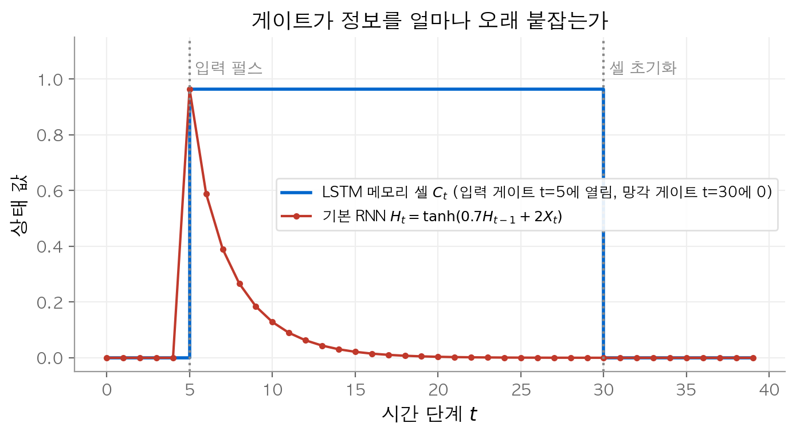
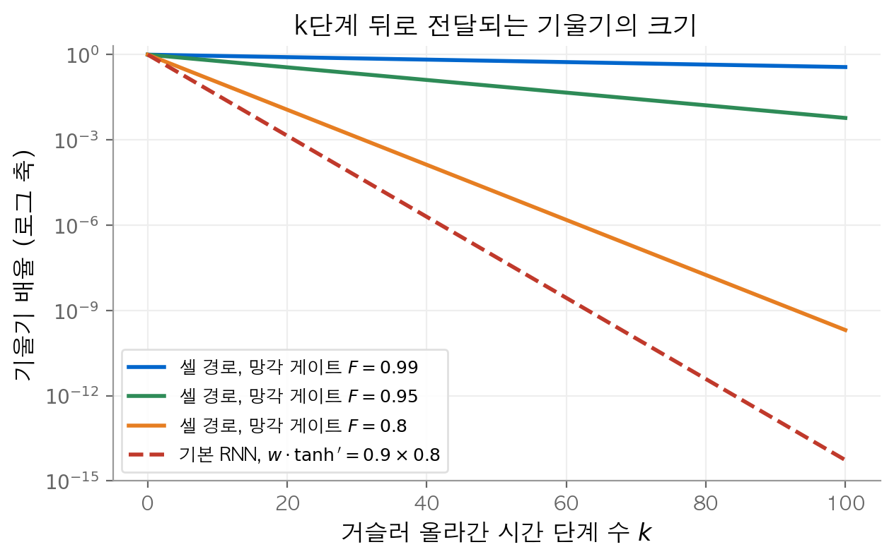
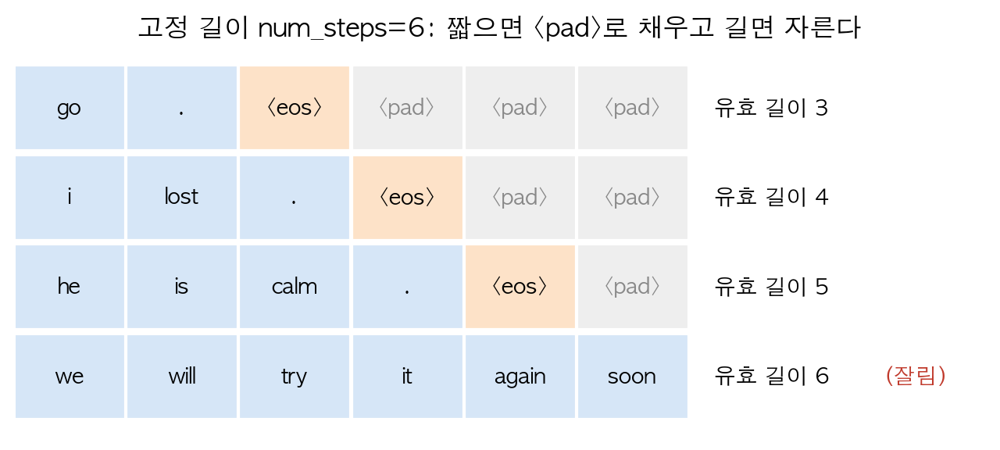
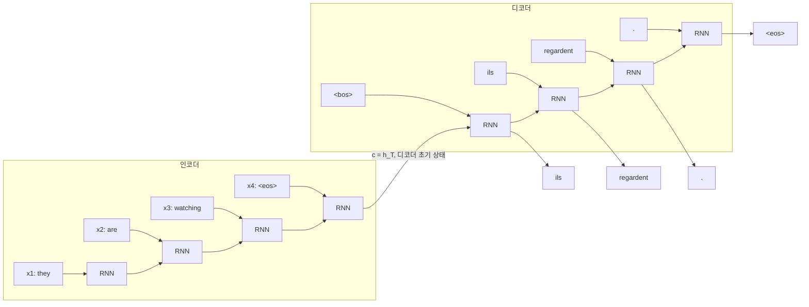
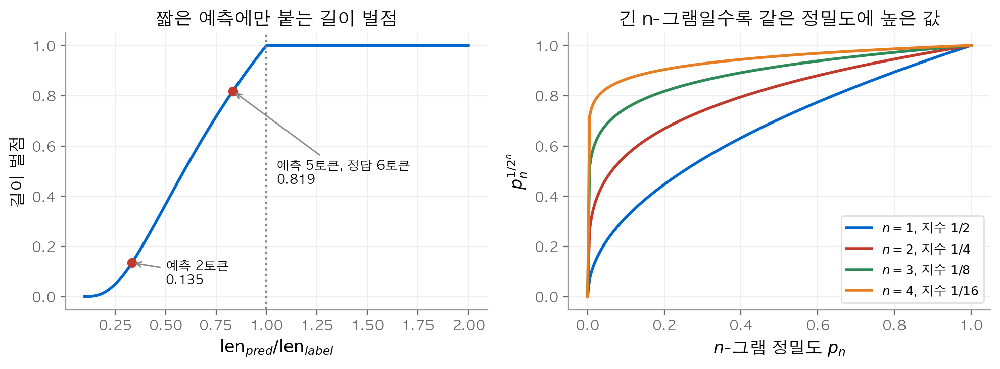
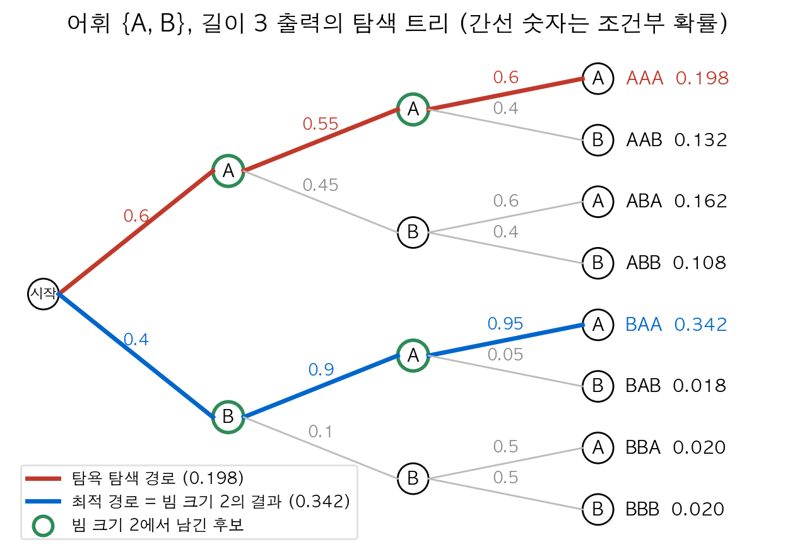

# 7. 현대 순환 신경망

[6장](06-rnn.md)의 기본 RNN은 긴 시퀀스에서 기울기가 사라지거나 폭발합니다. 이 장의 질문은 두 가지입니다. 첫째, 오래전 입력의 정보를 어떻게 보존할까요? 둘째, 길이가 다른 시퀀스를 다른 시퀀스로 어떻게 바꿀까요? 첫째 질문의 답은 **게이트(gate)** 입니다. 게이트는 상태를 덮어쓸지 유지할지를 학습으로 정하고, 유지 경로에서는 기울기가 거의 줄지 않습니다. 둘째 질문의 답은 **인코더-디코더(encoder-decoder)** 구조입니다. 이 구조는 교사 강요로 학습하고, BLEU로 평가하며, 빔 탐색으로 출력을 만듭니다.

!!! info "원문과 자료"
    - 원문: [10. Modern Recurrent Neural Networks](https://d2l.ai/chapter_recurrent-modern/index.html)
    - [10.1 LSTM](https://d2l.ai/chapter_recurrent-modern/lstm.html), [10.2 GRU](https://d2l.ai/chapter_recurrent-modern/gru.html)
    - [10.3 Deep RNN](https://d2l.ai/chapter_recurrent-modern/deep-rnn.html), [10.4 Bidirectional RNN](https://d2l.ai/chapter_recurrent-modern/bi-rnn.html)
    - [10.5 Machine Translation and the Dataset](https://d2l.ai/chapter_recurrent-modern/machine-translation-and-dataset.html)
    - [10.6 Encoder–Decoder](https://d2l.ai/chapter_recurrent-modern/encoder-decoder.html), [10.7 Seq2Seq](https://d2l.ai/chapter_recurrent-modern/seq2seq.html), [10.8 Beam Search](https://d2l.ai/chapter_recurrent-modern/beam-search.html)
    - 함께 읽기: [6. 순환 신경망](06-rnn.md), [8. 어텐션과 트랜스포머](08-attention-transformer.md)

## 1. LSTM

### 문제: 상태를 매번 덮어쓴다

기본 RNN은 $\mathbf{H}_t = \phi(\mathbf{X}_t \mathbf{W}_{\textrm{xh}} + \mathbf{H}_{t-1}\mathbf{W}_{\textrm{hh}} + \mathbf{b}_\textrm{h})$ 로 상태를 갱신합니다. 매 단계에서 이전 상태 전체가 행렬 곱과 비선형 함수를 다시 통과합니다. 그래서 $k$ 단계 전의 정보는 $k$ 번 변형되고, 역전파 기울기도 $k$ 개 야코비 행렬의 곱이 됩니다. 곱의 크기가 1보다 작으면 기울기가 지수적으로 줄어듭니다.

**LSTM(long short-term memory)** 은 상태를 둘로 나눕니다. **메모리 셀(memory cell)** $\mathbf{C}_t$ 는 정보를 장기간 보관합니다. 은닉 상태 $\mathbf{H}_t$ 는 셀에서 필요한 부분만 꺼내 출력합니다. 셀은 행렬 곱을 거치지 않고 원소별 곱과 덧셈으로만 갱신됩니다.

### 정의

배치 크기 $n$, 입력 차원 $d$, 은닉 차원 $h$ 일 때 $\mathbf{X}_t \in \mathbb{R}^{n \times d}$, $\mathbf{H}_{t-1} \in \mathbb{R}^{n \times h}$ 입니다. 세 게이트는 모두 시그모이드 $\sigma$ 를 거치므로 값이 $(0, 1)$ 범위에 있습니다.

$$
\begin{aligned}
\mathbf{I}_t &= \sigma(\mathbf{X}_t \mathbf{W}_{\textrm{xi}} + \mathbf{H}_{t-1} \mathbf{W}_{\textrm{hi}} + \mathbf{b}_\textrm{i}) && \text{입력 게이트(input gate)} \\
\mathbf{F}_t &= \sigma(\mathbf{X}_t \mathbf{W}_{\textrm{xf}} + \mathbf{H}_{t-1} \mathbf{W}_{\textrm{hf}} + \mathbf{b}_\textrm{f}) && \text{망각 게이트(forget gate)} \\
\mathbf{O}_t &= \sigma(\mathbf{X}_t \mathbf{W}_{\textrm{xo}} + \mathbf{H}_{t-1} \mathbf{W}_{\textrm{ho}} + \mathbf{b}_\textrm{o}) && \text{출력 게이트(output gate)} \\
\tilde{\mathbf{C}}_t &= \tanh(\mathbf{X}_t \mathbf{W}_{\textrm{xc}} + \mathbf{H}_{t-1} \mathbf{W}_{\textrm{hc}} + \mathbf{b}_\textrm{c}) && \text{입력 노드(candidate)}
\end{aligned}
$$

셀과 은닉 상태는 다음과 같이 갱신됩니다. $\odot$ 는 원소별 곱입니다.

$$
\mathbf{C}_t = \mathbf{F}_t \odot \mathbf{C}_{t-1} + \mathbf{I}_t \odot \tilde{\mathbf{C}}_t, \qquad
\mathbf{H}_t = \mathbf{O}_t \odot \tanh(\mathbf{C}_t)
$$

### 직관

각 게이트는 "얼마나 통과시킬지"를 원소마다 정하는 밸브입니다.

| 게이트 | 0에 가까우면 | 1에 가까우면 |
| --- | --- | --- |
| 망각 $\mathbf{F}_t$ | 이전 셀 내용을 지웁니다 | 이전 셀 내용을 그대로 둡니다 |
| 입력 $\mathbf{I}_t$ | 새 입력을 무시합니다 | 새 후보 $\tilde{\mathbf{C}}_t$ 를 셀에 더합니다 |
| 출력 $\mathbf{O}_t$ | 셀 내용을 숨깁니다 | 셀 내용을 은닉 상태로 내보냅니다 |

$\mathbf{F}_t = 1$, $\mathbf{I}_t = 0$ 이면 셀은 값을 바꾸지 않고 다음 단계로 넘깁니다. 출력 게이트가 닫혀 있어도 셀은 값을 계속 보관합니다.

<figure markdown>

<figcaption markdown>
<span class="fig-title"><b>Figure 1.</b> 게이트로 정보를 보관하는 LSTM 셀과 감쇠하는 기본 RNN 상태</span>

LSTM 셀은 입력 펄스를 $t=30$ 까지 보관하지만, 기본 RNN 상태는 10단계 안에 거의 0이 됩니다.
</figcaption>
</figure>

### 수치 예시

스칼라 LSTM 한 단계를 계산합니다. $x=1$, $h_{t-1}=0.5$, $c_{t-1}=2$ 이고 가중치는 코드에 적었습니다.

```python
import numpy as np

def sigmoid(z):
    return 1 / (1 + np.exp(-z))

def lstm_step(x, h, c, W):
    i = sigmoid(W["xi"] * x + W["hi"] * h + W["bi"])
    f = sigmoid(W["xf"] * x + W["hf"] * h + W["bf"])
    o = sigmoid(W["xo"] * x + W["ho"] * h + W["bo"])
    c_tilde = np.tanh(W["xc"] * x + W["hc"] * h + W["bc"])
    c_new = f * c + i * c_tilde
    h_new = o * np.tanh(c_new)
    return h_new, c_new, (i, f, o, c_tilde)

W = dict(xi=0.5, hi=0.2, bi=0.0, xf=1.0, hf=0.5, bf=1.0,
         xo=0.3, ho=0.1, bo=0.0, xc=0.8, hc=-0.4, bc=0.0)
h, c, gates = lstm_step(x=1.0, h=0.5, c=2.0, W=W)
print(np.round(gates, 4))   # [0.6457 0.9047 0.5866 0.537 ]
print(round(h, 4), round(c, 4))   # 0.5711 2.1561
```

망각 게이트가 $0.9047$ 이므로 이전 셀 값 2의 약 90%인 $1.809$ 가 남습니다. 여기에 $0.6457 \times 0.537 = 0.347$ 이 더해져 새 셀 값은 $2.156$ 이 됩니다. 은닉 상태는 $0.5866 \times \tanh(2.156) = 0.571$ 입니다.

### 기울기가 셀 경로로 보존되는 이유

셀 갱신식을 $\mathbf{C}_{t-1}$ 로 미분하면 직접 경로의 야코비 행렬은 대각 행렬입니다.

$$
\frac{\partial \mathbf{C}_t}{\partial \mathbf{C}_{t-1}} \bigg|_{\text{직접 경로}} = \operatorname{diag}(\mathbf{F}_t)
\quad\Longrightarrow\quad
\frac{\partial \mathbf{C}_t}{\partial \mathbf{C}_{t-k}} \bigg|_{\text{직접 경로}} = \operatorname{diag}\Big(\prod_{j=0}^{k-1} \mathbf{F}_{t-j}\Big)
$$

이 경로에는 가중치 행렬도 없고 $\tanh'$ 도 없습니다. 기울기의 크기는 망각 게이트 값의 곱으로만 정해집니다. 망각 게이트가 1에 가까우면 기울기는 수십 단계를 거슬러 올라가도 크기를 유지합니다. 게이트가 $\mathbf{H}_{t-1}$ 을 거쳐 $\mathbf{C}_{t-1}$ 에 의존하는 간접 경로도 있습니다. 간접 경로가 사라져도 직접 경로는 남으므로 기울기 전달이 끊기지 않습니다.

<figure markdown>

<figcaption markdown>
<span class="fig-title"><b>Figure 2.</b> 망각 게이트 값에 따른 기울기 배율과 기본 RNN의 기울기 배율</span>

50단계 뒤 배율은 $F=0.95$ 이면 0.077, 기본 RNN은 $7.4 \times 10^{-8}$ 입니다.
</figcaption>
</figure>

망각 게이트는 학습되는 값입니다. 모델은 오래 기억할 차원에서는 $\mathbf{F}_t \approx 1$ 을, 지울 차원에서는 $\mathbf{F}_t \approx 0$ 을 학습합니다. 실무에서는 망각 게이트 편향 $\mathbf{b}_\textrm{f}$ 를 1 정도의 양수로 초기화합니다. 그러면 학습 초기에 셀이 정보를 유지하는 쪽으로 출발합니다.

## 2. GRU

### 정의

**GRU(gated recurrent unit)** 는 LSTM을 단순하게 만든 구조입니다. 셀과 은닉 상태를 하나로 합치고 게이트를 두 개로 줄입니다.

$$
\begin{aligned}
\mathbf{R}_t &= \sigma(\mathbf{X}_t \mathbf{W}_{\textrm{xr}} + \mathbf{H}_{t-1} \mathbf{W}_{\textrm{hr}} + \mathbf{b}_\textrm{r}) && \text{리셋 게이트(reset gate)} \\
\mathbf{Z}_t &= \sigma(\mathbf{X}_t \mathbf{W}_{\textrm{xz}} + \mathbf{H}_{t-1} \mathbf{W}_{\textrm{hz}} + \mathbf{b}_\textrm{z}) && \text{업데이트 게이트(update gate)} \\
\tilde{\mathbf{H}}_t &= \tanh(\mathbf{X}_t \mathbf{W}_{\textrm{xh}} + (\mathbf{R}_t \odot \mathbf{H}_{t-1}) \mathbf{W}_{\textrm{hh}} + \mathbf{b}_\textrm{h}) && \text{후보 은닉 상태} \\
\mathbf{H}_t &= \mathbf{Z}_t \odot \mathbf{H}_{t-1} + (1 - \mathbf{Z}_t) \odot \tilde{\mathbf{H}}_t
\end{aligned}
$$

### 직관

리셋 게이트는 후보를 만들 때 과거를 얼마나 참고할지 정합니다. 업데이트 게이트는 이전 상태와 후보를 섞는 비율을 정합니다. 게이트 값이 극단일 때 GRU는 익숙한 모델로 바뀝니다.

| 조건 | $\mathbf{H}_t$ | 의미 |
| --- | --- | --- |
| $\mathbf{Z}_t = 1$ | $\mathbf{H}_{t-1}$ | 입력을 건너뛰고 상태를 복사합니다 |
| $\mathbf{Z}_t = 0$, $\mathbf{R}_t = 1$ | $\tilde{\mathbf{H}}_t$ | 기본 RNN과 같습니다 |
| $\mathbf{Z}_t = 0$, $\mathbf{R}_t = 0$ | $\tanh(\mathbf{X}_t \mathbf{W}_{\textrm{xh}} + \mathbf{b}_\textrm{h})$ | 과거를 잊고 현재 입력만 봅니다 |

$\mathbf{Z}_t$ 는 LSTM의 망각 게이트 역할을 합니다. $1 - \mathbf{Z}_t$ 는 입력 게이트 역할을 합니다. GRU는 두 게이트의 합을 1로 묶어 둔 것입니다. 그래서 $\partial \mathbf{H}_t / \partial \mathbf{H}_{t-1}$ 의 직접 경로는 $\operatorname{diag}(\mathbf{Z}_t)$ 이고, LSTM과 같은 원리로 기울기를 보존합니다.

### 수치 예시

$x=1$, $h_{t-1}=0.5$ 에서 리셋 게이트 사전 활성값을 $0.4x + 0.3h$, 업데이트 게이트 사전 활성값을 $-0.2x + h + 0.5$, 후보를 $\tanh(0.9x - 0.6 (r h))$ 로 둡니다. numpy로 계산하면 $r = 0.6341$, $z = 0.6900$, $\tilde{h} = 0.6105$ 입니다. 새 상태는 $0.69 \times 0.5 + 0.31 \times 0.6105 = 0.5343$ 입니다. 이전 상태 비중이 69%이므로 상태는 0.5에서 조금만 움직였습니다.

### LSTM과 비교

| 항목 | LSTM | GRU |
| --- | --- | --- |
| 상태 | $\mathbf{C}_t$, $\mathbf{H}_t$ 두 개 | $\mathbf{H}_t$ 하나 |
| 게이트 | 입력, 망각, 출력 | 리셋, 업데이트 |
| 가중치 블록 수 | 4개 | 3개 |
| 입력 32, 은닉 256일 때 매개변수 수 | 295,936 | 221,952 |

매개변수 수는 블록 하나에 $d h + h^2 + h$ 개이므로 $4 \times 73{,}984$ 와 $3 \times 73{,}984$ 입니다. GRU는 약 25% 작고 계산이 빠릅니다. 여러 실험에서 두 구조의 성능 차이는 작습니다. 어느 쪽이 나은지는 과제마다 다르므로 둘 다 시험해 보는 것이 보통입니다.

## 3. 깊은 RNN

### 정의

**깊은 RNN(deep RNN)** 은 순환 층을 세로로 쌓습니다. $l$ 번째 층은 아래층의 같은 시점 출력을 입력으로 받습니다. $\mathbf{H}_t^{(0)} = \mathbf{X}_t$ 입니다.

$$
\mathbf{H}_t^{(l)} = \phi_l\big(\mathbf{H}_t^{(l-1)} \mathbf{W}_{\textrm{xh}}^{(l)} + \mathbf{H}_{t-1}^{(l)} \mathbf{W}_{\textrm{hh}}^{(l)} + \mathbf{b}_\textrm{h}^{(l)}\big), \qquad
\mathbf{O}_t = \mathbf{H}_t^{(L)} \mathbf{W}_{\textrm{hq}} + \mathbf{b}_\textrm{q}
$$

### 직관

시간 방향의 깊이는 시퀀스 길이로 정해집니다. 층 방향의 깊이는 한 시점에서 입력을 몇 번 변환할지 정합니다. MLP에서 층을 쌓으면 표현력이 커지는 것과 같은 이유로, 층을 쌓으면 시점마다 더 복잡한 특징을 만들 수 있습니다. $\phi_l$ 자리에는 LSTM이나 GRU 셀을 그대로 넣습니다.

### 수치 예시

입력 32차원, 은닉 256차원 GRU를 2층으로 쌓습니다. 1층은 $3 \times (32 \cdot 256 + 256^2 + 256) = 221{,}952$ 개의 매개변수를 씁니다. 2층의 입력은 256차원이므로 $3 \times (256 \cdot 256 + 256^2 + 256) = 393{,}984$ 개입니다. 합계는 615,936개입니다. 층이 늘면 학습이 느려지고 과적합 위험이 커지므로 보통 2~4층을 씁니다.

## 4. 양방향 RNN

### 정의

**양방향 RNN(bidirectional RNN)** 은 순방향 RNN과 역방향 RNN을 따로 돌려 두 상태를 연결합니다.

$$
\overrightarrow{\mathbf{H}}_t = \phi(\mathbf{X}_t \mathbf{W}_{\textrm{xh}}^{(f)} + \overrightarrow{\mathbf{H}}_{t-1} \mathbf{W}_{\textrm{hh}}^{(f)} + \mathbf{b}_\textrm{h}^{(f)}), \quad
\overleftarrow{\mathbf{H}}_t = \phi(\mathbf{X}_t \mathbf{W}_{\textrm{xh}}^{(b)} + \overleftarrow{\mathbf{H}}_{t+1} \mathbf{W}_{\textrm{hh}}^{(b)} + \mathbf{b}_\textrm{h}^{(b)})
$$

$$
\mathbf{H}_t = [\overrightarrow{\mathbf{H}}_t, \overleftarrow{\mathbf{H}}_t] \in \mathbb{R}^{n \times 2h}
$$

### 직관

"나는 ___ 배고프다"의 빈칸을 채울 때 빈칸 뒤의 단어가 단서가 됩니다. 순방향 상태는 $t$ 이전 문맥만 요약합니다. 역방향 상태는 $t$ 이후 문맥만 요약합니다. 둘을 이어 붙이면 각 위치의 표현이 문장 전체를 반영합니다.

### 수치 예시

선형 순환 $h_t = 0.5\,h_{t-1} + x_t$ 를 입력 $x = (1, 0, 0, 2)$ 에 양방향으로 적용합니다. 순방향 상태는 $(1, 0.5, 0.25, 2.125)$ 입니다. 역방향 상태는 $(1.25, 0.5, 1, 2)$ 입니다. $t=2$ 의 순방향 상태 0.5는 $x_1$ 만 반영합니다. 같은 위치의 역방향 상태 0.5는 $x_4 = 2$ 에서 온 값입니다. 연결한 표현 $(0.5, 0.5)$ 는 양쪽 문맥을 모두 담습니다.

### 쓸 수 있는 경우와 없는 경우

| 과제 | 양방향 사용 | 이유 |
| --- | --- | --- |
| 품사 태깅, 개체명 인식 | 가능 | 입력 문장 전체가 처음부터 주어집니다 |
| 문장 분류, 번역의 인코더 | 가능 | 입력을 모두 읽은 뒤 출력합니다 |
| 언어 모델, 다음 토큰 예측 | 불가 | 예측 시점에 미래 토큰이 없습니다 |
| 번역의 디코더, 실시간 음성 인식 | 불가 | 출력을 한 토큰씩 만들거나 입력이 계속 들어옵니다 |

언어 모델 학습에 양방향 RNN을 쓰면 역방향 상태가 정답 토큰을 미리 봅니다. 그러면 학습 손실은 낮아지지만 테스트에서는 그 정보가 없어 생성이 실패합니다. 계산량도 단방향의 두 배이고, 역방향 계산은 시퀀스 끝까지 기다려야 시작할 수 있습니다.

## 5. 기계 번역 데이터

**기계 번역(machine translation)** 은 원문 시퀀스를 다른 언어의 대상 시퀀스로 바꾸는 과제입니다. d2l은 영어-프랑스어 문장 쌍 데이터를 씁니다. 입력과 출력의 길이가 서로 다르다는 점이 6장의 언어 모델과 다릅니다.

### 전처리와 어휘

전처리는 다음 순서로 진행합니다.

1. 공백 문자를 정리하고 소문자로 바꿉니다.
2. 구두점 앞에 공백을 넣어 `go.` 를 `go` 와 `.` 로 나눕니다.
3. 단어 단위로 토큰화합니다.
4. 원문과 대상 언어에 어휘(vocabulary)를 따로 만듭니다. 두 번 미만 나온 토큰은 `<unk>` 로 바꿉니다.

### 특수 토큰, 패딩, 자르기

미니배치는 같은 길이의 텐서여야 하므로 모든 시퀀스를 고정 길이 `num_steps` 로 맞춥니다.

| 토큰 | 역할 |
| --- | --- |
| `<eos>` | 시퀀스 끝. 디코더는 이 토큰을 내면 생성을 멈춥니다 |
| `<bos>` | 시퀀스 시작. 디코더의 첫 입력입니다 |
| `<pad>` | 길이를 맞추려고 채운 자리. 손실 계산에서 제외합니다 |
| `<unk>` | 어휘에 없는 토큰 |

시퀀스가 `num_steps` 보다 짧으면 끝에 `<pad>` 를 채웁니다. 이것이 **패딩(padding)** 입니다. 더 길면 앞의 `num_steps` 개만 남깁니다. 이것이 **자르기(truncation)** 입니다. `<pad>` 를 뺀 토큰 수를 **유효 길이(valid length)** 라고 부르고 따로 저장합니다.

<figure markdown>

<figcaption markdown>
<span class="fig-title"><b>Figure 3.</b> 고정 길이 6으로 맞춘 네 문장의 패딩과 자르기</span>

짧은 문장은 `<pad>` 로 채우고, 긴 문장은 6토큰에서 잘려 `<eos>` 를 잃습니다.
</figcaption>
</figure>

## 6. 인코더-디코더 구조

### 정의

**인코더(encoder)** 는 가변 길이 입력을 받아 상태로 요약합니다. **디코더(decoder)** 는 그 상태를 받아 가변 길이 출력을 한 토큰씩 만듭니다. RNN 인코더는 은닉 상태를 갱신한 뒤 문맥 변수(context variable) $\mathbf{c}$ 를 만듭니다.

$$
\mathbf{h}_t = f(\mathbf{x}_t, \mathbf{h}_{t-1}), \qquad \mathbf{c} = q(\mathbf{h}_1, \ldots, \mathbf{h}_T)
$$

d2l은 $q$ 로 마지막 상태를 고릅니다. 즉 $\mathbf{c} = \mathbf{h}_T$ 입니다. 디코더는 이전 출력 토큰, 문맥 변수, 자기 이전 상태로 다음 상태를 만듭니다.

$$
\mathbf{s}_{t'} = g(y_{t'-1}, \mathbf{c}, \mathbf{s}_{t'-1}), \qquad
P(y_{t'} \mid y_1, \ldots, y_{t'-1}, \mathbf{c}) = \operatorname{softmax}(\mathbf{W} \mathbf{s}_{t'} + \mathbf{b})
$$



### 직관

$\mathbf{c}$ 는 두 군데로 들어갑니다. 첫째, 인코더 마지막 상태로 디코더의 초기 상태를 정합니다. 이 방식은 인코더와 디코더의 층 수와 은닉 차원이 같아야 합니다. 둘째, 매 시점 디코더 입력 임베딩에 $\mathbf{c}$ 를 이어 붙입니다. 그러면 디코더가 긴 출력을 만드는 동안에도 원문 요약을 계속 참조합니다.

입력 전체를 고정 크기 벡터 하나로 줄이는 것이 이 구조의 한계입니다. 원문이 길수록 $\mathbf{c}$ 에 정보를 다 담기 어렵습니다. [8장](08-attention-transformer.md)의 어텐션은 디코더가 매 시점 인코더의 모든 상태 $\mathbf{h}_1, \ldots, \mathbf{h}_T$ 를 직접 보게 해서 이 한계를 없앱니다.

## 7. seq2seq 학습

### 교사 강요

학습할 때 디코더 입력으로 무엇을 줄까요? **교사 강요(teacher forcing)** 는 모델의 예측 대신 정답 토큰을 넣습니다. 디코더 입력은 `<bos>` 뒤에 정답 시퀀스의 마지막 토큰을 뺀 것입니다. 레이블은 정답 시퀀스를 한 칸 왼쪽으로 민 것입니다.

| 시점 $t'$ | 1 | 2 | 3 | 4 |
| --- | --- | --- | --- | --- |
| 디코더 입력 | `<bos>` | ils | regardent | . |
| 레이블 | ils | regardent | . | `<eos>` |

교사 강요를 쓰면 모든 시점의 입력이 미리 정해집니다. 초반 예측이 틀려도 오류가 다음 시점으로 번지지 않아 학습이 안정적입니다. 예측할 때는 정답이 없으므로 직전 시점의 예측 토큰을 입력으로 씁니다. 학습과 예측의 입력 분포가 달라지는 이 차이를 **노출 편향(exposure bias)** 이라고 부릅니다.

### 마스킹된 손실

`<pad>` 위치의 예측은 의미가 없으므로 손실에서 빼야 합니다. 유효 길이 $L_i$ 로 마스크 $m_{i,t'} = \mathbb{1}[t' \le L_i]$ 를 만들고 다음처럼 평균합니다.

$$
\ell = \frac{\sum_{i}\sum_{t'} m_{i,t'} \cdot \big(-\log P(y_{i,t'} \mid \cdot)\big)}{\sum_{i}\sum_{t'} m_{i,t'}}
$$

수치 예시를 봅니다. 두 시퀀스의 유효 길이는 3과 2이고 `num_steps` 는 4입니다. 각 위치에서 정답 토큰에 준 확률은 1행 $(0.7, 0.6, 0.9, 0.2)$, 2행 $(0.8, 0.5, 0.1, 0.3)$ 입니다. 1행의 4번째 칸과 2행의 3~4번째 칸은 `<pad>` 입니다. 마스크 없이 8칸을 평균하면 손실은 $0.876$ 입니다. 유효한 5칸만 평균하면 손실은 $0.378$ 입니다. `<pad>` 칸의 손실 $-\log 0.1 = 2.303$ 같은 값이 평균을 크게 왜곡했습니다.

다음 코드는 교사 강요와 마스킹을 함께 쓰는 학습 한 단계입니다.

```python
import torch
from torch import nn

def train_step(encoder, decoder, X, X_len, Y, Y_len, bos_id, optimizer):
    # Y: (batch, num_steps) 정답, 끝은 <eos> 와 <pad>
    _, state = encoder(X, X_len)                 # 인코더 마지막 상태
    bos = torch.full((Y.shape[0], 1), bos_id, device=Y.device)
    dec_input = torch.cat([bos, Y[:, :-1]], dim=1)  # 교사 강요 입력
    logits, _ = decoder(dec_input, state)        # (batch, num_steps, vocab)

    loss = nn.functional.cross_entropy(
        logits.transpose(1, 2), Y, reduction="none")  # (batch, num_steps)
    steps = torch.arange(Y.shape[1], device=Y.device)
    mask = (steps[None, :] < Y_len[:, None]).float()  # 유효 위치만 1
    loss = (loss * mask).sum() / mask.sum()

    optimizer.zero_grad()
    loss.backward()
    optimizer.step()
    return loss.item()
```

## 8. BLEU

### 정의

번역 결과는 정답과 단어가 조금 달라도 맞을 수 있습니다. **BLEU(bilingual evaluation understudy)** 는 예측과 정답의 $n$-그램이 얼마나 겹치는지로 품질을 잽니다. $p_n$ 은 예측의 $n$-그램 가운데 정답에도 있는 비율입니다. 한 정답 $n$-그램은 한 번만 짝지을 수 있습니다.

$$
\textrm{BLEU} = \exp\left(\min\left(0,\ 1 - \frac{\textrm{len}_{\textrm{label}}}{\textrm{len}_{\textrm{pred}}}\right)\right) \prod_{n=1}^{k} p_n^{1/2^n}
$$

### 직관

정밀도만 쓰면 짧게 예측할수록 유리합니다. 앞의 지수 항은 예측이 정답보다 짧을 때만 점수를 깎는 **길이 벌점(brevity penalty)** 입니다. 가중치 $1/2^n$ 은 $n$ 이 클수록 작아지므로 같은 $p_n$ 이라도 긴 $n$-그램 항이 1에 가까워집니다. 긴 $n$-그램은 맞추기 어려우므로 맞혔을 때 상대적으로 큰 점수를 줍니다. 예측이 정답과 같으면 BLEU는 1입니다. 원 논문은 $1/2^n$ 대신 같은 가중치 $1/k$ 의 기하 평균을 씁니다.

<figure markdown>

<figcaption markdown>
<span class="fig-title"><b>Figure 4.</b> 길이 벌점 곡선과 n별 정밀도 변환</span>

예측이 짧을수록 벌점이 지수적으로 커지고, $n$ 이 클수록 $p_n^{1/2^n}$ 은 1에 가까워집니다.
</figcaption>
</figure>

### 수치 예시

정답 `A B C D E F`, 예측 `A B B C D` 를 비교합니다.

| $n$ | 예측의 $n$-그램 | 정답과 일치 | $p_n$ |
| --- | --- | --- | --- |
| 1 | A, B, B, C, D | A, B, C, D | 4/5 |
| 2 | AB, BB, BC, CD | AB, BC, CD | 3/4 |
| 3 | ABB, BBC, BCD | BCD | 1/3 |
| 4 | ABBC, BBCD | 없음 | 0 |

길이 벌점은 $\exp(1 - 6/5) = 0.819$ 입니다. $k=2$ 이면 $0.819 \times 0.8^{1/2} \times 0.75^{1/4} = 0.681$ 입니다. $k=4$ 이면 $p_4 = 0$ 이므로 BLEU는 0입니다. 정답과 일부만 겹치는 예측 `A B` 는 $p_1 = p_2 = 1$ 이지만 $k=2$ 의 BLEU는 $\exp(1 - 3) = 0.135$ 입니다.

```python
from collections import Counter
import math

def bleu(label, pred, k):
    score = math.exp(min(0, 1 - len(label) / len(pred)))
    for n in range(1, k + 1):
        ref = Counter(tuple(label[i:i + n]) for i in range(len(label) - n + 1))
        hits, total = 0, len(pred) - n + 1
        for i in range(total):
            g = tuple(pred[i:i + n])
            if ref[g] > 0:
                hits += 1
                ref[g] -= 1
        score *= (hits / total) ** (0.5 ** n)
    return score

print(round(bleu("ABCDEF", "ABBCD", 2), 4))  # 0.6815
print(round(bleu("ABCDEF", "ABBCD", 3), 4))  # 0.594
print(round(bleu("ABCDEF", "AB", 2), 4))     # 0.1353
```

## 9. 탐색 전략

학습이 끝난 디코더는 매 시점 다음 토큰의 조건부 분포를 줍니다. 출력 어휘를 $\mathcal{Y}$ (`<eos>` 포함), 최대 출력 길이를 $T'$ 라고 합니다. 우리가 원하는 출력은 결합 확률이 가장 큰 시퀀스입니다.

$$
\prod_{t'=1}^{T'} P(y_{t'} \mid y_1, \ldots, y_{t'-1}, \mathbf{c})
$$

### 세 가지 탐색

**탐욕 탐색(greedy search)** 은 매 시점 확률이 가장 큰 토큰 하나를 고릅니다.

$$
y_{t'} = \operatorname*{argmax}_{y \in \mathcal{Y}} P(y \mid y_1, \ldots, y_{t'-1}, \mathbf{c})
$$

**전체 탐색(exhaustive search)** 은 가능한 모든 시퀀스의 결합 확률을 계산합니다. **빔 탐색(beam search)** 은 매 시점 결합 확률이 큰 후보 $k$ 개만 남깁니다. $k$ 를 **빔 크기(beam size)** 라고 부릅니다. 다음 시점에는 $k$ 개 후보마다 $|\mathcal{Y}|$ 개 토큰을 붙여 $k|\mathcal{Y}|$ 개 후보를 만들고 다시 $k$ 개를 고릅니다.

| 방법 | 계산량 | $|\mathcal{Y}|=10^4$, $T'=10$ 일 때 | 최적 보장 |
| --- | --- | --- | --- |
| 탐욕 탐색 | $O(\lvert\mathcal{Y}\rvert T')$ | 약 $10^5$ | 없음 |
| 빔 탐색 | $O(k\lvert\mathcal{Y}\rvert T')$ | 약 $k \times 10^5$ | 없음 |
| 전체 탐색 | $O(\lvert\mathcal{Y}\rvert^{T'})$ | $10^{40}$ | 있음 |

빔 크기 $k=1$ 이면 탐욕 탐색과 같습니다. $k$ 를 키우면 전체 탐색에 가까워지지만 계산량도 비례해 늘어납니다.

### 탐욕 탐색이 최적이 아닌 예

어휘 $\{A, B\}$, 출력 길이 3인 작은 예를 봅니다. 조건부 확률은 아래 그림의 간선에 적었습니다.

<figure markdown>

<figcaption markdown>
<span class="fig-title"><b>Figure 5.</b> 탐욕 탐색, 빔 탐색, 최적 경로를 표시한 탐색 트리</span>

탐욕 탐색은 A를 고른 뒤 돌아보지 않지만, 빔 크기 2는 B를 남겨 최적 시퀀스 BAA에 도달합니다.
</figcaption>
</figure>

첫 토큰의 확률만 보면 A가 낫습니다. 그러나 B를 고르면 다음 토큰들의 확률이 0.9와 0.95로 높아집니다. 결합 확률은 $0.4 \times 0.9 \times 0.95 = 0.342$ 로 탐욕 결과 $0.6 \times 0.55 \times 0.6 = 0.198$ 보다 큽니다. 탐욕 탐색은 지금 좋은 선택이 나중의 선택지를 나쁘게 만드는 경우를 놓칩니다.

```python
P = {(): {"A": .6, "B": .4},
     ("A",): {"A": .55, "B": .45}, ("B",): {"A": .9, "B": .1},
     ("A", "A"): {"A": .6, "B": .4}, ("A", "B"): {"A": .6, "B": .4},
     ("B", "A"): {"A": .95, "B": .05}, ("B", "B"): {"A": .5, "B": .5}}

def beam_search(k, steps=3):
    beams = [((), 1.0)]
    for _ in range(steps):
        cands = [(seq + (y,), p * q)
                 for seq, p in beams for y, q in P[seq].items()]
        beams = sorted(cands, key=lambda c: -c[1])[:k]
    return "".join(beams[0][0]), round(beams[0][1], 3)

print(beam_search(1))  # ('AAA', 0.198)  탐욕 탐색
print(beam_search(2))  # ('BAA', 0.342)
print(beam_search(8))  # ('BAA', 0.342)  후보 8개 전부 = 전체 탐색
```

### 길이 정규화

실제 번역에서는 후보마다 `<eos>` 가 나오는 시점이 다릅니다. 확률의 곱은 항이 늘수록 작아지므로, 그대로 비교하면 짧은 시퀀스가 유리합니다. 빔 탐색은 마지막에 길이 $L$ 로 정규화한 로그 확률로 후보를 고릅니다.

$$
\frac{1}{L^\alpha} \log P(y_1, \ldots, y_L \mid \mathbf{c}) = \frac{1}{L^\alpha} \sum_{t'=1}^{L} \log P(y_{t'} \mid y_1, \ldots, y_{t'-1}, \mathbf{c})
$$

보통 $\alpha = 0.75$ 를 씁니다. 예를 들어 로그 확률이 $-2.0$ 인 길이 2 후보와 $-2.8$ 인 길이 4 후보를 비교합니다. 정규화 전에는 길이 2 후보가 낫습니다. 정규화 후에는 $-2.0 / 2^{0.75} = -1.19$, $-2.8 / 4^{0.75} = -0.99$ 이므로 길이 4 후보가 낫습니다.

## 정리

- 기본 RNN은 매 단계 상태를 행렬 곱과 비선형 함수로 덮어쓰므로, 먼 과거의 기울기가 지수적으로 줄어듭니다.
- LSTM은 메모리 셀을 원소별 곱과 덧셈으로만 갱신합니다. 셀 경로의 야코비 행렬은 $\operatorname{diag}(\mathbf{F}_t)$ 이므로 망각 게이트가 1에 가까우면 기울기가 보존됩니다.
- GRU는 셀과 은닉 상태를 합치고 업데이트 게이트 $\mathbf{Z}_t$ 하나로 유지와 갱신의 비율을 정합니다. 매개변수는 LSTM의 3/4이고 성능은 비슷합니다.
- 깊은 RNN은 층을 쌓아 시점마다 표현을 여러 번 변환합니다. 양방향 RNN은 미래 문맥을 쓰므로 입력 전체가 주어지는 과제에만 쓸 수 있습니다.
- 번역 데이터는 `<eos>` 를 붙이고 고정 길이로 패딩하거나 자릅니다. 유효 길이를 저장해 두었다가 손실을 마스킹합니다.
- 인코더-디코더는 입력을 문맥 변수 $\mathbf{c}$ 로 요약하고, 디코더는 교사 강요로 학습합니다. 고정 크기 $\mathbf{c}$ 의 한계는 [8장](08-attention-transformer.md)의 어텐션으로 이어집니다.
- BLEU는 $n$-그램 정밀도의 가중 곱에 길이 벌점을 곱한 값입니다. 짧은 예측과 긴 $n$-그램 불일치를 모두 벌합니다.
- 탐욕 탐색은 빠르지만 최적을 놓칠 수 있습니다. 빔 탐색은 후보 $k$ 개를 남겨 계산량과 정확도를 절충하고, 길이 정규화로 짧은 출력 편향을 줄입니다.
