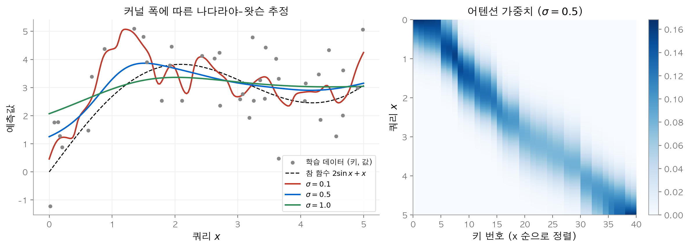
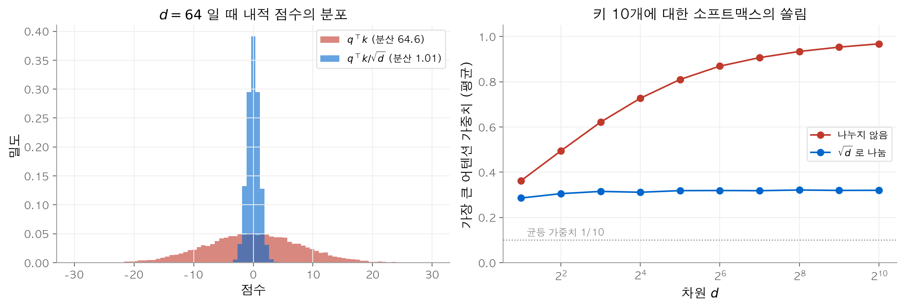
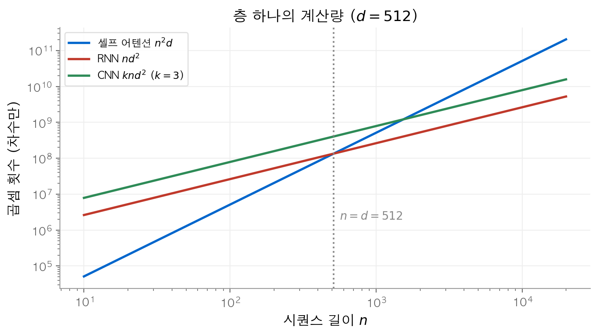
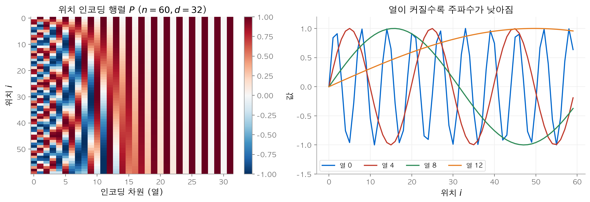
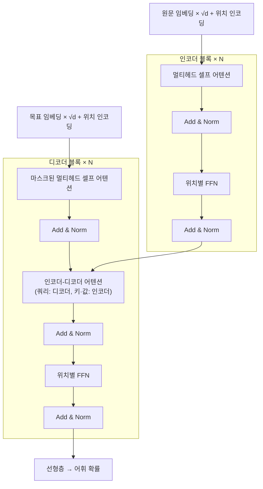
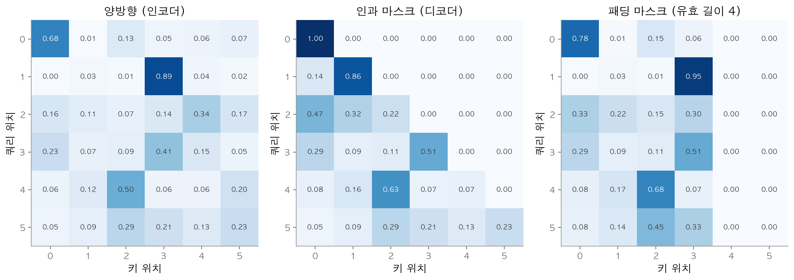
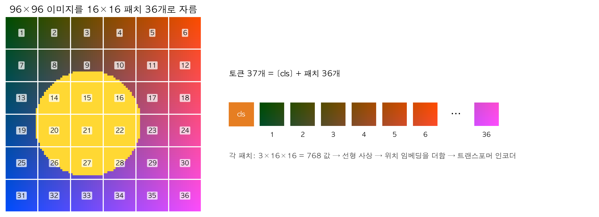

# 8. 어텐션과 트랜스포머

[7장](07-modern-rnn.md)의 인코더-디코더는 입력 문장 전체를 고정 길이 벡터 하나에 담았습니다.
이 장의 질문은 다음과 같습니다. 출력을 만들 때마다 입력의 필요한 부분을 골라 읽게 하려면 어떻게 해야 할까요?
답은 **어텐션(attention)** 입니다. 어텐션은 쿼리와 키의 유사도로 가중치를 정하고, 그 가중치로 값을 평균합니다.
이 연산 하나만 쌓아 만든 모델이 트랜스포머입니다. 트랜스포머는 순차 연산이 없어 병렬화가 쉽고, 규모를 키울수록 성능이 꾸준히 오릅니다.

!!! info "원문과 자료"
    - 원문: [11. Attention Mechanisms and Transformers](https://d2l.ai/chapter_attention-mechanisms-and-transformers/index.html)
    - [11.1 Queries, Keys, and Values](https://d2l.ai/chapter_attention-mechanisms-and-transformers/queries-keys-values.html)
    - [11.2 Attention Pooling by Similarity](https://d2l.ai/chapter_attention-mechanisms-and-transformers/attention-pooling.html)
    - [11.3 Attention Scoring Functions](https://d2l.ai/chapter_attention-mechanisms-and-transformers/attention-scoring-functions.html)
    - [11.4 The Bahdanau Attention Mechanism](https://d2l.ai/chapter_attention-mechanisms-and-transformers/bahdanau-attention.html)
    - [11.5 Multi-Head Attention](https://d2l.ai/chapter_attention-mechanisms-and-transformers/multihead-attention.html)
    - [11.6 Self-Attention and Positional Encoding](https://d2l.ai/chapter_attention-mechanisms-and-transformers/self-attention-and-positional-encoding.html)
    - [11.7 The Transformer Architecture](https://d2l.ai/chapter_attention-mechanisms-and-transformers/transformer.html)
    - [11.8 Transformers for Vision](https://d2l.ai/chapter_attention-mechanisms-and-transformers/vision-transformer.html)
    - [11.9 Large-Scale Pretraining with Transformers](https://d2l.ai/chapter_attention-mechanisms-and-transformers/large-pretraining-transformers.html)

## 1. 쿼리, 키, 값

### 데이터베이스 비유

데이터베이스는 키와 값의 쌍을 저장합니다. 이 장에서는 $m$ 개의 쌍으로 이루어진 집합을 다음과 같이 씁니다.

$$
\mathcal{D} \stackrel{\textrm{def}}{=} \{(\mathbf{k}_1, \mathbf{v}_1), \ldots, (\mathbf{k}_m, \mathbf{v}_m)\}
$$

일반 데이터베이스는 **쿼리(query)** 와 정확히 같은 **키(key)** 를 찾아 그 **값(value)** 을 돌려줍니다.
어텐션은 이 조회를 부드럽게 만듭니다. 모든 값을 가중 평균하고, 가중치는 쿼리와 각 키가 얼마나 닮았는지로 정합니다.

$$
\textrm{Attention}(\mathbf{q}, \mathcal{D}) \stackrel{\textrm{def}}{=} \sum_{i=1}^m \alpha(\mathbf{q}, \mathbf{k}_i)\, \mathbf{v}_i
$$

이 연산을 **어텐션 풀링(attention pooling)** 이라고 부릅니다. $\alpha(\mathbf{q}, \mathbf{k}_i)$ 는 스칼라 **어텐션 가중치(attention weight)** 입니다.

### 가중치의 네 가지 경우

| 가중치 조건 | 결과 |
| --- | --- |
| 모두 0 이상 | 출력이 값들이 만드는 볼록 원뿔 안에 있습니다. |
| 0 이상이고 합이 1 | 출력이 값들의 볼록 결합입니다. 딥러닝에서 가장 흔한 경우입니다. |
| 하나만 1, 나머지 0 | 일반 데이터베이스 조회와 같습니다. |
| 모두 $1/m$ | 전체 평균입니다. 평균 풀링(average pooling)과 같습니다. |

합이 1인 가중치를 만드는 표준 방법은 점수 $a(\mathbf{q}, \mathbf{k}_i)$ 에 소프트맥스를 적용하는 것입니다.

$$
\alpha(\mathbf{q}, \mathbf{k}_i) = \frac{\exp(a(\mathbf{q}, \mathbf{k}_i))}{\sum_j \exp(a(\mathbf{q}, \mathbf{k}_j))}
$$

가중치는 미분 가능하므로 경사 하강법이 "무엇과 무엇을 닮았다고 볼지"를 학습합니다.
키와 값의 개수 $m$ 은 고정할 필요가 없습니다. 그래서 길이가 다른 입력을 같은 연산으로 처리합니다.

## 2. 나다라야-왓슨 커널 회귀

어텐션은 1964년의 **나다라야-왓슨 추정(Nadaraya-Watson estimator)** 과 같은 꼴입니다.
학습 데이터 $(x_i, y_i)$ 의 입력을 키로, 레이블을 값으로 둡니다. 새 입력 $\mathbf{q}$ 의 예측값은 다음과 같습니다.

$$
f(\mathbf{q}) = \sum_i \mathbf{v}_i \frac{\alpha(\mathbf{q}, \mathbf{k}_i)}{\sum_j \alpha(\mathbf{q}, \mathbf{k}_j)}
$$

$\alpha$ 는 **커널(kernel)** 입니다. 원문은 다음 커널을 예로 듭니다.

| 커널 | $\alpha(\mathbf{q}, \mathbf{k})$ |
| --- | --- |
| 가우스(Gaussian) | $\exp\left(-\frac{1}{2\sigma^2}\|\mathbf{q} - \mathbf{k}\|^2\right)$ |
| 박스카(Boxcar) | $\|\mathbf{q} - \mathbf{k}\| \le 1$ 이면 1, 아니면 0 |
| 에파네치니코프(Epanechnikov) | $\max(0, 1 - \|\mathbf{q} - \mathbf{k}\|)$ |

가우스 커널을 쓰면 정규화한 가중치는 점수 $-\|\mathbf{q}-\mathbf{k}_i\|^2 / 2\sigma^2$ 에 대한 소프트맥스와 같습니다.
즉 가우스 커널 회귀는 "거리의 음수"를 점수로 쓰는 어텐션입니다.

키 $k = (1, 2, 3)$, 값 $v = (10, 20, 30)$, 쿼리 $q = 2.2$ 라고 합시다. $\sigma$ 에 따라 결과가 바뀝니다.

| $\sigma$ | 가중치 $(\alpha_1, \alpha_2, \alpha_3)$ | 예측값 |
| --- | --- | --- |
| 0.1 | (0.000, 1.000, 0.000) | 20.00 |
| 0.5 | (0.045, 0.734, 0.221) | 21.76 |
| 1.0 | (0.222, 0.447, 0.331) | 21.09 |
| 2.0 | (0.303, 0.361, 0.335) | 20.32 |

$\sigma$ 가 작으면 가장 가까운 키 하나만 봅니다. 이것은 원-핫 조회와 같습니다.
$\sigma$ 가 크면 가중치가 균등해지고 결과는 전체 평균 20에 가까워집니다.


왼쪽은 $2\sin x + x$ 에 잡음을 더한 40개 점에 세 가지 $\sigma$ 로 추정한 곡선입니다. $\sigma=0.1$ 은 잡음을 따라 흔들리고 $\sigma=1$ 은 지나치게 평평합니다. 오른쪽은 $\sigma=0.5$ 일 때 각 쿼리가 어떤 키에 가중치를 주는지 보여 줍니다. 가중치가 대각선 주변에 모입니다.

이 추정에는 학습할 매개변수가 사실상 없습니다. 커널 폭 $\sigma$ 하나만 있습니다.
다음 절부터는 점수 함수 자체에 학습 가능한 매개변수를 넣습니다.

## 3. 어텐션 스코어 함수

가우스 커널의 지수 안을 풀면 $-\frac{1}{2}\|\mathbf{q}\|^2 + \mathbf{q}^\top \mathbf{k}_i - \frac{1}{2}\|\mathbf{k}_i\|^2$ 입니다.
첫 항은 모든 $i$ 에 같으므로 소프트맥스에서 사라집니다. 키의 노름이 비슷하다면 셋째 항도 무시할 수 있습니다.
남는 것은 내적입니다. 그래서 다음 **스케일드 내적 어텐션(scaled dot product attention)** 을 씁니다.

$$
a(\mathbf{q}, \mathbf{k}_i) = \frac{\mathbf{q}^\top \mathbf{k}_i}{\sqrt{d}}
$$

### $\sqrt{d}$ 로 나누는 이유

$\mathbf{q}$ 와 $\mathbf{k}$ 의 각 성분이 서로 독립이고 평균 0, 분산 1이라고 가정합니다.
곱 $q_l k_l$ 의 평균은 $\mathbb{E}[q_l]\mathbb{E}[k_l] = 0$ 이고, 분산은 $\mathbb{E}[q_l^2]\mathbb{E}[k_l^2] = 1$ 입니다.
내적은 이런 항 $d$ 개의 합이므로 분산이 $d$ 입니다.

$$
\operatorname{Var}(\mathbf{q}^\top \mathbf{k}) = \sum_{l=1}^{d} \operatorname{Var}(q_l k_l) = d,
\qquad
\operatorname{Var}\left(\frac{\mathbf{q}^\top \mathbf{k}}{\sqrt{d}}\right) = 1
$$

$d=512$ 이면 점수의 표준편차가 약 22.6입니다. 점수 차이가 수십이면 소프트맥스는 거의 원-핫이 됩니다.
그러면 가장 큰 항을 뺀 나머지 항의 기울기가 0에 가까워져 학습이 멈춥니다.
$\sqrt{d}$ 로 나누면 차원과 관계없이 분산이 1로 유지됩니다.

numpy로 10만 쌍을 뽑아 확인하면 $d = 512$ 에서 나누기 전 분산은 514.2, 나눈 뒤 분산은 1.004입니다.


왼쪽은 $d=64$ 에서 나누기 전 점수의 분산이 약 64이고 나눈 뒤 약 1임을 보여 줍니다. 오른쪽은 키 10개에 대한 소프트맥스의 최대 가중치입니다. 나누지 않으면 $d$ 가 커질수록 최대 가중치가 1에 다가가고, 나누면 $d$ 와 관계없이 약 0.32에 머뭅니다.

쿼리 $n$ 개, 키-값 쌍 $m$ 개를 한 번에 계산합니다. $\mathbf{Q} \in \mathbb{R}^{n \times d}$, $\mathbf{K} \in \mathbb{R}^{m \times d}$, $\mathbf{V} \in \mathbb{R}^{m \times v}$ 이면 출력은 $\mathbb{R}^{n \times v}$ 입니다.

$$
\mathrm{softmax}\left(\frac{\mathbf{Q}\mathbf{K}^\top}{\sqrt{d}}\right)\mathbf{V}
$$

### 마스킹 소프트맥스

미니배치의 문장은 길이가 다릅니다. 짧은 문장은 패딩 토큰으로 길이를 맞춥니다.
패딩 위치에 가중치가 가면 안 됩니다. 그래서 **마스킹 소프트맥스(masked softmax)** 를 씁니다.
유효 길이 $l$ 을 넘는 위치의 점수를 $-10^6$ 같은 매우 작은 수로 바꾼 뒤 소프트맥스를 적용합니다.
조건 분기보다 산술 연산이 하드웨어에서 빠르기 때문에 이 방식을 씁니다.
점수 $(0.5, 1.0, -0.3, 2.0)$ 의 소프트맥스는 $(0.132, 0.218, 0.059, 0.591)$ 입니다. 유효 길이 2를 적용하면 $(0.378, 0.622, 0, 0)$ 이 됩니다.

```python
import numpy as np

def masked_softmax(S, valid_len=None):
    """S: (n, m) 점수 행렬. valid_len 이후의 키를 가린다."""
    if valid_len is not None:
        S = np.where(np.arange(S.shape[-1]) >= valid_len, -1e6, S)
    S = S - S.max(axis=-1, keepdims=True)
    E = np.exp(S)
    return E / E.sum(axis=-1, keepdims=True)

def attention(Q, K, V, valid_len=None):
    d = Q.shape[-1]
    A = masked_softmax(Q @ K.T / np.sqrt(d), valid_len)
    return A @ V, A

print(masked_softmax(np.array([[0.5, 1.0, -0.3, 2.0]]), valid_len=2).round(4))
# [[0.3775 0.6225 0.     0.    ]]
```

### 가산 어텐션

쿼리와 키의 길이가 다르면 내적을 쓸 수 없습니다. 이때 **가산 어텐션(additive attention)** 을 씁니다.

$$
a(\mathbf{q}, \mathbf{k}) = \mathbf{w}_v^\top \tanh(\mathbf{W}_q \mathbf{q} + \mathbf{W}_k \mathbf{k}) \in \mathbb{R}
$$

$\mathbf{W}_q \in \mathbb{R}^{h \times q}$, $\mathbf{W}_k \in \mathbb{R}^{h \times k}$, $\mathbf{w}_v \in \mathbb{R}^{h}$ 는 학습 매개변수입니다.
쿼리와 키를 이어 붙여 은닉층 하나인 MLP에 넣는 것과 같습니다.
수치 예시로 $\mathbf{W}_q = I$, $\mathbf{W}_k = \operatorname{diag}(1, -1)$, $\mathbf{w}_v = (1, 1)$, $\mathbf{q} = (1, 0.5)$ 를 둡니다.
키 $(1,0)$, $(0,1)$, $(-1,0)$ 의 점수는 $1.426, 0.300, 0.462$ 이고, 소프트맥스 가중치는 $0.586, 0.190, 0.224$ 입니다.

## 4. 바다나우 어텐션

[7장](07-modern-rnn.md)의 seq2seq는 인코더의 마지막 은닉 상태 하나를 디코더에 넘겼습니다.
문장이 길면 이 벡터 하나에 모든 정보를 담기 어렵습니다.
**바다나우 어텐션(Bahdanau attention)** 은 디코딩 단계마다 문맥 변수를 새로 계산합니다.

$$
\mathbf{c}_{t'} = \sum_{t=1}^{T} \alpha(\mathbf{s}_{t'-1}, \mathbf{h}_t)\, \mathbf{h}_t
$$

| 역할 | 무엇을 쓰는가 |
| --- | --- |
| 쿼리 | 디코더의 직전 은닉 상태 $\mathbf{s}_{t'-1}$ |
| 키 | 인코더의 각 시점 은닉 상태 $\mathbf{h}_t$ |
| 값 | 키와 같은 $\mathbf{h}_t$ |
| 점수 함수 | 가산 어텐션 |

문맥 $\mathbf{c}_{t'}$ 는 그 시점 입력 토큰의 임베딩과 이어 붙여 디코더 RNN에 들어갑니다.

3절의 가산 어텐션 예시를 그대로 씁니다. 디코더 상태 $\mathbf{s}_{t'-1} = (1, 0.5)$ 가 쿼리이고, 인코더 상태 $\mathbf{h}_1 = (1,0)$, $\mathbf{h}_2 = (0,1)$, $\mathbf{h}_3 = (-1,0)$ 이 키이자 값입니다.
가중치가 $(0.586, 0.190, 0.224)$ 이므로 문맥은 $0.586\,(1,0) + 0.190\,(0,1) + 0.224\,(-1,0) = (0.363, 0.190)$ 입니다.
디코더는 이번 단계에서 첫 번째 입력 위치를 가장 많이 참고합니다. 다음 단계에서는 쿼리가 바뀌므로 가중치도 바뀝니다.

## 5. 멀티헤드 어텐션

어텐션 하나는 한 가지 기준의 유사도만 봅니다. 문장에는 문법 관계, 지시 관계, 인접 단어 관계가 함께 있습니다.
**멀티헤드 어텐션(multi-head attention)** 은 쿼리, 키, 값을 $h$ 개의 서로 다른 부분 공간으로 사상한 뒤 각각 어텐션을 계산합니다.

$$
\mathbf{h}_i = f(\mathbf{W}_i^{(q)} \mathbf{q}, \mathbf{W}_i^{(k)} \mathbf{k}, \mathbf{W}_i^{(v)} \mathbf{v}) \in \mathbb{R}^{p_v}, \quad i = 1, \ldots, h
$$

$\mathbf{W}_i^{(q)} \in \mathbb{R}^{p_q \times d_q}$, $\mathbf{W}_i^{(k)} \in \mathbb{R}^{p_k \times d_k}$, $\mathbf{W}_i^{(v)} \in \mathbb{R}^{p_v \times d_v}$ 입니다.
각 **헤드(head)** 의 출력을 이어 붙인 $[\mathbf{h}_1; \ldots; \mathbf{h}_h]$ 를 $\mathbf{W}_o \in \mathbb{R}^{p_o \times h p_v}$ 로 사상해 $p_o$ 차원 출력을 얻습니다.

### 계산량을 늘리지 않는 차원 선택

원문 구현은 $p_q = p_k = p_v = p_o / h$ 로 둡니다.
$p_o = 512$, $h = 8$ 이면 헤드마다 64차원입니다.
네 사상 행렬의 매개변수는 합해서 $4 \times 512^2 = 1{,}048{,}576$ 개입니다. 이것은 512차원 헤드 하나를 쓸 때와 같습니다.
헤드 수를 늘려도 비용은 그대로이고 보는 관점만 늘어납니다.
구현에서는 헤드마다 따로 계산하지 않습니다. 512차원 사상 결과를 8조각으로 나눠 배치 축에 쌓고, 배치 행렬 곱 한 번으로 모든 헤드를 계산합니다.

```python
import torch
from torch import nn

class MultiHeadAttention(nn.Module):
    def __init__(self, num_hiddens, num_heads):
        super().__init__()
        self.h = num_heads
        self.W_q, self.W_k, self.W_v, self.W_o = (
            nn.LazyLinear(num_hiddens, bias=False) for _ in range(4))

    def split(self, X):            # (B, n, h*p) -> (B*h, n, p)
        B, n, _ = X.shape
        X = X.reshape(B, n, self.h, -1).permute(0, 2, 1, 3)
        return X.reshape(B * self.h, n, -1)

    def merge(self, X):            # (B*h, n, p) -> (B, n, h*p)
        X = X.reshape(-1, self.h, X.shape[1], X.shape[2]).permute(0, 2, 1, 3)
        return X.reshape(X.shape[0], X.shape[1], -1)

    def forward(self, q, k, v, mask=None):
        Q, K, V = self.split(self.W_q(q)), self.split(self.W_k(k)), self.split(self.W_v(v))
        S = Q @ K.transpose(1, 2) / Q.shape[-1] ** 0.5
        if mask is not None:       # mask: True인 위치를 가린다
            S = S.masked_fill(mask, -1e6)
        return self.W_o(self.merge(torch.softmax(S, dim=-1) @ V))
```

## 6. 셀프 어텐션과 CNN·RNN 비교

쿼리, 키, 값을 모두 같은 시퀀스에서 가져오면 **셀프 어텐션(self-attention)** 입니다.
입력 $\mathbf{x}_1, \ldots, \mathbf{x}_n$ ($\mathbf{x}_i \in \mathbb{R}^d$) 에 대해 출력은 다음과 같습니다.

$$
\mathbf{y}_i = f(\mathbf{x}_i, (\mathbf{x}_1, \mathbf{x}_1), \ldots, (\mathbf{x}_n, \mathbf{x}_n)) \in \mathbb{R}^d
$$

각 토큰이 시퀀스의 모든 토큰을 보고 자기 표현을 다시 씁니다.

토큰 세 개 $\mathbf{x}_1 = (1,0,1,0)$, $\mathbf{x}_2 = (0,2,0,2)$, $\mathbf{x}_3 = (1,1,1,1)$ 을 사상 없이 그대로 $\mathbf{Q}=\mathbf{K}=\mathbf{V}=\mathbf{X}$ 로 씁니다.
$\mathbf{X}\mathbf{X}^\top / \sqrt{4}$ 와 그 소프트맥스는 다음과 같습니다.

$$
\frac{\mathbf{X}\mathbf{X}^\top}{2} = \begin{bmatrix} 1 & 0 & 1 \\ 0 & 4 & 2 \\ 1 & 2 & 2 \end{bmatrix},
\qquad
\mathbf{A} = \begin{bmatrix} 0.422 & 0.155 & 0.422 \\ 0.016 & 0.867 & 0.117 \\ 0.155 & 0.422 & 0.422 \end{bmatrix}
$$

$\mathbf{x}_2$ 는 노름이 커서 자기 자신에게 0.867을 줍니다. 출력 $\mathbf{y}_2 = (0.133, 1.851, 0.133, 1.851)$ 은 원래 $\mathbf{x}_2$ 에 가깝습니다.
$\mathbf{x}_1$ 은 자신과 $\mathbf{x}_3$ 에 같은 가중치를 줍니다. 두 토큰과의 내적이 모두 2이기 때문입니다.
3절의 `attention(X, X, X)` 로 같은 값을 얻습니다.

### 세 구조의 비교

길이 $n$, 차원 $d$, 합성곱 커널 크기 $k$ 일 때 층 하나의 비용은 다음과 같습니다.

| 구조 | 계산 복잡도 | 순차 연산 | 최대 경로 길이 |
| --- | --- | --- | --- |
| CNN | $\mathcal{O}(knd^2)$ | $\mathcal{O}(1)$ | $\mathcal{O}(n/k)$ |
| RNN | $\mathcal{O}(nd^2)$ | $\mathcal{O}(n)$ | $\mathcal{O}(n)$ |
| 셀프 어텐션 | $\mathcal{O}(n^2d)$ | $\mathcal{O}(1)$ | $\mathcal{O}(1)$ |

- **순차 연산**: RNN은 $\mathbf{h}_{t-1}$ 을 알아야 $\mathbf{h}_t$ 를 계산합니다. 그래서 $n$ 단계를 차례로 밟습니다. CNN과 셀프 어텐션은 모든 위치를 동시에 계산합니다.
- **최대 경로 길이**: 첫 토큰의 정보가 마지막 토큰까지 가는 데 거치는 층이나 단계의 수입니다. 경로가 짧을수록 먼 거리 의존성을 학습하기 쉽습니다. 셀프 어텐션은 모든 쌍이 한 번에 연결됩니다.
- **계산 복잡도**: 셀프 어텐션은 $n^2$ 에 비례합니다. $n = 1000$, $d = 512$ 이면 셀프 어텐션은 $5.12 \times 10^8$ 번, RNN은 $2.62 \times 10^8$ 번 곱합니다.


$d=512$ 에서 셀프 어텐션의 곱셈 횟수 $n^2 d$ 와 RNN의 $n d^2$ 는 $n = d$ 에서 같아집니다. 시퀀스가 차원보다 짧으면 셀프 어텐션이 더 싸고, 길면 셀프 어텐션의 비용이 빠르게 커집니다.

## 7. 위치 인코딩

셀프 어텐션은 입력 순서를 섞어도 출력이 같은 방식으로 섞일 뿐입니다. 즉 순서를 모릅니다.
그래서 입력에 위치 정보를 더합니다. 위치 인코딩 행렬 $\mathbf{P} \in \mathbb{R}^{n \times d}$ 를 만들고 $\mathbf{X} + \mathbf{P}$ 를 입력으로 씁니다.

### 사인·코사인 인코딩

원래 트랜스포머는 학습하지 않는 고정 인코딩을 씁니다.

$$
p_{i, 2j} = \sin\left(\frac{i}{10000^{2j/d}}\right), \qquad
p_{i, 2j+1} = \cos\left(\frac{i}{10000^{2j/d}}\right)
$$

$\omega_j = 1/10000^{2j/d}$ 로 두면 $p_{i,2j} = \sin(i\omega_j)$, $p_{i,2j+1} = \cos(i\omega_j)$ 입니다.
열 쌍 $j$ 마다 주파수가 다르고, $j$ 가 커질수록 주파수가 낮아집니다.
이진수에서 낮은 자리 비트가 빨리 바뀌고 높은 자리 비트가 천천히 바뀌는 것과 같은 원리입니다.


왼쪽은 위치 60개, 32차원의 인코딩 행렬입니다. 왼쪽 열일수록 위치에 따라 빠르게 바뀝니다. 오른쪽은 열 0, 4, 8, 12의 값을 위치에 따라 그린 곡선입니다. 열 번호가 커질수록 주기가 길어집니다.

### 상대 위치가 선형 변환이 되는 이유

위치 $i$ 의 한 쌍 $(p_{i,2j}, p_{i,2j+1})$ 은 각도 $i\omega_j$ 의 단위 원 위의 점입니다.
위치를 $\delta$ 만큼 옮기면 각도가 $\delta\omega_j$ 만큼 늘어납니다. 각도를 더하는 것은 회전입니다.
삼각함수 덧셈 정리로 쓰면 다음과 같습니다.

$$
\begin{bmatrix} \cos(\delta\omega_j) & \sin(\delta\omega_j) \\ -\sin(\delta\omega_j) & \cos(\delta\omega_j) \end{bmatrix}
\begin{bmatrix} p_{i,2j} \\ p_{i,2j+1} \end{bmatrix}
=
\begin{bmatrix} p_{i+\delta,2j} \\ p_{i+\delta,2j+1} \end{bmatrix}
$$

첫 성분은 $\sin(i\omega_j)\cos(\delta\omega_j) + \cos(i\omega_j)\sin(\delta\omega_j) = \sin((i+\delta)\omega_j)$ 입니다.
이 $2 \times 2$ 행렬은 $\delta$ 에만 의존하고 $i$ 에는 의존하지 않습니다.
따라서 "3칸 뒤"라는 관계를 모든 위치에서 같은 선형 변환 하나로 표현할 수 있습니다.
수치로 확인합니다. $d = 4$ 에서 $\omega_0 = 1$, $\omega_1 = 0.01$ 입니다.
$(p_{2,0}, p_{2,1}) = (0.9093, -0.4161)$ 에 $\delta = 3$ 회전 행렬을 곱하면 $(-0.9589, 0.2837)$ 이 나옵니다. 이 값은 $(p_{5,0}, p_{5,1})$ 과 같습니다.
같은 성질 때문에 두 위치 인코딩의 내적은 거리만의 함수입니다. $d=16$ 에서 $\mathbf{p}_3^\top \mathbf{p}_7$, $\mathbf{p}_{20}^\top \mathbf{p}_{24}$, $\mathbf{p}_{30}^\top \mathbf{p}_{34}$ 는 모두 $5.5597$ 입니다.

```python
import numpy as np

def positional_encoding(n, d):
    P = np.zeros((n, d))
    i = np.arange(n)[:, None]
    omega = 1 / 10000 ** (np.arange(0, d, 2) / d)
    P[:, 0::2] = np.sin(i * omega)
    P[:, 1::2] = np.cos(i * omega)
    return P

P = positional_encoding(10, 4)
delta, w = 3, 1.0
R = np.array([[np.cos(delta * w), np.sin(delta * w)],
              [-np.sin(delta * w), np.cos(delta * w)]])
print((R @ P[2, 0:2]).round(4), P[5, 0:2].round(4))
# [-0.9589  0.2837] [-0.9589  0.2837]
```

## 8. 트랜스포머 구조

**트랜스포머(Transformer)** 는 합성곱과 순환 없이 어텐션만으로 만든 인코더-디코더입니다.



인코더 블록은 두 하위 층을 가집니다. 멀티헤드 셀프 어텐션과 위치별 FFN입니다.
디코더 블록은 세 하위 층을 가집니다. 둘째 층의 쿼리는 디코더에서, 키와 값은 인코더 출력에서 옵니다.
임베딩에 $\sqrt{d}$ 를 곱하는 이유가 있습니다. 위치 인코딩 값은 $[-1, 1]$ 범위에 있으므로 임베딩의 크기를 그에 맞춥니다.

### 잔차 연결과 층 정규화

각 하위 층의 출력은 **잔차 연결(residual connection)** 로 입력에 더한 뒤 **층 정규화(layer normalization)** 를 거칩니다.

$$
\mathrm{AddNorm}(\mathbf{X}) = \mathrm{LayerNorm}(\mathbf{X} + \mathrm{Dropout}(\mathrm{Sublayer}(\mathbf{X})))
$$

잔차 연결 덕분에 깊은 층에서도 기울기가 지름길로 흐릅니다([5장](05-modern-cnn.md)의 ResNet과 같은 원리입니다).
덧셈을 하려면 하위 층의 출력 모양이 입력과 같아야 합니다. 그래서 모든 하위 층이 $d$ 차원을 유지합니다.
층 정규화는 한 샘플 안에서 특성 축으로 정규화합니다. 배치 정규화는 배치 축으로 정규화합니다.
두 샘플 $(1,2,3,6)$ 과 $(10,20,30,60)$ 으로 차이를 봅니다.

| 방법 | 첫 샘플 결과 | 둘째 샘플 결과 |
| --- | --- | --- |
| 층 정규화 | $(-1.069, -0.535, 0, 1.604)$ | $(-1.069, -0.535, 0, 1.604)$ |
| 배치 정규화 | $(-1, -1, -1, -1)$ | $(1, 1, 1, 1)$ |

층 정규화는 각 샘플의 모양을 보존하고 배치 크기와 관계없이 같은 결과를 냅니다.
길이가 제각각인 문장을 다룰 때 이 성질이 유리합니다.

### 위치별 FFN

**위치별 피드포워드 네트워크(positionwise feed-forward network)** 는 모든 위치에 같은 가중치의 2층 MLP를 적용합니다.

$$
\mathrm{FFN}(\mathbf{x}) = \mathbf{W}_2\, \mathrm{ReLU}(\mathbf{W}_1 \mathbf{x} + \mathbf{b}_1) + \mathbf{b}_2
$$

어텐션이 위치 사이에서 정보를 섞는다면, FFN은 각 위치 안에서 특성을 변환합니다.
$d = 512$, 은닉 2048이면 매개변수는 $2 \times 512 \times 2048 + 2048 + 512 = 2{,}099{,}712$ 개입니다. 같은 블록의 어텐션 사상 행렬보다 약 두 배 많습니다.

### 디코더의 학습과 예측

학습할 때는 정답 문장 전체를 한 번에 넣습니다. **인과 마스크(causal mask)** 로 $i$ 번째 위치가 $i$ 이후를 보지 못하게 합니다.
예측할 때는 토큰을 하나씩 만듭니다. 이전 토큰의 표현을 상태에 저장해 두고 새 토큰의 표현을 이어 붙입니다.
6절의 예시에 인과 마스크를 적용하면 첫 행은 $(1, 0, 0)$, 둘째 행은 $(0.018, 0.982, 0)$ 이 됩니다. 셋째 행은 이미 모든 키를 볼 수 있으므로 바뀌지 않습니다.


같은 점수 행렬에 세 가지 마스크를 적용한 어텐션 가중치입니다. 인코더는 모든 키를 봅니다. 디코더는 자신과 이전 위치만 봅니다. 패딩 마스크는 유효 길이 4 이후의 키에 가중치를 주지 않습니다.

## 9. 비전 트랜스포머

**비전 트랜스포머(Vision Transformer, ViT)** 는 이미지를 토큰 시퀀스로 바꿔 트랜스포머 인코더에 넣습니다.
높이 $h$, 너비 $w$, 채널 $c$ 인 이미지를 $p \times p$ **패치(patch)** 로 자르면 패치 수는 $m = hw/p^2$ 입니다.

각 패치를 길이 $cp^2$ 벡터로 펴고 선형 사상으로 임베딩합니다.
이 연산은 커널 크기와 보폭이 모두 $p$ 인 합성곱 하나와 같습니다.
$96 \times 96$ 이미지에 $p = 16$ 이면 패치는 36개입니다. $224 \times 224$ RGB 이미지에 $p = 16$ 이면 패치는 196개이고, 패치 하나는 $3 \times 16 \times 16 = 768$ 개 값입니다.


96×96 이미지를 16×16 패치 36개로 자르고 왼쪽 위부터 차례로 번호를 붙인 모습입니다. 앞에 학습 가능한 cls 토큰을 붙여 토큰 37개를 인코더에 넣습니다.

- **cls 토큰**: 학습 가능한 벡터 하나를 시퀀스 앞에 붙입니다. 셀프 어텐션으로 모든 패치를 본 뒤의 cls 표현을 분류 헤드에 넣습니다.
- **위치 임베딩**: 사인·코사인 대신 학습하는 $(1, m+1, d)$ 모양의 매개변수를 더합니다.
- **사전 정규화(pre-norm)**: 층 정규화를 어텐션과 MLP 앞에 둡니다. 원래 트랜스포머의 사후 정규화보다 학습이 안정적입니다.
- **MLP**: 활성화 함수로 ReLU를 부드럽게 만든 GELU를 씁니다.

```python
import torch
from torch import nn

class PatchEmbedding(nn.Module):
    def __init__(self, img_size=96, patch_size=16, num_hiddens=512):
        super().__init__()
        self.num_patches = (img_size // patch_size) ** 2
        self.conv = nn.LazyConv2d(num_hiddens, kernel_size=patch_size, stride=patch_size)

    def forward(self, X):                      # (B, C, H, W)
        return self.conv(X).flatten(2).transpose(1, 2)   # (B, m, d)

emb = PatchEmbedding()
cls = nn.Parameter(torch.zeros(1, 1, 512))
pos = nn.Parameter(0.02 * torch.randn(1, emb.num_patches + 1, 512))
X = emb(torch.zeros(2, 3, 96, 96))
X = torch.cat([cls.expand(2, -1, -1), X], dim=1) + pos   # (2, 37, 512)
```

### 귀납 편향과 데이터 규모

합성곱은 지역성과 이동 불변성이라는 **귀납 편향(inductive bias)** 을 구조에 넣습니다([4장](04-cnn.md)).
ViT에는 이런 가정이 거의 없습니다. 그래서 Fashion-MNIST나 ImageNet(120만 장) 규모에서는 ResNet을 넘지 못합니다.
3억 장 규모로 데이터와 모델을 키우면 ViT가 ResNet을 크게 앞섭니다.
데이터가 적을 때는 가정이 도움이 되고, 데이터가 많을 때는 가정이 제약이 됩니다.

## 10. 대규모 사전학습

트랜스포머는 레이블 없는 대량의 텍스트로 먼저 사전학습하고, 그 뒤 과제에 맞춰 미세 조정하거나 그대로 씁니다. 어떤 블록을 쓰는지에 따라 세 갈래로 나뉩니다.

| 구성 | 대표 모델 | 사전학습 목표 | 어텐션 마스크 | 주 용도 |
| --- | --- | --- | --- | --- |
| 인코더 전용 | BERT | 가린 토큰 예측(masked language modeling) | 양방향 | 분류, 태깅 |
| 인코더-디코더 | T5, BART | 손상된 구간 복원 | 인코더 양방향, 디코더 인과 | 번역, 요약, 텍스트-텍스트 |
| 디코더 전용 | GPT 계열 | 다음 토큰 예측 | 인과 | 생성, 문맥 내 학습 |

- **인코더 전용**: BERT는 무작위로 가린 토큰을 좌우 문맥으로 맞힙니다. 미세 조정 때는 과제별 출력층을 새로 붙이고 사전학습 가중치도 함께 갱신합니다. 매개변수 3.5억 개인 BERT는 2,500억 토큰으로 사전학습했습니다.
- **인코더-디코더**: T5는 모든 과제를 "텍스트를 받아 텍스트를 내는" 형태로 바꿉니다. 연속 구간을 특수 토큰으로 바꾸고 디코더가 빠진 구간을 생성합니다. C4 말뭉치 1조 토큰으로 사전학습했습니다. 미세 조정 때 추가 층이 필요 없고 입력에 과제 설명을 넣습니다.
- **디코더 전용**: GPT는 입력을 한 칸 민 것을 목표로 삼아 다음 토큰을 예측합니다. GPT-2는 매개변수 15억 개, GPT-3은 3,000억 토큰으로 학습했습니다. GPT-3은 매개변수를 갱신하지 않고 프롬프트 속 예시만으로 과제를 수행합니다. 예시 수에 따라 제로샷(zero-shot), 원샷(one-shot), 퓨샷(few-shot)으로 부릅니다. 이것을 **문맥 내 학습(in-context learning)** 이라고 합니다.

### 스케일링 법칙

Kaplan 등(2020)은 언어 모델의 테스트 손실이 세 요인 각각에 대해 **거듭제곱 법칙(power law)** 을 따른다고 보고했습니다.
세 요인은 임베딩을 뺀 매개변수 수 $N$, 학습 토큰 수 $D$, 학습 계산량 $C$ 입니다. 다른 두 요인이 병목이 아닐 때 $L(N) \approx (N_c/N)^{\alpha_N}$ 꼴이 성립합니다.
이 관계는 로그-로그 그래프에서 직선입니다.
지수가 $\alpha_N = 0.076$ 이라면, $N$ 을 10배 키울 때 손실은 $10^{-0.076} \approx 0.839$ 배가 됩니다.
작은 개선이지만 규모를 늘리는 만큼 예측 가능하게 개선됩니다.
큰 모델은 같은 토큰 수에서 더 많이 배웁니다. 즉 표본 효율이 높습니다.
다만 고정된 계산 예산을 $N$ 과 $D$ 에 어떻게 나눌지는 논쟁이 이어졌습니다. Chinchilla(700억 매개변수, 1.4조 토큰)는 이전 모델보다 데이터 비중을 크게 늘린 예입니다.

## 정리

- 어텐션은 쿼리와 키의 유사도로 가중치를 정하고 값을 가중 평균하는 연산입니다. 가중치가 원-핫이면 데이터베이스 조회, 균등하면 평균 풀링입니다.
- 가우스 커널을 쓴 나다라야-왓슨 회귀는 "거리의 음수"를 점수로 쓰는 어텐션입니다. 커널 폭은 가중치가 얼마나 쏠릴지를 정합니다.
- 내적 점수의 분산은 $d$ 입니다. $\sqrt{d}$ 로 나누면 분산이 1이 되어 소프트맥스가 원-핫으로 포화하지 않습니다.
- 마스킹 소프트맥스는 가릴 위치의 점수를 매우 작은 수로 바꿔 가중치를 0으로 만듭니다. 패딩과 인과 마스크에 같은 방법을 씁니다.
- 바다나우 어텐션은 디코딩 단계마다 인코더 상태를 다시 읽어 문맥을 만듭니다. 고정 길이 문맥의 병목을 없앱니다.
- 멀티헤드 어텐션은 $d$ 차원을 $h$ 개 부분 공간으로 나눠 여러 관계를 동시에 봅니다. 매개변수 수는 헤드 하나일 때와 같습니다.
- 셀프 어텐션은 순차 연산 $\mathcal{O}(1)$, 최대 경로 길이 $\mathcal{O}(1)$ 입니다. 대가로 계산량이 $\mathcal{O}(n^2 d)$ 입니다.
- 사인·코사인 위치 인코딩에서 $\delta$ 만큼의 이동은 위치와 무관한 회전 행렬입니다. 그래서 상대 위치를 선형 변환으로 표현할 수 있습니다.
- 트랜스포머 블록은 어텐션과 위치별 FFN을 잔차 연결과 층 정규화로 감쌉니다. 디코더는 인과 마스크와 인코더-디코더 어텐션을 더합니다.
- ViT는 이미지를 패치 시퀀스로 바꿔 같은 인코더를 씁니다. 귀납 편향이 약해 데이터가 많을 때 CNN을 앞섭니다.
- 사전학습 모델은 인코더 전용, 인코더-디코더, 디코더 전용으로 나뉩니다. 손실은 모델 크기, 데이터, 계산량에 대해 거듭제곱 법칙을 따릅니다.
