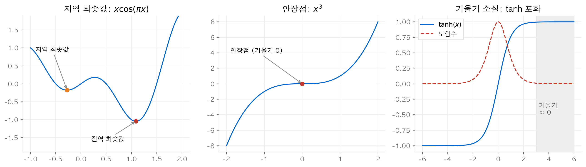
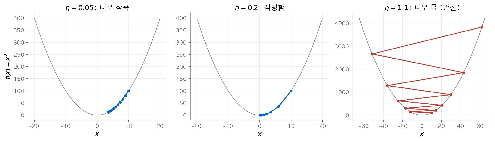
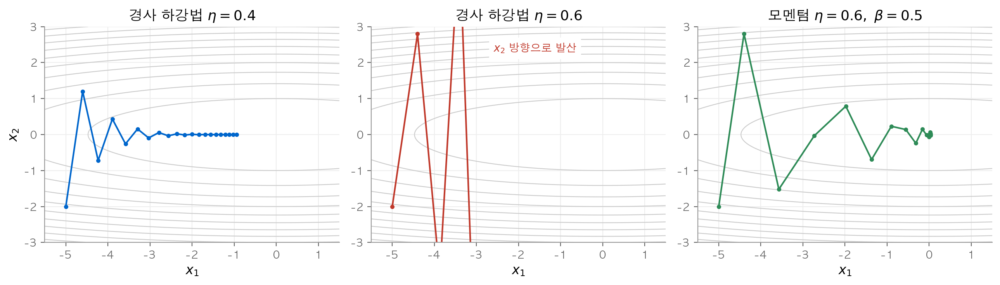
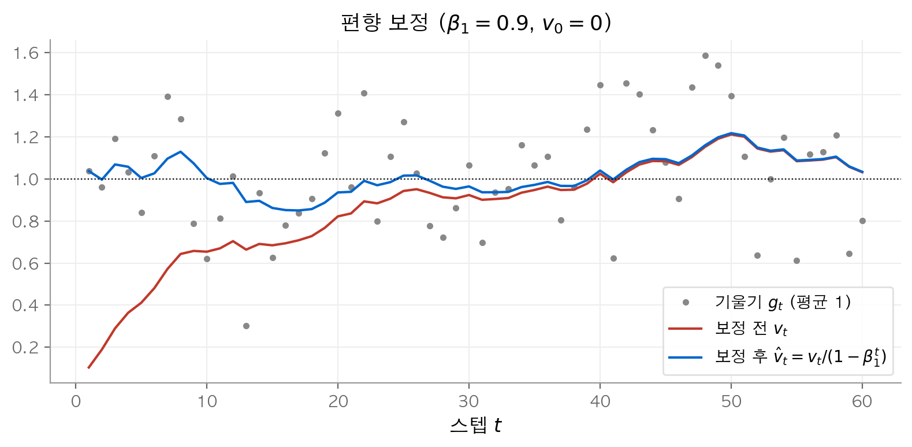
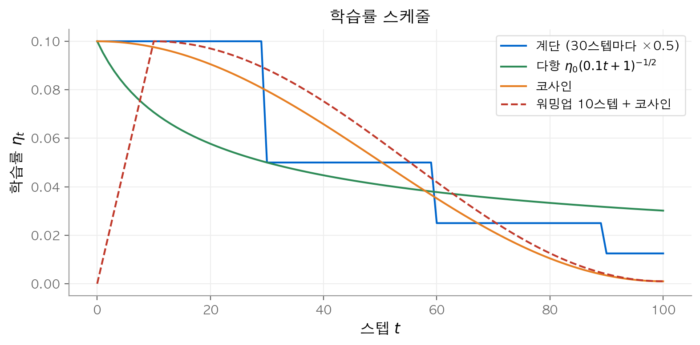
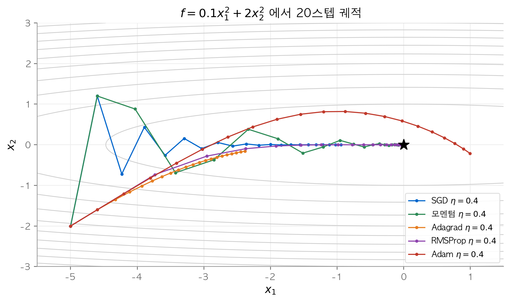

# 9. 최적화 알고리즘

앞 장들은 모델의 구조를 다뤘습니다. 이 장은 그 모델의 파라미터를 실제로 찾는 방법을 다룹니다. 질문은 다음과 같습니다. 손실을 줄이는 방향은 기울기가 알려 주는데, 얼마나 크게, 어떤 정보를 모아서 움직여야 할까요? 이 장의 결론은 **좋은 옵티마이저는 기울기의 잡음과 좌표별 곡률 차이를 동시에 다룬다**는 것입니다. 모멘텀은 기울기를 시간 방향으로 평균해 잡음과 진동을 줄이고, Adagrad, RMSProp, Adam은 좌표마다 보폭을 따로 맞춥니다. 학습률 스케줄은 학습 단계에 따라 보폭 자체를 바꿉니다.

!!! info "원문과 자료"
    - [12. Optimization Algorithms](https://d2l.ai/chapter_optimization/index.html)
    - [12.1 Optimization and Deep Learning](https://d2l.ai/chapter_optimization/optimization-intro.html), [12.2 Convexity](https://d2l.ai/chapter_optimization/convexity.html)
    - [12.3 Gradient Descent](https://d2l.ai/chapter_optimization/gd.html), [12.4 Stochastic Gradient Descent](https://d2l.ai/chapter_optimization/sgd.html), [12.5 Minibatch SGD](https://d2l.ai/chapter_optimization/minibatch-sgd.html)
    - [12.6 Momentum](https://d2l.ai/chapter_optimization/momentum.html), [12.7 Adagrad](https://d2l.ai/chapter_optimization/adagrad.html), [12.8 RMSProp](https://d2l.ai/chapter_optimization/rmsprop.html), [12.9 Adadelta](https://d2l.ai/chapter_optimization/adadelta.html), [12.10 Adam](https://d2l.ai/chapter_optimization/adam.html)
    - [12.11 Learning Rate Scheduling](https://d2l.ai/chapter_optimization/lr-scheduler.html)
    - 함께 읽기: [3. 다층 퍼셉트론](03-mlp.md), [8. 어텐션과 트랜스포머](08-attention-transformer.md)

## 1. 최적화와 딥러닝

### 목표의 차이

**최적화(optimization)** 의 목표는 주어진 목적 함수의 값을 줄이는 것입니다. 딥러닝의 목표는 처음 보는 데이터에서 오차를 줄이는 것입니다. 옵티마이저가 직접 줄이는 값은 **경험적 위험(empirical risk)**, 곧 훈련 데이터에서 평균한 손실입니다. 우리가 실제로 원하는 값은 데이터 분포 전체에서 기대한 **위험(risk)** 입니다. 두 값의 차이는 과적합과 일반화의 문제이고, 이 장은 앞의 값을 줄이는 방법에 집중합니다.

### 세 가지 어려움

딥러닝의 손실 함수는 대부분 볼록하지 않습니다. 그래서 기울기만 보고 움직이면 다음 세 곳에서 문제가 생깁니다.

| 어려움 | 정의 | 예 |
| --- | --- | --- |
| **지역 최솟값(local minimum)** | 주변보다 낮지만 전체에서 가장 낮지는 않은 점 | $f(x)=x\cos(\pi x)$ 의 $x\approx-0.27$ |
| **안장점(saddle point)** | 기울기가 0이지만 최솟값도 최댓값도 아닌 점 | $f(x)=x^3$ 의 $x=0$, $f(x,y)=x^2-y^2$ 의 원점 |
| **기울기 소실(vanishing gradient)** | 기울기가 0에 가까워 갱신이 멈추는 현상 | $\tanh$ 가 포화된 구간 |


왼쪽은 $x\cos(\pi x)$ 에서 지역 최솟값($-0.18$)과 전역 최솟값($-1.05$)이 따로 있는 모습입니다. 가운데는 기울기가 0인데 최솟값이 아닌 안장점이고, 오른쪽은 $\tanh$ 의 도함수가 $|x|>3$ 에서 거의 0이 되는 모습입니다.

수치로 확인합니다. $\tanh$ 의 도함수 $1-\tanh^2(x)$ 는 $x=0$ 에서 1이고 $x=4$ 에서 $0.00134$ 입니다. 입력이 4만 되어도 기울기가 약 750분의 1로 줄어듭니다. 고차원에서는 안장점이 지역 최솟값보다 훨씬 흔합니다. 헤세 행렬(Hessian)의 고윳값 $k$ 개가 모두 양수일 확률보다 부호가 섞일 확률이 훨씬 크기 때문입니다. 기울기 소실은 [3장](03-mlp.md)에서 ReLU를 쓰는 이유로 이미 다뤘습니다.

## 2. 볼록성

### 정의

집합 $\mathcal{X}$ 가 **볼록 집합(convex set)** 이라는 것은 두 점을 잇는 선분이 집합 안에 남는다는 뜻입니다. 모든 $a, b \in \mathcal{X}$ 와 $\lambda \in [0,1]$ 에서 $\lambda a + (1-\lambda) b \in \mathcal{X}$ 가 성립합니다.

함수 $f$ 가 **볼록 함수(convex function)** 라는 것은 다음 부등식이 성립한다는 뜻입니다.

$$
\lambda f(x) + (1-\lambda) f(x') \ge f(\lambda x + (1-\lambda) x')
$$

직관적으로 말하면 두 점을 잇는 현이 항상 그래프 위에 있습니다. $f(x)=x^2$, $x=-1$, $x'=3$, $\lambda=0.25$ 로 확인합니다. 가운데 점은 $0.25\cdot(-1)+0.75\cdot 3 = 2$ 이고 $f(2)=4$ 입니다. 현 위의 값은 $0.25\cdot 1 + 0.75 \cdot 9 = 7$ 입니다. $7 \ge 4$ 이므로 부등식이 성립합니다.

### 젠센 부등식

정의를 여러 점의 가중 평균으로 넓히면 **젠센 부등식(Jensen's inequality)** 이 됩니다.

$$
\sum_i \alpha_i f(x_i) \ge f\Big(\sum_i \alpha_i x_i\Big), \qquad E_X[f(X)] \ge f(E_X[X])
$$

"함숫값의 평균은 평균의 함숫값보다 작지 않다"로 읽습니다. $X$ 가 1과 3을 같은 확률로 갖고 $f(x)=x^2$ 이면 $f(E[X]) = 2^2 = 4$ 이고 $E[f(X)] = (1+9)/2 = 5$ 입니다. 이 차이 $5-4=1$ 이 바로 $X$ 의 분산입니다. 젠센 부등식은 로그 우도의 하한(ELBO)을 유도할 때 자주 쓰입니다.

### 성질

볼록 함수에는 최적화에 유리한 성질이 세 가지 있습니다.

1. **지역 최솟값은 전역 최솟값입니다.** 더 낮은 점이 따로 있다면, 그 점을 잇는 선분 위에서 정의에 모순이 생깁니다.
2. **하위 수준 집합(sublevel set)** $\{x : f(x) \le b\}$ 는 볼록 집합입니다.
3. 두 번 미분 가능하면 볼록성은 헤세 행렬이 양의 준정부호라는 조건 $\nabla^2 f \succeq 0$ 과 같습니다.

딥러닝 손실은 볼록하지 않습니다. 그래도 최솟값 근처에서는 볼록 이차 함수와 비슷하게 행동합니다. 그래서 이 장의 수렴 분석은 대부분 볼록 함수, 특히 이차 함수에서 진행합니다.

## 3. 경사 하강법

### 1차원에서의 유도

$f(x+\epsilon)$ 을 테일러 전개하면 $f(x+\epsilon) = f(x) + \epsilon f'(x) + O(\epsilon^2)$ 입니다. $\epsilon = -\eta f'(x)$ 로 두면 다음 식을 얻습니다.

$$
f(x - \eta f'(x)) = f(x) - \eta f'^2(x) + O(\eta^2 f'^2(x))
$$

$\eta>0$ 이 충분히 작으면 둘째 항이 셋째 항보다 크므로 함숫값이 줄어듭니다. 이 갱신 $x \leftarrow x - \eta f'(x)$ 가 **경사 하강법(gradient descent)** 이고, $\eta$ 를 **학습률(learning rate)** 이라고 합니다.

### 학습률에 따른 수렴과 발산

$f(x)=x^2$ 에서는 갱신이 $x \leftarrow (1-2\eta)x$ 입니다. 한 스텝마다 $|1-2\eta|$ 배가 되므로 $0<\eta<1$ 이면 수렴하고 $\eta>1$ 이면 발산합니다.

```python
import numpy as np

def gd(eta, x=10.0, steps=10):
    for _ in range(steps):
        x = x - eta * 2 * x        # f(x) = x^2, f'(x) = 2x
    return x

for eta in [0.05, 0.2, 0.5, 1.1]:
    print(eta, round(gd(eta), 4))
# 0.05 3.4868
# 0.2 0.0605
# 0.5 0.0
# 1.1 61.9174
```

$\eta=0.5$ 는 곡률에 정확히 맞는 값이라 한 스텝 만에 0에 도착합니다. $\eta=1.1$ 은 매 스텝 $-1.2$ 배가 되어 부호를 바꾸며 커집니다.


$x_0=10$ 에서 10스텝을 진행한 궤적입니다. $\eta=0.05$ 는 3.49까지만 내려오고, $\eta=0.2$ 는 0.06에 도착하며, $\eta=1.1$ 은 좌우로 튀면서 61.9까지 커집니다.

### 다변수와 조건수

다변수에서는 $\mathbf{x} \leftarrow \mathbf{x} - \eta \nabla f(\mathbf{x})$ 입니다. 이차 함수 $f(\mathbf{x}) = 0.1x_1^2 + 2x_2^2$ 의 헤세 행렬은 $\mathrm{diag}(0.2, 4)$ 입니다. 좌표마다 갱신 계수가 $1-\eta\lambda_i$ 이므로, 두 좌표가 동시에 수렴하려면 $\eta < 2/\lambda_{\max} = 0.5$ 여야 합니다.

- $\eta=0.4$: 계수는 $(0.92, -0.6)$ 입니다. 둘 다 절댓값이 1보다 작습니다.
- $\eta=0.6$: 계수는 $(0.88, -1.4)$ 입니다. $x_2$ 방향이 발산합니다.

가장 큰 곡률이 학습률의 상한을 정하고, 가장 작은 곡률이 수렴 속도를 정합니다. 두 값의 비 $\lambda_{\max}/\lambda_{\min} = 20$ 을 **조건수(condition number)** 라고 합니다. 조건수가 클수록 경사 하강법은 느립니다. $\eta=0.4$ 로 20스텝을 진행해도 $x_1$ 은 $-5$ 에서 $-0.94$ 까지만 움직입니다.

### 뉴턴법과 전처리

2차 항까지 쓰면 **뉴턴법(Newton's method)** 이 나옵니다. $f(\mathbf{x}+\boldsymbol{\epsilon}) \approx f(\mathbf{x}) + \boldsymbol{\epsilon}^\top \nabla f + \frac{1}{2}\boldsymbol{\epsilon}^\top \mathbf{H} \boldsymbol{\epsilon}$ 를 최소화하면 다음 갱신을 얻습니다.

$$
\mathbf{x} \leftarrow \mathbf{x} - \mathbf{H}^{-1} \nabla f(\mathbf{x})
$$

이차 함수에서는 한 스텝 만에 최솟값에 도착합니다. 위 예에서 $(-5,-2)$ 는 바로 $(0,0)$ 이 됩니다. $f(x)=\cosh(0.5x)$, $x_0=1$ 로 비교합니다.

| 스텝 | 1 | 2 | 3 |
| --- | --- | --- | --- |
| 뉴턴법 | 0.0758 | 0.000036 | 0.0000 |
| 경사 하강법 ($\eta=1$) | 0.739 | 0.550 | 0.411 |

뉴턴법은 최솟값 근처에서 오차가 제곱으로 줄어듭니다. 문제는 두 가지입니다. 파라미터가 $d$ 개면 헤세 행렬은 $d^2$ 개의 원소를 갖습니다. 그리고 볼록하지 않은 곳에서 $\mathbf{H}$ 가 음의 고윳값을 가지면 최댓값 쪽으로 움직입니다.

절충안이 **전처리(preconditioning)** 입니다. 헤세 행렬 전체 대신 대각 원소만 써서 $\mathbf{x} \leftarrow \mathbf{x} - \eta\,\mathrm{diag}(\mathbf{H})^{-1}\nabla f$ 로 갱신합니다. 좌표마다 곡률로 나눠 주므로 단위가 다른 좌표의 보폭이 맞춰집니다. 7~10절의 적응형 방법은 헤세 행렬 대신 기울기 제곱의 통계로 이 대각 원소를 추정합니다.

## 4. 확률적 경사 하강법

### 갱신식

훈련 데이터가 $n$ 개면 목적 함수는 $f(\mathbf{x}) = \frac{1}{n}\sum_{i=1}^n f_i(\mathbf{x})$ 입니다. 전체 기울기 계산은 스텝마다 $O(n)$ 의 비용이 듭니다. **확률적 경사 하강법(stochastic gradient descent, SGD)** 은 표본 $i$ 하나를 무작위로 골라 다음과 같이 갱신합니다.

$$
\mathbf{x} \leftarrow \mathbf{x} - \eta \nabla f_i(\mathbf{x}), \qquad E_i[\nabla f_i(\mathbf{x})] = \nabla f(\mathbf{x})
$$

한 스텝의 비용은 $O(1)$ 입니다. 기울기는 평균적으로 정확하지만 스텝마다 잡음이 섞입니다. 그래서 학습률이 고정되어 있으면 최솟값 근처에서 잡음 크기만큼 계속 흔들립니다.

### 동적 학습률

흔들림을 줄이려면 학습률을 시간에 따라 줄입니다. 원문은 세 가지를 소개합니다.

$$
\eta(t) = \eta_i \ (t_i \le t \le t_{i+1}), \qquad \eta(t) = \eta_0 e^{-\lambda t}, \qquad \eta(t) = \eta_0 (\beta t + 1)^{-\alpha}
$$

각각 **구간 상수(piecewise constant)**, **지수 감쇠(exponential decay)**, **다항 감쇠(polynomial decay)** 입니다. 지수 감쇠는 학습률이 너무 빨리 0이 되어 최솟값에 닿기 전에 멈출 수 있습니다. 다항 감쇠에서는 $\alpha=0.5$ 가 자주 쓰입니다.

### 수렴 분석의 요지

볼록 목적 함수와 확률적 기울기 노름의 상한 $L$ 을 가정합니다. $r = \|\mathbf{x}_1 - \mathbf{x}^*\|$ 이고 $\bar{\mathbf{x}}$ 가 학습률로 가중 평균한 반복점이면 다음이 성립합니다.

$$
E[R(\bar{\mathbf{x}})] - R^* \le \frac{r^2 + L^2 \sum_{t=1}^T \eta_t^2}{2\sum_{t=1}^T \eta_t}
$$

$\eta = r/(L\sqrt{T})$ 로 고정하면 우변은 $rL/\sqrt{T}$ 가 됩니다. 수렴 속도는 $O(1/\sqrt{T})$ 입니다. $r=1$, $L=2$ 이면 $T=100$ 에서 상한은 $0.2$ 이고 $T=10000$ 에서 $0.02$ 입니다. 스텝을 100배 늘려야 오차 상한이 10분의 1로 줄어듭니다.

실제 구현은 복원 추출 대신 에폭마다 데이터를 섞고 순서대로 한 번씩 씁니다. 비복원 추출은 같은 표본을 반복해서 쓰지 않으므로 분산이 조금 더 작습니다.

## 5. 미니배치 SGD

### 벡터화와 캐시

표본 하나씩 처리하면 GPU와 CPU의 병렬 연산을 거의 쓰지 못합니다. 행렬-벡터 곱을 여러 번 하는 것보다 행렬-행렬 곱을 한 번 하는 편이 빠릅니다. 메모리에서 읽은 값을 캐시에 두고 여러 번 재사용하기 때문입니다. **미니배치(minibatch)** 는 이 효율을 얻기 위해 표본 $b$ 개를 묶어 기울기를 평균합니다.

$$
\mathbf{g}_t = \frac{1}{|\mathcal{B}_t|} \sum_{i \in \mathcal{B}_t} \nabla f_i(\mathbf{x}_{t-1}), \qquad \mathbf{x}_t \leftarrow \mathbf{x}_{t-1} - \eta_t \mathbf{g}_t
$$

### 배치 크기의 절충

표본별 기울기가 서로 독립이고 표준편차가 $\sigma$ 이면 평균 기울기의 표준편차는 $\sigma/\sqrt{b}$ 입니다. $\sigma=2$ 인 정규 난수 10만 개로 확인했습니다.

| 배치 크기 $b$ | 측정한 표준편차 | 이론값 $\sigma/\sqrt{b}$ |
| --- | --- | --- |
| 1 | 2.000 | 2.000 |
| 16 | 0.497 | 0.500 |
| 256 | 0.123 | 0.125 |

배치를 16배 키우면 잡음은 4배만 줄어듭니다. 반면 에폭당 갱신 횟수는 16배 줄어듭니다. 그래서 배치 크기는 하드웨어 효율과 갱신 횟수 사이의 절충입니다.

| 방법 | 한 스텝의 표본 수 | 하드웨어 효율 | 에폭당 갱신 횟수 | 기울기 잡음 |
| --- | --- | --- | --- | --- |
| 경사 하강법 | $n$ | 높음 | 1 | 없음 |
| SGD | 1 | 낮음 | $n$ | 큼 |
| 미니배치 SGD | $b$ | 중간~높음 | $n/b$ | $\propto 1/\sqrt{b}$ |

## 6. 모멘텀

### 누설 평균

미니배치 기울기의 잡음을 더 줄이는 방법은 과거 기울기를 함께 평균하는 것입니다. **누설 평균(leaky average)** 은 다음과 같이 정의합니다.

$$
\mathbf{v}_t = \beta \mathbf{v}_{t-1} + \mathbf{g}_{t,t-1} = \sum_{\tau=0}^{t-1} \beta^\tau \mathbf{g}_{t-\tau, t-\tau-1}, \qquad \beta \in (0,1)
$$

$\mathbf{v}_t$ 를 **속도(velocity)** 라고 부릅니다. 최근 기울기일수록 큰 가중치를 받습니다. 기울기가 계속 1이고 $\beta=0.9$ 이면 $v_1=1$, $v_2=1.9$, $v_3=2.71$ 이고, 극한은 10입니다.

### 유효 표본 수

가중치의 합은 $\sum_{\tau=0}^\infty \beta^\tau = 1/(1-\beta)$ 입니다. 그래서 누설 평균은 최근 기울기 약 $1/(1-\beta)$ 개를 더한 것과 비슷합니다.

| $\beta$ | $1/(1-\beta)$ | 실효 학습률 $\eta/(1-\beta)$ |
| --- | --- | --- |
| 0.5 | 2 | $2\eta$ |
| 0.9 | 10 | $10\eta$ |
| 0.99 | 100 | $100\eta$ |

$\beta$ 를 키우면 실효 학습률도 커집니다. 그래서 $\beta$ 를 바꿀 때는 $\eta$ 도 함께 조정합니다.

### 모멘텀법

**모멘텀(momentum)** 은 기울기 대신 속도로 갱신합니다.

$$
\mathbf{v}_t \leftarrow \beta \mathbf{v}_{t-1} + \mathbf{g}_{t,t-1}, \qquad \mathbf{x}_t \leftarrow \mathbf{x}_{t-1} - \eta_t \mathbf{v}_t
$$

$\beta=0$ 이면 일반 경사 하강법입니다. 조건수가 나쁜 이차 함수에서 효과가 분명합니다. $x_2$ 방향 기울기는 부호가 번갈아 바뀌므로 평균하면 서로 상쇄됩니다. $x_1$ 방향 기울기는 부호가 같으므로 평균하면 쌓입니다.


$f=0.1x_1^2+2x_2^2$ 에서 $(-5,-2)$ 부터 20스텝을 진행했습니다. 경사 하강법은 $\eta=0.4$ 에서 $x_1$ 방향이 느리고 $\eta=0.6$ 에서 $x_2$ 방향이 발산합니다. 모멘텀은 같은 $\eta=0.6$ 에서도 원점 근처까지 수렴합니다.

20스텝 후 함숫값은 경사 하강법($\eta=0.4$)이 $0.089$ 이고 모멘텀($\eta=0.6$, $\beta=0.5$)이 $1.8\times10^{-5}$ 입니다.

### 이차 함수에서의 분석

볼록 이차 함수는 헤세 행렬의 고유벡터 좌표로 바꾸면 좌표별로 분리됩니다. 그래서 스칼라 함수 $f(x) = \frac{\lambda}{2}x^2$ 만 분석하면 충분합니다. 경사 하강법은 $0 < \eta\lambda < 2$ 에서 수렴합니다. 모멘텀은 $0 < \eta\lambda < 2 + 2\beta$ 에서 수렴합니다. 위 예의 $x_2$ 좌표는 $\eta\lambda = 0.6 \times 4 = 2.4$ 입니다. 경사 하강법의 한계 2는 넘고, $\beta=0.5$ 모멘텀의 한계 3 안에는 있습니다. 모멘텀은 안정하게 쓸 수 있는 학습률의 범위를 넓힙니다.

## 7. Adagrad

### 희소 특성과 좌표별 학습률

자연어 모델에서는 드물게 나타나는 단어의 임베딩이 가끔씩만 기울기를 받습니다. 모든 좌표에 같은 학습률을 쓰면 드문 특성은 거의 학습되지 않습니다. **Adagrad** 는 지금까지 받은 기울기 크기의 누적으로 좌표별 학습률을 정합니다.

$$
\mathbf{s}_t = \mathbf{s}_{t-1} + \mathbf{g}_t^2, \qquad \mathbf{x}_t = \mathbf{x}_{t-1} - \frac{\eta}{\sqrt{\mathbf{s}_t + \epsilon}} \odot \mathbf{g}_t
$$

제곱, 나눗셈, 제곱근은 모두 원소별 연산입니다. 큰 기울기를 자주 받은 좌표는 보폭이 줄고, 드물게 받은 좌표는 보폭이 유지됩니다. $\sqrt{\mathbf{s}_t}$ 는 3절의 대각 전처리에서 곡률 역할을 합니다. 이차 함수에서는 기울기가 곡률에 비례하므로 이 추정이 합리적입니다.

### 수치 예시

$f=0.1x_1^2+2x_2^2$, $\eta=0.4$, $\mathbf{x}_0 = (-5,-2)$ 에서 첫 세 스텝입니다.

| 스텝 | 기울기 $\mathbf{g}_t$ | 보폭 $\eta \mathbf{g}_t/\sqrt{\mathbf{s}_t}$ |
| --- | --- | --- |
| 1 | $(-1, -8)$ | $(-0.400, -0.400)$ |
| 2 | $(-0.92, -6.40)$ | $(-0.271, -0.250)$ |
| 3 | $(-0.87, -5.40)$ | $(-0.215, -0.187)$ |

기울기 크기는 8배 차이가 나지만 첫 스텝의 보폭은 두 좌표 모두 $0.4$ 입니다. 문제는 $\mathbf{s}_t$ 가 계속 커진다는 점입니다. 학습률이 대략 $O(t^{-1/2})$ 로 줄어서 20스텝 후 함숫값은 $0.62$ 에 머뭅니다. 볼록 문제에서는 이 감쇠가 이론적으로 맞지만, 딥러닝처럼 긴 학습에서는 너무 빨리 멈춥니다.

## 8. RMSProp

**RMSProp** 은 Adagrad의 누적 합을 누설 평균으로 바꿉니다.

$$
\mathbf{s}_t \leftarrow \gamma \mathbf{s}_{t-1} + (1-\gamma) \mathbf{g}_t^2, \qquad \mathbf{x}_t \leftarrow \mathbf{x}_{t-1} - \frac{\eta}{\sqrt{\mathbf{s}_t + \epsilon}} \odot \mathbf{g}_t
$$

$\mathbf{s}_t$ 는 최근 약 $1/(1-\gamma)$ 스텝의 기울기 제곱 평균입니다. 그래서 학습률이 0으로 줄어들지 않습니다. 학습률의 감쇠는 따로 스케줄로 정합니다.

기울기가 상수 $G$ 로 유지되면 $\mathbf{s}_t \to G^2$ 이고 보폭은 $\eta G/|G| = \eta$ 가 됩니다. $\eta=0.01$, $\gamma=0.9$ 로 200스텝 후 보폭을 계산하면 $G=1$ 과 $G=100$ 모두 $0.0100$ 입니다. RMSProp의 보폭은 기울기의 크기와 거의 무관하고 $\eta$ 로 정해집니다. 앞의 이차 함수에서 20스텝 후 함숫값은 $1.1\times10^{-5}$ 입니다.

## 9. Adadelta

**Adadelta** 는 학습률 $\eta$ 자체를 없앤 변형입니다. 상태 변수를 두 개 둡니다.

$$
\begin{aligned}
\mathbf{s}_t &= \rho \mathbf{s}_{t-1} + (1-\rho) \mathbf{g}_t^2 \\
\mathbf{g}_t' &= \frac{\sqrt{\Delta\mathbf{x}_{t-1} + \epsilon}}{\sqrt{\mathbf{s}_t + \epsilon}} \odot \mathbf{g}_t \\
\mathbf{x}_t &= \mathbf{x}_{t-1} - \mathbf{g}_t' \\
\Delta\mathbf{x}_t &= \rho \Delta\mathbf{x}_{t-1} + (1-\rho) (\mathbf{g}_t')^2
\end{aligned}
$$

$\mathbf{s}_t$ 는 기울기 제곱의 평균이고 $\Delta\mathbf{x}_t$ 는 실제 갱신량 제곱의 평균입니다. 분자 $\sqrt{\Delta\mathbf{x}_{t-1}}$ 가 학습률 자리를 대신합니다. 최근 갱신량의 크기에 맞춰 다음 갱신량을 정한다는 뜻입니다. 분자와 분모의 비는 "파라미터 단위 / 기울기 단위" 이므로 갱신량의 단위가 파라미터와 일치합니다.

$\rho=0.9$, $\epsilon=10^{-5}$, 기울기가 계속 1일 때 갱신량은 $0.0100$, $0.0103$, $0.0104$ 입니다. $\Delta\mathbf{x}_0=0$ 이므로 첫 갱신량은 $\sqrt{\epsilon}/\sqrt{0.1}\approx 0.01$ 이고 그 뒤로 천천히 커집니다. 대신 $\epsilon$ 이 사실상 초기 학습률 역할을 합니다.

## 10. Adam

### 알고리즘

**Adam** 은 모멘텀의 1차 모멘트와 RMSProp의 2차 모멘트를 함께 씁니다.

$$
\begin{aligned}
\mathbf{v}_t &\leftarrow \beta_1 \mathbf{v}_{t-1} + (1-\beta_1)\mathbf{g}_t \\
\mathbf{s}_t &\leftarrow \beta_2 \mathbf{s}_{t-1} + (1-\beta_2)\mathbf{g}_t^2 \\
\hat{\mathbf{v}}_t &= \frac{\mathbf{v}_t}{1-\beta_1^t}, \qquad \hat{\mathbf{s}}_t = \frac{\mathbf{s}_t}{1-\beta_2^t} \\
\mathbf{x}_t &\leftarrow \mathbf{x}_{t-1} - \frac{\eta\, \hat{\mathbf{v}}_t}{\sqrt{\hat{\mathbf{s}}_t} + \epsilon}
\end{aligned}
$$

기본값은 $\beta_1=0.9$, $\beta_2=0.999$ 입니다. $\epsilon$ 은 제곱근 밖에 둡니다. 원문은 이 위치가 실제로 조금 더 잘 동작한다고 설명합니다.

### 편향 보정의 유도

$\mathbf{v}_0 = 0$ 에서 시작하면 $\mathbf{v}_t$ 를 다음과 같이 풀어 쓸 수 있습니다.

$$
\mathbf{v}_t = (1-\beta_1)\sum_{i=1}^{t} \beta_1^{t-i} \mathbf{g}_i
$$

기울기의 기댓값이 시간에 따라 일정하게 $E[\mathbf{g}]$ 라고 가정하면 등비수열의 합으로 다음을 얻습니다.

$$
E[\mathbf{v}_t] = (1-\beta_1)\frac{1-\beta_1^t}{1-\beta_1} E[\mathbf{g}] = (1-\beta_1^t)\,E[\mathbf{g}]
$$

$\mathbf{v}_t$ 는 실제 평균보다 $(1-\beta_1^t)$ 배 작습니다. 이 값으로 나누면 편향이 사라집니다. $\mathbf{s}_t$ 도 같은 방식으로 $(1-\beta_2^t)$ 로 나눕니다.

| $t$ | $1-\beta_1^t$ ($\beta_1=0.9$) | $1-\beta_2^t$ ($\beta_2=0.999$) |
| --- | --- | --- |
| 1 | 0.100 | 0.001 |
| 10 | 0.651 | 0.00996 |
| 100 | 1.000 | 0.095 |
| 1000 | 1.000 | 0.632 |

$\beta_2$ 가 1에 가까우므로 2차 모멘트의 보정은 수천 스텝 동안 영향을 줍니다.


평균이 1인 잡음 섞인 기울기를 $\beta_1=0.9$ 로 누설 평균한 결과입니다. 보정 전 값은 0.1에서 출발해 약 20스텝 동안 1보다 작고, 보정 후 값은 첫 스텝부터 1 근처에 있습니다.

### 첫 스텝 수치 예시

보정이 없으면 첫 스텝의 크기가 어떻게 되는지 계산합니다.

```python
import numpy as np

g = np.array([0.5, -0.01])           # 첫 스텝의 기울기 (두 좌표의 크기가 50배 차이)
b1, b2, eps = 0.9, 0.999, 1e-8
v = (1 - b1) * g                      # v_0 = 0 에서 한 번 갱신
s = (1 - b2) * g**2

raw = v / (np.sqrt(s) + eps)
corrected = (v / (1 - b1)) / (np.sqrt(s / (1 - b2)) + eps)
print(v, s)                           # [ 0.05  -0.001] [2.5e-04 1.0e-07]
print(raw.round(4), corrected.round(4))  # [ 3.1623 -3.1622] [ 1. -1.]
```

보정 전 비율은 $(1-\beta_1)/\sqrt{1-\beta_2} = 0.1/0.0316 \approx 3.16$ 입니다. 첫 스텝이 의도한 $\eta$ 의 3.16배가 됩니다. 보정 후 첫 스텝은 정확히 $\eta \cdot \mathrm{sign}(\mathbf{g})$ 입니다. 기울기 크기가 50배 달라도 두 좌표가 같은 보폭으로 움직입니다.

### Adam의 한계

기울기 분산이 크면 $\mathbf{s}_t$ 가 갑자기 커졌다가 천천히 줄어듭니다. 원문은 이를 완화하는 변형으로 **Yogi** 를 소개합니다. Yogi는 $\mathbf{s}_t \leftarrow \mathbf{s}_{t-1} + (1-\beta_2)\,\mathbf{g}_t^2 \odot \mathrm{sgn}(\mathbf{g}_t^2 - \mathbf{s}_{t-1})$ 로 갱신합니다. 한 스텝의 변화량이 $(1-\beta_2)\mathbf{g}_t^2$ 를 넘지 않습니다.

## 11. 학습률 스케줄

### 스케줄러의 종류

학습률은 옵티마이저 종류만큼 결과에 영향을 줍니다. 원문의 스케줄러를 정리합니다.

| 이름 | 식 | 특징 |
| --- | --- | --- |
| 계단(multifactor) | $t \in s$ 일 때 $\eta_{t+1} \leftarrow \eta_t \cdot \alpha$ | 정해진 에폭에 한 번씩 낮춤 |
| 지수(factor) | $\eta_{t+1} \leftarrow \max(\eta_{\min}, \eta_t \alpha)$ | 매 스텝 일정 비율로 낮춤 |
| 다항 | $\eta_t = \eta_0(\beta t + 1)^{-\alpha}$ | 느리게 감쇠 |
| 코사인 | $\eta_t = \eta_T + \frac{\eta_0 - \eta_T}{2}\big(1 + \cos(\pi t / T)\big)$ | 처음과 끝은 완만, 중간은 빠름 |

코사인 스케줄을 $\eta_0=0.1$, $\eta_T=0.001$, $T=100$ 으로 계산하면 다음과 같습니다.

| $t$ | 0 | 25 | 50 | 75 | 100 |
| --- | --- | --- | --- | --- | --- |
| 코사인 $\eta_t$ | 0.1000 | 0.0855 | 0.0505 | 0.0155 | 0.0010 |
| 다항 $\eta_0(0.1t+1)^{-1/2}$ | 0.1000 | 0.0535 | 0.0408 | 0.0343 | 0.0302 |

다항 감쇠는 초반에 빨리 줄고 후반에는 거의 평평합니다. 코사인은 초반에 큰 학습률을 오래 유지하고 끝에서 $\eta_T$ 까지 내려갑니다.

### 워밍업

**워밍업(warmup)** 은 처음 몇 스텝 동안 학습률을 0 근처에서 $\eta_0$ 까지 선형으로 올리는 방법입니다. 학습 초기에는 파라미터가 무작위라서 기울기가 크고 방향도 불안정합니다. 이때 큰 학습률을 쓰면 첫 몇 스텝에 발산할 수 있습니다. Adam의 $\hat{\mathbf{s}}_t$ 도 초기에는 표본이 적어 추정이 부정확합니다. 워밍업은 [8장](08-attention-transformer.md)의 트랜스포머 학습에서 거의 필수로 씁니다.


$\eta_0=0.1$ 에서 시작하는 네 스케줄입니다. 계단 스케줄은 30스텝마다 절반이 되고, 워밍업 스케줄은 10스텝 동안 0에서 0.1까지 올라간 뒤 코사인으로 내려갑니다.

PyTorch에서는 옵티마이저에 스케줄러를 연결하고 매 스텝 `step()` 을 부릅니다.

```python
import math, torch

model = torch.nn.Linear(10, 1)
opt = torch.optim.AdamW(model.parameters(), lr=1e-3, betas=(0.9, 0.999))

warmup, total = 1000, 100_000
def lr_lambda(step):                       # lr = 1e-3 * lr_lambda(step)
    if step < warmup:
        return step / warmup               # 선형 워밍업
    p = (step - warmup) / (total - warmup)
    return 0.5 * (1 + math.cos(math.pi * p))   # 코사인 감쇠

sched = torch.optim.lr_scheduler.LambdaLR(opt, lr_lambda)
for step in range(total):
    loss = model(torch.randn(32, 10)).pow(2).mean()
    opt.zero_grad()
    loss.backward()
    opt.step()
    sched.step()
```

## 12. 옵티마이저 비교

### 갱신식 비교 표

모든 연산은 원소별 연산이고 $\mathbf{g}_t$ 는 미니배치 기울기입니다.

| 옵티마이저 | 상태 | 갱신식 | 주요 하이퍼파라미터 |
| --- | --- | --- | --- |
| SGD | 없음 | $\mathbf{x}_t = \mathbf{x}_{t-1} - \eta\mathbf{g}_t$ | $\eta$ |
| 모멘텀 | $\mathbf{v}$ | $\mathbf{v}_t = \beta\mathbf{v}_{t-1} + \mathbf{g}_t$, $\mathbf{x}_t = \mathbf{x}_{t-1} - \eta\mathbf{v}_t$ | $\eta$, $\beta=0.9$ |
| Adagrad | $\mathbf{s}$ | $\mathbf{s}_t = \mathbf{s}_{t-1} + \mathbf{g}_t^2$, $\mathbf{x}_t = \mathbf{x}_{t-1} - \frac{\eta}{\sqrt{\mathbf{s}_t+\epsilon}}\mathbf{g}_t$ | $\eta$ |
| RMSProp | $\mathbf{s}$ | $\mathbf{s}_t = \gamma\mathbf{s}_{t-1} + (1-\gamma)\mathbf{g}_t^2$, $\mathbf{x}_t = \mathbf{x}_{t-1} - \frac{\eta}{\sqrt{\mathbf{s}_t+\epsilon}}\mathbf{g}_t$ | $\eta$, $\gamma=0.9$ |
| Adadelta | $\mathbf{s}$, $\Delta\mathbf{x}$ | $\mathbf{x}_t = \mathbf{x}_{t-1} - \frac{\sqrt{\Delta\mathbf{x}_{t-1}+\epsilon}}{\sqrt{\mathbf{s}_t+\epsilon}}\mathbf{g}_t$ | $\rho=0.9$ |
| Adam | $\mathbf{v}$, $\mathbf{s}$ | $\mathbf{x}_t = \mathbf{x}_{t-1} - \frac{\eta\hat{\mathbf{v}}_t}{\sqrt{\hat{\mathbf{s}}_t}+\epsilon}$ | $\eta$, $\beta_1=0.9$, $\beta_2=0.999$ |

상태 변수의 개수는 메모리 비용과 같습니다. Adam은 파라미터마다 값 두 개를 더 저장하므로 옵티마이저 상태가 파라미터의 두 배입니다.

### 같은 문제에서 비교

다섯 옵티마이저를 같은 이차 함수에서 20스텝씩 실행합니다.

```python
import numpy as np

grad = lambda x: np.array([0.2 * x[0], 4 * x[1]])   # f = 0.1 x1^2 + 2 x2^2
f = lambda x: 0.1 * x[0]**2 + 2 * x[1]**2

def run(update, steps=20):
    x, state = np.array([-5.0, -2.0]), {}   # 시작점, 옵티마이저 상태
    for t in range(1, steps + 1):
        x = x - update(grad(x), state, t)
    return f(x)

def sgd(g, s, t, eta=0.4):
    return eta * g

def momentum(g, s, t, eta=0.6, beta=0.5):
    s["v"] = beta * s.get("v", 0) + g
    return eta * s["v"]

def adagrad(g, s, t, eta=0.4, eps=1e-6):
    s["s"] = s.get("s", 0) + g**2
    return eta * g / np.sqrt(s["s"] + eps)

def rmsprop(g, s, t, eta=0.4, gamma=0.9, eps=1e-6):
    s["s"] = gamma * s.get("s", 0) + (1 - gamma) * g**2
    return eta * g / np.sqrt(s["s"] + eps)

def adam(g, s, t, eta=0.4, b1=0.9, b2=0.999, eps=1e-6):
    s["v"] = b1 * s.get("v", 0) + (1 - b1) * g
    s["s"] = b2 * s.get("s", 0) + (1 - b2) * g**2
    v_hat, s_hat = s["v"] / (1 - b1**t), s["s"] / (1 - b2**t)
    return eta * v_hat / (np.sqrt(s_hat) + eps)

for u in [sgd, momentum, adagrad, rmsprop, adam]:
    print(f"{u.__name__:9s} f = {run(u):.2e}")
# sgd       f = 8.90e-02
# momentum  f = 1.82e-05
# adagrad   f = 6.18e-01
# rmsprop   f = 1.12e-05
# adam      f = 1.90e-01
```

시작점의 함숫값은 $10.5$ 입니다. 이 결과는 옵티마이저의 순위가 아니라 각 방법의 성격을 보여 줍니다. Adagrad는 학습률이 계속 줄어 느립니다. Adam은 좌표마다 보폭이 약 $\eta=0.4$ 로 맞춰지고 모멘텀까지 쌓여서 최솟값을 지나칩니다. 작은 장난감 문제에서는 Adam의 학습률을 더 작게 잡아야 합니다.


모든 옵티마이저에 $\eta=0.4$ 를 쓰고 모멘텀은 $\beta=0.5$ 를 썼습니다. SGD와 모멘텀은 $x_2$ 방향으로 진동하고, 적응형 방법은 두 좌표를 같은 보폭으로 움직여 대각선으로 출발합니다. Adam은 원점을 지나 $x_1=1$ 근처까지 갑니다.

## 정리

- 옵티마이저는 경험적 위험을 줄입니다. 딥러닝에서는 지역 최솟값, 안장점, 기울기 소실이 걸림돌이고, 고차원에서는 안장점이 특히 흔합니다.
- 볼록 함수에서는 지역 최솟값이 전역 최솟값입니다. 젠센 부등식 $E[f(X)] \ge f(E[X])$ 은 볼록성의 확률 버전입니다.
- 경사 하강법의 학습률은 가장 큰 곡률로 상한이 정해집니다. $f=x^2$ 에서는 $\eta<1$ 이어야 수렴합니다. 조건수가 클수록 수렴이 느립니다.
- 뉴턴법은 헤세 행렬로 곡률을 보정해 이차 함수를 한 스텝에 풉니다. 대각 전처리는 그 값싼 근사이고 적응형 옵티마이저의 출발점입니다.
- SGD는 스텝 비용을 $O(1)$ 로 줄이고 잡음을 얻습니다. 볼록 문제에서 $\eta = r/(L\sqrt{T})$ 로 $O(1/\sqrt{T})$ 속도로 수렴합니다.
- 미니배치는 기울기 표준편차를 $1/\sqrt{b}$ 로 줄이고 하드웨어 효율을 높입니다. 대신 에폭당 갱신 횟수가 $1/b$ 로 줍니다.
- 모멘텀은 기울기를 누설 평균합니다. 유효 표본 수는 $1/(1-\beta)$ 이고, 안정한 학습률 범위를 $\eta\lambda < 2+2\beta$ 로 넓힙니다.
- Adagrad는 기울기 제곱을 누적해 좌표별 학습률을 정하지만 학습률이 계속 줄어듭니다. RMSProp은 누적을 누설 평균으로 바꿔 이 문제를 고칩니다. Adadelta는 학습률 대신 최근 갱신량의 크기를 씁니다.
- Adam은 1차, 2차 모멘트를 함께 쓰고 $(1-\beta^t)$ 로 편향을 보정합니다. 보정 없이 첫 스텝은 의도한 크기의 약 3.16배가 됩니다.
- 학습률 스케줄은 계단, 다항, 코사인 감쇠가 대표적입니다. 워밍업은 초기의 불안정한 구간에서 발산을 막습니다.
