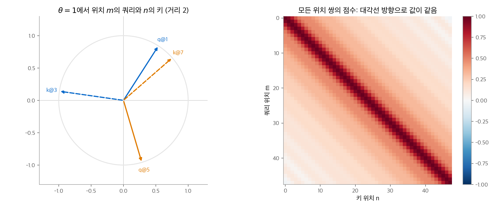
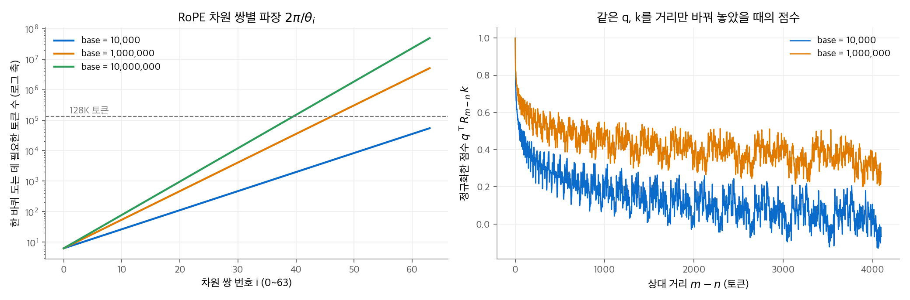
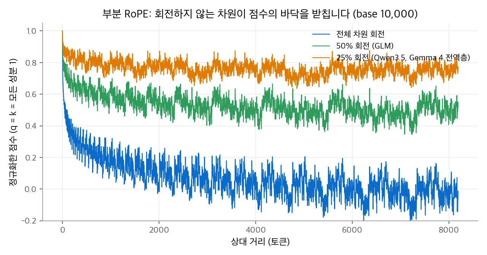

# 1. RoPE: 회전 위치 인코딩

어텐션 식에는 위치가 없습니다. 토큰 순서를 섞어도 출력은 같은 순서로 섞일 뿐입니다.
그래서 위치 정보를 따로 넣어야 합니다. 최근 LLM은 거의 모두 **RoPE(rotary position embedding)**를 씁니다.
RoPE는 쿼리와 키를 위치에 비례하는 각도로 회전합니다. 그러면 두 벡터의 내적이 상대 거리에만 의존합니다.
이 장은 2차원 회전에서 이 성질을 유도하고, 고차원 주파수 배치, 장거리 감쇠, 모델별 변형(부분 RoPE, 분리 RoPE, M-RoPE), 구현 방식을 정리합니다.

!!! info "자료"
    - Su et al., [RoFormer: Enhanced Transformer with Rotary Position Embedding](https://arxiv.org/abs/2104.09864), 2021.
    - 사인·코사인 위치 인코딩은 [신경망 기초 8장 7절](../d2l/08-attention-transformer.md)에 있습니다.
    - 모델 설정값: Qwen3.5-397B-A17B, GLM-4.5, GLM-5, Gemma 4 31B, DeepSeek-V3.2의 공개 `config.json`.

## 1. 덧셈 위치 인코딩의 한계

원래 트랜스포머는 위치 벡터 $\mathbf{p}_m$ 을 입력 임베딩에 더했습니다. 위치 $m$ 의 쿼리와 위치 $n$ 의 키의 점수를 풀어 씁니다.

$$
(\mathbf{x}_m + \mathbf{p}_m)^\top \mathbf{W}_Q^\top \mathbf{W}_K (\mathbf{x}_n + \mathbf{p}_n)
= \underbrace{\mathbf{x}_m^\top \mathbf{A}\mathbf{x}_n}_{\text{내용}} + \underbrace{\mathbf{x}_m^\top \mathbf{A}\mathbf{p}_n + \mathbf{p}_m^\top \mathbf{A}\mathbf{x}_n}_{\text{내용과 위치의 섞임}} + \underbrace{\mathbf{p}_m^\top \mathbf{A}\mathbf{p}_n}_{\text{위치}}
$$

$\mathbf{A} = \mathbf{W}_Q^\top\mathbf{W}_K$ 입니다. 문제는 세 가지입니다.

1. 위치 항이 절대 위치 $m, n$ 에 의존합니다. 언어에서 중요한 것은 보통 "몇 칸 떨어졌는가"입니다.
2. 가운데 두 항은 내용과 위치를 섞습니다. 모델이 이 섞임을 따로 풀어야 합니다.
3. 위치 정보가 입력에서 한 번만 들어가므로, 층을 지나며 희석됩니다.

상대 위치 편향(T5 등)은 점수에 $b_{n-m}$ 을 더해 1번을 풉니다. 하지만 거리마다 학습한 값을 표로 들고 있어야 합니다.
RoPE는 **점수 자체가 상대 거리의 함수가 되도록** 쿼리와 키를 변환합니다. 그리고 모든 층의 어텐션에 직접 적용합니다.

## 2. 2차원에서 유도하기

### 조건

함수 $f(\mathbf{x}, m)$ 이 위치 $m$ 의 벡터를 변환한다고 합니다. 원하는 성질은 다음과 같습니다.

$$
f(\mathbf{q}, m)^\top f(\mathbf{k}, n) = g(\mathbf{q}, \mathbf{k}, n - m)
$$

내적이 $\mathbf{q}, \mathbf{k}$ 와 거리 $n - m$ 에만 의존하면 됩니다.

### 답: 회전

2차원 회전 행렬은 이 조건을 만족합니다.

$$
\mathbf{R}_m = \begin{pmatrix} \cos m\theta & -\sin m\theta \\ \sin m\theta & \cos m\theta \end{pmatrix},\qquad
f(\mathbf{x}, m) = \mathbf{R}_m\mathbf{x}
$$

**증명.** 회전 행렬은 직교 행렬이므로 $\mathbf{R}_m^\top = \mathbf{R}_{-m}$ 입니다. 회전 두 번은 각도의 합만큼 한 번 회전한 것과 같으므로 $\mathbf{R}_{-m}\mathbf{R}_n = \mathbf{R}_{n-m}$ 입니다.

$$
(\mathbf{R}_m\mathbf{q})^\top(\mathbf{R}_n\mathbf{k}) = \mathbf{q}^\top\mathbf{R}_m^\top\mathbf{R}_n\mathbf{k} = \mathbf{q}^\top\mathbf{R}_{n-m}\,\mathbf{k}
$$

오른쪽은 $n - m$ 에만 의존합니다. 회전은 노름도 바꾸지 않으므로 $\|\mathbf{R}_m\mathbf{q}\| = \|\mathbf{q}\|$ 입니다. 위치를 넣어도 벡터의 크기가 변하지 않습니다.

### 손계산 예제

$\theta = 1$, $\mathbf{q} = \mathbf{k} = (1, 0)$ 으로 둡니다.

| 위치 $(m, n)$ | $\mathbf{R}_m\mathbf{q}$ | $\mathbf{R}_n\mathbf{k}$ | 점수 |
| --- | --- | --- | --- |
| (1, 3) | $(\cos 1, \sin 1) = (0.540, 0.841)$ | $(\cos 3, \sin 3) = (-0.990, 0.141)$ | $-0.535 + 0.119 = -0.416$ |
| (5, 7) | $(\cos 5, \sin 5) = (0.284, -0.959)$ | $(\cos 7, \sin 7) = (0.754, 0.657)$ | $0.214 - 0.630 = -0.416$ |

두 경우 모두 점수가 $\cos 2 = -0.416$ 입니다. 절대 위치는 다르지만 거리가 2로 같기 때문입니다.

<figure markdown>

<figcaption markdown>
<span class="fig-title"><b>Figure 1.</b> 2차원 회전과 상대 위치 성질</span>

절대 방향이 달라도 거리가 같으면 사잇각이 같습니다. 그래서 점수 행렬은 같은 대각선 위의 값이 같습니다(퇴플리츠 행렬).
</figcaption>
</figure>

## 3. 고차원으로 늘리기

### 차원 쌍마다 다른 주파수

$d$ 차원 벡터를 $d/2$ 개의 2차원 쌍으로 나누고, 쌍 $i$ 를 각속도 $\theta_i$ 로 회전합니다.

$$
\theta_i = b^{-2i/d},\qquad i = 0, 1, \ldots, d/2 - 1
$$

$b$ 는 **기저 주파수(base)**입니다. 원 논문은 $b = 10{,}000$ 을 썼습니다. 전체 변환은 블록 대각 행렬입니다.

$$
\mathbf{R}_m = \operatorname{diag}\big(\mathbf{R}_m^{(\theta_0)},\ \mathbf{R}_m^{(\theta_1)},\ \ldots,\ \mathbf{R}_m^{(\theta_{d/2-1})}\big)
$$

블록마다 2절의 증명이 성립하므로, 전체 내적도 거리에만 의존합니다.

$$
(\mathbf{R}_m\mathbf{q})^\top(\mathbf{R}_n\mathbf{k}) = \sum_{i=0}^{d/2-1} \mathbf{q}_{[i]}^\top\,\mathbf{R}_{n-m}^{(\theta_i)}\,\mathbf{k}_{[i]}
$$

**4차원 예제.** $d = 4$, $b = 100$ 이면 $\theta_0 = 1$, $\theta_1 = 100^{-1/2} = 0.1$ 입니다. $\mathbf{q} = \mathbf{k} = (1, 0, 1, 0)$ 이면 점수는 $\cos(\Delta) + \cos(0.1\Delta)$ 입니다($\Delta = n - m$).

| $\Delta$ | 빠른 쌍 $\cos\Delta$ | 느린 쌍 $\cos 0.1\Delta$ | 점수 |
| --- | --- | --- | --- |
| 0 | 1 | 1 | 2.000 |
| 1 | 0.540 | 0.995 | 1.535 |
| 10 | $-0.839$ | 0.540 | $-0.299$ |
| 31 | 0.915 | $-0.999$ | $-0.084$ |

빠른 쌍은 가까운 거리를 구별하고, 느린 쌍은 먼 거리를 구별합니다. 시계의 초침과 시침에 비유할 수 있습니다.
위치 (0, 10)과 (3, 13)으로 직접 계산해도 둘 다 $-0.299$ 입니다.

### 복소수로 보기

차원 쌍 $(x_{2i}, x_{2i+1})$ 을 복소수 $z_i = x_{2i} + \mathrm{i}\,x_{2i+1}$ 로 보면 회전은 곱셈입니다.

$$
\tilde{z}_i = z_i\,e^{\mathrm{i} m\theta_i},\qquad
\operatorname{Re}\!\big[\tilde{q}_i\,\overline{\tilde{k}_i}\big] = \operatorname{Re}\!\big[q_i\,\overline{k_i}\,e^{\mathrm{i}(m-n)\theta_i}\big]
$$

LLaMA 원본 구현은 이 복소수 형태(`torch.polar`)로 RoPE를 계산합니다.

## 4. 장거리 감쇠와 파장

### 감쇠

$\mathbf{q} = \mathbf{k}$ 이고 모든 성분이 같다고 놓으면 점수는 $\sum_i \cos(\Delta\theta_i)$ 입니다.
$\Delta$ 가 커지면 주파수가 다른 코사인들의 위상이 흩어져 서로 상쇄됩니다. 그래서 거리가 멀수록 점수가 평균적으로 줄어듭니다.

<figure markdown>

<figcaption markdown>
<span class="fig-title"><b>Figure 2.</b> RoPE 차원 쌍별 파장과 거리에 따른 점수</span>

$d = 128$ 에서 차원 쌍별 파장과 거리별 점수입니다. 거리가 멀수록 점수가 줄고, 기저가 클수록 천천히 줄어듭니다.
</figcaption>
</figure>

이 감쇠는 "가까운 토큰을 더 본다"는 귀납 편향을 줍니다. 대신 긴 문맥에서 먼 토큰을 찾을 때는 방해가 됩니다.

### 파장 계산

쌍 $i$ 가 한 바퀴 도는 데 필요한 토큰 수(파장)는 $\lambda_i = 2\pi/\theta_i = 2\pi\,b^{2i/d}$ 입니다.
가장 빠른 쌍($i = 0$)은 언제나 $2\pi \approx 6.3$ 토큰입니다. 가장 느린 쌍($i = d/2 - 1$)은 $b$ 에 따라 달라집니다.

| 기저 $b$ ($d = 128$) | 가장 느린 쌍의 파장 | 쓰는 모델 |
| --- | --- | --- |
| $10^4$ | $2\pi \times 10^{4 \cdot 126/128} \approx 54{,}400$ | Gemma 3·4 로컬층, DeepSeek |
| $10^6$ | 약 506만 | Gemma 3·4 전역층, Qwen3, GLM-4.5·5 |
| $10^7$ | 약 4,884만 | Qwen3-Next, Qwen3.5 |

$b = 10^4$ 이면 128K 문맥에서 모든 쌍이 한 바퀴 이상 돕니다. 학습에서 본 적 없는 각도 조합이 생기므로 긴 문맥이 깨집니다.
이 문제와 해결책(기저 키우기, 위치 보간, YaRN)은 [2장](02-long-context.md)에서 다룹니다.

## 5. 모델별 변형

### 부분 RoPE

헤드 차원의 일부에만 RoPE를 적용하고, 나머지 차원은 회전하지 않습니다.

| 모델 | 회전 비율 | 헤드 차원 | 회전 차원 |
| --- | --- | --- | --- |
| GLM-4, GLM-4.5 | 50% (`partial_rotary_factor: 0.5`) | 128 | 64 |
| Qwen3-Next, Qwen3.5 | 25% (`partial_rotary_factor: 0.25`) | 256 | 64 |
| Gemma 4 전역층 | 25% (`rope_type: proportional`) | 512 | 128 |

회전하지 않는 차원은 위치와 무관한 내용 유사도를 계산합니다. 감쇠를 받지 않으므로 먼 토큰도 내용이 같으면 높은 점수를 받습니다.

<figure markdown>

<figcaption markdown>
<span class="fig-title"><b>Figure 3.</b> 부분 RoPE의 거리별 점수</span>

회전하지 않는 차원이 점수의 바닥을 받칩니다. 25%만 회전하면 점수가 약 0.75 아래로 내려가지 않습니다.
</figcaption>
</figure>

Gemma 4의 **p-RoPE(proportional RoPE)**는 회전할 차원 쌍을 25%로 줄인 전역층용 RoPE입니다.
전역층은 문맥 전체를 보는 층이므로, 위치보다 내용으로 먼 토큰을 찾는 능력이 중요합니다. 로컬층은 일반 RoPE($b = 10^4$, 전체 차원)를 그대로 씁니다.

### 분리 RoPE (MLA)

DeepSeek의 MLA는 키를 저차원 잠재 벡터에서 복원하고, 복원 행렬을 쿼리 쪽에 흡수해 계산을 줄입니다.
그런데 키에 RoPE를 적용하면 회전 행렬이 두 행렬 사이에 끼어 흡수가 깨집니다.

$$
(\mathbf{R}_t\mathbf{W}^{UQ}\mathbf{c}_t^Q)^\top(\mathbf{R}_j\mathbf{W}^{UK}\mathbf{c}_j^{KV}) = \mathbf{c}_t^{Q\top}\,\mathbf{W}^{UQ\top}\,\mathbf{R}_{j-t}\,\mathbf{W}^{UK}\,\mathbf{c}_j^{KV}
$$

그래서 위치 정보만 따로 작은 차원(64차원, `qk_rope_head_dim: 64`)으로 분리합니다. 점수는 "내용 항 + 위치 항"의 합이 됩니다.
DeepSeek V2·V3·V3.2와 GLM-5가 이 방식을 씁니다. 자세한 유도는 [어텐션 메커니즘 5장](../attention/05-mla.md)에 있습니다.
DeepSeek V4는 마지막 64차원에만 RoPE를 적용하고, 키가 곧 값이므로 출력의 마지막 64차원에 위치 $-i$ 의 RoPE를 다시 적용해 상대 위치만 남깁니다.

### M-RoPE: 이미지와 영상의 위치

이미지 패치는 위치가 1차원이 아니라 (시간, 높이, 너비) 3차원입니다.
**M-RoPE(multimodal RoPE)**는 회전 차원 쌍을 세 구간으로 나누고, 구간마다 다른 좌표로 회전합니다(Qwen2-VL에서 도입).
Qwen3.5의 설정은 `mrope_section: [11, 11, 10]` 입니다. 회전 차원 64(헤드 차원 256의 25%)를 32쌍으로 보고, 시간 11쌍, 높이 11쌍, 너비 10쌍에 나눕니다. `mrope_interleaved: true` 는 세 좌표의 쌍을 번갈아 배치한다는 뜻입니다.
텍스트 토큰은 세 좌표가 모두 같은 위치 번호를 가집니다. 그래서 텍스트만 보면 일반 RoPE와 같습니다.

## 6. 구현: 인터리브 방식과 반 분할 방식

RoPE는 "어느 두 차원을 한 쌍으로 묶는가"에 따라 두 가지 구현이 있습니다.

| 방식 | 쌍 $i$ 의 차원 | 쓰는 곳 |
| --- | --- | --- |
| 인터리브(interleave) | $(x_{2i},\ x_{2i+1})$ | 원 논문, GLM-5 (`rope_interleave: true`) |
| 반 분할(half-split, `rotate_half`) | $(x_i,\ x_{i + d/2})$ | Hugging Face LLaMA 계열 구현 |

수학적으로 두 방식은 차원 순서만 다릅니다. 하지만 같은 가중치에 다른 방식을 쓰면 결과가 달라집니다.
체크포인트를 다른 프레임워크로 옮길 때는 $\mathbf{W}_Q, \mathbf{W}_K$ 의 출력 행 순서를 바꿔야 합니다.

```python
import torch

def rope_halfsplit(x, pos, base=10_000.0, frac=1.0):
    """x: (n, d). 앞쪽 frac 비율의 차원만 회전합니다. 쌍은 (i, i + r/2)입니다."""
    d = x.shape[-1]
    r = int(d * frac) // 2 * 2
    theta = base ** (-torch.arange(0, r, 2, dtype=torch.float32) / r)    # (r/2,)
    ang = pos[:, None].float() * theta[None, :]                           # (n, r/2)
    cos, sin = torch.cat([ang.cos()] * 2, -1), torch.cat([ang.sin()] * 2, -1)
    xr, xp = x[..., :r], x[..., r:]
    x1, x2 = xr[..., : r // 2], xr[..., r // 2 :]
    rotated = xr * cos + torch.cat([-x2, x1], -1) * sin                  # rotate_half
    return torch.cat([rotated, xp], -1)

def rope_interleave(x, pos, base=10_000.0):
    """쌍이 (2i, 2i+1)인 원 논문 방식입니다."""
    d = x.shape[-1]
    theta = base ** (-torch.arange(0, d, 2, dtype=torch.float32) / d)
    ang = pos[:, None].float() * theta[None, :]
    x1, x2 = x[..., 0::2], x[..., 1::2]
    out = torch.stack([x1 * ang.cos() - x2 * ang.sin(), x1 * ang.sin() + x2 * ang.cos()], -1)
    return out.flatten(-2)

# 4차원 예제: 위치 (0, 10)과 (3, 13)의 점수가 같습니다.
q = k = torch.tensor([[1.0, 0.0, 1.0, 0.0]])
for m, n in [(0, 10), (3, 13)]:
    s = rope_interleave(q, torch.tensor([m]), base=100.0) @ rope_interleave(k, torch.tensor([n]), base=100.0).T
    print(m, n, round(s.item(), 3))   # -0.299, -0.299
```

`rope_halfsplit` 에 같은 예제를 넣으려면 벡터를 $(1, 1, 0, 0)$ 으로 바꿔야 합니다. 쌍 $(0, 2)$, $(1, 3)$ 의 첫 성분이 1이 되도록 차원 순서를 맞추는 것입니다.

## 정리

- RoPE는 쿼리와 키를 위치에 비례하는 각도로 회전합니다. 회전 행렬의 성질 $\mathbf{R}_m^\top\mathbf{R}_n = \mathbf{R}_{n-m}$ 때문에 점수가 상대 거리에만 의존합니다.
- 차원 쌍마다 각속도 $\theta_i = b^{-2i/d}$ 가 다릅니다. 빠른 쌍은 가까운 거리를, 느린 쌍은 먼 거리를 구별합니다.
- 거리가 멀수록 점수가 줄어드는 감쇠가 있습니다. 기저 $b$ 가 클수록 감쇠가 느리고 파장이 깁니다.
- 최근 모델은 부분 RoPE(Qwen3.5 25%, GLM 50%, Gemma 4 전역층 25%), 분리 RoPE(MLA), M-RoPE(멀티모달)로 RoPE를 변형합니다.
- 구현은 인터리브와 반 분할 두 방식이 있고, 가중치와 방식이 맞아야 합니다.

다음 장은 학습 길이보다 긴 문맥에서 RoPE를 고치는 방법을 다룹니다.
