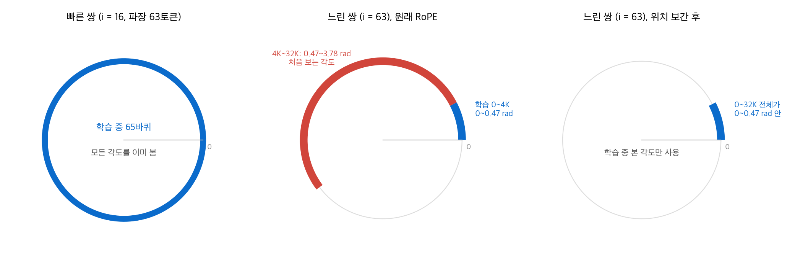
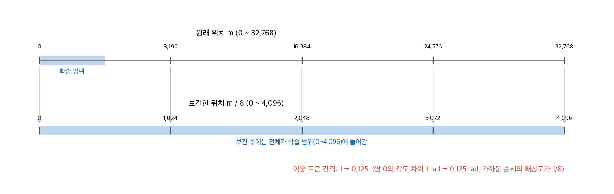
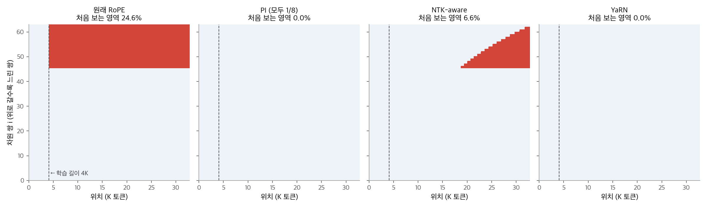
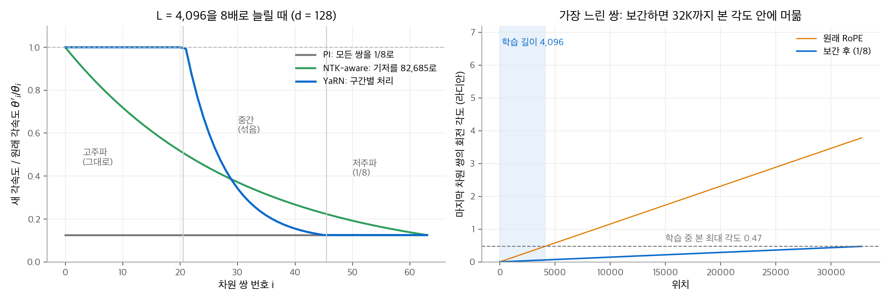
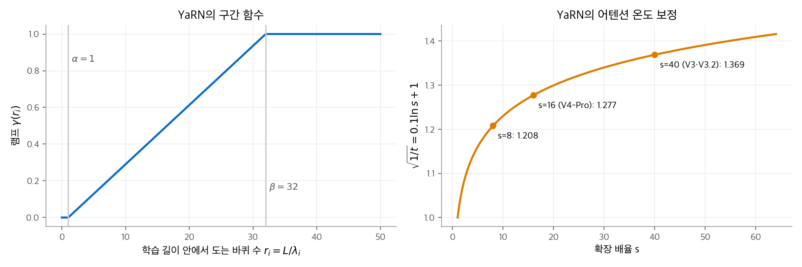
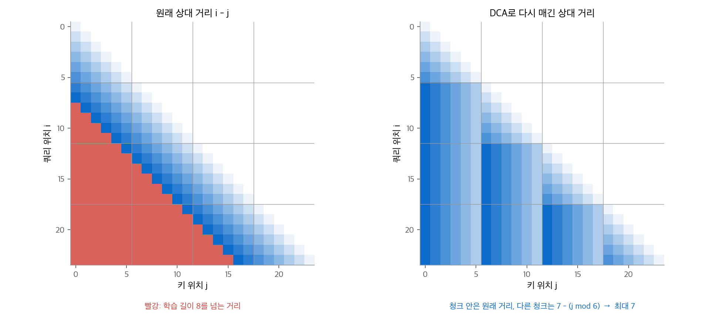
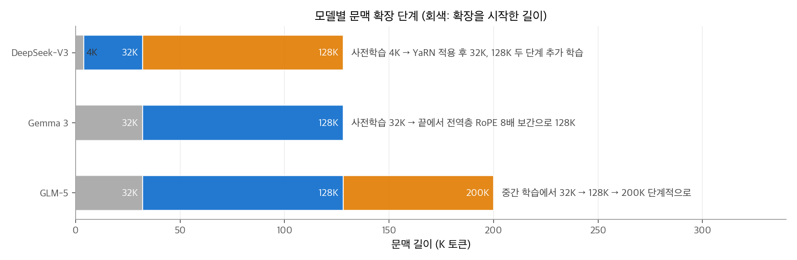

# 2. 긴 문맥 확장

LLM은 보통 4K~32K 토큰 길이로 사전학습하고, 그 뒤에 128K~1M 토큰으로 문맥을 늘립니다.
그런데 [1장](01-rope.md)의 RoPE를 그대로 두고 긴 입력을 넣으면 성능이 크게 떨어집니다.
이 장은 그 이유를 회전 각도로 설명하고, 위치 보간(PI), NTK-aware 스케일링, YaRN, 기저 주파수 키우기, DCA를 같은 예제로 비교합니다.

!!! info "자료"
    - Chen et al., [Extending Context Window of Large Language Models via Positional Interpolation](https://arxiv.org/abs/2306.15595), 2023.
    - Peng et al., [YaRN: Efficient Context Window Extension of Large Language Models](https://arxiv.org/abs/2309.00071), 2023.
    - An et al., [Training-Free Long-Context Scaling of Large Language Models](https://arxiv.org/abs/2402.17463) (DCA), 2024.
    - 모델 설정값: DeepSeek-V3 보고서, DeepSeek-V3.2·V4-Pro, Gemma 3 27B, Qwen3, Qwen3-Next의 공개 `config.json`.

## 1. 학습 길이를 넘으면 깨지는 이유

이 장의 예제는 모두 헤드 차원 $d = 128$, 기저 $b = 10^4$, 학습 길이 $L = 4{,}096$ 이고, 문맥을 $s = 8$ 배인 32,768로 늘린다고 가정합니다.

차원 쌍 $i$ 의 각속도는 $\theta_i = b^{-2i/d}$ 이고 파장은 $\lambda_i = 2\pi/\theta_i$ 입니다. 학습 길이 안에서 쌍 $i$ 가 도는 바퀴 수를 $r_i = L/\lambda_i$ 로 둡니다.

| 쌍 $i$ | $\theta_i$ | 파장 $\lambda_i$ | 학습 중 바퀴 수 $r_i$ |
| --- | --- | --- | --- |
| 0 | 1 | 6.3 | 652 |
| 16 | 0.1 | 62.8 | 65.2 |
| 32 | 0.01 | 628 | 6.52 |
| 40 | 0.00316 | 1,987 | 2.06 |
| 48 | 0.001 | 6,283 | 0.65 |
| 63 | 0.000115 | 54,410 | 0.075 |

빠른 쌍($r_i \gg 1$)은 학습 중에 모든 각도를 수백 번 봤습니다. 위치가 32K로 늘어도 새로운 각도가 없습니다.
느린 쌍($r_i < 1$)은 한 바퀴도 돌지 못했습니다. 쌍 63은 학습 중 최대 $4096 \times 0.000115 = 0.47$ 라디안까지만 봤습니다.
32K 위치에서는 각도가 3.78 라디안이 됩니다. 모델은 이 각도를 처음 봅니다. 이것이 **외삽(extrapolation)** 실패의 원인입니다.

<figure markdown>

<figcaption markdown>
<span class="fig-title"><b>Figure 1.</b> 회전 원 위에서 본 학습 중 각도와 처음 보는 각도</span>

느린 쌍은 학습 중 0~0.47 rad만 봤으므로, 4K를 넘는 위치에서 처음 보는 각도(빨강)가 생깁니다. 보간하면 32K까지 본 범위에 들어옵니다.
</figcaption>
</figure>

## 2. 위치 보간 (PI)

가장 단순한 해결책은 위치 번호를 $s$ 로 나누는 것입니다.

$$
m' = \frac{m}{s}\quad\Longleftrightarrow\quad \theta'_i = \frac{\theta_i}{s}\quad(\text{모든 } i)
$$

32K 위치가 4K 위치처럼 보이므로, 모든 쌍의 각도가 학습 범위 안에 들어옵니다. 짧은 추가 학습(약 1,000스텝)으로 문맥을 늘릴 수 있습니다.

단점은 빠른 쌍까지 느려진다는 것입니다. 쌍 0은 원래 이웃 토큰 사이에 1라디안 차이가 났지만, 보간 후에는 0.125라디안입니다.
가까운 토큰의 순서를 구별하는 해상도가 1/8로 떨어집니다. 짧은 문맥 성능이 나빠질 수 있습니다.

<figure markdown>

<figcaption markdown>
<span class="fig-title"><b>Figure 2.</b> 위치 보간이 위치 눈금을 압축하는 모습</span>

위치를 8로 나누면 32,768까지 학습 범위에 들어갑니다. 대신 이웃 토큰의 간격이 1에서 0.125로 줄어듭니다.
</figcaption>
</figure>

Gemma 3은 전역층에 이 선형 보간을 계수 8로 적용했습니다(`rope_scaling: {rope_type: linear, factor: 8}`). 전역층은 32K로 사전학습한 뒤 128K로 늘렸습니다.
로컬층은 1,024 토큰 창만 보므로 보간하지 않습니다.

## 3. NTK-aware 스케일링

빠른 쌍은 그대로 두고 느린 쌍만 늦추고 싶습니다. NTK-aware 방법은 기저 $b$ 자체를 바꿉니다.

$$
b' = b \cdot s^{d/(d-2)}
$$

가장 느린 쌍($i = d/2 - 1$)에서 $\theta' = b'^{-(d-2)/d} = b^{-(d-2)/d}/s$ 이므로 정확히 $1/s$ 로 느려집니다. 가장 빠른 쌍($i = 0$)은 $b'^0 = 1$ 이므로 그대로입니다.
예제에서 $b' = 10^4 \times 8^{128/126} = 82{,}685$ 입니다.

| 쌍 $i$ | 0 | 16 | 32 | 40 | 48 | 63 |
| --- | --- | --- | --- | --- | --- | --- |
| $\theta'_i/\theta_i$ | 1.00 | 0.59 | 0.35 | 0.27 | 0.21 | 0.125 |

PI보다 빠른 쌍을 덜 건드립니다. 하지만 중간 쌍(16번)도 0.59로 느려집니다. 이 쌍은 학습 중에 이미 65바퀴를 돌았으므로 늦출 필요가 없었습니다.

## 4. YaRN

### 구간별 처리

YaRN은 쌍마다 "학습 중에 몇 바퀴 돌았는가($r_i$)"를 보고 처리 방법을 정합니다.

$$
\gamma(r) = \begin{cases} 0 & r < \alpha \\ \dfrac{r - \alpha}{\beta - \alpha} & \alpha \le r \le \beta \\ 1 & r > \beta \end{cases},\qquad
\theta'_i = \big(1 - \gamma(r_i)\big)\frac{\theta_i}{s} + \gamma(r_i)\,\theta_i
$$

- $r_i > \beta$ (빠른 쌍): $\gamma = 1$ 이므로 그대로 둡니다. 이미 모든 각도를 봤습니다.
- $r_i < \alpha$ (느린 쌍): $\gamma = 0$ 이므로 PI처럼 $1/s$ 로 보간합니다.
- 그 사이: 두 값을 선형으로 섞습니다.

DeepSeek-V3는 $\alpha = 1$, $\beta = 32$ 를 씁니다(설정의 `beta_slow: 1`, `beta_fast: 32`). 예제에 적용합니다.

| 쌍 $i$ | $r_i$ | $\gamma$ | $\theta'_i/\theta_i$ |
| --- | --- | --- | --- |
| 0, 16 | 652, 65.2 | 1 | 1.000 |
| 32 | 6.52 | $(6.52 - 1)/31 = 0.178$ | $0.822/8 + 0.178 = 0.281$ |
| 40 | 2.06 | 0.034 | 0.155 |
| 48, 63 | 0.65, 0.075 | 0 | 0.125 |

0~20번 쌍은 그대로이고($r_i > 32$), 46~63번 쌍은 1/8입니다($r_i < 1$). 21~45번 쌍만 섞습니다.

### 네 방법을 한 지도로 비교하기

차원 쌍마다 "이 위치의 각도를 학습 중에 본 적이 있는가"를 표시하면 네 방법의 차이가 한눈에 보입니다.
기준은 1절과 같습니다. 학습 중 한 바퀴 이상 돈 쌍($r_i \ge 1$)은 모든 각도를 본 것으로 둡니다. 한 바퀴도 못 돈 쌍은 각도가 $L\theta_i$ 를 넘으면 처음 보는 각도로 표시합니다.

<figure markdown>

<figcaption markdown>
<span class="fig-title"><b>Figure 3.</b> 방법별로 처음 보는 각도가 생기는 영역</span>

빨간 칸은 처음 보는 각도입니다. 원래 RoPE는 24.6%, NTK-aware는 6.6%이고, PI와 YaRN은 0%입니다.
</figcaption>
</figure>

<figure markdown>

<figcaption markdown>
<span class="fig-title"><b>Figure 4.</b> PI, NTK-aware, YaRN의 각속도 비율</span>

PI는 모든 쌍을 1/8로 늦추고, YaRN은 빠른 쌍을 그대로 둡니다. 보간하면 느린 쌍의 각도가 32K까지 0.47 안에 머뭅니다.
</figcaption>
</figure>

### 온도 보정

보간하면 느린 쌍의 각도 차이가 작아져서, 먼 토큰들 사이의 점수 차이도 작아집니다. 소프트맥스 분포가 평평해집니다.
YaRN은 점수에 온도 $t$ 를 넣어 분포를 다시 날카롭게 합니다.

$$
\operatorname{softmax}\!\left(\frac{\mathbf{q}_m^\top\mathbf{k}_n}{t\sqrt{d}}\right),\qquad \sqrt{1/t} = 0.1\ln s + 1
$$

구현은 쿼리와 키에 각각 $\sqrt{1/t}$ 를 곱합니다. 그러면 점수 전체에 $1/t$ 가 곱해집니다.

| 확장 배율 $s$ | $\sqrt{1/t}$ | 점수 배율 $1/t$ | 쓰는 모델 |
| --- | --- | --- | --- |
| 8 | 1.208 | 1.459 | 이 장의 예제 |
| 16 | 1.277 | 1.631 | DeepSeek-V4-Pro (65,536 → 1,048,576) |
| 40 | 1.369 | 1.874 | DeepSeek-V3, V3.2 (4,096 → 163,840) |

<figure markdown>

<figcaption markdown>
<span class="fig-title"><b>Figure 5.</b> YaRN의 구간 함수와 온도 보정</span>

왼쪽은 학습 중 바퀴 수에 따른 램프 $\gamma$, 오른쪽은 확장 배율에 따른 온도 보정값입니다.
</figcaption>
</figure>

```python
import math
import torch

def yarn_inv_freq(d=128, base=1e4, L=4096, s=8.0, alpha=1.0, beta=32.0):
    """YaRN으로 바꾼 각속도 θ'_i와 쿼리·키에 곱할 배율을 돌려줍니다."""
    theta = base ** (-torch.arange(0, d, 2, dtype=torch.float64) / d)
    r = L / (2 * math.pi / theta)                       # 학습 중 바퀴 수
    gamma = ((r - alpha) / (beta - alpha)).clamp(0, 1)
    theta_new = (1 - gamma) * theta / s + gamma * theta
    mscale = 0.1 * math.log(s) + 1.0                    # sqrt(1/t)
    return theta_new, mscale

theta_new, mscale = yarn_inv_freq()
theta = 1e4 ** (-torch.arange(0, 128, 2, dtype=torch.float64) / 128)
print((theta_new / theta)[[0, 16, 32, 40, 48, 63]])    # 1, 1, 0.281, 0.155, 0.125, 0.125
print(round(mscale, 3))                                  # 1.208
```

## 5. 기저 주파수를 처음부터 키우기

보간은 학습한 뒤에 각도를 고칩니다. 다른 방법은 **긴 문맥 학습 단계에서 기저 $b$ 자체를 키우는 것**입니다.
[1장 4절](01-rope.md)의 표처럼 $b$ 가 크면 느린 쌍의 파장이 문맥보다 길어집니다. 모든 각도가 학습 중에 등장하도록 처음부터 맞추는 것입니다.

| 모델 | 기저 $b$ | 문맥 |
| --- | --- | --- |
| Gemma 3, Gemma 4 | 로컬층 $10^4$, 전역층 $10^6$ | 128K (Gemma 3), 256K (Gemma 4 31B·26B A4B) |
| Qwen3 | $10^6$ | 32K, YaRN으로 128K |
| Qwen3-Next, Qwen3.5 | $10^7$ | 262,144 |
| GLM-4.5, GLM-5 | $10^6$ | 128K, 약 200K |
| GLM-5.2 | $8 \times 10^6$ | 1,048,576 |

DeepSeek은 반대로 $b = 10^4$ 를 유지하고 YaRN으로 늘립니다. DeepSeek의 RoPE는 MLA의 64차원에만 적용되므로, 위치를 담는 차원 자체가 작습니다.

## 6. DCA: 위치 번호를 다시 매기기

**DCA(Dual Chunk Attention)**는 추가 학습 없이 문맥을 늘리는 방법입니다. Qwen2와 Qwen2.5의 긴 문맥 처리에 쓰였습니다.
RoPE의 점수는 상대 거리 $n - m$ 에만 의존합니다. 그래서 각도를 고치는 대신, **모든 상대 거리가 학습 길이 안에 들어오도록 위치 번호를 다시 매깁니다.**

1. 긴 시퀀스를 학습 길이보다 짧은 청크로 나눕니다.
2. **청크 안**: 원래 상대 위치를 그대로 씁니다. 가까운 토큰의 순서 정보가 정확히 남습니다.
3. **인접 청크 사이**: 경계 근처의 지역성을 유지하도록 위치를 맞춥니다.
4. **먼 청크 사이**: 쿼리 쪽 위치를 고정된 큰 값으로 두어, 상대 거리가 학습 길이를 넘지 않게 합니다.

세 경우의 점수를 따로 계산한 뒤 1장의 온라인 소프트맥스처럼 합칩니다. 먼 토큰 사이의 정확한 거리는 잃지만, 학습 중 본 적 없는 각도는 생기지 않습니다.

<figure markdown>

<figcaption markdown>
<span class="fig-title"><b>Figure 6.</b> DCA가 상대 거리를 다시 매기는 모습</span>

DCA는 다른 청크로 가는 거리를 $7 - (j \bmod 6)$ 으로 다시 매겨, 모든 거리를 학습 길이 안(0~7)에 넣습니다. 인접 청크 처리는 생략했습니다.
</figcaption>
</figure>

## 7. 추가 학습 단계

실제 모델은 위 방법과 함께 긴 시퀀스로 짧게 추가 학습합니다.

| 모델 | 문맥 확장 단계 |
| --- | --- |
| DeepSeek-V3 | 4K로 사전학습한 뒤 YaRN을 적용해 32K, 128K 두 단계로 추가 학습 |
| Gemma 3 | 32K로 사전학습한 뒤 사전학습 끝에서 전역층 RoPE를 8배 보간해 128K로 확장 |
| GLM-5 | 중간 학습(mid-training)에서 32K → 128K → 200K 단계로 늘림 |

<figure markdown>

<figcaption markdown>
<span class="fig-title"><b>Figure 7.</b> 모델별 문맥 확장 단계</span>

세 모델 모두 문맥을 2~3단계에 걸쳐 늘립니다. 회색은 확장을 시작한 길이입니다.
</figcaption>
</figure>

## 정리

- RoPE의 느린 차원 쌍은 학습 길이 안에서 한 바퀴도 돌지 못합니다. 문맥을 늘리면 처음 보는 각도가 생겨 성능이 떨어집니다.
- PI는 모든 쌍을 $1/s$ 로 늦춥니다. 단순하지만 가까운 토큰의 해상도도 떨어집니다.
- NTK-aware는 기저를 $b \cdot s^{d/(d-2)}$ 로 바꿔 빠른 쌍을 덜 건드립니다.
- YaRN은 학습 중 바퀴 수 $r_i$ 로 쌍을 나눠, 빠른 쌍은 그대로, 느린 쌍은 보간, 중간은 섞습니다. 온도 $\sqrt{1/t} = 0.1\ln s + 1$ 로 분포를 보정합니다.
- 기저 주파수를 처음부터 키우거나($10^6$, $10^7$), 위치 번호를 다시 매기는(DCA) 방법도 있습니다.

다음 장은 어텐션 점수와 출력 로짓이 폭주하지 않게 하는 정규화 기법을 다룹니다.
