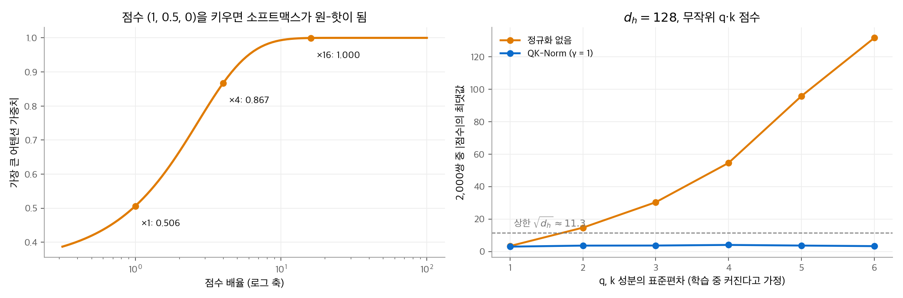
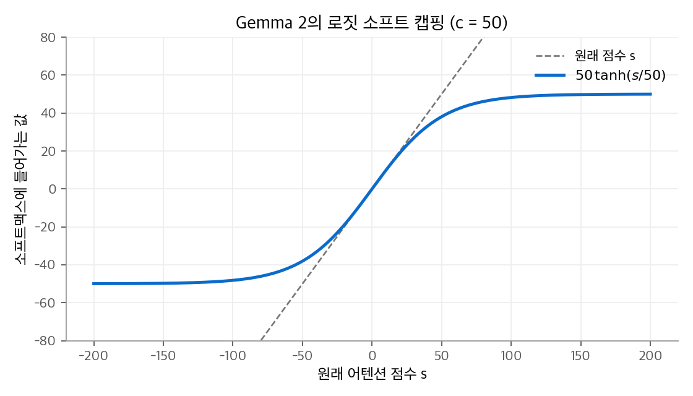

# 3. 정규화와 로짓 안정화

큰 모델을 오래 학습하면 활성값과 어텐션 점수가 서서히 커집니다. 점수가 커지면 소프트맥스가 원-핫에 가까워지고, 기울기가 사라지거나 손실이 튑니다.
이 장은 활성값의 크기를 맞추는 정규화(LayerNorm, RMSNorm, 정규화 위치)와, 어텐션 점수와 출력 로짓의 상한을 두는 기법(소프트 캡핑, QK-Norm, V-Norm, QK-Clip)을 정리합니다.

!!! info "자료"
    - Zhang and Sennrich, [Root Mean Square Layer Normalization](https://arxiv.org/abs/1910.07467), 2019.
    - Dehghani et al., [Scaling Vision Transformers to 22 Billion Parameters](https://arxiv.org/abs/2302.05442) (QK-Norm), 2023.
    - Gemma Team, [Gemma 2](https://arxiv.org/abs/2408.00118), [Gemma 3](https://arxiv.org/abs/2503.19786) 기술 보고서. Hugging Face Transformers [modeling_gemma4.py](https://github.com/huggingface/transformers/blob/main/src/transformers/models/gemma4/modeling_gemma4.py).
    - Kimi Team, [Kimi K2: Open Agentic Intelligence](https://arxiv.org/abs/2507.20534) (QK-Clip), 2025.
    - DeepSeek-AI, [DeepSeek-V4](https://arxiv.org/abs/2606.19348), 2026.

## 1. LayerNorm과 RMSNorm

### 두 정규화의 식

**LayerNorm**은 벡터 하나의 평균을 빼고 표준편차로 나눈 뒤, 학습하는 배율 $\boldsymbol{\gamma}$ 와 이동 $\boldsymbol{\beta}$ 를 적용합니다.

$$
\operatorname{LN}(\mathbf{x}) = \boldsymbol{\gamma}\odot\frac{\mathbf{x} - \mu}{\sqrt{\sigma^2 + \epsilon}} + \boldsymbol{\beta},\qquad
\mu = \frac{1}{d}\sum_l x_l,\quad \sigma^2 = \frac{1}{d}\sum_l (x_l - \mu)^2
$$

**RMSNorm**은 평균을 빼지 않고 제곱 평균의 제곱근(RMS)으로만 나눕니다. 이동 $\boldsymbol{\beta}$ 도 없습니다.

$$
\operatorname{RMSNorm}(\mathbf{x}) = \boldsymbol{\gamma}\odot\frac{\mathbf{x}}{\operatorname{RMS}(\mathbf{x})},\qquad
\operatorname{RMS}(\mathbf{x}) = \sqrt{\frac{1}{d}\sum_l x_l^2 + \epsilon}
$$

### 손계산 예제

$\mathbf{x} = (1, 2, 3, 6)$, $\boldsymbol{\gamma} = \mathbf{1}$, $\boldsymbol{\beta} = \mathbf{0}$ 으로 둡니다.

| 정규화 | 중간 값 | 결과 |
| --- | --- | --- |
| LayerNorm | $\mu = 3$, $\sigma = \sqrt{14/4} = 1.871$ | $(-1.069,\ -0.535,\ 0,\ 1.604)$ |
| RMSNorm | $\operatorname{RMS} = \sqrt{(1 + 4 + 9 + 36)/4} = 3.536$ | $(0.283,\ 0.566,\ 0.849,\ 1.697)$ |

LayerNorm 결과는 평균이 0이고 표준편차가 1입니다. RMSNorm 결과는 평균이 0이 아니지만 RMS가 1입니다. 방향은 원래 벡터와 같고 크기만 맞춥니다.
RMSNorm은 평균 계산과 이동 매개변수가 없어 조금 더 쌉니다. 성능 차이는 거의 없다고 보고되어, 최근 LLM은 대부분 RMSNorm을 씁니다.
이 교재에서 다루는 Gemma, DeepSeek, Qwen, GLM 계열은 모두 RMSNorm을 씁니다.

## 2. 정규화의 위치

### Post-Norm과 Pre-Norm

정규화를 잔차 연결의 어디에 두는지에 따라 학습 안정성이 달라집니다. 부분층(어텐션 또는 FFN)을 $F$ 라고 합니다.

$$
\text{Post-Norm: } \mathbf{x}_{l+1} = \operatorname{Norm}\big(\mathbf{x}_l + F(\mathbf{x}_l)\big),\qquad
\text{Pre-Norm: } \mathbf{x}_{l+1} = \mathbf{x}_l + F\big(\operatorname{Norm}(\mathbf{x}_l)\big)
$$

원래 트랜스포머는 Post-Norm이었습니다. Post-Norm은 잔차 경로에도 정규화가 있어, 깊은 모델에서 기울기가 첫 층까지 잘 전달되지 않고 워밍업 없이는 학습이 불안정합니다.
Pre-Norm은 잔차 경로 $\mathbf{x}_l \to \mathbf{x}_{l+1}$ 가 항등 사상이므로 기울기가 그대로 흐릅니다. 대신 층이 깊어질수록 잔차 스트림의 크기가 계속 커질 수 있습니다.

### Gemma의 앞뒤 정규화

Gemma 2 보고서는 "각 트랜스포머 부분층의 입력과 출력을 RMSNorm으로 정규화한다"고 설명합니다. Pre-Norm과 Post-Norm을 모두 씁니다.

$$
\mathbf{x}_{l+1} = \mathbf{x}_l + \operatorname{Norm}_{\text{post}}\Big(F\big(\operatorname{Norm}_{\text{pre}}(\mathbf{x}_l)\big)\Big)
$$

Gemma 4 구현도 같은 구조입니다. 어텐션 앞뒤(`input_layernorm`, `post_attention_layernorm`)와 FFN 앞뒤(`pre_feedforward_layernorm`, `post_feedforward_layernorm`)에 RMSNorm이 있습니다.
부분층 출력이 잔차에 더해지기 전에 크기가 맞춰지므로, 잔차 스트림이 층마다 비슷한 크기로 자랍니다.

## 3. 로짓 폭주

### 점수를 키우면 생기는 일

점수 $(1, 0.5, 0)$ 에 배율을 곱해 소프트맥스를 계산합니다.

| 배율 | 소프트맥스 | 최대 가중치 |
| --- | --- | --- |
| ×1 | (0.506, 0.307, 0.186) | 0.506 |
| ×4 | (0.867, 0.117, 0.016) | 0.867 |
| ×16 | (0.9997, 0.0003, 0.0000) | 0.9997 |

점수 순서는 같은데, 배율만 커져도 분포가 원-핫이 됩니다.
소프트맥스의 기울기 $\partial a_i/\partial s_j = a_i(\delta_{ij} - a_j)$ 는 $a$ 가 원-핫이면 모두 0에 가까워집니다. 그래서 학습이 멈춥니다.
반대로 일부 헤드의 점수가 갑자기 커지면 손실이 튀는 **손실 스파이크**가 생깁니다.

점수 $s = \mathbf{q}^\top\mathbf{k}/\sqrt{d_h}$ 는 $\|\mathbf{q}\|\,\|\mathbf{k}\|$ 에 비례합니다. 학습 중 $\mathbf{W}_Q, \mathbf{W}_K$ 의 노름이 커지면 점수가 제한 없이 커질 수 있습니다.

<figure markdown>

<figcaption markdown>
<span class="fig-title"><b>Figure 1.</b> 로짓 폭주와 QK-Norm</span>

성분이 커지면 정규화 없는 점수는 100을 넘습니다. QK-Norm을 거친 점수는 상한 $\sqrt{128} \approx 11.3$ 아래에 머뭅니다.
</figcaption>
</figure>

## 4. 로짓 소프트 캡핑

Gemma 2는 점수를 $\tanh$ 로 부드럽게 눌러 상한을 둡니다.

$$
s \leftarrow c\cdot\tanh\!\left(\frac{s}{c}\right),\qquad \frac{d}{ds}\Big[c\tanh(s/c)\Big] = 1 - \tanh^2(s/c)
$$

$|s| \ll c$ 이면 $\tanh(x) \approx x$ 이므로 값과 기울기가 거의 그대로입니다. $|s|$ 가 $c$ 에 다가가면 값은 $\pm c$ 에 묶이고 기울기는 0에 가까워집니다.

| 원래 점수 $s$ | 10 | 50 | 100 | 200 |
| --- | --- | --- | --- | --- |
| $50\tanh(s/50)$ | 9.87 | 38.08 | 48.20 | 49.97 |
| 기울기 $1 - \tanh^2(s/50)$ | 0.96 | 0.42 | 0.07 | 0.001 |

<figure markdown>

<figcaption markdown>
<span class="fig-title"><b>Figure 2.</b> Gemma 2의 로짓 소프트 캡핑</span>

$c = 50$ 소프트 캡핑은 작은 점수는 거의 그대로 두고, 큰 점수만 $\pm 50$ 에 묶습니다.
</figcaption>
</figure>

| 모델 | 어텐션 점수 캡 | 최종 출력 로짓 캡 |
| --- | --- | --- |
| Gemma 2 | 50 (`attn_logit_softcapping`) | 30 (`final_logit_softcapping`) |
| Gemma 3 | 없음 (QK-Norm으로 교체) | 없음 |
| Gemma 4 31B | 없음 | 30 |

어텐션 점수 캡은 점수 하나하나에 비선형 함수를 적용해야 합니다. 그래서 점수 행렬을 만들지 않는 FlashAttention 커널에 따로 지원을 넣어야 했습니다.
Gemma 3은 이 캡을 QK-Norm으로 바꿨습니다. Gemma 4는 어텐션 캡 없이 최종 출력 로짓에만 캡 30을 둡니다.

## 5. QK-Norm

### 식과 상한

**QK-Norm**은 헤드마다 쿼리와 키에 RMSNorm을 적용한 뒤 점수를 계산합니다. 순서는 정규화 → RoPE → 내적입니다.

$$
\hat{\mathbf{q}} = \boldsymbol{\gamma}_q\odot\frac{\mathbf{q}}{\operatorname{RMS}(\mathbf{q})},\qquad
\hat{\mathbf{k}} = \boldsymbol{\gamma}_k\odot\frac{\mathbf{k}}{\operatorname{RMS}(\mathbf{k})},\qquad
s = \frac{\operatorname{RoPE}(\hat{\mathbf{q}})^\top\operatorname{RoPE}(\hat{\mathbf{k}})}{\sqrt{d_h}}
$$

$\mathbf{x}/\operatorname{RMS}(\mathbf{x})$ 의 노름은 정확히 $\sqrt{d_h}$ 입니다. 배율을 곱하면 노름은 $\max_l|\gamma_l|\sqrt{d_h}$ 이하입니다. RoPE는 회전이므로 노름을 바꾸지 않습니다. 코시-슈바르츠 부등식으로 다음 상한이 나옵니다.

$$
|s| \le \frac{\|\hat{\mathbf{q}}\|\,\|\hat{\mathbf{k}}\|}{\sqrt{d_h}} \le \max|\gamma_q|\cdot\max|\gamma_k|\cdot\sqrt{d_h}
$$

$\boldsymbol{\gamma} = \mathbf{1}$, $d_h = 128$ 이면 상한은 약 11.3입니다. 이 값이면 소프트맥스가 충분히 날카로울 수 있으면서도 무한히 커지지는 않습니다.
$\boldsymbol{\gamma}$ 는 학습되므로 모델이 필요한 만큼 상한을 넓힙니다. 하지만 $\mathbf{W}_Q, \mathbf{W}_K$ 의 노름이 커지는 것만으로는 점수가 커지지 않습니다.
소프트 캡핑과 달리 QK-Norm은 점수 계산 **전에** 적용하므로, FlashAttention 커널을 그대로 쓸 수 있습니다.

### 모델별 사용

| 모델 | 적용 방식 |
| --- | --- |
| Gemma 3 | QK-Norm. 점수는 $\sqrt{d_{\text{model}}/h}$ 로 나눔 (27B는 $\sqrt{168}$) |
| Gemma 4 | QK-Norm + V-Norm(배율 없는 RMSNorm). $1/\sqrt{d_h}$ 대신 `scaling = 1.0` |
| Qwen3, Qwen3-Next, Qwen3.5 | QK-Norm. Qwen3에서 QKV 편향을 없애고 도입 |
| GLM-4.5 | QK-Norm (`use_qk_norm: true`) |
| DeepSeek-V4 | 각 쿼리 헤드와 압축 KV 항목에 RMSNorm |

**Gemma 4의 V-Norm과 배율.** Gemma 4는 값 벡터에도 배율 없는 RMSNorm을 적용합니다. 헤드 출력 $\sum_j a_{ij}\mathbf{v}_j$ 는 정규화된 값의 볼록 결합이므로 노름이 $\sqrt{d_h}$ 이하로 묶입니다.
점수는 $\sqrt{d_h}$ 로 나누지 않습니다. 쿼리와 키가 이미 정규화되어 있으므로, 배율 $\boldsymbol{\gamma}_q, \boldsymbol{\gamma}_k$ 가 소프트맥스 온도를 학습합니다.

## 6. QK-Clip: 옵티마이저 쪽에서 막기

Kimi K2는 [4.3 Muon](optimizer/03-muon.md) 옵티마이저로 학습했습니다. 보고서는 Muon에서 AdamW보다 어텐션 로짓 폭주가 자주 생겼다고 설명합니다.
K2는 MLA를 쓰므로 QK-Norm을 바로 넣기 어렵습니다. 생성 단계에서 키를 복원하지 않고 잠재 벡터를 그대로 쓰기 때문입니다.
그래서 **QK-Clip**은 점수가 아니라 **가중치**를 고칩니다.

1. 학습 스텝마다 헤드 $h$ 의 최대 점수 $S_{\max}^h = \max_{i,j}\mathbf{q}_i^\top\mathbf{k}_j$ 를 기록합니다.
2. 임계값 $\tau$ 를 넘은 헤드만 배율 $\gamma_h = \min(1,\ \tau/S_{\max}^h)$ 를 계산합니다. K2는 $\tau = 100$ 을 썼습니다.
3. 그 헤드의 쿼리·키 사상 행렬을 각각 $\sqrt{\gamma_h}$ 배로 줄입니다. 점수는 두 행렬의 곱에 비례하므로 $\gamma_h$ 배가 됩니다.
4. MLA의 경우, 헤드별 내용 사상 $\mathbf{W}_{qc}, \mathbf{W}_{kc}$ 는 $\sqrt{\gamma_h}$ 배, 헤드별 RoPE 쿼리 사상 $\mathbf{W}_{qr}$ 는 $\gamma_h$ 배로 줄입니다. 모든 헤드가 공유하는 RoPE 키는 다른 헤드에 영향을 주므로 건드리지 않습니다.

**예제.** 어떤 헤드의 최대 점수가 $S_{\max} = 250$ 이면 $\gamma = 100/250 = 0.4$ 입니다. $\mathbf{W}_q, \mathbf{W}_k$ 를 각각 $\sqrt{0.4} = 0.632$ 배로 줄이면, 같은 입력의 최대 점수는 $250 \times 0.632^2 = 100$ 이 됩니다.

이 장치는 학습 초반에 주로 작동합니다. 헤드의 점수가 스스로 임계값 아래로 내려가면 $\gamma_h = 1$ 이므로 더는 개입하지 않습니다.
DeepSeek-V4는 Muon을 쓰지만 쿼리와 KV에 RMSNorm을 적용하므로 "QK-Clip을 쓰지 않는다"고 밝혔습니다. 두 방법은 같은 문제를 다른 위치에서 풉니다.

```python
import torch

class RMSNorm(torch.nn.Module):
    def __init__(self, d, eps=1e-6, with_scale=True):
        super().__init__()
        self.eps = eps
        self.weight = torch.nn.Parameter(torch.ones(d)) if with_scale else None

    def forward(self, x):
        x = x * torch.rsqrt(x.pow(2).mean(-1, keepdim=True) + self.eps)
        return x * self.weight if self.weight is not None else x

def qk_norm_scores(q, k, q_norm, k_norm):
    """q, k: (n, d_h). 헤드 하나의 QK-Norm 점수를 계산합니다(RoPE는 생략)."""
    q, k = q_norm(q), k_norm(k)
    return q @ k.T / q.shape[-1] ** 0.5

torch.manual_seed(0)
d = 128
q, k = torch.randn(4, d) * 50, torch.randn(4, d) * 50          # 노름이 매우 큰 q, k
print((q @ k.T / d ** 0.5).abs().max())                         # 수천 단위
print(qk_norm_scores(q, k, RMSNorm(d), RMSNorm(d)).abs().max())  # sqrt(128) = 11.3 이하
print(RMSNorm(4)(torch.tensor([1., 2., 3., 6.])))               # (0.283, 0.566, 0.849, 1.697)
```

## 정리

- RMSNorm은 평균을 빼지 않고 RMS로만 나눕니다. LayerNorm보다 싸고 성능이 비슷해 최근 LLM의 표준입니다.
- Pre-Norm은 잔차 경로를 항등으로 둬 깊은 모델을 안정적으로 학습시킵니다. Gemma는 부분층의 입력과 출력을 모두 정규화합니다.
- 어텐션 점수가 커지면 소프트맥스가 원-핫이 되어 기울기가 사라집니다.
- 소프트 캡핑(Gemma 2)은 점수를 $c\tanh(s/c)$ 로 누르고, QK-Norm(Gemma 3, Qwen3, GLM-4.5)은 쿼리와 키의 노름을 고정해 점수 상한 $\sqrt{d_h}$ 를 만듭니다.
- QK-Clip(Kimi K2)은 임계값을 넘은 헤드의 사상 행렬을 줄이고, DeepSeek-V4는 RMSNorm으로 같은 문제를 막습니다.

다음 장은 이 장의 QK-Clip이 필요해진 배경인 Muon 옵티마이저와, 각 모델이 실제로 쓴 옵티마이저를 다룹니다.
