# 5. 전문가 혼합(MoE)

트랜스포머 층의 매개변수는 대부분 FFN에 있습니다. **전문가 혼합(mixture of experts, MoE)**은 FFN 하나를 작은 FFN(전문가) 여러 개로 나누고, 토큰마다 그중 몇 개만 계산합니다.
그러면 전체 매개변수는 크게 늘리면서 토큰 하나의 계산량은 작게 유지할 수 있습니다.
이 장은 먼저 0절에서 전체 흐름을 그림으로 보고, 다음 순서로 진행합니다.

1. 총 매개변수와 활성 매개변수를 공개 설정값으로 직접 계산합니다.
2. MoE 층의 정방향 계산을 토큰 4개, 전문가 4개로 처음부터 끝까지 손으로 따라갑니다.
3. 라우팅 방식(토큰 선택, 전문가 선택, 그룹 제한)을 비교합니다.
4. 부하 균형(보조 손실, z-loss, 용량과 토큰 버림, 보조 손실 없는 편향 조정)을 다룹니다.
5. 세분화된 전문가와 공유 전문가, 희소도 경향을 봅니다.
6. 전문가 병렬, 통신량, 디코드 단계의 메모리 읽기 같은 시스템 측면을 계산합니다.

!!! info "자료"
    - Shazeer et al., [Outrageously Large Neural Networks: The Sparsely-Gated Mixture-of-Experts Layer](https://arxiv.org/abs/1701.06538), 2017.
    - Lepikhin et al., [GShard](https://arxiv.org/abs/2006.16668), 2020.
    - Fedus et al., [Switch Transformers](https://arxiv.org/abs/2101.03961), 2021.
    - Zoph et al., [ST-MoE: Designing Stable and Transferable Sparse Expert Models](https://arxiv.org/abs/2202.08906), 2022.
    - Zhou et al., [Mixture-of-Experts with Expert Choice Routing](https://arxiv.org/abs/2202.09368), 2022.
    - Dai et al., [DeepSeekMoE](https://arxiv.org/abs/2401.06066), 2024.
    - DeepSeek-AI, [DeepSeek-V3 Technical Report](https://arxiv.org/abs/2412.19437), 2024.
    - Kimi Team, [Kimi K2: Open Agentic Intelligence](https://arxiv.org/abs/2507.20534), 2025.
    - 모델 설정값: DeepSeek-V3.2, Kimi K2, GLM-4.5, GLM-5, Qwen3-235B-A22B, Qwen3-Next-80B-A3B, Qwen3.5-397B-A17B, Gemma 4 26B A4B의 공개 `config.json`. Gemma 4의 구조는 Hugging Face Transformers `modeling_gemma4.py` 로 확인했습니다.

## 0. 한눈에 보는 MoE

자세한 계산에 들어가기 전에, MoE가 어디에 있고 토큰이 어떤 경로로 지나가는지 그림으로 먼저 봅니다.
아래 그림과 표의 각 단계는 이 장의 해당 절로 이어집니다.

### 밀집 FFN을 전문가 여러 개로 바꾸기

<figure markdown>
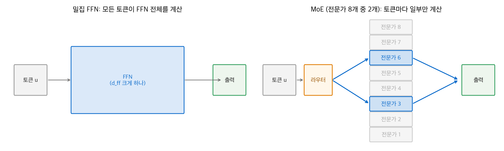
<figcaption markdown>
<span class="fig-title"><b>Figure 1.</b> 밀집 FFN과 MoE의 비교</span>

밀집 FFN은 모든 토큰이 FFN 전체를 계산합니다. MoE는 라우터가 고른 전문가 2개만 계산합니다.
</figcaption>
</figure>

### 트랜스포머 블록 안의 위치

MoE는 어텐션을 바꾸지 않습니다. 블록의 FFN 자리만 바꿉니다.

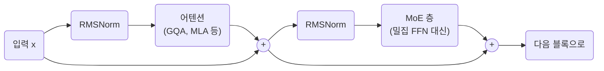

DeepSeek-V3·V3.2·GLM-5는 앞쪽 3층, Kimi K2는 앞쪽 1층을 밀집 FFN으로 두고, 그 뒤 모든 층의 FFN을 MoE로 바꿉니다(`first_k_dense_replace`, 8절).

### MoE 층 안의 흐름

토큰 하나가 MoE 층을 지나는 과정입니다. 번호는 2절의 작동 원리 단계와 같습니다.

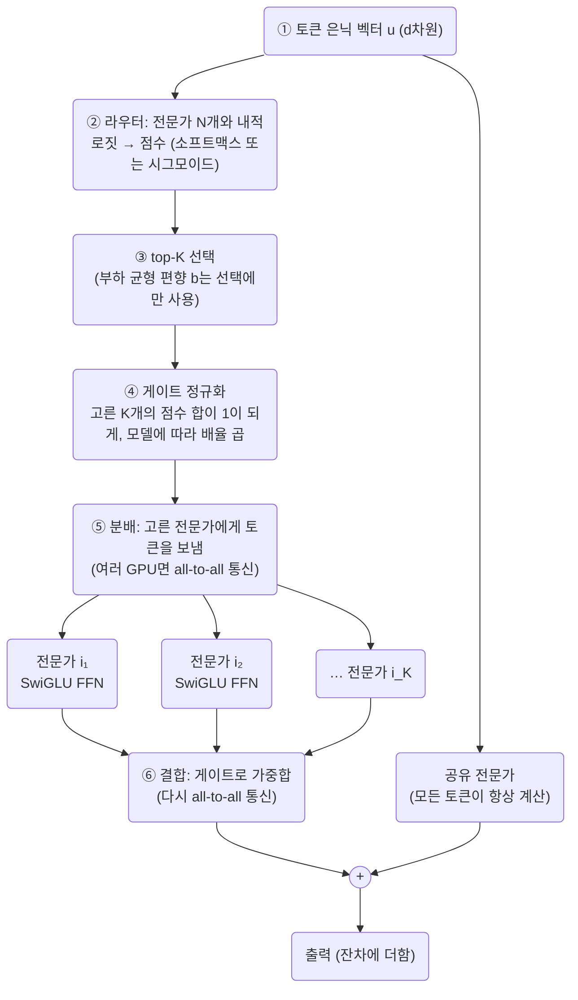

### 네 토큰이 실제로 지나가는 모습

2절의 손계산 예제(토큰 4개, 전문가 4개, top-2)를 같은 단계로 그린 것입니다.

<figure markdown>
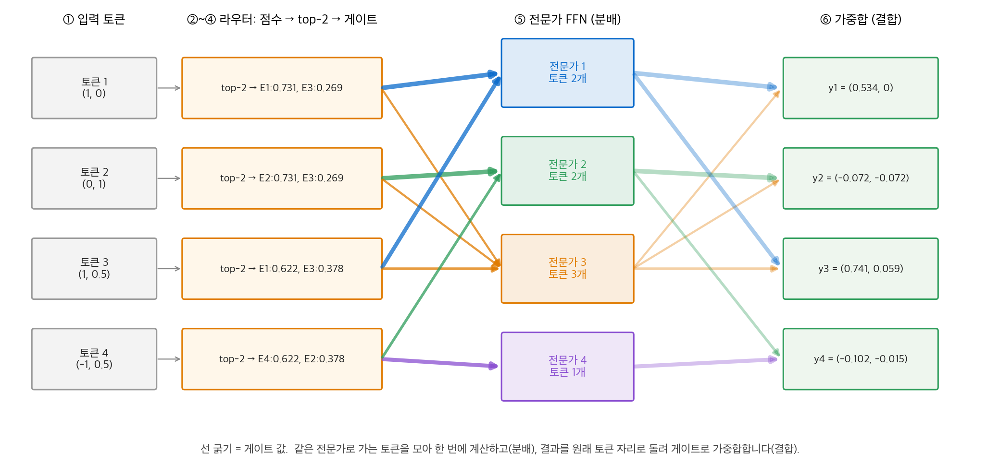
<figcaption markdown>
<span class="fig-title"><b>Figure 2.</b> 토큰 4개의 분배와 결합</span>

같은 전문가로 가는 토큰을 모아 계산하고 게이트로 가중합합니다. 전문가 3에 토큰이 몰리는 것이 부하 균형 문제입니다(4절).
</figcaption>
</figure>

### 학습과 추론에서 덧붙는 흐름

정방향 계산 바깥에서 두 흐름이 더 돕니다. 학습에서는 전문가별 부하를 보고 라우터를 조정하고, 추론에서는 전문가가 여러 GPU에 흩어져 있어 통신이 생깁니다.

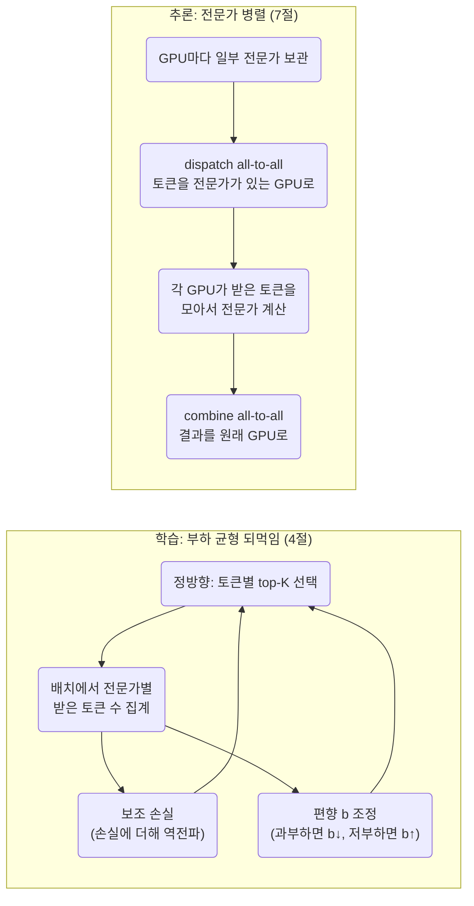

### 단계와 절의 대응

| 단계 | 하는 일 | 자세히 다루는 곳 |
| --- | --- | --- |
| 전문가 수와 크기 정하기 | 총 매개변수와 활성 매개변수의 균형 | 1절, 5절, 6절 |
| ② 라우터와 점수 | 소프트맥스와 시그모이드 | 2절 |
| ③ 선택 | 토큰 선택, 전문가 선택, 그룹 제한 | 3절 |
| ④ 게이트 | 정규화, 배율(`routed_scaling_factor`) | 2절, 8절 |
| ⑤ 전문가 계산 | SwiGLU, 세분화된 전문가, 공유 전문가 | 2절, 5절 |
| 학습 되먹임 | 보조 손실, z-loss, 용량, 편향 조정 | 4절 |
| 분배·결합 통신 | 전문가 병렬, all-to-all, 디코드의 메모리 읽기 | 7절 |

## 1. 왜 MoE인가: 총 매개변수와 활성 매개변수

### 이름에 붙는 두 숫자

MoE 모델의 이름에는 숫자가 두 개 붙습니다. 앞은 전체 매개변수, 뒤는 토큰 하나가 실제로 쓰는 **활성 매개변수**입니다.

| 모델 | 전체 | 활성 |
| --- | --- | --- |
| Gemma 4 26B A4B | 26B | 4B |
| Qwen3-Next-80B-A3B | 80B | 3B |
| Qwen3-235B-A22B | 235B | 22B |
| GLM-4.5 | 355B | 32B |
| Qwen3.5-397B-A17B | 397B | 17B |
| DeepSeek-V3 | 671B | 37B |
| GLM-5 | 744B | 40B |
| Kimi K2 | 1.04T | 32B |
| DeepSeek-V4-Pro | 1.6T | 49B |

계산량(FLOPs)은 활성 매개변수에 비례하고, 메모리는 전체 매개변수에 비례합니다.
그래서 MoE는 "같은 계산으로 더 많은 매개변수를 쓰는" 방법입니다. 대신 서빙할 때 모든 전문가를 메모리에 올려야 합니다.

### config로 다시 계산하기: DeepSeek-V3

DeepSeek-V3의 공개 설정에서 필요한 값은 다음과 같습니다.

| 항목 | 값 |
| --- | --- |
| 은닉 차원 $d$ | 7,168 |
| 층 수 | 61 (앞쪽 3층은 밀집 FFN, 나머지 58층은 MoE) |
| 밀집 FFN 중간 차원 | 18,432 |
| 전문가 중간 차원 | 2,048 |
| 라우팅 전문가 / 공유 전문가 / 토큰당 활성 | 256 / 1 / 8 |
| 어휘 크기 | 129,280 (입력 임베딩과 출력층을 따로 둠) |

전문가 하나는 SwiGLU FFN입니다(2절). 행렬 3개이므로 매개변수는 $3 \times 7168 \times 2048 = 44.04\text{M}$ 입니다.

- MoE 층 하나: 전문가 $257 \times 44.04\text{M} = 11.32\text{B}$ 에 라우터 $256 \times 7168$ 이 더해집니다. 58층이면 약 657B입니다.
- 어텐션(MLA, [어텐션 5장](../attention/05-mla.md)): 층마다 약 187M, 61층이면 11.4B입니다.
- 앞쪽 밀집 FFN 3층, 임베딩과 출력층을 더하면 **전체 671.0B**입니다.
- 토큰 하나는 MoE 층마다 9개 전문가(라우팅 8 + 공유 1)만 씁니다. 같은 방식으로 더하면 **활성 37.6B**입니다. 보고서의 37B와 맞습니다.

| 구성 | 매개변수 |
| --- | --- |
| 임베딩·출력층 | 1.85B |
| 어텐션 | 11.41B |
| 밀집 FFN, 공유 전문가, 라우터 | 3.85B |
| 활성 라우팅 전문가 (토큰당 8개 × 58층) | 20.43B |
| 쉬는 라우팅 전문가 | 633.47B |

**눈여겨볼 점.** 밀집 FFN의 중간 차원 18,432는 $9 \times 2048$ 입니다. MoE 층의 토큰당 계산은 밀집 층과 똑같고, 매개변수만 $257/9 \approx 28.6$ 배입니다.
Kimi K2도 같은 관계(18,432 = 9 × 2,048)를 씁니다.

같은 방법으로 다른 모델도 계산했습니다.

| 모델 | config로 계산한 전체 | 활성 | 보고 값 |
| --- | --- | --- | --- |
| DeepSeek-V3 | 671.0B | 37.6B | 671B / 37B |
| Qwen3-235B-A22B | 235.1B | 22.2B | 235B / 22B |
| Kimi K2 | 1,026B | 32.9B | 1.04T (표 4는 1,043B) / 32.6B |

Kimi K2는 전체 매개변수가 보고 값보다 약 17B 작게 나옵니다. 어느 부분에서 차이가 나는지는 확인하지 못했습니다.

<figure markdown>
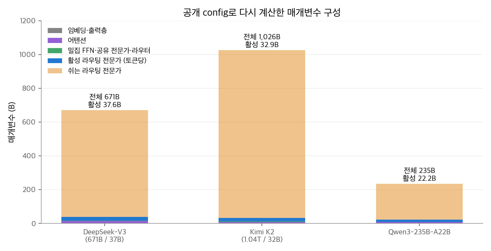
<figcaption markdown>
<span class="fig-title"><b>Figure 3.</b> 공개 config로 다시 계산한 매개변수 구성</span>

세 모델 모두 매개변수의 90% 이상이 토큰 하나에 대해 쉬는 라우팅 전문가(주황)입니다.
</figcaption>
</figure>

## 2. MoE 층의 정방향 계산

### 전문가 FFN: SwiGLU

여기서 다루는 모델의 전문가는 모두 SwiGLU FFN입니다(`hidden_act: silu`).

$$
\operatorname{FFN}(\mathbf{u}) = \mathbf{W}_2\big(\operatorname{SiLU}(\mathbf{W}_1\mathbf{u}) \odot \mathbf{W}_3\mathbf{u}\big),\qquad
\operatorname{SiLU}(x) = \frac{x}{1 + e^{-x}}
$$

$\mathbf{W}_1, \mathbf{W}_3 \in \mathbb{R}^{d_{ff} \times d}$, $\mathbf{W}_2 \in \mathbb{R}^{d \times d_{ff}}$ 입니다. 그래서 전문가 하나의 매개변수는 $3 d\,d_{ff}$ 입니다.

### 작동 원리

토큰의 은닉 벡터 $\mathbf{u}_t$ 가 MoE 층에 들어오면 다음 순서로 계산합니다.

1. **라우터 로짓.** 전문가 $i$ 마다 학습하는 중심 벡터 $\mathbf{e}_i$ 와 내적합니다. 라우터는 $N \times d$ 행렬 하나입니다.
2. **점수 함수.** 로짓을 소프트맥스나 시그모이드로 점수 $s_{i,t}$ 로 바꿉니다.
3. **top-k 선택.** 점수가 가장 큰 $K$ 개 전문가를 고릅니다.
4. **게이트 정규화.** 고른 전문가의 점수를 합이 1이 되게 다시 나눕니다. 모델에 따라 배율을 곱합니다.
5. **전문가 계산과 가중합.** 고른 전문가만 계산하고, 게이트로 가중합합니다. 공유 전문가와 잔차를 더합니다.

$$
\mathbf{h}_t = \mathbf{u}_t + \sum_{j=1}^{N_s}\operatorname{FFN}^{(s)}_j(\mathbf{u}_t) + \sum_{i=1}^{N_r} g_{i,t}\,\operatorname{FFN}^{(r)}_i(\mathbf{u}_t)
$$

$N_s$ 는 공유 전문가 수, $N_r$ 은 라우팅 전문가 수입니다. 고르지 않은 전문가는 $g_{i,t} = 0$ 이므로 계산하지 않습니다.

### 손계산: 토큰 4개, 전문가 4개, top-2

$d = 2$, 전문가 중간 차원 $d_{ff} = 1$ 로 줄여서 모든 값을 손으로 계산합니다. 공유 전문가와 잔차는 생략합니다.

| 토큰 | $\mathbf{u}_t$ |
| --- | --- |
| 1 | $(1, 0)$ |
| 2 | $(0, 1)$ |
| 3 | $(1, 0.5)$ |
| 4 | $(-1, 0.5)$ |

| 전문가 | 라우터 행 $\mathbf{e}_i$ | $\mathbf{W}_1$ (1×2) | $\mathbf{W}_3$ (1×2) | $\mathbf{W}_2$ (2×1) |
| --- | --- | --- | --- | --- |
| 1 | $(2, 0)$ | $(1, 0)$ | $(1, 1)$ | $(1, 0)^\top$ |
| 2 | $(0, 2)$ | $(0, 1)$ | $(1, 0)$ | $(0, 1)^\top$ |
| 3 | $(1, 1)$ | $(1, -1)$ | $(0, 1)$ | $(1, 1)^\top$ |
| 4 | $(-1, 1)$ | $(0.5, 0.5)$ | $(1, -1)$ | $(-1, 1)^\top$ |

**1단계: 라우터 로짓.** $\mathbf{u}_t^\top\mathbf{e}_i$ 를 모두 계산합니다.

| 토큰 | 전문가 1 | 전문가 2 | 전문가 3 | 전문가 4 |
| --- | --- | --- | --- | --- |
| 1 | 2 | 0 | 1 | $-1$ |
| 2 | 0 | 2 | 1 | 1 |
| 3 | 2 | 1 | 1.5 | $-0.5$ |
| 4 | $-2$ | 1 | $-0.5$ | 1.5 |

**2단계: 소프트맥스.** 토큰 1은 $e^{(2, 0, 1, -1)} = (7.389,\ 1,\ 2.718,\ 0.368)$, 합 11.475이므로 $(0.644,\ 0.087,\ 0.237,\ 0.032)$ 입니다.

**3~4단계: top-2와 게이트.** 토큰 1은 전문가 1과 3을 고릅니다. 게이트는 $0.644/(0.644 + 0.237) = 0.731$, $0.269$ 입니다.

<figure markdown>
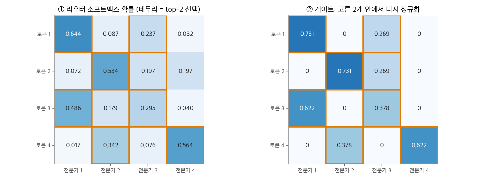
<figcaption markdown>
<span class="fig-title"><b>Figure 4.</b> 토큰 4개의 라우팅과 게이트</span>

주황 테두리가 각 토큰이 고른 전문가 2개입니다. 전문가 3은 토큰 3개가, 전문가 4는 토큰 하나만 고릅니다.
</figcaption>
</figure>

**5단계: 전문가 계산.** $d_{ff} = 1$ 이므로 $a = \mathbf{W}_1\mathbf{u}$, $b = \mathbf{W}_3\mathbf{u}$ 는 스칼라이고, 출력은 $\operatorname{SiLU}(a)\cdot b\cdot\mathbf{W}_2$ 입니다.

| 토큰 | 전문가 | 게이트 | $a$ | $\operatorname{SiLU}(a)$ | $b$ | 전문가 출력 |
| --- | --- | --- | --- | --- | --- | --- |
| 1 | 1 | 0.731 | 1.00 | 0.731 | 1.00 | $(0.731,\ 0)$ |
| 1 | 3 | 0.269 | 1.00 | 0.731 | 0.00 | $(0,\ 0)$ |
| 2 | 2 | 0.731 | 1.00 | 0.731 | 0.00 | $(0,\ 0)$ |
| 2 | 3 | 0.269 | $-1.00$ | $-0.269$ | 1.00 | $(-0.269,\ -0.269)$ |
| 3 | 1 | 0.622 | 1.00 | 0.731 | 1.50 | $(1.097,\ 0)$ |
| 3 | 3 | 0.378 | 0.50 | 0.311 | 0.50 | $(0.156,\ 0.156)$ |
| 4 | 4 | 0.622 | $-0.25$ | $-0.109$ | $-1.50$ | $(-0.164,\ 0.164)$ |
| 4 | 2 | 0.378 | 0.50 | 0.311 | $-1.00$ | $(0,\ -0.311)$ |

**가중합.** 토큰 1의 출력은 $0.731 \times (0.731, 0) + 0.269 \times (0, 0) = (0.534,\ 0)$ 입니다. 네 토큰의 출력은 다음과 같습니다.

$$
\mathbf{y}_1 = (0.534,\ 0),\quad
\mathbf{y}_2 = (-0.072,\ -0.072),\quad
\mathbf{y}_3 = (0.741,\ 0.059),\quad
\mathbf{y}_4 = (-0.102,\ -0.015)
$$

토큰 하나는 전문가 4개 중 2개만 계산했습니다. 전문가 계산량은 밀집 FFN 4개를 모두 계산할 때의 절반입니다.

```python
import torch
import torch.nn.functional as F

U  = torch.tensor([[1., 0.], [0., 1.], [1., .5], [-1., .5]])
Wr = torch.tensor([[2., 0.], [0., 2.], [1., 1.], [-1., 1.]])
W1 = torch.tensor([[1., 0.], [0., 1.], [1., -1.], [.5, .5]])
W3 = torch.tensor([[1., 1.], [1., 0.], [0., 1.], [1., -1.]])
W2 = torch.tensor([[1., 0.], [0., 1.], [1., 1.], [-1., 1.]])   # 전문가별 출력 방향

def moe(U, k=2):
    p = torch.softmax(U @ Wr.T, dim=-1)                 # 1~2단계
    g, idx = p.topk(k, dim=-1)                          # 3단계
    g = g / g.sum(-1, keepdim=True)                     # 4단계
    out = torch.zeros_like(U)
    for e in range(Wr.shape[0]):                        # 5단계: 전문가별로 모아서 계산
        tok, slot = (idx == e).nonzero(as_tuple=True)
        if len(tok) == 0:
            continue
        h = F.silu(U[tok] @ W1[e]) * (U[tok] @ W3[e])   # (토큰 수,)
        out[tok] += g[tok, slot, None] * h[:, None] * W2[e]
    return out

print(moe(U))   # [[0.534, 0], [-0.072, -0.072], [0.741, 0.059], [-0.102, -0.015]]
```

실제 구현도 5단계처럼 **전문가별로 토큰을 모아서** 계산합니다. 토큰마다 전문가를 따로 부르면 작은 행렬 곱이 너무 많아지기 때문입니다.

### 소프트맥스 라우터와 시그모이드 라우터

점수 함수는 모델마다 다릅니다.

| 방식 | 점수 | 쓰는 모델 |
| --- | --- | --- |
| 소프트맥스 | $s_{i,t} = \operatorname{softmax}_i(\mathbf{u}_t^\top\mathbf{e}_i)$ | Gemma 4 26B A4B, Qwen3 계열 |
| 시그모이드 | $s_{i,t} = \sigma(\mathbf{u}_t^\top\mathbf{e}_i)$ | DeepSeek-V3·V3.2, GLM-5, Kimi K2 (`scoring_func: sigmoid`) |

시그모이드는 전문가마다 독립적인 0~1 점수를 줍니다. 전문가 하나의 점수가 오른다고 다른 전문가의 점수가 내려가지 않습니다.
DeepSeek-V3의 게이트는 고른 전문가 안에서 정규화합니다.

$$
g'_{i,t} = \begin{cases} s_{i,t} & s_{i,t} + b_i \in \operatorname{Top-}K(\{s_{j,t} + b_j\}) \\ 0 & \text{그 밖} \end{cases},\qquad
g_{i,t} = \frac{g'_{i,t}}{\sum_j g'_{j,t}}
$$

$b_i$ 는 4절의 부하 균형용 편향입니다. **선택에만 쓰고, 게이트 값에는 쓰지 않습니다.**

### 시그모이드와 편향의 손계산

전문가 4개, $K = 2$, 토큰 벡터 $\mathbf{u} = (1,\ 0.5)$ 입니다. 전문가 중심 벡터는 $\mathbf{e}_1 = (1, 0)$, $\mathbf{e}_2 = (0, 1)$, $\mathbf{e}_3 = (1, 1)$, $\mathbf{e}_4 = (-1, 0.5)$ 입니다.

| 전문가 | 내적 $\mathbf{u}^\top\mathbf{e}_i$ | 시그모이드 $s_i$ | 소프트맥스 |
| --- | --- | --- | --- |
| 1 | 1.00 | 0.731 | 0.292 |
| 2 | 0.50 | 0.622 | 0.177 |
| 3 | 1.50 | **0.818** | 0.481 |
| 4 | $-0.75$ | 0.321 | 0.051 |

**편향이 없을 때.** 상위 2개는 전문가 3과 1입니다. 게이트는 $0.818/(0.818 + 0.731) = 0.528$, $0.731/1.549 = 0.472$ 입니다.

**전문가 3이 과부하라서 $b_3 = -0.2$ 일 때.** 선택용 점수는 $(0.731,\ 0.622,\ 0.618,\ 0.321)$ 입니다. 상위 2개가 전문가 1과 2로 바뀝니다.
게이트는 원래 점수로 계산합니다. $0.731/(0.731 + 0.622) = 0.540$, $0.460$ 입니다. 배율 2.5를 곱하면 $(1.350,\ 1.150)$ 입니다.

편향은 전문가 3을 "덜 고르게" 만들 뿐, 고른 전문가의 기여도는 바꾸지 않습니다.

## 3. 라우팅 방식 비교

### 토큰 선택: top-k와 Switch의 top-1

2절의 방식은 **토큰이 전문가를 고릅니다(token choice)**. 처음 제안된 희소 MoE(Shazeer et al., 2017)와 GShard는 $K = 2$ 를 썼습니다.
Switch Transformer는 $K = 1$ 로 줄였습니다. 토큰 하나가 전문가 하나에만 가므로 계산과 통신이 가장 적습니다.
최근 LLM은 $K = 8$ 이나 $K = 10$ 을 씁니다(5절의 세분화된 전문가).

토큰 선택의 약점은 **전문가가 받는 토큰 수를 통제할 수 없다**는 점입니다. 위 손계산에서 전문가 3은 토큰 3개, 전문가 4는 1개를 받았습니다.

### 전문가 선택

**전문가 선택(expert choice)** 라우팅은 방향을 뒤집습니다. 전문가마다 처리할 토큰 $c$ 개를 고릅니다. 토큰 $T$ 개, 전문가 $E$ 개, 평균 $K$ 개를 쓰려면 $c = TK/E$ 입니다.

위 예제에서 $c = 4 \times 2 / 4 = 2$ 입니다. 각 전문가가 확률 열에서 상위 2개 토큰을 고릅니다.

| 전문가 | 고른 토큰 (확률) |
| --- | --- |
| 1 | 토큰 1 (0.644), 토큰 3 (0.486) |
| 2 | 토큰 2 (0.534), 토큰 4 (0.342) |
| 3 | 토큰 3 (0.295), 토큰 1 (0.237) |
| 4 | 토큰 4 (0.564), 토큰 2 (0.197) |

모든 전문가가 정확히 2개씩 받습니다. 부하는 완전히 균등합니다.
대신 토큰마다 받는 전문가 수가 달라질 수 있습니다(이 예에서는 우연히 모두 2개). 그리고 전문가가 배치 안의 모든 토큰을 보고 골라야 합니다.
자기회귀 생성에서는 한 번에 토큰 하나씩 들어오므로 이 방식을 그대로 쓰기 어렵습니다. 이 장에서 다루는 LLM은 모두 토큰 선택을 씁니다.

### 그룹 제한 라우팅 (DeepSeek)

전문가가 GPU 여러 노드에 흩어져 있으면, 토큰이 고른 전문가가 많은 노드에 걸칠수록 노드 간 통신이 늘어납니다.
DeepSeek-V3는 **노드 제한 라우팅**을 씁니다. 토큰 하나는 최대 $M = 4$ 개 노드의 전문가에만 갑니다.

1. 전문가를 노드(그룹)별로 묶습니다. V3 설정은 `n_group: 8`(그룹당 32개 전문가)입니다.
2. 그룹마다 그 그룹 안 상위 $K/M$ 개 점수의 합을 그룹 점수로 씁니다. $K = 8$, $M = 4$ 이면 상위 2개의 합입니다.
3. 그룹 점수가 큰 $M$ 개 그룹을 고릅니다(`topk_group: 4`).
4. 고른 그룹 안의 전문가에서만 top-$K$ 를 고릅니다.

**손계산.** 전문가 8개를 2개씩 4그룹으로 나누고, $K = 4$, $M = 2$ 로 둡니다. 점수는 다음과 같습니다.

| 그룹 | 전문가 (점수) | 그룹 점수 (상위 2개 합) |
| --- | --- | --- |
| A | 1 (0.90), 2 (0.10) | **1.00** |
| B | 3 (0.50), 4 (0.60) | **1.10** |
| C | 5 (0.85), 6 (0.05) | 0.90 |
| D | 7 (0.30), 8 (0.20) | 0.50 |

그룹 A와 B가 뽑힙니다. 그 안의 top-4는 전문가 1, 4, 3, 2입니다.
제한이 없다면 top-4는 1, 5, 4, 3입니다. 점수 0.85인 전문가 5가 빠지고, 0.10인 전문가 2가 들어갔습니다.
품질을 조금 양보하고 통신 노드 수를 2개로 묶은 것입니다. V3 보고서는 이 제한 아래에서 토큰 하나가 노드당 평균 3.2개 전문가를 고른다고 설명합니다.

Kimi K2는 그룹 제한을 쓰지 않습니다(`n_group: 1`, `topk_group: 1`). 보고서도 V3와 비교한 표에서 전문가 그룹화를 "No"로 적었습니다.

## 4. 부하 균형

### 문제: 쏠림

라우터를 그냥 학습하면 초반에 조금 더 좋은 전문가가 더 많이 선택되고, 더 많이 학습되어 더 좋아집니다. 결국 소수의 전문가만 쓰이는 **쏠림(collapse)**이 생깁니다.
분산 학습에서는 전문가가 GPU마다 나뉘어 있으므로, 쏠림은 일부 GPU만 바쁘게 만들어 전체 속도도 떨어뜨립니다.

<figure markdown>
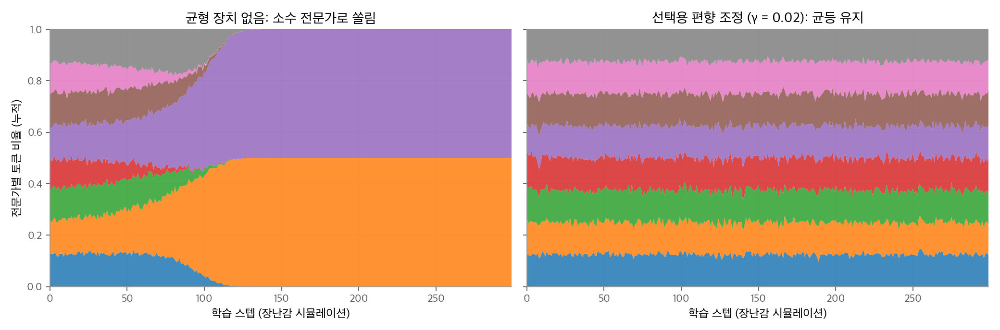
<figcaption markdown>
<span class="fig-title"><b>Figure 5.</b> 부하 균형 장치가 없을 때의 쏠림</span>

toy 시뮬레이션입니다. 균형 장치가 없으면 약 120스텝 만에 전문가 2개가 모든 토큰을 가져갑니다. 편향을 조정하면 약 1.1배에 머뭅니다.
</figcaption>
</figure>

### 보조 손실

Switch Transformer는 손실에 부하 균형 항을 더했습니다. $f_i$ 는 전문가 $i$ 로 간 토큰의 비율, $P_i$ 는 라우터가 전문가 $i$ 에 준 평균 확률입니다.

$$
\mathcal{L}_{\text{aux}} = \alpha\,N\sum_{i=1}^{N} f_i\,P_i
$$

균등하면 $f_i = P_i = 1/N$ 이고 $N\sum f_i P_i = 1$ 입니다. 쏠릴수록 커집니다.
$f_i$ 는 이산 선택이므로 기울기가 없습니다. 기울기는 $P_i$ 를 통해 흐르고, 많이 받은 전문가의 확률을 낮추는 방향으로 작용합니다. Switch Transformer는 $\alpha = 0.01$ 을 썼습니다.

**손계산.** 2절 예제에서 선택 횟수는 전문가 순서대로 $(2, 2, 3, 1)$ 이고, 선택 8건으로 나누면 $f = (0.25,\ 0.25,\ 0.375,\ 0.125)$ 입니다.
평균 확률은 $P = (0.305,\ 0.286,\ 0.201,\ 0.208)$ 입니다. $4\sum f_i P_i = 0.996$ 입니다.
전문가 3은 많이 선택됐지만 평균 확률은 낮아서, 이 작은 예에서는 값이 1에 가깝습니다.

단점은 $\alpha$ 가 크면 균형을 위해 언어 모델링 성능을 희생한다는 점입니다.
설정 파일의 계수는 모델마다 다릅니다. Qwen3-235B와 Qwen3.5는 `router_aux_loss_coef: 0.001`, Kimi K2는 `aux_loss_alpha: 0.001`(`seq_aux: true`)입니다.

### 시퀀스 단위 보조 손실

DeepSeek-V3는 배치 전체가 아니라 **시퀀스 하나 안에서** $f_i$ 와 $P_i$ 를 셉니다.

$$
\mathcal{L}_{\text{Bal}} = \alpha\sum_{i=1}^{N_r} f_i P_i,\qquad
f_i = \frac{N_r}{K_r T}\sum_{t=1}^{T}\mathbb{1}\big(s_{i,t} \in \operatorname{Top-}K_r\big),\qquad
P_i = \frac{1}{T}\sum_{t=1}^{T} s'_{i,t}
$$

$T$ 는 시퀀스 길이이고, $s'_{i,t}$ 는 시그모이드 점수를 전문가 방향으로 정규화한 값입니다.
V3는 $\alpha = 0.0001$ 로 아주 작게 둡니다. 보고서는 이 손실이 "한 시퀀스 안의 극단적인 쏠림만 막기 위한" 것이라고 설명합니다. 주된 균형은 아래의 편향 조정이 맡습니다.

### 라우터 z-loss

ST-MoE는 라우터 로짓이 너무 커지는 것을 막는 **z-loss**를 제안했습니다. 로그-합-지수를 제곱해서 평균합니다.

$$
\mathcal{L}_z = \frac{1}{T}\sum_{t=1}^{T}\left(\log\sum_{i=1}^{N} e^{x_{i,t}}\right)^2
$$

로짓 $x$ 가 커지면 지수 계산에서 반올림 오차가 커지고, 학습이 불안정해집니다. z-loss는 로짓 전체의 크기를 작게 유지합니다. ST-MoE는 계수 0.001을 권했습니다.

**손계산.** 2절 예제의 로그-합-지수는 토큰 순서대로 $(2.440,\ 2.627,\ 2.721,\ 2.072)$ 입니다. 제곱 평균은 6.14이고, 계수 0.001을 곱하면 0.006입니다.
이 장에서 다루는 모델 가운데 어느 모델이 z-loss를 쓰는지는 공개 설정에서 확인하지 못했습니다.

### 전문가 용량과 토큰 버림

학습 시스템은 보통 전문가마다 받을 수 있는 토큰 수에 상한을 둡니다. 이것이 **전문가 용량(expert capacity)**입니다.

$$
\text{용량} = \frac{T \cdot K}{E} \times \text{용량 계수(capacity factor)}
$$

용량을 넘은 토큰은 그 전문가에서 **버려지고(drop)**, 잔차 연결로만 다음 층에 갑니다.

**손계산.** 2절 예제는 $T = 4$, $K = 2$, $E = 4$ 이므로 용량 계수 1.0에서 전문가당 2칸입니다.
전문가 3은 토큰 3개를 받았으므로 하나가 버려집니다. 용량 계수를 1.5로 올리면 3칸이 되어 버려지는 토큰이 없습니다.
용량을 늘리면 버림은 줄지만, 빈 칸까지 계산하므로 낭비가 늘어납니다.

<figure markdown>
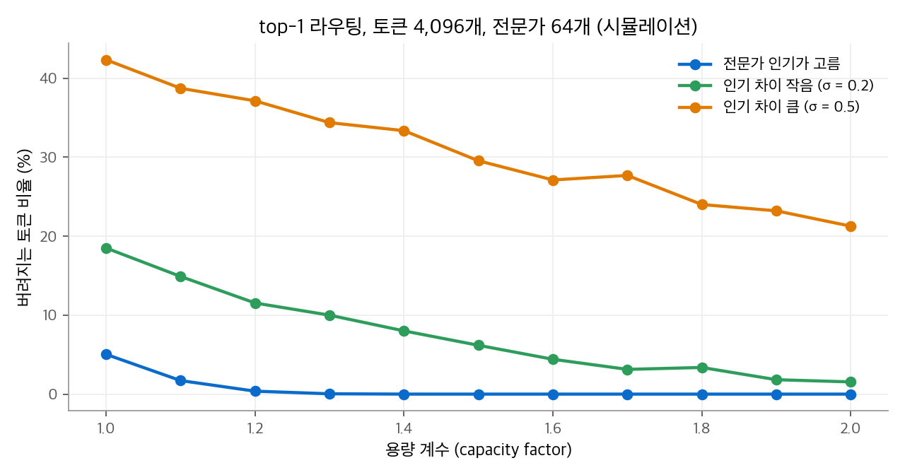
<figcaption markdown>
<span class="fig-title"><b>Figure 6.</b> 용량 계수와 버려지는 토큰 비율</span>

top-1 시뮬레이션입니다. 인기 차이가 크면 용량 계수 2.0에서도 20% 이상 버려지므로, 부하 균형과 용량을 함께 맞춰야 합니다.
</figcaption>
</figure>

DeepSeek-V3는 학습과 추론 모두에서 토큰을 버리지 않는다고 밝혔습니다. 편향 조정으로 균형을 맞추고, 추론 배치에서는 아래 7절의 중복 전문가를 씁니다.

### 보조 손실 없는 부하 균형 (DeepSeek-V3)

DeepSeek-V3는 손실을 더하는 대신, 2절의 편향 $b_i$ 를 학습 스텝마다 직접 조정합니다.

1. 스텝이 끝나면 전문가마다 처리한 토큰 수를 셉니다.
2. 평균보다 많이 받은 전문가는 $b_i \leftarrow b_i - \gamma$, 적게 받은 전문가는 $b_i \leftarrow b_i + \gamma$ 로 바꿉니다.
3. 다음 스텝의 선택에 새 편향을 씁니다. 게이트 값과 기울기에는 영향을 주지 않습니다.

V3는 $\gamma = 0.001$ 을 처음 14.3T 토큰 동안 쓰고, 마지막 500B 토큰은 $\gamma = 0$ 으로 편향을 고정했습니다.
Kimi K2의 설정도 같은 방식을 가리킵니다(`topk_method: noaux_tc`).

<figure markdown>
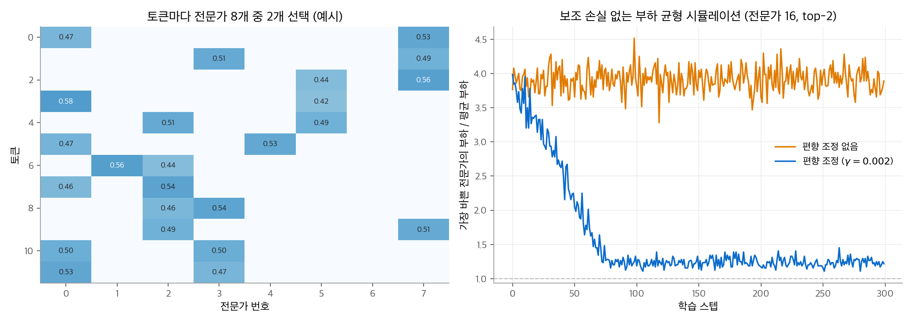
<figcaption markdown>
<span class="fig-title"><b>Figure 7.</b> 토큰별 전문가 선택과 편향 조정</span>

라우터 점수가 치우치면 가장 바쁜 전문가가 평균의 약 4배 일을 합니다. 편향을 조정하면 약 1.2배로 내려갑니다.
</figcaption>
</figure>

```python
import torch

def route(u, centroids, bias, k=2, scale=2.5):
    """시그모이드 점수, 편향은 선택에만, 게이트는 원래 점수로 정규화합니다."""
    s = torch.sigmoid(u @ centroids.T)                 # (T, E)
    idx = (s + bias).topk(k, dim=-1).indices           # 선택
    g = s.gather(-1, idx)
    g = g / g.sum(-1, keepdim=True) * scale            # 게이트
    return idx, g

def update_bias(bias, idx, n_experts, gamma=1e-3):
    load = torch.bincount(idx.flatten(), minlength=n_experts).float()
    return bias - gamma * torch.sign(load - load.mean())   # 과부하면 내리고, 부족하면 올림

u = torch.tensor([[1.0, 0.5]])
E = torch.tensor([[1.0, 0.0], [0.0, 1.0], [1.0, 1.0], [-1.0, 0.5]])
print(route(u, E, torch.zeros(4), scale=1.0))                       # 전문가 3, 1 / 게이트 0.528, 0.472
print(route(u, E, torch.tensor([0.0, 0.0, -0.2, 0.0]), scale=2.5))  # 전문가 1, 2 / 게이트 1.350, 1.150
```

| 방법 | 균형을 맞추는 수단 | 언어 모델링 기울기에 주는 영향 | 쓰는 모델 |
| --- | --- | --- | --- |
| 보조 손실 | 손실 항 $\alpha N\sum f_i P_i$ | 있음 ($\alpha$ 에 비례) | Switch, Qwen3·3.5 (계수 0.001) |
| 시퀀스 단위 보조 손실 | 시퀀스 안의 $f_i P_i$ | 아주 작음 ($\alpha = 0.0001$) | DeepSeek-V3 (보조 수단) |
| z-loss | 로짓 크기 | 로짓 크기만 | ST-MoE |
| 용량과 버림 | 상한을 넘는 토큰 제외 | 버린 토큰은 전문가 학습에서 빠짐 | Switch, GShard |
| 편향 조정 | 선택용 편향 $b_i$ | 없음 | DeepSeek-V3, Kimi K2 |

## 5. 세분화된 전문가와 공유 전문가

### 세분화: 조합의 수를 늘리기

DeepSeekMoE는 두 전략을 제안했습니다.

1. **세분화(fine-grained segmentation).** 전문가 $N$ 개를 각각 $m$ 개로 쪼개 $mN$ 개로 만들고, 토큰당 $mK$ 개를 씁니다. 전문가 하나는 $1/m$ 크기가 되므로 계산량은 그대로입니다.
2. **공유 전문가 분리.** $K_s$ 개 전문가를 모든 토큰이 쓰는 공유 전문가로 둡니다.

세분화의 효과는 고를 수 있는 조합의 수로 설명할 수 있습니다.

| 구성 | 토큰당 계산 | 가능한 조합 수 |
| --- | --- | --- |
| 전문가 16개 중 2개 | 기준 | $\binom{16}{2} = 120$ |
| 각각 4조각으로: 64개 중 8개 | 같음 | $\binom{64}{8} \approx 4.4 \times 10^9$ |
| DeepSeek-V3: 256개 중 8개 | | $\binom{256}{8} \approx 4.1 \times 10^{14}$ |
| Kimi K2: 384개 중 8개 | | $\binom{384}{8} \approx 1.1 \times 10^{16}$ |
| Qwen3-Next·3.5: 512개 중 10개 | | $\binom{512}{10} \approx 3.1 \times 10^{20}$ |

같은 계산량으로 훨씬 다양한 전문가 조합을 쓸 수 있습니다. 토큰마다 필요한 지식을 더 정밀하게 조합할 수 있다는 것이 DeepSeekMoE의 논리입니다.

### 공유 전문가

**공유 전문가(shared expert)**는 라우터와 무관하게 모든 토큰이 항상 통과하는 전문가입니다.
모든 토큰에 필요한 공통 지식(문법, 자주 쓰는 패턴)을 공유 전문가가 맡으면, 라우팅 전문가는 더 좁은 지식에 특화할 수 있다는 생각입니다.
DeepSeek-V3의 추론 배포에서는 공유 전문가를 "항상 선택되는 라우팅 전문가"로 취급해 토큰마다 9개 전문가를 처리합니다.

| 모델 | 공유 전문가 | 비고 |
| --- | --- | --- |
| DeepSeek-V3·V3.2 | 1개 | |
| Kimi K2 | 1개 | |
| GLM-4.5, GLM-5 | 1개 | |
| Qwen3-235B-A22B | 없음 | |
| Qwen3-Next, Qwen3.5 | 1개 | 공유 전문가 크기 = 라우팅 전문가 크기 |
| Gemma 4 26B A4B | 없음 | 대신 밀집 MLP(중간 차원 2,112)를 MoE와 **병렬로** 두고 두 출력을 더함 |

Gemma 4 26B A4B의 구조는 다른 계열과 다릅니다. 층마다 밀집 MLP의 출력과 MoE(128개 중 8개, 전문가 중간 차원 704)의 출력을 각각 RMSNorm으로 정규화한 뒤 더합니다.
라우터는 소프트맥스로 확률을 구하고, 상위 8개를 다시 합이 1이 되게 정규화한 뒤, 전문가별로 학습하는 배율(`per_expert_scale`)을 곱합니다.

## 6. 희소도: 전문가를 얼마나 많이 둘까

**희소도(sparsity)**를 전체 라우팅 전문가 수와 활성 전문가 수의 비로 정의합니다. Kimi K2 보고서의 정의입니다.

Kimi K2 보고서는 활성 전문가 8개와 공유 전문가 1개를 고정하고, 전체 전문가 수만 바꿔 실험했습니다.
검증 손실 1.5에 도달하는 데 필요한 FLOPs는 희소도 48이 가장 적었습니다. 희소도 8, 16, 32는 각각 1.69배, 1.39배, 1.15배가 필요했습니다.
보고서는 이 결과로 전문가 수를 DeepSeek-V3의 256개에서 384개로 늘렸다고 설명합니다. 동시에 "인프라 복잡도가 늘어난다"는 대가도 적었습니다.

<figure markdown>
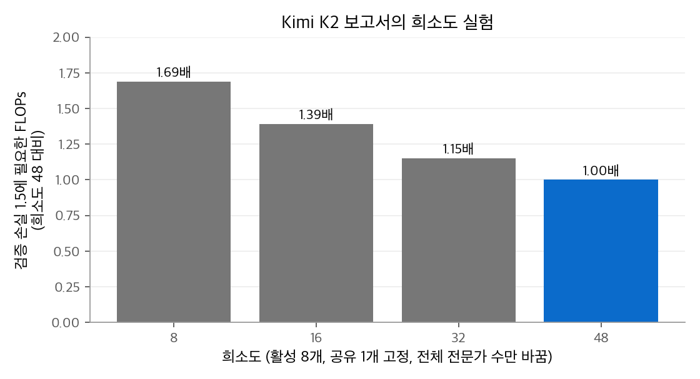
<figcaption markdown>
<span class="fig-title"><b>Figure 8.</b> Kimi K2 보고서의 희소도 실험</span>

희소도 48 기준의 FLOPs 비율입니다. 같은 활성 계산량에서 전문가를 많이 둘수록 학습 효율이 좋았습니다.
</figcaption>
</figure>

<figure markdown>
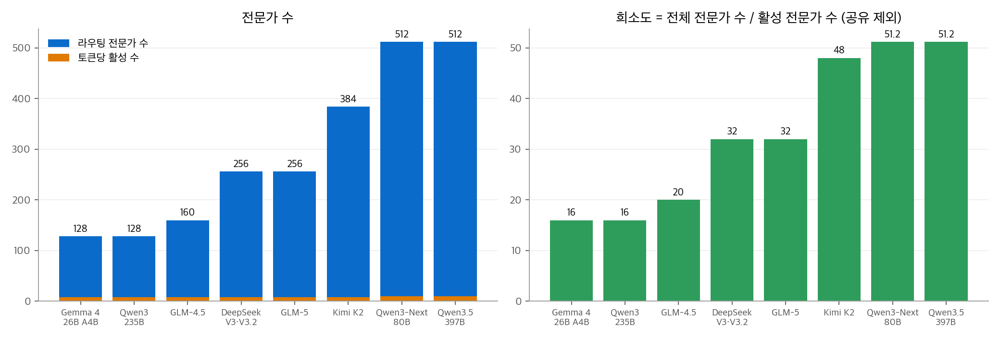
<figcaption markdown>
<span class="fig-title"><b>Figure 9.</b> 공개 설정의 MoE 구성</span>

희소도는 Gemma 4·Qwen3가 16, DeepSeek·GLM-5가 32, Kimi K2가 48, Qwen3-Next·3.5가 51.2입니다.
</figcaption>
</figure>

### 모델별 MoE 설정

| 모델 | 라우팅 전문가 | 토큰당 활성 | 공유 | 전문가 중간 차원 | 앞쪽 밀집층 | 라우터 |
| --- | --- | --- | --- | --- | --- | --- |
| DeepSeek-V3·V3.2 | 256 | 8 | 1 | 2,048 | 3 (`first_k_dense_replace`) | 시그모이드, 그룹 제한 8그룹 중 4, 배율 2.5 |
| Kimi K2 | 384 | 8 | 1 | 2,048 | 1 | 시그모이드, 그룹 제한 없음, 배율 2.827 |
| GLM-4.5 | 160 | 8 | 1 | 1,536 | 3 | 배율 2.5 |
| GLM-5 | 256 | 8 | 1 | 2,048 | 3 | 시그모이드, 배율 2.5 |
| Qwen3-235B-A22B | 128 | 8 | 0 | 1,536 | 0 | 소프트맥스, 상위 $K$ 정규화, 보조 손실 0.001 |
| Qwen3-Next-80B-A3B | 512 | 10 | 1 | 512 | 0 | 상위 $K$ 정규화 |
| Qwen3.5-397B-A17B | 512 | 10 | 1 | 1,024 | 0 | 보조 손실 계수 0.001 |
| Gemma 4 26B A4B | 128 | 8 | 0 (병렬 밀집 MLP) | 704 | 0 (30층 모두 MoE) | 소프트맥스, 전문가별 배율 |

### 경향

- **잘게 쪼갠 전문가.** 전문가 수를 늘리고 하나의 크기를 줄이는 방향입니다. Qwen3-Next는 중간 차원 512짜리 전문가 512개 중 10개를 씁니다.
- **희소도 증가.** DeepSeek-V3의 32에서 Kimi K2의 48, Qwen3-Next·3.5의 51.2로 늘었습니다.
- **앞쪽 밀집층.** DeepSeek과 GLM은 처음 3층, Kimi K2는 처음 1층을 일반 FFN으로 둡니다. Qwen과 Gemma 4는 모든 층을 MoE로 둡니다.
- **공유 전문가.** Qwen은 Qwen3에서 공유 전문가를 뺐다가 Qwen3-Next에서 다시 넣었습니다. Gemma 4는 공유 전문가 대신 병렬 밀집 MLP를 둡니다.

## 7. 시스템 측면: 학습과 추론

### 전문가 병렬과 all-to-all 통신

전문가가 수백 개이면 한 GPU에 다 올릴 수 없습니다. **전문가 병렬(expert parallelism, EP)**은 전문가를 GPU마다 나눠 둡니다.
MoE 층 하나는 다음 순서로 실행합니다.

1. **dispatch.** 토큰마다 고른 전문가가 있는 GPU로 은닉 벡터를 보냅니다. GPU 전체가 서로 주고받는 all-to-all 통신입니다.
2. **전문가 계산.** GPU마다 받은 토큰을 모아 자기 전문가로 계산합니다.
3. **combine.** 결과를 원래 GPU로 돌려보내고 게이트로 가중합합니다. 다시 all-to-all입니다.

DeepSeek-V3는 학습에서 8개 노드의 GPU 64개에 라우팅 전문가를 고르게 나눴습니다(64-way EP). 노드 안은 NVLink, 노드 사이는 InfiniBand(IB)로 연결합니다.
토큰은 IB로 대상 노드의 GPU에 먼저 간 뒤, NVLink로 전문가가 있는 GPU에 전달됩니다.
dispatch는 FP8로 양자화해서 보내고, combine은 BF16으로 보냅니다.

**통신량 계산.** 토큰 하나, MoE 층 하나 기준으로 계산합니다. $d = 7168$, $K = 8$ 입니다.

| 단계 | 계산 | 크기 |
| --- | --- | --- |
| dispatch (FP8, 전문가 8개분) | $8 \times 7168 \times 1\ \text{B}$ | 56KiB |
| 그중 노드 간(IB) 전송 | 대상 노드 최대 4개 × 7,168B | 최대 28KiB |
| combine (BF16, 전문가 8개분) | $8 \times 7168 \times 2\ \text{B}$ | 112KiB |

IB 전송량은 보고서의 경로 설명(노드마다 한 번 IB로 보낸 뒤 NVLink로 전달)을 따른 추정이고, FP8 배율 같은 부가 데이터는 뺐습니다.
4개 노드 제한이 없으면 최악의 경우 8개 노드로 보내야 하므로, 노드 제한은 IB 전송량을 절반으로 묶습니다.
MoE 층이 58개이므로, 토큰 하나가 정방향 한 번에 dispatch와 combine으로 약 9.5MiB를 주고받습니다.

### 추론: 디코드 단계의 메모리 읽기

[어텐션 3장](../attention/03-mqa-gqa.md)에서 본 것처럼, 디코드 단계는 가중치와 KV 캐시를 읽는 속도에 묶입니다.
MoE에서는 **배치 안의 토큰들이 고른 서로 다른 전문가의 가중치**를 모두 읽어야 합니다.
토큰 $B$ 개가 전문가 $E$ 개 중 $K$ 개를 독립적으로 고르게 고른다고 가정하면, 한 층에서 읽는 전문가 수의 기댓값은 다음과 같습니다.

$$
\mathbb{E}[\text{서로 다른 전문가 수}] = E\left(1 - \left(1 - \frac{K}{E}\right)^{B}\right)
$$

| 배치 $B$ | 256개 중 8개 | 384개 중 8개 | 128개 중 8개 |
| --- | --- | --- | --- |
| 1 | 8.0 | 8.0 | 8.0 |
| 16 | 102.0 | 109.8 | 82.4 |
| 64 | 222.4 | 284.2 | 125.9 |
| 256 | 255.9 | 382.2 | 128.0 |

<figure markdown>
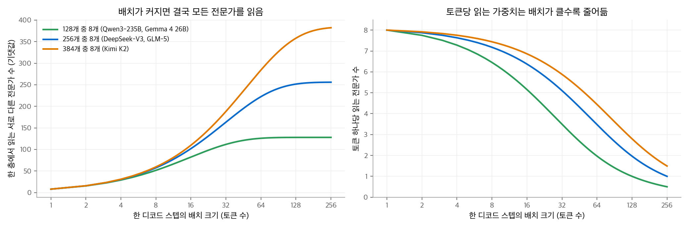
<figcaption markdown>
<span class="fig-title"><b>Figure 10.</b> 배치 크기와 읽는 전문가 수</span>

배치가 64를 넘으면 한 층에서 256개 전문가 대부분을 읽습니다. 배치가 클수록 같은 가중치를 여러 토큰이 나눠 씁니다.
</figcaption>
</figure>

배치 1이면 DeepSeek-V3는 층마다 전문가 8개(라우팅)만 읽습니다. FP8이면 $8 \times 44.04\text{M} \times 58 \approx 20.4\text{GB}$ 를 토큰 하나마다 읽습니다.
이 가중치로 하는 계산은 토큰 하나분뿐이므로, 연산기는 대부분 놉니다. 배치를 키우면 읽는 양은 천천히 늘고 계산은 배치에 비례해 늘어서 효율이 오릅니다.
그래서 MoE는 큰 배치로 서빙할 때 유리합니다.

이 성질은 추측 디코딩과도 엮입니다. [6장](06-mtp.md)에서 보듯이, 추측 디코딩은 초안 토큰 여러 개를 한 번에 검증합니다.
밀집 모델에서는 같은 가중치를 한 번 읽어 여러 토큰을 검증하므로 이득이 큽니다. MoE에서는 초안 토큰마다 다른 전문가를 고르면 읽을 가중치가 늘어납니다.
Google 문서가 Gemma 4 26B A4B의 MTP 드래프터는 병렬성이 낮은 하드웨어에서 빨라지지 않을 수 있다고 밝힌 이유입니다.

### 중복 전문가

추론 배치에서도 특정 전문가에 토큰이 몰릴 수 있습니다. DeepSeek-V3는 디코드 단계를 40개 노드의 GPU 320개(EP320)에 배포합니다.
GPU마다 전문가 하나만 두고, 그중 64개 GPU는 중복 전문가와 공유 전문가를 맡습니다. 많이 쓰이는 전문가를 복제해 부하를 나누는 방법입니다.

## 8. 설정값의 의미

| 설정 | 뜻 | 예 |
| --- | --- | --- |
| `n_routed_experts`, `num_experts` | 라우팅 전문가 수 | V3 256, K2 384, Qwen3 128 |
| `num_experts_per_tok` | 토큰당 활성 라우팅 전문가 $K$ | 8 또는 10 |
| `n_shared_experts` | 공유 전문가 수 | 1 |
| `moe_intermediate_size` | 전문가 하나의 중간 차원 | V3 2,048, Qwen3-Next 512 |
| `first_k_dense_replace` | 앞쪽에서 MoE 대신 밀집 FFN을 쓰는 층 수 | V3·GLM 3, K2 1 |
| `scoring_func` | 점수 함수 | `sigmoid` (V3, GLM-5, K2) |
| `n_group`, `topk_group` | 그룹 제한 라우팅의 그룹 수와 고를 그룹 수 | V3 8과 4, K2 1과 1(제한 없음) |
| `topk_method: noaux_tc` | 보조 손실 없는 편향 조정 방식의 top-k | V3, K2 |
| `norm_topk_prob` | 고른 $K$ 개 안에서 게이트를 다시 정규화 | V3, K2, Qwen3 |
| `routed_scaling_factor` | 정규화한 게이트에 곱하는 배율. 라우팅 전문가 출력 전체를 키움 | V3·GLM 2.5, K2 2.827 |
| `router_aux_loss_coef`, `aux_loss_alpha` | 보조 손실 계수 | Qwen3 0.001, K2 0.001 |

`routed_scaling_factor` 를 쓰면 게이트의 합이 1이 아니라 그 배율이 됩니다. 설정 파일에는 값만 있고, 왜 그 값을 골랐는지는 확인한 자료에 설명이 없습니다.

## 정리

| 질문 | 답 |
| --- | --- |
| MoE가 늘리는 것과 유지하는 것 | 전체 매개변수(메모리)는 늘리고, 토큰당 계산(활성 매개변수)은 유지합니다. V3의 MoE 층은 밀집 층과 계산이 같고 매개변수는 28.6배입니다. |
| 정방향 계산 | 라우터 로짓 → 점수(소프트맥스·시그모이드) → top-$K$ → 게이트 정규화(배율) → 전문가별로 토큰을 모아 SwiGLU 계산 → 가중합 |
| 라우팅 방식 | LLM은 토큰 선택 top-$K$ 를 씁니다. 전문가 선택은 부하가 균등하지만 자기회귀 생성에 맞지 않습니다. DeepSeek은 노드 수를 묶는 그룹 제한을 씁니다. |
| 부하 균형 | 보조 손실(Qwen 0.001), 시퀀스 단위 손실(V3 0.0001), z-loss(ST-MoE), 용량과 버림(Switch), 선택용 편향 조정(V3, K2) |
| 전문가 모양 | 잘게 쪼갠 전문가와 공유 전문가 1개가 표준이 되었습니다. 희소도는 16~51.2입니다. |
| 시스템 | 학습은 all-to-all 통신이 병목이고, 추론은 배치가 작을 때 가중치 읽기가 병목입니다. 큰 배치와 중복 전문가로 대응합니다. |

모델별 MoE 설정은 트렌드의 모델 글에서도 볼 수 있습니다. [Gemma](../../trends/posts/2026-10-20-llm-gemma.md), [DeepSeek](../../trends/posts/2026-10-20-llm-deepseek.md), [Qwen](../../trends/posts/2026-10-20-llm-qwen.md), [GLM](../../trends/posts/2026-10-20-llm-glm.md), [Kimi](../../trends/posts/2026-10-20-llm-kimi.md) 글입니다.

다음 장은 MoE 모델이 함께 쓰는 멀티 토큰 예측(MTP)과 추측 디코딩을 다룹니다.
