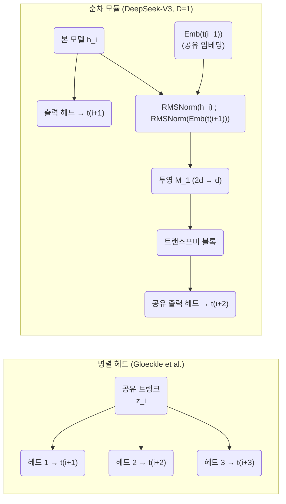
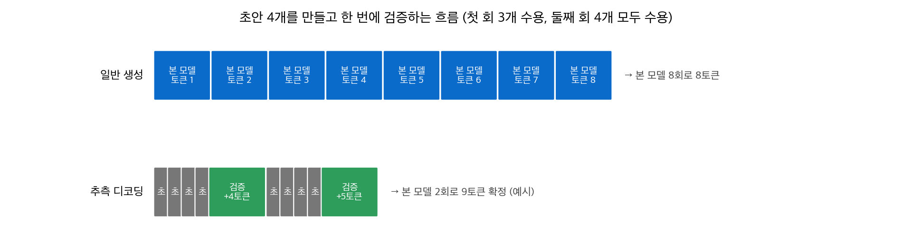
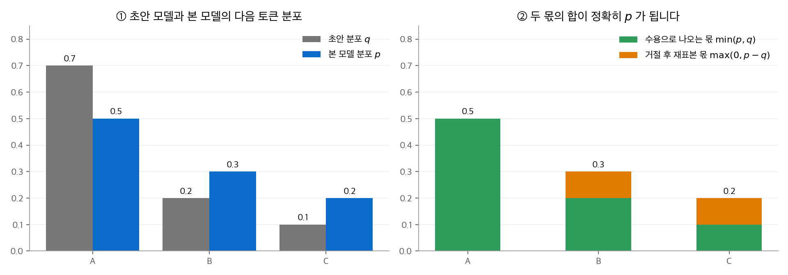
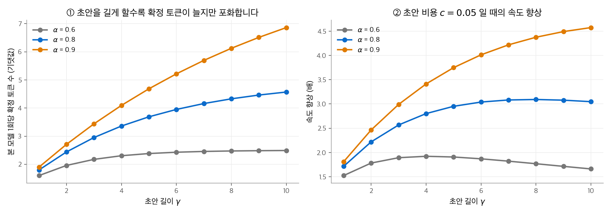
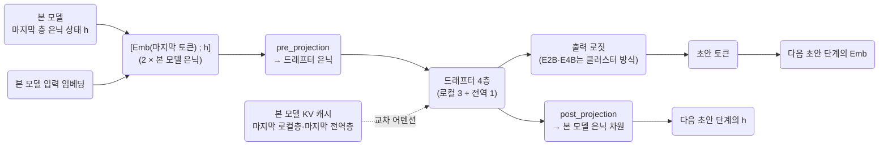
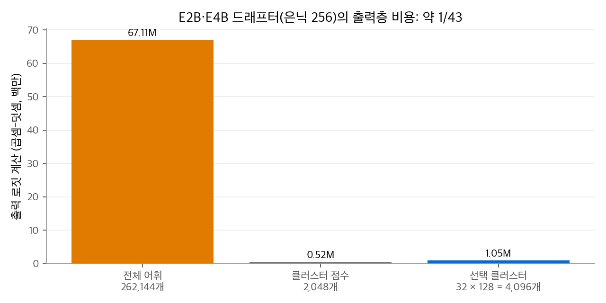

# 6. 멀티 토큰 예측(MTP)과 추측 디코딩

언어 모델은 보통 다음 토큰 하나만 예측하도록 학습하고, 생성할 때도 토큰을 하나씩 만듭니다.
**멀티 토큰 예측(multi-token prediction, MTP)**은 한 위치에서 그 뒤의 토큰 여러 개를 함께 예측하게 합니다.
MTP는 두 가지 목적으로 씁니다. 학습에서는 신호를 더 촘촘하게 주는 보조 목표가 되고, 생성에서는 **추측 디코딩(speculative decoding)**의 초안 모델이 됩니다.
이 장은 MTP의 학습 목표와 구조, 추측 디코딩의 수용 규칙과 속도 계산을 다룹니다. 그다음 Gemma 4의 MTP 드래프터를 공개 구현 코드로 따라갑니다.

!!! info "이 장에서 쓰는 자료"
    - Gloeckle et al., [Better & Faster Large Language Models via Multi-token Prediction](https://arxiv.org/abs/2404.19737), 2024.
    - DeepSeek-AI, [DeepSeek-V3 Technical Report](https://arxiv.org/abs/2412.19437), 2024 (2.2절, 4.2절, 5.4.3절).
    - Leviathan et al., [Fast Inference from Transformers via Speculative Decoding](https://arxiv.org/abs/2211.17192), 2023.
    - Google, [Speed-up Gemma 4 with Multi-Token Prediction](https://ai.google.dev/gemma/docs/mtp/overview), [MTP using Hugging Face Transformers](https://ai.google.dev/gemma/docs/mtp/mtp), [Accelerating Gemma 4](https://blog.google/innovation-and-ai/technology/developers-tools/multi-token-prediction-gemma-4/) (2026. 5. 5.).
    - Hugging Face Transformers의 `modeling_gemma4_assistant.py`, `generation/candidate_generator.py`, 그리고 각 드래프터의 `config.json`.

## 1. 다음 토큰 하나 대신 여러 개

### 학습 목표

길이 $T$ 인 토큰열 $t_1, \ldots, t_T$ 가 있습니다. 일반 언어 모델의 손실은 위치마다 다음 토큰 하나의 교차 엔트로피입니다.

$$
\mathcal{L}_{\text{NTP}} = -\frac{1}{T}\sum_{i=1}^{T} \log p_\theta(t_{i+1} \mid t_{\le i})
$$

MTP는 위치 $i$ 에서 $t_{i+1}, \ldots, t_{i+n}$ 을 함께 예측합니다. $k$ 칸 뒤를 예측하는 손실을 $\mathcal{L}^{(k)}$ 라 두면 다음과 같습니다.

$$
\mathcal{L}^{(k)} = -\frac{1}{T}\sum_{i} \log p_\theta^{(k)}(t_{i+k} \mid t_{\le i}),\qquad
\mathcal{L} = \mathcal{L}^{(1)} + \frac{\lambda}{D}\sum_{k=2}^{D+1} \mathcal{L}^{(k)}
$$

$D$ 는 추가로 예측하는 깊이이고, $\lambda$ 는 보조 손실의 가중치입니다. $\mathcal{L}^{(1)}$ 은 일반 언어 모델의 손실과 같습니다.

### 무엇이 달라지는가

| 항목 | 다음 토큰 예측 | 멀티 토큰 예측 |
| --- | --- | --- |
| 위치 하나에서 받는 학습 신호 | 1개 | $1 + D$ 개 |
| 은닉 상태가 담아야 할 정보 | 바로 다음 토큰 | 몇 칸 뒤까지의 계획 |
| 추론 때 쓰는 출력 | 다음 토큰 분포 | 다음 토큰 분포 (+ 초안용 추가 출력) |

추가 예측은 은닉 상태가 몇 칸 뒤를 미리 준비하도록 압박합니다.
Gloeckle et al.은 13B 모델에서 4토큰 예측으로 학습하면 HumanEval에서 12%, MBPP에서 17% 더 많은 문제를 푼다고 보고했습니다.
DeepSeek-V3 보고서도 절제 실험에서 MTP가 대부분의 벤치마크 성능을 높였다고 보고했습니다.

## 2. 두 가지 구조

### 병렬 출력 헤드 (Gloeckle et al., 2024)

공유 트렁크(트랜스포머 본체)의 마지막 은닉 상태 $\mathbf{z}_i$ 위에 독립된 출력 헤드 $n$ 개를 둡니다. 헤드 $k$ 는 $t_{i+k}$ 를 예측합니다.

$$
p^{(k)}(t_{i+k} \mid t_{\le i}) = \operatorname{softmax}\big(\mathbf{W}_{\text{out}}\, f_k(\mathbf{z}_i)\big),\qquad k = 1, \ldots, n
$$

$f_k$ 는 헤드마다 따로 둔 트랜스포머 층 하나이고, 출력 사상 $\mathbf{W}_{\text{out}}$ 은 공유합니다.
헤드들은 서로를 보지 않고 동시에 예측합니다. 그래서 $t_{i+2}$ 를 예측할 때 $t_{i+1}$ 에 무엇이 올지 모릅니다.
논문은 4토큰 예측으로 학습한 모델을 자기 추측 디코딩에 쓰면 큰 배치에서도 추론이 최대 3배 빨라진다고 보고했습니다.

### 순차 MTP 모듈 (DeepSeek-V3)

DeepSeek-V3는 깊이 $k$ 의 예측에 **앞 깊이의 표현과 실제 다음 토큰의 임베딩**을 함께 넣습니다. 그래서 인과 관계가 끊기지 않습니다.

$$
\mathbf{h}_i'^{(k)} = \mathbf{M}_k\big[\operatorname{RMSNorm}(\mathbf{h}_i^{(k-1)});\ \operatorname{RMSNorm}(\operatorname{Emb}(t_{i+k}))\big]
$$

$$
\mathbf{h}_{1:T-k}^{(k)} = \operatorname{TRM}_k\big(\mathbf{h}_{1:T-k}'^{(k)}\big),\qquad
p_{i+k+1}^{(k)} = \operatorname{OutHead}\big(\mathbf{h}_i^{(k)}\big)
$$

| 구성 요소 | 내용 |
| --- | --- |
| $\mathbf{h}_i^{(0)}$ | 본 모델 마지막 층의 은닉 상태 |
| $\operatorname{Emb}$, $\operatorname{OutHead}$ | 본 모델과 **공유** |
| $\mathbf{M}_k$ | 두 벡터를 이어 붙인 $2d$ 차원을 $d$ 차원으로 줄이는 투영 |
| $\operatorname{TRM}_k$ | 모듈마다 따로 둔 트랜스포머 블록 하나 |

DeepSeek-V3는 $D = 1$ 로 둡니다. 즉 모듈 하나가 두 칸 뒤 토큰을 예측합니다.
손실 가중치는 처음 10T 토큰 동안 $\lambda = 0.3$, 나머지 4.8T 토큰 동안 $\lambda = 0.1$ 입니다.
추론에서는 MTP 모듈을 버리고 본 모델만 쓸 수도 있고, 초안 모델로 다시 쓸 수도 있습니다.



**작은 예시.** 학습 문장이 "나는 / 밥을 / 먹었다 / ." 이고 $D = 1$ 이라고 둡니다. 위치 1("나는")에서 다음과 같습니다.

1. 본 모델은 $\mathbf{h}_1^{(0)}$ 으로 "밥을"을 예측합니다. 손실 $\mathcal{L}^{(1)}$ 의 한 항입니다.
2. MTP 모듈은 $\mathbf{h}_1^{(0)}$ 과 **정답** "밥을"의 임베딩을 이어 붙여 투영하고, 블록 하나를 거쳐 "먹었다"를 예측합니다. 손실 $\mathcal{L}^{(2)}$ 의 한 항입니다.
3. 전체 손실은 $\mathcal{L}^{(1)} + 0.3\,\mathcal{L}^{(2)}$ 입니다(학습 앞부분 기준).

병렬 헤드라면 2단계에서 "밥을"을 넣지 않고 $\mathbf{z}_1$ 만으로 "먹었다"를 맞혀야 합니다.

## 3. 추측 디코딩

### 왜 빨라지는가

생성 단계 하나는 행렬-벡터 곱이라 메모리 대역폭에 묶입니다([어텐션 메커니즘 3장](../attention/03-mqa-gqa.md)).
본 모델이 토큰 1개를 계산하는 시간과 토큰 5개를 한꺼번에 검증하는 시간은 거의 같습니다. 가중치와 KV 캐시를 한 번 읽는 비용이 대부분이기 때문입니다.
그래서 싼 초안 모델이 토큰 몇 개를 미리 만들고, 본 모델이 한 번에 검증하면 본 모델 호출 횟수가 줄어듭니다.

### 단계

1. **초안**: 초안 모델이 토큰 $\gamma$ 개를 차례로 만듭니다. 각 토큰의 초안 분포 $q_j$ 를 기록합니다.
2. **검증**: 본 모델이 원래 문맥 + 초안 $\gamma$ 개를 한 번의 순전파로 계산합니다. 위치마다 본 모델 분포 $p_j$ 가 나옵니다. 마지막 위치 뒤의 분포 $p_{\gamma+1}$ 도 함께 나옵니다.
3. **수용·거절**: 앞에서부터 초안 토큰 $x_j$ 를 확률 $\min\!\big(1, p_j(x_j)/q_j(x_j)\big)$ 로 받아들입니다.
4. **교정**: 처음 거절된 위치에서 잔차 분포 $\operatorname{norm}\big(\max(0, p_j - q_j)\big)$ 로 토큰 하나를 새로 뽑고, 그 뒤 초안은 버립니다. 모두 수용되면 $p_{\gamma+1}$ 에서 토큰 하나를 더 뽑습니다.

그래서 본 모델 한 번에 최소 1개, 최대 $\gamma + 1$ 개 토큰이 확정됩니다.
탐욕 디코딩(greedy decoding)에서는 규칙이 단순해집니다. 초안 토큰이 본 모델의 argmax와 같으면 수용하고, 다르면 본 모델의 argmax로 바꿉니다.

<figure markdown>

<figcaption markdown>
<span class="fig-title"><b>Figure 1.</b> 일반 생성과 추측 디코딩의 흐름</span>

일반 생성은 본 모델을 8번 호출해 8토큰을 만듭니다. 추측 디코딩은 검증 두 번으로 9토큰을 확정합니다.
</figcaption>
</figure>

### 수용 규칙의 손계산

어휘가 $\{A, B, C\}$ 셋이라고 둡니다. 본 모델 분포는 $p = (0.5, 0.3, 0.2)$, 초안 분포는 $q = (0.7, 0.2, 0.1)$ 입니다.

| 초안 토큰 | $q$ | $p$ | 수용 확률 $\min(1, p/q)$ |
| --- | --- | --- | --- |
| A | 0.7 | 0.5 | $0.5 / 0.7 = 0.714$ |
| B | 0.2 | 0.3 | 1 |
| C | 0.1 | 0.2 | 1 |

전체 거절 확률은 $0.7 \times (1 - 0.714) = 0.2$ 입니다. 잔차는 $\max(0, p - q) = (0, 0.1, 0.1)$ 이고, 정규화하면 $(0, 0.5, 0.5)$ 입니다.
최종 출력 분포를 확인합니다.

$$
P(A) = 0.7 \times 0.714 = 0.5,\qquad
P(B) = 0.2 \times 1 + 0.2 \times 0.5 = 0.3,\qquad
P(C) = 0.1 \times 1 + 0.2 \times 0.5 = 0.2
$$

결과가 본 모델 분포 $p$ 와 정확히 같습니다. 초안 모델이 틀려도 **출력 분포는 바뀌지 않고 속도만 달라집니다.**

<figure markdown>

<figcaption markdown>
<span class="fig-title"><b>Figure 2.</b> 수용·거절 규칙이 본 모델 분포를 복원하는 과정</span>

수용 몫 $\min(p, q)$ (초록)와 거절 뒤 다시 뽑는 몫(주황)을 더하면 정확히 $p$ 가 됩니다.
</figcaption>
</figure>

```python
import numpy as np

def speculative_step(p, q, rng):
    """초안 토큰 하나를 수용하거나, 거절하고 잔차 분포에서 다시 뽑습니다."""
    x = rng.choice(len(q), p=q)
    if rng.random() < min(1.0, p[x] / q[x]):
        return x
    residual = np.maximum(0.0, p - q)
    return rng.choice(len(p), p=residual / residual.sum())

p, q = np.array([0.5, 0.3, 0.2]), np.array([0.7, 0.2, 0.1])
rng = np.random.default_rng(0)
counts = np.bincount([speculative_step(p, q, rng) for _ in range(200_000)], minlength=3)
print(counts / counts.sum())   # 약 [0.500 0.301 0.199]
```

### 기대 속도 향상

초안 토큰이 각각 독립적으로 확률 $\alpha$ 로 수용된다고 가정합니다. 본 모델 한 번에 확정되는 토큰 수의 기댓값은 다음과 같습니다.

$$
\mathbb{E}[\text{확정 토큰}] = 1 + \alpha + \alpha^2 + \cdots + \alpha^{\gamma} = \frac{1 - \alpha^{\gamma+1}}{1 - \alpha}
$$

초안 토큰 하나의 비용이 본 모델 한 단계의 $c$ 배이면, 한 회의 비용은 $\gamma c + 1$ 입니다. 속도 향상은 두 값의 비입니다.

$$
\text{속도 향상} = \frac{1 - \alpha^{\gamma+1}}{(1 - \alpha)(\gamma c + 1)}
$$

**예제.** $\alpha = 0.8$, $\gamma = 4$, $c = 0.05$ 이면 확정 토큰은 $(1 - 0.8^5)/0.2 = 3.36$ 개이고, 속도 향상은 $3.36 / 1.2 = 2.80$ 배입니다.

| $\alpha$ | $\gamma = 1$ | $\gamma = 2$ | $\gamma = 4$ | $\gamma = 8$ |
| --- | --- | --- | --- | --- |
| 0.6 | 1.60 | 1.96 | 2.31 | 2.48 |
| 0.8 | 1.80 | 2.44 | 3.36 | 4.33 |
| 0.9 | 1.90 | 2.71 | 4.10 | 6.13 |

표는 본 모델 한 번에 확정되는 토큰 수의 기댓값입니다.

<figure markdown>

<figcaption markdown>
<span class="fig-title"><b>Figure 3.</b> 초안 길이에 따른 확정 토큰 수와 속도 향상</span>

수용률이 낮으면 초안을 늘려도 금방 포화합니다. $\alpha = 0.6$ 이면 초안 4개 근처가 최적입니다.
</figcaption>
</figure>

**DeepSeek-V3로 확인하기.** V3 보고서는 MTP 모듈로 둘째 토큰을 초안으로 만들면 수용률이 85~90%이고, 초당 토큰 수(TPS)가 1.8배가 된다고 보고했습니다.
$\gamma = 1$ 이면 확정 토큰은 $1 + \alpha = 1.85 \sim 1.9$ 개입니다. 초안 비용을 빼면 1.8배와 맞습니다.

### 실제 시스템의 차이

- 수용률은 토큰마다 다르고 독립도 아닙니다. 코드처럼 예측하기 쉬운 구간에서 높고, 창작 문장에서 낮습니다.
- 그래서 초안 길이를 동적으로 바꿉니다. Transformers의 `heuristic` 일정은 초안을 모두 받으면 2개 늘리고, 하나라도 거절되면 1개 줄입니다.
- MoE 모델은 초안 토큰마다 다른 전문가가 선택될 수 있습니다. 검증 한 번에 더 많은 전문가 가중치를 읽어야 하므로 속도 향상이 줄어듭니다([MoE](05-moe.md)).

## 4. Gemma 4의 MTP 드래프터

### 개요

Google은 2026. 5. 5. Gemma 4용 MTP 드래프터를 공개했습니다. 라이선스는 Gemma 4와 같은 Apache 2.0입니다.
체크포인트 이름은 본 모델 이름 뒤에 `-assistant` 를 붙인 형태입니다(예: `google/gemma-4-E2B-it-assistant`).
Google은 출력 품질 저하 없이 최대 3배 빨라진다고 발표했습니다. 측정은 LiteRT-LM, MLX, Hugging Face Transformers, vLLM에서 했습니다.

DeepSeek-V3의 MTP 모듈이 본 모델 안에 붙어 함께 학습되는 것과 달리, Gemma 4 드래프터는 **별도 체크포인트로 배포되는 작은 모델**입니다.
다만 독립된 초안 모델은 아닙니다. 본 모델의 입력 임베딩 표와 마지막 층 활성값, KV 캐시를 그대로 씁니다.
학습 방법은 공개 자료에 설명이 없습니다.

### 구조

공개 설정(`config.json`)에서 읽은 값입니다.

| 드래프터 | 본 모델 은닉 차원 | 드래프터 은닉 차원 | 층 | 쿼리 헤드 | 클러스터 출력층 |
| --- | --- | --- | --- | --- | --- |
| E2B-it-assistant | 1,536 | 256 | 4 (로컬 3 + 전역 1) | 4 | 사용 |
| E4B-it-assistant | 2,560 | 256 | 4 | (확인하지 않음) | 사용 |
| 26B-A4B-it-assistant | 2,816 | 1,024 | 4 | (확인하지 않음) | 미사용 |
| 31B-it-assistant | 5,376 | 1,024 | 4 (로컬 3 + 전역 1) | 32 | 미사용 |

네 드래프터 모두 `num_kv_shared_layers: 4` 입니다. 즉 **4개 층이 모두 자기 KV를 만들지 않고 본 모델의 KV를 빌려 씁니다.**
이것은 [어텐션 메커니즘 3장](../attention/03-mqa-gqa.md)의 층 간 KV 공유를 모델 경계 너머로 확장한 것입니다.



### 초안 한 단계의 작동

Transformers의 후보 생성 코드(`candidate_generator.py`)를 따라가면 다음 순서입니다.

1. 본 모델이 검증 순전파를 마치면 마지막 층 은닉 상태와, 층 종류별 마지막 층의 KV(`shared_kv_states`)를 돌려줍니다.
2. 마지막으로 확정된 토큰의 임베딩을 **본 모델의 임베딩 표**에서 꺼내고, 본 모델 은닉 상태와 이어 붙입니다.
3. 드래프터는 이 벡터를 `pre_projection` 으로 자기 차원(예: 31B 드래프터는 $2 \times 5376 \to 1024$)으로 줄입니다.
4. 드래프터의 4개 층이 본 모델의 KV에 어텐션합니다. 로컬층은 본 모델 마지막 로컬층의 KV를, 전역층은 마지막 전역층의 KV를 씁니다.
5. 출력 로짓의 argmax를 초안 토큰으로 정합니다. 마지막 은닉 상태는 `post_projection` 으로 본 모델 차원으로 되돌려, 다음 초안 단계의 "은닉 상태" 자리에 넣습니다.
6. 2~5단계를 초안 길이만큼 반복합니다. Google 예제는 `num_assistant_tokens = 4` 를 씁니다.

드래프터는 자기 KV를 쌓지 않으므로(`use_cache=False`), 초안을 만드는 동안 캐시 메모리가 늘지 않습니다.
5단계의 은닉 상태 되먹임이 DeepSeek 순차 모듈의 $\mathbf{h}^{(k-1)}$ 과 같은 역할을 합니다.

### 클러스터 출력층 (E2B·E4B)

작은 모델에서는 어휘 262,144개 전체의 로짓을 계산하는 출력층이 병목입니다. E2B·E4B 드래프터는 출력층을 두 단계로 나눕니다(`Gemma4AssistantMaskedEmbedder`).

1. 어휘를 미리 정한 순서(`token_ordering`)로 클러스터 2,048개에 나눕니다. 클러스터 하나에 $262{,}144 / 2{,}048 = 128$ 개 토큰이 들어갑니다.
2. 은닉 상태로 클러스터 2,048개의 점수를 먼저 계산하고, 상위 32개 클러스터를 고릅니다(`centroid_intermediate_top_k: 32`).
3. 고른 클러스터의 토큰 $32 \times 128 = 4{,}096$ 개에 대해서만 실제 로짓을 계산합니다. 나머지 토큰의 로짓은 최솟값보다 작은 값으로 채웁니다.

은닉 차원 256 기준으로 출력층의 곱셈-덧셈 수는 다음과 같습니다.

$$
\underbrace{256 \times 262{,}144}_{\text{전체}} = 67.1\text{M}
\quad\text{대}\quad
\underbrace{256 \times (2{,}048 + 4{,}096)}_{\text{클러스터}} = 1.57\text{M}
\quad(\text{약 } 1/43)
$$

<figure markdown>

<figcaption markdown>
<span class="fig-title"><b>Figure 4.</b> E2B·E4B 드래프터의 출력층 비용</span>

클러스터 점수와 선택된 클러스터의 로짓만 계산하면 출력층 계산이 약 1/43로 줄어듭니다.
</figcaption>
</figure>

초안 분포는 근사가 되지만, 3절의 검증 단계가 출력 분포를 본 모델과 같게 맞춥니다. 근사는 수용률에만 영향을 줍니다.

### 26B A4B의 주의점

Google 문서는 26B A4B 드래프터가 병렬성이 낮은 하드웨어에서는 빨라지지 않을 수 있다고 밝힙니다.
배치 크기 1에서는 초안 토큰들이 서로 다른 전문가를 고르는 일이 많아, 검증에서 전문가 가중치를 더 많이 읽기 때문입니다.
블로그는 Apple Silicon에서 배치 크기 4~8이면 로컬에서 약 2.2배 빨라진다고 보고했습니다.

```python
import torch
from transformers import AutoModelForCausalLM, AutoProcessor

target_id = "google/gemma-4-E2B-it"
processor = AutoProcessor.from_pretrained(target_id)
target = AutoModelForCausalLM.from_pretrained(target_id, dtype=torch.bfloat16, device_map="auto")
assistant = AutoModelForCausalLM.from_pretrained(target_id + "-assistant", dtype=torch.bfloat16, device_map="auto")

assistant.generation_config.num_assistant_tokens = 4
assistant.generation_config.num_assistant_tokens_schedule = "heuristic"   # 전부 수용 +2, 거절 -1

inputs = processor(text="RoPE를 한 문단으로 설명해 주세요.", return_tensors="pt").to(target.device)
out = target.generate(**inputs, assistant_model=assistant, max_new_tokens=256, do_sample=False)
print(processor.decode(out[0], skip_special_tokens=True))
```

## 5. 계열별 MTP 비교

| 모델 | MTP 형태 | 공개 설정 | 추론 쓰임과 보고된 수치 |
| --- | --- | --- | --- |
| DeepSeek-V3, V3.2, V4 | 본 모델에 붙은 순차 모듈, 함께 학습 | `num_nextn_predict_layers: 1` | V3: 둘째 토큰 수용률 85~90%, TPS 1.8배 |
| GLM-4.5, GLM-5 | 본 모델에 붙은 MTP 층 | `num_nextn_predict_layers: 1` | GLM-5.2: 평균 수용 길이 4.56 → 5.47 (IndexShare 등 여러 변경을 함께 적용한 결과) |
| Qwen3-Next | 모델 카드에 MTP 명시 | `config.json` 에 MTP 항목 없음 | vLLM `qwen3_next_mtp`, 초안 2토큰 권장 설정 |
| Qwen3.5 | 본 모델에 붙은 MTP 층 | `mtp_num_hidden_layers: 1` | 확인한 수치 없음 |
| Gemma 4 | 별도 체크포인트 드래프터, 본 모델 KV·활성값 공유 | 드래프터 4층, `num_kv_shared_layers: 4` | 최대 3배 (Google 발표) |

공통점과 차이를 정리하면 다음과 같습니다.

- **모두 본 모델의 정보를 재사용합니다.** DeepSeek·GLM·Qwen의 MTP 층은 본 모델 은닉 상태와 임베딩을 공유하고, Gemma 4 드래프터는 여기에 KV 캐시까지 빌려 씁니다. 독립 초안 모델보다 수용률을 높이기 쉽습니다.
- **배포 방식이 다릅니다.** DeepSeek과 GLM은 MTP 층을 본 체크포인트에 포함합니다. Gemma 4는 드래프터를 따로 받아 붙입니다. 필요 없으면 받지 않아도 됩니다.
- **깊이는 대부분 1입니다.** 학습 때 깊이 1 모듈 하나만 두고, 추론 때 그 모듈을 여러 번 반복해 초안을 늘립니다. 반복할수록 학습 때 보지 못한 입력이 들어가므로 수용률이 떨어집니다.

## 정리

- MTP는 한 위치에서 몇 칸 뒤의 토큰까지 예측하는 보조 목표입니다. 병렬 헤드 방식과, 실제 다음 토큰 임베딩을 넣는 순차 모듈 방식이 있습니다.
- 추측 디코딩은 초안 $\gamma$ 개를 본 모델이 한 번에 검증합니다. 수용 확률 $\min(1, p/q)$ 와 잔차 재표본 규칙 덕분에 출력 분포는 본 모델과 같습니다.
- 속도 향상은 $\frac{1 - \alpha^{\gamma+1}}{(1-\alpha)(\gamma c + 1)}$ 로 계산합니다. 수용률이 낮으면 긴 초안이 오히려 손해입니다.
- Gemma 4 드래프터는 4층짜리 별도 모델입니다. 본 모델의 임베딩, 마지막 은닉 상태, KV 캐시를 재사용하고, E2B·E4B에서는 클러스터 출력층으로 로짓 계산을 약 1/43로 줄입니다.

관련 장: [MoE](05-moe.md), [어텐션 메커니즘 3장: KV 캐시, MQA, GQA](../attention/03-mqa-gqa.md), [Gemma 계열 정리](../../trends/posts/2026-10-20-llm-gemma.md), [DeepSeek 계열 정리](../../trends/posts/2026-10-20-llm-deepseek.md).
