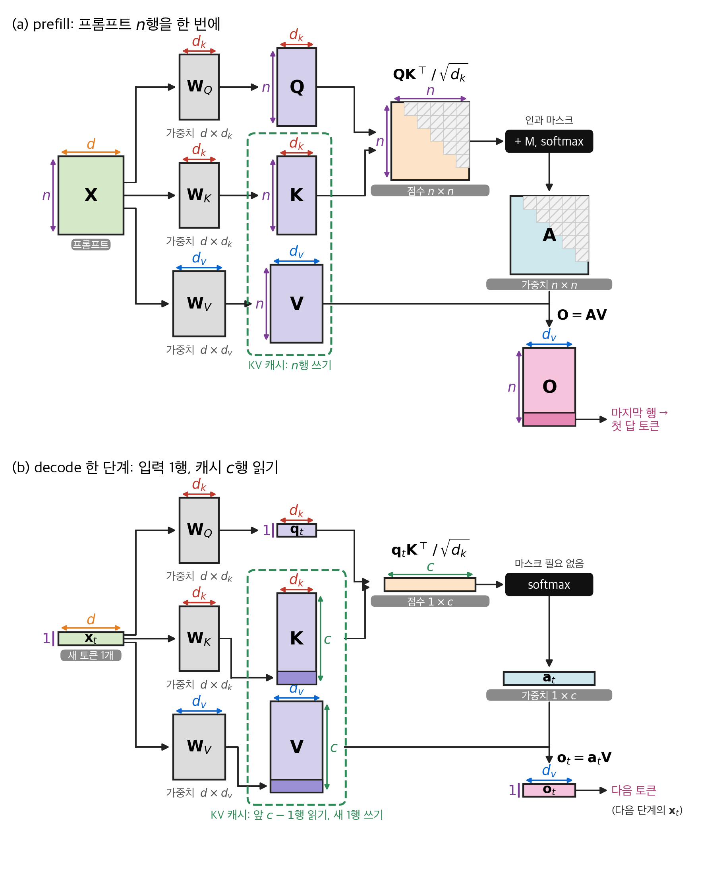
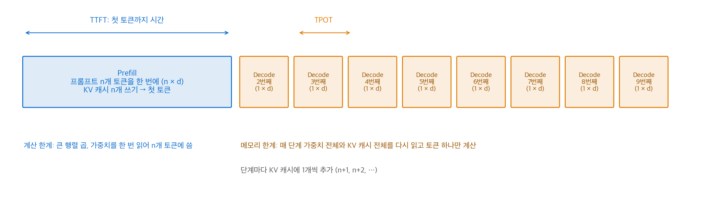
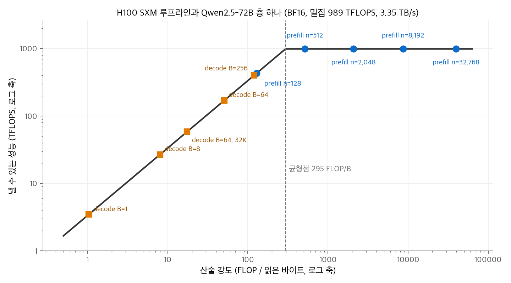
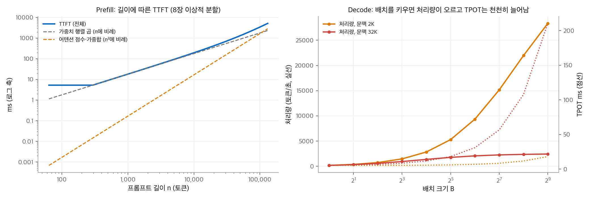
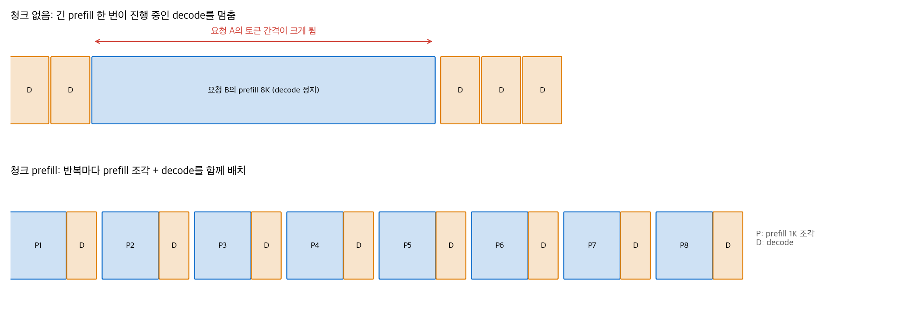
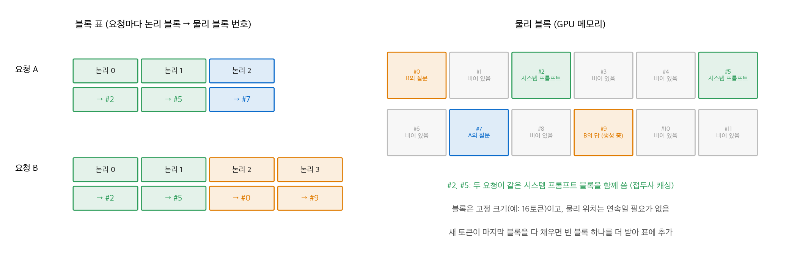
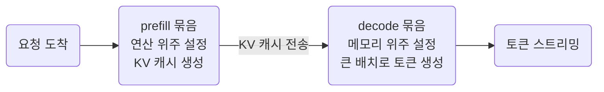

# 7. Prefill과 Decode

LLM이 답을 만드는 과정은 성격이 다른 두 단계로 나뉩니다.
**prefill**은 프롬프트 전체를 한 번에 읽어 KV 캐시를 채우고 첫 토큰을 만듭니다.
**decode**는 그 뒤 토큰을 하나씩 만듭니다.
두 단계는 같은 모델을 쓰지만, 하드웨어에서 병목이 되는 자원이 다릅니다. prefill은 연산이, decode는 메모리 대역폭이 병목입니다.
이 장은 그 차이를 실제 모델 설정과 GPU 사양으로 직접 계산하고, 그 차이에서 나온 서빙 기법(청크 prefill, PagedAttention, 접두사 캐싱, 연속 배치, prefill·decode 분리 배포)을 설명합니다.
마지막 절은 앞 장들의 어텐션 변형이 두 단계에 각각 어떤 영향을 주는지 정리합니다.

!!! info "자료"
    - NVIDIA H100 데이터시트: H100 SXM의 BF16 Tensor Core 1,979 TFLOPS(구조적 희소성 기준, 밀집은 절반인 약 989 TFLOPS), HBM3 3.35 TB/s.
    - 모델 설정값: Qwen2.5-72B 공개 `config.json` (은닉 8,192, FFN 중간 29,568, 80층, 쿼리 헤드 64, KV 헤드 8).
    - Yu et al., [Orca: A Distributed Serving System for Transformer-Based Generative Models](https://www.usenix.org/conference/osdi22/presentation/yu), OSDI 2022.
    - Kwon et al., [Efficient Memory Management for Large Language Model Serving with PagedAttention](https://arxiv.org/abs/2309.06180), SOSP 2023.
    - Agrawal et al., [Taming Throughput-Latency Tradeoff in LLM Inference with Sarathi-Serve](https://arxiv.org/abs/2403.02310), 2024.
    - Zhong et al., [DistServe: Disaggregating Prefill and Decoding for Goodput-optimized Large Language Model Serving](https://arxiv.org/abs/2401.09670), OSDI 2024.
    - Patel et al., [Splitwise: Efficient Generative LLM Inference Using Phase Splitting](https://arxiv.org/abs/2311.18677), 2023.
    - DeepSeek-AI, [DeepSeek-V3 Technical Report](https://arxiv.org/abs/2412.19437), 2024 (추론 배포 절).
    - vLLM [MLA 어텐션 문서](https://docs.vllm.ai/en/v0.15.0/api/vllm/model_executor/layers/attention/mla_attention/).

## 1. 추론의 두 단계

### 작동 원리

사용자가 $n$ 개 토큰의 프롬프트를 보내고 답으로 $T$ 개 토큰을 받는다고 하겠습니다.

1. **prefill.** 프롬프트 $n$ 개 토큰을 한 번의 정방향 계산으로 처리합니다. 층마다 입력은 $n \times d$ 행렬입니다. 인과 마스크를 쓰는 어텐션으로 $n$ 개 토큰의 출력을 모두 계산하고, 층마다 키와 값 $n$ 개를 KV 캐시에 씁니다. 마지막 토큰의 출력으로 첫 번째 답 토큰을 고릅니다.
2. **decode.** 방금 만든 토큰 하나를 입력으로 넣습니다. 층마다 입력은 $1 \times d$ 입니다. 쿼리는 하나뿐이고, 키와 값은 KV 캐시에서 앞의 모든 토큰 것을 읽습니다. 새 토큰의 키와 값은 캐시에 하나 추가합니다.
3. 종료 토큰이 나오거나 $T$ 개를 채울 때까지 2단계를 반복합니다.

| 항목 | prefill | decode (한 단계) |
| --- | --- | --- |
| 층 입력 모양 | $n \times d$ | $1 \times d$ (배치면 $B \times d$) |
| 어텐션 쿼리 수 | $n$ | 1 |
| 어텐션 마스크 | $n \times n$ 인과 마스크 | 필요 없음 (앞 토큰만 캐시에 있음) |
| KV 캐시 | $n$ 개 쓰기 | 앞의 모든 항목 읽기 + 1개 쓰기 |
| 횟수 | 요청마다 1번 | 출력 토큰마다 1번 |

<figure markdown>

<figcaption markdown>
<span class="fig-title"><b>Figure 1.</b> 행렬 단위로 본 prefill과 decode</span>

층 하나의 어텐션에서 행렬 모양을 따라간 그림입니다. 색은 차원을 나타냅니다. 보라는 토큰 수 $n$, 주황은 은닉 차원 $d$, 빨강은 $d_k$, 파랑은 $d_v$, 초록은 캐시 길이 $c$ 입니다.
(a) prefill은 $n$ 행을 한 번에 사상하고, $\mathbf{K}$ 와 $\mathbf{V}$ 를 그대로 KV 캐시에 씁니다. 점수는 $n \times n$ 이고, 빗금 칸은 인과 마스크가 가린 칸입니다. 첫 답 토큰은 출력 $\mathbf{O}$ 의 마지막 행에서 나옵니다.
(b) decode는 새 토큰 1행만 사상합니다. 캐시에 진한 보라색 1행을 붙이고, 쿼리 1개로 캐시 $c$ 행을 모두 읽습니다. 점수는 $1 \times c$ 이고, 캐시에는 앞 토큰만 있으므로 마스크가 필요 없습니다.
두 단계의 가중치 $\mathbf{W}_Q, \mathbf{W}_K, \mathbf{W}_V$ 는 같습니다. prefill은 가중치를 한 번 읽어 $n$ 행에 쓰고, decode는 1행을 위해 가중치 전체를 다시 읽습니다. 이 차이가 2절의 산술 강도 차이로 이어집니다.
</figcaption>
</figure>

<figure markdown>

<figcaption markdown>
<span class="fig-title"><b>Figure 2.</b> prefill과 decode의 타임라인</span>

prefill은 긴 계산 한 번으로 첫 토큰을 내고, decode는 짧은 계산을 토큰마다 반복합니다.
</figcaption>
</figure>

### 코드로 보기

```python
import torch

def attend(q, K, V):
    """q: (m, d), K·V: (t, d). 마지막 m개 쿼리가 앞의 t개 키를 봅니다."""
    m, t = q.shape[0], K.shape[0]
    S = q @ K.T / q.shape[-1] ** 0.5
    mask = torch.ones(m, t, dtype=torch.bool).tril(diagonal=t - m)  # 인과 마스크
    return torch.softmax(S.masked_fill(~mask, float("-inf")), -1) @ V

torch.manual_seed(0)
d, n = 8, 5
Wq, Wk, Wv = (torch.randn(d, d) for _ in range(3))
X = torch.randn(n + 1, d)                       # 프롬프트 5개 + 생성 토큰 1개

# prefill: 5개를 한 번에. KV 캐시를 채웁니다.
K_cache, V_cache = X[:n] @ Wk, X[:n] @ Wv
out_prefill = attend(X[:n] @ Wq, K_cache, V_cache)            # (5, d)

# decode: 새 토큰 1개. 캐시에 1개를 붙이고 쿼리 1개로 읽습니다.
K_cache = torch.cat([K_cache, X[n:] @ Wk]); V_cache = torch.cat([V_cache, X[n:] @ Wv])
out_decode = attend(X[n:] @ Wq, K_cache, V_cache)              # (1, d)

# 6개를 한 번에 계산한 결과와 같습니다.
full = attend(X @ Wq, X @ Wk, X @ Wv)
print(torch.allclose(full[:n], out_prefill, atol=1e-5), torch.allclose(full[n:], out_decode, atol=1e-5))  # True True
```

## 2. 계산량과 메모리 읽기

### 층 하나의 비용

Qwen2.5-72B의 층 하나를 기준으로 계산합니다. 헤드 차원은 $8192 / 64 = 128$ 입니다.

| 부분 | 매개변수 |
| --- | --- |
| 어텐션 사상 ($\mathbf{W}_Q, \mathbf{W}_O$: $8192^2$ 씩, $\mathbf{W}_K, \mathbf{W}_V$: $8192 \times 1024$ 씩) | 151.0M |
| SwiGLU FFN ($3 \times 8192 \times 29568$) | 726.7M |
| 층 하나 합계 $P$ | 877.7M |

80층이면 70.2B이고, 입력·출력 임베딩 2.5B를 더하면 72.7B입니다. 공개 이름의 72B와 맞습니다.

행렬 곱 $\mathbf{X}\mathbf{W}$ 에서 $\mathbf{X}$ 가 $n \times d$, $\mathbf{W}$ 가 $d \times d'$ 이면 FLOPs는 $2 n d d'$ 입니다. 그래서 층 하나의 비용은 다음과 같습니다. KV 캐시 원소는 토큰 하나, 층 하나에 $2 \times 8 \times 128 = 2{,}048$ 개(BF16로 4,096바이트)입니다.

$$
\text{prefill:}\quad \text{FLOPs} \approx 2nP + 2n^2 \cdot 8192,\qquad \text{읽는 바이트} \approx 2P + 4096\,n
$$

$$
\text{decode (배치 } B\text{, 문맥 } c\text{):}\quad \text{FLOPs} \approx B\,(2P + 4c \cdot 8192),\qquad \text{읽는 바이트} \approx 2P + 4096\,Bc
$$

두 식의 핵심 차이는 가중치 읽기 $2P$ 입니다. prefill은 가중치를 한 번 읽어 $n$ 개 토큰에 씁니다. decode는 단계마다 가중치 전체를 다시 읽어 토큰 $B$ 개에만 씁니다.
어텐션 항 $2n^2 \cdot 8192$ 는 인과 마스크로 점수와 가중합의 절반만 계산한다고 둔 값입니다.

### 산술 강도와 균형점

**산술 강도**는 읽은 바이트당 FLOPs입니다. H100 SXM은 밀집 BF16 989 TFLOPS, HBM3 3.35 TB/s이므로 균형점이 다음과 같습니다.

$$
\frac{989 \times 10^{12}}{3.35 \times 10^{12}} \approx 295\ \text{FLOP/바이트}
$$

산술 강도가 295보다 낮으면 메모리 대역폭이, 높으면 연산이 시간을 정합니다. [어텐션 3장](../attention/03-mqa-gqa.md)의 생성 단계 분석에서 쓴 값과 같습니다.

| 경우 | 산술 강도 | 병목 | 층 하나 시간 (GPU 1장) |
| --- | --- | --- | --- |
| prefill $n = 128$ | 128 | 메모리 | 0.52ms |
| prefill $n = 2{,}048$ | 2,077 | 연산 | 3.70ms |
| prefill $n = 8{,}192$ | 8,653 | 연산 | 15.65ms |
| decode $B = 1$, $c = 2{,}048$ | 1.0 | 메모리 | 0.53ms |
| decode $B = 64$, $c = 2{,}048$ | 50.9 | 메모리 | 0.68ms |
| decode $B = 256$, $c = 2{,}048$ | 119.5 | 메모리 | 1.17ms |
| decode $B = 64$, $c = 32{,}768$ | 17.5 | 메모리 | 3.09ms |

시간은 연산 시간과 메모리 시간 중 큰 값으로 계산한 하한입니다. 실제 커널은 이보다 느립니다.

<figure markdown>

<figcaption markdown>
<span class="fig-title"><b>Figure 3.</b> H100 루프라인과 prefill·decode의 위치</span>

2K 이상의 prefill은 계산 한계 구간에, decode는 배치 256에서도 메모리 한계 구간에 있습니다.
</figcaption>
</figure>

두 가지를 함께 읽을 수 있습니다.

- **짧은 prefill은 메모리 한계입니다.** $n = 128$ 이면 산술 강도가 128이라 균형점에 못 미칩니다. 토큰이 수백 개 이상이어야 연산이 병목이 됩니다.
- **decode는 배치를 키워도 KV 캐시 때문에 한계가 있습니다.** 가중치 읽기는 배치 전체가 나눠 쓰지만, KV 캐시는 요청마다 따로 읽습니다. $B = 64$, $c = 32{,}768$ 이면 층 하나가 읽는 KV 캐시가 $64 \times 32768 \times 4096 \approx 8.6$ GB로, 가중치 1.76 GB의 약 5배입니다.

### 길이와 배치에 따른 변화

<figure markdown>

<figcaption markdown>
<span class="fig-title"><b>Figure 4.</b> 프롬프트 길이에 따른 TTFT와 배치에 따른 decode 처리량</span>

GPU 8장에 이상적으로 나눈 하한입니다. 문맥 32K에서는 KV 캐시 읽기가 지배해 decode 처리량이 일찍 포화합니다.
</figcaption>
</figure>

```python
P = 2*8192*8192 + 2*8192*1024 + 3*8192*29568      # 층 하나 매개변수
F, BW, kv = 989e12, 3.35e12, 4096                  # FLOPS, 바이트/초, 토큰·층당 KV 바이트

def prefill(n):  return 2*n*P + 2*n*n*8192, 2*P + n*kv
def decode(B, c): return B*(2*P + 4*c*8192), 2*P + B*c*kv

for name, (fl, by) in [("prefill 2K", prefill(2048)), ("decode B=1", decode(1, 2048))]:
    print(name, round(fl / by), "FLOP/B,", round(max(fl / F, by / BW) * 1e3, 2), "ms/층")
# prefill 2K 2077 FLOP/B, 3.7 ms/층
# decode B=1 1 FLOP/B, 0.53 ms/층
```

## 3. 지표: TTFT, TPOT, 처리량

| 지표 | 정의 | 주로 정하는 단계 |
| --- | --- | --- |
| **TTFT** (time to first token) | 요청을 보낸 뒤 첫 토큰이 나올 때까지의 시간 | prefill (+ 대기열 시간) |
| **TPOT** (time per output token) | 첫 토큰 이후 토큰 하나당 평균 시간. 토큰 사이 간격(ITL)으로도 부릅니다 | decode |
| **처리량** | 시스템 전체가 1초에 만드는 토큰 수 | 배치 크기와 decode |

**손계산.** Qwen2.5-72B를 H100 8장에 이상적으로 나눴다고 가정합니다. 프롬프트 2,048토큰, 답 256토큰입니다.

1. TTFT: prefill 층 하나 3.70ms × 80층 / 8 = **37.0ms**.
2. TPOT: decode($B = 1$) 층 하나 0.526ms × 80층 / 8 = **5.26ms**.
3. 전체 시간: $37.0 + 255 \times 5.26 \approx 1{,}380$ms. 요청 하나의 생성 속도는 $256 / 1.38 \approx 186$ 토큰/초입니다.
4. 같은 GPU로 요청 64개를 함께 decode하면 단계 하나가 6.84ms입니다. TPOT는 1.3배가 되지만 처리량은 $64 / 6.84\,\text{ms} \approx 9{,}350$ 토큰/초로 약 50배가 됩니다.

서빙 시스템의 설계는 대부분 이 두 축(요청 하나의 지연과 전체 처리량)의 절충입니다. DistServe는 TTFT와 TPOT 목표를 함께 지키는 초당 요청 수를 **goodput**으로 정의했습니다.

## 4. Prefill 최적화

### FlashAttention

prefill의 어텐션은 $n \times n$ 점수 행렬을 만듭니다. [어텐션 1장](../attention/01-scaled-dot-product.md)의 FlashAttention은 점수 행렬을 HBM에 쓰지 않고 타일 단위로 계산합니다.
prefill은 쿼리가 많아서 이 이득이 큽니다. decode는 쿼리가 하나이므로 점수 행렬이 $1 \times c$ 로 작습니다. 대신 KV 캐시를 빨리 읽는 것이 중요합니다.

### 연속 배치

요청 단위로 배치를 묶으면, 배치 안의 모든 요청이 끝나야 다음 요청을 받습니다. 짧은 답을 받은 요청도 긴 답이 끝날 때까지 자리를 차지합니다.
Orca는 **반복(iteration) 단위 스케줄링**을 제안했습니다. 모델을 한 단계 돌릴 때마다 끝난 요청을 빼고 새 요청을 넣습니다. 이 방식을 흔히 **연속 배치(continuous batching)**라고 부릅니다.
Orca 논문은 GPT-3 175B에서 같은 지연 수준으로 FasterTransformer보다 처리량이 36.9배 높다고 보고했습니다.

### 청크 prefill

연속 배치에서 긴 프롬프트가 들어오면 문제가 생깁니다. 그 prefill이 한 반복 전체를 차지하는 동안 진행 중인 요청들의 decode가 멈춥니다. 사용자 입장에서는 답이 나오다가 갑자기 끊깁니다.

**청크 prefill(chunked prefill)**은 긴 prefill을 비슷한 크기의 조각으로 나눕니다. 반복마다 prefill 조각 하나와 진행 중인 decode들을 한 배치로 묶습니다.
Sarathi-Serve는 이 방법과 decode를 멈추지 않는 스케줄링(stall-free scheduling)을 함께 제안했습니다. vLLM 대비 지연 제약 아래 처리 용량이 Mistral-7B(A100 1장)에서 2.6배, Yi-34B(A100 2장)에서 최대 3.7배 높았다고 보고했습니다.

<figure markdown>

<figcaption markdown>
<span class="fig-title"><b>Figure 5.</b> 청크 prefill의 스케줄</span>

prefill을 1K 조각으로 나누면 decode와 함께 실행되므로, 다른 요청의 토큰 간격이 고르게 유지됩니다.
</figcaption>
</figure>

청크 prefill이 효율적인 이유는 2절의 계산에 있습니다. decode만 모은 배치는 메모리 한계라 연산기가 놉니다. 여기에 prefill 조각을 섞으면, 어차피 읽는 가중치로 더 많은 연산을 합니다. 조각이 너무 작으면 prefill 자체가 메모리 한계가 되므로($n = 128$ 의 산술 강도 128), 조각 크기는 수백 토큰 이상으로 둡니다.

### PagedAttention과 접두사 캐싱

KV 캐시는 요청마다 길이가 다르고 생성하면서 계속 늘어납니다. 요청마다 최대 길이만큼 연속 메모리를 미리 잡으면, 쓰지 않는 공간과 조각화로 메모리가 크게 낭비됩니다.
**PagedAttention**(vLLM)은 운영체제의 가상 메모리와 페이징에서 아이디어를 가져왔습니다.

1. KV 캐시를 고정 크기 **블록**(예: 16토큰)으로 나눕니다.
2. 요청마다 **블록 표**를 둡니다. 표는 논리 블록 번호를 GPU 메모리의 물리 블록 번호로 바꿉니다.
3. 물리 블록은 아무 위치에나 있을 수 있습니다. 어텐션 커널은 블록 표를 따라 키와 값을 읽습니다.
4. 마지막 블록이 다 차면 빈 물리 블록 하나를 받아 표에 붙입니다.

<figure markdown>

<figcaption markdown>
<span class="fig-title"><b>Figure 6.</b> 블록 표와 물리 블록</span>

같은 시스템 프롬프트로 시작하는 두 요청은 앞 블록을 같은 물리 블록(#2, #5)으로 공유합니다.
</figcaption>
</figure>

같은 물리 블록을 여러 요청이 가리키면 **접두사 캐싱(prefix caching)**이 됩니다. 시스템 프롬프트나 대화 앞부분처럼 반복되는 접두사의 KV를 다시 계산하지 않으므로, 그만큼 prefill이 줄어 TTFT가 짧아집니다.
vLLM 논문은 이 방식으로 KV 캐시 낭비를 거의 없애고, 요청 안과 요청 사이에서 KV 캐시를 공유할 수 있다고 설명합니다. 같은 지연 수준에서 FasterTransformer, Orca 같은 시스템보다 처리량이 2~4배 높다고 보고했습니다.

## 5. Prefill·Decode 분리 배포

### 작동 원리

연속 배치와 청크 prefill은 두 단계를 같은 GPU에서 섞습니다. 그러면 두 단계가 서로 간섭하고, 병렬화 방식도 하나로 묶입니다.
**분리 배포(disaggregation)**는 prefill과 decode를 서로 다른 GPU 묶음에서 실행합니다.



| 연구 | 핵심 주장 |
| --- | --- |
| Splitwise | prompt 계산은 연산 집약적이고 token 생성은 메모리 집약적입니다. token 생성은 최신 GPU의 연산 능력이 필요 없으므로, 두 단계를 다른 기계(다른 종류의 하드웨어 포함)에서 실행합니다. 같은 비용·전력에서 처리량이 2.35배라고 보고했습니다. |
| DistServe | TTFT와 TPOT 목표가 주어지면 두 단계의 자원 배분과 병렬화를 따로 고르고, 클러스터 대역폭을 보고 배치를 정합니다. 기존 시스템보다 요청을 최대 7.4배 더 처리하거나, 12.6배 엄격한 목표를 지킨다고 보고했습니다. |

### KV 전송량 계산

분리 배포의 대가는 prefill이 만든 KV 캐시를 decode 쪽으로 옮기는 비용입니다. 8K 토큰 프롬프트로 계산합니다. 링크 속도는 50 GB/s로 가정합니다.

| 모델 | 토큰당 KV (전체 층, BF16) | 8K 토큰의 KV | 50 GB/s 전송 시간 |
| --- | --- | --- | --- |
| Qwen2.5-72B (GQA, 80층) | 320 KiB | 2.5 GiB | 약 54ms |
| DeepSeek-V3 (MLA, 61층) | 68.6 KiB | 0.54 GiB | 약 12ms |

KV 캐시가 작을수록 분리 배포의 부담이 줄어듭니다. [MLA](../attention/05-mla.md)처럼 토큰당 KV를 줄인 구조는 전송량도 함께 줄입니다.

### DeepSeek-V3의 배포 구성

DeepSeek-V3 보고서는 두 단계를 다른 단위로 배포했습니다.

| 항목 | prefill | decode |
| --- | --- | --- |
| 최소 배포 단위 | 4노드, GPU 32장 | 40노드, GPU 320장 |
| 어텐션 병렬화 | TP4 + 시퀀스 병렬, DP8 | TP4 + 시퀀스 병렬, DP80 |
| MoE 전문가 병렬 | EP32 | EP320 (GPU 하나에 전문가 하나) |
| 중복 전문가 | 32개 (GPU마다 원래 전문가 8개 + 중복 1개) | 중복·공유 전문가를 GPU 64장에 둠 |

prefill은 비슷한 작업량의 마이크로배치 두 개를 함께 돌려, 한쪽의 어텐션·MoE 계산과 다른 쪽의 dispatch·combine 통신을 겹칩니다.
decode는 GPU 하나에 전문가 하나만 두어 전문가 가중치를 읽는 양을 줄입니다. [MoE 장](05-moe.md) 7절의 전문가 병렬과 이어지는 내용입니다.

## 6. 어텐션 변형이 두 단계에 주는 영향

앞 장들의 기법은 대부분 한 단계를 겨냥합니다.

| 기법 | prefill에 주는 영향 | decode에 주는 영향 | 자세히 |
| --- | --- | --- | --- |
| GQA, MQA | 사상 계산이 약간 줄어듦 | KV 캐시 읽기가 KV 헤드 수에 비례해 줄어듦 | [어텐션 3장](../attention/03-mqa-gqa.md) |
| MLA | 키와 값을 복원해 일반 어텐션처럼 계산 | 흡수한 형태로 576차원 잠재 벡터만 읽음 | [어텐션 5장](../attention/05-mla.md) |
| 슬라이딩 창 | 로컬층 어텐션이 $O(nw)$ | 로컬층 KV 캐시가 창 크기로 고정 | [어텐션 4장](../attention/04-sliding-window.md) |
| 희소 어텐션 (DSA, IndexShare) | 본 어텐션이 $O(n^2)$ 에서 $O(nk)$ 로 줄고, 인덱서가 남은 $O(n^2)$ 비용을 맡음 | 읽는 KV가 고른 $k$ 개로 줄어듦 | [어텐션 6장](../attention/06-sparse-attention.md) |
| 선형 어텐션 (Gated DeltaNet, KDA) | 청크 병렬 알고리즘으로 한 번에 계산 | 고정 크기 상태를 순환으로 갱신, KV 캐시 없음 | [어텐션 7장](../attention/07-linear-attention.md), [9장](../attention/09-kda.md) |
| MoE | 토큰이 많아 대부분의 전문가가 활성, 연산 위주 | 배치가 작으면 일부 전문가만 읽음, 메모리 위주 | [5장](05-moe.md) |
| MTP, 추측 디코딩 | 영향 작음 | 초안 $\gamma$ 개를 한 번에 검증해 decode에 작은 prefill을 섞는 효과 | [6장](06-mtp.md) |

**MLA가 두 단계에서 다르게 계산하는 이유.** vLLM의 MLA 구현 문서는 MLA를 두 방식으로 계산한다고 설명합니다. 쿼리 길이와 KV 길이의 비가 1에 가까운 prefill에는 연산 효율이 좋은 방식(키와 값을 복원)을 쓰고, 비가 큰 decode에는 데이터 이동이 적은 방식(흡수)을 씁니다.
2절의 관점으로 보면 자연스럽습니다. prefill은 연산 한계이므로 흡수로 늘어나는 연산(헤드마다 576차원 내적)이 부담입니다. decode는 메모리 한계이므로 읽는 바이트를 줄이는 흡수가 유리합니다.

**추측 디코딩이 decode를 빠르게 하는 이유.** 본 모델이 초안 토큰 $\gamma$ 개를 한 번의 정방향 계산으로 검증하면, 그 단계는 쿼리 $\gamma + 1$ 개짜리 작은 prefill입니다. 가중치 읽기는 같고 연산만 $\gamma + 1$ 배가 되므로, 메모리 한계인 decode에서는 시간이 거의 늘지 않습니다.

## 정리

- prefill은 프롬프트 전체를 한 번에 처리하고 KV 캐시를 채웁니다. decode는 토큰을 하나씩 만들며 KV 캐시를 읽습니다.
- 가중치 읽기를 몇 개 토큰이 나눠 쓰는지가 산술 강도를 정합니다. H100 균형점은 약 295 FLOP/바이트입니다. 수백 토큰 이상의 prefill은 연산 한계이고, decode는 큰 배치에서도 메모리 한계입니다.
- TTFT는 prefill이, TPOT는 decode가 주로 정합니다. 배치를 키우면 처리량은 오르고 TPOT는 조금 늘어납니다. 긴 문맥에서는 KV 캐시 읽기가 처리량의 상한을 낮춥니다.
- 연속 배치, 청크 prefill, PagedAttention과 접두사 캐싱은 두 단계를 같은 GPU에서 효율적으로 섞는 방법입니다.
- 분리 배포는 두 단계를 다른 GPU에서 실행하고 KV 캐시를 옮깁니다. DeepSeek-V3는 prefill을 32장, decode를 320장 단위로 배포했습니다.
- 어텐션 변형은 대부분 decode의 메모리(GQA, MLA, 슬라이딩 창, 선형 어텐션)나 긴 prefill의 연산(희소 어텐션)을 겨냥합니다.

모델별 실제 설정과 비용은 트렌드의 LLM Model 글([Gemma](../../trends/posts/2026-10-20-llm-gemma.md), [DeepSeek](../../trends/posts/2026-10-20-llm-deepseek.md), [Qwen](../../trends/posts/2026-10-20-llm-qwen.md), [GLM](../../trends/posts/2026-10-20-llm-glm.md), [Kimi](../../trends/posts/2026-10-20-llm-kimi.md))에 있습니다.
