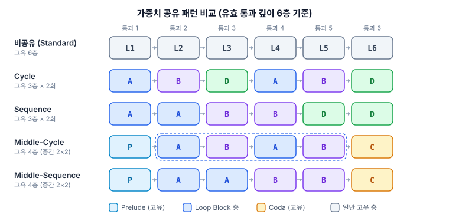
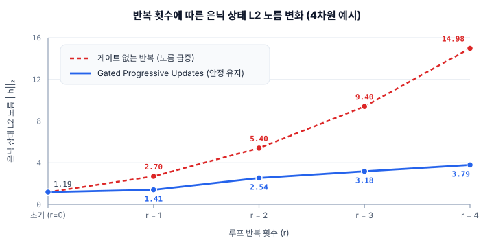
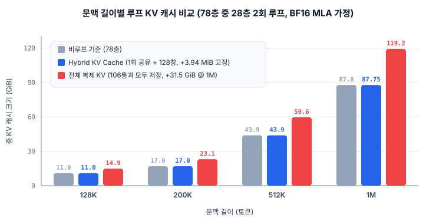

# 8. 루프 아키텍처

일반 트랜스포머는 층마다 고유 가중치를 두고 토큰을 한 번만 통과시킵니다.
**루프 아키텍처(Loop Architecture)**는 공유 층 블록을 여러 번 반복 실행해 매개변수를 늘리지 않고 연산 깊이를 키웁니다.
이 구조는 문맥에 추론 토큰을 길게 출력하는 대신 은닉 상태 안에서 계산을 반복하므로 **잠재 공간 추론(latent reasoning)**이라고도 부릅니다.
이 장은 가중치 공유 방식, 반복 실행 안정화, KV 캐시와 희소 인덱스 재사용을 수식으로 설명합니다.
이어서 학습 및 깊이 조절 전략과 대표 모델을 수치 예시로 비교합니다.

!!! info "이 장에서 쓰는 자료"
    - Dehghani et al., [Universal Transformers](https://arxiv.org/abs/1807.03819), ICLR 2019.
    - Bae et al., [Relaxed Recursive Transformers: Effective Parameter Sharing with Layer-wise LoRA](https://arxiv.org/abs/2410.20672), ICLR 2025.
    - Geiping et al., [Scaling up Test-Time Compute with Latent Reasoning: A Recurrent Depth Approach](https://arxiv.org/abs/2502.05171) (Huginn), 2025.
    - Bae et al., [Mixture-of-Recursions: Learning Dynamic Recursive Depths for Adaptive Token-Level Computation](https://arxiv.org/abs/2507.10524), NeurIPS 2025.
    - Zhu et al., [Scaling Latent Reasoning via Looped Language Models](https://arxiv.org/abs/2510.25741) (Ouro), 2025.
    - Z.ai, [GLM-5.4 문서](https://docs.z.ai/guides/llm/glm-5.4) 및 기술 블로그 *GLM-5.4: Toward Generalized Coding with Our First Loop Transformer* (2026. 11. 23.).

## 1. 왜 층을 반복하는가: 매개변수 대 연산 깊이

### 지식 용량과 추론 깊이의 분리

대형 언어 모델에서 사실을 외우는 일은 가중치 용량(매개변수 수)에 크게 의존합니다.
반면 다단계 논리나 상태 추적 같은 추론 과제는 가중치 크기보다 토큰 하나를 처리하는 유효 연산 깊이(effective depth)에 민감합니다.

일반 트랜스포머에서 깊이를 두 배로 늘리면 층마다 고유 가중치가 추가되므로 매개변수도 두 배가 됩니다.
디코드 단계는 가중치를 HBM에서 읽어 들이는 메모리 대역폭이 병목입니다([7. Prefill과 Decode](07-prefill-decode.md)).
따라서 모델이 커질수록 배포에 필요한 VRAM과 토큰당 지연 시간이 함께 늘어납니다.
루프 아키텍처는 같은 가중치 블록을 여러 번 재사용해 가중치 저장 공간을 고정한 채 유효 깊이를 늘립니다.

### 명시적 사고 사슬 대 잠재 공간 추론

추론 시점 계산(test-time compute)을 늘리는 방법에는 두 가지 흐름이 있습니다.
하나는 사고 사슬(Chain-of-Thought, CoT)처럼 중간 과정을 텍스트 토큰으로 출력하는 방식입니다.
다른 하나는 루프 아키텍처처럼 은닉 상태를 반복 갱신해 잠재 공간에서 계산을 마치는 방식입니다.

| 항목 | 명시적 CoT | 잠재 공간 추론 (루프 아키텍처) |
| --- | --- | --- |
| 추론 수행 위치 | 출력 토큰열 (어휘 공간) | 은닉 상태 $\mathbf{h}^{(r)}$ (연속 잠재 공간) |
| 문맥 창 소비 | 사고 토큰만큼 길어짐 | 출력 전까지 추가 토큰 없음 |
| 단계별 추론 데이터 | SFT·RL 데이터 구축이 중요 | 사전학습 단계부터 반복 계산 학습 가능 |
| 언어화 제약 | 말로 적기 쉬운 단계에 유리 | 비언어적 상태 추적에도 계산 투입 가능 |
| 해석 가능성 | 중간 추론 과정을 사람이 읽음 | 중간 상태를 직접 해석하기 어려움 |

두 방식은 서로 배타적이지 않습니다.
상용 모델에서는 루프 아키텍처로 토큰당 잠재 추론 깊이를 확보한 뒤 사고 모드(thinking mode)로 명시적 CoT를 함께 씁니다.

## 2. 구조와 가중치 공유 방식

### Prelude-Loop-Coda 구조

현대 루프 언어 모델은 전체 층을 똑같이 반복하지 않습니다.
대부분 세 구간으로 나뉩니다.
입력 임베딩을 잠재 공간으로 옮기는 **Prelude($\mathcal{P}$)**, 가중치를 공유해 $K$회 반복하는 **Loop Block($\mathcal{R}$)**, 다음 토큰 분포를 만드는 **Coda($\mathcal{C}$)**입니다.

$$
\mathbf{h}^{(0)} = \mathcal{P}(\mathbf{x}),\qquad
\mathbf{h}^{(r)} = \mathcal{R}\!\left(\mathbf{h}^{(r-1)};\,\theta_{\text{loop}}\right)\ \ (r = 1, \ldots, K),\qquad
\mathbf{y} = \mathcal{C}\!\left(\mathbf{h}^{(K)}\right)
$$

Prelude가 $L_{\text{pre}}$층, Loop Block이 $L_{\text{loop}}$층, Coda가 $L_{\text{coda}}$층이면 고유 가중치 층 수와 유효 통과 깊이는 다음과 같습니다.

$$
L_{\text{uniq}} = L_{\text{pre}} + L_{\text{loop}} + L_{\text{coda}},\qquad
L_{\text{eff}} = L_{\text{pre}} + K \cdot L_{\text{loop}} + L_{\text{coda}}
$$

Huginn처럼 매 반복마다 Prelude 출력 $\mathbf{e} = \mathcal{P}(\mathbf{x})$ 를 Loop Block에 함께 넣는 변형도 있습니다.

$$
\mathbf{s}_r = \mathcal{R}\!\left(\mathbf{e},\,\mathbf{s}_{r-1};\,\theta_{\text{loop}}\right)
$$

이 방식은 반복이 길어져도 초기 입력 정보가 중간 상태에서 희석되는 현상을 막아 줍니다.

### 네 가지 가중치 공유 패턴

공유 가중치를 층에 배치하는 방식은 크게 네 가지입니다.
고유 층 3개($A, B, D$) 또는 경계 층($P, C$)과 중간 층($A, B$)으로 유효 깊이 6층을 만드는 경우를 비교합니다.

| 패턴 | 실행 순서 (유효 6층) | 특징 |
| --- | --- | --- |
| `Cycle` | $A \to B \to D \to A \to B \to D$ | 전체 블록을 묶어 $K$회 순환 |
| `Sequence` | $A \to A \to B \to B \to D \to D$ | 각 층을 제자리에서 연속 반복 |
| `Middle-Cycle` | $P \to A \to B \to A \to B \to C$ | 입출력 경계는 고유 가중치, 중간 블록만 순환 |
| `Middle-Sequence` | $P \to A \to A \to B \to B \to C$ | 경계는 고유 가중치, 중간 층을 층별 연속 반복 |

<figure markdown>

<figcaption markdown>
<span class="fig-title"><b>Figure 1.</b> 가중치 공유 패턴 비교 (유효 통과 깊이 6층 기준)</span>

`Cycle`과 `Sequence`는 모든 층의 가중치를 재사용합니다. `Middle-Cycle`은 입력 해석($P$)과 출력 투영($C$)을 고유 층으로 남겨 두어 변환 손실을 줄입니다.
</figcaption>
</figure>

Relaxed Recursive Transformers와 Mixture-of-Recursions의 비교 실험에서 **Middle-Cycle**이 가장 낮은 검증 손실과 가장 안정적인 성능을 기록했습니다.
초기 층은 토큰 임베딩을 문맥 표현으로 바꾸고, 마지막 층은 출력 어휘 분포로 투영합니다.
역할이 다른 양 끝 층을 중간 추론 층과 분리해야 표현 충돌이 줄어들기 때문입니다.
GLM-5.4도 78층 중 1~26층(Prelude), 27~54층(28층 Loop Block), 55~78층(Coda)으로 나눈 Middle-Cycle 구조를 씁니다.

## 3. 반복 실행 안정화: Gated Progressive Updates

### 왜 단순 반복이 불안정한가

트랜스포머 블록 $\mathcal{R}$ 은 잔차 연결 $\mathbf{h} + F(\mathbf{h})$ 구조를 갖습니다.
서로 다른 층을 쌓은 일반 모델에서는 각 층의 가중치가 자기 위치의 입력 노름(norm)과 분포에 맞춰 학습됩니다.
반면 같은 블록을 여러 번 통과시키면 후보 갱신 $F(\mathbf{h}^{(r-1)})$ 이 같은 방향으로 계속 더해집니다.
그 결과 활성화 노름이 급격히 커지거나, 다음 회차가 기대하는 분포에서 벗어날 수 있습니다.

### 토큰별 게이트와 완화된 공유

이 문제를 푸는 대표적인 방법이 **Gated Progressive Updates**입니다.
반복 회차 $r$ 마다 독립된 토큰별 게이트 $\mathbf{g}^{(r)}$ 를 두어 후보 갱신의 반영 비율을 조절합니다.

$$
\mathbf{g}^{(r)} = \sigma\!\left(\mathbf{W}_g^{(r)}\,\mathbf{h}^{(r-1)} + \mathbf{b}_g^{(r)}\right),\qquad
\mathbf{h}^{(r)} = \mathbf{h}^{(r-1)} + \mathbf{g}^{(r)} \odot F\!\left(\mathbf{h}^{(r-1)};\,\theta_{\text{loop}}\right)
$$

게이트 파라미터 $(\mathbf{W}_g^{(r)}, \mathbf{b}_g^{(r)})$ 는 회차마다 따로 둡니다.
Z.ai의 GLM-5.4 분석에 따르면 학습된 게이트는 회차별 역할 분담을 보입니다.
1회차 게이트는 전체적으로 작은 값으로 보수적인 갱신을 수행해 전역 문맥을 안정적으로 잡습니다.
반면 예측이 어려운 토큰에서는 1회차 게이트가 더 크게 열립니다.
2회차에서는 게이트가 넓게 열려 1회차가 세운 문맥 위에서 논리를 정교하게 다듬습니다.

다른 안정화 기법으로 **층별 LoRA 완화(Layer-wise LoRA)**도 있습니다.
Relaxed Recursive Transformers는 공유 가중치 $\mathbf{W}_{\text{shared}}$ 에 반복별 저랭크 행렬 $\Delta\mathbf{W}^{(r)} = \mathbf{A}^{(r)}\mathbf{B}^{(r)}$ 를 더해, 적은 추가 매개변수로 반복 회차마다 미세한 역할 분화를 허용합니다.

### 손계산 수치 예시

작은 4차원 모델에서 게이트 유무에 따른 노름 변화를 확인합니다.
초기 은닉 상태가 $\mathbf{h}^{(0)} = [0.80,\ -0.60,\ 0.50,\ -0.40]$ ($\|\mathbf{h}^{(0)}\|_2 = 1.187$) 이고, 공유 블록의 후보 갱신이 $F(\mathbf{h}) = 1.2\tanh(\mathbf{W}\mathbf{h}) + 0.35\mathbf{h}$ 라고 둡니다.

```text
W = [[ 0.9,  0.3, -0.2,  0.1],
     [-0.2,  0.8,  0.4, -0.1],
     [ 0.3, -0.1,  0.8,  0.3],
     [-0.1,  0.2, -0.3,  0.9]]
```

1. **게이트 없는 반복** ($\mathbf{h}^{(r)} = \mathbf{h}^{(r-1)} + F(\mathbf{h}^{(r-1)})$):
   - $r=1$: $\mathbf{h}^{(1)} = [1.536,\ -1.266,\ 1.302,\ -1.273]$, 노름 $2.698$
   - $r=2$: $\mathbf{h}^{(2)} = [2.731,\ -2.412,\ 2.775,\ -2.870]$, 노름 $5.405$
   - $r=4$: $\mathbf{h}^{(4)} = [7.174,\ -6.817,\ 7.851,\ -8.050]$, 노름 $14.979$ (초기 대비 약 12.6배)

2. **Gated Progressive Updates** ($b_g^{(1)} = -1.8$, $b_g^{(2)} = 0.6$, $b_g^{(3)} = -1.2$, $b_g^{(4)} = -1.5$):
   - $r=1$: 후보 갱신 $F(\mathbf{h}^{(0)}) = [0.736,\ -0.666,\ 0.802,\ -0.873]$ 에 보수적 게이트 $\mathbf{g}^{(1)} = [0.165,\ 0.127,\ 0.156,\ 0.137]$ 를 곱해 더합니다. 결과 $\mathbf{h}^{(1)} = [0.922,\ -0.684,\ 0.625,\ -0.520]$ 의 노름은 $1.407$ 입니다.
   - $r=2$: 게이트를 연 $\mathbf{g}^{(2)} = [0.692,\ 0.612,\ 0.676,\ 0.631]$ 를 후보 갱신 $[0.826,\ -0.726,\ 0.936,\ -1.032]$ 에 곱해 더합니다. 결과 $\mathbf{h}^{(2)} = [1.493,\ -1.129,\ 1.257,\ -1.171]$ 의 노름은 $2.541$ 입니다.
   - $r=4$: 4회차까지 진행해도 노름이 $3.794$ 에 머뭅니다.

<figure markdown>

<figcaption markdown>
<span class="fig-title"><b>Figure 2.</b> 반복 횟수에 따른 은닉 상태 L2 노름 변화 (4차원 예시)</span>

게이트가 없으면 같은 잔차 가산이 겹치면서 4회차 만에 노름이 14.98까지 커집니다. 회차별 게이트를 두면 1회차에 폭주를 막고 2회차에 필요한 갱신만 반영해 노름이 3.79 수준에서 안정됩니다.
</figcaption>
</figure>

## 4. 추론 비용과 KV 캐시 설계

### 루프 모델의 KV 캐시 문제

일반 트랜스포머는 층마다 토큰 하나의 키와 값을 한 번만 KV 캐시에 씁니다.
반면 Loop Block $L_{\text{loop}}$ 층을 $K$회 반복하면 회차 $r$ 마다 은닉 상태 $\mathbf{h}^{(r-1)}$ 이 달라지므로 키 $\mathbf{K}^{(r)}$ 와 값 $\mathbf{V}^{(r)}$ 도 달라집니다.
단순히 모든 반복의 KV를 따로 저장하면 루프 구간의 KV 캐시 용량과 디코드 메모리 대역폭이 $K$배로 늘어납니다.
특히 1M(100만) 토큰처럼 긴 문맥에서는 이 증가량이 서빙 한계를 직접 결정합니다.

| 전략 | 2회차 이후 KV 처리 | 추가 메모리 | 대표 적용 | 장단점 |
| --- | --- | --- | --- | --- |
| **반복별 독립 KV** | 매 반복마다 전체 문맥 KV 생성·저장 | 루프 층 × $(K-1)$ 배 | Ouro 기본형 | 표현은 가장 정확하지만 긴 문맥에서 메모리 급증 |
| **전체 KV 공유** | 1회차 KV를 모든 반복이 그대로 재사용 | $0$ | 경량 실험 모델 | 메모리는 최소이지만 2회차 문맥 변화를 어텐션에 반영 못 함 |
| **선택적 재귀 KV** | 라우터가 선택한 활성 토큰만 KV 계산·저장 | 활성 토큰 비율에 비례 | MoR | 불필요한 토큰의 KV 저장과 어텐션 연산을 함께 절약 |
| **Hybrid KV Cache** | 1회차 전역 희소 KV 공유 + 2회차 지역 창만 별도 저장 | 창 크기 $W$ 에 비례하는 상수 | GLM-5.4 | 긴 문맥 메모리 폭증을 막으면서 최근 토큰 정교화 유지 |

### Hybrid KV Cache와 Sparse Attention Index Reuse

긴 문맥과 루프 구조를 결합할 때 두 가지 공학 기법이 핵심 역할을 합니다.

1. **Hybrid KV Cache(전역 공유 + 지역 슬라이딩 창)**:
   2회차는 먼 과거 토큰을 볼 때 1회차가 만든 전역 KV 캐시를 그대로 읽습니다.
   대신 최근 $W$개 토큰의 슬라이딩 창([어텐션 메커니즘 4장](../attention/04-sliding-window.md)) 안에서만 2회차 전용 KV를 새로 생성해 저장합니다.
   전역 맥락은 1회차 캐시로 유지하고, 국소적인 구문·논리 교정만 2회차 창에서 반영하는 절충입니다.
2. **Sparse Attention Index Reuse**:
   DSA 같은 동적 희소 어텐션([어텐션 메커니즘 6장](../attention/06-sparse-attention.md))을 쓸 때, 1회차 인덱서가 고른 top-$k$ 토큰 인덱스를 2회차가 다시 계산하지 않고 재사용합니다.
   Z.ai는 2회차에서 인덱스를 새로 뽑는 경우와 1회차 인덱스를 재사용하는 경우의 성능 차이가 거의 없으면서 추가 인덱서 연산을 0으로 줄였다고 보고했습니다.

### 수치 계산: 1M 문맥에서의 메모리 차이

78층 모델의 중간 28층을 2회 반복하는 설정(유효 106층 통과)을 가정합니다.
GLM-5 공개 규격처럼 MLA(잠재 512 + RoPE 키 64 = 576개 원소, BF16 기준 층당 토큰당 $1{,}152\,\text{B}$)를 씁니다.
문맥 길이 $n$ 에 따른 KV 캐시 용량은 다음과 같습니다.

- **비루프 기준 (78층)**: 토큰당 $78 \times 1{,}152 = 89{,}856\,\text{B} = 87.75\,\text{KiB}$
- **반복별 전체 복제 (추가 28층)**: 토큰당 $28 \times 1{,}152 = 32{,}256\,\text{B} = 31.5\,\text{KiB}$ 추가
- **Hybrid KV Cache (창 $W = 128$ 토큰)**: $n \ge 128$ 일 때 $28 \times 1{,}152 \times 128 = 4{,}128{,}768\,\text{B} \approx 3.94\,\text{MiB}$ 고정 추가

| 문맥 길이 ($n$) | 비루프 기준 (78층) | 전체 복제 (106통과) | Hybrid KV ($W=128$) | Hybrid 추가 비율 |
| --- | --- | --- | --- | --- |
| 8K (8,192) | 0.69 GiB | 0.93 GiB (+0.25 GiB) | 0.69 GiB (+3.94 MiB) | +0.56% |
| 32K (32,768) | 2.74 GiB | 3.73 GiB (+0.98 GiB) | 2.75 GiB (+3.94 MiB) | +0.14% |
| 128K (131,072) | 10.97 GiB | 14.91 GiB (+3.94 GiB) | 10.97 GiB (+3.94 MiB) | +0.035% |
| 200K (202,752) | 16.97 GiB | 23.06 GiB (+6.09 GiB) | 16.97 GiB (+3.94 MiB) | +0.023% |
| 512K (524,288) | 43.88 GiB | 59.62 GiB (+15.75 GiB) | 43.88 GiB (+3.94 MiB) | +0.0088% |
| 1M (1,048,576) | 87.75 GiB | 119.25 GiB (+31.50 GiB) | 87.754 GiB (+3.94 MiB) | +0.0044% |

1M 토큰 기준 전체 복제는 $31.50\,\text{GiB}$ 를 더 쓰지만, Hybrid KV Cache는 $3.94\,\text{MiB}$ 로 전체 복제 추가량의 $1/8{,}192$ 만 사용합니다.

<figure markdown>

<figcaption markdown>
<span class="fig-title"><b>Figure 3.</b> 문맥 길이별 루프 KV 캐시 비교 (78층 중 28층 2회 루프, BF16 MLA 가정)</span>

전체 복제는 문맥 길이에 비례해 추가 캐시가 커지므로 1M 문맥에서 119.25 GiB에 달합니다. Hybrid KV Cache는 2회차 캐시를 128토큰 창으로 제한해 비루프 기준(87.75 GiB)과 거의 같은 크기를 유지합니다.
</figcaption>
</figure>

## 5. 학습 전략과 적응형 연산 깊이

### 처음부터 학습 대 사전학습 모델 전환

초기 루프 트랜스포머 연구는 같은 학습 FLOPs 예산에서 처음부터 학습한 루프 모델이 비공유 모델보다 불리한 경우가 많았습니다.
최근 연구는 두 가지 경로로 이 한계를 넘었습니다.

1. **대규모 루프 사전학습(Ouro)**: 7.7T 토큰 규모로 처음부터 루프 구조를 사전학습했습니다. 1.4B·2.6B 매개변수 모델이 최대 12B 비공유 모델과 비슷한 추론 점수를 냈습니다.
2. **이어 학습 전환(Continued Training / Upcycling)**: Relaxed Recursive Transformers와 GLM-5.4는 이미 수십조 토큰으로 사전학습된 비공유 모델을 출발점으로 삼습니다. 중간 층을 루프로 묶고 게이트를 초기화한 뒤 이어 학습하면, 처음부터 학습할 때의 초기 불안정성과 막대한 사전학습 비용을 피합니다.

### 적응형 연산 깊이와 Overthinking 문제

모든 토큰에 똑같은 반복 횟수를 쓰는 대신, 토큰 난이도에 따라 반복 깊이를 조절하는 기법도 발전했습니다.

- **ACT(Adaptive Computation Time, Universal Transformer)**: 매 반복마다 정지 확률을 예측하고, 누적 확률이 임계값을 넘은 토큰은 계산을 멈춥니다.
- **엔트로피 정규화 조기 종료(Ouro)**: 각 반복 단계의 출력 분포를 감독하면서, 깊이 배분에 엔트로피 정규화를 걸어 쉬운 토큰은 일찍 빠져나오도록 학습합니다.
- **토큰별 동적 라우팅(Mixture-of-Recursions)**: MoE의 토큰 선택 라우팅과 비슷하게 경량 라우터가 토큰마다 최대 반복 깊이(예: 1~3회)를 배정합니다.
- **고정 루프 + 게이트 조절(GLM-5.4)**: 추론 서빙 배치 효율을 위해 물리적 반복 횟수는 2회로 고정하고, 토큰별 게이트 크기로 실질적인 갱신 강도를 조절합니다.

루프 횟수를 무조건 늘린다고 항상 좋아지지는 않습니다.
쉬운 토큰이나 단답형 작업에 너무 많은 반복을 강제하면 은닉 상태가 과하게 변형되어 성능이 떨어지는 **Overthinking** 현상과 응답 지연이 생깁니다.

## 6. 코드로 보기

Prelude, 2회 반복 Loop Block(토큰별 게이트 + Hybrid KV Cache 슬라이딩 창 개념), Coda로 이루어진 최소 구조를 PyTorch 코드로 나타냅니다.

```python
import torch
import torch.nn as nn
import torch.nn.functional as F


class GatedLoopBlock(nn.Module):
    """공유 가중치 블록에 반복 회차별 토큰 게이트를 붙인 루프 모듈입니다."""

    def __init__(self, d_model: int, n_heads: int, num_loops: int = 2, window_size: int = 128):
        super().__init__()
        self.num_loops = num_loops
        self.window_size = window_size
        self.norm1 = nn.RMSNorm(d_model)
        self.attn = nn.MultiheadAttention(d_model, n_heads, batch_first=True)
        self.norm2 = nn.RMSNorm(d_model)
        self.ffn = nn.Sequential(
            nn.Linear(d_model, d_model * 4),
            nn.SiLU(),
            nn.Linear(d_model * 4, d_model),
        )
        # 반복 회차마다 독립된 토큰별 게이트를 둡니다.
        self.gates = nn.ModuleList([nn.Linear(d_model, d_model) for _ in range(num_loops)])

    def _candidate_step(self, h: torch.Tensor, shared_kv: torch.Tensor | None) -> tuple[torch.Tensor, torch.Tensor]:
        q = self.norm1(h)
        if shared_kv is None:
            # 1회차: 전역 KV를 직접 만들고 저장합니다.
            kv = q
            attn_out, _ = self.attn(q, kv, kv, need_weights=False)
            next_shared_kv = kv
        else:
            # 2회차 이후: 1회차 전역 KV를 공유하고, 새 KV는 최근 window_size 토큰만 덧붙입니다.
            local_kv = q[:, -self.window_size:, :]
            kv = torch.cat([shared_kv, local_kv], dim=1)
            attn_out, _ = self.attn(q, kv, kv, need_weights=False)
            next_shared_kv = shared_kv

        u = h + attn_out
        delta = attn_out + self.ffn(self.norm2(u))
        return delta, next_shared_kv

    def forward(self, h: torch.Tensor) -> torch.Tensor:
        shared_kv = None
        for r in range(self.num_loops):
            delta, shared_kv = self._candidate_step(h, shared_kv)
            gate = torch.sigmoid(self.gates[r](h))
            h = h + gate * delta
        return h


class MiddleCycleLoopLM(nn.Module):
    """Prelude -> Shared Loop Block -> Coda 구조의 최소 언어 모델입니다."""

    def __init__(self, vocab_size: int, d_model: int = 256, n_heads: int = 4, num_loops: int = 2):
        super().__init__()
        self.emb = nn.Embedding(vocab_size, d_model)
        self.prelude = nn.TransformerEncoderLayer(d_model, n_heads, d_model * 4, batch_first=True)
        self.loop = GatedLoopBlock(d_model, n_heads, num_loops=num_loops)
        self.coda = nn.TransformerEncoderLayer(d_model, n_heads, d_model * 4, batch_first=True)
        self.head = nn.Linear(d_model, vocab_size)

    def forward(self, input_ids: torch.Tensor) -> torch.Tensor:
        h = self.prelude(self.emb(input_ids))
        h = self.loop(h)
        h = self.coda(h)
        return self.head(h)
```

실제 추론 엔진에서는 `_candidate_step` 의 `shared_kv` 에 1회차가 계산한 희소 KV 캐시를 연결하고, 인과 마스크와 RoPE·MLA 투영을 함께 처리합니다.

## 7. 대표 루프 아키텍처 비교

| 모델·연구 (연도) | 공유 패턴 | 규모 | 학습 방식 | 깊이 조절 | KV 캐시 전략 |
| --- | --- | --- | --- | --- | --- |
| **Universal Transformer** (2018) | `Cycle` (단일 블록 반복) | 소형 실험 | 처음부터 학습 | ACT (토큰별 동적 정지) | 비자기회귀/초기 인코더-디코더 |
| **Relaxed Recursive Transformer** (2024) | `Middle-Cycle` + 층별 LoRA | 1B~소형 LLM | 사전학습 모델 변환 | 고정 반복 + 조기 종료 | 반복별 또는 공유 비교 |
| **Huginn** (2025) | `Prelude` + `Cycle` + `Coda` (입력 재주입) | 3.5B | 800B 토큰 사전학습 | 추론 시 임의 깊이(예: 32회) | 반복별 캐시 / 공유 실험 |
| **Mixture-of-Recursions** (2025) | `Middle-Cycle` | 135M~1.7B | 처음부터 학습 | 라우터로 토큰별 동적 깊이 | 활성 토큰 선택적 재귀 KV |
| **Ouro** (2025) | `Cycle` (공유 블록 반복) | 1.4B, 2.6B | 7.7T 토큰 사전학습 | 엔트로피 정규화 조기 종료 | 반복별 독립 KV (후속 연구로 압축) |
| **GLM-5.4** (2026) | `Middle-Cycle` (26 + 28×2 + 24) | 약 750B | GLM-5 이어 학습 전환 | 고정 2회 + 토큰별 게이트 | 1회차 희소 KV 공유 + 2회차 128창 |
