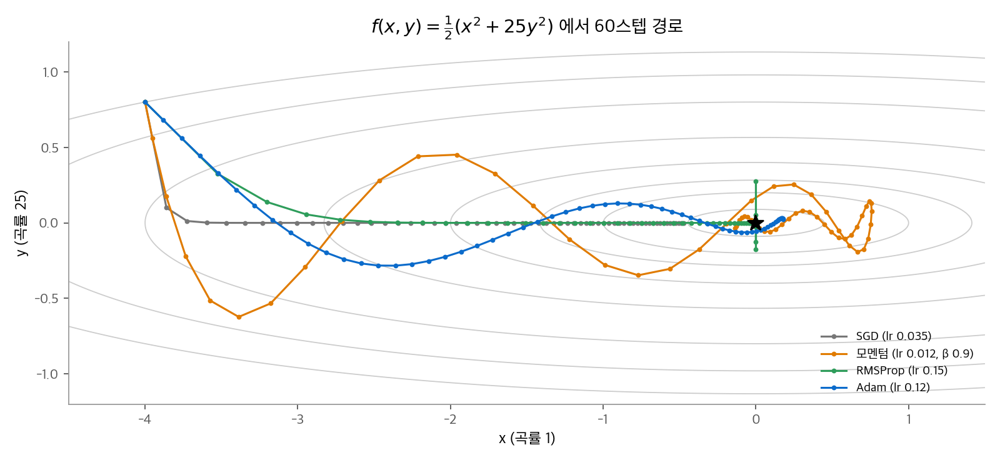
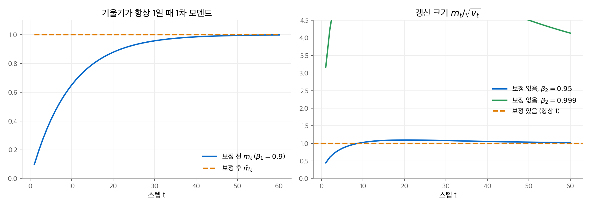
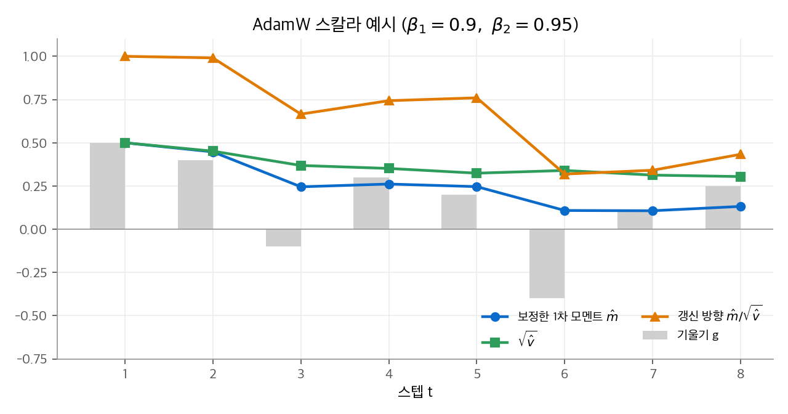
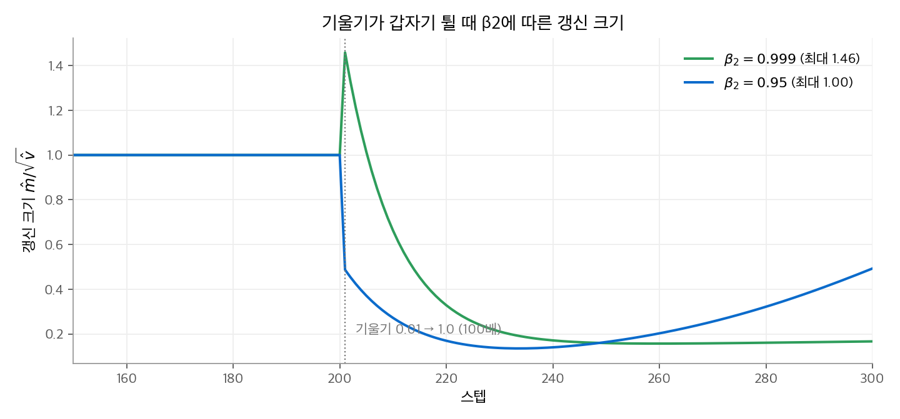

# 4.1 Adam

Adam은 기울기의 평균(1차 모멘트)과 제곱 평균(2차 모멘트)을 추적해, **좌표마다 갱신 크기를 따로 맞추는** 옵티마이저입니다.
이 페이지는 SGD에서 출발해 모멘텀과 RMSProp을 거쳐 Adam의 식을 세우고, 편향 보정을 유도합니다.
그다음 손계산으로 갱신을 따라가고, β2가 기울기 급변에 어떻게 반응하는지, 메모리를 얼마나 쓰는지 계산합니다.
모델별 설정과 세 옵티마이저 비교는 [4. 옵티마이저](index.md)에 있습니다.

## 1. SGD에서 Adam까지

### SGD와 곡률 문제

SGD는 기울기 방향으로 일정한 비율만큼 움직입니다.

$$
\mathbf{w}_t = \mathbf{w}_{t-1} - \eta\,\mathbf{g}_t
$$

손실 $f(x, y) = \frac{1}{2}(x^2 + 25y^2)$ 을 생각합니다. 기울기는 $(x,\ 25y)$ 입니다. $y$ 방향의 곡률이 $x$ 방향의 25배입니다.
SGD가 발산하지 않으려면 $\eta < 2/25 = 0.08$ 이어야 합니다. 이 학습률에서 $x$ 방향은 스텝마다 $1 - \eta$ 배로 아주 느리게 줄어듭니다.
학습률 하나로는 두 좌표를 동시에 적당한 속도로 움직일 수 없습니다.

### 모멘텀: 방향의 평균

모멘텀은 기울기의 이동 평균을 따라 움직입니다. 방향이 일관된 좌표는 가속되고, 부호가 자주 바뀌는 좌표는 상쇄됩니다.

$$
\mathbf{m}_t = \beta\,\mathbf{m}_{t-1} + \mathbf{g}_t,\qquad \mathbf{w}_t = \mathbf{w}_{t-1} - \eta\,\mathbf{m}_t
$$

모멘텀은 진동을 줄이지만, 좌표마다 다른 곡률을 직접 보정하지는 않습니다. 이 기초는 [신경망 기초 9장](../../d2l/09-optimization.md)에 있습니다.

### RMSProp: 좌표별 크기 맞춤

RMSProp은 좌표마다 기울기 제곱의 이동 평균 $\mathbf{v}_t$ 를 추적하고, 그 제곱근으로 나눕니다.

$$
\mathbf{v}_t = \beta_2\,\mathbf{v}_{t-1} + (1 - \beta_2)\,\mathbf{g}_t^2,\qquad
\mathbf{w}_t = \mathbf{w}_{t-1} - \eta\,\frac{\mathbf{g}_t}{\sqrt{\mathbf{v}_t} + \epsilon}
$$

$\mathbf{g}^2$ 과 나눗셈은 원소별 연산입니다. 기울기가 큰 좌표는 큰 값으로, 작은 좌표는 작은 값으로 나누므로 모든 좌표의 갱신 크기가 비슷해집니다.

### Adam: 두 가지를 합치기

Adam은 모멘텀의 1차 모멘트와 RMSProp의 2차 모멘트를 함께 씁니다.

$$
\mathbf{m}_t = \beta_1\mathbf{m}_{t-1} + (1 - \beta_1)\mathbf{g}_t,\qquad
\mathbf{v}_t = \beta_2\mathbf{v}_{t-1} + (1 - \beta_2)\mathbf{g}_t^2
$$

$$
\hat{\mathbf{m}}_t = \frac{\mathbf{m}_t}{1 - \beta_1^t},\qquad
\hat{\mathbf{v}}_t = \frac{\mathbf{v}_t}{1 - \beta_2^t},\qquad
\mathbf{w}_t = \mathbf{w}_{t-1} - \eta\,\frac{\hat{\mathbf{m}}_t}{\sqrt{\hat{\mathbf{v}}_t} + \epsilon}
$$

원 논문의 기본값은 $\beta_1 = 0.9$, $\beta_2 = 0.999$, $\epsilon = 10^{-8}$ 입니다.

<figure markdown>

<figcaption markdown>
<span class="fig-title"><b>Figure 1.</b> 이방성 2차 함수에서 네 옵티마이저의 경로</span>

SGD는 $x$ 방향으로 아주 느리고, 모멘텀은 휘돌아 갑니다. RMSProp과 Adam은 두 좌표를 같은 크기로 움직입니다.
</figcaption>
</figure>

## 2. 단계별 작동 원리

토큰 배치 하나를 처리할 때마다 Adam은 다음 순서로 동작합니다.

1. **기울기 계산.** 역전파로 $\mathbf{g}_t$ 를 얻습니다.
2. **1차 모멘트 갱신.** $\mathbf{m}_t$ 는 최근 기울기의 지수 이동 평균입니다. $\beta_1 = 0.9$ 이면 대략 최근 $1/(1-\beta_1) = 10$ 스텝의 평균입니다.
3. **2차 모멘트 갱신.** $\mathbf{v}_t$ 는 최근 $\mathbf{g}^2$ 의 이동 평균입니다. $\beta_2 = 0.999$ 이면 약 1,000스텝, $0.95$ 이면 약 20스텝의 평균입니다.
4. **편향 보정.** 초기값 0의 영향을 없앱니다(3절).
5. **좌표별 정규화.** $\hat{\mathbf{m}}/\sqrt{\hat{\mathbf{v}}}$ 는 "평균 기울기 ÷ 기울기 크기"입니다. 부호가 일관되면 1에 가깝고, 부호가 자주 바뀌면 0에 가깝습니다.
6. **갱신.** 학습률 $\eta$ 를 곱해 가중치에서 뺍니다. 갱신 크기는 좌표마다 대략 $\eta$ 이하로 묶입니다.

**예제: 첫 스텝.** 위 그림의 출발점에서 기울기는 $\mathbf{g}_1 = (-4,\ 20)$ 입니다.
$\mathbf{m}_1 = 0.1\,\mathbf{g}_1$, $\mathbf{v}_1 = 0.001\,\mathbf{g}_1^2$ 이고, 보정하면 $\hat{\mathbf{m}}_1 = \mathbf{g}_1$, $\hat{\mathbf{v}}_1 = \mathbf{g}_1^2$ 입니다.

$$
\frac{\hat{\mathbf{m}}_1}{\sqrt{\hat{\mathbf{v}}_1}} = \left(\frac{-4}{4},\ \frac{20}{20}\right) = (-1,\ 1)
$$

기울기가 5배 차이 나도 두 좌표 모두 정확히 $\eta = 0.12$ 만큼 움직입니다. 첫 스텝의 Adam은 기울기의 부호만 쓰는 sign SGD와 같습니다.

## 3. 편향 보정의 유도

$\mathbf{m}_0 = \mathbf{0}$ 에서 시작하면 식을 펼쳐 쓸 수 있습니다.

$$
\mathbf{m}_t = (1 - \beta_1)\sum_{i=1}^{t}\beta_1^{t-i}\,\mathbf{g}_i
$$

기울기의 기댓값이 시간에 따라 일정하다고($\mathbb{E}[\mathbf{g}_i] = \mathbb{E}[\mathbf{g}]$) 가정합니다. 등비수열의 합으로 계산합니다.

$$
\mathbb{E}[\mathbf{m}_t] = \mathbb{E}[\mathbf{g}]\,(1 - \beta_1)\sum_{i=1}^{t}\beta_1^{t-i} = \mathbb{E}[\mathbf{g}]\,(1 - \beta_1^t)
$$

그래서 $\mathbf{m}_t$ 는 참값보다 $1 - \beta_1^t$ 배 작습니다. 이 값으로 나누면 치우침이 사라집니다. $\mathbf{v}_t$ 도 같은 방법으로 $1 - \beta_2^t$ 로 나눕니다.

**보정이 없으면 생기는 일.** 기울기가 계속 1이라고 가정합니다. 보정 없이 $m_t/\sqrt{v_t} = (1 - \beta_1^t)/\sqrt{1 - \beta_2^t}$ 입니다.

| $t$ | $1 - 0.9^t$ | $\sqrt{1 - 0.999^t}$ | 보정 없는 갱신 크기 |
| --- | --- | --- | --- |
| 1 | 0.100 | 0.032 | 3.16 |
| 10 | 0.651 | 0.100 | 6.53 |
| 60 | 0.998 | 0.241 | 4.14 |

$\beta_2$ 가 1에 가까울수록 $v_t$ 가 오래 작게 머무르므로, 초반 갱신이 의도보다 몇 배 커집니다. 보정하면 항상 1입니다.

<figure markdown>

<figcaption markdown>
<span class="fig-title"><b>Figure 2.</b> 편향 보정의 효과</span>

보정하지 않으면 $m_t$ 가 0에서 천천히 출발하고, $\beta_2 = 0.999$ 에서 갱신 크기가 수십 스텝 동안 4~6배로 커집니다.
</figcaption>
</figure>

## 4. 손계산: 세 스텝 따라가기

스칼라 매개변수 하나에 기울기 $0.5,\ 0.4,\ -0.1$ 이 차례로 들어옵니다. $\beta_1 = 0.9$, $\beta_2 = 0.95$ 입니다.

| $t$ | $g_t$ | $m_t$ | $v_t$ | $\hat m_t$ | $\hat v_t$ | $\hat m_t/\sqrt{\hat v_t}$ |
| --- | --- | --- | --- | --- | --- | --- |
| 1 | 0.5 | 0.050 | 0.0125 | 0.500 | 0.250 | **1.000** |
| 2 | 0.4 | 0.085 | 0.0199 | 0.447 | 0.204 | **0.991** |
| 3 | $-0.1$ | 0.0665 | 0.0194 | 0.245 | 0.136 | **0.666** |

2스텝의 계산을 풀어 씁니다.

- $m_2 = 0.9 \times 0.05 + 0.1 \times 0.4 = 0.085$, $\hat m_2 = 0.085 / (1 - 0.81) = 0.447$
- $v_2 = 0.95 \times 0.0125 + 0.05 \times 0.16 = 0.019875$, $\hat v_2 = 0.019875 / (1 - 0.9025) = 0.204$
- $\hat m_2 / \sqrt{\hat v_2} = 0.447 / 0.451 = 0.991$

3스텝에서 기울기 부호가 바뀌자, 갱신 방향은 양수로 유지되지만 크기가 0.666으로 줄었습니다.

<figure markdown>

<figcaption markdown>
<span class="fig-title"><b>Figure 3.</b> Adam 스칼라 예시</span>

기울기 부호가 바뀌는 6스텝에서 갱신 크기가 크게 줄어듭니다.
</figcaption>
</figure>

## 5. 하이퍼파라미터의 의미

| 기호 | 원 논문 기본값 | LLM에서 쓴 값 | 의미 |
| --- | --- | --- | --- |
| $\beta_1$ | 0.9 | 0.9 | 1차 모멘트의 기억 길이 (약 10스텝) |
| $\beta_2$ | 0.999 | 0.95 | 2차 모멘트의 기억 길이 (0.999는 약 1,000스텝, 0.95는 약 20스텝) |
| $\epsilon$ | $10^{-8}$ | $10^{-8}$ (Qwen 1세대), $10^{-20}$ (DeepSeek V4의 AdamW 부분) | 분모가 0이 되는 것을 막는 값. 기울기가 $\epsilon$ 보다 작은 좌표에서는 갱신이 줄어듭니다 |

GPT-3는 Adam에 $\beta_1 = 0.9$, $\beta_2 = 0.95$, $\epsilon = 10^{-8}$ 을 썼습니다([Brown et al., 2020](https://arxiv.org/abs/2005.14165) 부록 B).
이 장에서 다루는 모델 중 설정을 밝힌 AdamW 사용 모델(Qwen 1세대, DeepSeek V2·V3, DeepSeek V4의 AdamW 부분)도 모두 $\beta_2 = 0.95$ 입니다.
보고서들은 이 값을 고른 이유를 따로 설명하지 않습니다. 아래는 $\beta_2$ 가 갱신에 미치는 효과를 직접 계산한 결과입니다.

### β2와 기울기 급변

기울기가 200스텝 동안 0.01이다가, 201스텝에 갑자기 1.0이 됩니다(100배). $\beta_1 = 0.9$ 로 고정합니다.

| | $\beta_2 = 0.999$ | $\beta_2 = 0.95$ |
| --- | --- | --- |
| 급변 스텝의 $\hat v$ | 0.0056 | 0.0501 |
| 급변 스텝의 $\hat m$ | 0.109 | 0.109 |
| 급변 스텝의 갱신 $\hat m/\sqrt{\hat v}$ | **1.46** | **0.49** |
| 급변 뒤 100스텝 | 약 0.16으로 낮아진 채 유지 | 약 0.14까지 내려간 뒤 다시 커짐 (300스텝에 0.49) |

$\beta_2 = 0.999$ 이면 새 기울기 제곱의 0.1%만 $v$ 에 들어갑니다. $\sqrt{\hat v}$ 가 기울기 급변을 따라가지 못해, 급변 스텝의 갱신이 평소의 1.46배가 됩니다.
$\beta_2 = 0.95$ 이면 5%가 들어가므로 $\hat v$ 가 즉시 커지고, 급변 스텝의 갱신은 오히려 0.49로 줄어듭니다.
대신 $\beta_2$ 가 작으면 $\hat v$ 가 짧은 기간만 기억하므로, 기울기 크기의 추정이 더 흔들립니다.

<figure markdown>

<figcaption markdown>
<span class="fig-title"><b>Figure 4.</b> 기울기 급변에 대한 β2별 갱신 크기</span>

201스텝에서 기울기가 100배로 뜁니다. $\beta_2 = 0.95$ 는 급변 스텝부터 갱신을 줄이고, 급변을 빨리 잊습니다.
</figcaption>
</figure>

## 6. 메모리 비용

Adam은 매개변수마다 $\mathbf{m}$ 과 $\mathbf{v}$ 두 상태를 저장합니다. 혼합 정밀도 학습에서는 FP32로 저장합니다.
ZeRO 논문([Rajbhandari et al., 2019](https://arxiv.org/abs/1910.02054))의 계산 방식으로 매개변수 하나당 메모리를 셉니다.

| 항목 | 바이트 |
| --- | --- |
| BF16(또는 FP16) 가중치 | 2 |
| BF16(또는 FP16) 기울기 | 2 |
| FP32 마스터 가중치 | 4 |
| FP32 1차 모멘트 $\mathbf{m}$ | 4 |
| FP32 2차 모멘트 $\mathbf{v}$ | 4 |
| 합계 | **16** |

**예제.** DeepSeek-V3의 총 매개변수 671B로 계산하면 $671 \times 10^9 \times 16 = 10.7\,\text{TB}$ 입니다. 그중 $\mathbf{m}, \mathbf{v}$ 만 5.4TB입니다.
그래서 대규모 학습은 이 상태를 여러 GPU에 나눠 저장합니다(ZeRO, FSDP). Gemma 보고서가 "옵티마이저 상태를 ZeRO-3와 비슷하게 샤딩"한다고 적은 것도 이 부분입니다.
Muon은 상태가 1개이므로 매개변수당 12바이트입니다([4.3 Muon](03-muon.md)).

## 7. 구현

```python
import torch

def adam(p, grads, lr=0.1, b1=0.9, b2=0.95, eps=1e-8):
    """기울기 목록을 차례로 적용한 결과를 돌려줍니다. torch.optim.Adam 과 같은 식입니다."""
    m = torch.zeros_like(p)
    v = torch.zeros_like(p)
    for t, g in enumerate(grads, start=1):
        m = b1 * m + (1 - b1) * g                 # 1차 모멘트
        v = b2 * v + (1 - b2) * g * g             # 2차 모멘트
        m_hat = m / (1 - b1 ** t)                 # 편향 보정
        v_hat = v / (1 - b2 ** t)
        p = p - lr * m_hat / (v_hat.sqrt() + eps) # 좌표별 정규화 후 갱신
    return p

grads = [torch.tensor([0.5, -4.0]), torch.tensor([0.4, 20.0]), torch.tensor([-0.1, 3.0])]
p0 = torch.tensor([1.0, 1.0])
print(adam(p0.clone(), grads))                    # tensor([0.7343, 0.9857])

q = p0.clone().requires_grad_()
opt = torch.optim.Adam([q], lr=0.1, betas=(0.9, 0.95), eps=1e-8)
for g in grads:
    q.grad = g.clone()
    opt.step()
print(q.detach())                                 # tensor([0.7343, 0.9857])
```

첫 좌표는 4절 표의 기울기를 그대로 썼습니다. $1 - 0.1 \times (1.000 + 0.991 + 0.666) = 0.7343$ 입니다.

## 8. 남은 문제: 가중치 감쇠

과적합을 막으려고 손실에 $\frac{\lambda}{2}\|\mathbf{w}\|^2$ 를 더하면(L2 정규화), 기울기에 $\lambda\mathbf{w}$ 가 더해집니다.
SGD에서는 이것이 매 스텝 가중치를 $(1 - \eta\lambda)$ 배로 줄이는 가중치 감쇠와 같습니다.
Adam에서는 이 항도 $\sqrt{\hat{\mathbf{v}}}$ 로 나뉘므로, 좌표마다 감쇠 세기가 달라집니다. 이 문제와 해결책이 [4.2 AdamW](02-adamw.md)입니다.

## 정리

- Adam은 1차 모멘트(방향)와 2차 모멘트(크기)를 좌표마다 추적하고, $\hat{\mathbf{m}}/\sqrt{\hat{\mathbf{v}}}$ 로 갱신합니다. 갱신 크기는 좌표마다 대략 학습률 이하로 묶입니다.
- 편향 보정은 0에서 시작한 이동 평균이 $1 - \beta^t$ 배 작다는 점을 바로잡습니다. 첫 스텝의 Adam은 sign SGD와 같습니다.
- 이 장의 AdamW 사용 모델과 GPT-3는 $\beta_2 = 0.95$ 를 씁니다. 작은 $\beta_2$ 는 기울기 급변에 빨리 반응해, 급변 스텝의 갱신을 키우지 않습니다.
- 혼합 정밀도 학습에서 Adam은 매개변수당 16바이트를 씁니다.

다음 페이지: [4.2 AdamW](02-adamw.md)
