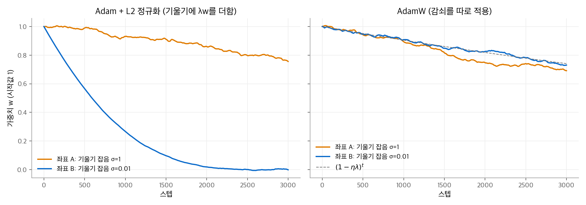
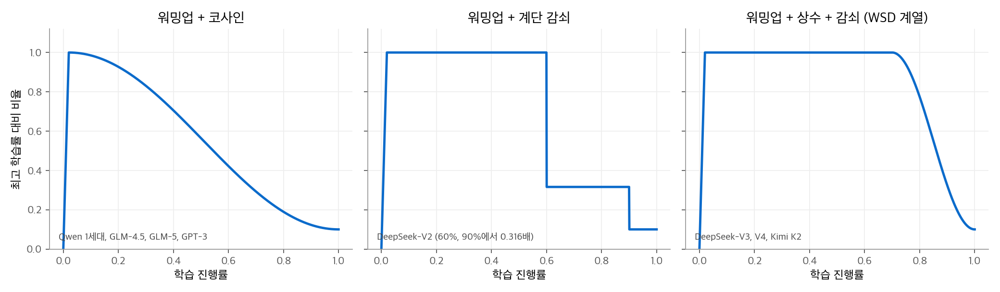
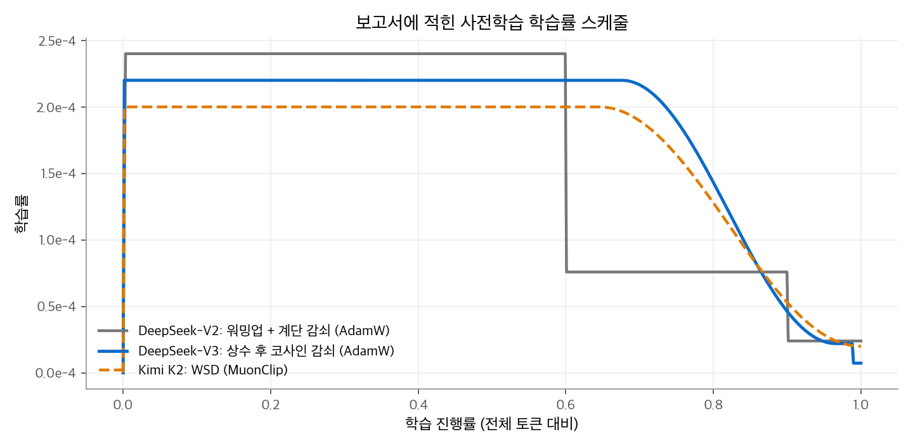
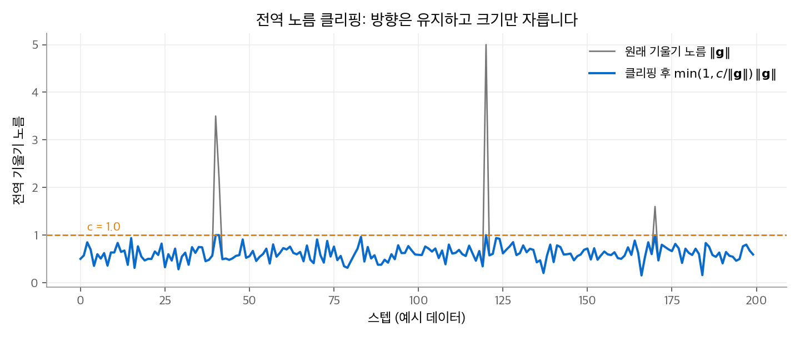

# 4.2 AdamW

AdamW는 Adam에서 **가중치 감쇠를 기울기와 분리한** 옵티마이저입니다. 갱신식은 Adam과 한 항만 다릅니다.
그런데 이 한 항 때문에 감쇠 세기가 모든 좌표에서 같아지고, 학습률과 감쇠 계수를 따로 조정할 수 있게 됩니다.
DeepSeek V2·V3와 Qwen 1세대가 AdamW로 사전학습했고, Muon을 쓰는 모델도 임베딩과 정규화 가중치는 AdamW로 학습합니다.
이 페이지는 L2 정규화와 가중치 감쇠가 Adam에서 달라지는 이유를 손계산으로 보이고, LLM 학습에서 AdamW와 함께 쓰는 학습률 스케줄, 기울기 클리핑, 배치 크기 워밍업을 정리합니다.
Adam의 식은 [4.1 Adam](01-adam.md)을 전제로 합니다.

## 1. 두 가지 감쇠

### SGD에서는 둘이 같습니다

손실에 $\frac{\lambda}{2}\|\mathbf{w}\|^2$ 를 더하는 것이 **L2 정규화**입니다. 기울기에 $\lambda\mathbf{w}$ 가 더해집니다.

$$
\mathbf{w}_t = \mathbf{w}_{t-1} - \eta\,(\mathbf{g}_t + \lambda\mathbf{w}_{t-1}) = (1 - \eta\lambda)\,\mathbf{w}_{t-1} - \eta\,\mathbf{g}_t
$$

매 스텝 가중치를 $(1 - \eta\lambda)$ 배로 줄이는 것이 **가중치 감쇠(weight decay)**입니다. SGD에서는 두 식이 정확히 같습니다.

### Adam에서는 다릅니다

Adam에 L2 정규화를 넣으면 $\lambda\mathbf{w}$ 가 $\mathbf{m}$ 과 $\mathbf{v}$ 안으로 들어갑니다. 감쇠 항도 $\sqrt{\hat{\mathbf{v}}}$ 로 나뉩니다.

$$
\text{Adam + L2:}\quad \mathbf{g}'_t = \mathbf{g}_t + \lambda\mathbf{w}_{t-1},\qquad
\mathbf{w}_t = \mathbf{w}_{t-1} - \eta\,\frac{\hat{\mathbf{m}}'_t}{\sqrt{\hat{\mathbf{v}}'_t} + \epsilon}
$$

감쇠 부분만 떼어 보면 좌표 $i$ 의 실제 감쇠 세기는 대략 $\lambda / \sqrt{\hat v_i}$ 입니다.
기울기가 크거나 잡음이 많은 좌표는 $\sqrt{\hat v_i}$ 가 커서 거의 감쇠되지 않습니다. 기울기가 작은 좌표는 감쇠가 기울기를 압도해 빠르게 0으로 끌려갑니다.

**AdamW**는 감쇠를 Adam 갱신 밖으로 뺍니다([Loshchilov and Hutter, 2017](https://arxiv.org/abs/1711.05101)).

$$
\text{AdamW:}\quad
\mathbf{w}_t = \mathbf{w}_{t-1} - \eta_t\left(\frac{\hat{\mathbf{m}}_t}{\sqrt{\hat{\mathbf{v}}_t} + \epsilon} + \lambda\,\mathbf{w}_{t-1}\right)
$$

$\hat{\mathbf{m}}, \hat{\mathbf{v}}$ 는 원래 기울기 $\mathbf{g}_t$ 로만 계산합니다. 감쇠는 모든 좌표에서 $\eta_t\lambda$ 비율로 같습니다.
원 논문의 식은 학습률 $\alpha$ 와 스케줄 배율 $\eta_t$ 를 나눠 씁니다. PyTorch의 `torch.optim.AdamW` 는 감쇠에 학습률을 곱한 $\mathbf{w} \leftarrow (1 - \text{lr}\cdot\lambda)\,\mathbf{w}$ 를 먼저 적용하고 Adam 갱신을 합니다.
DeepSeek V4와 Muon is Scalable 논문의 식도 이 형태($\eta_t\lambda\mathbf{W}$)입니다.

## 2. 손계산: 감쇠 세기 비교

좌표 두 개의 가중치가 모두 $w = 1$ 입니다. $\eta = 10^{-3}$, $\lambda = 0.1$ 입니다.

- 좌표 A: 손실 기울기가 표준편차 1의 잡음입니다.
- 좌표 B: 손실 기울기가 표준편차 0.01의 잡음입니다.

**AdamW.** 감쇠는 기울기와 무관하게 두 좌표 모두 $\eta\lambda w = 10^{-4}$ 입니다.

**Adam + L2.**

- 좌표 A: $\mathbf{g}' = \mathbf{g} + 0.1$ 에서 잡음(크기 1)이 $\sqrt{\hat v}$ 를 정합니다. $\sqrt{\hat v} \approx 1$ 이므로 감쇠 부분은 $\eta \times 0.1 / 1 = 10^{-4}$ 로 AdamW와 비슷합니다.
- 좌표 B: $\mathbf{g}' = \mathbf{g} + 0.1$ 에서 감쇠 항 0.1이 잡음(0.01)보다 10배 큽니다. $\hat m'/\sqrt{\hat v'} \approx 1$ 이 되어 매 스텝 거의 $\eta = 10^{-3}$ 씩 줄어듭니다. AdamW의 **10배**이고, 이 세기는 $\lambda$ 를 바꿔도 거의 변하지 않습니다.

| 좌표 | AdamW 감쇠 (스텝당) | Adam + L2 감쇠 (스텝당) |
| --- | --- | --- |
| A (기울기 잡음 1) | $10^{-4}$ | 약 $10^{-4}$ |
| B (기울기 잡음 0.01) | $10^{-4}$ | 약 $10^{-3}$ |

3,000스텝을 시뮬레이션하면 다음과 같습니다. 이론값 $(1 - \eta\lambda)^{3000} = 0.741$ 입니다.

| | 좌표 A | 좌표 B |
| --- | --- | --- |
| Adam + L2 | 0.756 | 약 0 |
| AdamW | 0.692 | 0.731 |

<figure markdown>

<figcaption markdown>
<span class="fig-title"><b>Figure 1.</b> Adam + L2와 AdamW의 감쇠 비교</span>

Adam + L2는 기울기가 작은 좌표만 0으로 끌어당깁니다. AdamW는 두 좌표를 이론값 $(1 - \eta\lambda)^t$ 대로 같은 비율로 줄입니다.
</figcaption>
</figure>

원 논문은 감쇠를 분리하면 최적 학습률과 최적 감쇠 계수가 서로 덜 얽히고, Adam의 일반화 성능이 좋아진다고 보고했습니다.

## 3. 어떤 매개변수를 감쇠하는가

가중치 감쇠는 보통 모든 매개변수에 적용하지 않습니다. nanoGPT 구현의 규칙이 대표적입니다.

```python
# nanoGPT model.py: 2차원 이상(행렬 곱의 가중치, 임베딩)만 감쇠하고, 편향과 LayerNorm은 감쇠하지 않습니다.
decay_params   = [p for n, p in param_dict.items() if p.dim() >= 2]
nodecay_params = [p for n, p in param_dict.items() if p.dim() < 2]
optim_groups = [{"params": decay_params, "weight_decay": weight_decay},
                {"params": nodecay_params, "weight_decay": 0.0}]
```

정규화 가중치 $\boldsymbol{\gamma}$ 는 활성값의 크기를 정하는 배율입니다. 0으로 끌어당기면 층의 출력 크기가 줄어들므로, 감쇠에서 빼는 경우가 많습니다.
이 장의 모델 보고서들은 매개변수별 감쇠 적용 여부를 자세히 밝히지 않았습니다. 확인된 것은 옵티마이저를 나눈 방식입니다.

| 모델 | 보고서에 적힌 분리 |
| --- | --- |
| GLM-4.5 | 임베딩, 편향, RMSNorm 가중치를 Muon에서 제외 |
| DeepSeek V4 | 임베딩, 예측 헤드, mHC의 정적 편향·게이트, RMSNorm 가중치를 AdamW로 학습(가중치 감쇠 0.1로 표기) |

## 4. 학습률 스케줄

AdamW의 $\eta_t$ 는 상수가 아닙니다. LLM 사전학습은 거의 항상 워밍업과 감쇠를 둡니다.

### 워밍업

처음 몇천 스텝 동안 학습률을 0에서 최고값까지 선형으로 올립니다. 초반에는 $\hat{\mathbf{v}}$ 추정이 불안정하고, 무작위 초기 가중치에서 기울기 방향이 크게 바뀌기 때문입니다.

$$
\eta_t = \eta_{\max}\cdot\frac{t}{T_{\text{warm}}},\qquad t \le T_{\text{warm}}
$$

DeepSeek V2·V3와 V4는 2,000스텝, Kimi K2는 500스텝을 썼습니다.

### 세 가지 감쇠 모양

| 스케줄 | 식 또는 규칙 | 쓴 모델 |
| --- | --- | --- |
| 코사인 | $\eta_t = \eta_{\min} + \frac{1}{2}(\eta_{\max} - \eta_{\min})\left(1 + \cos\frac{\pi(t - T_{\text{warm}})}{T - T_{\text{warm}}}\right)$ | GPT-3(최고의 10%까지), Qwen 1세대(최고의 10%까지), GLM-4.5($2.5 \times 10^{-4} \to 2.5 \times 10^{-5}$), GLM-5 |
| 계단 감쇠 | 정해진 지점에서 일정 배율로 떨어뜨림 | DeepSeek-V2: 토큰 60%, 90% 지점에서 각각 0.316배 |
| 상수 후 감쇠 (WSD 계열) | 워밍업 → 긴 상수 구간 → 끝부분에서만 감쇠 | DeepSeek-V3·V4, Kimi K2 |

**WSD(warmup-stable-decay)**는 워밍업, 상수 유지, 감쇠의 세 구간으로 나눕니다. Kimi K2 보고서가 이 이름을 씁니다.
DeepSeek-V3와 V4는 이름을 붙이지 않았지만 같은 모양입니다. V3는 전체 14.8T 토큰 중 10T 토큰 동안 최고 학습률 $2.2 \times 10^{-4}$ 를 유지합니다.
상수 구간이 길면, 중간 체크포인트에서 감쇠만 따로 돌려 짧은 학습의 결과를 볼 수 있습니다. 데이터를 더 넣고 싶을 때 상수 구간을 늘리기도 쉽습니다.

**손계산: DeepSeek-V2의 계단.** 최고 학습률 $2.4 \times 10^{-4}$ 에 0.316을 두 번 곱합니다.

$$
2.4 \times 10^{-4} \xrightarrow{\times 0.316} 7.58 \times 10^{-5} \xrightarrow{\times 0.316} 2.40 \times 10^{-5}
$$

$0.316 \approx 1/\sqrt{10}$ 이므로 두 번 떨어뜨리면 정확히 1/10입니다.

<figure markdown>

<figcaption markdown>
<span class="fig-title"><b>Figure 2.</b> 세 가지 학습률 스케줄의 모양</span>

코사인은 워밍업 직후부터, 계단 감쇠는 정해진 지점에서, WSD는 끝부분에서만 학습률을 줄입니다.
</figcaption>
</figure>

<figure markdown>

<figcaption markdown>
<span class="fig-title"><b>Figure 3.</b> 보고서에 적힌 사전학습 학습률 스케줄</span>

보고서 값으로 그린 실제 스케줄입니다. DeepSeek-V2의 전체 토큰 수와 워밍업 길이는 근사했습니다.
</figcaption>
</figure>

## 5. 기울기 클리핑

한 배치에서 기울기가 갑자기 커지면 갱신이 튀고 손실이 발산할 수 있습니다. **전역 노름 클리핑**은 모든 매개변수의 기울기를 하나의 벡터로 보고, 그 노름이 $c$ 를 넘으면 전체를 같은 비율로 줄입니다.

$$
\mathbf{g} \leftarrow \mathbf{g}\cdot\min\!\left(1,\ \frac{c}{\|\mathbf{g}\|_2}\right)
$$

방향은 그대로이고 크기만 $c$ 로 잘립니다. GPT-3, DeepSeek V2·V3는 $c = 1.0$ 을 썼습니다.

**손계산.** 기울기가 $\mathbf{g} = (3,\ 4)$ 이면 $\|\mathbf{g}\| = 5$ 입니다. $c = 1$ 이면 $\mathbf{g} \leftarrow (3, 4) \times 1/5 = (0.6,\ 0.8)$ 입니다. 노름은 1이고 방향은 같습니다.
클리핑은 옵티마이저에 들어가기 **전에** 적용합니다. 그래서 잘린 기울기가 $\mathbf{m}$ 과 $\mathbf{v}$ 에도 들어갑니다.

<figure markdown>

<figcaption markdown>
<span class="fig-title"><b>Figure 4.</b> 전역 노름 클리핑</span>

예시 데이터입니다. 전역 노름이 $c = 1$ 을 넘는 네 스텝만 1로 잘립니다.
</figcaption>
</figure>

## 6. 배치 크기 워밍업

여러 모델이 학습 초반에 배치 크기도 점점 늘립니다.

| 모델 | 배치 크기 |
| --- | --- |
| DeepSeek-V2 | 2,304 → 9,216 시퀀스 (첫 225B 토큰) |
| DeepSeek-V3 | 3,072 → 15,360 시퀀스 (첫 469B 토큰) |
| GLM-4.5 | 16M → 64M 토큰 (첫 500B 토큰) |
| DeepSeek-V4-Flash | 작은 값에서 75.5M 토큰까지 늘린 뒤 유지 |

학습 초반에는 손실이 빠르게 줄고 기울기 방향이 크게 바뀝니다. 작은 배치로 자주 갱신하는 편이 같은 토큰으로 더 많이 배웁니다.
손실이 낮아지면 기울기 잡음이 상대적으로 커지므로, 큰 배치로 잡음을 줄입니다.

## 7. LLM에서의 실제 설정

| 모델 | β | ε | 가중치 감쇠 | 클리핑 | 최고 학습률 |
| --- | --- | --- | --- | --- | --- |
| Qwen 1세대 | (0.9, 0.95) | $10^{-8}$ | 명시 없음 | 명시 없음 | $3 \times 10^{-4}$ |
| DeepSeek-V2 | (0.9, 0.95) | 명시 없음 | 0.1 | 1.0 | $2.4 \times 10^{-4}$ |
| DeepSeek-V3 | (0.9, 0.95) | 명시 없음 | 0.1 | 1.0 | $2.2 \times 10^{-4}$ |
| DeepSeek-V4 (AdamW 부분) | (0.9, 0.95) | $10^{-20}$ | 0.1 | 명시 없음 | Muon과 같은 스케줄 |

**Muon과 함께 쓰는 AdamW.** DeepSeek V4는 행렬 매개변수를 Muon으로, 나머지를 AdamW로 학습합니다. AdamW 부분의 $\epsilon$ 은 $10^{-20}$ 으로, 통상 값 $10^{-8}$ 보다 훨씬 작습니다.
$\epsilon$ 이 $\sqrt{\hat v}$ 보다 크면 갱신이 $\hat m/\epsilon$ 처럼 줄어듭니다. 기울기가 아주 작은 매개변수도 Adam의 정규화된 크기로 갱신하려면 $\epsilon$ 을 작게 둬야 합니다. 보고서는 이 값을 고른 이유를 설명하지 않습니다.
모델별 전체 설정은 [4. 옵티마이저](index.md)의 표에 있습니다.

## 8. 구현

```python
import torch

def adamw_step(w, g, m, v, t, lr=1e-3, b1=0.9, b2=0.95, eps=1e-8, wd=0.1):
    """torch.optim.AdamW 와 같은 순서: 감쇠를 먼저 적용하고, 원래 기울기로 Adam 갱신을 합니다."""
    w = w * (1 - lr * wd)                       # 분리된 가중치 감쇠
    m = b1 * m + (1 - b1) * g
    v = b2 * v + (1 - b2) * g * g
    m_hat, v_hat = m / (1 - b1 ** t), v / (1 - b2 ** t)
    w = w - lr * m_hat / (v_hat.sqrt() + eps)
    return w, m, v

def cosine_lr(step, total, warmup, lr_max, lr_min):
    if step < warmup:
        return lr_max * step / warmup
    p = (step - warmup) / (total - warmup)
    return lr_min + 0.5 * (lr_max - lr_min) * (1 + torch.cos(torch.tensor(torch.pi * p))).item()

# torch.optim.AdamW 와 비교
w0, grads = torch.tensor([1.0, 1.0]), [torch.tensor([0.5, -4.0]), torch.tensor([0.4, 20.0])]
w, m, v = w0.clone(), torch.zeros(2), torch.zeros(2)
for t, g in enumerate(grads, 1):
    w, m, v = adamw_step(w, g, m, v, t)
q = w0.clone().requires_grad_()
opt = torch.optim.AdamW([q], lr=1e-3, betas=(0.9, 0.95), eps=1e-8, weight_decay=0.1)
for g in grads:
    q.grad = g.clone(); opt.step()
print(w, q.detach())                            # 두 결과가 같습니다
print(cosine_lr(5000, 10000, 1000, 2.5e-4, 2.5e-5))
torch.nn.utils.clip_grad_norm_([q], max_norm=1.0)  # 전역 노름 클리핑
```

## 정리

- Adam에 L2 정규화를 넣으면 감쇠도 $\sqrt{\hat v}$ 로 나뉘어, 기울기가 작은 좌표만 강하게 감쇠됩니다. AdamW는 감쇠를 분리해 모든 좌표를 $\eta\lambda$ 비율로 똑같이 줄입니다.
- 감쇠는 보통 행렬 가중치에만 적용하고, 편향과 정규화 가중치는 뺍니다.
- 학습률 스케줄은 워밍업 뒤 코사인(GLM, Qwen 1세대), 계단(DeepSeek-V2), 상수 후 감쇠(DeepSeek-V3·V4, Kimi K2)가 쓰였습니다.
- 전역 노름 클리핑($c = 1.0$)과 배치 크기 워밍업이 함께 쓰입니다.
- Muon을 쓰는 모델도 임베딩, 출력 헤드, 정규화 가중치는 AdamW로 학습합니다.

이전 페이지: [4.1 Adam](01-adam.md) · 다음 페이지: [4.3 Muon](03-muon.md)
