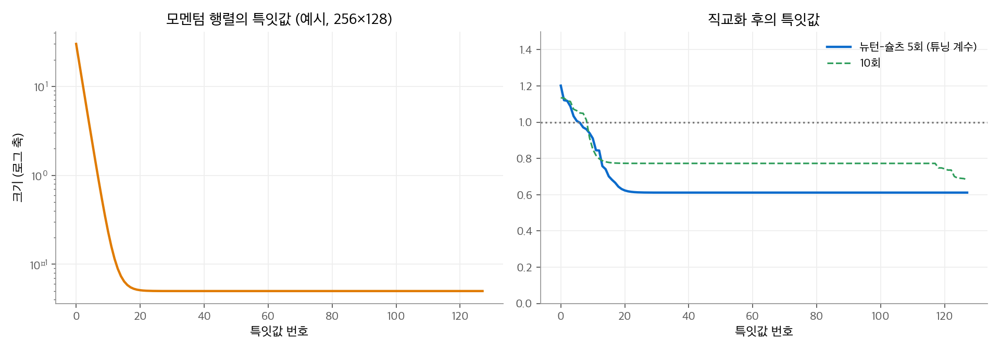
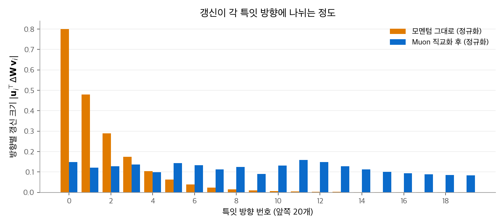
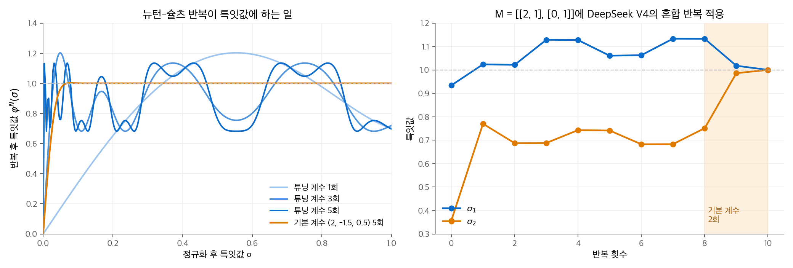
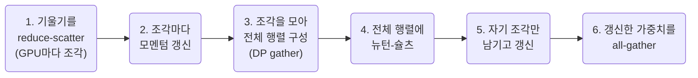

# 4.3 Muon

Muon은 행렬 매개변수의 모멘텀을 **직교화**해서 갱신하는 옵티마이저입니다. Adam이 좌표마다 크기를 맞췄다면, Muon은 행렬의 특잇 방향마다 크기를 맞춥니다.
GLM-4.5·GLM-5, Kimi K2, DeepSeek V4가 사전학습에 Muon을 씁니다.
이 페이지는 직교화가 무엇을 하는지, 뉴턴-슐츠 반복이 SVD 없이 이를 계산하는 원리, AdamW의 학습률을 재사용하는 크기 맞춤, 그리고 대규모 학습에서 생긴 문제와 변형(Muon Split, QK-Clip)을 다룹니다.
Adam과 AdamW는 [4.1](01-adam.md), [4.2](02-adamw.md)에 있습니다.

!!! info "자료"
    - Keller Jordan et al., [Muon: An optimizer for hidden layers in neural networks](https://kellerjordan.github.io/posts/muon/), 2024.
    - Liu et al. (Moonshot AI), [Muon is Scalable for LLM Training](https://arxiv.org/abs/2502.16982), 2025.
    - 모델별 설정: [GLM-4.5](https://arxiv.org/abs/2508.06471), [GLM-5](https://arxiv.org/abs/2602.15763), [Kimi K2](https://arxiv.org/abs/2507.20534), [DeepSeek-V4](https://arxiv.org/abs/2606.19348).

## 1. 문제: 갱신 행렬은 소수의 방향에 쏠립니다

선형층 $\mathbf{W} \in \mathbb{R}^{A \times B}$ 의 기울기 모멘텀 $\mathbf{M}$ 을 특잇값 분해합니다.

$$
\mathbf{M} = \mathbf{U}\boldsymbol{\Sigma}\mathbf{V}^\top = \sum_i \sigma_i\,\mathbf{u}_i\mathbf{v}_i^\top
$$

$\mathbf{u}_i\mathbf{v}_i^\top$ 는 "입력 방향 $\mathbf{v}_i$ 를 출력 방향 $\mathbf{u}_i$ 로 보내는" 성분이고, $\sigma_i$ 는 그 성분의 크기입니다.
트랜스포머의 기울기 행렬은 특잇값 몇 개가 매우 큰 경우가 많습니다. 그대로 갱신하면 그 몇 방향만 크게 움직이고, 나머지 방향은 거의 학습되지 않습니다.
Adam은 이 문제를 풀지 못합니다. 원소별로 크기를 맞추므로 행렬의 특잇 방향 구조는 보지 않습니다.

## 2. 해결: 특잇값을 모두 1로

Muon은 특잇값을 버리고 방향만 남깁니다.

$$
\operatorname{Orth}(\mathbf{M}) = \mathbf{U}\mathbf{V}^\top,\qquad \mathbf{W}_t = \mathbf{W}_{t-1} - \eta\,\operatorname{Orth}(\mathbf{M}_t)
$$

모든 특잇 방향이 같은 크기로 갱신됩니다. 작은 특잇값의 방향도 큰 방향만큼 움직입니다.

### 스펙트럴 노름 관점

갱신의 스펙트럴 노름(가장 큰 특잇값)을 $\eta$ 이하로 제한하고, 손실의 1차 근사를 가장 많이 줄이는 갱신을 구합니다.

$$
\min_{\|\Delta\mathbf{W}\|_2 \le \eta}\ \langle\mathbf{G}, \Delta\mathbf{W}\rangle = \min\ \operatorname{tr}(\mathbf{G}^\top\Delta\mathbf{W})
$$

$\mathbf{G} = \mathbf{U}\boldsymbol{\Sigma}\mathbf{V}^\top$ 이면 $\operatorname{tr}(\mathbf{G}^\top\Delta\mathbf{W}) = \sum_i \sigma_i\,\mathbf{u}_i^\top\Delta\mathbf{W}\mathbf{v}_i$ 입니다. 각 항 $\mathbf{u}_i^\top\Delta\mathbf{W}\mathbf{v}_i$ 는 $-\eta$ 이상이므로, 최솟값은 $\Delta\mathbf{W} = -\eta\,\mathbf{U}\mathbf{V}^\top$ 일 때 $-\eta\sum_i\sigma_i$ 입니다.
Muon은 "스펙트럴 노름 아래에서의 최급강하"에 모멘텀을 더한 방법으로 볼 수 있습니다. Keller Jordan의 글은 이 해석을 Jeremy Bernstein의 논의와 연결합니다.
비교하면, 원소별 크기를 제한하는(무한 노름) 최급강하는 sign SGD이고, 이것이 첫 스텝의 Adam과 같습니다([4.1 Adam 2절](01-adam.md)).

### 손계산

$\mathbf{M} = \begin{pmatrix} 2 & 1 \\ 0 & 1 \end{pmatrix}$ 의 특잇값은 $(2.288,\ 0.874)$ 입니다. 직교화 결과는 다음과 같습니다.

$$
\operatorname{Orth}(\mathbf{M}) = \mathbf{U}\mathbf{V}^\top = \begin{pmatrix} 0.949 & 0.316 \\ -0.316 & 0.949 \end{pmatrix}
$$

결과는 회전 행렬입니다(특잇값이 모두 1). 원래 행렬에서 두 번째 방향은 첫 번째의 0.38배였지만, 직교화 후에는 같은 크기입니다.

### 큰 행렬에서 보기

256×128 행렬을 특잇값이 $30 \times 0.6^i + 0.05$ 로 빠르게 줄어들도록 만들었습니다. 가장 큰 특잇값은 50번째의 약 600배입니다.

<figure markdown>

<figcaption markdown>
<span class="fig-title"><b>Figure 1.</b> 모멘텀 행렬의 특잇값과 직교화 후의 특잇값</span>

뉴턴-슐츠 5회 뒤에는 넓게 퍼진 특잇값이 모두 약 0.61~1.20 사이에 모입니다.
</figcaption>
</figure>

<figure markdown>

<figcaption markdown>
<span class="fig-title"><b>Figure 2.</b> 갱신이 특잇 방향에 나뉘는 정도</span>

모멘텀은 첫 특잇 방향에 갱신의 0.80이 몰립니다. 직교화하면 모든 방향이 0.1~0.15로 고르게 갱신됩니다.
</figcaption>
</figure>

## 3. 단계별 작동 원리

배치 하나를 처리할 때마다 Muon은 행렬 매개변수 하나에 대해 다음을 합니다.

1. **기울기 계산.** $\mathbf{G}_t$ 를 얻습니다.
2. **모멘텀 갱신.** $\mathbf{B}_t = \mu\,\mathbf{B}_{t-1} + \mathbf{G}_t$ 입니다. 보고서들의 $\mu$ 는 0.95입니다. Keller Jordan의 구현은 Nesterov 형태 $\mathbf{G}_t + \mu\,\mathbf{B}_t$ 를 다음 단계에 넘깁니다.
3. **직교화.** 뉴턴-슐츠 반복으로 $\mathbf{O}_t \approx \operatorname{Orth}(\cdot)$ 를 계산합니다(4절).
4. **크기 맞춤.** $\mathbf{O}_t$ 에 $0.2\sqrt{\max(A, B)}$ 를 곱해 갱신 RMS를 AdamW 수준으로 맞춥니다(5절).
5. **분리된 가중치 감쇠와 갱신.** $\mathbf{W}_t = \mathbf{W}_{t-1} - \eta_t\left(0.2\sqrt{\max(A,B)}\,\mathbf{O}_t + \lambda\,\mathbf{W}_{t-1}\right)$ 입니다. 감쇠 방식은 [AdamW](02-adamw.md)와 같습니다.

임베딩, 출력 헤드, 정규화 가중치, 편향은 이 과정을 거치지 않고 AdamW로 학습합니다(6절).

## 4. 뉴턴-슐츠 반복: SVD 없이 직교화하기

큰 행렬의 SVD는 GPU에서 느립니다. Muon은 행렬 곱만으로 $\mathbf{U}\mathbf{V}^\top$ 을 근사합니다.

1. **정규화.** $\mathbf{X}_0 = \mathbf{M}/\|\mathbf{M}\|_F$ 로 나눕니다. 모든 특잇값이 $[0, 1]$ 에 들어옵니다. 배율은 $\operatorname{Orth}$ 결과를 바꾸지 않습니다.
2. **반복.** 다음을 $N$ 번 반복합니다.

    $$
    \mathbf{A} = \mathbf{X}\mathbf{X}^\top,\qquad \mathbf{X} \leftarrow a\mathbf{X} + (b\mathbf{A} + c\mathbf{A}^2)\mathbf{X}
    $$

3. **특잇값에 미치는 효과.** $\mathbf{X} = \mathbf{U}\boldsymbol{\Sigma}\mathbf{V}^\top$ 이면 $\mathbf{A}\mathbf{X} = \mathbf{U}\boldsymbol{\Sigma}^3\mathbf{V}^\top$ 입니다. 그래서 반복 한 번은 특잇값마다 다항식 $\varphi(\sigma) = a\sigma + b\sigma^3 + c\sigma^5$ 를 적용합니다. $\mathbf{U}, \mathbf{V}$ 는 그대로입니다.

목표는 $[0, 1]$ 의 모든 값을 1 근처로 보내는 $\varphi$ 입니다.

| 계수 $(a, b, c)$ | 성질 | 0.05에서 시작한 특잇값 (1~6회) |
| --- | --- | --- |
| 기본 $(2, -1.5, 0.5)$ | $\varphi(1) = 1$, 1로 정확히 수렴. 0 근처 기울기 2 | 0.10, 0.20, 0.39, 0.69, 0.97, 1.00 |
| 튜닝 $(3.4445, -4.7750, 2.0315)$ | 0 근처 기울기 3.44로 빠르게 커짐. 1로 수렴하지 않고 약 [0.7, 1.3]에서 진동 | 0.17, 0.57, 1.20, 0.94, 0.76, 1.04 |

Muon 기본 구현은 튜닝 계수로 5회 반복합니다. 정확히 1이 아니어도 대략 같은 크기면 충분하고, 반복 횟수를 줄이는 것이 더 중요하기 때문입니다. bfloat16으로 계산해도 안정적입니다.

**손계산.** 2절의 $\mathbf{M}$ 을 $\|\mathbf{M}\|_F = \sqrt{6} = 2.449$ 로 나누면 특잇값이 $(0.934,\ 0.357)$ 입니다.

| 반복 | 튜닝 계수 5회 | 기본 계수 5회 |
| --- | --- | --- |
| 0 | (0.934, 0.357) | (0.934, 0.357) |
| 1 | (1.024, 0.770) | (1.001, 0.648) |
| 2 | (1.022, 0.687) | (1.000, 0.945) |
| 3 | (1.129, 0.688) | (1.001, 1.000) |
| 5 | (1.061, 0.741) | (1.000, 1.000) |

첫 반복을 다항식으로 직접 계산합니다. 표는 각 반복 뒤의 특잇값을 큰 값부터 적었습니다.

- 튜닝 계수: $\varphi(0.357) = 1.230 - 0.217 + 0.012 = 1.024$, $\varphi(0.934) = 3.217 - 3.891 + 1.444 = 0.770$
- 기본 계수: $\varphi(0.357) = 0.714 - 0.068 + 0.003 = 0.648$, $\varphi(0.934) = 1.868 - 1.222 + 0.355 = 1.001$

튜닝 계수에서는 작은 특잇값 0.357이 1.024로 커지고, 큰 값 0.934는 0.770으로 줄어 순서가 바뀝니다. 0 근처를 강하게 끌어올리는 대신 1 근처를 지나치는 다항식이기 때문입니다.

**DeepSeek V4의 혼합 반복.** V4는 10회를 두 단계로 나눕니다. 처음 8회는 튜닝 계수로 특잇값을 빠르게 1 근처로 모으고, 마지막 2회는 기본 계수로 정확히 1에 맞춥니다.
위 예제에 적용하면 8회 후 $(1.133, 0.751)$ 이 10회 후 $(1.0002, 1.0001)$ 이 됩니다.

<figure markdown>

<figcaption markdown>
<span class="fig-title"><b>Figure 3.</b> 뉴턴-슐츠 반복이 특잇값에 하는 일</span>

튜닝 계수는 작은 $\sigma$ 를 빠르게 끌어올리지만 1 주변에서 진동하고, 기본 계수는 느리지만 정확히 1로 갑니다.
</figcaption>
</figure>

## 5. 갱신 크기 맞추기

$A \times B$ 직교 행렬의 RMS(원소 제곱 평균의 제곱근)는 $\sqrt{\min(A,B)/(AB)} = 1/\sqrt{\max(A, B)}$ 입니다. 행렬이 크면 갱신이 매우 작아지고, 모양마다 크기가 다릅니다.
Muon is Scalable 논문은 갱신에 $0.2\sqrt{\max(A, B)}$ 를 곱해 RMS를 0.2로 맞췄습니다. AdamW 갱신의 RMS가 보통 0.2~0.4라는 관찰에서 나온 값이고, 부록 실험에서 0.2와 0.4가 비슷하게 가장 좋았습니다.

$$
\mathbf{W}_t = \mathbf{W}_{t-1} - \eta_t\left(0.2\sqrt{\max(A, B)}\cdot\mathbf{O}_t + \lambda\mathbf{W}_{t-1}\right)
$$

| 행렬 모양 | 직교 행렬의 RMS | 배율 $0.2\sqrt{\max}$ | 맞춘 RMS |
| --- | --- | --- | --- |
| $7168 \times 2048$ | 0.0118 | 16.93 | 0.2 |
| $4096 \times 4096$ | 0.0156 | 12.8 | 0.2 |

튜닝 계수의 뉴턴-슐츠 결과는 특잇값이 정확히 1이 아니므로, 실제 RMS는 이 값 근처입니다. 64×32 무작위 행렬 하나로 계산하면 약 0.17이었습니다.
이렇게 맞추면 AdamW용으로 정한 학습률과 가중치 감쇠를 그대로 쓸 수 있습니다. GLM-4.5는 RMS 0.2, DeepSeek V4는 0.18로 맞췄습니다.

**가중치 감쇠의 필요.** 같은 논문은 감쇠 없는 Muon에서 가중치와 층 출력의 RMS가 계속 커져, bf16의 정밀도가 높은 범위를 벗어날 수 있다고 보고했습니다. AdamW 방식의 분리된 감쇠를 넣자 감쇠 없는 Muon과 AdamW보다 검증 손실이 낮았습니다.

## 6. 어떤 매개변수에 쓰는가

Muon은 은닉층의 **2차원 행렬**에만 씁니다. 나머지는 AdamW로 학습합니다.

| 매개변수 | 옵티마이저 | 이유 |
| --- | --- | --- |
| 어텐션 $\mathbf{W}_Q, \mathbf{W}_K, \mathbf{W}_V, \mathbf{W}_O$, FFN·전문가 행렬 | Muon | 은닉층 선형 사상 |
| 토큰 임베딩, 출력 헤드 | AdamW | 입력·출력층. Muon 저자들이 AdamW를 권장하고, Moonshot·DeepSeek V4도 AdamW로 둠 |
| RMSNorm 가중치, 편향, 스칼라 | AdamW | 1차원 매개변수 |

Keller Jordan의 글은 $\mathbf{W}_Q, \mathbf{W}_K, \mathbf{W}_V$ 를 하나로 합친 행렬보다 **따로 직교화할 때** 더 좋다고 보고했습니다. 이 생각을 헤드 단위로 밀고 간 것이 8절의 Muon Split입니다.
[MoE](../05-moe.md)의 전문가 행렬도 전문가마다 따로 직교화합니다. 전문가 하나가 독립된 FFN이기 때문입니다.

## 7. 비용

### 메모리

Muon은 모멘텀 하나만 저장합니다. AdamW는 $\mathbf{m}, \mathbf{v}$ 두 개를 저장합니다. Muon is Scalable 논문은 Muon 옵티마이저 상태의 추가 메모리가 Distributed AdamW의 절반이라고 적었습니다.

| | AdamW | Muon |
| --- | --- | --- |
| 옵티마이저 상태 | $\mathbf{m}, \mathbf{v}$ | 모멘텀 $\mathbf{B}$ |
| 매개변수당 바이트 (혼합 정밀도, FP32 상태) | 16 | 12 |
| 1T 매개변수 모델 | 16TB | 12TB |

Muon을 쓰지 않는 매개변수(임베딩 등)는 AdamW 상태를 가지므로, 실제 비율은 모델 구성에 따라 조금 다릅니다.

### 계산

뉴턴-슐츠 반복의 추가 FLOPs는 Keller Jordan의 추정으로 일반적인 LM 학습에서 1% 미만입니다. 비율은 대략 (반복 횟수 × 모델 차원) / 배치 토큰 수입니다.
Muon is Scalable 논문은 옵티마이저 시간이 정방향·역방향 시간의 약 1~3%라고 추정했습니다.

### 분산 학습: Distributed Muon

AdamW는 원소별 연산이므로, 매개변수를 GPU마다 잘라서(ZeRO-1) 각자 갱신하면 됩니다. Muon은 직교화에 **행렬 전체**가 필요하므로 그대로는 안 됩니다.
Muon is Scalable 논문의 Distributed Muon은 ZeRO-1 위에서 다음 순서로 동작합니다.



추가되는 것은 3단계의 gather와 4단계의 중복 계산입니다. 논문은 통신량을 Distributed AdamW의 1~1.25배로 추정했고, 자기 클러스터에서 눈에 띄는 지연 증가가 없었다고 보고했습니다.

## 8. 대규모 학습의 문제와 변형

### 효과

Muon is Scalable 논문은 계산 최적 학습에서 Muon이 AdamW 성능에 도달하는 데 학습 FLOPs의 약 52%만 필요하다고 보고했습니다(약 2배 효율). 실험 모델은 3B 활성 / 16B 전체 MoE(Moonlight)입니다.
5절의 크기 맞춤 덕분에 AdamW의 학습률과 감쇠를 재사용할 수 있다는 점도 옮겨 가기 쉬운 이유입니다.

### 대가: 어텐션 로짓 폭주

모든 방향을 같은 크기로 갱신하므로 일부 헤드의 $\mathbf{W}_Q, \mathbf{W}_K$ 노름이 빠르게 커져 **어텐션 로짓이 폭주**할 수 있습니다. Kimi K2 보고서는 이 현상이 AdamW보다 Muon에서 자주 생겼다고 설명합니다.
그래서 Muon을 쓰는 계열은 모두 로짓을 막는 장치를 함께 둡니다.

| 계열 | 로짓 폭주 대책 | 위치 |
| --- | --- | --- |
| Kimi K2 | QK-Clip (MuonClip) | 옵티마이저 뒤에 가중치 조정 |
| GLM-4.5 | QK-Norm | 모델 구조 |
| GLM-5 | Muon Split | 옵티마이저 안에서 헤드별 직교화 |
| DeepSeek V4 | 쿼리·KV RMSNorm + 혼합 뉴턴-슐츠 | 모델 구조 + 옵티마이저 |

### Muon Split (GLM-5)

GLM-5는 MLA를 도입하면서 Muon과 MLA의 조합이 GQA-8보다 성능이 낮다는 것을 발견했습니다.
[MLA](../../attention/05-mla.md)의 복원 행렬 $\mathbf{W}^{UQ}, \mathbf{W}^{UK}, \mathbf{W}^{UV}$ 는 모든 헤드의 행렬을 세로로 이어 붙인 큰 행렬입니다. 통째로 직교화하면 헤드마다 다른 갱신 크기가 하나의 기준으로 섞입니다.
**Muon Split**은 헤드별로 잘라 따로 직교화합니다.

$$
\mathbf{W}^{UK} = \begin{pmatrix} \mathbf{W}_1^{UK} \\ \vdots \\ \mathbf{W}_{n_h}^{UK} \end{pmatrix},\qquad
\Delta\mathbf{W}_i^{UK} = -\eta\,\operatorname{Orth}(\mathbf{M}_i),\quad i = 1, \ldots, n_h
$$

보고서는 이렇게 하면 헤드별 가중치가 각자의 크기로 갱신되고, 클리핑 없이도 어텐션 로짓 크기가 안정된다고 보고했습니다.

| 설정 (GLM-5 보고서 표 1의 일부) | MMLU | GSM8K | HumanEval |
| --- | --- | --- | --- |
| GQA-8 | 61.2 | 47.6 | 38.5 |
| MLA | 61.5 | 46.2 | 33.5 |
| MLA + Muon Split | 62.5 | 45.0 | 36.7 |
| MLA-256 + Muon Split | 62.0 | 47.5 | 36.6 |

### QK-Clip (Kimi K2)

K2는 임계값 $\tau = 100$ 을 넘은 헤드의 쿼리·키 사상 행렬을 매 스텝 줄입니다. 자세한 식과 예제는 [3. 정규화와 로짓 안정화](../03-normalization.md)에 있습니다.
Muon 갱신 자체는 그대로 두고, 갱신 뒤의 가중치를 고치는 방식입니다. Muon과 QK-Clip을 합친 것을 K2 보고서는 **MuonClip**이라고 부릅니다.

### 정규화로 막기 (DeepSeek V4, GLM-4.5)

DeepSeek V4는 쿼리와 KV 항목에 RMSNorm을 적용하므로 QK-Clip을 쓰지 않는다고 밝혔습니다. GLM-4.5도 QK-Norm을 씁니다.
QK-Norm이 있으면 사상 행렬의 노름이 커져도 점수 상한이 유지됩니다.

## 9. 모델별 Muon 설정

| 모델 | 뉴턴-슐츠 | 모멘텀 | 갱신 RMS | 가중치 감쇠 | 그 밖 |
| --- | --- | --- | --- | --- | --- |
| GLM-4.5 | 5회 | 0.95 | 0.2 | 0.1 | 임베딩, 편향, RMSNorm 가중치 제외 |
| GLM-5 | GLM-4.5와 같음 | | | | Muon Split |
| Kimi K2 | 명시 없음 | 명시 없음 | 0.2 (AdamW에 맞춤) | 0.1 | QK-Clip $\tau = 100$ |
| DeepSeek V4 | 혼합 10회 (튜닝 8 + 기본 2) | 0.95 | 0.18 | 0.1 | 나머지는 AdamW($\epsilon = 10^{-20}$), QK-Clip 없음 |

학습률 스케줄과 배치 크기는 [4. 옵티마이저](index.md)의 표와 [4.2 AdamW](02-adamw.md) 4절에 있습니다.

## 10. 구현

```python
import torch

def newton_schulz(G, steps=5, coeffs=(3.4445, -4.7750, 2.0315), eps=1e-7):
    """G의 직교화 근사 U V^T를 행렬 곱만으로 계산합니다."""
    a, b, c = coeffs
    X = G / (G.norm() + eps)
    transposed = X.shape[0] > X.shape[1]
    if transposed:                      # X X^T가 작은 쪽이 되도록 맞춥니다.
        X = X.T
    for _ in range(steps):
        A = X @ X.T
        X = a * X + (b * A + c * A @ A) @ X
    return X.T if transposed else X

def muon_step(W, grad, buf, lr=2e-4, momentum=0.95, wd=0.1, rms=0.2):
    """Nesterov 모멘텀 → 직교화 → 크기 맞춤 → 분리된 가중치 감쇠 순서로 갱신합니다."""
    buf.mul_(momentum).add_(grad)
    update = grad + momentum * buf                       # Nesterov
    O = newton_schulz(update)
    O = O * rms * max(W.shape) ** 0.5                    # 갱신 RMS를 약 rms로 맞춤
    W.mul_(1 - lr * wd).sub_(lr * O)

def muon_split_update(M, n_heads):
    """M: (n_heads * d_h, d_in). 헤드별로 잘라 직교화한 뒤 다시 붙입니다 (GLM-5)."""
    return torch.cat([newton_schulz(b) for b in M.chunk(n_heads, dim=0)], dim=0)

M = torch.tensor([[2.0, 1.0], [0.0, 1.0]])
print(torch.linalg.svdvals(newton_schulz(M)))                              # (1.061, 0.741)
print(torch.linalg.svdvals(newton_schulz(M, coeffs=(2.0, -1.5, 0.5))))     # (1.000, 1.000)
```

## 정리

- Muon은 모멘텀 행렬을 직교화해 모든 특잇 방향을 같은 크기로 갱신합니다. 스펙트럴 노름 제약 아래의 최급강하로 해석할 수 있습니다.
- 뉴턴-슐츠 반복은 특잇값에 다항식 $a\sigma + b\sigma^3 + c\sigma^5$ 를 반복 적용해 SVD 없이 직교화합니다. 기본 구현은 튜닝 계수 5회, DeepSeek V4는 혼합 10회입니다.
- 갱신 RMS를 $0.2\sqrt{\max(A, B)}$ 배로 맞추고 분리된 가중치 감쇠를 쓰면, AdamW의 학습률과 감쇠를 재사용할 수 있습니다.
- 상태가 1개여서 메모리가 AdamW보다 작고, 추가 계산은 1% 안팎입니다. 분산 학습에서는 전체 행렬을 모으는 단계가 필요합니다.
- 로짓 폭주는 QK-Norm(GLM-4.5, DeepSeek V4), QK-Clip(Kimi K2), Muon Split(GLM-5)으로 막습니다.

이전 페이지: [4.2 AdamW](02-adamw.md) · 다음 장: [5. 전문가 혼합(MoE)](../05-moe.md)
