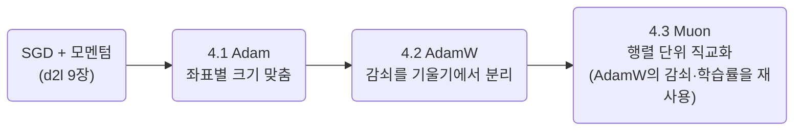
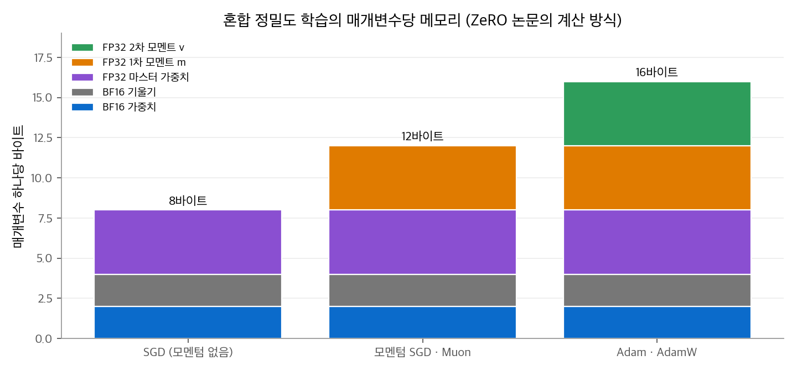

# 4. 옵티마이저

LLM 사전학습의 옵티마이저는 오랫동안 Adam 계열이었습니다. DeepSeek V2·V3와 Qwen 1세대가 AdamW로 학습했습니다.
2025년부터 일부 계열이 **Muon**으로 옮겼습니다. GLM-4.5·GLM-5, Kimi K2, DeepSeek V4가 Muon을 씁니다.
이 장은 세 옵티마이저를 한 페이지씩 나눠 다룹니다. 이 페이지에는 세 페이지의 구성, 각 모델이 보고서에 밝힌 설정, 세 옵티마이저의 비교를 모았습니다.

!!! info "자료"
    - Kingma and Ba, [Adam: A Method for Stochastic Optimization](https://arxiv.org/abs/1412.6980), 2014.
    - Loshchilov and Hutter, [Decoupled Weight Decay Regularization](https://arxiv.org/abs/1711.05101) (AdamW), 2017.
    - Keller Jordan et al., [Muon: An optimizer for hidden layers in neural networks](https://kellerjordan.github.io/posts/muon/), 2024.
    - Liu et al. (Moonshot AI), [Muon is Scalable for LLM Training](https://arxiv.org/abs/2502.16982), 2025.
    - SGD와 모멘텀의 기초는 [신경망 기초 9장](../../d2l/09-optimization.md)에 있습니다.

## 1. 세 페이지의 구성

| 페이지 | 다루는 내용 |
| --- | --- |
| [4.1 Adam](01-adam.md) | 모멘텀과 RMSProp에서 Adam이 나오는 과정, 편향 보정 유도, 좌표별 학습률, β2의 역할, 메모리 비용 |
| [4.2 AdamW](02-adamw.md) | L2 정규화와 가중치 감쇠가 Adam에서 달라지는 이유, 분리된 감쇠, 학습률 스케줄, 기울기 클리핑, 배치 크기 워밍업 |
| [4.3 Muon](03-muon.md) | 모멘텀 행렬의 직교화, 뉴턴-슐츠 반복, 갱신 크기 맞춤, Muon Split과 QK-Clip, 분산 학습 |

순서대로 읽는 편이 좋습니다. AdamW는 Adam의 갱신식을 전제로 하고, Muon은 AdamW의 분리된 감쇠와 학습률 스케줄을 그대로 가져옵니다.

## 2. 모델별 옵티마이저

아래 표는 각 기술 보고서가 밝힌 사전학습 설정입니다. 보고서에 없는 값은 "명시 없음"으로 적었고, 추측해서 채우지 않았습니다.

| 모델 | 옵티마이저 | 핵심 하이퍼파라미터 | 학습률 스케줄 | 배치 크기 | 출처 |
| --- | --- | --- | --- | --- | --- |
| Gemma 1, 2, 3 | 명시 없음 | 명시 없음. "옵티마이저 상태를 ZeRO-3와 비슷한 방식으로 샤딩"만 언급 | 명시 없음 | 명시 없음 | [Gemma](https://arxiv.org/abs/2403.08295), [Gemma 2](https://arxiv.org/abs/2408.00118), [Gemma 3](https://arxiv.org/abs/2503.19786) |
| Gemma 4 | 확인하지 못함 | | | | 공식 기술 보고서를 확인하지 못함 |
| Qwen 1세대 | AdamW | $\beta_1 = 0.9$, $\beta_2 = 0.95$, $\epsilon = 10^{-8}$ | 코사인, 최고 학습률 $3 \times 10^{-4}$ (1.8B·7B·14B), 최고의 10%까지 감쇠 | 4M 토큰 | [Qwen](https://arxiv.org/abs/2309.16609) |
| Qwen2, Qwen2.5, Qwen3 | 명시 없음 | 사전학습 값 명시 없음 | Qwen2.5·Qwen3은 "학습률과 배치 크기를 스케일링 법칙으로 예측해 설정"이라고만 설명 | 명시 없음 | [Qwen2](https://arxiv.org/abs/2407.10671), [Qwen2.5](https://arxiv.org/abs/2412.15115), [Qwen3](https://arxiv.org/abs/2505.09388) |
| DeepSeek-V2 | AdamW | $\beta = (0.9, 0.95)$, 가중치 감쇠 0.1, 기울기 클리핑 1.0 | 2K스텝 워밍업 후 최고 $2.4 \times 10^{-4}$, 토큰 60%·90% 지점에서 각각 0.316배 (계단 감쇠) | 2,304 → 9,216 (첫 225B 토큰 동안) | [V2](https://arxiv.org/abs/2405.04434) |
| DeepSeek-V3 | AdamW | $\beta = (0.9, 0.95)$, 가중치 감쇠 0.1, 기울기 클리핑 1.0 | 2K스텝 워밍업 → $2.2 \times 10^{-4}$ 를 10T 토큰까지 유지 → 4.3T 토큰 동안 코사인으로 $2.2 \times 10^{-5}$ → 마지막 500B 중 333B는 $2.2 \times 10^{-5}$, 167B는 $7.3 \times 10^{-6}$ | 3,072 → 15,360 (첫 469B 토큰 동안) | [V3](https://arxiv.org/abs/2412.19437) |
| DeepSeek-V3.2 | 명시 없음 | 이어 학습 단계의 학습률만 명시: 밀집 워밍업 $10^{-3}$, 희소 학습 $7.3 \times 10^{-6}$ | | 128K 시퀀스 16개(워밍업), 480개(희소) | [V3.2](https://arxiv.org/abs/2512.02556) |
| DeepSeek-V4 | 대부분 Muon, 일부 AdamW | Muon: 모멘텀 0.95, 가중치 감쇠 0.1, 갱신 RMS 0.18, 혼합 뉴턴-슐츠 10회. AdamW(임베딩, 예측 헤드, mHC 정적 편향·게이트, RMSNorm 가중치): $\beta = (0.9, 0.95)$, $\epsilon = 10^{-20}$, 가중치 감쇠 0.1. QK-Clip 없음 | 2,000스텝 워밍업 → 대부분 상수 → 끝에서 코사인. Flash $2.7 \times 10^{-4} \to 2.7 \times 10^{-5}$, Pro $2.0 \times 10^{-4} \to 2.0 \times 10^{-5}$ | Flash 최대 75.5M 토큰, Pro 최대 94.4M 토큰 | [V4](https://arxiv.org/abs/2606.19348) |
| GLM-4.5 | Muon (임베딩, 편향, RMSNorm 가중치 제외) | 뉴턴-슐츠 5회, 모멘텀 0.95, 갱신 RMS 0.2, 가중치 감쇠 0.1 | 워밍업 → 최고 $2.5 \times 10^{-4}$ → 코사인으로 $2.5 \times 10^{-5}$ (중간 학습 끝까지) | 16M → 64M 토큰 (첫 500B 토큰 동안) | [GLM-4.5](https://arxiv.org/abs/2508.06471) |
| GLM-5 | Muon + Muon Split | 그 밖의 값은 "GLM-4.5와 같음" | 사전학습 $0 \to 2 \times 10^{-4}$ 워밍업 후 코사인으로 $4 \times 10^{-5}$, 중간 학습은 $4 \times 10^{-5} \to 10^{-5}$ 선형 | GLM-4.5처럼 배치 워밍업 | [GLM-5](https://arxiv.org/abs/2602.15763) |
| Kimi K2 | MuonClip (Muon + QK-Clip) | QK-Clip 임계값 $\tau = 100$, 가중치 감쇠 0.1, 갱신 RMS를 AdamW에 맞춤(0.2) | WSD: 500스텝 워밍업 → $2 \times 10^{-4}$ 를 10T 토큰 유지 → 5.5T 토큰 동안 코사인으로 $2 \times 10^{-5}$ | 67M 토큰 | [Kimi K2](https://arxiv.org/abs/2507.20534) |

정리하면 다음과 같습니다.

- **AdamW**: DeepSeek V2·V3, Qwen 1세대. 모두 $\beta = (0.9, 0.95)$ 를 씁니다. 같은 값을 GPT-3도 썼습니다(4.1 Adam 5절).
- **Muon**: GLM-4.5·GLM-5, DeepSeek V4, Kimi K2. 행렬 매개변수에만 Muon을 쓰고, 임베딩·출력 헤드·정규화 가중치는 AdamW나 제외 목록으로 둡니다.
- **명시 없음**: Gemma 1~3, Qwen2 이후. 같은 계열이라도 옵티마이저를 공개하지 않은 경우가 많습니다.

계열별 전체 특징은 트렌드의 LLM Model 글에 있습니다: [Gemma](../../../trends/posts/2026-10-20-llm-gemma.md), [DeepSeek](../../../trends/posts/2026-10-20-llm-deepseek.md), [Qwen](../../../trends/posts/2026-10-20-llm-qwen.md), [GLM](../../../trends/posts/2026-10-20-llm-glm.md), [Kimi](../../../trends/posts/2026-10-20-llm-kimi.md).

## 3. 세 옵티마이저 비교

| 항목 | Adam | AdamW | Muon |
| --- | --- | --- | --- |
| 갱신 방향 | 좌표마다 $\hat m/(\sqrt{\hat v}+\epsilon)$ | Adam과 같음 | 모멘텀 행렬 $\mathbf{M}$ 의 직교화 $\mathbf{U}\mathbf{V}^\top$ |
| 크기를 맞추는 단위 | 좌표(원소) | 좌표(원소) | 행렬 전체(특잇 방향) |
| 가중치 감쇠 | L2로 넣으면 기울기에 섞임 | 갱신과 분리해 $-\eta\lambda\mathbf{W}$ | AdamW와 같은 분리 방식 |
| 옵티마이저 상태 | $\mathbf{m}, \mathbf{v}$ (2개) | $\mathbf{m}, \mathbf{v}$ (2개) | 모멘텀 1개 |
| 혼합 정밀도 학습의 매개변수당 메모리 | 16바이트 | 16바이트 | 12바이트 |
| 추가 계산 | 원소별 연산 | 원소별 연산 | 행렬 곱 기반 뉴턴-슐츠 5~10회 |
| 적용 대상 | 모든 매개변수 | 모든 매개변수 | 은닉층 2차원 행렬. 나머지는 AdamW |
| 이 장의 모델 | (L2와 함께 쓴 사례는 다루지 않음) | DeepSeek V2·V3, Qwen 1세대, DeepSeek V4의 일부 | GLM-4.5·5, Kimi K2, DeepSeek V4 |

<figure markdown>

<figcaption markdown>
<b>Figure 1.</b> 혼합 정밀도 학습의 매개변수당 메모리

ZeRO 논문의 계산 방식입니다. 매개변수당 메모리는 Adam 계열이 16바이트, Muon이 12바이트입니다.
</figcaption>
</figure>

다음 페이지는 [4.1 Adam](01-adam.md)입니다.
