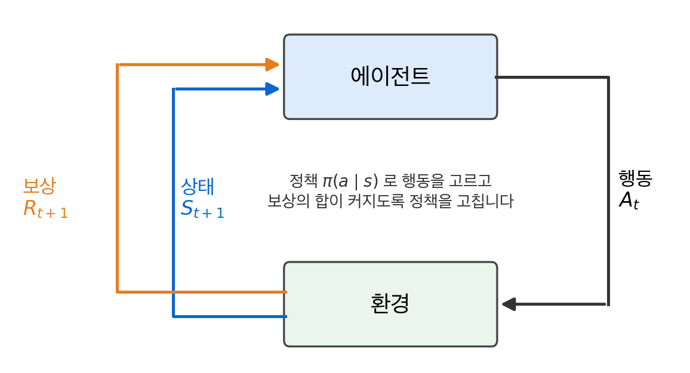
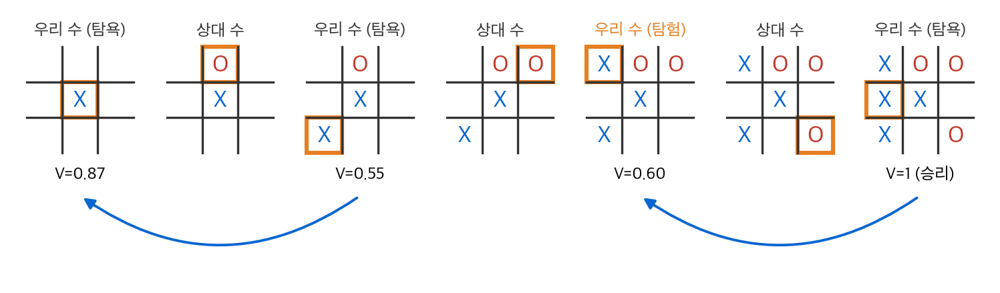
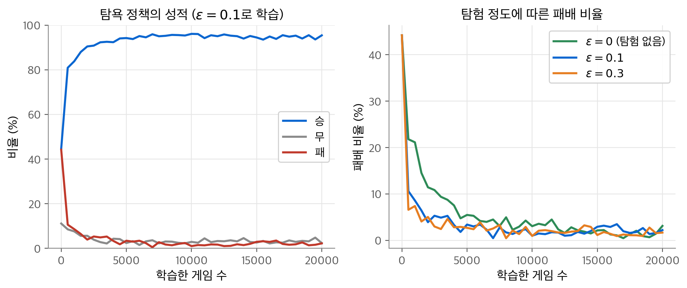
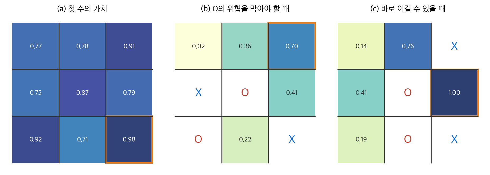
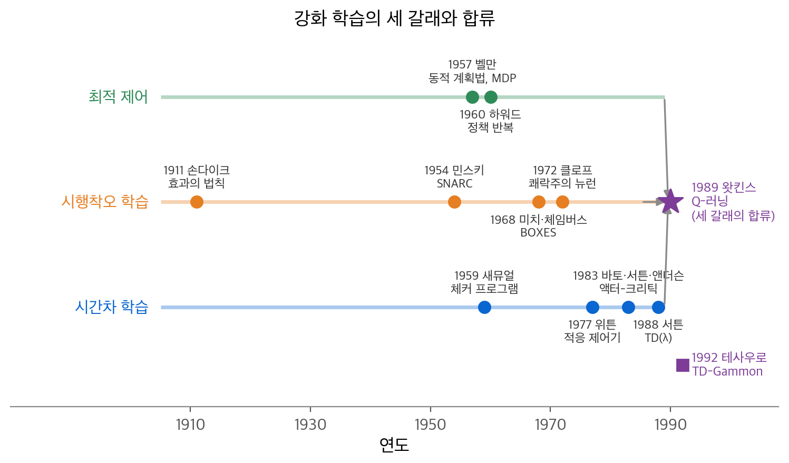

# 1. 강화 학습 문제

아기는 선생님 없이도 팔을 휘두르고 주위를 둘러보며 세상을 배웁니다. 이 장의 질문은 "정답을 알려 주는 사람이 없을 때 상호작용만으로 목표를 이루는 법을 어떻게 배울까?"입니다. 결론은 다음과 같습니다. 행동의 결과로 받는 숫자 하나, 곧 **보상(reward)** 의 합을 최대로 만드는 문제로 학습을 정의합니다. 이 정의에서 강화 학습의 두 특징이 나옵니다. 하나는 시행착오로 탐색해야 한다는 점입니다. 다른 하나는 보상이 늦게 온다는 점입니다. 틱택토 예제에서 상태마다 승리 확률을 적은 표를 두고 시간차 규칙으로 고치면, 상대 모델 없이도 패배율이 44%에서 2% 근처로 떨어집니다.

!!! info "원문과 자료"
    - 원문: Sutton & Barto 2판 초안, 1장 The Reinforcement Learning Problem (1.1~1.7). 최종본 1장 Introduction에 해당합니다.
    - 1.1 Reinforcement Learning, 1.2 Examples, 1.3 Elements of Reinforcement Learning, 1.4 Limitations and Scope, 1.5 An Extended Example: Tic-Tac-Toe, 1.7 History of Reinforcement Learning
    - [Sutton & Barto 책 페이지 (최종본 PDF)](http://incompleteideas.net/book/the-book-2nd.html)
    - [David Silver, UCL RL 강의](https://www.davidsilver.uk/teaching/) 1강 [Introduction to Reinforcement Learning 슬라이드](https://davidstarsilver.wordpress.com/wp-content/uploads/2025/04/intro_rl.pdf)
    - [Coursera: Fundamentals of Reinforcement Learning](https://www.coursera.org/learn/fundamentals-of-reinforcement-learning) (Martha White, Adam White)
    - 함께 읽기: [2. 다중 선택 밴딧](02-bandits.md), [3. 유한 마르코프 결정 과정](03-finite-mdp.md), [6. 시간차 학습](06-td-learning.md)

## 1. 강화 학습이란

### 정의

**강화 학습(reinforcement learning)** 은 상황을 행동으로 연결하는 법을 배워 수치 보상 신호를 최대로 만드는 학습입니다. 학습자를 **에이전트(agent)** 라고 부릅니다. 에이전트 밖의 모든 것을 **환경(environment)** 이라고 부릅니다. 시간 단계 $t = 0, 1, 2, \ldots$ 마다 다음 일이 반복됩니다.

1. 에이전트가 환경의 **상태(state)** $S_t$ 를 관측합니다.
2. 에이전트가 **행동(action)** $A_t$ 를 고릅니다.
3. 환경이 다음 상태 $S_{t+1}$ 과 보상 $R_{t+1}$ 을 돌려줍니다.

<figure markdown>

<figcaption markdown>
<span class="fig-title"><b>Figure 1.</b> 에이전트-환경 상호작용</span>

에이전트가 행동을 보내면 환경이 다음 상태와 보상을 돌려줍니다. 이 고리가 강화 학습 문제의 전부입니다.
</figcaption>
</figure>

에이전트의 목표는 지금 받을 보상이 아니라 앞으로 받을 보상의 합입니다. 이 합을 **이득(return)** 이라고 합니다. 가장 단순한 형태는 다음과 같습니다.

$$
G_t = R_{t+1} + R_{t+2} + \cdots + R_T
$$

$T$ 는 마지막 시간 단계입니다. 미래 보상을 덜 쳐 주는 할인 이득과 끝이 없는 과제는 [3장](03-finite-mdp.md)에서 다룹니다. 이 장에서는 "보상의 합을 크게"라는 목표만 기억하면 됩니다.

### 두 가지 특징

강화 학습 문제를 다른 학습 문제와 구분하는 특징은 두 가지입니다.

| 특징 | 뜻 | 결과 |
| --- | --- | --- |
| 시행착오 탐색 | 어떤 행동이 좋은지 아무도 알려 주지 않습니다. | 에이전트가 직접 해 보고 결과를 비교해야 합니다. |
| 지연된 보상 | 지금 행동이 바로 다음 보상뿐 아니라 이후 상황과 보상을 바꿉니다. | 어느 행동이 결과에 기여했는지 나누는 일이 어렵습니다. |

두 번째 특징을 **신용 할당 문제(credit assignment problem)** 라고도 부릅니다. 체스에서 마지막에 이겼다면 서른 번의 수 가운데 어느 수가 승리를 만들었는지 따로 알아내야 합니다.

### 지도 학습, 비지도 학습과의 차이

**지도 학습(supervised learning)** 은 정답이 붙은 예제로 배웁니다. 교사는 "이 상황에서는 이 행동이 맞다"라고 알려 줍니다. 이런 신호를 **지시적 피드백(instructive feedback)** 이라고 합니다. 강화 학습의 보상은 "방금 한 행동이 얼마나 좋았다"만 알려 줍니다. 이것을 **평가적 피드백(evaluative feedback)** 이라고 합니다. 평가적 피드백은 다른 행동을 했으면 어땠을지 알려 주지 않습니다.

상호작용 문제에서는 모든 상황의 정답을 미리 모을 수 없습니다. 에이전트가 가 본 적 없는 상황이 계속 생기기 때문입니다. 그래서 에이전트는 자기 경험에서 직접 배워야 합니다.

**비지도 학습(unsupervised learning)** 은 정답 없는 데이터에서 숨은 구조를 찾습니다. 강화 학습도 정답이 없으니 비지도 학습처럼 보입니다. 그러나 목표가 다릅니다. 강화 학습은 구조를 찾는 것이 아니라 보상을 최대로 만드는 것이 목표입니다. 구조를 잘 찾으면 도움이 될 수는 있지만, 그 자체로는 보상 최대화 문제를 풀지 못합니다. 그래서 원문은 강화 학습을 지도·비지도 학습과 나란한 세 번째 패러다임으로 봅니다.

| 구분 | 학습 신호 | 목표 |
| --- | --- | --- |
| 지도 학습 | 정답 레이블 | 정답을 일반화 |
| 비지도 학습 | 없음 | 데이터의 구조 발견 |
| 강화 학습 | 보상(평가) | 보상 합 최대화 |

### 탐험-활용 딜레마

보상을 많이 받으려면 지금까지 좋았던 행동을 골라야 합니다. 이것을 **활용(exploitation)** 이라고 합니다. 그런데 좋은 행동을 찾으려면 아직 덜 시도한 행동도 해 봐야 합니다. 이것을 **탐험(exploration)** 이라고 합니다. 한 번에 둘 다 할 수는 없습니다.

작은 예로 식당 두 곳을 생각합니다. A 식당은 열 번 가서 평균 만족도가 7점이었습니다. B 식당은 한 번 가서 5점이었습니다. B의 참평균이 8점일 가능성도 있습니다. 한 번의 경험으로는 알 수 없습니다. A만 가면 B가 더 좋을 가능성을 영영 확인하지 못합니다. B에 자주 가면 대부분의 저녁을 덜 좋은 식당에서 보낼 수 있습니다.

확률적인 과제에서는 행동마다 여러 번 시도해야 기대 보상을 믿을 만하게 추정할 수 있습니다. 이 딜레마는 지도 학습과 비지도 학습에는 나타나지 않습니다. [2장](02-bandits.md)에서 가장 단순한 형태로 자세히 다룹니다.

## 2. 예시

원문은 강화 학습 문제의 예로 다음 다섯 가지를 듭니다.

| 예 | 상태 | 행동 | 보상 또는 목표 |
| --- | --- | --- | --- |
| 체스 선수 | 판의 배치 | 다음 수 | 승리 |
| 정유 공장 제어기 | 공정 변수 | 운전 파라미터 조정 | 수율, 비용, 품질의 균형 |
| 새끼 가젤 | 몸과 주변 상태 | 근육 움직임 | 빨리 일어나 달리기 |
| 청소 로봇 | 배터리 잔량, 위치 | 다음 방 탐색 또는 충전소 복귀 | 쓰레기 수거, 방전 회피 |
| 아침 식사를 준비하는 사람 | 찬장, 냉장고, 배고픔 | 걷기, 손 뻗기, 집기 | 배부름, 영양 |

예들의 공통점은 다음과 같습니다.

- 에이전트와 환경이 상호작용합니다. 환경에 대한 불확실성이 있는데도 목표를 이루려 합니다.
- 행동이 미래 상태를 바꿉니다. 그래서 지금 고를 수 있는 선택지와 기회도 달라집니다.
- 행동의 결과를 완전히 예측할 수 없습니다. 에이전트는 환경을 계속 관찰하며 반응해야 합니다.
- 목표가 명시적입니다. 에이전트는 자기 감각으로 목표에 얼마나 다가갔는지 판단할 수 있습니다.
- 에이전트는 경험으로 성능을 높입니다. 새끼 가젤은 태어난 직후 비틀거리지만 30분 뒤에는 시속 약 32 km(20마일)로 달립니다.

## 3. 강화 학습의 구성 요소

에이전트와 환경 외에 강화 학습 시스템에는 네 가지 요소가 있습니다.

### 정책

**정책(policy)** 은 상태를 보고 행동을 고르는 규칙입니다. 확률적 정책은 상태 $s$ 에서 행동 $a$ 를 고를 확률 $\pi(a \mid s)$ 로 씁니다. 결정적 정책이면 표 하나로 충분합니다. 복잡한 정책은 탐색 과정 전체일 수도 있습니다. 정책만 있으면 행동을 정할 수 있으므로 정책이 에이전트의 핵심입니다.

### 보상 신호

**보상 신호(reward signal)** 는 문제의 목표를 정의합니다. 매 단계 환경이 숫자 $R_{t+1}$ 하나를 보냅니다. 에이전트는 이 숫자를 바꿀 수 없습니다. 바꿀 수 있는 것은 자기 행동뿐입니다. 생물에 빗대면 보상은 즐거움과 고통에 해당합니다. 정책을 고치는 1차 근거가 보상입니다. 보상이 낮은 행동을 했다면 다음에는 다른 행동을 고르도록 정책을 바꿉니다.

### 가치 함수

보상은 지금 얼마나 좋은지를 알려 줍니다. **가치 함수(value function)** 는 길게 보아 얼마나 좋은지를 알려 줍니다. 상태 $s$ 의 가치는 그 상태에서 시작해 앞으로 받을 것으로 기대하는 보상의 합입니다.

$$
v_\pi(s) = \mathbb{E}_\pi[\,G_t \mid S_t = s\,]
$$

보상과 가치는 다를 수 있습니다. 보상이 낮아도 그 뒤에 보상이 높은 상태가 이어지면 가치는 높습니다. 시험 공부는 당장의 보상이 낮지만 가치는 높습니다. 우리는 가치가 가장 높은 상태로 가는 행동을 고릅니다. 보상이 가장 높은 행동을 고르지 않습니다.

보상은 환경이 직접 줍니다. 가치는 에이전트가 경험을 쌓으며 추정하고 계속 고쳐야 합니다. 그래서 거의 모든 강화 학습 알고리즘에서 가장 중요한 부분은 가치를 효율적으로 추정하는 방법입니다.

가치 함수 없이 푸는 방법도 있습니다. 유전 알고리즘 같은 **진화적 방법(evolutionary method)** 은 정책을 통째로 여러 개 만들어 평가하고 좋은 정책을 남깁니다. 정책 공간이 작거나 상태를 잘 관측하지 못할 때 쓸 만합니다. 하지만 한 게임 안에서 어느 상태를 지났는지 같은 정보를 버립니다. 이 책은 상호작용 중의 정보를 활용하는 방법을 다룹니다.

### 모델

**모델(model)** 은 환경을 흉내 냅니다. 상태와 행동을 넣으면 다음 상태와 보상을 예측합니다. 모델이 있으면 실제로 해 보기 전에 미래를 따져 행동을 정할 수 있습니다. 이것을 **계획(planning)** 이라고 합니다. 모델과 계획을 쓰는 방법을 **모델 기반(model-based)** 방법이라고 합니다. 모델 없이 시행착오만으로 배우는 방법을 **모델 없는(model-free)** 방법이라고 합니다. 두 방법을 섞는 방법은 [8장](08-planning-learning.md)에서 다룹니다.

| 요소 | 질문 | 기호 |
| --- | --- | --- |
| 정책 | 이 상태에서 무엇을 할까? | $\pi(a \mid s)$ |
| 보상 신호 | 지금 얼마나 좋았나? | $R_{t+1}$ |
| 가치 함수 | 앞으로 얼마나 좋을까? | $v_\pi(s)$, $q_\pi(s, a)$ |
| 모델 | 이렇게 하면 무슨 일이 생길까? | $p(s', r \mid s, a)$ |

### 범위와 한계

이 책은 상태를 에이전트가 받는 신호로 봅니다. 상태 신호를 어떻게 만드는지는 다루지 않습니다. 원문은 이것을 "강화 학습 문제의 정의 밖"이라고 둡니다. 또 이 책의 방법 대부분은 가치 함수를 추정합니다. 진화적 방법은 상태 공간이 크고 상호작용이 쌓일 때 효율이 떨어지므로 다루지 않습니다.

## 4. 확장 예제: 틱택토

### 문제

틱택토는 3×3 판에서 두 사람이 번갈아 X와 O를 놓는 게임입니다. 가로, 세로, 대각선으로 셋을 먼저 잇는 쪽이 이깁니다. 판이 다 차면 무승부입니다. 잘하는 사람끼리 두면 항상 무승부입니다. 그래서 가끔 실수하는 상대를 가정합니다. 무승부와 패배는 똑같이 나쁘다고 봅니다. 질문은 "상대의 약점을 찾아 이길 확률을 최대로 만드는 선수를 어떻게 만들까?"입니다.

고전적 방법은 잘 맞지 않습니다.

- **미니맥스(minimax)** 는 상대가 최선을 둔다고 가정합니다. 실수하는 상대를 이용하지 못합니다. 상대가 실수해서 내가 늘 이기는 상태도 "질 수 있는 상태"라며 피합니다.
- **동적 계획법(dynamic programming)** 은 어떤 상대에게나 최적 해를 계산합니다. 그러나 상태마다 상대가 각 수를 둘 확률을 미리 알아야 합니다. 이 정보는 대개 주어지지 않습니다.
- 진화적 방법은 정책을 고정하고 많은 게임을 두어 승률을 잽니다. 게임 결과만 보고 게임 중 무엇이 있었는지는 무시합니다.

세 방법을 나란히 놓으면 다음과 같습니다.

| 방법 | 필요한 것 | 배우는 단위 | 게임 중 정보 사용 |
| --- | --- | --- | --- |
| 미니맥스 | 게임 규칙 | 없음(계산만) | 해당 없음 |
| 동적 계획법 | 상대의 수 확률 전체 | 상태별 가치 | 해당 없음 |
| 진화적 방법 | 상대와 둘 기회 | 정책 전체 | 쓰지 않음(최종 결과만) |
| 가치 함수 + TD | 상대와 둘 기회 | 상태별 가치 | 매 수마다 씀 |

### 가치 테이블과 시간차 갱신

가치 함수를 쓰는 방법은 다음과 같습니다. 게임의 가능한 상태마다 숫자 하나를 담은 표 $V$ 를 둡니다. 숫자는 그 상태에서 이길 확률의 추정값입니다.

- 우리가 X이고 X 셋이 이어진 상태의 값은 1입니다. 이미 이겼습니다.
- O 셋이 이어졌거나 판이 다 찬 상태의 값은 0입니다.
- 나머지 상태는 모두 0.5로 시작합니다.

이 표가 왜 가치 함수인지 확인합니다. 이기면 보상 1을 받고 그 밖에는 언제나 보상 0을 받는다고 정합니다. 그러면 한 게임의 이득 $G_t$ 는 이기면 1, 아니면 0입니다. 기댓값을 취하면 다음과 같습니다.

$$
v_\pi(s) = \mathbb{E}_\pi[G_t \mid S_t = s] = 1 \cdot P(\text{승리} \mid s) + 0 \cdot P(\text{무승부 또는 패배} \mid s) = P(\text{승리} \mid s)
$$

따라서 승리 확률 표는 이 보상 정의 아래의 상태 가치 함수입니다.

수를 고를 때는 둘 수 있는 칸마다 그 수를 둔 뒤의 상태를 만들어 표에서 값을 찾습니다. 대부분은 값이 가장 큰 수를 둡니다. 이것을 **탐욕적(greedy)** 수라고 합니다. 가끔은 무작위로 다른 수를 둡니다. 이것을 **탐험적 수(exploratory move)** 라고 합니다. 탐험적 수는 평소에 보지 못할 상태를 경험하게 합니다.

게임 중에 지나간 상태의 값을 고칩니다. 탐욕적 수를 둔 뒤의 상태 $s'$ 의 값을 바로 앞에서 우리가 만든 상태 $s$ 로 거꾸로 전달합니다. 이것을 **백업(backup)** 이라고 합니다.

$$
V(s) \leftarrow V(s) + \alpha\,\big[V(s') - V(s)\big]
$$

$\alpha$ 는 작은 양수이고 **스텝 크기(step size)** 라고 부릅니다. $V(s)$ 를 $V(s')$ 쪽으로 $\alpha$ 만큼의 비율로 옮깁니다. 이 규칙은 **시간차(TD, temporal difference)** 학습의 한 예입니다. 두 시점의 추정값 차이 $V(s') - V(s)$ 로 값을 고치기 때문에 이 이름이 붙었습니다.

작은 수치 예를 봅니다. $V(s) = 0.5$, $V(s') = 0.9$, $\alpha = 0.1$ 이면 $V(s)$ 는 $0.5 + 0.1 \times 0.4 = 0.54$ 가 됩니다. 같은 전이를 계속 겪으면 $V(s)$ 는 $0.9$ 로 다가갑니다. 이긴 상태의 값은 1로 고정입니다. 그래서 이긴 게임마다 승리 직전 상태의 값이 오릅니다. 그 값은 다음 게임에서 더 앞 상태로 전해집니다.

### 값이 뒤로 전해지는 속도

백업은 한 번에 한 칸씩만 값을 옮깁니다. 승리 직전까지 상태 세 개 $s_1 \to s_2 \to s_3 \to$ 승리를 똑같이 반복해서 겪는 경우를 계산해 봅니다. 처음 값은 모두 0.5이고 $\alpha = 0.1$ 입니다. 한 게임 안에서 $s_1, s_2, s_3$ 순서로 고칩니다.

| 반복한 게임 수 | $V(s_1)$ | $V(s_2)$ | $V(s_3)$ |
| --- | --- | --- | --- |
| 1 | 0.500 | 0.500 | 0.550 |
| 10 | 0.535 | 0.632 | 0.826 |
| 50 | 0.944 | 0.983 | 0.997 |
| 100 | 0.999 | 1.000 | 1.000 |

첫 게임에서는 승리에 바로 닿은 $s_3$ 만 바뀝니다. $s_1$ 은 $s_2$ 의 값이 먼저 오른 다음에야 움직입니다. 승리에서 멀리 떨어진 상태일수록 늦게 배웁니다. 한 단계씩 전하지 않고 여러 단계를 한꺼번에 보는 방법은 [7장](07-eligibility-traces.md)에서 다룹니다.

<figure markdown>

<figcaption markdown>
<span class="fig-title"><b>Figure 2.</b> 틱택토 게임 한 판의 백업</span>

파란 화살표가 가치 백업입니다. 다섯 번째 수는 탐험적 수이므로 그 앞 상태로 백업하지 않습니다.
</figcaption>
</figure>

### 구현

판을 길이 9인 튜플로 나타내고 표는 파이썬 딕셔너리로 둡니다. 상대 O는 이길 수 있으면 반드시 이기고, 막아야 할 때 절반의 확률로 막고, 나머지는 무작위로 둡니다.

```python
import numpy as np
LINES = [(0,1,2),(3,4,5),(6,7,8),(0,3,6),(1,4,7),(2,5,8),(0,4,8),(2,4,6)]

def winner(b):                       # 1: X 승, 2: O 승, 3: 무승부, 0: 진행 중
    for i, j, k in LINES:
        if b[i] and b[i] == b[j] == b[k]:
            return b[i]
    return 3 if 0 not in b else 0

def value(V, s):
    w = winner(s)
    return 1.0 if w == 1 else 0.0 if w in (2, 3) else V.get(s, 0.5)

def x_move(V, b, eps, rng):
    moves = [c for c in range(9) if b[c] == 0]
    if rng.random() < eps:                               # 탐험적 수
        return moves[rng.integers(len(moves))], True
    after = [b[:c] + (1,) + b[c+1:] for c in moves]
    vals = np.array([value(V, s) for s in after])
    best = np.flatnonzero(vals == vals.max())
    return moves[rng.choice(best)], False

def td_update(V, s, s_next, alpha=0.1):                  # V(s) <- V(s) + a[V(s') - V(s)]
    V[s] = V.get(s, 0.5) + alpha * (value(V, s_next) - V.get(s, 0.5))
```

게임 한 판에서 우리가 수를 둘 때마다 이전 사후 상태를 새 사후 상태 쪽으로 고칩니다. 탐험적 수를 둔 직후에는 고치지 않습니다. 상대가 이기거나 무승부가 되면 마지막 사후 상태를 0 쪽으로 고칩니다. 수를 둔 뒤의 상태를 **사후 상태(afterstate)** 라고 부릅니다. 이 개념은 [6장](06-td-learning.md)에서 다시 다룹니다.

### 학습 곡선

$\alpha = 0.1$ 로 20,000판을 학습했습니다. 500판마다 학습을 멈추고 탐험 없이 탐욕적으로만 1,000판을 두어 성적을 쟀습니다. 시드 8개의 평균입니다.

<figure markdown>

<figcaption markdown>
<span class="fig-title"><b>Figure 3.</b> 틱택토 학습 곡선</span>

왼쪽은 $\varepsilon = 0.1$ 선수의 승·무·패 비율, 오른쪽은 $\varepsilon$ 별 패배 비율입니다(시드 8개 평균).
</figcaption>
</figure>

numpy로 잰 결과는 다음과 같습니다.

| $\varepsilon$ | 학습 전 패배 | 2,000판 후 패배 | 5,000판 후 패배 | 20,000판 후 승/무/패 | 표에 들어간 상태 수 |
| --- | --- | --- | --- | --- | --- |
| 0 | 44.2% | 11.4% | 5.5% | 87.0 / 9.9 / 3.1% | 341 |
| 0.1 | 44.2% | 3.9% | 3.4% | 95.4 / 2.4 / 2.2% | 1,155 |
| 0.3 | 44.2% | 5.1% | 2.7% | 95.2 / 3.2 / 1.7% | 1,815 |

학습 전 선수는 비종료 상태의 값이 모두 0.5입니다. 그래서 바로 이기는 수만 알아보고 나머지는 무작위로 둡니다. 이때 승률은 44.7%이고 패배율은 44.2%입니다. 몇백 판 만에 패배율이 크게 줄어듭니다. 이 선수는 상대 모델도 없고 수 읽기도 하지 않습니다. 표 하나만 고쳤습니다.

탐험이 없으면($\varepsilon = 0$) 표에 341개 상태만 들어갑니다. 처음 좋아 보인 길만 계속 가기 때문입니다. 그래서 학습이 느리고 최종 승률도 87%에 머뭅니다. $\varepsilon = 0.1$ 은 1,155개 상태를 경험하고 승률이 95% 근처까지 오릅니다. 탐험을 더 많이 해도($\varepsilon = 0.3$) 탐욕 정책의 성적은 비슷합니다. 다만 학습 중에 두는 게임은 무작위 수가 많아 더 자주 집니다. 탐험의 대가는 학습 중의 손해입니다.

### 학습된 상태 가치

$\varepsilon = 0.1$ 로 학습한 선수 하나의 표를 들여다봅니다. 각 칸의 숫자는 그 칸에 X를 둔 뒤의 상태 가치입니다.

<figure markdown>

<figcaption markdown>
<span class="fig-title"><b>Figure 4.</b> 학습된 상태 가치</span>

주황 테두리는 탐욕적 선수가 고르는 칸입니다. (a)는 빈 판에서의 첫 수, (b)와 (c)는 학습된 선수가 이 상대와 실제로 만난 국면입니다.
</figcaption>
</figure>

- (a) 첫 수에서는 구석 칸(0.98, 0.92, 0.91)과 가운데(0.87)가 변 칸(0.71~0.79)보다 높습니다. 구석 하나(0.77)는 낮습니다. 첫 수 값은 그 칸에서 시작한 게임을 얼마나 많이 겪었는지에 따라서도 달라집니다.
- (b) O가 대각선 2-4-6을 위협합니다. 막는 칸의 값은 0.70이고 나머지 칸은 0.02~0.41입니다. 막지 않으면 상대가 바로 이기므로 값이 0에 가깝습니다.
- (c) X가 2-5-8을 완성할 수 있습니다. 그 칸의 값은 1.00입니다. 상대의 1-4-7 위협을 막는 칸은 0.76으로 두 번째입니다.

"위협을 막아라" 같은 규칙을 가르친 적이 없습니다. 이긴 게임과 진 게임의 결과가 백업을 거쳐 앞 상태로 전해진 결과입니다.

### 예제에서 배우는 점

- 에이전트는 상호작용하면서 배웁니다. 이 예에서는 상대와 게임을 두며 배웁니다.
- 목표가 분명하고, 수의 효과가 늦게 나타납니다. 학습된 선수는 근시안적인 상대에게 여러 수짜리 함정을 팔 수 있습니다.
- 상대 모델이나 명시적 수 읽기 없이도 계획과 비슷한 효과를 냅니다.
- 진화적 방법은 이긴 게임의 모든 수에 똑같이 신용을 줍니다. 가치 함수 방법은 상태마다 따로 평가합니다.
- 스텝 크기를 시간에 따라 적절히 줄이면, 고정된 상대에게 이 방법은 각 상태의 참승리 확률로 수렴합니다. 이때 탐욕적 수는 그 상대에 대한 최적의 수입니다. 스텝 크기를 0까지 줄이지 않으면 천천히 바뀌는 상대에도 따라갈 수 있습니다.

틱택토는 상태가 수천 개뿐입니다. 테사우로(Tesauro)는 같은 규칙에 신경망을 붙여 상태가 약 $10^{20}$ 개인 백개먼을 배웠습니다. 상태가 많으면 대부분의 상태를 한 번도 보지 못합니다. 그래서 비슷한 상태에서 배운 것을 새 상태로 옮기는 **일반화(generalization)** 가 필요합니다. 이것은 [9장](09-function-approximation.md)의 주제입니다.

## 5. 더 생각해 볼 점

원문은 틱택토 예제 뒤에 다섯 가지 질문을 던집니다. 답이 하나로 정해지지 않는 질문입니다. 아래는 이 노트의 구현으로 확인한 사실과 생각할 거리입니다.

??? example "자기 대국(self-play)"
    상대가 무작위 선수가 아니라 같은 알고리즘이면 어떻게 될까요? 두 선수가 모두 배우므로 상대가 계속 바뀝니다. 고정된 상대에 맞춘 약점 공략은 의미가 없어집니다. 두 선수는 서로를 이기려고 점점 강해지고, 결국 미니맥스에 가까운 정책을 배울 것이라고 기대할 수 있습니다. 탐험이 계속 있으므로 정확히 같지는 않습니다.

??? example "대칭"
    틱택토 판은 회전 4가지와 뒤집기를 합쳐 8가지 대칭이 있습니다. X가 둔 뒤의 비종료 상태는 2,097개입니다. 대칭으로 같은 상태를 하나로 묶으면 289개로 줄어듭니다. 표가 작아지므로 같은 경험으로 더 빨리 배웁니다. 그러나 상대가 대칭을 따르지 않으면 문제가 생깁니다. 상대가 왼쪽 구석에서만 실수한다면 대칭으로 묶은 상태의 값은 이 차이를 담을 수 없습니다. 대칭인 상태가 반드시 같은 가치를 가져야 하는 것은 아닙니다.

??? example "탐욕적으로만 두기"
    탐험 없이 탐욕적 수만 두면 처음 운 좋게 이긴 길만 반복합니다. 4절의 실험에서 $\varepsilon = 0$ 인 선수는 341개 상태만 경험했고 최종 승률이 87.0%였습니다. $\varepsilon = 0.1$ 인 선수는 1,155개 상태를 겪고 95.4%에 이르렀습니다. 탐욕적 선수는 더 좋은 수가 있다는 사실을 알아낼 기회가 없습니다.

??? example "탐험적 수에서도 배운다면"
    탐험적 수 뒤에도 백업하면 표는 "탐험을 섞어 둘 때의 승리 확률"을 배웁니다. 탐험적 수 뒤에 백업하지 않으면 "탐욕적으로 둘 때의 승리 확률"을 배웁니다. 계속 탐험할 계획이라면 앞쪽이 실제 승률을 더 잘 예측합니다. 탐험을 끝내고 최선으로 둘 계획이라면 뒤쪽이 더 쓸모 있습니다. 이 구분은 뒤에서 on-policy와 off-policy 학습의 차이로 다시 나옵니다([5장](05-monte-carlo.md), [6장](06-td-learning.md)).

??? example "다른 개선"
    상태 수가 많아지면 표 대신 함수로 가치를 근사해야 합니다. 상대의 행동을 배워 모델로 쓰면 실제 게임 없이도 연습할 수 있습니다. 스텝 크기를 상태별 방문 횟수에 따라 줄이면 수렴이 빨라집니다. 각 아이디어는 [8장](08-planning-learning.md), [9장](09-function-approximation.md)에서 다룹니다.

## 6. 역사

강화 학습은 오랫동안 따로 발전한 세 갈래가 1980년대 후반에 합쳐져 만들어졌습니다.

<figure markdown>

<figcaption markdown>
<span class="fig-title"><b>Figure 5.</b> 강화 학습의 세 갈래</span>

최적 제어, 시행착오 학습, 시간차 학습의 주요 사건입니다. 세 갈래는 1989년 왓킨스의 Q-러닝에서 합쳐집니다.
</figcaption>
</figure>

### 최적 제어

**최적 제어(optimal control)** 는 시간에 따라 움직이는 시스템의 비용을 최소로 만드는 제어기를 설계하는 문제입니다. 1950년대 중반 벨만(Bellman)은 시스템의 상태와 가치 함수로 방정식을 세웠습니다. 이 방정식을 지금은 **벨만 방정식(Bellman equation)** 이라고 부릅니다. 이 방정식을 풀어 최적 제어 문제를 푸는 방법이 동적 계획법입니다. 벨만은 1957년 이 문제의 이산 확률 버전인 **마르코프 결정 과정(MDP, Markov decision process)** 도 도입했습니다. 1960년 하워드(Howard)는 MDP를 푸는 정책 반복을 내놓았습니다.

동적 계획법은 상태 수에 따라 계산량이 지수적으로 늘어납니다. 벨만은 이것을 **차원의 저주(curse of dimensionality)** 라고 불렀습니다. 이 갈래는 대부분 학습을 다루지 않았습니다. 모델을 알고 푸는 문제였습니다. 그래도 이 책은 동적 계획법을 강화 학습의 일부로 봅니다. [4장](04-dynamic-programming.md)에서 다룹니다.

### 시행착오 학습

이 갈래는 동물 학습 심리학에서 시작합니다. 1911년 손다이크(Thorndike)는 **효과의 법칙(Law of Effect)** 을 이렇게 정리했습니다. 만족이 뒤따른 반응은 그 상황과 더 강하게 연결되고, 불편함이 뒤따른 반응은 연결이 약해집니다. 이 법칙에는 두 성질이 있습니다. 여러 행동을 시도해 결과로 고르는 **선택적(selectional)** 성질과, 고른 행동을 특정 상황에 묶는 **연관적(associative)** 성질입니다.

컴퓨터로 시행착오 학습을 구현한 초기 시도는 다음과 같습니다.

- 1954년 민스키(Minsky)는 박사 논문에서 SNARC라는 부품으로 만든 아날로그 학습 기계를 설명했습니다.
- 미치(Michie)는 틱택토를 배우는 MENACE를 만들었습니다. 1968년 미치와 체임버스(Chambers)는 막대 세우기를 배우는 BOXES를 발표했습니다.
- 1952년 섀넌(Shannon)은 시행착오로 미로의 길을 찾는 기계 쥐 테세우스(Theseus)를 시연했습니다.
- 1960년대에는 학습 자동자(learning automata) 연구가 밴딧 문제를 다뤘습니다.

동물 학습에서 "강화(reinforcement)"라는 말은 1927년 파블로프(Pavlov)의 조건 반사 연구가 영어로 번역되면서 쓰이기 시작했습니다. 컴퓨터에서 시행착오 학습을 구현하자는 생각은 1948년 튜링(Turing)의 "쾌락-고통 시스템" 구상에도 나타납니다.

이후 많은 연구자가 시행착오 학습과 지도 학습을 혼동했고, 이 갈래는 한동안 약해졌습니다. 클로프(Klopf)는 1972년부터 이 갈래를 되살렸습니다. 그는 학습의 핵심이 환경으로부터 무언가를 얻으려는 "쾌락주의적" 측면이고, 지도 학습 연구가 이것을 놓쳤다고 주장했습니다.

### 시간차 학습

세 번째 갈래는 같은 양의 연속된 두 추정값의 차이로 배우는 방법입니다. 틱택토의 $V(s') - V(s)$ 가 그 예입니다.

- 1959년 새뮤얼(Samuel)의 체커 프로그램이 이 생각을 처음 담았습니다.
- 1972년 클로프는 시행착오 학습과 시간차의 생각을 연결했습니다.
- 1977년 위튼(Witten)은 시간차 학습 규칙을 처음으로 출판했습니다.
- 1983년 바토(Barto), 서튼(Sutton), 앤더슨(Anderson)은 시간차 학습을 시행착오 학습에 쓰는 **액터-크리틱(actor-critic)** 구조를 막대 세우기 문제에 적용했습니다.
- 1988년 서튼은 시간차 학습을 예측 문제에서 분리해 TD($\lambda$) 알고리즘과 수렴 성질을 발표했습니다.

### 합류

1989년 왓킨스(Watkins)는 **Q-러닝(Q-learning)** 을 개발했습니다. Q-러닝은 MDP 형식 위에서 시간차 학습으로 최적 제어 문제를 풉니다. 이 일로 세 갈래가 하나로 합쳐졌습니다. 1992년 테사우로의 TD-Gammon은 백개먼에서 세계 정상급 실력을 보이며 강화 학습에 큰 관심을 모았습니다.

| 갈래 | 핵심 질문 | 이 책에서 이어지는 곳 |
| --- | --- | --- |
| 최적 제어 | 모델이 주어질 때 최적 정책을 어떻게 계산할까? | [3장](03-finite-mdp.md), [4장](04-dynamic-programming.md) |
| 시행착오 학습 | 결과가 좋은 행동을 어떻게 더 자주 고를까? | [2장](02-bandits.md), [11장](11-policy-gradient.md) |
| 시간차 학습 | 최종 결과 전에 추정값으로 어떻게 배울까? | [6장](06-td-learning.md), [7장](07-eligibility-traces.md) |

## 정리

- 강화 학습은 상황을 행동으로 연결하는 법을 배워 보상의 합을 최대로 만드는 학습입니다. 에이전트는 상태 $S_t$ 를 보고 행동 $A_t$ 를 고르고, 환경은 $S_{t+1}$ 과 $R_{t+1}$ 을 돌려줍니다.
- 강화 학습의 두 특징은 시행착오 탐색과 지연된 보상입니다.
- 지도 학습은 정답을 알려 주는 지시적 피드백으로 배웁니다. 강화 학습은 행동의 좋고 나쁨만 알려 주는 평가적 피드백으로 배웁니다. 비지도 학습은 구조를 찾고, 강화 학습은 보상을 최대로 만듭니다.
- 탐험과 활용은 동시에 할 수 없습니다. 이 딜레마는 강화 학습에만 나타납니다.
- 구성 요소는 정책 $\pi(a \mid s)$, 보상 신호, 가치 함수 $v_\pi(s)$, 모델입니다. 보상은 지금의 좋음이고 가치는 앞으로의 좋음입니다.
- 틱택토에서 승리 확률 표를 $V(s) \leftarrow V(s) + \alpha[V(s') - V(s)]$ 로 고쳤습니다. 상대 모델 없이 패배율이 44.2%에서 2% 근처로 줄었습니다.
- 탐험이 없으면 경험한 상태가 341개에 그치고 최종 승률도 87%에 머물렀습니다. $\varepsilon = 0.1$ 에서는 1,155개 상태를 겪고 승률이 95% 근처에 이르렀습니다.
- 강화 학습은 최적 제어, 시행착오 학습, 시간차 학습의 세 갈래가 1989년 Q-러닝에서 합쳐져 만들어졌습니다.
