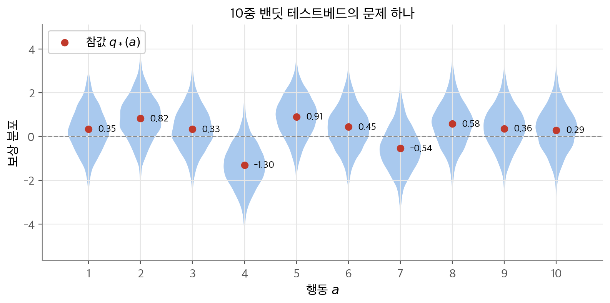
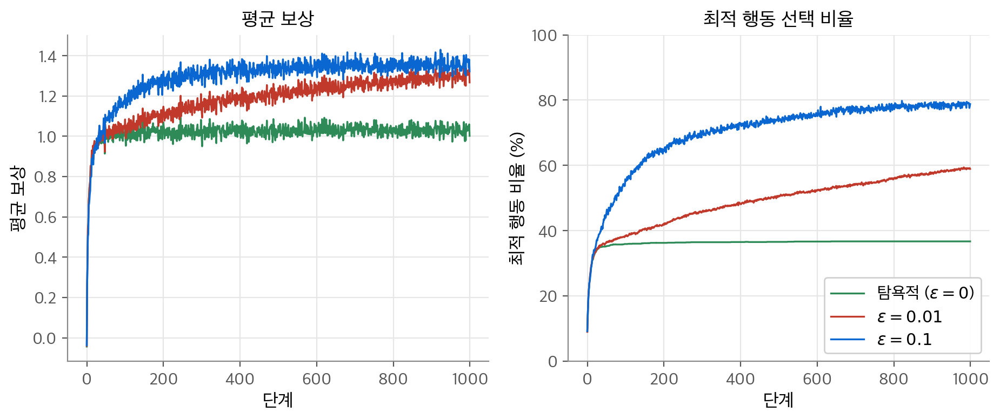
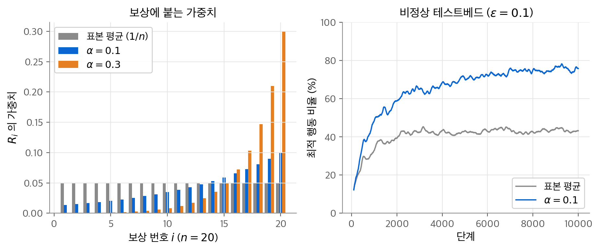
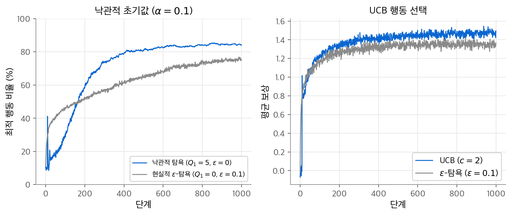
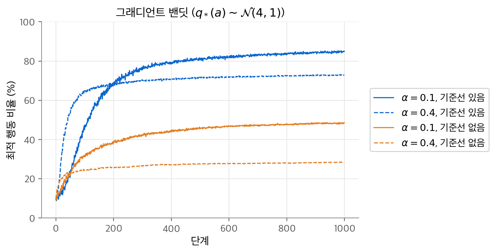
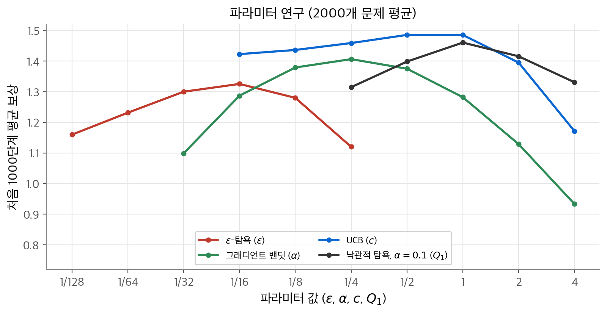

# 2. 다중 선택 밴딧

강화 학습이 다른 학습과 가장 다른 점은 평가적 피드백입니다. 보상은 고른 행동이 얼마나 좋았는지만 알려 주고, 무엇이 정답인지는 알려 주지 않습니다. 이 장은 상태가 하나뿐인 가장 단순한 문제에서 이 특징을 봅니다. 질문은 "몇 개의 선택지 가운데 무엇이 좋은지 모르는 채로 반복해서 고를 때, 탐험과 활용을 어떻게 나눌까?"입니다. 결론은 다음과 같습니다. 행동마다 평균 보상을 증분 방식으로 추정하고, 탐욕적 선택에 탐험을 섞습니다. 탐험을 섞는 방법은 ε-탐욕, 낙관적 초기값, UCB, 그래디언트 밴딧 네 가지입니다. 10중 테스트베드에서 탐험을 전혀 하지 않는 탐욕적 방법은 최적 행동을 37%만 골랐습니다. UCB는 처음 1,000단계 평균 보상이 1.49로 네 방법 가운데 가장 높았습니다.

!!! info "원문과 자료"
    - 원문: Sutton & Barto 2판 초안, 2장 Multi-arm Bandits (2.1~2.9). 최종본 2장 Multi-armed Bandits에 해당합니다.
    - 2.1 An n-Armed Bandit Problem, 2.2 Action-Value Methods(10중 테스트베드 포함), 2.3 Incremental Implementation, 2.4 Tracking a Nonstationary Problem, 2.5 Optimistic Initial Values, 2.6 Upper-Confidence-Bound Action Selection, 2.7 Gradient Bandits, 2.8 Associative Search (Contextual Bandits), 2.9 Summary
    - 초안은 행동 수를 $n$ 으로 쓰고 "n-armed bandit"이라고 부릅니다. 이 노트는 최종본을 따라 $k$ 와 "k-armed bandit"을 씁니다.
    - [Sutton & Barto 책 페이지 (최종본 PDF)](http://incompleteideas.net/book/the-book-2nd.html)
    - [David Silver, UCL RL 강의](https://www.davidsilver.uk/teaching/) 9강 [Exploration and Exploitation 슬라이드](https://davidstarsilver.wordpress.com/wp-content/uploads/2025/04/lecture-9-exploration-and-exploitation.pdf)
    - [Coursera: Fundamentals of Reinforcement Learning](https://www.coursera.org/learn/fundamentals-of-reinforcement-learning) 2주차 An Introduction to Sequential Decision-Making
    - 함께 읽기: [1. 강화 학습 문제](01-rl-problem.md), [3. 유한 마르코프 결정 과정](03-finite-mdp.md), [11. 정책 근사](11-policy-gradient.md)

## 1. k-armed bandit 문제

### 정의

다음 문제를 생각합니다. $k$ 개의 행동 가운데 하나를 고르는 일을 반복합니다. 고를 때마다 수치 보상을 받습니다. 보상은 고른 행동에 따라 정해진 확률 분포에서 나옵니다. 분포는 시간이 지나도 바뀌지 않습니다. 목표는 예를 들어 1,000단계 동안 받은 보상의 합을 최대로 만드는 것입니다.

이것을 **k-armed bandit 문제** 라고 합니다. 레버가 하나인 슬롯머신을 "외팔이 강도(one-armed bandit)"라고 부르는 데서 왔습니다. 여기서는 레버가 $k$ 개입니다. 또 다른 예는 위중한 환자들에게 실험 치료법 가운데 하나를 고르는 의사입니다.

시간 단계 $t$ 에 고른 행동을 $A_t$, 받은 보상을 $R_t$ 로 씁니다. 행동 $a$ 의 **가치(value)** 는 그 행동을 골랐을 때의 기대 보상입니다.

$$
q_*(a) \doteq \mathbb{E}[R_t \mid A_t = a]
$$

$q_*(a)$ 를 알면 문제는 쉽습니다. 가치가 가장 큰 행동만 고르면 됩니다. 우리는 $q_*(a)$ 를 모릅니다. 시간 $t$ 에서의 추정값을 $Q_t(a)$ 로 씁니다. 목표는 $Q_t(a)$ 를 $q_*(a)$ 에 가깝게 만드는 것입니다.

### 탐욕적 행동, 탐험, 활용

각 시점에 추정값이 가장 큰 행동이 적어도 하나 있습니다. 이것을 **탐욕적(greedy)** 행동이라고 합니다. 탐욕적 행동을 고르면 지금 아는 지식을 **활용(exploitation)** 하는 것입니다. 탐욕적이지 않은 행동을 고르면 **탐험(exploration)** 하는 것입니다. 탐험하면 그 행동의 추정값이 좋아집니다.

활용은 이번 한 단계의 기대 보상을 최대로 만듭니다. 탐험은 길게 보아 보상의 합을 더 키울 수 있습니다. 남은 단계가 많고 추정이 불확실할수록 탐험의 가치가 큽니다. 한 단계에서 둘을 동시에 할 수 없으므로 이것을 탐험과 활용의 **충돌(conflict)** 이라고 부릅니다.

밴딧 문제는 **비연관(nonassociative)** 문제입니다. 상황이 하나뿐이고, 그 상황에서 가장 좋은 행동 하나를 찾으면 됩니다. 상황이 여러 개인 경우는 7절에서 다룹니다.

## 2. 행동 가치 방법

### 표본 평균

행동의 가치를 추정하고 그 추정으로 행동을 고르는 방법을 **행동 가치 방법(action-value method)** 이라고 합니다. 가장 자연스러운 추정은 그 행동을 고른 뒤 받은 보상의 평균입니다.

$$
Q_t(a) \doteq \frac{\sum_{i=1}^{t-1} R_i \cdot \mathbf{1}_{A_i = a}}{\sum_{i=1}^{t-1} \mathbf{1}_{A_i = a}}
$$

$\mathbf{1}_{\text{조건}}$ 은 조건이 참이면 1, 거짓이면 0입니다. 분모가 0이면 $Q_t(a)$ 를 0 같은 기본값으로 둡니다. 분모가 무한히 커지면 큰 수의 법칙에 따라 $Q_t(a)$ 는 $q_*(a)$ 로 수렴합니다. 이것을 **표본 평균(sample-average)** 방법이라고 합니다.

### 탐욕적 선택과 ε-탐욕

탐욕적 선택은 추정값이 가장 큰 행동을 고릅니다.

$$
A_t \doteq \arg\max_a Q_t(a)
$$

최댓값이 여러 개면 무작위로 하나를 고릅니다. 탐욕적 선택은 탐험을 하지 않습니다. 대안은 대부분 탐욕적으로 고르고, 작은 확률 $\varepsilon$ 으로 모든 행동 가운데 무작위로 고르는 것입니다. 이것을 **ε-탐욕(ε-greedy)** 방법이라고 합니다.

ε-탐욕에서 탐욕적 행동이 하나일 때 그 행동을 고를 확률은 다음과 같습니다.

$$
P(A_t = \text{탐욕적 행동}) = (1 - \varepsilon) + \frac{\varepsilon}{k}
$$

무작위 선택에서도 $1/k$ 확률로 탐욕적 행동이 다시 뽑히기 때문입니다. $k = 2$, $\varepsilon = 0.5$ 이면 $0.5 + 0.25 = 0.75$ 입니다. 단계가 무한히 늘면 모든 행동이 무한히 자주 선택됩니다. 그래서 모든 $Q_t(a)$ 가 $q_*(a)$ 로 수렴합니다. 최적 행동을 고를 확률은 $1 - \varepsilon$ 이상으로 수렴합니다.

### 10중 테스트베드

방법을 비교하려고 **10중 테스트베드(10-armed testbed)** 를 만듭니다. 무작위로 만든 $k = 10$ 밴딧 문제 2,000개의 모음입니다.

- 문제마다 참가치 $q_*(a)$, $a = 1, \ldots, 10$ 을 평균 0, 분산 1인 정규 분포에서 뽑습니다.
- 행동 $A_t$ 를 고르면 보상 $R_t$ 를 평균 $q_*(A_t)$, 분산 1인 정규 분포에서 뽑습니다.
- 한 방법을 문제 하나에서 1,000단계 돌린 것을 **실행(run)** 한 번이라고 합니다. 2,000번 실행의 평균으로 성능을 잽니다.

<figure markdown>

<figcaption markdown>
<span class="fig-title"><b>Figure 1.</b> 10중 밴딧 테스트베드</span>

빨간 점이 참가치 $q_*(a)$, 파란 영역이 보상 분포입니다. 이 문제에서는 행동 5($q_* = 0.905$)가 최적입니다.
</figcaption>
</figure>

보상 분포가 넓게 겹칩니다. 행동 5와 행동 2의 참가치 차이는 0.08인데 보상의 표준 편차는 1입니다. 몇 번의 보상으로는 어느 쪽이 나은지 알 수 없습니다. 참고로 10개 표준 정규 값의 최댓값의 기댓값은 약 1.54입니다. 이 값이 테스트베드에서 얻을 수 있는 평균 보상의 상한입니다.

numpy로 구현한 핵심 부분은 다음과 같습니다. 2,000개 문제를 행렬로 한꺼번에 돌립니다.

```python
import numpy as np
rng = np.random.default_rng(0)
runs, k, steps, eps = 2000, 10, 1000, 0.1
q_star = rng.normal(0, 1, (runs, k))
Q, N = np.zeros((runs, k)), np.zeros((runs, k))
idx = np.arange(runs)
for t in range(steps):
    ties = Q == Q.max(axis=1, keepdims=True)
    greedy = np.argmax(ties * rng.random((runs, k)), axis=1)       # 동률은 무작위로
    A = np.where(rng.random(runs) < eps, rng.integers(0, k, runs), greedy)
    R = rng.normal(q_star[idx, A], 1.0)
    N[idx, A] += 1
    Q[idx, A] += (R - Q[idx, A]) / N[idx, A]                       # 증분 표본 평균 (3절)
```

### 탐욕적 방법과 ε-탐욕의 비교

<figure markdown>

<figcaption markdown>
<span class="fig-title"><b>Figure 2.</b> ε-탐욕의 효과</span>

탐욕적 방법과 ε-탐욕 방법의 평균 보상(왼쪽)과 최적 행동 비율(오른쪽)입니다. 2,000번 실행의 평균입니다.
</figcaption>
</figure>

| 방법 | 마지막 100단계 평균 보상 | 마지막 100단계 최적 행동 비율 | 1,000단계 전체 평균 보상 |
| --- | --- | --- | --- |
| 탐욕적 ($\varepsilon = 0$) | 1.030 | 36.8% | 1.018 |
| $\varepsilon = 0.01$ | 1.297 | 58.5% | 1.184 |
| $\varepsilon = 0.1$ | 1.354 | 78.5% | 1.293 |

탐욕적 방법은 맨 처음 몇 단계에서 가장 빨리 오릅니다. 그러나 곧 평균 보상 1.03 근처에 멈춥니다. 처음 운 좋게 좋은 보상을 준 행동에 갇히기 때문입니다. 최적 행동을 고른 비율은 37% 정도에서 더 오르지 않습니다.

$\varepsilon = 0.1$ 은 더 많이 탐험해서 최적 행동을 더 빨리 찾습니다. 그러나 1,000단계 동안 최적 행동을 고른 비율은 91%를 넘을 수 없습니다. 탐험할 때 고르는 무작위 행동 때문입니다. $\varepsilon = 0.01$ 은 느리게 오르지만, 길게 보면 $\varepsilon = 0.1$ 을 앞지를 것입니다. 최적 행동 비율의 상한이 99.1%이기 때문입니다.

어느 쪽이 나은지는 과제에 따라 다릅니다.

- 보상의 분산이 크면 탐험이 더 필요합니다. 분산이 0이면 행동마다 한 번만 시도해도 참가치를 압니다.
- 과제가 **비정상(nonstationary)** 이면, 곧 참가치가 시간에 따라 변하면 탐험이 계속 필요합니다.
- $\varepsilon$ 을 시간에 따라 줄이면 두 장점을 함께 얻을 수 있습니다.

## 3. 증분 구현

### 유도

표본 평균을 그대로 계산하면 받은 보상을 모두 저장해야 합니다. 메모리와 계산이 시간에 따라 늘어납니다. 행동 하나만 보고, 그 행동에서 받은 $i$ 번째 보상을 $R_i$ 로 씁니다. $n - 1$ 번 고른 뒤의 추정값은 다음과 같습니다.

$$
Q_n \doteq \frac{R_1 + R_2 + \cdots + R_{n-1}}{n - 1}
$$

$n$ 번째 보상 $R_n$ 을 받은 뒤의 추정값 $Q_{n+1}$ 을 $Q_n$ 과 $R_n$ 만으로 씁니다.

$$
\begin{aligned}
Q_{n+1} &= \frac{1}{n}\sum_{i=1}^{n} R_i
= \frac{1}{n}\Big(R_n + \sum_{i=1}^{n-1} R_i\Big) \\
&= \frac{1}{n}\Big(R_n + (n-1)\,\frac{1}{n-1}\sum_{i=1}^{n-1} R_i\Big)
= \frac{1}{n}\big(R_n + (n-1)\,Q_n\big) \\
&= \frac{1}{n}\big(R_n + n Q_n - Q_n\big)
= Q_n + \frac{1}{n}\big[R_n - Q_n\big]
\end{aligned}
$$

이 식은 $n = 1$ 에서도 성립합니다. $Q_1$ 이 무엇이든 $Q_2 = R_1$ 이 됩니다. 저장할 것은 $Q_n$ 과 $n$ 뿐이고 계산량은 단계마다 일정합니다.

### 일반형

이 식의 모양은 책 전체에서 반복해 나옵니다.

$$
\text{새 추정값} \leftarrow \text{이전 추정값} + \text{스텝 크기}\,\big[\text{목표} - \text{이전 추정값}\big]
$$

$[\text{목표} - \text{이전 추정값}]$ 을 추정의 **오차(error)** 라고 합니다. 목표 쪽으로 한 걸음 옮겨 오차를 줄입니다. 목표에 잡음이 있어도 됩니다. 여기서 목표는 $n$ 번째 보상입니다. 스텝 크기는 이 장에서 $1/n$ 이었고 일반적으로 $\alpha$ 또는 $\alpha_t(a)$ 로 씁니다. 1장 틱택토의 $V(s) \leftarrow V(s) + \alpha[V(s') - V(s)]$ 도 같은 모양입니다.

작은 예로 보상이 1, 3, 2, 6 순서로 들어온다고 합니다. 증분 식으로 계산한 $Q_2, Q_3, Q_4, Q_5$ 는 1, 2, 2, 3입니다. 일괄로 계산한 평균 1, 2, 2, 3과 같습니다.

### 밴딧 알고리즘

증분 표본 평균과 ε-탐욕을 쓰는 전체 알고리즘입니다.

1. 모든 행동 $a = 1, \ldots, k$ 의 $Q(a)$ 와 $N(a)$ 를 0으로 둡니다.
2. 다음을 반복합니다.
    1. 확률 $1 - \varepsilon$ 으로 $A \leftarrow \arg\max_a Q(a)$ (동률은 무작위), 확률 $\varepsilon$ 으로 $A \leftarrow$ 무작위 행동.
    2. $R \leftarrow \text{bandit}(A)$
    3. $N(A) \leftarrow N(A) + 1$
    4. $Q(A) \leftarrow Q(A) + \frac{1}{N(A)}\big[R - Q(A)\big]$

## 4. 비정상 문제

### 지수 가중 평균

표본 평균은 모든 보상에 같은 가중치를 줍니다. 참가치가 시간에 따라 변하면 최근 보상이 더 믿을 만합니다. 흔한 방법은 스텝 크기를 상수 $\alpha \in (0, 1]$ 로 두는 것입니다.

$$
Q_{n+1} \doteq Q_n + \alpha\big[R_n - Q_n\big]
$$

이 식을 풀어 쓰면 $Q_{n+1}$ 이 과거 보상과 초기값 $Q_1$ 의 가중 평균임을 알 수 있습니다.

$$
\begin{aligned}
Q_{n+1} &= \alpha R_n + (1 - \alpha) Q_n \\
&= \alpha R_n + (1 - \alpha)\big[\alpha R_{n-1} + (1 - \alpha) Q_{n-1}\big] \\
&= \alpha R_n + (1 - \alpha)\alpha R_{n-1} + (1 - \alpha)^2 Q_{n-1} \\
&\;\;\vdots \\
&= (1 - \alpha)^n Q_1 + \sum_{i=1}^{n} \alpha (1 - \alpha)^{n-i} R_i
\end{aligned}
$$

가중치의 합은 1입니다. 등비급수 합으로 확인합니다.

$$
(1 - \alpha)^n + \sum_{i=1}^{n} \alpha (1 - \alpha)^{n-i}
= (1 - \alpha)^n + \alpha \cdot \frac{1 - (1 - \alpha)^n}{1 - (1 - \alpha)} = 1
$$

$R_i$ 의 가중치 $\alpha(1 - \alpha)^{n-i}$ 는 오래된 보상일수록 지수적으로 작아집니다. 그래서 이것을 **지수 최근 가중 평균(exponential recency-weighted average)** 이라고 부릅니다. $1 - \alpha = 0$ 이면 마지막 보상 $R_n$ 만 남습니다.

<figure markdown>

<figcaption markdown>
<span class="fig-title"><b>Figure 3.</b> 비정상 문제</span>

상수 스텝 크기는 최근 보상에 가중치를 몰아 줍니다(왼쪽). 그래서 참가치가 움직이는 문제에서 최적 행동을 더 자주 고릅니다(오른쪽).
</figcaption>
</figure>

$\alpha = 0.1$, $n = 20$ 이면 가장 최근 보상의 가중치는 0.1이고 10번째로 최근인 보상의 가중치는 $0.1 \times 0.9^9 \approx 0.039$ 입니다. 초기값의 가중치 $0.9^{20} \approx 0.12$ 까지 더하면 정확히 1입니다.

### 비정상 테스트베드 실험

원문의 연습 문제 하나를 재현합니다. 모든 $q_*(a)$ 가 0에서 같이 시작합니다. 매 단계 모든 $q_*(a)$ 에 평균 0, 표준 편차 0.01인 정규 잡음을 더합니다. $\varepsilon = 0.1$ 로 두고 10,000단계를 돌렸습니다. 계산 시간을 줄이려고 실행 수를 2,000에서 500으로 줄였습니다.

| 방법 | 마지막 1,000단계 평균 보상 | 마지막 1,000단계 최적 행동 비율 |
| --- | --- | --- |
| 표본 평균 ($1/n$) | 1.064 | 43.4% |
| 상수 스텝 크기 ($\alpha = 0.1$) | 1.338 | 75.8% |

표본 평균은 시간이 지날수록 새 보상의 영향이 $1/n$ 로 줄어듭니다. 그래서 참가치가 바뀐 것을 따라가지 못합니다. 상수 스텝 크기는 최근 보상을 계속 반영합니다.

### 수렴 조건

스텝 크기를 단계마다 바꿀 수도 있습니다. $n$ 번째 선택 뒤의 스텝 크기를 $\alpha_n(a)$ 로 씁니다. 확률 근사 이론은 다음 두 조건이 성립하면 확률 1로 수렴한다고 보장합니다.

$$
\sum_{n=1}^{\infty} \alpha_n(a) = \infty
\qquad \text{그리고} \qquad
\sum_{n=1}^{\infty} \alpha_n^2(a) < \infty
$$

첫 조건은 스텝이 충분히 커서 초기값과 우연한 요동을 이겨 낼 수 있다는 뜻입니다. 둘째 조건은 스텝이 결국 충분히 작아져 수렴한다는 뜻입니다.

| 스텝 크기 | $\sum \alpha_n$ | $\sum \alpha_n^2$ | 수렴 보장 |
| --- | --- | --- | --- |
| $1/n$ | $\infty$ (조화급수) | $\pi^2/6$ | 있음 |
| 상수 $\alpha$ | $\infty$ | $\infty$ | 없음 |
| $1/n^2$ | $\pi^2/6$ | 유한 | 없음 (너무 빨리 작아짐) |

상수 스텝 크기는 두 번째 조건을 어깁니다. 추정값이 수렴하지 않고 최근 보상에 따라 계속 흔들립니다. 비정상 문제에서는 이것이 바로 원하는 성질입니다. 강화 학습에서 만나는 문제는 대부분 비정상이므로 상수 스텝 크기를 자주 씁니다.

## 5. 낙관적 초기값

### 초기값의 편향

지금까지의 방법은 초기값 $Q_1(a)$ 에 어느 정도 의존합니다. 이것을 **편향(bias)** 이라고 합니다. 표본 평균은 모든 행동을 한 번씩 고르면 편향이 사라집니다. 상수 $\alpha$ 는 편향이 영구히 남습니다. 다만 앞 절의 식처럼 $(1 - \alpha)^n$ 으로 줄어듭니다.

편향은 단점이자 장점입니다. 단점은 사용자가 초기값을 골라야 한다는 점입니다. 장점은 초기값으로 사전 지식을 넣을 수 있다는 점입니다.

### 초기값으로 탐험을 유도하기

초기값을 일부러 크게 잡으면 탐험이 생깁니다. 테스트베드에서 $q_*(a)$ 는 평균 0, 분산 1에서 나오므로 $Q_1(a) = +5$ 는 아주 낙관적입니다. 어떤 행동을 고르든 받은 보상은 5보다 훨씬 작습니다. 그 행동의 추정값이 떨어지고, 다음에는 아직 5인 다른 행동이 탐욕적 행동이 됩니다. 이렇게 탐욕적 선택만으로도 모든 행동을 여러 번 시도합니다. 이 방법을 **낙관적 초기값(optimistic initial values)** 이라고 합니다.

<figure markdown>

<figcaption markdown>
<span class="fig-title"><b>Figure 4.</b> 낙관적 초기값과 UCB</span>

왼쪽은 낙관적 초기값($Q_1 = 5$)과 ε-탐욕의 최적 행동 비율, 오른쪽은 UCB($c = 2$)와 ε-탐욕의 평균 보상입니다.
</figcaption>
</figure>

| 방법 | 마지막 100단계 최적 행동 비율 |
| --- | --- |
| 낙관적 탐욕 ($Q_1 = 5$, $\varepsilon = 0$) | 84.5% |
| 현실적 ε-탐욕 ($Q_1 = 0$, $\varepsilon = 0.1$) | 75.1% |

낙관적 방법은 처음에 더 나쁩니다. 탐험을 많이 하기 때문입니다. 시간이 지나면 탐험이 줄어 더 좋아집니다. 왼쪽 그림의 11단계에 뾰족한 봉우리가 있습니다. 최적 행동 비율이 처음 10단계 동안 약 10%에 머물다가 11단계에서 41.2%로 뛰고 다시 떨어집니다. 처음 10단계에 열 개 행동을 한 번씩 고르면 모든 추정값이 5보다 작아집니다. 11단계에서는 그중 가장 높은 행동, 곧 최적일 가능성이 큰 행동이 뽑힙니다. 그 행동도 보상이 5보다 작으므로 추정값이 내려가고, 다시 다른 행동이 선택됩니다.

이 방법은 정상 문제에서는 쓸 만한 요령입니다. 일반적인 탐험 방법은 아닙니다. 탐험의 동기가 처음에만 있기 때문입니다. 과제가 바뀌어 다시 탐험해야 할 때는 도움이 되지 않습니다. 시작 시점에 특별히 의존하는 방법은 비정상 문제로 일반화되기 어렵습니다.

## 6. UCB 행동 선택

### 정의

ε-탐욕의 탐험은 아무 행동이나 똑같이 고릅니다. 거의 탐욕적인 행동이나 이미 확실하게 나쁘다고 알려진 행동이나 차별하지 않습니다. 더 나은 탐험은 최적일 가능성이 있는 행동을 고르는 것입니다. 이 가능성은 추정값이 최댓값에 얼마나 가까운지와 그 추정이 얼마나 불확실한지로 정해집니다. **UCB(upper confidence bound)** 행동 선택은 다음 규칙으로 행동을 고릅니다.

$$
A_t \doteq \arg\max_a \left[ Q_t(a) + c\sqrt{\frac{\ln t}{N_t(a)}} \right]
$$

$N_t(a)$ 는 시간 $t$ 이전에 행동 $a$ 를 고른 횟수입니다. $c > 0$ 은 탐험의 정도를 정합니다. $N_t(a) = 0$ 이면 $a$ 를 최대화 행동으로 봅니다. 그래서 처음 $k$ 단계에는 모든 행동을 한 번씩 고릅니다.

### 직관

제곱근 항은 $a$ 의 가치 추정의 불확실성, 곧 분산의 척도입니다. 괄호 안의 값은 $a$ 의 참가치가 가질 법한 값의 상한입니다. $c$ 가 신뢰 수준을 정합니다.

- $a$ 를 고르면 $N_t(a)$ 가 커지므로 불확실성 항이 줄어듭니다.
- $a$ 가 아닌 행동을 고르면 $t$ 는 커지고 $N_t(a)$ 는 그대로이므로 불확실성 항이 커집니다.
- 로그를 쓰므로 증가 속도는 점점 느려지지만 끝없이 커집니다. 그래서 모든 행동이 결국 선택됩니다.
- 추정값이 낮거나 이미 자주 고른 행동은 점점 드물게 선택됩니다.

수치 예를 봅니다. $t = 100$ 에서 행동 두 개가 $Q = (1.0, 0.9)$, $N = (90, 10)$ 이고 $c = 2$ 입니다. 보너스는 각각 $2\sqrt{\ln 100 / 90} = 0.452$ 와 $2\sqrt{\ln 100 / 10} = 1.357$ 입니다. 괄호 안의 값은 1.452와 2.257입니다. 추정값이 더 낮은 두 번째 행동이 선택됩니다. 덜 시도해서 불확실성이 크기 때문입니다.

### 실험

앞 그림의 오른쪽에서 UCB는 대체로 ε-탐욕보다 좋습니다. 마지막 100단계 평균 보상은 UCB가 1.473, ε-탐욕이 1.349였습니다.

UCB 곡선의 11단계에도 봉우리가 있습니다. 처음 10단계는 행동을 하나씩 고르므로 10단계의 평균 보상은 0.004입니다. 11단계에서는 모든 $N_t(a) = 1$ 이라 보너스가 같고, 첫 보상이 가장 컸던 행동이 뽑힙니다. 그래서 평균 보상이 1.017로 뜁니다. 12단계에서는 그 행동의 $N$ 이 2가 되어 보너스가 줄어듭니다. 다른 행동이 다시 선택되며 평균 보상이 0.932로 내려갑니다.

UCB는 밴딧 문제에서는 잘 작동합니다. 그러나 이 책의 더 일반적인 강화 학습 문제로 넓히기는 ε-탐욕보다 어렵습니다. 비정상 문제를 다루려면 더 복잡한 방법이 필요합니다. 상태 공간이 커서 함수 근사를 써야 하면 $N_t(a)$ 같은 횟수를 셀 수 없습니다.

## 7. 그래디언트 밴딧

### 선호도와 소프트맥스

지금까지는 행동 가치를 추정하고 그 값으로 행동을 골랐습니다. 다른 방법은 행동마다 수치 **선호도(preference)** $H_t(a)$ 를 배우는 것입니다. 선호도는 보상의 의미가 없습니다. 선호도 사이의 상대적 크기만 중요합니다. 모든 선호도에 1000을 더해도 행동 확률은 같습니다. 행동 확률은 **소프트맥스(soft-max)** 분포로 정합니다.

$$
P(A_t = a) \doteq \frac{e^{H_t(a)}}{\sum_{b=1}^{k} e^{H_t(b)}} \doteq \pi_t(a)
$$

$\pi_t(a)$ 는 시간 $t$ 에 행동 $a$ 를 고를 확률입니다. 처음에는 모든 선호도가 같아서($H_1(a) = 0$) 모든 행동의 확률이 같습니다.

### 갱신식

행동 $A_t$ 를 고르고 보상 $R_t$ 를 받은 뒤 선호도를 다음처럼 고칩니다.

$$
\begin{aligned}
H_{t+1}(A_t) &\doteq H_t(A_t) + \alpha\,(R_t - \bar{R}_t)\,(1 - \pi_t(A_t)) \\
H_{t+1}(a) &\doteq H_t(a) - \alpha\,(R_t - \bar{R}_t)\,\pi_t(a) \qquad \text{모든 } a \ne A_t
\end{aligned}
$$

$\alpha > 0$ 은 스텝 크기이고 $\bar{R}_t$ 는 시간 $t$ 까지 받은 보상의 평균입니다. $\bar{R}_t$ 는 3절의 증분 식으로 계산합니다. $\bar{R}_t$ 를 **기준선(baseline)** 이라고 부릅니다. 보상이 기준선보다 크면 방금 고른 행동을 앞으로 더 자주 고릅니다. 고르지 않은 행동은 반대 방향으로 움직입니다.

수치 예를 봅니다. $k = 3$, 모든 $H = 0$ 이면 $\pi = (1/3, 1/3, 1/3)$ 입니다. 행동 1을 골라 $R = 2$ 를 받았고 $\bar{R} = 1$, $\alpha = 0.1$ 입니다. $H(1)$ 은 $0.1 \times 1 \times (2/3) = 0.067$ 만큼 오릅니다. 나머지는 $0.1 \times 1 \times (1/3) = 0.033$ 만큼 내려갑니다. 새 확률은 $(0.356, 0.322, 0.322)$ 입니다.

### 확률적 경사 상승으로 유도하기

이 갈래식은 기대 보상에 대한 **확률적 경사 상승(stochastic gradient ascent)** 입니다. 기대 보상은 다음과 같습니다.

$$
\mathbb{E}[R_t] = \sum_x \pi_t(x)\, q_*(x)
$$

정확한 경사 상승이라면 각 선호도를 기대 보상의 편미분에 비례하게 옮깁니다.

$$
H_{t+1}(a) \doteq H_t(a) + \alpha \frac{\partial\, \mathbb{E}[R_t]}{\partial H_t(a)}
$$

우리는 $q_*(x)$ 를 모르므로 이 값을 직접 계산할 수 없습니다. 기댓값이 이 편미분과 같은 샘플을 만들 수 있음을 보이면 충분합니다.

**1단계: 기준선을 끼워 넣습니다.** 편미분을 씁니다.

$$
\frac{\partial\, \mathbb{E}[R_t]}{\partial H_t(a)}
= \sum_x q_*(x) \frac{\partial \pi_t(x)}{\partial H_t(a)}
= \sum_x \big(q_*(x) - B_t\big) \frac{\partial \pi_t(x)}{\partial H_t(a)}
$$

$B_t$ 는 $x$ 에 의존하지 않는 아무 스칼라입니다. 두 번째 등호가 성립하는 이유는 확률의 합이 언제나 1이기 때문입니다. 따라서 $\sum_x \pi_t(x) = 1$ 을 미분하면 $\sum_x \partial \pi_t(x) / \partial H_t(a) = 0$ 입니다. $B_t$ 를 곱한 항의 합은 0입니다.

**2단계: 기댓값 꼴로 바꿉니다.** 각 항에 $\pi_t(x)/\pi_t(x)$ 를 곱합니다.

$$
\frac{\partial\, \mathbb{E}[R_t]}{\partial H_t(a)}
= \sum_x \pi_t(x)\big(q_*(x) - B_t\big)\frac{\partial \pi_t(x)}{\partial H_t(a)} \Big/ \pi_t(x)
= \mathbb{E}\!\left[\big(q_*(A_t) - B_t\big)\frac{\partial \pi_t(A_t)}{\partial H_t(a)} \Big/ \pi_t(A_t)\right]
$$

확률 $\pi_t(x)$ 로 가중한 합은 $A_t$ 에 대한 기댓값입니다. 이제 $B_t = \bar{R}_t$ 로 둡니다. $\mathbb{E}[R_t \mid A_t] = q_*(A_t)$ 이므로 $q_*(A_t)$ 를 $R_t$ 로 바꿔도 기댓값은 같습니다.

$$
\frac{\partial\, \mathbb{E}[R_t]}{\partial H_t(a)}
= \mathbb{E}\!\left[\big(R_t - \bar{R}_t\big)\frac{\partial \pi_t(A_t)}{\partial H_t(a)} \Big/ \pi_t(A_t)\right]
$$

**3단계: 소프트맥스의 미분.** $\mathbf{1}_{a=x}$ 는 $a = x$ 이면 1, 아니면 0입니다. 몫의 미분법을 씁니다.

$$
\begin{aligned}
\frac{\partial \pi_t(x)}{\partial H_t(a)}
&= \frac{\partial}{\partial H_t(a)} \left[\frac{e^{H_t(x)}}{\sum_{y} e^{H_t(y)}}\right] \\
&= \frac{\mathbf{1}_{a=x}\, e^{H_t(x)} \sum_{y} e^{H_t(y)} - e^{H_t(x)}\, e^{H_t(a)}}{\big(\sum_{y} e^{H_t(y)}\big)^2} \\
&= \mathbf{1}_{a=x}\,\pi_t(x) - \pi_t(x)\,\pi_t(a)
= \pi_t(x)\big(\mathbf{1}_{a=x} - \pi_t(a)\big)
\end{aligned}
$$

**4단계: 합칩니다.** 3단계의 결과를 2단계 식에 넣으면 $\pi_t(A_t)$ 가 약분됩니다.

$$
\frac{\partial\, \mathbb{E}[R_t]}{\partial H_t(a)}
= \mathbb{E}\!\left[\big(R_t - \bar{R}_t\big)\big(\mathbf{1}_{a=A_t} - \pi_t(a)\big)\right]
$$

기댓값 안의 값을 매 단계 샘플로 쓰면 다음 갱신식이 됩니다.

$$
H_{t+1}(a) = H_t(a) + \alpha\,\big(R_t - \bar{R}_t\big)\big(\mathbf{1}_{a=A_t} - \pi_t(a)\big) \qquad \text{모든 } a
$$

$a = A_t$ 이면 $1 - \pi_t(A_t)$, 아니면 $-\pi_t(a)$ 이므로 앞의 두 줄 갱신식과 같습니다. 따라서 그래디언트 밴딧 갱신의 기댓값은 기대 보상의 그래디언트와 같습니다. 이 알고리즘은 확률적 경사 상승의 한 예이고 수렴 성질이 좋습니다. 유도에서 기준선은 $x$ 에만 의존하지 않으면 무엇이든 됩니다. 기준선을 바꿔도 기댓값은 바뀌지 않습니다. 바뀌는 것은 분산이고, 분산이 수렴 속도를 정합니다. 같은 유도가 [11장](11-policy-gradient.md)의 정책 그래디언트(policy gradient)와 REINFORCE로 이어집니다.

### 기준선의 효과

기준선의 효과를 보려고 참가치를 평균 +4, 분산 1인 정규 분포에서 뽑았습니다. 모든 보상을 똑같이 옮기면 기준선이 있는 알고리즘은 영향을 받지 않습니다. 기준선이 그 이동을 바로 따라가기 때문입니다.

<figure markdown>

<figcaption markdown>
<span class="fig-title"><b>Figure 5.</b> 그래디언트 밴딧</span>

참가치를 $\mathcal{N}(4, 1)$ 에서 뽑은 테스트베드에서 그래디언트 밴딧의 최적 행동 비율입니다. 2,000번 실행의 평균입니다.
</figcaption>
</figure>

| 설정 | 마지막 100단계 최적 행동 비율 |
| --- | --- |
| $\alpha = 0.1$, 기준선 있음 | 84.5% |
| $\alpha = 0.4$, 기준선 있음 | 72.8% |
| $\alpha = 0.1$, 기준선 없음 ($\bar{R}_t = 0$) | 48.3% |
| $\alpha = 0.4$, 기준선 없음 ($\bar{R}_t = 0$) | 28.3% |

기준선이 없으면 거의 모든 보상이 양수(평균 4)입니다. 그래서 어떤 행동을 고르든 그 행동의 선호도가 오릅니다. 처음 고른 행동이 계속 강화되고, 좋은 행동과 나쁜 행동을 구분하는 신호는 보상 크기의 작은 차이뿐입니다. 기준선을 빼면 평균보다 좋은 행동만 강화됩니다.

## 8. 연관 탐색 (컨텍스트 밴딧)

### 정의

지금까지는 상황이 하나뿐인 비연관 과제였습니다. 일반적인 강화 학습에는 상황이 여럿이고, 목표는 상황에서 최선의 행동으로 가는 정책을 배우는 것입니다. 그 사이의 단계를 봅니다.

$k$ 중 밴딧 과제가 여러 개 있고, 매 단계 그중 하나가 무작위로 주어진다고 합니다. 어느 과제인지 알 수 없다면 하나의 비정상 밴딧처럼 보입니다. 이번에는 어느 과제인지 알려 주는 단서가 있습니다. 예를 들어 슬롯머신의 색이 과제마다 다릅니다. 그러면 "빨간색이면 1번 레버, 초록색이면 2번 레버" 같은 정책을 배울 수 있습니다.

이런 과제를 **연관 탐색(associative search)** 과제라고 합니다. 최선의 행동을 시행착오로 찾는 탐색과, 그 행동을 상황과 연결하는 연관이 함께 들어 있습니다. 요즘은 **컨텍스트 밴딧(contextual bandit)** 이라는 이름을 더 많이 씁니다.

| 문제 | 상황 | 행동의 영향 |
| --- | --- | --- |
| k-armed bandit | 하나 | 보상만 |
| 컨텍스트 밴딧 | 여럿, 단서가 주어짐 | 보상만 |
| 완전한 강화 학습 문제 | 여럿 | 보상과 다음 상황 |

### 수치 예

원문의 연습 문제를 계산합니다. 행동이 두 개인 밴딧이 있습니다. 매 단계 과제 A 또는 B가 각각 확률 0.5로 나옵니다.

| 과제 | $q_*(1)$ | $q_*(2)$ |
| --- | --- | --- |
| A | 0.1 | 0.2 |
| B | 0.9 | 0.8 |

어느 과제인지 모르면 행동 1의 기대 보상은 $0.5 \times 0.1 + 0.5 \times 0.9 = 0.5$ 이고, 행동 2도 $0.5 \times 0.2 + 0.5 \times 0.8 = 0.5$ 입니다. 어느 행동을 고르든 기대 보상은 0.5이고 더 잘할 방법이 없습니다. 과제를 알면 A에서는 행동 2, B에서는 행동 1을 고릅니다. 기대 보상은 $0.5 \times 0.2 + 0.5 \times 0.9 = 0.55$ 입니다. 단서를 쓰면 0.05를 더 얻습니다.

행동이 보상뿐 아니라 다음 상황까지 바꾸면 완전한 강화 학습 문제가 됩니다. [3장](03-finite-mdp.md)에서 이 문제를 마르코프 결정 과정으로 정식화합니다.

## 9. 파라미터 연구

### 방법

앞의 방법들은 파라미터가 하나씩 있습니다. 어느 방법이 나은지 공정하게 비교하려면 파라미터마다 성능을 재야 합니다. 각 방법을 파라미터 값별로 테스트베드에서 돌리고, 처음 1,000단계의 평균 보상을 하나의 숫자로 요약합니다. 이 그림을 **파라미터 연구(parameter study)** 라고 합니다.

<figure markdown>

<figcaption markdown>
<span class="fig-title"><b>Figure 6.</b> 파라미터 연구</span>

각 방법의 파라미터(2의 거듭제곱 눈금)에 따른 처음 1,000단계의 평균 보상입니다.
</figcaption>
</figure>

| 방법 | 파라미터 | 최적 값 | 최고 평균 보상 |
| --- | --- | --- | --- |
| ε-탐욕 | $\varepsilon$ | 1/16 | 1.325 |
| 그래디언트 밴딧 | $\alpha$ | 1/4 | 1.406 |
| UCB | $c$ | 1/2, 1 | 1.485 |
| 낙관적 탐욕 | $Q_1$ | 1 | 1.460 |

### 해석

- 모든 곡선이 뒤집힌 U자입니다. 파라미터가 너무 작으면 탐험이 부족하고, 너무 크면 탐험이 지나칩니다.
- 곡선의 봉우리가 넓습니다. 파라미터가 2~4배 바뀌어도 성능이 크게 변하지 않습니다. 이 방법들은 파라미터에 아주 민감하지는 않습니다.
- 이 문제에서는 UCB가 가장 좋았습니다. 그래도 차이는 0.16 이내입니다. 상한 1.54에 비하면 모든 방법이 가까이 있습니다.

### 이론적으로 더 나은 방법

이 장의 방법은 단순하지만 최선은 아닙니다. 탐험과 활용의 균형을 이론적으로 정확히 맞추는 방법도 있습니다.

- **기틴스 지수(Gittins index)** 는 베이즈 관점에서 각 행동의 사전 분포를 알면 최적 행동을 계산합니다.
- **사후 샘플링(posterior sampling)** 또는 톰프슨 샘플링(Thompson sampling)은 매 단계 사후 분포에서 행동 가치를 하나씩 뽑습니다. 그리고 뽑은 값이 가장 큰 행동을 고릅니다.

그러나 이 방법들은 완전한 강화 학습 문제로 넓히기 어렵습니다. 가능한 경험의 나무가 너무 커서 계산할 수 없습니다. 그래서 이 책은 계속 ε-탐욕과 비슷한 단순한 탐험을 씁니다.

## 정리

- k-armed bandit은 상태가 하나인 강화 학습 문제입니다. 행동 가치 $q_*(a) = \mathbb{E}[R_t \mid A_t = a]$ 를 모르는 채로 보상의 합을 최대로 만듭니다.
- 표본 평균은 증분 식 $Q_{n+1} = Q_n + \frac{1}{n}[R_n - Q_n]$ 으로 계산합니다. "새 추정 = 이전 추정 + 스텝 크기 × (목표 − 이전 추정)" 꼴은 책 전체에서 반복됩니다.
- 탐욕적 방법은 처음 행동에 갇혀 테스트베드에서 최적 행동을 37%만 골랐습니다. ε-탐욕($\varepsilon = 0.1$)은 1,000단계 끝에서 78.5%를 골랐습니다.
- 상수 스텝 크기 $\alpha$ 는 지수 최근 가중 평균입니다. 가중치 $\alpha(1-\alpha)^{n-i}$ 의 합은 초기값 가중치와 합쳐 1입니다. 비정상 테스트베드에서 상수 스텝 크기는 75.8%, 표본 평균은 43.4%의 최적 행동 비율을 보였습니다.
- 수렴을 보장하는 스텝 크기 조건은 $\sum \alpha_n = \infty$ 와 $\sum \alpha_n^2 < \infty$ 입니다. $1/n$ 은 만족하고 상수 $\alpha$ 는 만족하지 않습니다.
- 낙관적 초기값($Q_1 = 5$)은 탐욕적 선택만으로 초기 탐험을 만듭니다. 정상 문제에서는 쓸 만하지만 비정상 문제에는 도움이 되지 않습니다.
- UCB는 $Q_t(a) + c\sqrt{\ln t / N_t(a)}$ 를 최대화합니다. 덜 시도한 행동에 보너스를 주어 탐험을 고릅니다.
- 그래디언트 밴딧은 소프트맥스 선호도를 $H_{t+1}(a) = H_t(a) + \alpha(R_t - \bar{R}_t)(\mathbf{1}_{a=A_t} - \pi_t(a))$ 로 고칩니다. 이 갱신의 기댓값은 기대 보상의 그래디언트입니다. 기준선은 기댓값을 바꾸지 않고 분산을 줄입니다.
- 컨텍스트 밴딧은 상황 단서를 보고 행동을 고릅니다. 행동이 다음 상황까지 바꾸면 완전한 강화 학습 문제가 됩니다.
- 파라미터 연구에서 모든 방법은 뒤집힌 U자 곡선을 보였습니다. 처음 1,000단계 평균 보상은 UCB가 1.485로 가장 높았습니다.
