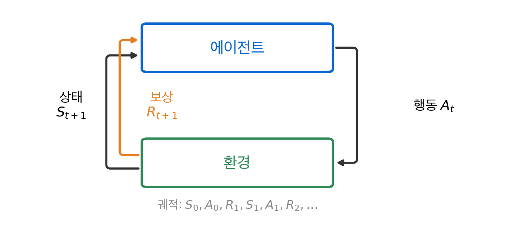
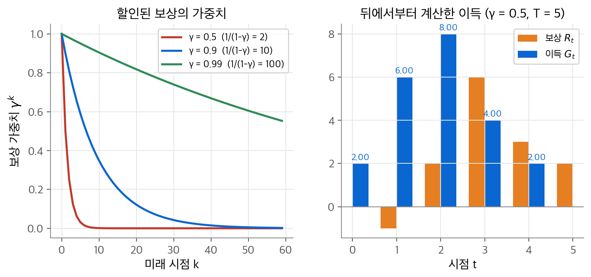
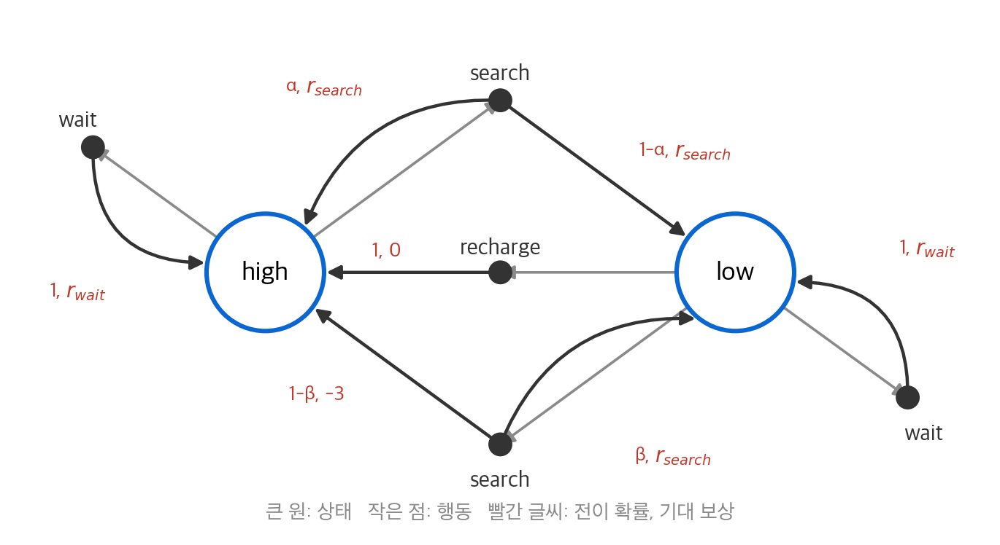
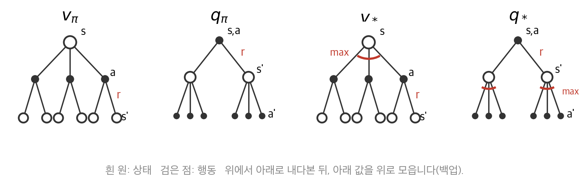
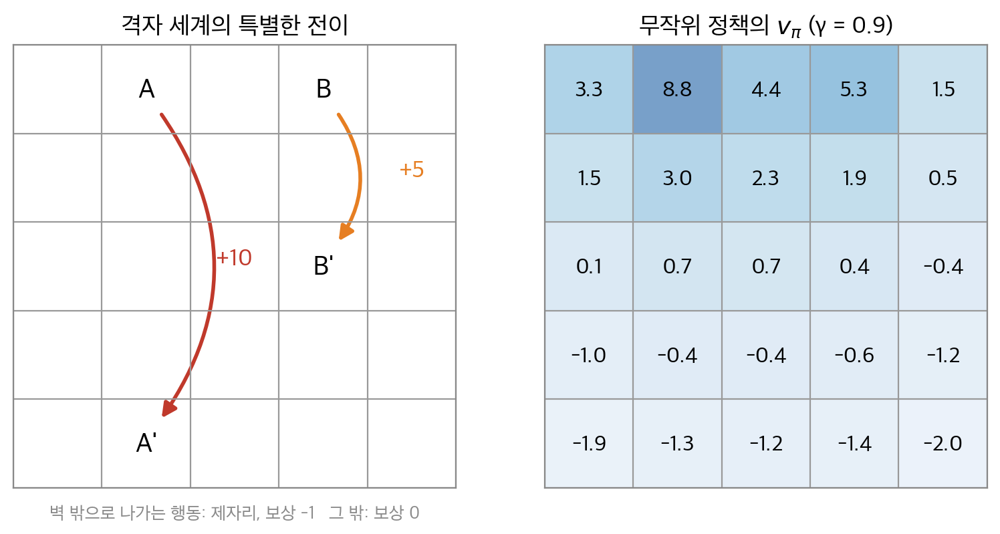
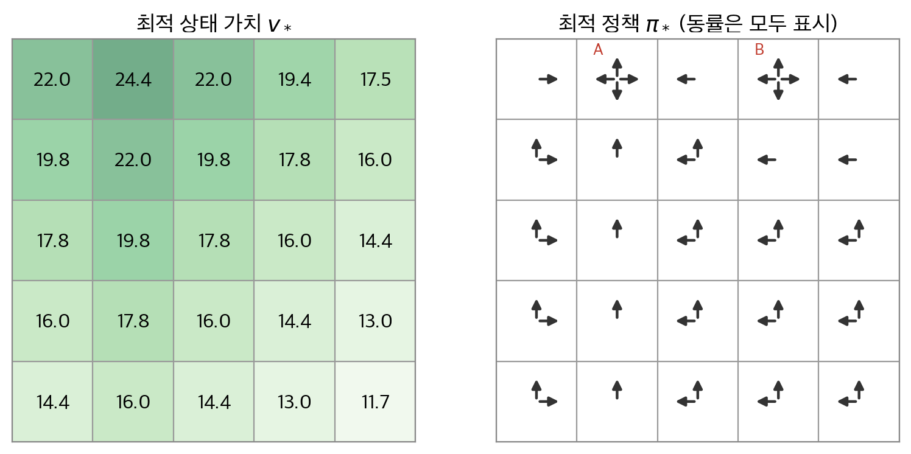

# 3. 유한 마르코프 결정 과정

2장의 밴딧에는 상황이 하나뿐이었습니다. 행동은 보상만 바꾸고 다음 상황은 바꾸지 않았습니다. 실제 문제에서는 지금의 행동이 다음 상태를 바꾸고, 그 상태가 이후의 보상을 바꿉니다. 이 장의 질문은 "행동의 결과가 미래로 이어지는 문제를 어떤 수학 대상으로 적어야 할까?"입니다. 결론은 **유한 마르코프 결정 과정(finite Markov decision process, finite MDP)** 입니다. 환경은 한 단계 동역학 $p(s', r \mid s, a)$ 하나로 완전히 정해집니다. 목표는 할인된 보상의 합인 이득의 기댓값입니다. 이 기댓값은 벨만 방정식이라는 재귀식을 만족합니다. 이후의 모든 장은 이 재귀식을 정확히 풀거나 근사로 푸는 방법입니다.

!!! info "원문과 자료"
    - 원문: Sutton & Barto 2판 초안 3장 Finite Markov Decision Processes (3.1~3.9절). 최종본 3장 (3.1~3.7절)으로 보충했습니다. 마르코프 성질(초안 3.5절)은 최종본에서 3.1절에 합쳐졌습니다.
    - [Sutton & Barto, Reinforcement Learning: An Introduction 책 페이지](http://incompleteideas.net/book/the-book-2nd.html)
    - [David Silver, UCL RL 강의 2: Markov Decision Processes (슬라이드 PDF)](https://davidstarsilver.wordpress.com/wp-content/uploads/2025/04/lecture-2-mdp.pdf)
    - [Coursera, Fundamentals of Reinforcement Learning (Martha White, Adam White)](https://www.coursera.org/learn/fundamentals-of-reinforcement-learning) 의 Markov Decision Processes, Value Functions & Bellman Equations 모듈
    - 함께 읽기: [1. 강화 학습 문제](01-rl-problem.md), [2. 다중 선택 밴딧](02-bandits.md), [4. 동적 계획법](04-dynamic-programming.md)

## 1. 에이전트-환경 인터페이스

### 상호작용 루프

학습하고 결정하는 주체를 **에이전트(agent)** 라고 합니다. 에이전트 바깥의 모든 것을 **환경(environment)** 이라고 합니다. 둘은 이산 시점 $t = 0, 1, 2, \ldots$ 마다 신호를 주고받습니다.

1. 에이전트가 **상태(state)** $S_t \in \mathcal{S}$ 를 관측합니다.
2. 에이전트가 **행동(action)** $A_t \in \mathcal{A}(s)$ 를 고릅니다.
3. 한 단계 뒤 환경이 **보상(reward)** $R_{t+1} \in \mathcal{R} \subset \mathbb{R}$ 과 다음 상태 $S_{t+1}$ 을 돌려줍니다.

이 과정을 이어 쓰면 **궤적(trajectory)** 이 됩니다.

$$
S_0, A_0, R_1, S_1, A_1, R_2, S_2, A_2, R_3, \ldots
$$

보상의 첨자가 $t+1$ 인 점에 주의합니다. $A_t$ 의 결과로 받은 보상이므로 $S_{t+1}$ 과 같은 시점에 묶습니다.

<figure markdown>

<figcaption markdown>
<span class="fig-title"><b>Figure 1.</b> 에이전트-환경 루프</span>

행동 $A_t$ 에 환경이 $S_{t+1}$ 과 $R_{t+1}$ 을 돌려주고, 이 순환이 궤적 하나를 만듭니다.
</figcaption>
</figure>

### 경계는 통제 가능성으로 정합니다

에이전트와 환경의 경계는 몸의 경계와 다릅니다. 로봇의 모터와 센서도 환경에 속할 수 있습니다. 기준은 하나입니다. 에이전트가 마음대로 바꿀 수 없는 것은 환경입니다. 보상도 환경에 속합니다. 보상 계산식을 에이전트가 알더라도 에이전트가 바꿀 수는 없기 때문입니다. 경계는 지식이 아니라 통제의 한계입니다.

### 동역학 함수

상태, 행동, 보상의 집합이 모두 유한하면 **유한 MDP** 라고 합니다. 이때 환경은 다음 함수 하나로 정해집니다.

$$
p(s', r \mid s, a) \doteq \Pr\{S_{t+1} = s', R_{t+1} = r \mid S_t = s, A_t = a\}
$$

이 함수를 **동역학(dynamics)** 이라고 합니다. 각 $(s, a)$ 마다 $(s', r)$ 위의 확률 분포이므로 합이 1입니다.

$$
\sum_{s' \in \mathcal{S}} \sum_{r \in \mathcal{R}} p(s', r \mid s, a) = 1 \quad \text{for all } s \in \mathcal{S}, a \in \mathcal{A}(s)
$$

환경에 대해 알고 싶은 다른 양은 모두 $p$ 에서 나옵니다.

| 양 | 정의 | $p$ 로 쓴 식 |
| --- | --- | --- |
| 상태 전이 확률 | $p(s' \mid s, a) = \Pr\{S_{t+1} = s' \mid S_t = s, A_t = a\}$ | $\sum_r p(s', r \mid s, a)$ |
| 기대 보상 | $r(s, a) = \mathbb{E}[R_{t+1} \mid S_t = s, A_t = a]$ | $\sum_r r \sum_{s'} p(s', r \mid s, a)$ |
| 전이별 기대 보상 | $r(s, a, s') = \mathbb{E}[R_{t+1} \mid s, a, s']$ | $\sum_r r\, p(s', r \mid s, a) / p(s' \mid s, a)$ |

1판은 $\mathcal{P}^a_{ss'}$ 와 $\mathcal{R}^a_{ss'}$ 두 양으로 환경을 적었습니다. 이 표기는 보상의 기댓값만 담고 분포는 담지 못합니다. 2판은 결합 분포 $p(s', r \mid s, a)$ 를 기본으로 씁니다.

## 2. 목표와 보상

### 보상 가설

에이전트의 목표는 보상이라는 스칼라 하나로 표현합니다. 저자들은 이 생각을 **보상 가설(reward hypothesis)** 이라고 부릅니다.

> 목표와 목적은 모두 받은 스칼라 신호(보상)의 누적합 기댓값을 최대화하는 일로 생각할 수 있다.

가설은 단순하지만 적용 범위가 넓습니다. 몇 가지 예를 봅니다.

| 과제 | 보상 설계 |
| --- | --- |
| 미로 탈출 | 탈출 전까지 매 단계 $-1$. 빨리 나갈수록 손실이 작습니다. |
| 로봇 걷기 | 매 단계 전진 거리에 비례하는 보상 |
| 빈 캔 수집 | 캔 하나에 $+1$, 사람이나 벽과 부딪히면 음의 보상 |
| 체스 | 이기면 $+1$, 지면 $-1$, 비기거나 게임 중에는 $0$ |

### 보상은 "무엇"을 말하고 "어떻게"는 말하지 않습니다

보상은 이루고 싶은 결과를 알려 줍니다. 방법을 알려 주는 통로가 아닙니다. 체스에서 상대 말을 잡을 때 보상을 주면 문제가 생깁니다. 에이전트는 게임에 지더라도 말을 많이 잡는 법을 배울 수 있습니다. 사전 지식은 보상이 아니라 초기 정책이나 초기 가치 함수에 넣는 편이 안전합니다.

## 3. 이득과 할인

### 이득의 정의

에이전트가 최대화할 대상은 미래 보상의 합입니다. 이 합을 **이득(return)** $G_t$ 라고 합니다. 가장 단순한 형태는 마지막 시점 $T$ 까지의 합입니다.

$$
G_t \doteq R_{t+1} + R_{t+2} + \cdots + R_T
$$

이 식은 상호작용이 자연스럽게 끝나는 경우에 맞습니다. 게임 한 판이나 미로 한 번처럼 끝이 있는 구간을 **에피소드(episode)** 라고 합니다. 에피소드가 끝나는 상태를 **종료 상태(terminal state)** 라고 합니다. 이런 과제를 **에피소드형 과제(episodic task)** 라고 합니다. 종료 상태를 뺀 상태 집합을 $\mathcal{S}$, 포함한 집합을 $\mathcal{S}^+$ 로 씁니다.

끝이 없는 과제도 있습니다. 공정 제어나 수명이 긴 로봇이 그렇습니다. 이를 **연속형 과제(continuing task)** 라고 합니다. 여기서는 $T = \infty$ 이므로 합이 발산할 수 있습니다. 매 단계 $+1$ 을 받으면 이득은 무한대입니다.

### 할인된 이득

해결책은 먼 미래의 보상을 덜 세는 것입니다. **할인율(discount rate)** $\gamma \in [0, 1]$ 을 도입합니다.

$$
G_t \doteq R_{t+1} + \gamma R_{t+2} + \gamma^2 R_{t+3} + \cdots = \sum_{k=0}^{\infty} \gamma^k R_{t+k+1}
$$

$k$ 단계 뒤의 보상은 $\gamma^{k}$ 배로 줄어듭니다. 보상이 $|R| \le R_{\max}$ 로 유계이고 $\gamma < 1$ 이면 등비급수 때문에 합이 수렴합니다.

$$
|G_t| \le \sum_{k=0}^{\infty} \gamma^k R_{\max} = \frac{R_{\max}}{1 - \gamma}
$$

$\gamma = 0$ 이면 에이전트는 바로 다음 보상 $R_{t+1}$ 만 봅니다. 이런 에이전트를 근시안적이라고 합니다. $\gamma$ 가 1에 가까울수록 먼 미래를 강하게 반영합니다. $1/(1-\gamma)$ 는 대략 "몇 단계 앞까지 보는가"를 나타냅니다. $\gamma = 0.9$ 이면 약 10단계, $\gamma = 0.99$ 이면 약 100단계입니다.

### 재귀식

이득은 한 단계 뒤의 이득으로 쓸 수 있습니다. 첫 항을 떼고 나머지를 $\gamma$ 로 묶습니다.

$$
\begin{aligned}
G_t &= R_{t+1} + \gamma R_{t+2} + \gamma^2 R_{t+3} + \gamma^3 R_{t+4} + \cdots \\
&= R_{t+1} + \gamma \left( R_{t+2} + \gamma R_{t+3} + \gamma^2 R_{t+4} + \cdots \right) \\
&= R_{t+1} + \gamma G_{t+1}
\end{aligned}
$$

이 식은 $t < T$ 인 모든 시점에서 성립합니다. 종료 시점에서는 $G_T = 0$ 으로 둡니다. 이 한 줄이 이 책 전체의 출발점입니다. 기댓값을 취하면 벨만 방정식이 되고, 샘플로 바꾸면 6장의 TD 학습이 됩니다.

### 수치 예시

$\gamma = 0.5$ 이고 보상이 $R_1 = -1, R_2 = 2, R_3 = 6, R_4 = 3, R_5 = 2$ 이며 $T = 5$ 입니다. 앞에서부터 합을 구하면 지수 계산이 필요합니다. 재귀식을 쓰면 뒤에서부터 한 번씩 더하면 됩니다.

| $t$ | 계산 | $G_t$ |
| --- | --- | --- |
| 5 | 종료 | 0 |
| 4 | $R_5 + 0.5 \cdot G_5 = 2 + 0$ | 2 |
| 3 | $R_4 + 0.5 \cdot G_4 = 3 + 1$ | 4 |
| 2 | $R_3 + 0.5 \cdot G_3 = 6 + 2$ | 8 |
| 1 | $R_2 + 0.5 \cdot G_2 = 2 + 4$ | 6 |
| 0 | $R_1 + 0.5 \cdot G_1 = -1 + 3$ | 2 |

연속형 과제에서 매 단계 보상이 $+1$ 이면 $G_t = \sum_k \gamma^k = 1/(1-\gamma)$ 입니다. $\gamma = 0.9$ 이면 $G_t = 10$ 입니다.

<figure markdown>

<figcaption markdown>
<span class="fig-title"><b>Figure 2.</b> 할인과 이득</span>

왼쪽은 $\gamma$ 별 가중치 $\gamma^k$ 입니다. 오른쪽에서 첫 보상은 $-1$ 이지만 뒤의 큰 보상 덕분에 $G_0 = 2$ 입니다.
</figcaption>
</figure>

### 막대 세우기 예제

카트 위의 막대를 쓰러뜨리지 않는 과제를 두 가지로 정식화할 수 있습니다.

- 에피소드형: 막대가 쓰러지면 에피소드가 끝납니다. 매 단계 $+1$ 을 받습니다. 이득은 버틴 단계 수입니다.
- 연속형: 쓰러지면 $-1$, 그 밖에는 $0$ 을 받고 할인합니다. 실패가 $K$ 단계 뒤라면 이득은 $-\gamma^{K-1}$ 입니다. 실패를 늦출수록 이득이 0에 가까워집니다.

두 정식화 모두 "오래 버티기"라는 같은 목표를 표현합니다.

## 4. 에피소드형과 연속형 과제의 통합 표기

두 과제를 한 식으로 다루려고 두 가지 약속을 합니다.

첫째, 에피소드 번호 첨자를 생략합니다. 엄밀히는 에피소드 $i$ 의 시점 $t$ 상태를 $S_{t,i}$ 로 써야 합니다. 하지만 대부분 에피소드 하나만 이야기하므로 $S_t$ 로 씁니다.

둘째, 종료를 **흡수 상태(absorbing state)** 로 바꿉니다. 종료 상태에 들어가면 그 상태로만 전이하고 보상 0을 영원히 받는다고 봅니다.

$$
S_0 \xrightarrow{R_1 = +1} S_1 \xrightarrow{R_2 = +1} S_2 \xrightarrow{R_3 = +1} \blacksquare \xrightarrow{R_4 = 0} \blacksquare \xrightarrow{R_5 = 0} \cdots
$$

이렇게 하면 무한 합으로 써도 값이 바뀌지 않습니다. 두 과제를 다음 한 식으로 씁니다.

$$
G_t \doteq \sum_{k=t+1}^{T} \gamma^{k-t-1} R_k
$$

여기서 $T = \infty$ 와 $\gamma = 1$ 중 하나는 허용하지만 둘을 동시에 허용하지는 않습니다. 둘이 함께 오면 합이 발산할 수 있기 때문입니다.

## 5. 마르코프 성질

### 정의

가장 일반적인 환경에서는 다음 상태와 보상이 지금까지의 모든 역사에 의존합니다.

$$
\Pr\{S_{t+1} = s', R_{t+1} = r \mid S_0, A_0, R_1, \ldots, S_{t-1}, A_{t-1}, R_t, S_t, A_t\}
$$

상태 신호가 **마르코프 성질(Markov property)** 을 가지면 이 분포가 현재 상태와 행동에만 의존합니다.

$$
\Pr\{S_{t+1} = s', R_{t+1} = r \mid S_0, A_0, \ldots, S_t, A_t\} = p(s', r \mid S_t, A_t)
$$

이 등식이 모든 $s'$, $r$, 역사에서 성립할 때 그 상태를 **마르코프 상태** 라고 합니다. 마르코프 상태는 과거를 버리지만 미래 예측에 필요한 정보는 모두 남깁니다. 체스의 현재 판 배치가 그렇습니다. 어떤 수순으로 이 배치에 왔는지는 앞으로의 게임에 영향을 주지 않습니다. 날아가는 포탄도 현재 위치와 속도만 알면 궤적이 정해집니다.

### 왜 중요한가

마르코프 성질이 있으면 한 단계 동역학을 반복 적용해 먼 미래의 분포를 계산할 수 있습니다. 그 정확도는 전체 역사를 아는 경우와 같습니다. 따라서 현재 상태의 함수인 정책만으로 역사의 함수인 정책만큼 잘할 수 있습니다. 이 책의 가치 함수와 정책이 모두 현재 상태만의 함수인 이유입니다.

### 근사로서의 마르코프 상태

실제 상태 신호는 엄밀한 마르코프가 아닌 경우가 많습니다. 막대 세우기에서 카트 위치, 속도, 막대 각도, 각속도는 이상적인 물리계라면 마르코프 상태입니다. 실제 센서에는 잡음과 지연이 있고, 막대는 휘고, 베어링 온도도 변합니다. 그래도 이 네 값으로 학습이 잘 됩니다. 초기 연구는 위치를 왼쪽, 가운데, 오른쪽 세 구간으로만 나눈 거친 상태로도 과제를 풀었습니다.

포커는 반대 방향의 예입니다. 마르코프 상태가 상대의 패나 남은 덱을 포함해야 하는 것은 아닙니다. 원리상 관측할 수 없는 정보이기 때문입니다. 대신 상대의 베팅, 교환한 카드 수, 상대의 습관까지 들어가야 합니다. 사람은 이 모두를 기억하지 못합니다. 그래도 좋은 결정을 내립니다. 결론은 이렇습니다. 상태는 마르코프 상태의 근사로 보고, 미래 보상과 다음 상태를 잘 예측하도록 설계합니다.

## 6. 마르코프 결정 과정과 재활용 로봇

### 정의

마르코프 성질을 만족하는 강화 학습 과제를 **마르코프 결정 과정(MDP)** 이라고 합니다. 상태 집합과 행동 집합이 유한하면 유한 MDP입니다. 유한 MDP는 상태 집합, 행동 집합, 동역학 $p(s', r \mid s, a)$ 로 정해집니다.

### 재활용 로봇

사무실에서 빈 캔을 모으는 로봇이 있습니다. 로봇은 배터리 잔량만 보고 결정합니다. 잔량은 두 단계로 구분합니다. 상태 집합은 $\mathcal{S} = \{\text{high}, \text{low}\}$ 입니다. 잔량이 높을 때 충전은 의미가 없으므로 행동 집합에서 뺍니다.

$$
\mathcal{A}(\text{high}) = \{\text{search}, \text{wait}\}, \qquad \mathcal{A}(\text{low}) = \{\text{search}, \text{wait}, \text{recharge}\}
$$

환경 규칙은 다음과 같습니다.

- 잔량이 high일 때 탐색하면 확률 $\alpha$ 로 high에 남고 $1 - \alpha$ 로 low가 됩니다.
- 잔량이 low일 때 탐색하면 확률 $\beta$ 로 low에 남습니다. 확률 $1-\beta$ 로 배터리가 방전됩니다. 이때 사람이 구조해 충전하므로 high로 돌아가고 보상 $-3$ 을 받습니다.
- 탐색 중 기대 캔 수는 $r_{\text{search}}$, 대기 중 기대 캔 수는 $r_{\text{wait}}$ 이고 $r_{\text{search}} > r_{\text{wait}}$ 입니다.
- 충전하러 가는 단계에는 캔을 모으지 못합니다.

| $s$ | $a$ | $s'$ | $p(s' \mid s, a)$ | $r(s, a, s')$ |
| --- | --- | --- | --- | --- |
| high | search | high | $\alpha$ | $r_{\text{search}}$ |
| high | search | low | $1-\alpha$ | $r_{\text{search}}$ |
| low | search | high | $1-\beta$ | $-3$ |
| low | search | low | $\beta$ | $r_{\text{search}}$ |
| high | wait | high | 1 | $r_{\text{wait}}$ |
| low | wait | low | 1 | $r_{\text{wait}}$ |
| low | recharge | high | 1 | 0 |

**전이 그래프(transition graph)** 로 그리면 동역학이 한눈에 보입니다. 상태마다 큰 노드를 두고, 상태-행동 쌍마다 작은 노드를 둡니다. 작은 노드에서 나가는 화살표가 다음 상태로 가는 전이이고, 확률과 기대 보상을 붙입니다. 한 행동 노드에서 나가는 확률의 합은 1입니다.

<figure markdown>

<figcaption markdown>
<span class="fig-title"><b>Figure 3.</b> 재활용 로봇 전이 그래프</span>

큰 원은 상태, 작은 점은 행동입니다. low에서 search를 고르면 확률 $1-\beta$ 로 방전되어 $-3$ 을 받습니다.
</figcaption>
</figure>

이 MDP는 8절에서 숫자를 넣어 풉니다.

## 7. 가치 함수와 벨만 기대 방정식

### 정책과 가치 함수

**정책(policy)** $\pi$ 는 상태에서 행동 확률로 가는 사상입니다. $\pi(a \mid s)$ 는 상태 $s$ 에서 행동 $a$ 를 고를 확률입니다. 정책 $\pi$ 를 따를 때 상태 $s$ 의 **상태 가치(state value)** 는 그 상태에서 출발한 이득의 기댓값입니다.

$$
v_\pi(s) \doteq \mathbb{E}_\pi[G_t \mid S_t = s] = \mathbb{E}_\pi\left[\sum_{k=0}^{\infty} \gamma^k R_{t+k+1} \,\middle|\, S_t = s\right]
$$

종료 상태의 가치는 0입니다. 상태 $s$ 에서 행동 $a$ 를 먼저 하고 그 뒤 $\pi$ 를 따를 때의 기대 이득은 **행동 가치(action value)** 입니다.

$$
q_\pi(s, a) \doteq \mathbb{E}_\pi[G_t \mid S_t = s, A_t = a]
$$

두 함수는 서로를 한 단계로 표현합니다. 상태 가치는 행동 가치의 정책 가중 평균입니다.

$$
v_\pi(s) = \sum_a \pi(a \mid s)\, q_\pi(s, a)
$$

행동 가치는 한 단계 보상과 다음 상태 가치의 기댓값입니다.

$$
q_\pi(s, a) = \sum_{s', r} p(s', r \mid s, a)\left[ r + \gamma v_\pi(s') \right]
$$

### 벨만 기대 방정식 유도

$v_\pi$ 의 정의에 이득의 재귀식 $G_t = R_{t+1} + \gamma G_{t+1}$ 을 넣습니다.

$$
v_\pi(s) = \mathbb{E}_\pi[R_{t+1} + \gamma G_{t+1} \mid S_t = s]
$$

기댓값을 세 단계로 나눕니다. 먼저 $\pi(a \mid s)$ 로 행동을 고르고, $p(s', r \mid s, a)$ 로 다음 상태와 보상이 나옵니다. 전체 확률 법칙을 쓰면 다음과 같습니다.

$$
v_\pi(s) = \sum_a \pi(a \mid s) \sum_{s'} \sum_r p(s', r \mid s, a)\left[ r + \gamma\, \mathbb{E}_\pi[G_{t+1} \mid S_{t+1} = s'] \right]
$$

여기서 마르코프 성질을 씁니다. $S_{t+1} = s'$ 가 주어지면 $G_{t+1}$ 의 분포는 그 이전 정보와 무관합니다. 그러므로 안쪽 기댓값은 $v_\pi(s')$ 그 자체입니다.

$$
\boxed{\, v_\pi(s) = \sum_a \pi(a \mid s) \sum_{s', r} p(s', r \mid s, a)\left[ r + \gamma v_\pi(s') \right] \quad \text{for all } s \in \mathcal{S} \,}
$$

이 식이 $v_\pi$ 에 대한 **벨만 방정식(Bellman equation)** 입니다. 한 상태의 가치를 다음 상태들의 가치로 적은 일관성 조건입니다. 같은 방법으로 $q_\pi$ 의 벨만 방정식도 얻습니다.

$$
q_\pi(s, a) = \sum_{s', r} p(s', r \mid s, a)\left[ r + \gamma \sum_{a'} \pi(a' \mid s')\, q_\pi(s', a') \right]
$$

### 백업 다이어그램

벨만 방정식은 그림으로 읽으면 쉽습니다. 흰 원은 상태, 검은 점은 상태-행동 쌍입니다. 뿌리에서 아래로 가능한 미래를 펼칩니다. 그다음 잎의 값을 확률로 가중해 뿌리로 올립니다. 아래 값을 위로 옮기는 이 연산을 **백업(backup)** 이라고 합니다. 이런 그림을 **백업 다이어그램(backup diagram)** 이라고 합니다.

<figure markdown>

<figcaption markdown>
<span class="fig-title"><b>Figure 4.</b> 백업 다이어그램</span>

왼쪽은 $v_\pi$, $q_\pi$ 의 벨만 방정식, 오른쪽은 최적 방정식입니다. 빨간 호에서는 평균 대신 최댓값을 취합니다.
</figcaption>
</figure>

$v_\pi$ 그림을 식과 맞춰 읽습니다. 뿌리 $s$ 에서 행동 갈래가 셋 나옵니다. 이 갈래를 $\pi(a \mid s)$ 로 평균합니다. 각 행동에서 $(s', r)$ 갈래가 나옵니다. 이 갈래를 $p(s', r \mid s, a)$ 로 평균하고, 잎의 값으로 $r + \gamma v_\pi(s')$ 를 씁니다.

### 선형 연립방정식으로 보기

벨만 방정식은 $|\mathcal{S}|$ 개의 미지수 $v_\pi(s)$ 에 대한 선형 방정식 $|\mathcal{S}|$ 개입니다. 정책 아래의 전이 행렬과 기대 보상 벡터를 정의합니다.

$$
P_\pi[s, s'] = \sum_a \pi(a \mid s)\, p(s' \mid s, a), \qquad r_\pi[s] = \sum_a \pi(a \mid s)\, r(s, a)
$$

그러면 벨만 방정식은 $v_\pi = r_\pi + \gamma P_\pi v_\pi$ 입니다. $\gamma < 1$ 이면 $I - \gamma P_\pi$ 가 가역이므로 해가 하나뿐입니다.

$$
v_\pi = (I - \gamma P_\pi)^{-1} r_\pi
$$

가역인 이유는 이렇습니다. $P_\pi$ 의 각 행은 합이 1인 확률 벡터이므로 고윳값의 절댓값이 1 이하입니다. 따라서 $\gamma P_\pi$ 의 고윳값은 절댓값이 $\gamma < 1$ 이하이고 $I - \gamma P_\pi$ 의 고윳값은 0이 될 수 없습니다.

## 8. 격자 세계와 재활용 로봇 풀기

### 5×5 격자 세계

5×5 격자에서 에이전트는 상하좌우 네 행동을 합니다. 규칙은 네 가지입니다.

- 격자 밖으로 나가는 행동은 위치를 바꾸지 않고 보상 $-1$ 을 줍니다.
- 칸 A에서는 어떤 행동을 해도 보상 $+10$ 을 받고 A'로 이동합니다.
- 칸 B에서는 어떤 행동을 해도 보상 $+5$ 를 받고 B'로 이동합니다.
- 그 밖의 이동은 보상 0입니다.

할인율은 $\gamma = 0.9$ 이고 연속형 과제입니다. 정책은 네 방향을 확률 $1/4$ 씩 고르는 무작위 정책입니다. 25개 상태의 벨만 방정식을 행렬로 세우고 한 번에 풉니다.

```python
import numpy as np
from itertools import product

N, gamma = 5, 0.9
moves = [(-1, 0), (1, 0), (0, -1), (0, 1)]

def step(s, a):
    if s == (0, 1): return (4, 1), 10.0   # A -> A'
    if s == (0, 3): return (2, 3), 5.0    # B -> B'
    r, c = s[0] + moves[a][0], s[1] + moves[a][1]
    if 0 <= r < N and 0 <= c < N:
        return (r, c), 0.0
    return s, -1.0                        # off-grid

P, R = np.zeros((N * N, N * N)), np.zeros(N * N)
for s in product(range(N), range(N)):
    i = s[0] * N + s[1]
    for a in range(4):
        s2, r = step(s, a)
        P[i, s2[0] * N + s2[1]] += 0.25
        R[i] += 0.25 * r
v_pi = np.linalg.solve(np.eye(N * N) - gamma * P, R).reshape(N, N)
```

<figure markdown>

<figcaption markdown>
<span class="fig-title"><b>Figure 5.</b> 격자 세계와 무작위 정책의 가치</span>

무작위 정책의 $v_\pi$ 입니다. 아래쪽 가장자리는 벽에 부딪힐 확률이 높아 음수입니다.
</figcaption>
</figure>

### 결과 읽기

A의 가치는 8.79로 즉시 보상 10보다 작습니다. A'가 아래쪽 가장자리에 있고 그 가치가 $-1.35$ 이기 때문입니다. 실제로 $10 + 0.9 \times (-1.345) = 8.79$ 입니다. B의 가치는 5.32로 즉시 보상 5보다 큽니다. B'의 가치가 $0.358$ 로 양수이기 때문입니다. $5 + 0.9 \times 0.358 = 5.32$ 입니다.

가운데 칸 $(2, 2)$ 에서 벨만 방정식을 직접 확인합니다. 네 이웃의 가치는 위 2.250, 아래 $-0.355$, 왼쪽 0.738, 오른쪽 0.358입니다. 즉시 보상은 모두 0입니다.

$$
v_\pi(2,2) = 0.9 \times \tfrac{1}{4}(2.250 - 0.355 + 0.738 + 0.358) = 0.673
$$

선형 방정식의 해도 0.673입니다. 할인율을 바꾸면 A의 가치가 달라집니다. NumPy로 다시 풀면 $\gamma = 0, 0.5, 0.9, 0.99$ 에서 $v_\pi(\text{A})$ 는 10.00, 9.76, 8.79, 7.12입니다. 먼 미래를 많이 볼수록 A' 근처의 나쁜 가치가 크게 반영됩니다.

### 재활용 로봇의 정책 비교

재활용 로봇에 숫자를 넣습니다. $\alpha = 0.9$, $\beta = 0.6$, $r_{\text{search}} = 3$, $r_{\text{wait}} = 1$, $\gamma = 0.9$ 입니다. low에서 탐색할 때의 기대 보상은 $0.6 \times 3 + 0.4 \times (-3) = 0.6$ 입니다. 결정적 정책은 $2 \times 3 = 6$ 개입니다. 각 정책의 2×2 선형 방정식을 풀었습니다.

| $\pi(\text{high})$ | $\pi(\text{low})$ | $v_\pi(\text{high})$ | $v_\pi(\text{low})$ |
| --- | --- | --- | --- |
| search | search | 26.07 | 21.71 |
| search | wait | 20.53 | 10.00 |
| search | recharge | **27.52** | **24.77** |
| wait | search | 10.00 | 9.13 |
| wait | wait | 10.00 | 10.00 |
| wait | recharge | 10.00 | 9.00 |

"high에서 탐색, low에서 충전" 정책이 두 상태 모두에서 가장 큽니다. 한 정책이 모든 상태에서 다른 정책 이상이라는 점이 중요합니다. 다음 절은 이런 정책이 항상 존재한다는 사실을 다룹니다.

## 9. 최적 가치 함수와 벨만 최적 방정식

### 정책의 순서와 최적 정책

모든 상태 $s$ 에서 $v_\pi(s) \ge v_{\pi'}(s)$ 이면 $\pi \ge \pi'$ 라고 씁니다. 다른 모든 정책 이상인 정책을 **최적 정책(optimal policy)** $\pi_*$ 라고 합니다. 유한 MDP에는 최적 정책이 적어도 하나 존재합니다. 최적 정책이 여럿이어도 가치 함수는 하나입니다.

$$
v_*(s) \doteq \max_\pi v_\pi(s), \qquad q_*(s, a) \doteq \max_\pi q_\pi(s, a)
$$

$q_*$ 는 $v_*$ 로 쓸 수 있습니다. 행동 $a$ 를 한 번 한 뒤 최적으로 행동하는 경우의 기대 이득이기 때문입니다.

$$
q_*(s, a) = \mathbb{E}[R_{t+1} + \gamma v_*(S_{t+1}) \mid S_t = s, A_t = a]
$$

### 벨만 최적 방정식 유도

최적 정책을 따를 때 상태의 가치는 그 상태의 가장 좋은 행동의 가치와 같습니다. 정책이 고를 수 있는 분포 중 평균을 가장 크게 하는 것은 최댓값 행동에 확률 1을 주는 분포이기 때문입니다.

$$
\begin{aligned}
v_*(s) &= \max_{a \in \mathcal{A}(s)} q_{\pi_*}(s, a) \\
&= \max_a \mathbb{E}_{\pi_*}[R_{t+1} + \gamma G_{t+1} \mid S_t = s, A_t = a] \\
&= \max_a \mathbb{E}[R_{t+1} + \gamma v_*(S_{t+1}) \mid S_t = s, A_t = a] \\
&= \max_a \sum_{s', r} p(s', r \mid s, a)\left[ r + \gamma v_*(s') \right]
\end{aligned}
$$

행동 가치의 형태도 같은 방법으로 얻습니다.

$$
q_*(s, a) = \sum_{s', r} p(s', r \mid s, a)\left[ r + \gamma \max_{a'} q_*(s', a') \right]
$$

이 두 식이 **벨만 최적 방정식(Bellman optimality equation)** 입니다. 기대 방정식의 $\sum_a \pi(a \mid s)$ 가 $\max_a$ 로 바뀌었습니다. 이 식에는 특정 정책이 나오지 않습니다. 대신 $\max$ 때문에 비선형입니다. 유한 MDP에서는 해가 하나뿐입니다. 근거는 4장의 축약 사상 논증입니다.

### 최적 가치에서 최적 정책으로

$v_*$ 를 알면 최적 정책을 얻기 쉽습니다. 각 상태에서 벨만 최적 방정식의 최댓값을 만드는 행동을 고르면 됩니다. 즉 $v_*$ 에 대해 한 단계만 내다보는 탐욕적 행동이 최적입니다. 장기 결과는 이미 $v_*$ 안에 들어 있기 때문입니다. $q_*$ 를 알면 더 쉽습니다. 동역학을 몰라도 $\arg\max_a q_*(s, a)$ 만 고르면 됩니다.

$$
\pi_*(s) = \arg\max_a q_*(s, a) = \arg\max_a \sum_{s', r} p(s', r \mid s, a)\left[ r + \gamma v_*(s') \right]
$$

### 재활용 로봇의 $v_*$

재활용 로봇의 벨만 최적 방정식은 두 식입니다. h는 high, l은 low입니다. $r_{\text{s}}$ 와 $r_{\text{w}}$ 는 $r_{\text{search}}$ 와 $r_{\text{wait}}$ 를 줄여 쓴 것입니다.

$$
\begin{aligned}
v_*(\text{h}) &= \max\left\{ r_{\text{s}} + \gamma[\alpha v_*(\text{h}) + (1-\alpha) v_*(\text{l})],\;\; r_{\text{w}} + \gamma v_*(\text{h}) \right\} \\
v_*(\text{l}) &= \max\left\{ \beta r_{\text{s}} - 3(1-\beta) + \gamma[(1-\beta) v_*(\text{h}) + \beta v_*(\text{l})],\;\; r_{\text{w}} + \gamma v_*(\text{l}),\;\; \gamma v_*(\text{h}) \right\}
\end{aligned}
$$

8절의 숫자로 이 식을 반복 대입해 풀면 $v_*(\text{h}) = 27.52$, $v_*(\text{l}) = 24.77$ 입니다. 8절 표의 최선 정책 값과 같습니다. 각 행동의 $q_*$ 는 다음과 같습니다.

| 상태 | search | wait | recharge |
| --- | --- | --- | --- |
| high | **27.52** | 25.77 | - |
| low | 23.88 | 23.29 | **24.77** |

low에서는 세 행동의 차이가 작습니다. $\beta$ 나 $r_{\text{search}}$ 를 조금 바꾸면 최선 행동이 바뀔 수 있습니다.

### 격자 세계의 $v_*$ 와 $\pi_*$

5×5 격자 세계에 벨만 최적 방정식을 반복 적용했습니다. 변화량이 $10^{-10}$ 아래로 내려갈 때까지 241회 반복했습니다.

<figure markdown>

<figcaption markdown>
<span class="fig-title"><b>Figure 6.</b> 격자 세계의 최적 가치와 최적 정책</span>

왼쪽은 $v_*$, 오른쪽은 $v_*$ 에 탐욕적인 최적 정책입니다. 화살표가 여럿인 칸은 그 행동들의 가치가 같습니다.
</figcaption>
</figure>

A의 최적 가치는 손으로도 계산할 수 있습니다. 최적 경로는 A에서 $+10$ 을 받고 A'로 간 뒤, 위로 네 번 올라와 다시 A에 닿는 5단계 순환입니다.

$$
v_*(\text{A}) = 10 + \gamma^5 \cdot 10 + \gamma^{10} \cdot 10 + \cdots = \frac{10}{1 - 0.9^5} = 24.419
$$

반복으로 얻은 값과 같습니다. B의 최적 가치는 19.42입니다. B에서 $+5$ 를 받고 B'로 간 다음, B'에서 네 걸음 걸어 A로 가는 것이 최적입니다. $v_*(\text{B}') = 0.9^4 \times 24.42 = 16.02$ 이고 $v_*(\text{B}) = 5 + 0.9 \times 16.02 = 19.42$ 입니다. B와 B' 사이를 3단계로 도는 순환의 가치는 $5/(1-0.9^3) = 18.45$ 입니다. 이 값이 19.42보다 작으므로 B 근처에 머무르는 정책은 최적이 아닙니다.

## 10. 최적성과 근사

벨만 최적 방정식을 풀면 최적 정책을 얻습니다. 하지만 이 방법을 그대로 쓰는 경우는 드뭅니다. 직접 풀려면 세 가정이 필요합니다.

1. 환경의 동역학을 정확히 압니다.
2. 계산 자원이 충분합니다.
3. 상태가 마르코프 성질을 만족합니다.

실제 문제는 대개 이 중 하나 이상을 어깁니다. 백개먼의 상태는 약 $10^{20}$ 개입니다. 표 하나에 모든 상태의 가치를 담을 수 없고 한 번 훑는 데도 수천 년이 걸립니다. 메모리 문제가 생기면 표 대신 매개변수 함수로 가치를 근사합니다. 이 내용은 9장에서 다룹니다.

근사는 약점만은 아닙니다. 에이전트가 자주 만나는 상태에서는 잘 결정하고, 드문 상태에서는 덜 신경 쓰면 됩니다. TD-Gammon은 사람 최고수와 비슷한 수준으로 두었습니다. 그러나 전문가끼리는 거의 나오지 않는 국면에서는 나쁜 수를 둡니다. 그런 국면은 성능에 거의 영향을 주지 않습니다. 강화 학습은 온라인으로 학습하므로 자주 만나는 상태에 노력을 집중할 수 있습니다. 이 점이 MDP를 근사로 푸는 다른 방법과 강화 학습을 구별합니다.

| 구분 | 필요한 것 | 이 책의 장 |
| --- | --- | --- |
| 정확한 해 | 동역학 $p$, 작은 상태 공간 | 4장 동적 계획법 |
| 모델 없는 표 방법 | 샘플 경험 | 5장 몬테카를로, 6장 TD |
| 근사 방법 | 샘플 경험, 매개변수 함수 | 9장 이후 |

## 정리

- 유한 MDP는 상태 집합, 행동 집합, 동역학 $p(s', r \mid s, a)$ 로 정해집니다. 상태 전이 확률과 기대 보상은 모두 $p$ 에서 계산합니다.
- 보상 가설에 따라 목표는 보상 누적합의 기댓값입니다. 보상은 무엇을 이룰지 알려 주고 방법은 알려 주지 않습니다.
- 이득은 $G_t = \sum_k \gamma^k R_{t+k+1}$ 이고 재귀식 $G_t = R_{t+1} + \gamma G_{t+1}$ 을 만족합니다. 종료를 흡수 상태로 보면 에피소드형과 연속형을 한 식으로 씁니다.
- 마르코프 성질은 현재 상태가 미래 예측에 필요한 정보를 모두 담는다는 조건입니다. 실제 상태는 이 성질의 근사로 봅니다.
- 벨만 기대 방정식 $v_\pi(s) = \sum_a \pi(a \mid s) \sum_{s', r} p(s', r \mid s, a)[r + \gamma v_\pi(s')]$ 는 선형이며 $v_\pi = (I - \gamma P_\pi)^{-1} r_\pi$ 로 풀립니다.
- 5×5 격자 세계에서 무작위 정책의 $v_\pi(\text{A}) = 8.79$, 최적 가치 $v_*(\text{A}) = 10/(1-0.9^5) = 24.42$ 입니다.
- 벨만 최적 방정식은 평균을 최댓값으로 바꾼 비선형 식입니다. $v_*$ 에 탐욕적인 정책이 최적 정책입니다.
- 정확한 해는 모델, 계산량, 마르코프 성질을 요구합니다. 실제로는 근사가 필요하고, 강화 학습은 자주 만나는 상태에 노력을 집중합니다.
