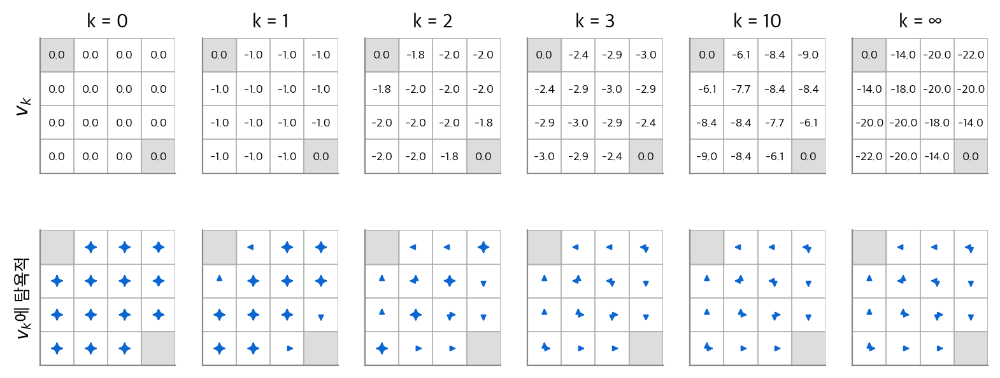
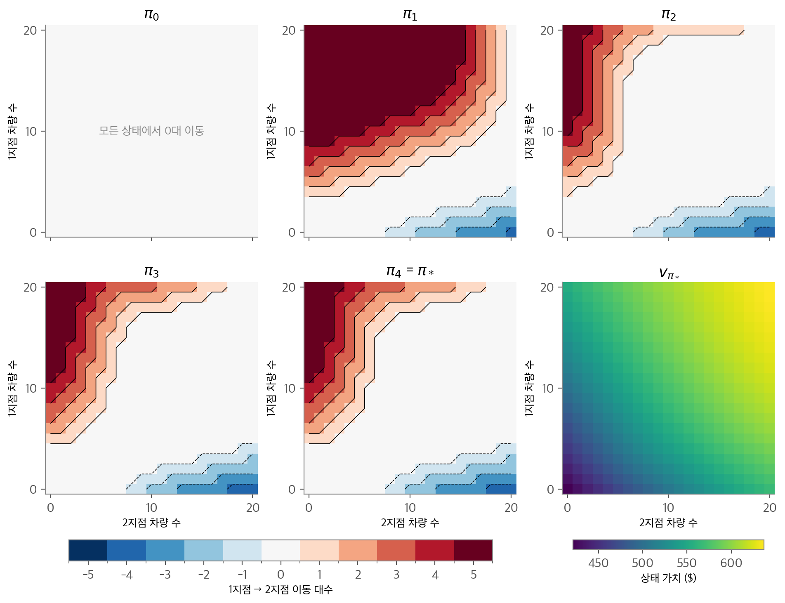
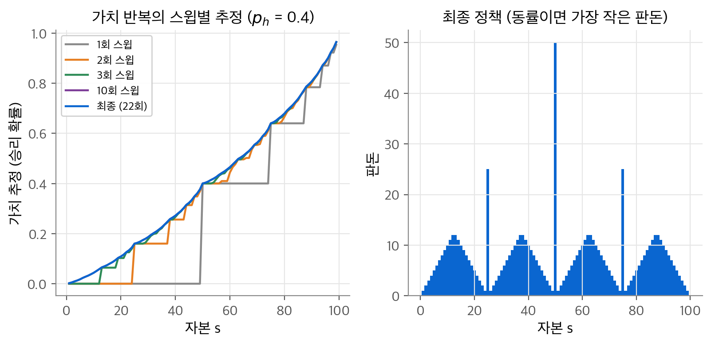
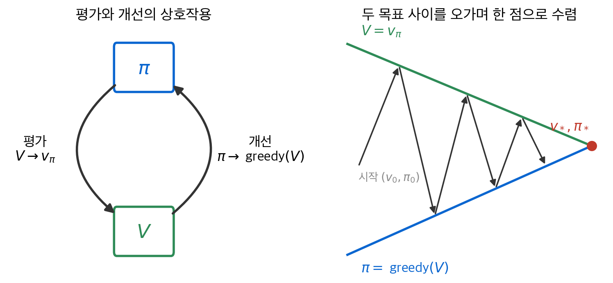
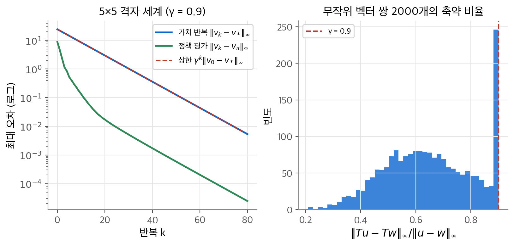

# 4. 동적 계획법

3장은 가치 함수가 벨만 방정식을 만족한다는 사실을 보였습니다. 이 장의 질문은 "환경의 동역학 $p(s', r \mid s, a)$ 를 완전히 알 때, 최적 정책을 실제로 어떻게 계산할까?"입니다. 결론은 벨만 방정식을 갱신 규칙으로 바꾸는 것입니다. 이 방법들을 **동적 계획법(dynamic programming, DP)** 이라고 합니다. 기대 방정식을 반복 적용하면 정책을 평가하고, 평가된 가치에 탐욕적으로 행동하면 정책이 나아집니다. 두 과정을 번갈아 하면 유한 번 안에 최적 정책에 닿습니다. 수렴의 근거는 벨만 연산자가 $\gamma$ 비율로 거리를 줄이는 축약 사상이라는 점입니다. DP는 완전한 모델을 요구하므로 실용성이 제한됩니다. 그래도 이후 모든 방법은 DP를 적은 계산과 불완전한 모델로 흉내 내는 시도로 볼 수 있습니다.

!!! info "원문과 자료"
    - 원문: Sutton & Barto 2판 초안 4장 Dynamic Programming (4.1~4.8절). 최종본 4장 (4.1~4.8절)으로 보충했습니다. 8절의 축약 사상 논증은 원문 본문에 없는 내용을 더했습니다.
    - [Sutton & Barto, Reinforcement Learning: An Introduction 책 페이지](http://incompleteideas.net/book/the-book-2nd.html)
    - [David Silver, UCL RL 강의 3: Planning by Dynamic Programming (슬라이드 PDF)](https://davidstarsilver.wordpress.com/wp-content/uploads/2025/04/lecture-3-planning-by-dynamic-programming-.pdf)
    - [Coursera, Fundamentals of Reinforcement Learning (Martha White, Adam White)](https://www.coursera.org/learn/fundamentals-of-reinforcement-learning) 의 Dynamic Programming 모듈
    - 함께 읽기: [3. 유한 마르코프 결정 과정](03-finite-mdp.md), [5. 몬테카를로 방법](05-monte-carlo.md), [6. 시간차 학습](06-td-learning.md), [8. 계획과 학습](08-planning-learning.md)

## 1. 정책 평가

### 벨만 방정식을 갱신 규칙으로

주어진 정책 $\pi$ 의 가치 함수 $v_\pi$ 를 계산하는 문제를 **정책 평가(policy evaluation)** 또는 **예측 문제(prediction problem)** 라고 합니다. 3장에서 본 벨만 방정식은 $|\mathcal{S}|$ 개 미지수의 선형 연립방정식입니다.

$$
v_\pi(s) = \sum_a \pi(a \mid s) \sum_{s', r} p(s', r \mid s, a)\left[ r + \gamma v_\pi(s') \right]
$$

상태 수가 작으면 역행렬로 풀 수 있습니다. 상태 수가 크면 반복법이 낫습니다. 임의의 $v_0$ 에서 시작해 벨만 방정식의 우변을 갱신 규칙으로 씁니다. 종료 상태의 값은 0으로 고정합니다.

$$
v_{k+1}(s) \doteq \sum_a \pi(a \mid s) \sum_{s', r} p(s', r \mid s, a)\left[ r + \gamma v_k(s') \right]
$$

$v_\pi$ 는 이 갱신의 고정점입니다. $v_k = v_\pi$ 를 넣으면 벨만 방정식 때문에 $v_{k+1} = v_\pi$ 가 나오기 때문입니다. $\gamma < 1$ 이거나 모든 상태에서 종료가 보장되면 $v_k \to v_\pi$ 입니다. 이 알고리즘을 **반복 정책 평가(iterative policy evaluation)** 라고 합니다.

### 기대 갱신

이 갱신은 한 상태의 옛 값을 새 값으로 바꿉니다. 새 값은 가능한 모든 다음 상태의 옛 값과 보상을 확률로 평균한 것입니다. 샘플 하나가 아니라 모든 가능성의 기댓값을 쓰므로 **기대 갱신(expected update)** 이라고 합니다. 상태 공간 전체를 한 번 훑으며 갱신하는 것을 **스윕(sweep)** 이라고 합니다.

### 두 배열과 제자리 갱신

구현은 두 가지입니다. 두 배열 방식은 옛 값 배열에서 읽고 새 배열에 씁니다. **제자리 갱신(in-place update)** 은 배열 하나에서 바로 덮어씁니다. 제자리 갱신은 같은 스윕 안에서 이미 갱신된 값을 바로 씁니다. 보통 더 빨리 수렴하고 메모리도 절반입니다.

1. 입력: 평가할 정책 $\pi$, 정확도 임계값 $\theta > 0$
2. 모든 $s \in \mathcal{S}^+$ 에서 $V(s)$ 를 초기화합니다. 단 $V(\text{종료}) = 0$ 입니다.
3. 반복합니다.
    - $\Delta \leftarrow 0$
    - 각 $s \in \mathcal{S}$ 에서: $v \leftarrow V(s)$, $V(s) \leftarrow \sum_a \pi(a \mid s) \sum_{s', r} p(s', r \mid s, a)[r + \gamma V(s')]$, $\Delta \leftarrow \max(\Delta, |v - V(s)|)$
4. $\Delta < \theta$ 이면 멈춥니다.

### 4×4 격자 세계

4×4 격자에서 왼쪽 위와 오른쪽 아래 칸이 종료 상태입니다. 나머지 14칸이 비종료 상태입니다. 행동은 상하좌우 넷이고 전이는 결정적입니다. 격자 밖으로 나가는 행동은 위치를 바꾸지 않습니다. 모든 전이의 보상은 $-1$ 이고 할인하지 않습니다($\gamma = 1$). 평가할 정책은 네 방향을 확률 $1/4$ 씩 고르는 무작위 정책입니다. 이때 $v_\pi(s)$ 는 종료까지 걸리는 기대 단계 수에 $-1$ 을 곱한 값입니다.

```python
import numpy as np
from itertools import product

N = 4
moves = [(-1, 0), (1, 0), (0, -1), (0, 1)]
terminal = {(0, 0), (3, 3)}

def nxt(s, a):
    r, c = s[0] + moves[a][0], s[1] + moves[a][1]
    return (r, c) if 0 <= r < N and 0 <= c < N else s

def sweep(V):                          # two-array version
    Vn = V.copy()
    for s in product(range(N), range(N)):
        if s not in terminal:
            Vn[s] = np.mean([-1 + V[nxt(s, a)] for a in range(4)])
    return Vn
```

$v_0 = 0$ 에서 시작한 두 배열 방식의 결과입니다. 첫 행의 값만 적습니다. 나머지 행은 대칭입니다.

| $k$ | 첫 행 $v_k$ | 둘째 행 $v_k$ |
| --- | --- | --- |
| 0 | 0.0, 0.0, 0.0, 0.0 | 0.0, 0.0, 0.0, 0.0 |
| 1 | 0.0, −1.0, −1.0, −1.0 | −1.0, −1.0, −1.0, −1.0 |
| 2 | 0.0, −1.8, −2.0, −2.0 | −1.8, −2.0, −2.0, −2.0 |
| 3 | 0.0, −2.4, −2.9, −3.0 | −2.4, −2.9, −3.0, −2.9 |
| 10 | 0.0, −6.1, −8.4, −9.0 | −6.1, −7.7, −8.4, −8.4 |
| ∞ | 0.0, −14.0, −20.0, −22.0 | −14.0, −18.0, −20.0, −20.0 |

$k = 2$ 에서 종료 칸 옆의 값이 $-1.8$ 인 이유를 계산해 봅니다. 칸 $(0,1)$ 에서 왼쪽으로 가면 종료 칸에 닿아 $-1 + 0 = -1$ 입니다. 나머지 세 방향은 $-1 + v_1 = -2$ 입니다. 평균은 $(-1 - 2 - 2 - 2)/4 = -1.75$ 이고, 반올림하면 $-1.8$ 입니다.

<figure markdown>

<figcaption markdown>
<span class="fig-title"><b>Figure 1.</b> 4×4 격자 세계의 반복 정책 평가</span>

윗줄은 $v_k$, 아랫줄은 $v_k$ 에 탐욕적인 정책입니다. $k = 3$ 부터 정책이 바뀌지 않고, 이것이 최적 정책입니다.
</figcaption>
</figure>

$\theta = 10^{-4}$ 으로 두고 수렴까지의 스윕 수를 셌습니다. 두 배열 방식은 173회, 제자리 갱신은 114회였습니다. 제자리 갱신이 약 3분의 1 적은 스윕으로 수렴합니다.

## 2. 정책 개선

### 한 상태에서 행동을 바꿔 보기

$v_\pi$ 를 알면 정책을 더 좋게 만들 수 있을까요? 상태 $s$ 에서만 정책과 다른 행동 $a$ 를 한 번 하고, 그 뒤로는 $\pi$ 를 따른다고 합니다. 이 선택의 가치는 행동 가치입니다.

$$
q_\pi(s, a) = \sum_{s', r} p(s', r \mid s, a)\left[ r + \gamma v_\pi(s') \right]
$$

$q_\pi(s, a) > v_\pi(s)$ 이면 $s$ 에서 $a$ 를 하는 편이 낫습니다. 그렇다면 $s$ 에 올 때마다 $a$ 를 고르는 새 정책이 전체적으로 더 나을 것이라고 기대할 수 있습니다. 이 기대가 옳다는 것이 정책 개선 정리입니다.

### 정책 개선 정리

**정책 개선 정리(policy improvement theorem)**: 두 결정적 정책 $\pi$, $\pi'$ 가 모든 $s \in \mathcal{S}$ 에서 다음을 만족한다고 합니다.

$$
q_\pi(s, \pi'(s)) \ge v_\pi(s)
$$

그러면 모든 $s$ 에서 $v_{\pi'}(s) \ge v_\pi(s)$ 입니다. 앞의 부등식이 어느 한 상태에서 엄격하면, 뒤의 부등식도 그 상태에서 엄격합니다.

**증명.** 가정의 부등식에서 시작해 $q_\pi$ 를 한 단계씩 펼칩니다. $\mathbb{E}_{\pi'}$ 는 $\pi'$ 로 행동을 고른다는 뜻입니다.

$$
\begin{aligned}
v_\pi(s) &\le q_\pi(s, \pi'(s)) \\
&= \mathbb{E}[R_{t+1} + \gamma v_\pi(S_{t+1}) \mid S_t = s, A_t = \pi'(s)] \\
&= \mathbb{E}_{\pi'}[R_{t+1} + \gamma v_\pi(S_{t+1}) \mid S_t = s] \\
&\le \mathbb{E}_{\pi'}[R_{t+1} + \gamma q_\pi(S_{t+1}, \pi'(S_{t+1})) \mid S_t = s] \\
&= \mathbb{E}_{\pi'}[R_{t+1} + \gamma \mathbb{E}_{\pi'}[R_{t+2} + \gamma v_\pi(S_{t+2}) \mid S_{t+1}] \mid S_t = s] \\
&= \mathbb{E}_{\pi'}[R_{t+1} + \gamma R_{t+2} + \gamma^2 v_\pi(S_{t+2}) \mid S_t = s] \\
&\le \mathbb{E}_{\pi'}[R_{t+1} + \gamma R_{t+2} + \gamma^2 R_{t+3} + \gamma^3 v_\pi(S_{t+3}) \mid S_t = s] \\
&\;\;\vdots \\
&\le \mathbb{E}_{\pi'}[R_{t+1} + \gamma R_{t+2} + \gamma^2 R_{t+3} + \cdots \mid S_t = s] = v_{\pi'}(s)
\end{aligned}
$$

넷째 줄에서 가정을 상태 $S_{t+1}$ 에 다시 적용했습니다. 다섯째 줄의 안쪽 기댓값은 반복 기댓값의 법칙으로 바깥과 합칩니다. 이 과정을 $n$ 번 하면 남는 항은 $\gamma^n \mathbb{E}[v_\pi(S_{t+n})]$ 입니다. $\gamma < 1$ 이고 $v_\pi$ 가 유계이면 이 항은 0으로 갑니다. 그래서 마지막 줄은 $\pi'$ 의 이득의 기댓값, 곧 $v_{\pi'}(s)$ 입니다. $\square$

### 탐욕적 개선

정리를 모든 상태에 한꺼번에 적용합니다. 각 상태에서 $q_\pi$ 가 가장 큰 행동을 고르는 **탐욕적(greedy)** 정책을 만듭니다.

$$
\pi'(s) \doteq \arg\max_a q_\pi(s, a) = \arg\max_a \sum_{s', r} p(s', r \mid s, a)\left[ r + \gamma v_\pi(s') \right]
$$

정의상 $q_\pi(s, \pi'(s)) = \max_a q_\pi(s, a) \ge q_\pi(s, \pi(s)) = v_\pi(s)$ 입니다. 따라서 정리의 조건이 성립하고 $\pi' \ge \pi$ 입니다. 원래 정책의 가치 함수에 탐욕적인 새 정책을 만드는 이 과정을 **정책 개선(policy improvement)** 이라고 합니다.

### 개선이 멈추면 최적입니다

새 정책이 원래 정책만큼만 좋다고 합니다. 즉 $v_{\pi'} = v_\pi$ 입니다. 그러면 모든 $s$ 에서 다음이 성립합니다.

$$
v_{\pi'}(s) = \max_a \sum_{s', r} p(s', r \mid s, a)\left[ r + \gamma v_{\pi'}(s') \right]
$$

이 식은 벨만 최적 방정식 그 자체입니다. 따라서 $v_{\pi'} = v_*$ 이고 $\pi$ 와 $\pi'$ 는 모두 최적 정책입니다. 정책 개선은 정책이 이미 최적일 때만 엄격한 개선을 주지 못합니다.

확률적 정책에도 같은 논리가 통합니다. 최댓값 행동이 여럿이면 그 행동들에만 확률을 나누면 됩니다. 4×4 격자의 아랫줄 그림에서 화살표가 여럿인 칸이 이런 경우입니다.

### 수치 예시

4×4 격자에서 무작위 정책의 $v_\pi$ 로 칸 $(0, 1)$ 의 행동 가치를 계산합니다. 이 칸의 $v_\pi$ 는 $-14$ 입니다.

| 행동 | 다음 칸 | $q_\pi = -1 + v_\pi(s')$ |
| --- | --- | --- |
| 왼쪽 | 종료 $(0,0)$ | $-1 + 0 = -1$ |
| 위 | 제자리 $(0,1)$ | $-1 - 14 = -15$ |
| 아래 | $(1,1)$ | $-1 - 18 = -19$ |
| 오른쪽 | $(0,2)$ | $-1 - 20 = -21$ |

네 값의 평균은 $-14 = v_\pi(0,1)$ 로 벨만 방정식과 맞습니다. 탐욕적 정책은 왼쪽만 고릅니다. 이 칸의 새 가치는 $-1$ 로, $-14$ 에서 크게 좋아집니다.

## 3. 정책 반복

### 알고리즘

평가와 개선을 번갈아 하면 단조롭게 좋아지는 정책 열을 얻습니다.

$$
\pi_0 \xrightarrow{\text{E}} v_{\pi_0} \xrightarrow{\text{I}} \pi_1 \xrightarrow{\text{E}} v_{\pi_1} \xrightarrow{\text{I}} \pi_2 \xrightarrow{\text{E}} \cdots \xrightarrow{\text{I}} \pi_* \xrightarrow{\text{E}} v_*
$$

E는 평가, I는 개선입니다. 각 정책은 앞 정책보다 엄격히 좋거나, 이미 최적입니다. 유한 MDP의 결정적 정책 수는 유한합니다. 같은 정책이 두 번 나오지 않으므로 유한 번 안에 최적 정책에 닿습니다. 이 방법을 **정책 반복(policy iteration)** 이라고 합니다.

1. 초기화: 모든 $s$ 에서 $V(s)$ 와 $\pi(s)$ 를 임의로 정합니다.
2. 정책 평가: 1절의 반복 정책 평가로 $V \approx v_\pi$ 를 구합니다.
3. 정책 개선: 각 $s$ 에서 $\pi(s) \leftarrow \arg\max_a \sum_{s', r} p(s', r \mid s, a)[r + \gamma V(s')]$ 로 바꿉니다.
4. 어느 상태에서도 정책이 바뀌지 않았으면 멈춥니다. 바뀌었으면 2로 갑니다.

두 행동의 가치가 같아 정책이 번갈아 바뀌면 끝나지 않을 수 있습니다. 구현에서는 새 행동이 엄격히 더 좋을 때만 정책을 바꿉니다. 각 평가는 앞 정책의 가치 함수에서 시작합니다. 정책이 조금만 바뀌므로 평가가 빨리 수렴합니다.

### 잭의 렌터카

잭은 렌터카 지점 두 곳을 운영합니다. 상태와 규칙은 다음과 같습니다.

- 상태: 하루가 끝났을 때 각 지점의 차량 수 $(n_1, n_2)$ 입니다. 지점마다 최대 20대이므로 상태는 $21 \times 21 = 441$ 개입니다.
- 행동: 밤사이 1지점에서 2지점으로 옮기는 차량 수 $a \in \{-5, \ldots, 5\}$ 입니다. 음수는 반대 방향입니다. 차량 한 대를 옮길 때 2달러가 듭니다.
- 보상: 차량을 빌려줄 때마다 10달러를 받습니다. 차가 없으면 손님을 놓칩니다.
- 수요: 대여 요청과 반납 수는 포아송 분포를 따릅니다. 1지점은 요청 평균 3, 반납 평균 3입니다. 2지점은 요청 평균 4, 반납 평균 2입니다. 반납된 차는 다음 날부터 빌려줄 수 있습니다. 20대를 넘는 차는 본사로 보냅니다.
- 할인율: $\gamma = 0.9$ 이고 연속형 과제입니다.

### 계산 방법

두 지점의 수요는 서로 독립입니다. 이 점을 쓰면 계산이 크게 줄어듭니다. 이동 후 차량 수를 $m_1, m_2$ 라고 합니다. 지점 $i$ 마다 $21 \times 21$ 전이 행렬 $P_i[m, n']$ 과 기대 대여 수익 $R_i[m]$ 을 미리 구합니다. 그러면 이동 후 상태의 기대 다음 가치는 행렬 곱 하나입니다.

$$
W[m_1, m_2] = \sum_{n_1', n_2'} P_1[m_1, n_1']\, P_2[m_2, n_2']\, V[n_1', n_2'] = (P_1 V P_2^\top)[m_1, m_2]
$$

```python
W = P1 @ V @ P2.T                       # expected next value for each post-move state
base = R1[:, None] + R2[None, :] + gamma * W
m1 = np.minimum(n1 - pi, 20)            # post-move counts under policy pi
m2 = np.minimum(n2 + pi, 20)
V_new = -2 * np.abs(pi) + base[m1, m2]  # one sweep of policy evaluation
```

포아송 분포는 25에서 잘랐습니다. 원문과 같은 최대 20대로 풀었고, 차량 수를 줄이지 않았습니다. 정책 평가의 임계값은 $\theta = 10^{-4}$ 입니다.

### 결과

$\pi_0$ 는 차를 전혀 옮기지 않는 정책입니다. 정책 반복은 4번 개선한 뒤 $\pi_4$ 에서 멈췄습니다.

| 반복 | 평가 스윕 수 | 정책이 바뀐 상태 수 |
| --- | --- | --- |
| $\pi_0$ 평가 후 개선 | 126 | 318 |
| $\pi_1$ 평가 후 개선 | 91 | 272 |
| $\pi_2$ 평가 후 개선 | 80 | 79 |
| $\pi_3$ 평가 후 개선 | 45 | 8 |
| $\pi_4$ 평가 후 개선 | 14 | 0 |

<figure markdown>

<figcaption markdown>
<span class="fig-title"><b>Figure 2.</b> 잭의 렌터카 정책 반복</span>

정책 반복이 만든 정책 $\pi_0, \ldots, \pi_4$ 와 최적 정책의 상태 가치(마지막)입니다. 색은 옮기는 차량 수입니다.
</figcaption>
</figure>

결과를 읽습니다. 1지점에 차가 많고 2지점에 적으면 최대 5대를 2지점으로 옮깁니다. 2지점은 요청 평균이 4로 크고 반납 평균이 2로 작기 때문입니다. 반대 방향 이동은 2지점에 차가 아주 많고 1지점이 비었을 때만 일어납니다. 두 지점이 모두 10대일 때 최적 행동은 0대 이동입니다. $(20, 0)$ 에서는 5대, $(0, 20)$ 에서는 반대로 4대를 옮깁니다. 최적 가치는 $(0, 0)$ 에서 421.4달러, $(20, 20)$ 에서 637.0달러입니다. 위의 벡터화 구현으로 정책 반복 전체가 1초 안에 끝났습니다.

결정적 정책의 수를 세면 정책 반복의 효율이 보입니다. 상태마다 가능한 이동 대수를 곱하면 약 $10^{426}$ 개입니다. 정책 반복은 그중 5개만 거쳐 최적 정책을 찾았습니다.

## 4. 가치 반복

### 평가를 한 스윕으로 줄이기

정책 반복의 약점은 매번 정책 평가를 수렴할 때까지 돌린다는 점입니다. 그런데 4×4 격자에서는 $k = 3$ 이후의 평가가 탐욕적 정책을 바꾸지 않았습니다. 평가를 일찍 끊어도 수렴이 보장될까요? 극단적으로 평가를 한 스윕만 하고 바로 개선하면 다음 갱신이 됩니다.

$$
v_{k+1}(s) \doteq \max_a \sum_{s', r} p(s', r \mid s, a)\left[ r + \gamma v_k(s') \right]
$$

이 방법을 **가치 반복(value iteration)** 이라고 합니다. 개선과 한 번의 평가를 한 식에 합쳤습니다. 다른 관점도 있습니다. 벨만 최적 방정식을 그대로 갱신 규칙으로 바꾼 것입니다. 백업 다이어그램으로 보면 정책 평가의 그림에서 행동 갈래의 평균을 최댓값으로 바꾼 것입니다. 임의의 $v_0$ 에서 $v_k \to v_*$ 입니다. 근거는 8절에서 보입니다.

1. 모든 $s \in \mathcal{S}^+$ 에서 $V(s)$ 를 초기화합니다. $V(\text{종료}) = 0$ 입니다.
2. 반복합니다: $\Delta \leftarrow 0$. 각 $s$ 에서 $v \leftarrow V(s)$, $V(s) \leftarrow \max_a \sum_{s', r} p(s', r \mid s, a)[r + \gamma V(s')]$, $\Delta \leftarrow \max(\Delta, |v - V(s)|)$.
3. $\Delta < \theta$ 이면 멈춥니다.
4. 결정적 정책 $\pi(s) = \arg\max_a \sum_{s', r} p(s', r \mid s, a)[r + \gamma V(s')]$ 를 출력합니다.

정책 반복과 가치 반복 사이에는 중간 단계가 있습니다. 평가 스윕을 몇 번만 하고 개선하는 방식입니다. 이 방식들은 모두 할인된 유한 MDP에서 최적 정책으로 수렴합니다.

### 도박사 문제

도박사가 동전 던지기에 돈을 겁니다. 앞면이면 건 만큼 따고 뒷면이면 건 돈을 잃습니다. 100달러에 닿으면 이기고 돈이 바닥나면 집니다. 동전이 앞면일 확률은 $p_h = 0.4$ 입니다.

- 상태: 자본 $s \in \{1, 2, \ldots, 99\}$ 입니다.
- 행동: 판돈 $a \in \{1, \ldots, \min(s, 100 - s)\}$ 입니다.
- 보상: 100달러에 닿는 전이만 $+1$, 나머지는 0입니다. 할인하지 않습니다.

이렇게 정하면 상태 가치는 그 자본에서 이길 확률입니다. 종료 상태 0과 100의 값을 각각 0과 1로 고정하면 구현이 단순합니다.

```python
ph, V = 0.4, np.zeros(101)
V[100] = 1.0
while True:
    delta = 0.0
    for s in range(1, 100):
        stakes = np.arange(1, min(s, 100 - s) + 1)
        v = np.max(ph * V[s + stakes] + (1 - ph) * V[s - stakes])
        delta, V[s] = max(delta, abs(v - V[s])), v
    if delta < 1e-12:
        break
```

<figure markdown>

<figcaption markdown>
<span class="fig-title"><b>Figure 3.</b> 도박사 문제</span>

왼쪽은 스윕별 가치 추정으로, 10회 스윕이면 최종 곡선과 거의 겹칩니다. 오른쪽은 최종 가치에 탐욕적인 정책입니다.
</figcaption>
</figure>

제자리 갱신은 22회 스윕에서 변화량이 $10^{-12}$ 아래로 내려갔습니다. 몇 가지 값은 손으로 확인할 수 있습니다. 50달러에서 전부 걸면 확률 0.4로 이깁니다. 계산한 $v_*(50)$ 도 0.4입니다. 25달러에서 25달러를 걸고 이기면 50달러가 됩니다. 그래서 $v_*(25) = 0.4 \times 0.4 = 0.16$ 입니다. 75달러에서 25달러를 걸면 이기거나 50달러가 됩니다. $v_*(75) = 0.4 + 0.6 \times 0.4 = 0.64$ 입니다.

정책은 톱니 모양입니다. 50달러에서는 전부 걸지만 51달러에서는 1달러만 겁니다. 동전이 불리하므로($p_h < 0.5$) 던지는 횟수를 줄이는 편이 좋습니다. 그래서 25, 50, 75처럼 한 번에 다음 기준점에 닿는 자본에서 크게 겁니다. 51달러에서 1달러를 걸면 지더라도 50달러가 남습니다. 50달러에서는 여전히 한 번에 이길 기회가 있습니다. 이런 상태에서는 판돈 여러 개의 가치가 같아집니다. 그래서 동률 처리 방식에 따라 정책 그림이 달라질 수 있습니다.

### 잭의 렌터카에 가치 반복 적용

같은 렌터카 문제를 가치 반복으로도 풀었습니다. $\theta = 10^{-4}$ 에서 126회 스윕이 필요했습니다. 결과 가치는 정책 반복의 가치와 최대 0.0006 차이였습니다. 정책 반복의 평가 스윕은 모두 합해 356회였습니다. 이 문제에서는 가치 반복이 스윕 수가 더 적습니다. 대신 가치 반복의 스윕은 모든 행동을 비교하므로 한 번의 비용이 11배까지 큽니다.

## 5. 비동기 동적 계획법

지금까지의 DP는 매 스윕마다 모든 상태를 갱신합니다. 상태가 많으면 한 스윕도 감당하기 어렵습니다. 백개먼의 상태는 $10^{20}$ 개가 넘습니다. 1초에 100만 상태를 갱신해도 한 스윕에 $10^{14}$ 초, 약 300만 년이 걸립니다.

**비동기 DP(asynchronous DP)** 는 체계적인 스윕을 버립니다. 이미 있는 값을 써서 상태를 아무 순서로나 갱신합니다. 어떤 상태는 여러 번 갱신하는 동안 다른 상태는 한 번도 갱신하지 않을 수 있습니다. 수렴 조건은 하나입니다. 모든 상태가 계속 갱신되어야 합니다. 어떤 상태를 영원히 무시하면 안 됩니다. 이 조건 아래 $0 \le \gamma < 1$ 이면 가치 반복의 비동기 판도 $v_*$ 로 수렴합니다.

비동기 DP의 이점은 세 가지입니다.

- 갱신 순서를 고를 수 있습니다. 가치 정보가 퍼질 방향을 따라 갱신하면 빨라집니다. 8장의 우선순위 스위핑이 이 생각을 씁니다.
- 중요하지 않은 상태를 드물게 갱신할 수 있습니다. 최적 행동과 관계없는 상태가 많으면 큰 이득입니다.
- 계산과 실제 상호작용을 섞을 수 있습니다. 에이전트가 지금 지나가는 상태를 우선 갱신하면 됩니다.

1절의 제자리 갱신이 가장 단순한 비동기 DP입니다. 4×4 격자에서 제자리 갱신은 두 배열 방식보다 스윕 수가 173회에서 114회로 줄었습니다. 한 스윕 안에서 새 값을 바로 퍼뜨리기 때문입니다.

## 6. 일반화된 정책 반복

정책 반복에는 두 과정이 있습니다. 평가는 가치 함수를 현재 정책에 맞춥니다. 개선은 정책을 현재 가치 함수에 탐욕적으로 맞춥니다. 정책 반복은 두 과정을 번갈아 끝까지 합니다. 가치 반복은 평가를 한 스윕으로 줄입니다. 비동기 DP는 두 과정을 상태 단위로 잘게 섞습니다.

두 과정이 어떤 단위로 섞이든 결과는 같습니다. 모든 상태를 계속 갱신하면 최적 가치와 최적 정책으로 수렴합니다. 이 일반적인 틀을 **일반화된 정책 반복(generalized policy iteration, GPI)** 이라고 합니다. 이 책의 거의 모든 강화 학습 방법이 GPI입니다. 명시적인 정책과 가치 함수가 있고, 정책은 가치에 맞춰 개선되고, 가치는 정책에 맞춰 평가됩니다.

<figure markdown>

<figcaption markdown>
<span class="fig-title"><b>Figure 4.</b> 일반화된 정책 반복</span>

평가와 개선은 서로를 목표로 삼습니다. 둘을 오가는 동안 두 목표가 만나는 $(v_*, \pi_*)$ 로 다가갑니다.
</figcaption>
</figure>

두 과정은 경쟁하면서 협력합니다. 정책을 탐욕적으로 바꾸면 가치 함수가 새 정책과 맞지 않게 됩니다. 가치 함수를 정책에 맞추면 정책이 더는 탐욕적이지 않게 됩니다. 두 과정이 모두 안정되는 지점은 하나뿐입니다. 가치 함수가 자기 탐욕적 정책과 일관된 지점, 곧 벨만 최적 방정식의 해입니다. 오른쪽 그림처럼 각 단계가 목표에 끝까지 가지 않아도 됩니다. 가치 반복은 한쪽 목표의 일부만큼만 움직이는 경우입니다.

## 7. DP의 효율성

DP는 큰 문제에 쓰기 어렵다는 평가를 받습니다. 그래도 MDP를 푸는 다른 일반적인 방법보다 효율적입니다. $n$ 을 상태 수, $k$ 를 행동 수라고 합니다.

| 방법 | 계산량 |
| --- | --- |
| 결정적 정책 전수 조사 | $k^n$ 개 정책을 모두 평가 |
| DP (최악의 경우) | $n$ 과 $k$ 의 다항식 시간 |
| 선형 계획법 | 다항식이지만 DP보다 훨씬 작은 문제에서 실용성을 잃음 |

4×4 격자도 비종료 상태 14개에 행동 4개이므로 결정적 정책이 $4^{14} \approx 2.7 \times 10^8$ 개입니다. 잭의 렌터카는 약 $10^{426}$ 개입니다. 정책 반복은 5개 정책만 거쳤습니다. 실제로 정책 반복과 가치 반복은 이론상 최악의 경우보다 훨씬 빨리 수렴합니다. 좋은 초기 가치나 정책이 있으면 더 빨라집니다.

**차원의 저주(curse of dimensionality)** 는 상태 변수 수가 늘 때 상태 수가 지수적으로 커지는 현상입니다. 이 문제는 DP의 약점이 아니라 문제 자체의 어려움입니다. 오늘날의 컴퓨터로 DP는 상태 수백만 개의 MDP를 풉니다. 이보다 크면 비동기 DP로 최적 해가 지나가는 상태만 갱신합니다.

## 8. 수렴의 근거: 축약 사상

1절과 4절에서 "$v_k$ 가 수렴한다"고만 말했습니다. 그 근거를 연산자 관점으로 보입니다.

### 벨만 연산자

가치 함수 $v \in \mathbb{R}^{|\mathcal{S}|}$ 를 받아 새 가치 함수를 돌려주는 두 연산자를 정의합니다.

$$
(T_\pi v)(s) \doteq \sum_a \pi(a \mid s) \sum_{s', r} p(s', r \mid s, a)\left[ r + \gamma v(s') \right]
$$

$$
(T_* v)(s) \doteq \max_a \sum_{s', r} p(s', r \mid s, a)\left[ r + \gamma v(s') \right]
$$

반복 정책 평가는 $v_{k+1} = T_\pi v_k$ 이고, 가치 반복은 $v_{k+1} = T_* v_k$ 입니다. 벨만 방정식은 고정점 방정식 $v_\pi = T_\pi v_\pi$, $v_* = T_* v_*$ 입니다. 거리는 최대 노름 $\|u - w\|_\infty = \max_s |u(s) - w(s)|$ 으로 잽니다.

### $T_*$ 는 $\gamma$-축약입니다

**축약 사상(contraction mapping)** 은 두 점 사이의 거리를 일정 비율 이하로 줄이는 사상입니다. 임의의 두 가치 함수 $u$, $w$ 에서 다음을 보입니다.

$$
\|T_* u - T_* w\|_\infty \le \gamma \|u - w\|_\infty
$$

**증명.** 먼저 보조 부등식이 필요합니다. 임의의 함수 $f$, $g$ 에서 다음이 성립합니다.

$$
\left| \max_a f(a) - \max_a g(a) \right| \le \max_a |f(a) - g(a)|
$$

$\max_a f(a) \ge \max_a g(a)$ 라고 하고 $a^* = \arg\max_a f(a)$ 로 둡니다. 그러면 $\max_a f(a) - \max_a g(a) \le f(a^*) - g(a^*) \le \max_a |f(a) - g(a)|$ 입니다. 반대 경우도 같습니다.

이제 상태 $s$ 하나를 고정합니다. $f(a) = \sum_{s', r} p(s', r \mid s, a)[r + \gamma u(s')]$, $g(a)$ 는 $u$ 대신 $w$ 를 넣은 것입니다. 보상 항은 빼면 사라집니다.

$$
\begin{aligned}
|(T_* u)(s) - (T_* w)(s)| &\le \max_a \left| \gamma \sum_{s'} p(s' \mid s, a)\,[u(s') - w(s')] \right| \\
&\le \gamma \max_a \sum_{s'} p(s' \mid s, a)\, |u(s') - w(s')| \\
&\le \gamma \max_a \sum_{s'} p(s' \mid s, a)\, \|u - w\|_\infty = \gamma \|u - w\|_\infty
\end{aligned}
$$

마지막 등호는 $\sum_{s'} p(s' \mid s, a) = 1$ 때문입니다. 좌변을 모든 $s$ 에서 최대로 잡으면 주장이 나옵니다. $\square$

$T_\pi$ 의 증명은 더 쉽습니다. $\max_a$ 대신 $\pi(a \mid s)$ 가중 평균이 들어가고, 평균도 절댓값을 키우지 않기 때문입니다.

### 바나흐 고정점 정리로부터

$\mathbb{R}^{|\mathcal{S}|}$ 는 최대 노름으로 완비 거리 공간입니다. **바나흐 고정점 정리(Banach fixed-point theorem)** 에 따르면 이런 공간의 축약 사상은 고정점이 하나뿐이고, 어디서 시작하든 반복하면 그 고정점으로 수렴합니다. 그래서 다음이 모두 나옵니다.

- 벨만 최적 방정식의 해 $v_*$ 는 하나뿐입니다. 벨만 기대 방정식의 해 $v_\pi$ 도 하나뿐입니다.
- 가치 반복은 임의의 $v_0$ 에서 $v_*$ 로 수렴합니다. 오차는 기하급수적으로 줄어듭니다.

$$
\|v_k - v_*\|_\infty = \|T_* v_{k-1} - T_* v_*\|_\infty \le \gamma \|v_{k-1} - v_*\|_\infty \le \cdots \le \gamma^k \|v_0 - v_*\|_\infty
$$

- 오차를 $\epsilon$ 아래로 줄이는 데 필요한 반복 수는 $\log(\|v_0 - v_*\|_\infty / \epsilon) / \log(1/\gamma)$ 이하입니다. $\gamma$ 가 1에 가까울수록 느려집니다.

3장의 5×5 격자 세계($\gamma = 0.9$)에서 이 상한을 확인했습니다.

<figure markdown>

<figcaption markdown>
<span class="fig-title"><b>Figure 5.</b> 축약 사상의 확인</span>

왼쪽에서 최대 오차는 상한 $\gamma^k \|v_0 - v_*\|_\infty$(빨간 점선) 아래에 머뭅니다. 오른쪽은 $T_*$ 의 축약 비율입니다.
</figcaption>
</figure>

$\|v_0 - v_*\|_\infty = 24.42$ 였습니다. 20회 반복 뒤 오차는 2.97, 80회 반복 뒤 오차는 0.0053입니다. 이 격자에서 가치 반복의 오차는 상한과 부동소수점 오차 범위 안에서 같았습니다. 즉 이 문제에서는 상한이 빡빡합니다. 정책 평가의 오차는 $\|v_0 - v_\pi\|_\infty = 8.79$ 에서 시작했고, 모든 $k$ 에서 자기 상한 $8.79 \times 0.9^k$ 아래에 있었습니다. 무작위 벡터 쌍의 축약 비율은 최대 0.900, 평균 0.649였습니다. 상한 $\gamma = 0.9$ 를 넘은 쌍은 없었습니다.

### 정책 반복의 수렴

정책 반복의 근거는 조금 다릅니다. 정책 개선 정리로 $v_{\pi_{k+1}} \ge v_{\pi_k}$ 이고, 결정적 정책의 수가 유한하므로 유한 번 안에 멈춥니다. 멈춘 정책은 2절에서 본 것처럼 $T_*$ 의 고정점입니다. 축약 성질로 이 고정점은 하나뿐이므로 $v_*$ 입니다.

## 정리

- DP는 완전한 모델 $p(s', r \mid s, a)$ 를 써서 벨만 방정식을 갱신 규칙으로 바꿉니다. 모든 갱신은 가능한 다음 상태 전체의 기댓값을 쓰는 기대 갱신입니다.
- 반복 정책 평가는 $v_{k+1} = T_\pi v_k$ 입니다. 4×4 격자에서 무작위 정책의 가치는 $-14, -18, -20, -22$ 같은 값으로 수렴했습니다. 제자리 갱신은 스윕 수를 173회에서 114회로 줄였습니다.
- 정책 개선 정리: 모든 상태에서 $q_\pi(s, \pi'(s)) \ge v_\pi(s)$ 이면 $\pi' \ge \pi$ 입니다. 탐욕적 개선이 더는 개선을 주지 않으면 그 정책은 최적입니다.
- 정책 반복은 평가와 개선을 번갈아 합니다. 잭의 렌터카(441개 상태)는 4번의 개선으로 최적 정책에 닿았습니다.
- 가치 반복은 평가를 한 스윕으로 줄인 $v_{k+1} = T_* v_k$ 입니다. 도박사 문제($p_h = 0.4$)에서 $v_*(50) = 0.4$, $v_*(25) = 0.16$ 이고 정책은 톱니 모양입니다.
- 비동기 DP는 상태를 아무 순서로나 갱신합니다. 모든 상태를 계속 갱신하면 수렴합니다.
- GPI는 평가와 개선이 어떤 단위로 섞이든 최적점으로 수렴한다는 틀입니다. 이후 장의 방법은 거의 모두 GPI입니다.
- DP는 최악의 경우에도 상태 수와 행동 수의 다항식 시간에 끝나며, 정책 전수 조사보다 지수적으로 빠릅니다.
- $T_\pi$ 와 $T_*$ 는 최대 노름에서 $\gamma$-축약입니다. 그래서 고정점이 하나뿐이고 오차는 $\gamma^k \|v_0 - v_*\|_\infty$ 이하로 줄어듭니다.
