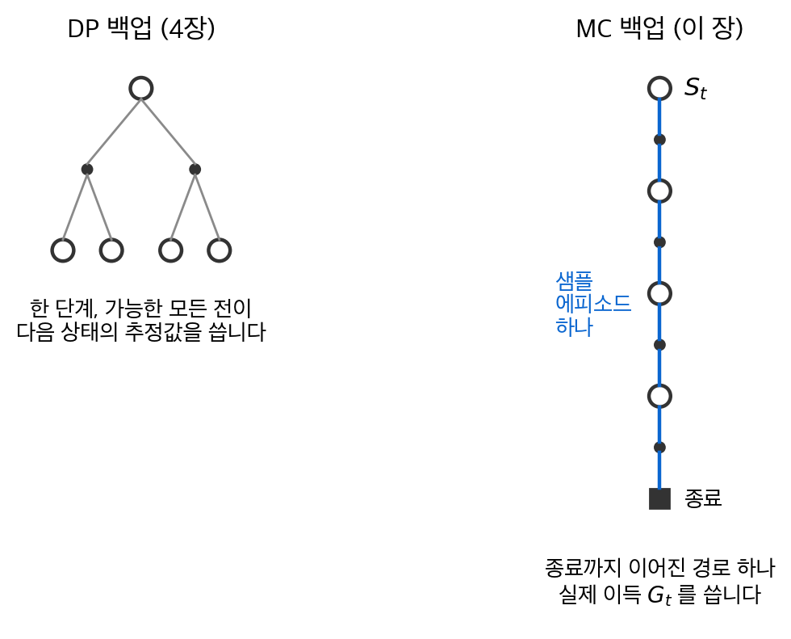
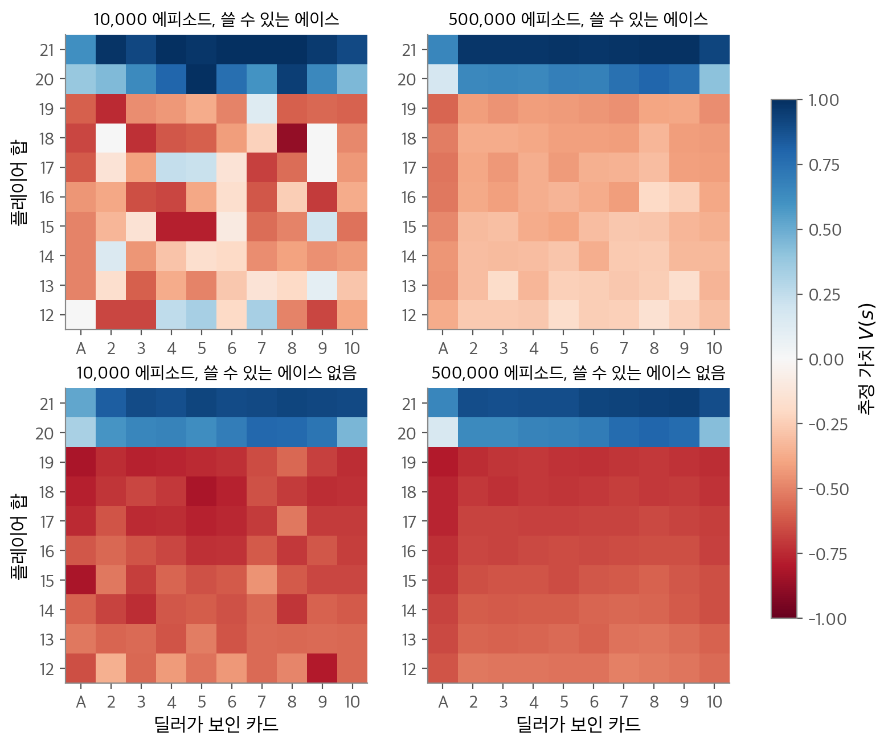
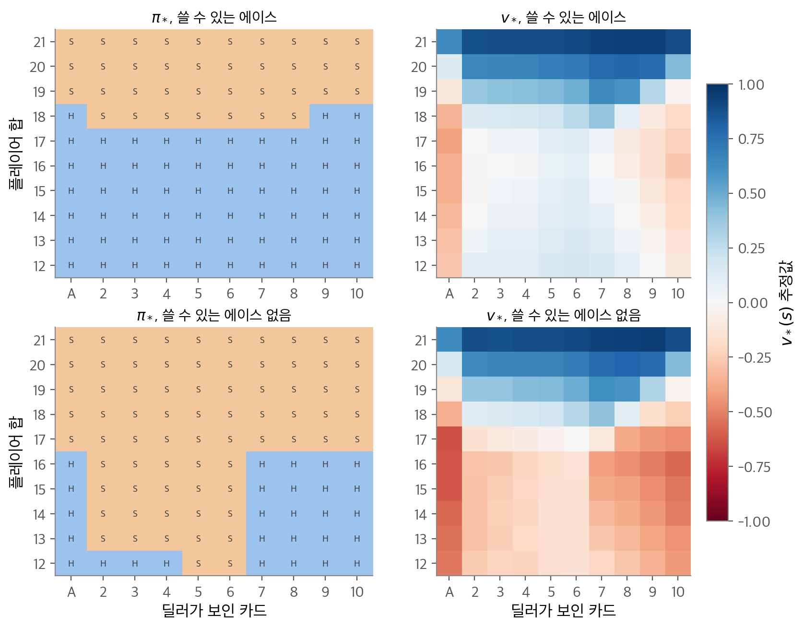
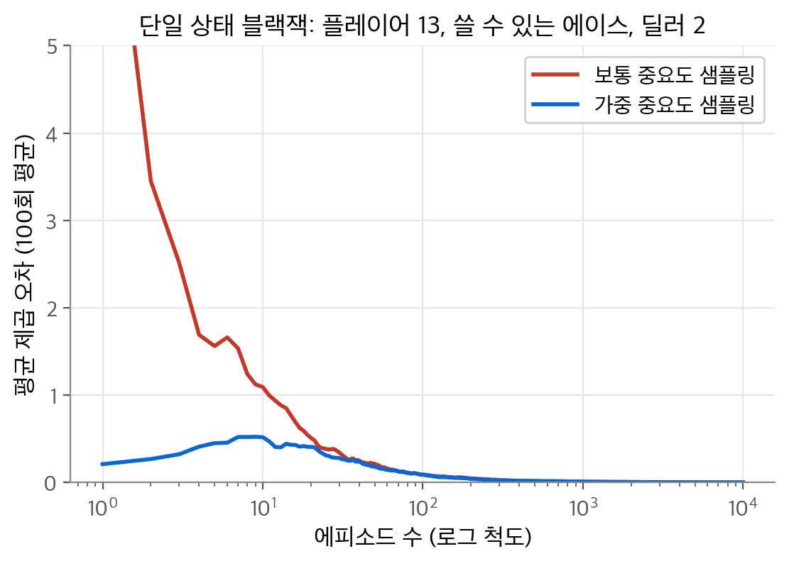
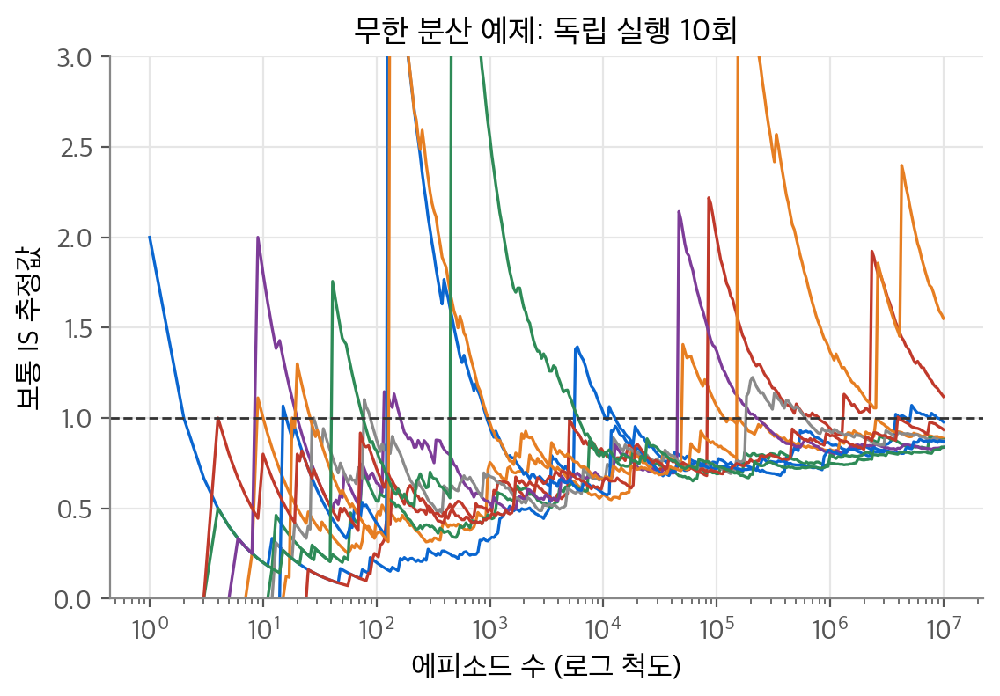

# 5. 몬테카를로 방법

4장의 동적 계획법은 환경의 전이 확률 $p(s', r \mid s, a)$ 를 모두 알아야 했습니다. 이 장의 질문은 "모델 없이 경험만으로 가치 함수와 최적 정책을 구할 수 있을까?"입니다. 결론은 **몬테카를로 방법(Monte Carlo method, MC)** 입니다. MC는 에피소드를 끝까지 진행하고 실제로 받은 이득을 평균합니다. 평균은 큰 수의 법칙에 따라 기댓값으로 수렴합니다. 탐험을 유지하는 방법은 세 가지입니다. 탐험적 시작, ε-soft 정책, 그리고 다른 정책이 만든 데이터를 중요도 샘플링으로 보정하는 off-policy 학습입니다.

!!! info "원문과 자료"
    - 원문: 초안 5장 Monte Carlo Methods (5.1~5.7, 5.9). 최종본 5장 (5.1~5.7, 5.10)
    - [David Silver, UCL RL Lecture 4: Model-Free Prediction (슬라이드)](https://davidstarsilver.wordpress.com/wp-content/uploads/2025/04/lecture-4-model-free-prediction-.pdf)
    - [David Silver, UCL RL Lecture 5: Model-Free Control (슬라이드)](https://davidstarsilver.wordpress.com/wp-content/uploads/2025/04/lecture-5-model-free-control-.pdf)
    - [Coursera, Sample-based Learning Methods (Alberta RL Specialization 2강, Monte Carlo 모듈)](https://www.coursera.org/learn/sample-based-learning-methods)
    - [Sutton & Barto 책 페이지](http://incompleteideas.net/book/the-book-2nd.html)
    - 함께 읽기: [3. 유한 마르코프 결정 과정](03-finite-mdp.md), [4. 동적 계획법](04-dynamic-programming.md), [6. 시간차 학습](06-td-learning.md)

## 1. 몬테카를로 예측

### 가치는 이득의 기댓값입니다

3장에서 상태 가치는 그 상태에서 출발한 이득의 기댓값으로 정의했습니다.

$$
v_\pi(s) = \mathbb{E}_\pi[G_t \mid S_t = s], \qquad G_t = R_{t+1} + \gamma R_{t+2} + \cdots + \gamma^{T-t-1} R_T
$$

기댓값은 샘플 평균으로 추정할 수 있습니다. 정책 $\pi$ 로 에피소드를 많이 만들고, 상태 $s$ 를 방문한 뒤에 받은 이득을 모아 평균합니다. 이것이 MC 예측의 전부입니다. 이득이 잘 정의되려면 에피소드가 반드시 끝나야 합니다. 그래서 이 장은 에피소드형 과제만 다룹니다.

DP와 비교하면 차이가 분명합니다. DP는 모든 다음 상태에 대한 기댓값을 모델로 계산합니다. MC는 샘플 하나의 실제 결과를 씁니다. 또한 MC는 다른 상태의 추정값을 쓰지 않습니다. 즉 **부트스트래핑(bootstrapping)** 을 하지 않습니다.

<figure markdown>

<figcaption markdown>
<span class="fig-title"><b>Figure 1.</b> DP 백업과 MC 백업</span>

DP는 한 단계 아래의 모든 전이와 추정값을 쓰고, MC는 경로 하나를 종료까지 따라가 실제 이득을 씁니다.
</figcaption>
</figure>

### 첫 방문 MC와 모든 방문 MC

한 에피소드 안에서 같은 상태를 여러 번 방문할 수 있습니다. 상태 $s$ 의 각 등장을 **방문(visit)** 이라고 합니다. 이득을 모으는 방법은 두 가지입니다.

| 방법 | 모으는 이득 | 성질 |
| --- | --- | --- |
| **첫 방문 MC(first-visit MC)** | 에피소드마다 $s$ 의 첫 방문 이후 이득 하나 | 샘플이 서로 독립입니다. 불편 추정량이고 표준 오차가 $1/\sqrt{n}$ 으로 줄어듭니다. |
| **모든 방문 MC(every-visit MC)** | $s$ 를 방문할 때마다 그 이후 이득 | 한 에피소드의 샘플끼리 상관이 있습니다. 그래도 $v_\pi(s)$ 로 수렴합니다. |

작은 예로 차이를 봅니다. $\gamma = 1$ 이고 에피소드가 $A, B, A, B$ 순서로 지나가며 보상 $1, 0, 2, 3$ 을 받았습니다. 각 시점의 이득은 뒤에서부터 누적합니다.

$$
G_3 = 3, \quad G_2 = 2 + 3 = 5, \quad G_1 = 0 + 5 = 5, \quad G_0 = 1 + 5 = 6
$$

첫 방문 MC는 $V(A) = G_0 = 6$, $V(B) = G_1 = 5$ 입니다. 모든 방문 MC는 $V(A) = (6 + 5)/2 = 5.5$, $V(B) = (5 + 3)/2 = 4$ 입니다.

첫 방문 MC 예측의 절차는 다음과 같습니다.

1. 모든 $s$ 에 대해 빈 목록 $\text{Returns}(s)$ 를 만듭니다.
2. $\pi$ 로 에피소드 $S_0, A_0, R_1, \ldots, S_{T-1}, A_{T-1}, R_T$ 를 만듭니다.
3. $G \leftarrow 0$ 으로 두고 $t = T-1, T-2, \ldots, 0$ 순서로 거꾸로 갑니다.
4. $G \leftarrow \gamma G + R_{t+1}$ 로 갱신합니다.
5. $S_t$ 가 $S_0, \ldots, S_{t-1}$ 에 없으면 $G$ 를 $\text{Returns}(S_t)$ 에 넣고 $V(S_t)$ 를 그 평균으로 바꿉니다.
6. 2번으로 돌아갑니다.

이득을 거꾸로 계산하면 한 번의 역방향 패스로 모든 시점의 $G_t$ 를 얻습니다.

## 2. 블랙잭: 고정 정책의 가치

### 문제 설정

블랙잭에서 플레이어는 카드 합을 21에 가깝게 만들되 넘지 않아야 합니다. 그림 카드는 10, 에이스는 1 또는 11입니다. 딜러는 카드 한 장을 보여 줍니다. 플레이어는 카드를 더 받거나(**히트, hit**) 멈춥니다(**스틱, stick**). 21을 넘으면 즉시 집니다. 딜러는 합이 17 이상이면 멈추는 고정 규칙을 따릅니다. 처음 두 장으로 21을 만들면 **내추럴(natural)** 이고 딜러도 내추럴이 아니면 이깁니다.

MDP로 쓰면 다음과 같습니다.

- 상태: 플레이어 합(12~21), 딜러가 보인 카드(A~10), 쓸 수 있는 에이스가 있는지. 모두 200개입니다.
- 행동: 히트, 스틱.
- 보상: 이기면 +1, 비기면 0, 지면 −1. 중간 보상은 0이고 $\gamma = 1$ 입니다. 그래서 최종 보상이 곧 이득입니다.
- 카드는 무한 덱에서 복원 추출합니다.

**쓸 수 있는 에이스(usable ace)** 는 11로 세어도 21을 넘지 않는 에이스입니다. 합이 11 이하이면 무조건 히트하는 것이 맞으므로 결정할 상태는 12부터입니다.

DP로 이 문제를 풀려면 "합 14에서 스틱할 때 딜러 카드별 승률" 같은 확률을 모두 미리 계산해야 합니다. 이 계산은 번거롭고 틀리기 쉽습니다. 반면 게임을 시뮬레이션하는 코드는 몇십 줄이면 됩니다. 환경을 완전히 알아도 샘플을 만드는 쪽이 쉬운 경우가 많습니다. 이것이 MC의 실용적 장점입니다.

### 20 이상에서만 스틱하는 정책

플레이어 합이 20이나 21이면 스틱하고 나머지는 히트하는 정책을 평가합니다. 블랙잭은 한 에피소드에서 같은 상태가 다시 나오지 않습니다. 합이 줄지 않기 때문입니다. 따라서 첫 방문 MC와 모든 방문 MC가 같습니다.

```python
tot = np.zeros((10, 10, 2)); cnt = np.zeros((10, 10, 2))
for _ in range(n_episodes):
    traj, r = episode(stick20)          # [(state, action), ...], 최종 보상
    for s, a in traj:                   # 중간 보상 0, gamma 1 이므로 G = r
        tot[idx(s)] += r; cnt[idx(s)] += 1
V = tot / np.maximum(cnt, 1)
```

<figure markdown>

<figcaption markdown>
<span class="fig-title"><b>Figure 2.</b> 블랙잭 고정 정책의 가치</span>

20 이상에서만 스틱하는 정책의 MC 추정값입니다. 에피소드가 10,000개(왼쪽)에서 500,000개(오른쪽)로 늘면 표면이 매끄러워집니다.
</figcaption>
</figure>

NumPy 시뮬레이션의 결과를 읽어 봅니다.

- 합 20, 21에서만 가치가 양수입니다. 20 이상에서만 멈추므로 19 이하에서 계속 히트하다 버스트하기 쉽습니다. 쓸 수 있는 에이스가 없는 상태의 평균 가치는 −0.366입니다.
- 합 19, 딜러 5, 에이스 없음의 가치는 −0.724입니다. 19에서 히트하는 정책이 얼마나 나쁜지 보여 줍니다.
- 딜러가 에이스를 보이면 가치가 낮습니다. 합 21, 에이스 있음의 가치도 딜러가 A이면 0.649에 그칩니다.
- 쓸 수 있는 에이스가 있으면 평균 가치가 −0.124로 더 높습니다. 히트해도 버스트하지 않고 에이스를 1로 바꿀 수 있기 때문입니다.
- 500,000 에피소드 중 에이스 있는 상태의 방문은 104,024번이고 없는 상태는 674,869번입니다. 방문이 적은 위쪽 왼편 그림이 더 거칩니다.

### 단일 상태만 추정할 수 있습니다

MC에서 각 상태의 추정은 서로 독립입니다. 한 상태의 가치만 필요하면 그 상태에서 시작하는 에피소드만 만들면 됩니다. 계산량이 전체 상태 수와 무관합니다. 원문의 비눗방울 예제(경계 조건을 주고 내부 한 점의 높이를 구하는 문제)가 이 장점을 보입니다. 무작위 보행을 경계까지 진행하고 경계 높이를 평균하면 그 점의 높이를 얻습니다.

## 3. 행동 가치와 탐험적 시작

### 모델이 없으면 행동 가치가 필요합니다

모델이 있으면 상태 가치만으로 정책을 개선할 수 있습니다. 한 단계 앞을 내다보고 보상과 다음 상태 가치의 합이 가장 큰 행동을 고르면 됩니다. 모델이 없으면 이 계산을 할 수 없습니다. 그래서 행동 가치 $q_\pi(s, a)$ 를 직접 추정합니다.

$$
q_\pi(s, a) = \mathbb{E}_\pi[G_t \mid S_t = s, A_t = a]
$$

MC 방법은 그대로 씁니다. 방문 단위만 상태–행동 쌍으로 바뀝니다. 정책 개선은 $\pi(s) = \arg\max_a q(s, a)$ 입니다. 모델이 필요 없습니다.

### 탐험 유지 문제

결정적 정책을 따르면 상태마다 행동 하나만 관측합니다. 다른 행동의 이득은 영영 모으지 못합니다. 비교할 값이 없으면 개선할 수 없습니다. 이것이 2장 밴딧에서 본 **탐험(exploration)** 문제입니다.

첫 번째 해결책은 **탐험적 시작(exploring starts)** 입니다. 에피소드의 첫 상태–행동 쌍을 무작위로 고르고, 모든 쌍이 선택될 확률이 0보다 크게 만듭니다. 그러면 에피소드가 무한히 많을 때 모든 쌍을 무한히 방문합니다. 시뮬레이터에서는 쉽지만 실제 환경에서는 시작 조건을 마음대로 정하기 어렵습니다.

## 4. 몬테카를로 제어

### 일반화된 정책 반복

4장의 **일반화된 정책 반복(GPI, generalized policy iteration)** 을 그대로 씁니다. 평가와 개선을 번갈아 합니다.

$$
\pi_0 \xrightarrow{E} q_{\pi_0} \xrightarrow{I} \pi_1 \xrightarrow{E} q_{\pi_1} \xrightarrow{I} \pi_2 \xrightarrow{E} \cdots \xrightarrow{I} \pi_* \xrightarrow{E} q_*
$$

개선이 맞는 이유는 4장의 정책 개선 정리입니다. 새 정책 $\pi_{k+1}$ 을 $q_{\pi_k}$ 에 대한 탐욕적 정책으로 두면 모든 $s$ 에서 다음이 성립합니다.

$$
q_{\pi_k}(s, \pi_{k+1}(s)) = \max_a q_{\pi_k}(s, a) \ge q_{\pi_k}(s, \pi_k(s)) = v_{\pi_k}(s)
$$

따라서 $\pi_{k+1} \ge \pi_k$ 입니다. 정확한 평가에는 에피소드가 무한히 필요합니다. 실제로는 4장의 가치 반복처럼 평가를 끝까지 하지 않습니다. 에피소드 하나마다 평가하고 그 자리에서 정책을 개선합니다.

### MC ES

**MC ES(Monte Carlo with Exploring Starts)** 의 절차는 다음과 같습니다.

1. $Q(s, a)$ 를 임의로, $\pi(s)$ 를 임의로 초기화합니다.
2. 시작 쌍 $(S_0, A_0)$ 를 무작위로 고릅니다.
3. 그 뒤로 $\pi$ 를 따라 에피소드를 만듭니다.
4. 각 쌍의 첫 방문 이후 이득으로 $Q(S_t, A_t)$ 의 평균을 갱신합니다.
5. 방문한 각 상태에서 $\pi(S_t) \leftarrow \arg\max_a Q(S_t, a)$ 로 바꿉니다.

이 알고리즘이 고정점에 수렴하면 그 정책은 최적입니다. 정책이 최적이 아니면 가치가 바뀌고, 가치가 정책과 맞지 않으면 정책이 바뀌기 때문입니다. 다만 수렴의 형식적 증명은 아직 열린 문제로 남아 있습니다.

### 블랙잭 최적 정책

블랙잭에 MC ES를 적용합니다. 시작 상태는 플레이어 합, 딜러 카드, 에이스 여부를 균등하게 고릅니다. 첫 행동도 균등하게 고릅니다. 초기 정책은 2절의 "20 이상에서 스틱"이고 $Q$ 는 0에서 시작합니다. 에피소드를 3,000,000개 진행했습니다.

<figure markdown>

<figcaption markdown>
<span class="fig-title"><b>Figure 3.</b> MC ES로 찾은 블랙잭 정책</span>

MC ES가 찾은 정책(왼쪽, H는 히트, S는 스틱)과 $v_*$ 추정값(오른쪽)입니다.
</figcaption>
</figure>

얻은 정책은 다음과 같습니다.

- 에이스 없음: 17 이상이면 항상 스틱합니다. 13~16에서는 딜러가 2~6을 보이면 스틱하고 A, 7~10이면 히트합니다. 12에서는 딜러 5, 6에서만 스틱합니다.
- 에이스 있음: 19 이상이면 스틱합니다. 18에서는 딜러 A, 9, 10이면 히트하고 나머지는 스틱합니다. 17 이하이면 히트합니다.

이 결과는 원문의 그림과 거의 같습니다. 차이는 에이스 없는 12, 딜러 4 칸입니다. 원문과 Thorp의 기본 전략은 이 칸에서 스틱합니다. 이 칸은 두 행동의 가치 차이가 작아서 샘플 잡음에 민감합니다. 비슷한 예로 합 16, 딜러 10, 에이스 없음의 추정값은 스틱 −0.579, 히트 −0.574입니다. 차이가 0.005뿐입니다. 이런 칸은 에피소드를 늘려도 쉽게 뒤집힙니다.

$v_*$ 의 모양도 의미가 있습니다. 합 20, 딜러 10, 에이스 없음의 가치는 0.440입니다. 2절의 고정 정책에서 같은 상태는 0.429였습니다. 이 상태에서는 두 정책이 같이 스틱하므로 가치가 거의 같습니다. 반면 13~16의 가치는 크게 올랐습니다. 딜러가 약한 카드를 보일 때 스틱해서 딜러의 버스트를 기다리기 때문입니다.

## 5. 탐험적 시작 없는 MC 제어

### on-policy와 off-policy

탐험적 시작을 쓰지 않고 탐험을 유지하는 방법은 두 가지입니다.

- **on-policy**: 행동을 고르는 정책 자체를 평가하고 개선합니다.
- **off-policy**: 데이터를 만드는 정책과 평가하는 정책을 분리합니다. 6절에서 다룹니다.

### ε-soft 정책

on-policy 방법은 정책이 **soft** 해야 합니다. 즉 모든 $s, a$ 에서 $\pi(a \mid s) > 0$ 이어야 합니다. 그중 모든 행동에 최소 $\varepsilon / |\mathcal{A}(s)|$ 의 확률을 주는 정책을 **ε-soft 정책** 이라고 합니다. ε-탐욕 정책은 ε-soft 정책 가운데 가장 탐욕적인 정책입니다.

$$
\pi(a \mid s) =
\begin{cases}
1 - \varepsilon + \dfrac{\varepsilon}{|\mathcal{A}(s)|} & a = \arg\max_{a'} Q(s, a') \\[2mm]
\dfrac{\varepsilon}{|\mathcal{A}(s)|} & \text{그 밖의 행동}
\end{cases}
$$

블랙잭처럼 행동이 둘이고 $\varepsilon = 0.1$ 이면 탐욕 행동의 확률은 $0.9 + 0.05 = 0.95$, 다른 행동은 0.05입니다.

### ε-탐욕 개선이 맞는 이유

$\pi$ 가 임의의 ε-soft 정책이고 $\pi'$ 이 $q_\pi$ 에 대한 ε-탐욕 정책이라고 합시다. 정책 개선 정리를 쓰려면 $q_\pi(s, \pi'(s)) \ge v_\pi(s)$ 를 보이면 됩니다. $m = |\mathcal{A}(s)|$ 로 둡니다.

$$
\begin{aligned}
q_\pi(s, \pi'(s)) &= \sum_a \pi'(a \mid s)\, q_\pi(s, a) \\
&= \frac{\varepsilon}{m} \sum_a q_\pi(s, a) + (1 - \varepsilon) \max_a q_\pi(s, a)
\end{aligned}
$$

핵심은 최댓값을 가중 평균보다 작지 않은 값으로 바꾸는 단계입니다. 가중치 $w_a = \dfrac{\pi(a \mid s) - \varepsilon/m}{1 - \varepsilon}$ 를 생각합니다. $\pi$ 가 ε-soft 이므로 $w_a \ge 0$ 이고, 합하면 $\sum_a w_a = \dfrac{1 - \varepsilon}{1 - \varepsilon} = 1$ 입니다. 최댓값은 어떤 가중 평균보다도 크거나 같습니다.

$$
\begin{aligned}
q_\pi(s, \pi'(s)) &\ge \frac{\varepsilon}{m} \sum_a q_\pi(s, a) + (1 - \varepsilon) \sum_a \frac{\pi(a \mid s) - \varepsilon/m}{1 - \varepsilon}\, q_\pi(s, a) \\
&= \frac{\varepsilon}{m} \sum_a q_\pi(s, a) - \frac{\varepsilon}{m} \sum_a q_\pi(s, a) + \sum_a \pi(a \mid s)\, q_\pi(s, a) \\
&= v_\pi(s)
\end{aligned}
$$

따라서 $\pi' \ge \pi$ 입니다. 등호는 언제 성립할까요? 원문은 환경을 하나 새로 정의해서 답합니다. 새 환경은 원래 환경과 같지만, 에이전트가 고른 행동을 확률 $\varepsilon$ 으로 무작위 행동으로 바꿉니다. 이 환경에서 가장 좋은 정책이 곧 ε-soft 정책 중 최선입니다. 등호는 $\pi$ 가 ε-soft 정책 중 최적일 때만 성립합니다. 결론적으로 ε-soft on-policy MC 제어는 진짜 최적 정책이 아니라 "ε-soft 정책 중 최적"에 도달합니다. 대신 탐험적 시작이 필요 없습니다.

알고리즘은 MC ES의 5번만 바꿉니다. 탐욕 행동 $A^* = \arg\max_a Q(S_t, a)$ 를 구하고 $\pi(\cdot \mid S_t)$ 를 위의 ε-탐욕 분포로 둡니다.

## 6. 중요도 샘플링을 쓰는 off-policy 예측

### 두 정책의 분리

on-policy 방법은 타협입니다. 최적 행동을 배우려면 최적이 아닌 행동도 해야 합니다. off-policy 방법은 정책을 둘로 나눕니다.

- **목표 정책(target policy)** $\pi$: 가치를 알고 싶은 정책입니다. 보통 결정적 탐욕 정책입니다.
- **행동 정책(behavior policy)** $b$: 실제로 데이터를 만드는 정책입니다. 탐험을 합니다.

$\pi$ 의 가치를 $b$ 의 데이터로 추정하려면 **포함 조건(coverage)** 이 필요합니다. $\pi(a \mid s) > 0$ 이면 $b(a \mid s) > 0$ 이어야 합니다. 목표 정책이 하는 행동은 행동 정책도 가끔 해야 한다는 뜻입니다.

### 중요도 샘플링 비의 유도

시점 $t$ 에서 상태 $S_t$ 로부터 시작한 궤적 $A_t, S_{t+1}, A_{t+1}, \ldots, S_T$ 의 확률을 정책 $\pi$ 아래에서 씁니다. 마르코프 성질로 단계별 확률을 곱합니다.

$$
\Pr\{A_t, S_{t+1}, \ldots, S_T \mid S_t, A_{t:T-1} \sim \pi\} = \prod_{k=t}^{T-1} \pi(A_k \mid S_k)\, p(S_{k+1} \mid S_k, A_k)
$$

$b$ 아래 확률도 같은 모양입니다. 두 확률의 비를 **중요도 샘플링 비(importance-sampling ratio)** 라고 합니다.

$$
\rho_{t:T-1} = \frac{\prod_{k=t}^{T-1} \pi(A_k \mid S_k)\, p(S_{k+1} \mid S_k, A_k)}{\prod_{k=t}^{T-1} b(A_k \mid S_k)\, p(S_{k+1} \mid S_k, A_k)} = \prod_{k=t}^{T-1} \frac{\pi(A_k \mid S_k)}{b(A_k \mid S_k)}
$$

전이 확률 $p$ 가 분자와 분모에서 약분됩니다. 그래서 비는 두 정책에만 의존하고 모델이 필요 없습니다. 이것이 off-policy MC가 모델 없이 동작하는 이유입니다.

비를 곱하면 기댓값이 바뀝니다. 궤적을 $\tau$, 그 이득을 $G(\tau)$ 로 두면 다음이 성립합니다.

$$
\mathbb{E}_b[\rho_{t:T-1} G_t \mid S_t = s] = \sum_\tau \Pr_b(\tau)\, \frac{\Pr_\pi(\tau)}{\Pr_b(\tau)}\, G(\tau) = \sum_\tau \Pr_\pi(\tau)\, G(\tau) = v_\pi(s)
$$

포함 조건은 $\Pr_\pi(\tau) > 0$ 인 궤적에서 $\Pr_b(\tau) > 0$ 을 보장합니다. 그래서 분모가 0이 되는 일이 없습니다.

작은 수치 예를 봅니다. 행동이 둘이고 $b$ 는 균등합니다. $\pi$ 는 결정적입니다. 세 단계 동안 $b$ 가 우연히 $\pi$ 와 같은 행동을 했다면 $\rho = (1/0.5)^3 = 8$ 입니다. 한 번이라도 다른 행동을 했다면 $\rho = 0$ 입니다. 목표 정책이 할 법한 궤적은 크게 키우고, 하지 않을 궤적은 지웁니다.

### 보통 중요도 샘플링과 가중 중요도 샘플링

$\mathcal{T}(s)$ 를 $s$ 의 방문 시점 집합, $T(t)$ 를 그 에피소드의 종료 시점이라고 합니다. 추정량은 두 가지입니다.

$$
V_{\text{보통}}(s) = \frac{\sum_{t \in \mathcal{T}(s)} \rho_{t:T(t)-1} G_t}{|\mathcal{T}(s)|},
\qquad
V_{\text{가중}}(s) = \frac{\sum_{t \in \mathcal{T}(s)} \rho_{t:T(t)-1} G_t}{\sum_{t \in \mathcal{T}(s)} \rho_{t:T(t)-1}}
$$

**보통 중요도 샘플링(ordinary importance sampling)** 은 단순 평균입니다. **가중 중요도 샘플링(weighted importance sampling)** 은 비의 합으로 나눈 가중 평균입니다. 분모가 0이면 추정값을 0으로 둡니다.

샘플이 하나뿐일 때 차이가 드러납니다. 가중 추정은 $\rho$ 가 약분되어 $G$ 그대로입니다. 편향은 있지만 값의 범위는 이득의 범위를 벗어나지 않습니다. 보통 추정은 $\rho G$ 입니다. $\rho = 10$ 이면 관측 이득의 10배를 추정값으로 냅니다.

| 성질 | 보통 IS | 가중 IS |
| --- | --- | --- |
| 편향(첫 방문) | 없음 | 있음. 샘플이 늘면 0으로 수렴 |
| 분산 | 비가 크면 무한히 클 수 있음 | 각 샘플 가중치가 1 이하로 제한되어 유한(이득이 유계일 때) |
| 실무 | 함수 근사로 확장하기 쉬움 | 보통 더 선호함 |

### 단일 상태 블랙잭 예제

블랙잭 한 상태의 가치를 off-policy로 추정합니다. 상태는 딜러 2, 플레이어 합 13, 쓸 수 있는 에이스 있음입니다. 행동 정책은 히트와 스틱을 반반으로 고릅니다. 목표 정책은 20 이상에서만 스틱합니다. 원문은 이 상태의 참값을 −0.27726으로 제시합니다(목표 정책으로 1억 에피소드를 평균한 값). 이 값을 기준으로 100회 독립 실행의 평균 제곱 오차를 계산했습니다.

<figure markdown>

<figcaption markdown>
<span class="fig-title"><b>Figure 4.</b> 보통 IS와 가중 IS의 오차</span>

단일 블랙잭 상태의 off-policy 추정 오차입니다. 각 곡선은 100회 독립 실행의 평균 제곱 오차이고, 가로축은 에피소드 수(로그 척도)입니다.
</figcaption>
</figure>

| 에피소드 수 | 1 | 10 | 100 | 1,000 | 10,000 |
| --- | --- | --- | --- | --- | --- |
| 보통 IS MSE | 7.993 | 1.092 | 0.089 | 0.010 | 0.001 |
| 가중 IS MSE | 0.210 | 0.519 | 0.090 | 0.011 | 0.001 |

초반에 보통 IS의 오차가 훨씬 큽니다. 목표 정책과 일치하는 궤적은 $\rho = 2^k$ 로 커지기 때문입니다. 가중 IS는 처음 몇 에피소드 동안 오차가 조금 오르다가 내려갑니다. 초반에는 일치 궤적이 없어 추정값이 0으로 남는 실행이 많습니다. 일치 궤적이 하나 생기면 그 이득($\pm 1$)이 그대로 추정값이 됩니다. 이 단계의 편향이 오차를 올립니다. 100 에피소드 이후 두 방법의 오차는 비슷해집니다.

### 무한 분산 예제

보통 IS의 분산은 무한일 수 있습니다. 종료가 아닌 상태 하나 $s$ 와 행동 둘(back, end)이 있는 MDP를 봅니다.

- end: 보상 0으로 종료합니다.
- back: 확률 0.9로 $s$ 로 돌아오고(보상 0), 확률 0.1로 보상 +1을 받고 종료합니다.
- 목표 정책은 항상 back입니다. 그래서 $v_\pi(s) = 1$ 입니다.
- 행동 정책은 back과 end를 반반으로 고릅니다.

$\rho G$ 의 기댓값은 1이지만 제곱의 기댓값을 계산해 봅니다. 0이 아닌 $\rho G$ 는 back만 $k + 1$ 번 고르고 마지막에 종료한 궤적에서만 나옵니다. 이 궤적의 확률은 $b$ 아래에서 $(0.5 \cdot 0.9)^k (0.5 \cdot 0.1)$ 이고 $\rho = 2^{k+1}$, $G = 1$ 입니다.

$$
\mathbb{E}_b[(\rho G)^2] = \sum_{k=0}^{\infty} 0.45^k \cdot 0.05 \cdot 4^{k+1} = 0.2 \sum_{k=0}^{\infty} 1.8^k = \infty
$$

등비가 1.8로 1보다 크므로 급수가 발산합니다. 분산이 무한이면 표본 평균은 안정되지 않습니다. 가끔 나오는 긴 일치 궤적이 거대한 $\rho$ 를 만들고 추정값을 튀게 합니다.

<figure markdown>

<figcaption markdown>
<span class="fig-title"><b>Figure 5.</b> 무한 분산 예제</span>

보통 IS 추정값은 참값 1(점선)로 수렴하지 않고, 큰 점프 뒤 천천히 내려오기를 반복합니다.
</figcaption>
</figure>

10,000,000 에피소드 뒤의 추정값은 0.838에서 1.551 사이에 퍼져 있습니다. 대부분은 1보다 작습니다. 이득이 큰 희귀 궤적을 아직 충분히 보지 못했기 때문입니다. 가중 IS는 이 예제에서 첫 일치 궤적 이후 정확히 1을 냅니다. 일치 궤적의 이득이 모두 1이기 때문입니다.

## 7. 증분 구현

### 보통 IS의 증분 형태

보통 IS는 $\rho G$ 의 단순 평균입니다. 2장의 증분 평균을 그대로 씁니다.

### 가중 IS의 증분 형태

가중 평균도 증분으로 계산할 수 있습니다. 이득 $G_1, \ldots, G_{n-1}$ 과 가중치 $W_k$ 가 있을 때 추정값은 다음과 같습니다.

$$
V_n = \frac{\sum_{k=1}^{n-1} W_k G_k}{\sum_{k=1}^{n-1} W_k}
$$

누적 가중치 $C_n = \sum_{k=1}^{n} W_k$ 를 두고 $V_{n+1}$ 을 $V_n$ 으로 씁니다. $C_n V_{n+1} = C_{n-1} V_n + W_n G_n$ 이고 $C_{n-1} = C_n - W_n$ 이므로 다음을 얻습니다.

$$
C_n V_{n+1} = C_n V_n - W_n V_n + W_n G_n
\quad\Longrightarrow\quad
V_{n+1} = V_n + \frac{W_n}{C_n}\big[G_n - V_n\big]
$$

스텝 크기가 $1/n$ 대신 $W_n / C_n$ 입니다. 모든 $W_n = 1$ 이면 2장의 증분 평균과 같습니다.

수치 예를 봅니다. 이득과 가중치가 $(G, W) = (1, 2), (-1, 4), (1, 0)$ 순서로 들어옵니다.

| 단계 | $C$ | $W/C$ | $V$ |
| --- | --- | --- | --- |
| 1 | 2 | 1 | $0 + 1 \cdot (1 - 0) = 1$ |
| 2 | 6 | 2/3 | $1 + \tfrac{2}{3}(-1 - 1) = -0.333$ |
| 3 | 6 | 0 | 변화 없음 |

직접 계산한 가중 평균 $(2 \cdot 1 + 4 \cdot (-1))/6 = -0.333$ 과 같습니다.

### off-policy MC 예측 알고리즘

행동 가치 버전을 에피소드마다 거꾸로 돌며 계산합니다.

```python
G, W = 0.0, 1.0
for t in reversed(range(T)):
    G = gamma * G + R[t + 1]
    s, a = S[t], A[t]
    C[s, a] += W
    Q[s, a] += (W / C[s, a]) * (G - Q[s, a])
    W *= pi[s, a] / b[s, a]
    if W == 0:
        break          # 이보다 앞선 시점은 모두 가중치 0
```

$W$ 를 갱신하는 위치에 주의합니다. $Q(S_t, A_t)$ 는 $A_t$ 가 주어진 조건부 값입니다. 그래서 $A_t$ 자신의 비는 곱하지 않고 그 뒤의 비 $\rho_{t+1:T-1}$ 만 씁니다.

## 8. off-policy MC 제어

### 목표 정책을 탐욕 정책으로 둡니다

off-policy MC 제어는 7절의 알고리즘에서 목표 정책을 $Q$ 에 대한 탐욕 정책으로 바꿉니다. 행동 정책 $b$ 는 soft 정책이면 무엇이든 됩니다. 보통 ε-soft 정책을 씁니다.

1. $Q(s, a)$ 를 임의로, $C(s, a) = 0$ 으로, $\pi(s) = \arg\max_a Q(s, a)$ 로 초기화합니다.
2. soft 정책 $b$ 로 에피소드를 만듭니다.
3. $G \leftarrow 0$, $W \leftarrow 1$ 로 두고 $t = T-1, \ldots, 0$ 순서로 갑니다.
4. $G \leftarrow \gamma G + R_{t+1}$, $C(S_t, A_t) \leftarrow C(S_t, A_t) + W$ 로 갱신합니다.
5. $Q(S_t, A_t) \leftarrow Q(S_t, A_t) + \dfrac{W}{C(S_t, A_t)}[G - Q(S_t, A_t)]$ 로 갱신합니다.
6. $\pi(S_t) \leftarrow \arg\max_a Q(S_t, a)$ 로 바꿉니다.
7. $A_t \ne \pi(S_t)$ 이면 이 에피소드의 처리를 멈춥니다.
8. 아니면 $W \leftarrow W \cdot \dfrac{1}{b(A_t \mid S_t)}$ 로 갱신하고 3번의 반복을 계속합니다.

목표 정책이 결정적이므로 $\pi(A_t \mid S_t)$ 는 1 아니면 0입니다. 그래서 8번의 분자는 1입니다. 7번에서 멈추는 이유도 같습니다. 탐욕 행동과 다른 행동이 나오면 그 앞의 모든 비가 0이 됩니다.

### 꼬리에서만 배웁니다

이 알고리즘에는 한계가 있습니다. 탐욕 행동과 일치하는 에피소드의 **꼬리** 에서만 배웁니다. 행동 정책이 탐험 행동을 자주 하면 에피소드 앞부분은 거의 학습에 쓰이지 않습니다. 특히 긴 에피소드의 앞쪽 상태는 학습이 매우 느립니다. 6장의 TD 방법과 7장의 n단계 방법이 이 문제를 줄입니다.

### 할인을 고려한 개선

원문은 비의 분산을 더 줄이는 두 가지 생각을 소개합니다(최종본 5.8, 5.9). 첫째, **할인 인지 중요도 샘플링(discounting-aware importance sampling)** 은 할인율을 "각 단계에서 에피소드가 끝날 확률"로 해석합니다. 그러면 먼 보상에 곱하는 긴 비를 끊을 수 있습니다. 둘째, **결정 단위 중요도 샘플링(per-decision importance sampling)** 은 각 보상 $R_{k+1}$ 에 그 시점까지의 비 $\rho_{t:k}$ 만 곱합니다. 보상 이후의 비는 기댓값이 1이므로 지워도 기댓값이 바뀌지 않습니다.

## 정리

- MC 예측은 정책을 따라 에피소드를 끝까지 진행하고 실제 이득을 평균합니다. 모델이 필요 없고 부트스트래핑을 하지 않습니다.
- 첫 방문 MC와 모든 방문 MC는 둘 다 $v_\pi$ 로 수렴합니다. 블랙잭처럼 상태가 반복되지 않으면 둘은 같습니다.
- 모델이 없으면 정책 개선에 행동 가치 $q_\pi(s, a)$ 가 필요합니다.
- MC ES는 탐험적 시작으로 모든 쌍을 방문합니다. 블랙잭에서 3,000,000 에피소드로 원문과 거의 같은 정책을 얻었습니다.
- ε-soft on-policy MC 제어는 탐험적 시작 없이 동작합니다. 대신 ε-soft 정책 중 최적에 머뭅니다. 개선의 근거는 "최댓값 ≥ 가중 평균" 부등식입니다.
- 중요도 샘플링 비 $\rho_{t:T-1} = \prod_k \pi(A_k \mid S_k) / b(A_k \mid S_k)$ 는 전이 확률이 약분되어 모델이 필요 없습니다.
- 보통 IS는 불편이지만 분산이 무한일 수 있습니다. 가중 IS는 편향이 있지만 분산이 작아 실무에서 선호합니다.
- 가중 IS의 증분 갱신은 스텝 크기 $W_n / C_n$ 을 씁니다.
- off-policy MC 제어는 탐욕 행동과 일치하는 에피소드 꼬리에서만 배웁니다. 그래서 학습이 느릴 수 있습니다.
