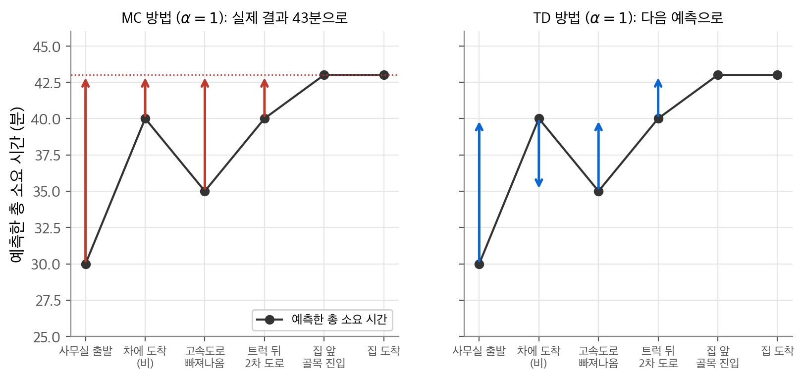
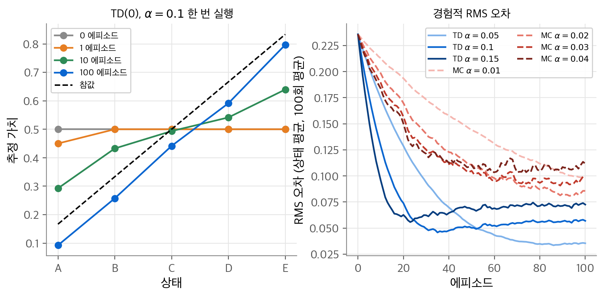
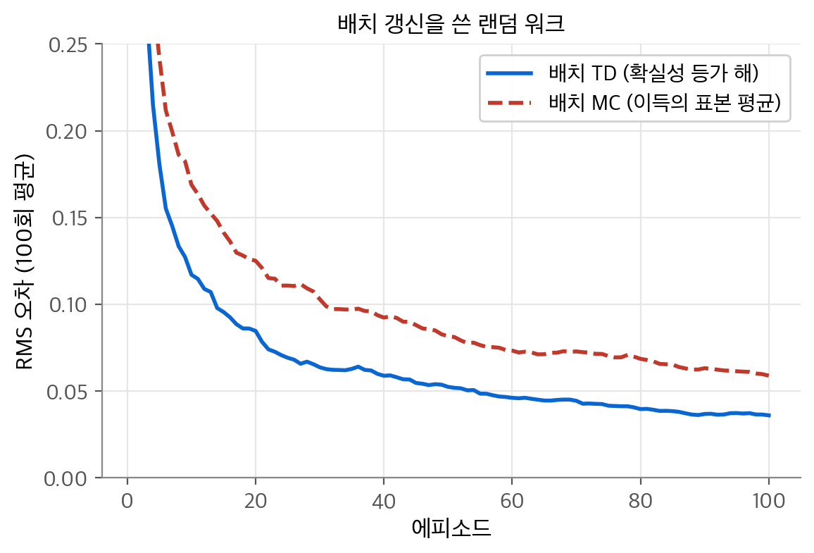
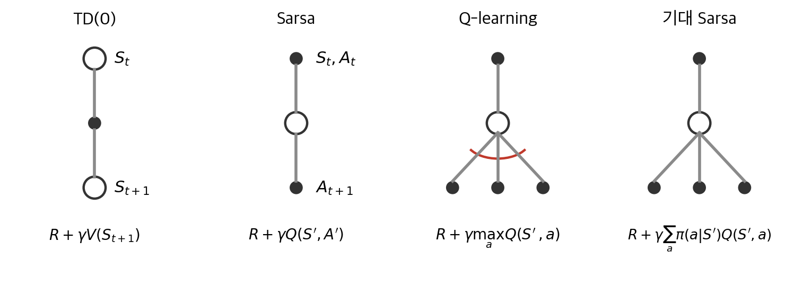
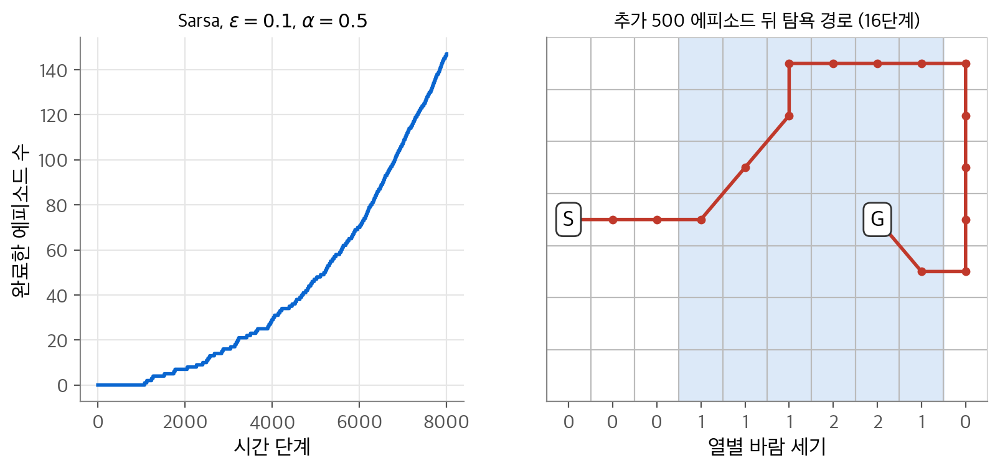
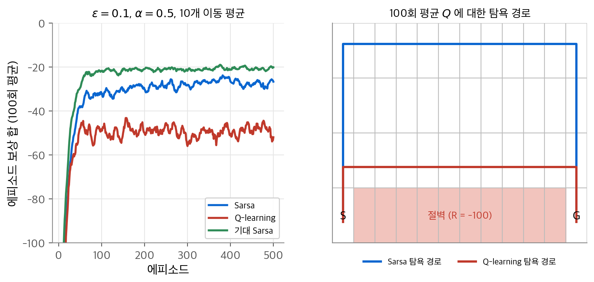
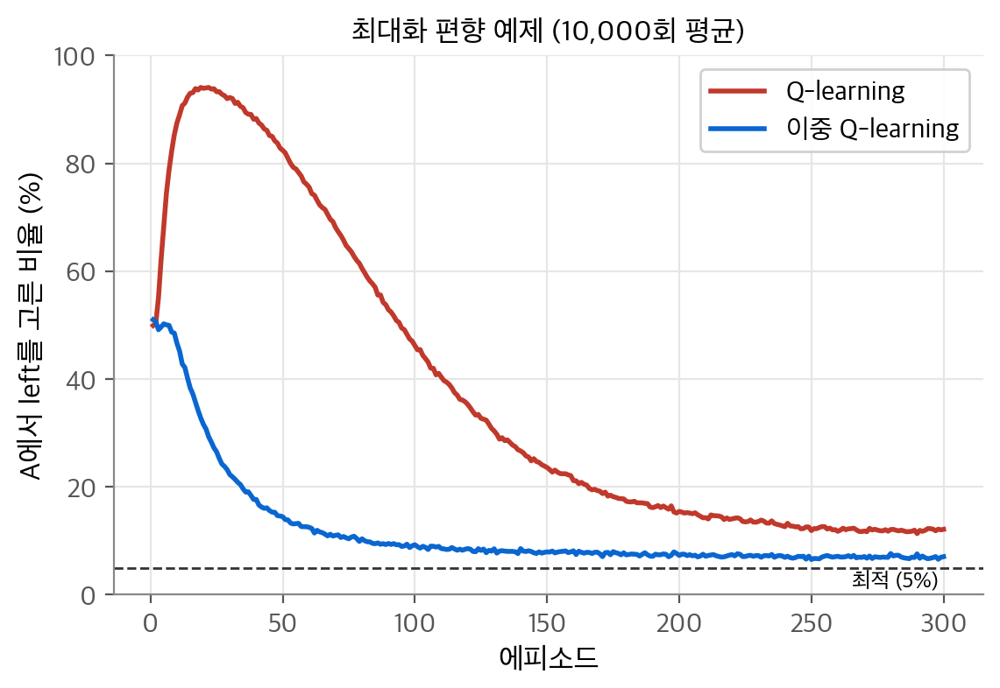

# 6. 시간차 학습

5장의 MC 방법은 에피소드가 끝나야 갱신할 수 있었습니다. 4장의 DP는 갱신은 바로 했지만 모델이 필요했습니다. 이 장의 질문은 "모델 없이, 에피소드가 끝나기 전에, 한 단계마다 배울 수 있을까?"입니다. 결론은 **시간차(TD, temporal difference) 학습** 입니다. TD는 MC처럼 샘플 경험에서 배우고, DP처럼 다음 상태의 추정값으로 현재 추정값을 갱신합니다. 즉 샘플링과 부트스트래핑을 함께 씁니다. 이 아이디어에서 on-policy 제어인 Sarsa와 off-policy 제어인 Q-learning이 나옵니다.

!!! info "원문과 자료"
    - 원문: 초안 6장 Temporal-Difference Learning (6.1~6.7). 최종본 6장 (6.1~6.9). 기대 Sarsa(6.6)와 최대화 편향(6.7)은 최종본에서 가져왔습니다.
    - [David Silver, UCL RL Lecture 4: Model-Free Prediction (슬라이드)](https://davidstarsilver.wordpress.com/wp-content/uploads/2025/04/lecture-4-model-free-prediction-.pdf)
    - [David Silver, UCL RL Lecture 5: Model-Free Control (슬라이드)](https://davidstarsilver.wordpress.com/wp-content/uploads/2025/04/lecture-5-model-free-control-.pdf)
    - [Coursera, Sample-based Learning Methods (Alberta RL Specialization 2강, TD 예측과 TD 제어 모듈)](https://www.coursera.org/learn/sample-based-learning-methods)
    - [Sutton & Barto 책 페이지](http://incompleteideas.net/book/the-book-2nd.html)
    - 함께 읽기: [4. 동적 계획법](04-dynamic-programming.md), [5. 몬테카를로 방법](05-monte-carlo.md), [7. n단계 TD와 적격 흔적](07-eligibility-traces.md), [8. 계획과 학습](08-planning-learning.md)

## 1. TD 예측

### MC 갱신에서 TD 갱신으로

5장의 MC 갱신을 상수 스텝 크기 $\alpha$ 로 쓰면 다음과 같습니다. 이 방법을 **상수 α MC(constant-α MC)** 라고 합니다.

$$
V(S_t) \leftarrow V(S_t) + \alpha\big[G_t - V(S_t)\big]
$$

목표값 $G_t$ 는 에피소드가 끝나야 압니다. TD는 목표값을 바꿉니다. 3장의 벨만 방정식에서 출발합니다.

$$
v_\pi(s) = \mathbb{E}_\pi[G_t \mid S_t = s] = \mathbb{E}_\pi[R_{t+1} + \gamma G_{t+1} \mid S_t = s] = \mathbb{E}_\pi[R_{t+1} + \gamma v_\pi(S_{t+1}) \mid S_t = s]
$$

첫 번째 등식이 MC의 목표, 세 번째 등식이 TD의 목표입니다. 기댓값을 샘플 하나로 바꾸고 모르는 $v_\pi$ 를 현재 추정값 $V$ 로 바꿉니다. 이것이 **TD(0)**, 또는 한 단계 TD입니다.

$$
V(S_t) \leftarrow V(S_t) + \alpha\big[R_{t+1} + \gamma V(S_{t+1}) - V(S_t)\big]
$$

TD 목표값은 두 가지 근사를 담고 있습니다. 기댓값 대신 샘플을 쓰는 것은 MC와 같습니다. $v_\pi$ 대신 추정값 $V$ 를 쓰는 것은 DP와 같습니다.

| 방법 | 목표값 | 샘플링 | 부트스트래핑 |
| --- | --- | --- | --- |
| DP | $\mathbb{E}_\pi[R_{t+1} + \gamma V(S_{t+1})]$ | 아니요 | 예 |
| MC | $G_t$ | 예 | 아니요 |
| TD(0) | $R_{t+1} + \gamma V(S_{t+1})$ | 예 | 예 |

### TD 오차

괄호 안의 값을 **TD 오차(TD error)** 라고 합니다.

$$
\delta_t = R_{t+1} + \gamma V(S_{t+1}) - V(S_t)
$$

$\delta_t$ 는 "한 단계 뒤에 본 더 나은 추정"과 "지금 추정"의 차이입니다. 시점 $t+1$ 에야 계산할 수 있습니다.

MC 오차는 TD 오차의 합으로 쓸 수 있습니다. 에피소드 동안 $V$ 가 바뀌지 않는다고 가정하고, $G_t = R_{t+1} + \gamma G_{t+1}$ 을 대입해 펼칩니다.

$$
\begin{aligned}
G_t - V(S_t) &= R_{t+1} + \gamma G_{t+1} - V(S_t) + \gamma V(S_{t+1}) - \gamma V(S_{t+1}) \\
&= \delta_t + \gamma\big(G_{t+1} - V(S_{t+1})\big) \\
&= \delta_t + \gamma \delta_{t+1} + \gamma^2\big(G_{t+2} - V(S_{t+2})\big) \\
&= \sum_{k=t}^{T-1} \gamma^{k-t} \delta_k
\end{aligned}
$$

마지막 줄에서 $G_T = 0$, $V(S_T) = 0$ 을 썼습니다. 에피소드 안에서 $V$ 를 갱신하면 이 식은 근사로만 성립합니다. 스텝 크기가 작으면 근사가 좋습니다.

### 작은 수치 예시

다섯 상태 랜덤 워크(3절)에서 모든 $V$ 를 0.5로 시작합니다. 첫 에피소드가 $C \to B \to A \to$ 왼쪽 종료로 끝났다고 합시다. 보상은 모두 0이고 $\alpha = 0.1$, $\gamma = 1$ 입니다.

- $C \to B$: $\delta = 0 + 0.5 - 0.5 = 0$. 변화가 없습니다.
- $B \to A$: $\delta = 0 + 0.5 - 0.5 = 0$. 변화가 없습니다.
- $A \to$ 종료: $\delta = 0 + 0 - 0.5 = -0.5$. $V(A) = 0.5 + 0.1 \cdot (-0.5) = 0.45$ 입니다.

한 에피소드 뒤에 바뀐 값은 $V(A)$ 하나입니다. 같은 에피소드라도 상수 α MC는 지나간 세 상태를 모두 이득 0 쪽으로 옮깁니다.

## 2. 퇴근길 운전 예제

### 예측이 바뀌는 과정

퇴근하면서 집까지 걸리는 시간을 예측합니다(원문 Example 6.1, Driving Home). 각 상태에서 "남은 시간"을 다시 예측합니다. 보상은 구간마다 걸린 시간이고 $\gamma = 1$ 입니다. 따라서 상태 가치는 남은 시간의 기댓값입니다.

| 상태 | 경과 시간(분) | 예측한 남은 시간 | 예측한 총 시간 |
| --- | --- | --- | --- |
| 금요일 6시 사무실 출발 | 0 | 30 | 30 |
| 차에 도착, 비가 옴 | 5 | 35 | 40 |
| 고속도로를 빠져나옴 | 20 | 15 | 35 |
| 2차 도로에서 트럭 뒤 | 30 | 10 | 40 |
| 집 앞 골목 진입 | 40 | 3 | 43 |
| 집 도착 | 43 | 0 | 43 |

<figure markdown>

<figcaption markdown>
<span class="fig-title"><b>Figure 1.</b> 퇴근길 운전 예제의 MC와 TD 갱신</span>

MC는 모든 예측을 실제 결과 43분으로 옮기고(왼쪽), TD는 각 예측을 바로 다음 예측으로 옮깁니다(오른쪽).
</figcaption>
</figure>

### 갱신량 비교

$\alpha = 1$ 이면 갱신량은 목표값과 현재 예측의 차이입니다.

| 상태 | MC 갱신량 (43 − 예측) | TD 갱신량 (다음 예측 − 예측) |
| --- | --- | --- |
| 사무실 출발 | +13 | +10 |
| 차에 도착 | +3 | −5 |
| 고속도로를 빠져나옴 | +8 | +5 |
| 트럭 뒤 | +3 | +3 |
| 집 앞 골목 | 0 | 0 |

MC는 집에 도착할 때까지 기다려야 갱신량을 압니다. TD는 차에 도착한 순간 "출발 예측 30분이 10분 짧았다"를 압니다. 고속도로를 빨리 빠져나온 뒤에는 "차에서 한 예측 40분이 5분 길었다"를 압니다. TD 갱신량을 모두 더하면 $10 - 5 + 5 + 3 + 0 = 13$ 으로 MC의 첫 갱신량과 같습니다. 1절의 "MC 오차는 TD 오차의 합" 식이 이것입니다.

## 3. TD 예측의 장점: 랜덤 워크

### TD가 MC보다 나은 점

TD는 모델이 필요 없다는 점에서 DP보다 낫습니다. 한 단계마다 온라인으로 갱신한다는 점에서 MC보다 낫습니다. 에피소드가 매우 길거나 끝나지 않는 연속형 과제에서 이 차이는 결정적입니다. 또한 MC는 탐험 행동이 나온 에피소드를 버리거나 할인해야 할 때가 있습니다. TD는 한 단계 전이마다 배우므로 이 문제가 작습니다.

고정 정책에서 TD(0)는 $v_\pi$ 로 수렴합니다. 스텝 크기가 작은 상수이면 평균적으로 수렴하고, 2장의 확률 근사 조건($\sum \alpha_n = \infty$, $\sum \alpha_n^2 < \infty$)을 만족하면 확률 1로 수렴합니다. 어느 쪽이 더 빨리 수렴하는지는 수학적으로 증명되지 않았습니다. 실험에서는 보통 TD가 더 빠릅니다.

### 다섯 상태 랜덤 워크

상태 $A, B, C, D, E$ 가 일렬로 있고 양 끝은 종료 상태입니다. 모든 에피소드는 $C$ 에서 시작합니다. 매 단계 왼쪽이나 오른쪽으로 같은 확률로 움직입니다. 오른쪽 끝에서 종료하면 보상 +1, 나머지 보상은 0입니다. $\gamma = 1$ 입니다.

참값을 구합니다. $v(k)$ 는 $k$ 번째 상태에서 오른쪽 끝에 도달할 확률입니다. 벨만 방정식은 $v(k) = \tfrac{1}{2} v(k-1) + \tfrac{1}{2} v(k+1)$ 이고 경계 조건은 $v(0) = 0$, $v(6) = 1$ 입니다. 이 식은 $v$ 가 $k$ 에 대해 선형이라는 뜻입니다. 따라서 $v(A), \ldots, v(E) = 1/6, 2/6, 3/6, 4/6, 5/6$ 입니다.

<figure markdown>

<figcaption markdown>
<span class="fig-title"><b>Figure 2.</b> 랜덤 워크에서 TD와 MC</span>

왼쪽은 에피소드가 쌓이며 TD(0) 추정값이 참값에 다가가는 모습, 오른쪽은 TD와 MC의 RMS 오차(100회 평균)입니다.
</figcaption>
</figure>

왼쪽 그림의 1 에피소드 곡선은 1절의 수치 예시와 같습니다. $V(A)$ 만 0.45로 내려갔습니다. 100 에피소드 뒤의 추정값은 $(0.092, 0.257, 0.441, 0.591, 0.797)$ 입니다. 상수 스텝 크기 때문에 최근 에피소드의 영향을 받아 참값 주위에서 흔들립니다.

오른쪽 그림의 수치는 다음과 같습니다.

| 방법 | 10 에피소드 | 50 에피소드 | 100 에피소드 |
| --- | --- | --- | --- |
| TD $\alpha = 0.05$ | 0.175 | 0.053 | 0.035 |
| TD $\alpha = 0.1$ | 0.129 | 0.050 | 0.057 |
| TD $\alpha = 0.15$ | 0.096 | 0.068 | 0.073 |
| MC $\alpha = 0.01$ | 0.213 | 0.144 | 0.098 |
| MC $\alpha = 0.02$ | 0.198 | 0.111 | 0.086 |
| MC $\alpha = 0.03$ | 0.189 | 0.105 | 0.098 |
| MC $\alpha = 0.04$ | 0.184 | 0.111 | 0.112 |

같은 에피소드 수에서 TD가 일관되게 오차가 작습니다. 스텝 크기가 크면 처음에 빨리 내려가지만 더 높은 수준에서 멈춥니다. $\alpha = 0.1, 0.15$ 의 TD 곡선은 최솟값을 지난 뒤 조금 다시 오릅니다. 원문은 이 현상의 원인을 연습 문제로 묻습니다. 초깃값 0.5가 가운데 상태 $C$ 의 참값과 같다는 점이 관련이 있습니다.

## 4. 배치 갱신과 TD(0)의 최적성

### 배치 갱신

경험이 유한하게 주어졌다고 합시다. 예를 들어 에피소드 10개입니다. 이 데이터를 반복해서 보여 주며 수렴할 때까지 학습할 수 있습니다. 각 반복에서 모든 증분을 계산한 뒤 합해서 한 번에 반영합니다. 이것을 **배치 갱신(batch updating)** 이라고 합니다. 스텝 크기가 충분히 작으면 배치 TD와 배치 MC는 각각 하나의 답으로 수렴합니다. 그런데 두 답이 서로 다릅니다.

### 무엇으로 수렴하나

원문의 "당신이 예측자입니다(You are the Predictor)" 예제를 봅니다. 다음 에피소드 8개를 관측했습니다.

- $A, 0, B, 0$ (한 번)
- $B, 1$ (여섯 번)
- $B, 0$ (한 번)

$V(B)$ 는 쉽습니다. 8번 중 6번 보상 1을 받았으므로 $6/8 = 0.75$ 입니다. $V(A)$ 는 두 가지 답이 있습니다.

- 배치 MC: $A$ 를 한 번 방문했고 그 이득이 0이었습니다. 그래서 $V(A) = 0$ 입니다. 관측한 데이터의 제곱 오차가 가장 작은 답입니다.
- 배치 TD: $A$ 에서 항상 $B$ 로 갔습니다. 그래서 $V(A) = V(B) = 0.75$ 입니다.

어느 답이 맞을까요? 이 과정이 마르코프라면 TD의 답이 미래 데이터에서 더 정확할 것입니다. 배치 TD의 답은 관측 데이터로 만든 모델에서 정확히 계산한 가치입니다. 그 모델은 다음과 같습니다.

$$
\hat{p}(s' \mid s) = \frac{n(s \to s')}{n(s)}, \qquad \hat{r}(s) = \text{$s$ 에서 받은 보상의 평균}
$$

이 모델이 참이라고 믿고 가치를 계산한 값을 **확실성 등가 추정(certainty-equivalence estimate)** 이라고 합니다. 모델의 불확실성을 무시하고 모델을 확실하다고 취급하기 때문입니다. 배치 TD(0)는 이 추정으로 수렴합니다. 배치 MC는 훈련 데이터에 대한 평균 제곱 오차를 최소화하는 답으로 수렴합니다.

### 랜덤 워크에서 배치 비교

랜덤 워크에서 에피소드를 하나씩 추가하며 배치 해를 다시 구했습니다. 원문은 작은 $\alpha$ 로 증분을 반복 적용해 수렴시킵니다. 이 노트는 두 수렴점을 직접 계산했습니다. 배치 MC의 수렴점은 상태별 이득의 표본 평균입니다. 배치 TD의 수렴점은 경험 전이 확률 $\hat{p}$ 로 만든 연립방정식 $V = \hat{r} + \hat{P} V$ 의 해입니다. 아직 방문하지 않은 상태는 0.5로 둡니다.

<figure markdown>

<figcaption markdown>
<span class="fig-title"><b>Figure 3.</b> 배치 갱신 비교</span>

랜덤 워크에서 배치 TD의 RMS 오차가 배치 MC보다 낮습니다(100회 평균).
</figcaption>
</figure>

| 에피소드 수 | 1 | 5 | 10 | 25 | 50 | 100 |
| --- | --- | --- | --- | --- | --- | --- |
| 배치 TD | 0.383 | 0.181 | 0.117 | 0.069 | 0.052 | 0.036 |
| 배치 MC | 0.383 | 0.242 | 0.169 | 0.111 | 0.082 | 0.059 |

첫 에피소드에서는 두 답이 같습니다. 그 뒤로는 배치 TD가 계속 낮습니다. 배치 MC는 훈련 데이터에는 최적이지만, 마르코프 구조를 쓰지 않습니다. 배치 TD는 이 구조를 써서 미래 예측을 더 잘합니다.

확실성 등가 추정을 직접 계산하면 상태 수 $n$ 에 대해 메모리가 $O(n^2)$, 계산이 $O(n^3)$ 입니다. TD는 메모리 $O(n)$ 으로 같은 답에 다가갑니다. 상태가 많은 문제에서는 이것이 TD를 쓰는 실용적 이유입니다.

## 5. Sarsa: on-policy TD 제어

### 상태–행동 쌍의 TD

제어에서는 행동 가치를 배웁니다. 상태 사이 전이 대신 상태–행동 쌍 사이 전이를 봅니다. TD(0)와 같은 형태의 갱신을 씁니다.

$$
Q(S_t, A_t) \leftarrow Q(S_t, A_t) + \alpha\big[R_{t+1} + \gamma Q(S_{t+1}, A_{t+1}) - Q(S_t, A_t)\big]
$$

갱신에 다섯 값 $(S_t, A_t, R_{t+1}, S_{t+1}, A_{t+1})$ 이 쓰입니다. 그래서 이름이 **Sarsa** 입니다. $S_{t+1}$ 이 종료 상태이면 $Q(S_{t+1}, A_{t+1}) = 0$ 으로 둡니다.

<figure markdown>

<figcaption markdown>
<span class="fig-title"><b>Figure 4.</b> TD 방법의 백업 다이어그램</span>

아래 식은 각 방법의 목표값입니다. Q-learning의 호는 최댓값을 뜻합니다.
</figcaption>
</figure>

### 알고리즘

Sarsa는 GPI입니다. $q_\pi$ 를 추정하면서 $\pi$ 를 $Q$ 에 대한 ε-탐욕 정책으로 계속 바꿉니다.

```python
for episode in range(n_episodes):
    s = start
    a = eps_greedy(Q, s)
    while s != goal:
        s2, r = env.step(s, a)
        a2 = eps_greedy(Q, s2)               # 다음 행동을 먼저 고릅니다
        target = r + gamma * Q[s2][a2] * (s2 != goal)
        Q[s][a] += alpha * (target - Q[s][a])
        s, a = s2, a2                         # 고른 행동을 실제로 실행합니다
```

모든 쌍을 무한히 방문하고 정책이 극한에서 탐욕 정책이 되면 Sarsa는 확률 1로 최적 정책에 수렴합니다. 예를 들어 $\varepsilon = 1/t$ 로 줄이면 이 조건을 만족합니다.

### 바람 부는 격자 세계

$7 \times 10$ 격자에서 시작 S에서 목표 G로 갑니다. 행동은 상, 하, 좌, 우 네 개입니다. 가운데 열에는 위로 부는 바람이 있습니다. 열별 바람 세기는 $0, 0, 0, 1, 1, 1, 2, 2, 1, 0$ 입니다. 바람이 있는 열에서 움직이면 그 세기만큼 위로 더 밀려납니다. 목표에 도착할 때까지 매 단계 보상은 −1입니다. $\varepsilon = 0.1$, $\alpha = 0.5$ 이고 $Q$ 는 0에서 시작합니다.

<figure markdown>

<figcaption markdown>
<span class="fig-title"><b>Figure 5.</b> 바람 부는 격자 세계</span>

왼쪽 곡선의 기울기가 가팔라질수록 에피소드가 짧아진 것입니다. 오른쪽은 학습 뒤의 탐욕 경로이고, 파란 열이 바람이 부는 곳입니다.
</figcaption>
</figure>

첫 에피소드를 끝내는 데 1,072단계가 걸렸습니다. 그 뒤로는 기울기가 점점 가팔라집니다. 8,000단계 동안 147개의 에피소드를 끝냈습니다(원문 그림은 약 170개). 마지막 10개 에피소드의 길이는 17~36단계입니다. ε-탐욕 탐험 때문에 최단 경로보다 깁니다.

이 문제에서 MC 방법은 쓰기 어렵습니다. 어떤 정책은 목표에 영원히 도달하지 못합니다. 에피소드가 끝나지 않으면 MC는 갱신을 시작조차 못 합니다. Sarsa는 한 에피소드 안에서 "이 정책은 나쁘다"를 배우고 다른 정책으로 바꿉니다.

8,000단계 직후의 탐욕 정책은 아직 목표에 도달하지 못하고 같은 칸을 맴돌았습니다. 500 에피소드를 더 학습하자 탐욕 경로가 16단계가 되었습니다. 원문이 말하는 최단 경로는 15단계입니다.

## 6. Q-learning: off-policy TD 제어

### 갱신 규칙

**Q-learning** 은 목표값에서 다음 행동 대신 최댓값을 씁니다.

$$
Q(S_t, A_t) \leftarrow Q(S_t, A_t) + \alpha\big[R_{t+1} + \gamma \max_a Q(S_{t+1}, a) - Q(S_t, A_t)\big]
$$

이 목표값은 3장의 벨만 최적 방정식 $q_*(s, a) = \mathbb{E}[R_{t+1} + \gamma \max_{a'} q_*(S_{t+1}, a') \mid s, a]$ 의 샘플 버전입니다. 그래서 $Q$ 는 행동 정책과 무관하게 $q_*$ 를 직접 근사합니다. 행동 정책은 어떤 쌍을 방문할지만 정합니다. 모든 쌍을 계속 갱신하고 스텝 크기 조건을 만족하면 $Q$ 는 확률 1로 $q_*$ 에 수렴합니다.

Q-learning이 off-policy인 이유는 목표 정책이 탐욕 정책이기 때문입니다. 실제 행동은 ε-탐욕으로 하지만 목표값은 탐욕 행동을 가정합니다. 5장의 off-policy MC와 달리 중요도 샘플링 비가 필요 없습니다. 한 단계 목표값에서 $A_t$ 는 이미 주어진 값이고, 그 뒤의 행동은 $\max$ 로 대체했기 때문입니다.

### 절벽 걷기

$4 \times 12$ 격자의 아래 줄 왼쪽 끝이 시작, 오른쪽 끝이 목표입니다. 그 사이의 아래 줄 10칸은 절벽입니다. 절벽에 들어가면 보상 −100을 받고 시작점으로 돌아갑니다. 나머지 이동의 보상은 −1입니다. 행동 정책은 $\varepsilon = 0.1$ 인 ε-탐욕이고 $\alpha = 0.5$ 입니다.

<figure markdown>

<figcaption markdown>
<span class="fig-title"><b>Figure 6.</b> 절벽 걷기</span>

왼쪽은 에피소드 보상 합(100회 평균), 오른쪽은 학습한 $Q$ 의 탐욕 경로입니다.
</figcaption>
</figure>

마지막 100 에피소드의 평균 보상 합은 다음과 같습니다.

| 방법 | 평균 보상 합 | 탐욕 경로 |
| --- | --- | --- |
| Sarsa | −27.5 | 맨 위 줄로 돌아가는 17단계 경로 |
| Q-learning | −48.8 | 절벽 바로 위를 지나는 13단계 경로 |
| 기대 Sarsa | −20.6 | (7절) |

Q-learning은 최적 경로를 배웁니다. 절벽 바로 위 줄을 따라가는 13단계 경로입니다. 그런데 실제 성과는 Sarsa보다 나쁩니다. ε-탐욕 탐험 중에 가끔 아래로 움직여 절벽에 빠지기 때문입니다. Sarsa는 자신의 탐험 행동까지 가치에 반영합니다. 절벽 근처 칸은 "가끔 떨어지는 곳"으로 평가되므로 멀리 돌아가는 안전한 경로를 고릅니다.

이 결과는 on-policy와 off-policy의 차이를 보여 줍니다. Q-learning은 탐욕 정책의 가치를 배우고, Sarsa는 실제로 따르는 ε-탐욕 정책의 가치를 배웁니다. $\varepsilon$ 을 점점 줄이면 두 방법 모두 최적 경로로 수렴합니다.

## 7. 기대 Sarsa

### 다음 행동에 대한 기댓값

**기대 Sarsa(Expected Sarsa)** 는 다음 행동의 샘플 대신 정책에 대한 기댓값을 씁니다.

$$
Q(S_t, A_t) \leftarrow Q(S_t, A_t) + \alpha\Big[R_{t+1} + \gamma \sum_a \pi(a \mid S_{t+1})\, Q(S_{t+1}, a) - Q(S_t, A_t)\Big]
$$

Sarsa의 목표값 $R_{t+1} + \gamma Q(S_{t+1}, A_{t+1})$ 은 $A_{t+1}$ 을 샘플링하면서 생기는 무작위성을 담고 있습니다. 기대 Sarsa는 이 무작위성을 기댓값으로 없앱니다. 두 목표값의 기댓값은 같지만 기대 Sarsa의 분산이 더 작습니다. 대신 계산량이 행동 수에 비례해 늘어납니다.

### 수치 예시

$S_{t+1}$ 에서 행동이 넷이고 $Q(S_{t+1}, \cdot) = (-3, -1, -5, -2)$, $\varepsilon = 0.1$ 이라고 합시다. ε-탐욕 정책은 탐욕 행동(두 번째)에 $0.9 + 0.025 = 0.925$, 나머지에 $0.025$ 를 줍니다.

$$
\sum_a \pi(a \mid S_{t+1}) Q(S_{t+1}, a) = 0.925 \cdot (-1) + 0.025 \cdot (-3 - 5 - 2) = -1.175
$$

Sarsa는 $A_{t+1}$ 에 따라 −1, −3, −5, −2 중 하나를 씁니다. 기대 Sarsa는 항상 −1.175를 씁니다. Q-learning은 항상 최댓값 −1을 씁니다.

### Sarsa와 Q-learning을 아우릅니다

기대 Sarsa의 목표 정책 $\pi$ 를 탐욕 정책으로 두면 $\sum_a \pi(a \mid s) Q(s, a) = \max_a Q(s, a)$ 입니다. 즉 Q-learning이 됩니다. 목표 정책을 행동 정책과 같게 두면 on-policy가 됩니다. 그래서 기대 Sarsa는 on-policy로도 off-policy로도 쓸 수 있습니다.

절벽 걷기 실험에서 기대 Sarsa의 마지막 100 에피소드 평균은 −20.6이었습니다. Sarsa의 −27.5보다 좋습니다. 원문은 이 문제의 상태 전이가 결정적이라는 점을 지적합니다. 그래서 목표값의 무작위성은 거의 모두 다음 행동 샘플에서 옵니다. 기대 Sarsa는 이 무작위성을 없애므로 큰 스텝 크기에서도 안정적입니다.

## 8. 최대화 편향과 이중 학습

### 최댓값의 추정은 위로 치우칩니다

Q-learning의 목표값은 추정값의 최댓값 $\max_a Q(s, a)$ 를 씁니다. ε-탐욕 정책의 탐욕 행동 선택도 최댓값을 씁니다. 추정값에 잡음이 있으면 최댓값은 위로 치우칩니다.

예를 들어 행동 10개의 참값이 모두 0이고, 각 행동을 보상 5개($\mathcal{N}(0, 1)$)의 평균으로 추정했다고 합시다. 참값의 최댓값은 0입니다. 그런데 NumPy로 100,000번 반복해 보면 추정값 최댓값의 평균은 0.690입니다. 개별 추정은 불편이지만 최댓값을 고르는 순간 운 좋게 크게 나온 추정을 고르기 때문입니다. 이것을 **최대화 편향(maximization bias)** 이라고 합니다.

### 최대화 편향 예제

원문 Example 6.7의 MDP를 재현합니다. 비종료 상태는 A와 B입니다.

- A에서 right: 보상 0으로 즉시 종료합니다.
- A에서 left: 보상 0으로 B로 갑니다.
- B에서는 행동이 여러 개이고 모두 즉시 종료합니다. 보상은 $\mathcal{N}(-0.1, 1)$ 에서 뽑습니다. 원문은 행동 수를 "많다"고만 씁니다. 이 노트는 10개로 정했습니다.

left의 기대 이득은 −0.1이므로 최적 행동은 right입니다. ε-탐욕($\varepsilon = 0.1$)으로 고를 때 최적 정책의 left 비율은 5%입니다. $\alpha = 0.1$, $\gamma = 1$ 이고 $Q$ 는 0에서 시작합니다. 동점은 무작위로 깹니다.

<figure markdown>

<figcaption markdown>
<span class="fig-title"><b>Figure 7.</b> 최대화 편향</span>

A에서 left를 고른 비율(10,000회 평균)입니다. 점선은 최적 ε-탐욕 정책의 비율 5%입니다.
</figcaption>
</figure>

Q-learning은 처음에 left를 강하게 선호합니다. 19번째 에피소드에서 left 비율이 94.1%로 가장 높습니다. 이는 ε-탐욕이 허용하는 최대치 95%에 가깝습니다. B의 행동 가치 추정 중 하나만 우연히 양수여도 $\max_a Q(B, a) > 0$ 이 되고, 그 값이 $Q(A, \text{left})$ 로 전파되기 때문입니다. 300 에피소드 근처(마지막 50 에피소드 평균)에도 12.0%로 최적보다 높습니다.

### 이중 학습

편향의 원인은 같은 추정값으로 "최댓값 행동 고르기"와 "그 행동의 가치 평가"를 함께 하는 데 있습니다. 해결책은 두 역할을 분리하는 것입니다. 데이터를 둘로 나누어 독립 추정값 $Q_1$, $Q_2$ 를 배웁니다.

$$
A^* = \arg\max_a Q_1(a), \qquad \text{가치 추정} = Q_2(A^*)
$$

$Q_2$ 는 $A^*$ 를 고르는 데 쓰지 않았습니다. 그래서 $A^*$ 가 주어졌을 때 $\mathbb{E}[Q_2(A^*)] = q(A^*)$ 이고 불편 추정입니다. 역할을 바꾸어 $Q_1(\arg\max_a Q_2(a))$ 로도 또 하나의 불편 추정을 얻습니다. 이것이 **이중 학습(double learning)** 입니다. 추정값이 두 개여도 갱신은 한 번에 하나만 하므로 계산량은 늘지 않습니다. 메모리만 두 배가 됩니다.

**이중 Q-learning(Double Q-learning)** 은 매 단계 동전을 던져 둘 중 하나를 갱신합니다.

$$
Q_1(S_t, A_t) \leftarrow Q_1(S_t, A_t) + \alpha\Big[R_{t+1} + \gamma\, Q_2\big(S_{t+1}, \arg\max_a Q_1(S_{t+1}, a)\big) - Q_1(S_t, A_t)\Big]
$$

뒷면이 나오면 $Q_1$ 과 $Q_2$ 의 역할을 바꿉니다. 행동 정책은 $Q_1 + Q_2$ 에 대한 ε-탐욕 정책을 씁니다.

위 그림에서 이중 Q-learning의 left 비율은 처음 50% 근처에서 바로 내려갑니다. 마지막 50 에피소드의 평균은 7.0%로 최적 5%에 가깝습니다. 최대화 편향의 영향을 거의 받지 않습니다.

## 9. 게임, 사후 상태, 특수한 경우

### 사후 상태

1장의 틱택토 예제에서 배운 가치 함수는 상태 가치도 행동 가치도 아니었습니다. 에이전트가 수를 둔 **직후** 의 판의 가치였습니다. 이런 위치를 **사후 상태(afterstate)** 라고 하고, 그 가치 함수를 사후 상태 가치 함수라고 합니다.

사후 상태가 유용한 이유는 서로 다른 상태–행동 쌍이 같은 결과로 이어질 때가 많기 때문입니다. 틱택토에서 두 수를 다른 순서로 두어도 같은 판이 될 수 있습니다.

| 경우 | 행동 가치 $Q(s, a)$ | 사후 상태 가치 $V(\text{판})$ |
| --- | --- | --- |
| 다른 순서로 같은 판에 도달 | 쌍마다 따로 배웁니다 | 한 값을 공유합니다 |
| 한쪽에서 배운 것 | 다른 쌍에 전해지지 않습니다 | 즉시 다른 쪽에도 적용됩니다 |

사후 상태를 쓰려면 행동의 직접 결과를 알아야 합니다. 게임에서는 내 수의 결과를 정확히 압니다. 모르는 것은 상대의 응수뿐입니다. 이처럼 환경의 동역학 일부만 알고 있을 때 사후 상태가 학습을 빠르게 합니다. 대기열 문제처럼 고객을 서버에 배정하는 과제도 같은 구조입니다. 배정의 직접 결과는 알고, 다음 고객의 도착만 무작위입니다.

사후 상태 가치를 쓰는 학습도 GPI입니다. 정책은 사후 상태 가치가 가장 큰 행동을 고르고, 가치는 TD로 갱신합니다. 이 장의 Sarsa나 Q-learning을 사후 상태에 맞게 바꾸면 됩니다.

## 정리

- TD(0)는 $V(S_t) \leftarrow V(S_t) + \alpha[R_{t+1} + \gamma V(S_{t+1}) - V(S_t)]$ 로 갱신합니다. MC처럼 샘플을 쓰고 DP처럼 부트스트래핑합니다.
- TD 오차 $\delta_t$ 를 할인해 더하면 MC 오차가 됩니다. 퇴근길 운전 예제에서 TD 갱신량의 합 13분이 MC 첫 갱신량과 같았습니다.
- 랜덤 워크에서 TD는 같은 에피소드 수에서 상수 α MC보다 RMS 오차가 작았습니다. 100 에피소드 뒤 TD($\alpha = 0.05$)는 0.035, MC의 가장 좋은 경우는 0.086이었습니다.
- 배치 MC는 훈련 데이터의 제곱 오차를 최소화합니다. 배치 TD는 경험으로 만든 마르코프 모델의 확실성 등가 추정으로 수렴하고, 미래 예측이 더 정확합니다.
- Sarsa는 $(S, A, R, S', A')$ 로 갱신하는 on-policy 제어입니다. 바람 부는 격자 세계처럼 끝나지 않는 정책이 있는 문제에서도 배웁니다.
- Q-learning은 $\max_a Q(S', a)$ 로 갱신하는 off-policy 제어이고 $q_*$ 를 직접 근사합니다. 절벽 걷기에서 최적 경로를 배우지만 탐험 중 성과는 Sarsa보다 나빴습니다(−48.8 대 −27.5).
- 기대 Sarsa는 다음 행동의 기댓값을 써서 분산을 줄입니다. 목표 정책이 탐욕이면 Q-learning과 같습니다. 절벽 걷기에서 −20.6으로 가장 좋았습니다.
- 최댓값 추정은 위로 치우칩니다. 이중 Q-learning은 행동 선택과 평가를 두 추정값으로 나누어 이 편향을 없앱니다.
- 사후 상태 가치는 같은 결과로 이어지는 상태–행동 쌍이 값을 공유하게 해 학습을 빠르게 합니다.
