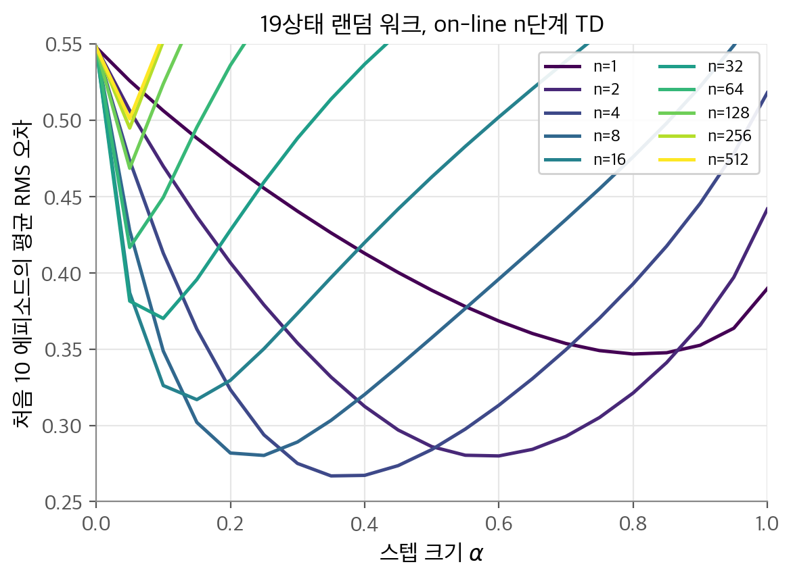
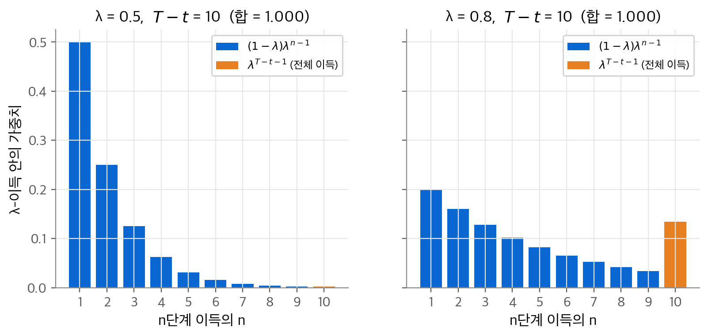
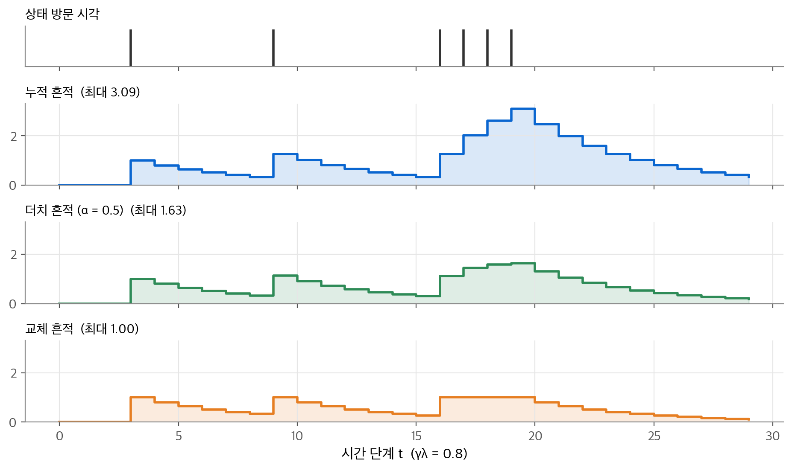
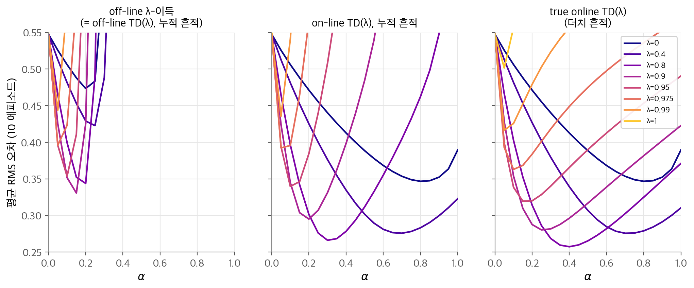
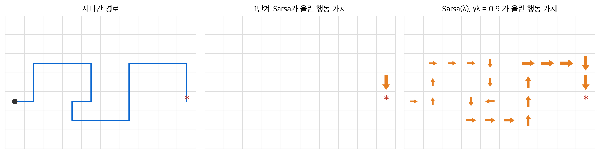

# 7. n단계 TD와 적격 흔적

[5장](05-monte-carlo.md)의 몬테카를로 방법은 에피소드 끝까지 기다려 실제 이득으로 갱신합니다. [6장](06-td-learning.md)의 TD(0)는 한 단계만 보고 다음 상태의 추정값으로 나머지를 채웁니다. 이 장의 질문은 "두 극단 사이에 더 나은 방법이 있는가, 있다면 어떻게 싸게 구현하는가?"입니다. 결론은 두 가지입니다. 첫째, $n$ 단계의 보상을 쓰는 n단계 이득과 그 평균인 λ-이득이 두 극단을 연속적으로 잇습니다. 중간 값이 대개 양 끝보다 낫습니다. 둘째, λ-이득은 미래를 봐야 계산되지만, **적격 흔적(eligibility trace)** 이라는 짧은 기억을 쓰면 매 단계 과거 방향으로 같은 효과를 얻습니다.

!!! info "원문과 자료"
    - 원문: 초안 7장 Eligibility Traces (7.1~7.9). 최종본 7장 n-step Bootstrapping (7.1~7.3)과 12장 Eligibility Traces (12.1~12.9)로 보충
    - [Sutton & Barto 2판 책 페이지](http://incompleteideas.net/book/the-book-2nd.html)
    - [David Silver, Lecture 4: Model-Free Prediction](https://davidstarsilver.wordpress.com/wp-content/uploads/2025/04/lecture-4-model-free-prediction-.pdf) (n단계 TD, TD(λ), 전방·후방 관점)
    - [David Silver, Lecture 5: Model-Free Control](https://davidstarsilver.wordpress.com/wp-content/uploads/2025/04/lecture-5-model-free-control-.pdf) (Sarsa(λ))
    - [DeepMind x UCL RL Lecture Series 2021 (Hado van Hasselt)](https://www.youtube.com/playlist?list=PLqYmG7hTraZDVH599EItlEWsUOsJbAodm)
    - 함께 읽기: [5. 몬테카를로 방법](05-monte-carlo.md), [6. 시간차 학습](06-td-learning.md), [9. 함수 근사](09-function-approximation.md)

## 1. n단계 TD 예측

### n단계 이득

고정된 정책 $\pi$ 를 따르는 에피소드 $S_t, R_{t+1}, S_{t+1}, R_{t+2}, \ldots, R_T, S_T$ 가 있습니다. 몬테카를로의 목표는 전체 이득입니다.

$$
G_t = R_{t+1} + \gamma R_{t+2} + \cdots + \gamma^{T-t-1} R_T
$$

TD(0)의 목표는 첫 보상에 다음 상태의 추정값을 더한 것입니다. $\gamma V(S_{t+1})$ 이 남은 항 $\gamma R_{t+2} + \gamma^2 R_{t+3} + \cdots$ 을 대신합니다. 이 대체를 한 단계 뒤가 아니라 $n$ 단계 뒤에 해도 됩니다. 그러면 **n단계 이득(n-step return)** 을 얻습니다.

$$
G_{t:t+n} = R_{t+1} + \gamma R_{t+2} + \cdots + \gamma^{n-1} R_{t+n} + \gamma^n V(S_{t+n})
$$

$t+n$ 을 이 이득의 **지평(horizon)** 이라고 부릅니다. 지평이 에피소드 끝을 넘으면($t + n \ge T$) 뒤의 항이 없으므로 $G_{t:t+n} = G_t$ 입니다. 그래서 $n = 1$ 이면 TD(0), $n = \infty$ 이면 몬테카를로입니다.

| 방법 | 목표 | 쓰는 실제 보상 수 | 부트스트래핑 |
| --- | --- | --- | --- |
| TD(0) | $R_{t+1} + \gamma V(S_{t+1})$ | 1 | 있음 |
| 2단계 TD | $R_{t+1} + \gamma R_{t+2} + \gamma^2 V(S_{t+2})$ | 2 | 있음 |
| n단계 TD | $G_{t:t+n}$ | $n$ | 있음 |
| 몬테카를로 | $G_t$ | 끝까지 | 없음 |

n단계 백업도 여전히 TD 방법입니다. 앞선 추정을 나중 추정과의 차이로 고치기 때문입니다. 차이가 한 단계 뒤가 아니라 $n$ 단계 뒤의 추정과 생길 뿐입니다.

### 갱신 규칙과 on-line, off-line

**n단계 TD(n-step TD)** 는 상태 $S_t$ 의 값을 n단계 이득 쪽으로 옮깁니다.

$$
V(S_t) \leftarrow V(S_t) + \alpha \big[ G_{t:t+n} - V(S_t) \big]
$$

$G_{t:t+n}$ 에는 $R_{t+n}$ 과 $S_{t+n}$ 이 들어갑니다. 그래서 이 갱신은 시각 $t+n$ 에야 할 수 있습니다. 에피소드의 처음 $n-1$ 단계에는 갱신이 없고, 끝난 뒤에 밀린 $n-1$ 개를 처리합니다.

원문 초안은 갱신 시점을 두 가지로 나눕니다.

- **on-line 갱신**: 증분을 계산하자마자 $V$ 에 반영합니다. 같은 에피소드의 뒤쪽 계산이 바뀐 값을 씁니다.
- **off-line 갱신**: 에피소드 동안 증분을 따로 모읍니다. 끝난 뒤 한꺼번에 더합니다. 에피소드 안에서는 $V$ 가 고정됩니다.

```python
import numpy as np

def nstep_td_episode(V, states, rewards, n, alpha, gamma=1.0):
    """states[0..T], rewards[1..T] (rewards[0] 은 쓰지 않음). on-line 갱신."""
    T = len(states) - 1
    for tau in range(T):                      # 시각 tau+n 에 S_tau 를 갱신
        h = min(tau + n, T)
        G = sum(gamma ** (k - tau - 1) * rewards[k] for k in range(tau + 1, h + 1))
        if h < T:
            G += gamma ** n * V[states[h]]    # 지평이 끝 전이면 부트스트래핑
        V[states[tau]] += alpha * (G - V[states[tau]])
    return V
```

표 형식에서는 $S_\tau$ 의 갱신이 $V(S_{\tau+n})$ 을 읽기 전에 앞선 갱신이 모두 끝나 있습니다. 그래서 위처럼 순서대로 돌려도 원문의 on-line 알고리즘과 같은 결과가 나옵니다.

### 작은 예시: 5상태 랜덤 워크

6장의 5상태 랜덤 워크에서 모든 값이 0.5로 시작합니다. 첫 에피소드가 C → D → E → 오른쪽 끝(보상 1)으로 끝났다고 합시다. $\alpha = 0.1$ 이면 결과는 다음과 같습니다.

| 방법 | 바뀌는 상태 | 새 값 |
| --- | --- | --- |
| $n = 1$ | E | $0.5 + 0.1(1 - 0.5) = 0.55$ |
| $n = 2$ | D, E | 둘 다 0.55 |
| $n \ge 3$ | C, D, E | 셋 다 0.55 |

$n$ 이 클수록 한 번의 보상이 더 많은 상태로 전해집니다. 대가로 목표에 더 많은 무작위 보상이 들어가므로 분산이 커집니다.

### 19상태 랜덤 워크 실험

원문 예제 7.1을 재현합니다. 상태는 19개이고 가운데(10번)에서 시작합니다. 왼쪽 끝 보상은 $-1$, 오른쪽 끝 보상은 $+1$, $\gamma = 1$ 입니다. 참값은 $v_\pi(i) = i/10 - 1$ 로 $-0.9$ 부터 $0.9$ 까지 선형입니다. 모든 값을 0에서 시작합니다. 성능 지표는 각 에피소드 끝의 RMS 오차를 처음 10 에피소드와 100회 반복에 걸쳐 평균한 값입니다. 모든 방법이 같은 100세트의 랜덤 워크를 씁니다. 에피소드 평균 길이는 97.3단계였습니다.

<figure markdown>

<figcaption markdown>
<span class="fig-title"><b>Figure 1.</b> n단계 TD의 RMS 오차</span>

n단계 TD의 평균 RMS 오차를 스텝 크기 $\alpha$ 의 함수로 그렸습니다. 선 하나가 $n$ 하나입니다.
</figcaption>
</figure>

NumPy로 계산한 각 $n$ 의 최저 오차는 다음과 같습니다.

| $n$ | 1 | 2 | 4 | 8 | 16 | 32 | 64 | 512 |
| --- | --- | --- | --- | --- | --- | --- | --- | --- |
| 최저 RMS | 0.347 | 0.280 | **0.267** | 0.280 | 0.317 | 0.370 | 0.417 | 0.501 |
| 그때 $\alpha$ | 0.80 | 0.60 | 0.35 | 0.25 | 0.15 | 0.10 | 0.05 | 0.05 |

읽을 점은 세 가지입니다.

1. 중간 값 $n = 4$ 가 가장 낫습니다. TD(0)($n = 1$)와 사실상 몬테카를로($n = 512$) 모두 이보다 나쁩니다.
2. $n$ 이 클수록 최적 $\alpha$ 가 작아집니다. 목표의 분산이 크므로 작은 걸음이 필요합니다.
3. 큰 $n$ 과 큰 $\alpha$ 를 함께 쓰면 오차가 초깃값 0.548보다 커집니다.

### 오차 감소 성질

n단계 이득이 수렴하는 방법의 목표가 되는 근거는 **오차 감소 성질(error reduction property)** 입니다. 임의의 가치 함수 $v$ 로 만든 n단계 이득의 기댓값은 최악 상태 기준으로 $v$ 보다 $v_\pi$ 에 가깝습니다.

$$
\max_s \Big| \mathbb{E}_\pi[G_{t:t+n} \mid S_t = s] - v_\pi(s) \Big| \le \gamma^n \max_s |v(s) - v_\pi(s)|
$$

유도는 짧습니다. $v_\pi$ 에 대한 벨만 방정식을 $n$ 번 펼치면 $v_\pi(s) = \mathbb{E}_\pi[R_{t+1} + \cdots + \gamma^{n-1}R_{t+n} + \gamma^n v_\pi(S_{t+n}) \mid S_t = s]$ 입니다. 이 식을 n단계 이득의 기댓값에서 빼면 보상 항이 모두 사라집니다.

$$
\mathbb{E}_\pi[G_{t:t+n} \mid S_t = s] - v_\pi(s) = \gamma^n \, \mathbb{E}_\pi\big[ v(S_{t+n}) - v_\pi(S_{t+n}) \mid S_t = s \big]
$$

기댓값의 절댓값은 절댓값의 최댓값을 넘지 못합니다. 그래서 위 부등식이 나옵니다. 에피소드가 지평 전에 끝나면 남는 오차 항이 0이므로 부등식은 더 쉽게 성립합니다.

19상태 랜덤 워크에 $\gamma = 0.9$ 를 주고 $v = 0$ 에서 계산해 봅니다. 처음 최대 오차는 0.696입니다.

| $n$ | 1 | 2 | 4 | 8 | 16 |
| --- | --- | --- | --- | --- | --- |
| 실제 최대 오차 | 0.436 | 0.273 | 0.172 | 0.073 | 0.019 |
| 상한 $\gamma^n \times 0.696$ | 0.627 | 0.564 | 0.457 | 0.300 | 0.129 |

실제 오차는 항상 상한 아래에 있고 $n$ 이 커지면 빠르게 줄어듭니다. 이 성질 덕분에 n단계 TD는 적절한 조건에서 $v_\pi$ 로 수렴합니다. 그래도 실제로는 $n$ 단계를 기다리는 구현이 불편합니다. 다음 절의 λ-이득과 흔적이 이 불편을 해결합니다.

## 2. n단계 Sarsa

최종본 7.2절은 n단계 아이디어를 제어로 옮깁니다. 상태 대신 상태-행동 쌍을 쓰고, 끝의 추정값을 $Q$ 로 바꿉니다.

$$
G_{t:t+n} = R_{t+1} + \gamma R_{t+2} + \cdots + \gamma^{n-1} R_{t+n} + \gamma^n Q(S_{t+n}, A_{t+n})
$$

$$
Q(S_t, A_t) \leftarrow Q(S_t, A_t) + \alpha \big[ G_{t:t+n} - Q(S_t, A_t) \big]
$$

정책은 현재 $Q$ 에 대한 ε-탐욕입니다. 이 방법이 **n단계 Sarsa(n-step Sarsa)** 입니다. 마지막 항을 다음 상태의 기대값 $\gamma^n \sum_a \pi(a \mid S_{t+n}) Q(S_{t+n}, a)$ 로 바꾸면 n단계 Expected Sarsa가 됩니다.

1. 에피소드를 시작하고 $S_0$, $A_0$ 를 고릅니다. $T = \infty$ 로 둡니다.
2. $t = 0, 1, 2, \ldots$ 마다: $t < T$ 이면 $A_t$ 를 실행해 $R_{t+1}$, $S_{t+1}$ 을 저장합니다. $S_{t+1}$ 이 종료이면 $T = t+1$, 아니면 $A_{t+1}$ 을 ε-탐욕으로 고릅니다.
3. $\tau = t - n + 1$ 이 0 이상이면 $G_{\tau:\tau+n}$ 을 계산합니다. $\tau + n < T$ 일 때만 $\gamma^n Q(S_{\tau+n}, A_{\tau+n})$ 을 더합니다. 그다음 $Q(S_\tau, A_\tau)$ 를 갱신합니다.
4. $\tau = T - 1$ 이 될 때까지 반복합니다.

n단계 Sarsa가 1단계 Sarsa보다 빠른 이유는 4절의 격자 세계 삽화와 같습니다. 목표에 도달한 한 번의 보상이 마지막 $n$ 개의 행동 가치에 한꺼번에 전해집니다.

### off-policy n단계 학습

행동 정책 $b$ 로 모은 데이터로 목표 정책 $\pi$ 를 배우려면 n단계 이득에 [5장](05-monte-carlo.md)의 **중요도 샘플링(importance sampling)** 비를 곱합니다.

$$
\rho_{t:h} = \prod_{k=t}^{\min(h, T-1)} \frac{\pi(A_k \mid S_k)}{b(A_k \mid S_k)}
$$

$$
Q(S_t, A_t) \leftarrow Q(S_t, A_t) + \alpha \, \rho_{t+1:t+n} \big[ G_{t:t+n} - Q(S_t, A_t) \big]
$$

$A_t$ 는 이미 정해진 행동이므로 비는 $t+1$ 부터 곱합니다. 예를 들어 $\pi$ 가 탐욕이고 $b$ 가 두 행동을 0.5씩 고르면, 각 비는 탐욕 행동일 때 2, 아닐 때 0입니다. $n = 3$ 이고 세 행동이 모두 탐욕이면 $\rho = 8$ 입니다. 하나라도 탐욕이 아니면 갱신이 0이 됩니다. 이 극단적인 값이 off-policy n단계 방법의 분산이 큰 이유입니다.

## 3. λ-이득과 전방 관점

### n단계 이득의 평균

목표로 n단계 이득 하나만 쓸 필요는 없습니다. 가중치가 양수이고 합이 1이면 여러 n단계 이득의 평균도 목표가 됩니다. 예를 들어 $\tfrac12 G_{t:t+2} + \tfrac12 G_{t:t+4}$ 도 됩니다. 평균도 오차 감소 성질을 물려받습니다. 각 항의 오차가 $\gamma^n$ 배 이하이므로 가중 평균의 오차도 $\max_n \gamma^n$ 배 이하입니다. 이런 백업을 **복합 백업(complex backup)** 이라고 합니다.

TD(λ)는 그중 특정한 평균을 씁니다. n단계 이득에 $\lambda^{n-1}$ 에 비례하는 가중치를 주고, 합이 1이 되도록 $1 - \lambda$ 를 곱합니다. 이것이 **λ-이득(λ-return)** 입니다.

$$
G_t^\lambda = (1 - \lambda) \sum_{n=1}^{\infty} \lambda^{n-1} G_{t:t+n}, \qquad \lambda \in [0, 1]
$$

가중치의 합이 1인지 확인합니다. 등비급수 $\sum_{n \ge 1} \lambda^{n-1} = 1/(1-\lambda)$ 이므로 $(1-\lambda) \cdot 1/(1-\lambda) = 1$ 입니다.

### 끝이 있는 에피소드

시각 $T$ 에 종료되면 $n \ge T - t$ 인 n단계 이득은 모두 $G_t$ 와 같습니다. 그 항들의 가중치를 모으면 $(1-\lambda)\sum_{n \ge T-t} \lambda^{n-1} = \lambda^{T-t-1}$ 입니다. 그래서 다음과 같이 나눠 쓸 수 있습니다.

$$
G_t^\lambda = (1-\lambda) \sum_{n=1}^{T-t-1} \lambda^{n-1} G_{t:t+n} + \lambda^{T-t-1} G_t
$$

이 식에서 양 끝이 보입니다. $\lambda = 0$ 이면 첫 항만 남아 $G_{t:t+1}$, 곧 TD(0)의 목표입니다. $\lambda = 1$ 이면 앞의 합이 사라지고 $G_t$, 곧 몬테카를로의 목표입니다.

<figure markdown>

<figcaption markdown>
<span class="fig-title"><b>Figure 2.</b> λ-이득의 가중치</span>

n단계 이득의 가중치 $(1-\lambda)\lambda^{n-1}$(파랑)과 전체 이득의 나머지 $\lambda^{T-t-1}$(주황)의 합은 1입니다.
</figcaption>
</figure>

$\lambda = 0.5$ 에서는 가중치가 매 단계 절반으로 줄어 전체 이득의 몫이 $0.5^9 \approx 0.002$ 에 그칩니다. $\lambda = 0.8$ 에서는 전체 이득이 $0.8^9 \approx 0.134$ 를 받습니다. 1단계 이득(0.2)과 2단계 이득(0.16) 다음으로 큰 몫입니다.

### 재귀식과 작은 예시

λ-이득은 재귀로 쓸 수 있습니다. 정의에서 $n = 1$ 항을 떼고 나머지를 한 단계 뒤의 λ-이득으로 묶으면 다음이 나옵니다.

$$
G_t^\lambda = R_{t+1} + \gamma \big[ (1-\lambda) V(S_{t+1}) + \lambda G_{t+1}^\lambda \big]
$$

다음 상태에서 "추정값을 믿을 확률" $1-\lambda$ 와 "한 단계 더 볼 확률" $\lambda$ 를 섞는다고 읽을 수 있습니다.

수치로 확인합니다. $\gamma = 1$, $\lambda = 0.5$ 이고 4단계 에피소드의 보상이 $(0, 0, 0, 1)$ 입니다. 추정값은 $V(S_0) = 0$, $V(S_1) = 0.2$, $V(S_2) = 0.4$, $V(S_3) = 0.6$ 입니다.

| n단계 이득 | $G_{0:1}$ | $G_{0:2}$ | $G_{0:3}$ | $G_0$ |
| --- | --- | --- | --- | --- |
| 값 | 0.2 | 0.4 | 0.6 | 1.0 |
| 가중치 | 0.5 | 0.25 | 0.125 | 0.125 |

$G_0^\lambda = 0.1 + 0.1 + 0.075 + 0.125 = 0.4$ 입니다.

### λ-이득 알고리즘과 전방 관점

**λ-이득 알고리즘(λ-return algorithm)** 은 $V(S_t) \leftarrow V(S_t) + \alpha [G_t^\lambda - V(S_t)]$ 로 갱신합니다. 이 관점을 **전방 관점(forward view)** 이라고 합니다. 각 상태에서 앞으로 올 보상과 상태를 모두 내다보고 갱신을 정하기 때문입니다. 문제는 인과적이지 않다는 점입니다. $G_t^\lambda$ 는 에피소드가 끝나야 확정됩니다.

## 4. 후방 관점과 적격 흔적

### TD(λ)의 정의

**후방 관점(backward view)** 은 같은 계산을 과거 방향으로 합니다. 상태마다 기억 변수 $E_t(s) \ge 0$ 를 하나씩 둡니다. 이것이 적격 흔적입니다. 매 단계 모든 흔적이 $\gamma\lambda$ 배로 줄고, 방문한 상태의 흔적만 1 늘어납니다.

$$
E_t(s) = \gamma \lambda E_{t-1}(s) + \mathbf{1}[s = S_t]
$$

$\lambda$ 를 **흔적 감쇠 파라미터(trace-decay parameter)** 라고 부릅니다. 매 단계의 TD 오차 $\delta_t = R_{t+1} + \gamma V(S_{t+1}) - V(S_t)$ 가 흔적에 비례해 모든 상태에 나눠집니다.

$$
V(s) \leftarrow V(s) + \alpha \, \delta_t \, E_t(s), \qquad \text{모든 } s
$$

```python
def td_lambda_episode(V, env_step, s, lam, alpha, gamma=1.0, kind="acc"):
    E = np.zeros_like(V)
    done = False
    while not done:
        r, s2, done = env_step(s)
        delta = r + (0.0 if done else gamma * V[s2]) - V[s]
        E *= gamma * lam                 # 모든 흔적 감쇠
        if kind == "acc":
            E[s] += 1.0                  # 누적 흔적
        else:
            E[s] = 1.0                   # 교체 흔적
        V += alpha * delta * E           # TD 오차를 흔적만큼 나눠 줌
        s = s2
    return V
```

직관은 다음과 같습니다. 지금 계산한 TD 오차를 최근에 지나온 상태들에게 "외쳐" 돌려줍니다. 최근일수록 흔적이 크므로 몫도 큽니다. $\lambda = 0$ 이면 직전 상태만 흔적이 있으므로 TD(0)와 같습니다. $\lambda = 1$ 이면 몫이 $\gamma$ 배씩만 줄어듭니다. $k$ 단계 뒤의 보상이 이득에서 받는 할인 $\gamma^k$ 와 같으므로 몬테카를로처럼 동작합니다. 이 경우를 TD(1)이라고 부릅니다. TD(1)은 에피소드가 끝나기 전에도 배우고, 할인된 연속형 과제에도 쓸 수 있습니다.

### 흔적의 세 종류

방문한 상태의 흔적을 올리는 방법은 세 가지입니다. 감쇠는 모두 같습니다.

| 흔적 | 방문한 상태의 갱신 | 특징 |
| --- | --- | --- |
| **누적 흔적(accumulating trace)** | $E(S_t) \leftarrow \gamma\lambda E(S_t) + 1$ | 자주 방문하면 1보다 커집니다. |
| **교체 흔적(replacing trace)** | $E(S_t) \leftarrow 1$ | 최대 1입니다. $\lambda = 1$ 에서 첫 방문 MC와 가깝습니다. |
| **더치 흔적(dutch trace)** | $E(S_t) \leftarrow (1-\alpha)\gamma\lambda E(S_t) + 1$ | $\alpha \to 0$ 이면 누적, $\alpha = 1$ 이면 교체가 됩니다. |

<figure markdown>

<figcaption markdown>
<span class="fig-title"><b>Figure 3.</b> 세 종류의 흔적</span>

같은 방문(맨 위)에 대한 누적, 더치, 교체 흔적입니다. $\gamma\lambda = 0.8$ 이므로 흔적은 약 5단계에 걸쳐 줄어듭니다.
</figcaption>
</figure>

마지막 네 번의 방문이 연달아 일어나면 누적 흔적은 3.09까지 쌓입니다. 더치 흔적은 1.63, 교체 흔적은 1.00에서 멈춥니다. 누적 흔적은 한 상태가 반복될 때 TD 오차를 그 상태에 과하게 몰아 줍니다. 이 점이 큰 $\alpha$ 에서 불안정해지는 원인입니다.

## 5. 전방 관점과 후방 관점의 동등성

### off-line에서는 정확히 같습니다

에피소드 안에서 $V$ 가 바뀌지 않는 off-line 경우를 봅니다. 먼저 λ-이득에서 현재 값을 뺀 것이 TD 오차의 할인 합임을 보입니다. 재귀식 $G_t^\lambda = R_{t+1} + \gamma(1-\lambda)V(S_{t+1}) + \gamma\lambda G_{t+1}^\lambda$ 에서 $V(S_t)$ 를 빼고 $\gamma\lambda V(S_{t+1})$ 을 더하고 빼면 다음과 같습니다.

$$
G_t^\lambda - V(S_t) = \underbrace{R_{t+1} + \gamma V(S_{t+1}) - V(S_t)}_{\delta_t} + \gamma\lambda \big[ G_{t+1}^\lambda - V(S_{t+1}) \big]
$$

이 식을 끝까지 펼칩니다.

$$
G_t^\lambda - V(S_t) = \sum_{k=t}^{T-1} (\gamma\lambda)^{k-t} \delta_k
$$

앞 절의 예시로 확인합니다. TD 오차는 $(0.2, 0.2, 0.2, 0.4)$ 이고 $0.2 + 0.5 \cdot 0.2 + 0.25 \cdot 0.2 + 0.125 \cdot 0.4 = 0.4$ 입니다. 직접 계산한 $G_0^\lambda - V(S_0) = 0.4$ 와 같습니다.

이제 한 상태 $s$ 가 에피소드 동안 받는 전방 관점 증분을 모두 더하고 합의 순서를 바꿉니다.

$$
\sum_{t=0}^{T-1} \alpha \big[ G_t^\lambda - V(S_t) \big] \mathbf{1}[S_t = s]
= \sum_{t=0}^{T-1} \alpha \sum_{k=t}^{T-1} (\gamma\lambda)^{k-t} \delta_k \mathbf{1}[S_t = s]
= \sum_{k=0}^{T-1} \alpha \, \delta_k \underbrace{\sum_{t=0}^{k} (\gamma\lambda)^{k-t} \mathbf{1}[S_t = s]}_{E_k(s)}
$$

밑줄 친 부분이 바로 누적 흔적입니다. 따라서 off-line λ-이득 알고리즘과 누적 흔적을 쓰는 off-line TD(λ)는 에피소드가 끝날 때 같은 값을 줍니다. 19상태 랜덤 워크의 실제 에피소드 10개로 두 구현을 돌려 보았습니다. $\lambda = 0.4, 0.8, 0.95$ 에서 최대 차이는 부동소수점 수준인 0이었습니다.

### on-line에서는 근사입니다

on-line에서는 $V$ 가 에피소드 중에 바뀝니다. 그래서 위 유도의 "$V$ 고정" 가정이 깨집니다. TD(λ)는 $\alpha$ 가 작을 때만 λ-이득 알고리즘에 가깝습니다. van Seijen과 Sutton(2014)의 **true online TD(λ)** 는 더치 흔적과 보정 항을 써서 on-line에서도 정확한 동등성을 얻습니다. 표 형식의 갱신은 다음과 같습니다.

$$
V(s) \leftarrow V(s) + \alpha \big[ \delta_t + V(S_t) - V_{\text{old}} \big] E_t(s) - \alpha \, \mathbf{1}[s = S_t] \big[ V(S_t) - V_{\text{old}} \big]
$$

$V_{\text{old}}$ 는 직전 단계에서 계산해 둔 $V(S_t)$ 입니다. 선형 함수 근사 형태의 유도는 [9장](09-function-approximation.md)에서 다룹니다.

### 19상태 랜덤 워크 비교

<figure markdown>

<figcaption markdown>
<span class="fig-title"><b>Figure 4.</b> λ 방법들의 RMS 오차</span>

19상태 랜덤 워크에서 λ를 쓰는 세 방법의 평균 RMS 오차입니다. 왼쪽 패널은 off-line TD(λ)와 정확히 같습니다.
</figcaption>
</figure>

| $\lambda$ | 0 | 0.4 | 0.8 | 0.9 | 0.95 | 0.99 | 1 |
| --- | --- | --- | --- | --- | --- | --- | --- |
| off-line λ-이득 | 0.473 | 0.423 | 0.344 | **0.331** | 0.354 | 0.444 | 0.548 |
| on-line TD(λ), 누적 | 0.347 | 0.276 | **0.266** | 0.295 | 0.340 | 0.436 | 0.548 |
| on-line TD(λ), 교체 | 0.347 | 0.276 | **0.251** | 0.259 | 0.277 | 0.328 | 0.368 |
| true online TD(λ) | 0.347 | 0.276 | **0.257** | 0.280 | 0.320 | 0.417 | 0.502 |

표의 값은 $\alpha \in \{0, 0.05, \ldots, 1\}$ 중 최저 오차입니다. 결과는 n단계 실험과 같은 모양입니다.

- 중간 값 $\lambda = 0.8$ 근처가 가장 낫습니다. n단계 실험의 최저치 0.267과 비슷한 수준입니다.
- off-line 방법은 오차가 크고, $\alpha$ 가 0.3을 넘으면 발산합니다.
- on-line 누적 흔적은 $\lambda$ 와 $\alpha$ 가 함께 크면 불안정합니다. 교체 흔적과 더치 흔적은 넓은 $\alpha$ 범위에서 안정적입니다.
- $\lambda = 0$ 줄은 on-line 방법 셋 모두 같습니다. 모두 TD(0)이기 때문입니다.

## 6. Sarsa(λ)

### 상태-행동 쌍의 흔적

흔적을 제어에 쓰는 가장 쉬운 방법은 TD(λ)를 상태-행동 쌍에 적용하는 것입니다. 흔적 $E_t(s, a)$ 를 쌍마다 둡니다.

$$
E_t(s, a) = \gamma\lambda E_{t-1}(s, a) + \mathbf{1}[s = S_t, a = A_t]
$$

$$
\delta_t = R_{t+1} + \gamma Q(S_{t+1}, A_{t+1}) - Q(S_t, A_t), \qquad Q(s, a) \leftarrow Q(s, a) + \alpha \, \delta_t \, E_t(s, a)
$$

이것이 **Sarsa(λ)** 입니다. 교체 흔적과 더치 흔적도 같은 방식으로 씁니다. 전방 관점으로 보면 n단계 Sarsa 목표들을 $(1-\lambda)\lambda^{n-1}$ 로 섞은 것입니다.

```python
def sarsa_lambda_step(Q, E, s, a, r, s2, a2, done, lam, alpha, gamma):
    target = r if done else r + gamma * Q[s2, a2]
    delta = target - Q[s, a]
    E[s, a] += 1.0              # 누적 흔적 (교체 흔적이면 E[s, :] = 0 뒤 E[s, a] = 1)
    Q += alpha * delta * E      # 흔적이 있는 모든 쌍을 갱신
    E *= gamma * lam
    return Q, E
```

### 격자 세계 삽화

원문 예제 7.2는 흔적이 신용을 퍼뜨리는 모습을 보여 줍니다. 모든 행동 가치가 0에서 시작합니다. 보상은 목표(*)에 들어갈 때만 양수입니다. 에이전트가 한 에피소드 동안 아래 경로를 지났다고 합시다.

<figure markdown>

<figcaption markdown>
<span class="fig-title"><b>Figure 5.</b> 격자 세계에서 흔적의 효과</span>

같은 경로(왼쪽)에서 1단계 Sarsa는 마지막 행동만 올리고(가운데), Sarsa(λ)는 경로 전체를 올립니다(오른쪽).
</figcaption>
</figure>

1단계 Sarsa는 마지막 행동 하나만 올립니다. 나머지 행동의 TD 오차가 모두 0이기 때문입니다. Sarsa(λ)는 보상이 생긴 순간의 TD 오차를 경로 위 모든 쌍에 나눠 줍니다. 마지막 행동이 1을 받으면 그 앞은 0.9, 0.81을 받습니다. 가장 먼 첫 행동은 $0.9^{20} \approx 0.12$ 를 받습니다. 한 에피소드로 정책의 긴 구간이 개선됩니다. 1단계 방법은 같은 경로를 반복해도 정보를 시작점까지 전하는 데 에피소드 21번이 필요합니다.

## 7. Watkins의 Q(λ)

### 탐험 행동에서 흔적을 자릅니다

Q-러닝은 탐욕 정책을 배우면서 탐험 행동을 섞어 행동하는 off-policy 방법입니다. 흔적을 붙일 때 주의가 필요합니다. $S_t, A_t$ 를 갱신하는데 $A_{t+3}$ 이 탐험 행동이라고 합시다. 그 뒤의 보상은 탐욕 정책의 결과가 아닙니다. 그래서 1, 2, 3단계 목표까지만 쓸 수 있습니다. 탐험 직전까지의 가장 긴 목표는 다음과 같습니다.

$$
R_{t+1} + \gamma R_{t+2} + \cdots + \gamma^{n-1} R_{t+n} + \gamma^n \max_a Q(S_{t+n}, a), \quad A_{t+n} \text{ 이 첫 탐험 행동}
$$

**Watkins의 Q(λ)** 는 후방 관점에서 이렇게 구현합니다. Sarsa(λ)와 같이 흔적을 쓰되, 탐욕이 아닌 행동을 고르면 모든 흔적을 0으로 만듭니다.

1. $A'$ 를 ε-탐욕으로 고르고 $A^* = \arg\max_a Q(S', a)$ 를 구합니다. $A'$ 가 최댓값과 같으면 $A^* = A'$ 로 둡니다.
2. $\delta = R + \gamma Q(S', A^*) - Q(S, A)$ 를 계산합니다.
3. $E(S, A)$ 를 올리고, 모든 쌍에 $Q \leftarrow Q + \alpha \delta E$ 를 적용합니다.
4. $A' = A^*$ 이면 $E \leftarrow \gamma\lambda E$, 아니면 $E \leftarrow 0$ 입니다.

### 한계

행동이 4개이고 ε = 0.1이면 탐욕이 아닌 행동이 나올 확률은 $0.1 \times 3/4 = 0.075$ 입니다. 흔적이 살아남는 평균 길이는 $1/0.075 \approx 13$ 단계에 그칩니다. 학습 초기에 탐험이 잦으면 1단계 Q-러닝과 거의 차이가 없습니다. 또한 Watkins의 Q(λ)는 $\lambda = 1$ 이어도 탐험 지점에서 부트스트래핑합니다. 부트스트래핑의 정도와 off-policy 보정이 한 장치에 섞여 있습니다.

## 8. 중요도 샘플링을 쓰는 off-policy 흔적

초안 7.7절은 두 문제를 지적합니다. 첫째, Watkins의 Q(λ)는 "목표 정책을 따랐다/어겼다"를 이진으로만 다룹니다. 실제로는 정책이 확률적이면 따른 정도가 연속적입니다. 둘째, $\lambda$ 가 부트스트래핑만 조절하도록 off-policy 보정을 분리하고 싶습니다. 최종본 12.9절이 이 해법을 줍니다.

단일 단계 비 $\rho_t = \pi(A_t \mid S_t) / b(A_t \mid S_t)$ 를 씁니다. 상태 가치의 off-policy λ-이득은 재귀로 정의합니다.

$$
G_t^{\lambda s} = \rho_t \Big( R_{t+1} + \gamma \big[ (1-\lambda) V(S_{t+1}) + \lambda G_{t+1}^{\lambda s} \big] \Big) + (1 - \rho_t) V(S_t)
$$

마지막 항 $(1-\rho_t)V(S_t)$ 는 **제어 변량(control variate)** 입니다. $\rho_t = 0$ 이면 목표가 현재 값과 같아져 갱신이 0이 됩니다. 목표 자체가 0이 되어 값을 0으로 끌어내리는 일을 막습니다. $\mathbb{E}_b[\rho_t] = 1$ 이므로 기댓값은 바뀌지 않습니다.

5절과 같은 방법으로 펼치고 합의 순서를 바꾸면 흔적의 재귀식이 나옵니다. $V$ 를 고정하면 $G_t^{\lambda s} - V(S_t) = \rho_t \sum_{k \ge t} \delta_k \prod_{i=t+1}^{k} \gamma\lambda\rho_i$ 입니다. 상태 $s$ 에 대한 계수를 모으면 다음 흔적이 됩니다.

$$
E_t(s) = \rho_t \big( \gamma\lambda E_{t-1}(s) + \mathbf{1}[s = S_t] \big), \qquad V(s) \leftarrow V(s) + \alpha \, \delta_t \, E_t(s)
$$

on-policy이면 $\rho_t = 1$ 이므로 보통의 누적 흔적입니다. 목표 정책이 고를 리 없는 행동이면 $\rho_t = 0$ 이고 흔적이 모두 잘립니다. Watkins의 Q(λ)는 이 규칙에서 $\pi$ 가 탐욕인 특수한 경우와 비슷합니다. 반대로 $\pi$ 가 $b$ 보다 더 자주 고르는 행동이면 $\rho_t > 1$ 이고 흔적이 커집니다. 비의 곱은 분산을 키우므로, 함수 근사와 함께 쓰면 안정성 문제가 생깁니다. 이 문제는 [10장](10-off-policy-approximation.md)에서 다룹니다.

## 9. 구현 이슈와 가변 λ

### 계산 비용

단순하게 구현하면 매 단계 모든 상태의 값과 흔적을 갱신해야 합니다. 직렬 컴퓨터에서는 부담입니다. 다행히 흔적은 대부분 거의 0입니다. $\gamma\lambda = 0.9$ 이면 44단계 뒤 흔적이 $0.9^{44} \approx 0.01$ 아래로 떨어집니다. 그래서 실제 구현은 흔적이 문턱보다 큰 상태 목록만 유지합니다. 비용은 1단계 방법의 몇 배 정도입니다.

```python
active = {}                                   # 상태 -> 흔적
def traced_update(V, active, s, delta, alpha, gl, eps=1e-3):
    active[s] = active.get(s, 0.0) + 1.0
    for k in list(active):
        V[k] += alpha * delta * active[k]
        active[k] *= gl
        if active[k] < eps:
            del active[k]                     # 작아진 흔적은 버림
```

표 형식은 흔적 비용 면에서 최악의 경우입니다. 함수 근사에서는 흔적이 가중치 벡터와 같은 크기의 벡터 하나입니다. 신경망에서도 메모리와 계산이 두 배 정도 늘 뿐입니다.

### 가변 λ

$\lambda$ 를 단계마다 바꿀 수도 있습니다. 상태의 함수 $\lambda_t = \lambda(S_t)$ 로 두는 것이 대표적입니다. 흔적은 $E_t(s) = \gamma\lambda_t E_{t-1}(s) + \mathbf{1}[s = S_t]$ 가 됩니다. 전방 관점의 λ-이득도 일반화됩니다.

$$
G_t^\lambda = \sum_{k=t+1}^{T-1} G_{t:k} \, (1 - \lambda_k) \prod_{i=t+1}^{k-1} \lambda_i + G_t \prod_{i=t+1}^{T-1} \lambda_i
$$

$\lambda$ 가 상수이면 곱이 $\lambda^{k-t-1}$ 이 되어 3절의 식과 같아집니다. 해석은 이렇습니다. 값을 확신하는 상태에는 $\lambda$ 를 0 가까이 줍니다. 그 상태에서 흔적이 끊기고 추정값을 그대로 씁니다. 값이 불확실한 상태에는 $\lambda$ 를 1 가까이 줍니다. 그 상태의 추정값은 거의 쓰이지 않고 건너뛰어집니다. 함수 근사로 상태를 구별하기 어려운 곳에 유용할 수 있습니다.

### 흔적을 쓰면 좋은 경우

흔적은 1단계 방법보다 계산이 늘지만 학습이 빠릅니다. 보상이 늦게 오는 과제와 마르코프 성질이 약한 과제에서 이득이 큽니다. 몬테카를로에 가까워져 부트스트래핑의 편향을 덜 받기 때문입니다. 반대로 데이터가 싸고 많이 모을 수 있으면 계산이 싼 1단계 방법이 나을 수 있습니다.

## 정리

- n단계 이득 $G_{t:t+n}$ 은 $n$ 개의 실제 보상 뒤에 $\gamma^n V(S_{t+n})$ 을 더합니다. $n = 1$ 이면 TD(0), $n = \infty$ 이면 몬테카를로입니다.
- 오차 감소 성질 $\max_s |\mathbb{E}[G_{t:t+n}] - v_\pi| \le \gamma^n \max_s |v - v_\pi|$ 가 n단계 방법의 수렴 근거입니다. $\gamma = 0.9$ 의 랜덤 워크에서 실제 오차는 상한보다 훨씬 작았습니다.
- 19상태 랜덤 워크에서 on-line n단계 TD의 최저 RMS 오차는 $n = 4$ 일 때 0.267이었습니다. $n = 1$ 은 0.347, $n = 512$ 는 0.501이었습니다.
- n단계 Sarsa는 끝의 추정값을 $Q(S_{t+n}, A_{t+n})$ 으로 바꾼 제어 방법입니다. off-policy이면 중요도 샘플링 비 $\rho_{t+1:t+n}$ 을 곱합니다.
- λ-이득은 n단계 이득을 $(1-\lambda)\lambda^{n-1}$ 로 섞고, 남은 몫 $\lambda^{T-t-1}$ 을 전체 이득에 줍니다. 이것이 전방 관점입니다.
- 후방 관점의 TD(λ)는 흔적 $E_t(s) = \gamma\lambda E_{t-1}(s) + \mathbf{1}[s = S_t]$ 와 $V \leftarrow V + \alpha\delta_t E_t$ 로 같은 효과를 인과적으로 얻습니다.
- off-line에서는 두 관점이 정확히 같습니다. $G_t^\lambda - V(S_t) = \sum_k (\gamma\lambda)^{k-t}\delta_k$ 를 상태별로 모으면 누적 흔적이 나옵니다. on-line에서 정확한 동등성은 true online TD(λ)가 줍니다.
- 누적 흔적은 반복 방문에서 1보다 커지고 큰 $\alpha$ 에서 불안정합니다. 교체 흔적과 더치 흔적은 더 넓은 $\alpha$ 에서 안정적이었습니다.
- Sarsa(λ)는 한 번의 보상을 경로 전체에 $\gamma\lambda$ 배씩 줄여 나눠 줍니다. Watkins의 Q(λ)는 탐험 행동에서 흔적을 자르므로 이득이 줄어듭니다.
- 중요도 샘플링 흔적 $E_t = \rho_t(\gamma\lambda E_{t-1} + \mathbf{1}[s = S_t])$ 은 off-policy 보정을 연속적으로 하고 $\lambda$ 를 부트스트래핑 조절에만 남깁니다.
- 실제 구현은 흔적이 큰 소수의 상태만 갱신합니다. $\lambda$ 를 상태마다 다르게 주는 가변 λ로 일반화할 수 있습니다.
