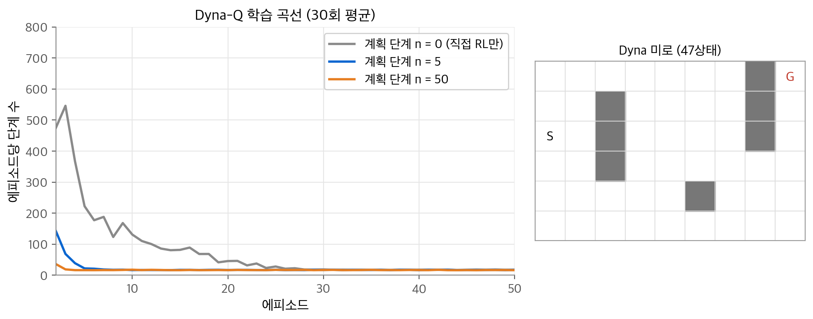
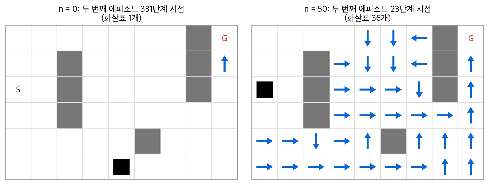
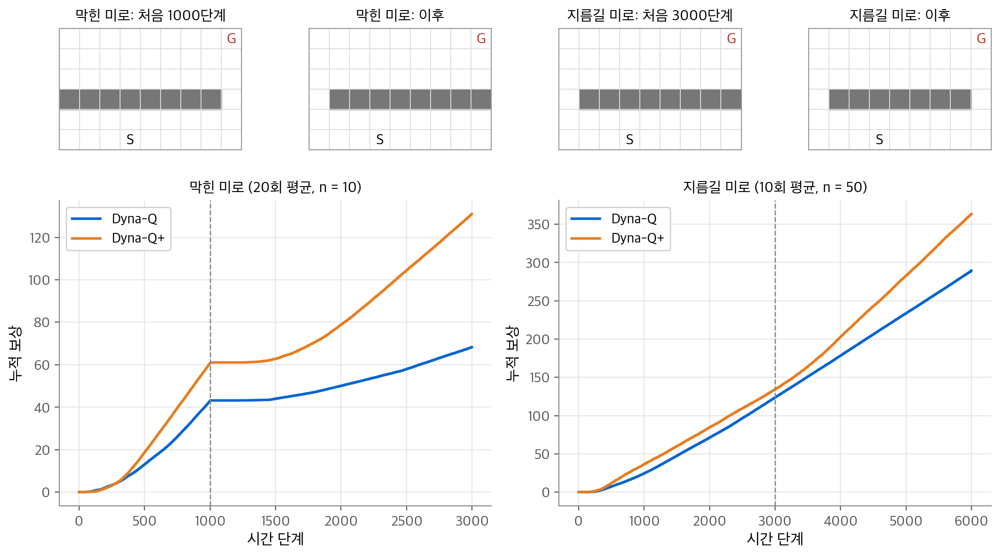
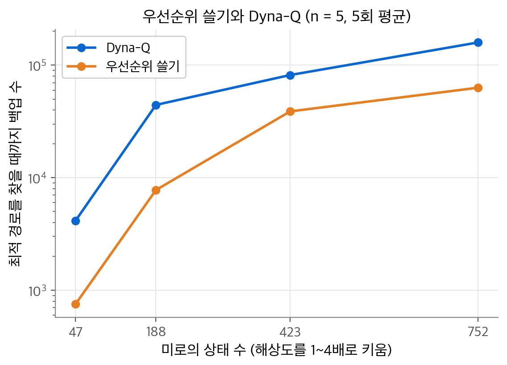
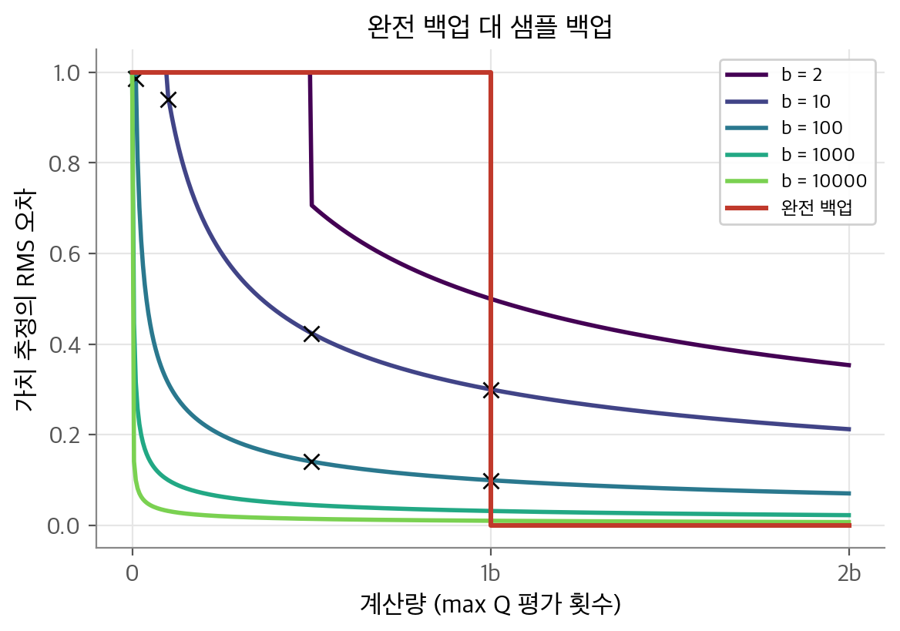
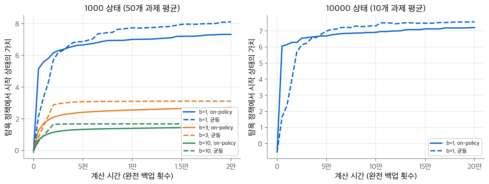
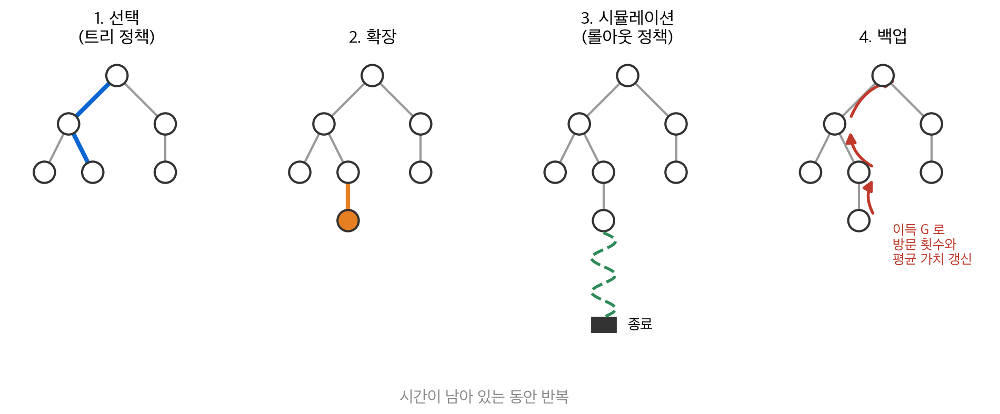

# 8. 계획과 학습

[4장](04-dynamic-programming.md)의 동적 계획법은 환경의 모델이 있어야 합니다. [5장](05-monte-carlo.md)과 [6장](06-td-learning.md)의 방법은 모델 없이 경험만으로 배웁니다. 이 장의 질문은 "모델을 쓰는 계획과 경험으로 배우는 학습을 하나의 틀로 볼 수 있는가?"입니다. 결론은 "그렇다"입니다. 두 방법 모두 가치 함수를 백업 연산으로 추정합니다. 차이는 경험의 출처뿐입니다. 계획은 모델이 만든 모의 경험을 쓰고, 학습은 환경의 실제 경험을 씁니다. 그래서 같은 갱신 규칙을 양쪽에 쓰고, 실제 한 걸음마다 모의 걸음을 여러 번 끼워 넣을 수 있습니다. 남는 문제는 "어디를 백업할 것인가"이며, 이 장의 후반부가 그 답을 다룹니다.

!!! info "원문과 자료"
    - 원문: 초안 8장 Planning and Learning with Tabular Methods (8.1~8.7). 최종본 8장으로 보충하고, 몬테카를로 트리 탐색은 최종본 8.10~8.11을 따릅니다.
    - [Sutton & Barto 2판 책 페이지](http://incompleteideas.net/book/the-book-2nd.html)
    - [David Silver, Lecture 8: Integrating Learning and Planning](https://davidstarsilver.wordpress.com/wp-content/uploads/2025/04/lecture-8-integrating-learning-and-planning.pdf) (Dyna, 시뮬레이션 기반 탐색, MCTS)
    - [Coursera: Sample-based Learning Methods (Martha White, Adam White)](https://www.coursera.org/learn/sample-based-learning-methods) (Dyna-Q, Dyna-Q+를 다루는 모듈 포함)
    - [DeepMind x UCL RL Lecture Series 2021 (Hado van Hasselt)](https://www.youtube.com/playlist?list=PLqYmG7hTraZDVH599EItlEWsUOsJbAodm)
    - 함께 읽기: [4. 동적 계획법](04-dynamic-programming.md), [6. 시간차 학습](06-td-learning.md), [13. 응용 사례와 전망](13-applications-frontiers.md)

## 1. 모델과 계획

### 분포 모델과 샘플 모델

환경의 **모델(model)** 은 행동에 대한 환경의 반응을 예측하는 모든 것입니다. 상태와 행동을 받아 다음 상태와 보상을 예측합니다. 모델은 두 종류입니다.

| 종류 | 내놓는 것 | 예 |
| --- | --- | --- |
| **분포 모델(distribution model)** | 가능한 모든 결과와 확률 $p(s', r \mid s, a)$ | 동적 계획법의 전이 확률 |
| **샘플 모델(sample model)** | 확률에 따라 뽑은 결과 하나 $(R, S')$ | 블랙잭 시뮬레이터 |

주사위 12개의 합으로 예를 듭니다. 분포 모델은 합 12부터 72까지 61가지 값의 확률을 모두 줍니다. 샘플 모델은 주사위를 굴린 합 하나를 줍니다. 분포 모델로는 언제든 샘플을 만들 수 있으므로 더 강합니다. 그래도 실제로는 샘플 모델을 얻기가 훨씬 쉬운 경우가 많습니다.

### 계획의 공통 구조

이 책에서 **계획(planning)** 은 모델을 입력으로 받아 정책을 만들거나 개선하는 모든 계산입니다. 이 장은 상태 공간 계획만 다룹니다. 원문은 모든 상태 공간 계획이 같은 구조를 가진다고 봅니다.

$$
\text{모델} \longrightarrow \text{모의 경험} \xrightarrow{\ \text{백업}\ } \text{가치} \longrightarrow \text{정책}
$$

두 가지 생각이 바탕에 있습니다. 첫째, 정책 개선의 중간 단계로 가치 함수를 계산합니다. 둘째, 가치 함수는 모의 경험에 백업을 적용해 계산합니다. 동적 계획법은 상태 공간을 쓸며 각 상태의 전이 분포로 백업합니다. 학습 방법은 실제 경험에 같은 백업을 합니다. 그래서 학습 알고리즘을 계획에 그대로 쓸 수 있습니다.

### 무작위 샘플 1단계 Q-계획

가장 단순한 예가 **무작위 샘플 1단계 표 형식 Q-계획(random-sample one-step tabular Q-planning)** 입니다.

1. 상태 $S$ 와 행동 $A$ 를 무작위로 고릅니다.
2. 샘플 모델에 $S, A$ 를 넣어 $R, S'$ 을 얻습니다.
3. 1단계 Q-러닝을 적용합니다: $Q(S, A) \leftarrow Q(S, A) + \alpha [R + \gamma \max_a Q(S', a) - Q(S, A)]$
4. 1로 돌아갑니다.

모든 쌍이 무한히 선택되고 $\alpha$ 가 적절히 줄면, 이 방법은 모델의 최적 정책으로 수렴합니다. Q-러닝이 실제 환경에서 수렴하는 조건과 같습니다. 계획을 이렇게 작은 단계로 쪼개면 언제든 멈추거나 방향을 바꿀 수 있습니다. 이 점이 행동, 학습과 계획을 섞을 때 중요합니다.

백업의 순서도 중요합니다. 결정론적 사슬 A → B → 목표(보상 1)에서 $\gamma = 0.95$, $\alpha = 1$ 이라고 합시다. B의 쌍을 먼저 백업하면 $Q(B) = 1$ 이고, 이어서 A를 백업하면 $Q(A) = 0.95$ 입니다. 백업 두 번으로 끝납니다. A를 먼저 백업하면 $Q(B)$ 가 아직 0이므로 $Q(A) = 0$ 이고, A를 한 번 더 백업해야 합니다. 이 순서 문제를 4절의 우선순위 쓸기가 다룹니다.

## 2. Dyna-Q: 계획, 행동, 학습의 통합

### 실제 경험의 두 가지 쓰임

계획하는 에이전트에게 실제 경험은 두 가지로 쓰입니다.

- **모델 학습(model learning)**: 모델을 실제 환경에 더 가깝게 고칩니다.
- **직접 강화 학습(direct RL)**: 가치 함수와 정책을 바로 고칩니다.

모델을 거쳐 가치를 고치는 경로를 **간접 강화 학습(indirect RL)** 이라고 부르며, 계획이 여기에 해당합니다. 간접 방법은 적은 경험을 더 철저하게 씁니다. 직접 방법은 단순하고 모델의 편향을 받지 않습니다.

**Dyna-Q** 는 이 과정을 모두 가장 단순한 형태로 담습니다. 직접 RL은 1단계 Q-러닝입니다. 모델은 결정론적 표입니다. 관측한 $(S, A)$ 에 대해 마지막으로 본 $(R, S')$ 을 저장합니다. 계획은 이미 경험한 쌍에서만 무작위로 뽑는 Q-계획입니다. 모의 경험을 시작할 상태와 행동을 고르는 과정을 **탐색 제어(search control)** 라고 부릅니다.

```python
import numpy as np

def dyna_q_step(Q, model, keys, s, env, n_plan, alpha, gamma, eps, rng):
    a = rng.integers(4) if rng.random() < eps else np.argmax(Q[s])   # (b) 행동 선택
    r, s2, done = env.step(s, a)                                      # (c) 실제 경험
    target = r if done else r + gamma * Q[s2].max()
    Q[s][a] += alpha * (target - Q[s][a])                             # (d) 직접 RL
    if (s, a) not in model:
        keys.append((s, a))
    model[(s, a)] = (r, s2, done)                                     # (e) 모델 학습
    for _ in range(n_plan):                                           # (f) 계획 n번
        ps, pa = keys[rng.integers(len(keys))]
        pr, ps2, pd = model[(ps, pa)]
        t = pr if pd else pr + gamma * Q[ps2].max()
        Q[ps][pa] += alpha * (t - Q[ps][pa])
    return s2, done
```

(e)와 (f)를 지우면 1단계 Q-러닝이 남습니다. 학습과 계획이 정확히 같은 갱신식을 씁니다. 다른 것은 경험의 출처뿐입니다.

### Dyna 구조의 구성 요소

원문 그림 8.3의 일반 Dyna 구조를 표로 정리합니다.

| 구성 요소 | 입력 | 출력 | Dyna-Q의 선택 |
| --- | --- | --- | --- |
| 행동 | 정책, 현재 상태 | 실제 경험 | ε-탐욕 |
| 직접 RL | 실제 경험 | 가치 함수 | 1단계 Q-러닝 |
| 모델 학습 | 실제 경험 | 모델 | 결정론적 표 |
| 탐색 제어 | 모델 | 모의 경험의 시작점 | 경험한 쌍에서 균등 추출 |
| 계획 | 모의 경험 | 가치 함수 | 1단계 Q-러닝 |

같은 강화 학습 방법이 실제 경험과 모의 경험 양쪽의 "최종 공통 경로"가 됩니다. 개념상 네 과정은 동시에 병렬로 일어납니다. 직렬 컴퓨터에서는 행동, 직접 RL, 모델 학습이 계산을 조금만 쓰고 나머지 시간을 계획에 씁니다. 실제 한 단계당 계획 횟수 $n$ 은 남는 계산 시간으로 정합니다.

### Dyna 미로

원문 예제 8.1을 재현합니다. 미로는 6×9 격자이고 벽을 뺀 상태는 47개입니다. 행동은 상하좌우 네 개이고 결정론적입니다. 벽이나 가장자리로 가면 제자리에 머뭅니다. 목표 G로 들어가는 전이만 보상 1이고 나머지는 0입니다. 목표에 닿으면 시작 S로 돌아갑니다. $\gamma = 0.95$, $\alpha = 0.1$, $\varepsilon = 0.1$ 이고 행동 가치는 0에서 시작합니다. 동점은 무작위로 깹니다.

<figure markdown>

<figcaption markdown>
<span class="fig-title"><b>Figure 1.</b> Dyna 미로 학습 곡선</span>

계획 단계 수 $n = 0, 5, 50$ 별 Dyna-Q의 에피소드당 단계 수입니다(30회 평균). 오른쪽은 미로입니다.
</figcaption>
</figure>

행동 선택과 계획에 서로 다른 난수열을 써서, 첫 에피소드가 모든 $n$ 에서 같도록 했습니다. 원문처럼 첫 에피소드에는 보상을 아직 모르므로 계획이 아무 일도 하지 못합니다. NumPy로 계산한 평균 단계 수는 다음과 같습니다.

| 에피소드 | 1 | 2 | 3 | 5 | 10 | 마지막 10개 평균 |
| --- | --- | --- | --- | --- | --- | --- |
| $n = 0$ | 921.4 | 475.0 | 545.8 | 222.4 | 130.9 | 17.7 |
| $n = 5$ | 921.4 | 141.8 | 68.5 | 21.9 | 16.4 | 16.9 |
| $n = 50$ | 921.4 | 35.8 | 18.8 | 16.3 | 17.8 | 16.4 |

최단 경로는 14단계입니다. ε-탐욕의 탐험 때문에 수렴 후에도 평균이 16~17단계입니다. 평균이 처음 20단계 아래로 내려가는 에피소드는 $n = 0$ 이 28번째, $n = 5$ 가 7번째, $n = 50$ 이 3번째였습니다. 원문의 "약 25, 5, 3 에피소드"와 같은 경향입니다.

### 왜 계획이 빠른가

<figure markdown>

<figcaption markdown>
<span class="fig-title"><b>Figure 2.</b> 두 번째 에피소드 중간의 정책</span>

두 번째 에피소드 중간의 탐욕 행동입니다. $n = 50$(오른쪽)은 $n = 0$(왼쪽)보다 훨씬 많은 상태에 정책이 생겼습니다.
</figcaption>
</figure>

계획이 없으면 에피소드 하나가 정책에 한 단계만 더합니다. 첫 에피소드 뒤 값이 생긴 곳은 목표 바로 앞 한 칸뿐입니다. 그래서 두 번째 에피소드 331단계째에도 화살표가 1개입니다. $n = 50$ 에서는 두 번째 에피소드 23단계째에 이미 화살표가 36개입니다. 에이전트가 시작점 근처를 헤매는 동안 계획이 목표에서 시작점 쪽으로 가치를 퍼뜨린 것입니다. 첫 에피소드에 쌓인 모델 덕분입니다.

## 3. 모델이 틀렸을 때

### 낙관적인 오류는 곧 드러납니다

모델은 여러 이유로 틀립니다. 확률적 환경에서 샘플이 적을 수 있습니다. 함수 근사가 잘못 일반화할 수 있습니다. 환경 자체가 바뀔 수도 있습니다. 모델이 틀리면 계획은 최적이 아닌 정책을 만듭니다.

모델이 실제보다 좋은 결과를 예측하면 오류는 빨리 드러납니다. 계획된 정책이 그 기회를 쓰려고 하다가 없다는 것을 알게 되기 때문입니다. **막힌 미로(blocking maze)** 가 이 경우입니다. 처음에는 벽 오른쪽에 짧은 길이 있습니다. 1000단계 뒤 그 길이 막히고 왼쪽에 긴 길이 열립니다.

### 비관적인 오류는 오래 남습니다

환경이 좋아졌는데 기존 정책이 그 변화를 보지 못하면 문제가 커집니다. **지름길 미로(shortcut maze)** 가 이 경우입니다. 처음에는 왼쪽으로 돌아가는 길만 있습니다. 3000단계 뒤 오른쪽에 짧은 길이 새로 열립니다. 기존 길은 그대로입니다. 모델에는 지름길이 없으므로, 계획을 많이 할수록 오른쪽으로 갈 이유가 줄어듭니다. 이것은 탐험과 활용 갈등의 또 다른 모습입니다. 여기서 탐험은 모델을 고치는 행동이고, 활용은 현재 모델에서 최선의 행동입니다.

### Dyna-Q+

**Dyna-Q+** 는 간단한 휴리스틱을 씁니다. 쌍마다 마지막으로 실제로 시도한 뒤 지난 시간 $\tau$ 를 기록합니다. 오래 시도하지 않은 전이일수록 바뀌었을 가능성이 큽니다. 그래서 계획할 때 보상에 보너스를 더합니다.

$$
r_{\text{계획}} = r + \kappa \sqrt{\tau}
$$

보너스는 오래된 전이를 실제로 다시 시도하도록 이끕니다. 원문 각주를 따라 두 가지를 더 바꿨습니다. 처음 보는 상태의 시도하지 않은 행동도 계획에 넣고, 그 모델은 "보상 0으로 제자리"로 시작합니다.

<figure markdown>

<figcaption markdown>
<span class="fig-title"><b>Figure 3.</b> 막힌 미로와 지름길 미로</span>

위는 바뀌기 전후의 두 미로, 아래는 누적 보상입니다. 점선은 환경이 바뀐 시점입니다.
</figcaption>
</figure>

| 실험 | 방법 | 바뀌는 시점 누적 보상 | 마지막 누적 보상 | 마지막 1000단계 보상 |
| --- | --- | --- | --- | --- |
| 막힌 미로 | Dyna-Q | 43.0 | 68.3 | 18.2 |
| 막힌 미로 | Dyna-Q+ | 60.7 | 131.0 | 52.1 |
| 지름길 미로 | Dyna-Q | 123.6 | 289.3 | 55.8 |
| 지름길 미로 | Dyna-Q+ | 134.2 | 363.4 | 80.6 |

막힌 미로에서는 길이 막힌 직후 두 곡선이 모두 평평해집니다. 벽 뒤를 헤매는 동안 보상이 없기 때문입니다. Dyna-Q+가 새 길을 훨씬 빨리 찾습니다. 지름길 미로에서 Dyna-Q는 마지막 1000단계에 보상 55.8을 얻었습니다. 에피소드당 약 18단계로, 긴 길을 계속 쓴다는 뜻입니다. Dyna-Q+는 80.6을 얻었고 에피소드당 약 12단계입니다. 지름길을 찾아낸 것입니다.

$\kappa$ 는 신중히 골라야 합니다. 지름길 미로에서 $\kappa = 3 \times 10^{-3}$ 으로 3회 시험하니 누적 보상이 70 안팎으로 떨어졌습니다. 보너스가 너무 크면 에이전트가 탐험만 합니다. 이런 계산상의 호기심에는 비용이 따릅니다.

## 4. 우선순위 쓸기

### 균등 선택의 낭비

Dyna-Q는 계획할 쌍을 균등하게 뽑습니다. 두 번째 에피소드 시작 시점을 떠올려 봅니다. 값이 0이 아닌 쌍은 목표로 들어가는 하나뿐입니다. 다른 쌍의 백업은 0에서 0으로 가므로 아무것도 바꾸지 못합니다. 쓸모 있는 백업을 우연히 고를 때까지 계산을 낭비합니다.

해법은 값이 바뀐 상태에서 거꾸로 일하는 것입니다. 한 상태의 값이 바뀌면 그 상태로 들어가는 행동들만 백업할 가치가 있습니다. 그 행동의 값이 바뀌면 다시 그 앞 상태들이 후보가 됩니다. 변화가 클수록 앞 상태의 변화도 클 가능성이 큽니다. 그래서 변화의 크기로 우선순위를 매깁니다.

### 알고리즘

**우선순위 쓸기(prioritized sweeping)** 는 우선순위 큐를 씁니다. 결정론적 환경의 알고리즘은 다음과 같습니다.

1. 실제로 $S, A$ 를 실행해 $R, S'$ 을 보고 모델에 저장합니다.
2. $P = |R + \gamma \max_a Q(S', a) - Q(S, A)|$ 를 계산합니다. $P > \theta$ 이면 $(S, A)$ 를 우선순위 $P$ 로 큐에 넣습니다.
3. 큐가 비지 않는 동안 최대 $n$ 번 반복합니다.
    - 우선순위가 가장 큰 $(S, A)$ 를 꺼내 모델의 $R, S'$ 으로 Q-러닝 백업을 합니다.
    - $S$ 로 들어간다고 예측되는 모든 $(\bar S, \bar A)$ 에 대해 $P = |\bar R + \gamma \max_a Q(S, a) - Q(\bar S, \bar A)|$ 를 계산합니다.
    - $P > \theta$ 이면 $(\bar S, \bar A)$ 를 큐에 넣습니다.

큐에는 쌍마다 항목을 하나만 둡니다. 같은 쌍이 다시 들어오면 더 높은 우선순위만 남깁니다. 확률적 환경으로 넓히려면 모델에 다음 상태의 빈도를 저장합니다. 그리고 샘플 백업 대신 다음 절의 완전 백업을 씁니다.

### 작은 수치 예시: 목표 값을 시작점까지 전하기

Dyna 미로의 모델을 이미 모두 안다고 합시다. 벽을 뺀 비목표 상태 46개에 행동 4개이므로 쌍은 184개입니다. 행동 가치는 모두 0이고, 결정론적이므로 $\alpha = 1$ 로 백업합니다. 모든 쌍의 오차가 0.01 이하가 될 때까지 백업 수를 셉니다.

| 방법 | 필요한 백업 수 |
| --- | --- |
| 균등 무작위 선택 (200회 평균) | 3,127 |
| 우선순위 쓸기 | 184 |

우선순위 쓸기는 쌍마다 정확히 한 번 백업하고 끝냅니다. 목표 쪽에서 큰 값부터 처리하므로, 각 쌍을 백업할 때 다음 상태의 값이 이미 정확하기 때문입니다. 균등 선택은 약 17배 많은 백업이 필요했습니다. 대부분이 0에서 0으로 가는 헛된 백업입니다. 이 실험에서 큐에 중복 항목을 허용하면 우선순위 쓸기도 같은 쌍을 여러 번 꺼내 백업 수가 크게 늘었습니다. 중복 제거가 구현의 핵심입니다.

### 해상도를 키운 미로에서 비교

원문 그림 8.10은 Peng과 Williams(1993)의 결과를 인용합니다. 여기서는 직접 계산합니다. Dyna 미로의 각 칸을 $k \times k$ 칸으로 나눠 상태 수를 $47k^2$ 으로 키웁니다. 두 방법 모두 실제 한 단계마다 최대 5번 계획합니다. $\alpha = 0.5$, $\varepsilon = 0.1$, $\theta = 10^{-4}$ 입니다. 에피소드가 끝날 때마다 탐욕 정책의 경로 길이를 재고, 최단 경로의 1.2배 이내가 되면 멈춥니다. 그때까지 한 백업 수(직접 RL 포함)를 셉니다.

<figure markdown>

<figcaption markdown>
<span class="fig-title"><b>Figure 4.</b> 우선순위 쓸기와 Dyna-Q</span>

미로 해상도를 1~4배로 키우며 최적에 가까운 경로를 찾을 때까지의 백업 수를 비교했습니다. 세로축은 로그 척도이고 값은 5회 평균입니다.
</figcaption>
</figure>

| 상태 수 | 47 | 188 | 423 | 752 |
| --- | --- | --- | --- | --- |
| Dyna-Q | 4,146 | 44,360 | 81,742 | 159,108 |
| 우선순위 쓸기 | 752 | 7,777 | 38,828 | 63,058 |
| 비 | 5.5배 | 5.7배 | 2.1배 | 2.5배 |

작은 두 미로에서는 우선순위 쓸기가 5.5~5.7배 적은 백업으로 끝납니다. 원문이 말하는 "5~10배" 범위의 아래쪽입니다. 큰 두 미로에서는 이 실험 설정에서 차이가 2배 남짓으로 줄었습니다. 실제 한 단계에 계획을 5번만 허용하므로 백업 수가 실제 탐험 단계 수에 묶이기 때문으로 보입니다. 반복이 5회뿐이라 이 차이의 원인은 확인하지 못했습니다.

우선순위 쓸기에도 한계가 있습니다. 앞 상태를 모두 찾아야 하므로 이산 상태를 가정합니다. 함수 근사를 쓰면 한 번의 백업이 많은 상태에 영향을 주므로 앞 상태를 찾기 어렵습니다.

## 5. 완전 백업 대 샘플 백업

### 1단계 백업의 여덟 가지

1단계 백업은 세 가지 이진 차원으로 나뉩니다. 상태 가치인가 행동 가치인가, 최적 정책인가 주어진 정책인가, 완전 백업인가 샘플 백업인가입니다. 여덟 경우 중 일곱이 알려진 알고리즘입니다.

| 추정 대상 | 완전 백업 (DP) | 샘플 백업 (1단계 TD) |
| --- | --- | --- |
| $v_\pi$ | 정책 평가 | TD(0) |
| $v_*$ | 가치 반복 | (유용한 대응 없음) |
| $q_\pi$ | Q-정책 평가 | Sarsa |
| $q_*$ | Q-가치 반복 | Q-러닝 |

$q_*$ 의 두 백업을 비교합니다. **완전 백업(full backup)** 은 가능한 모든 다음 상태를 확률로 가중합니다.

$$
Q(s, a) \leftarrow \sum_{s', r} \hat p(s', r \mid s, a) \big[ r + \gamma \max_{a'} Q(s', a') \big]
$$

**샘플 백업(sample backup)** 은 다음 상태 하나만 봅니다.

$$
Q(s, a) \leftarrow Q(s, a) + \alpha \big[ R + \gamma \max_{a'} Q(S', a') - Q(s, a) \big]
$$

### 같은 계산량으로 비교하기

다음 상태가 하나뿐이면 두 백업은 $\alpha = 1$ 에서 같습니다. 다음 상태가 많으면 다릅니다. 완전 백업은 샘플링 오차가 없습니다. 대신 $\max Q$ 를 **분기 계수(branching factor)** $b$ 번 계산해야 합니다. 샘플 백업은 한 번이면 됩니다. 그래서 공정한 질문은 이것입니다. "완전 백업 하나와 샘플 백업 $b$ 개 중 무엇이 나은가?"

원문의 분석 설정은 다음과 같습니다. $b$ 개의 다음 상태가 같은 확률이고 그 값은 정확합니다. 완전 백업은 $b$ 번 계산한 뒤 오차를 0으로 만듭니다. 샘플 백업은 $\alpha = 1/t$ 인 표본 평균입니다. 다음 상태의 값 $v_1, \ldots, v_b$ 가 분산 1인 독립 확률 변수라고 둡니다. 참 목표는 $\bar v = \frac1b \sum_i v_i$ 입니다. 샘플 $t$ 개의 평균은 $b$ 개 중 복원 추출한 평균이므로 오차의 분산은 $\sigma^2_b / t$ 입니다. 여기서 $\sigma^2_b = \frac1b \sum_i (v_i - \bar v)^2$ 이고 기댓값은 $(b-1)/b$ 입니다. 따라서 RMS 오차는 다음과 같습니다.

$$
\text{RMS}(t) = \sqrt{\frac{b-1}{b\,t}}
$$

<figure markdown>

<figcaption markdown>
<span class="fig-title"><b>Figure 5.</b> 완전 백업 대 샘플 백업</span>

완전 백업(빨강)은 $b$ 번 계산할 때까지 오차가 줄지 않지만, 샘플 백업은 $\sqrt{(b-1)/(bt)}$ 로 바로 줄어듭니다.
</figcaption>
</figure>

시뮬레이션 값은 식과 잘 맞습니다. $b = 10$ 에서 $t = 5$ 일 때 측정 0.423, 식 0.424입니다. $b = 100$ 에서 $t = 50$ 일 때 측정 0.141, 식 0.141입니다. 핵심은 $b$ 가 클 때입니다. $b = 1000$ 이면 완전 백업 계산량의 10%만 써도 오차가 $\sqrt{0.999/100} \approx 0.10$ 입니다. 같은 시간에 완전 백업 하나 대신 여러 쌍을 거의 다 고칠 수 있습니다. 실제 문제에서는 다음 상태의 값도 추정값입니다. 샘플 백업이 그 값들을 먼저 개선하므로 이득은 이 분석보다 더 큽니다.

## 6. 궤적 샘플링

### 백업을 어디에 배분할 것인가

동적 계획법의 고전적 방법은 상태 공간 전체를 쓸며 상태마다 한 번씩 백업합니다. 큰 문제에서는 한 번의 쓸기도 끝내기 어렵습니다. 또 대부분의 상태는 나쁜 정책에서만 방문되어 중요하지 않습니다.

다른 방법은 **on-policy 분포** 를 따라 백업하는 것입니다. 모델에서 현재 정책으로 궤적을 시뮬레이션하고, 지나는 상태-행동 쌍을 백업합니다. 이것이 **궤적 샘플링(trajectory sampling)** 입니다. on-policy 분포를 명시적으로 알 필요가 없으므로 효율적입니다. 체스를 배울 때 실제 대국에 나올 법한 국면을 공부하는 것과 같습니다.

### 실험

원문 그림 8.14의 실험을 재현합니다. 무작위 과제를 다음처럼 만듭니다.

- 상태마다 행동이 2개입니다. 각 행동은 무작위로 정한 $b$ 개의 다음 상태 중 하나로 같은 확률로 갑니다.
- 전이마다 기대 보상을 평균 0, 분산 1인 정규 분포에서 뽑습니다.
- 모든 전이에서 확률 0.1로 종료합니다. 할인은 없습니다.

백업은 모두 완전 백업입니다. 균등 방식은 모든 쌍을 차례로 돌며 백업합니다. on-policy 방식은 시작 상태에서 ε-탐욕($\varepsilon = 0.1$) 정책으로 에피소드를 시뮬레이션하고 만나는 쌍을 백업합니다. 성능은 현재 $Q$ 의 탐욕 정책에서 시작 상태의 참값입니다. 정책 평가를 반복해 정확히 계산합니다.

<figure markdown>

<figcaption markdown>
<span class="fig-title"><b>Figure 6.</b> 궤적 샘플링</span>

on-policy 궤적 샘플링(실선)과 균등 배분(점선)의 비교입니다. 왼쪽은 상태 1000개, 오른쪽은 상태 10000개입니다.
</figcaption>
</figure>

| 설정 | 첫 측정 (on / 균등) | 마지막 (on / 균등) |
| --- | --- | --- |
| 1000상태, $b = 1$, 500회 | 5.15 / 2.14 | 7.32 / 8.12 |
| 1000상태, $b = 3$, 500회 | 1.26 / 0.82 | 2.71 / 3.11 |
| 1000상태, $b = 10$, 500회 | 0.67 / 0.56 | 1.48 / 1.68 |
| 10000상태, $b = 1$, 5000회 | 6.06 / 1.64 | 7.21 / 7.57 |

원문과 같은 경향이 나옵니다. on-policy 방식은 초반에 훨씬 빠릅니다. 시작 상태와 가까운 후손 상태에 백업을 집중하기 때문입니다. 장기적으로는 균등 방식이 앞섭니다. 자주 방문하는 상태는 이미 값이 맞으므로, 그곳을 계속 백업해도 얻는 것이 없습니다. 분기 계수가 작고 상태가 많을수록 초반 이득이 크고 오래갑니다. 10000상태, $b = 1$ 에서는 5000회 백업 시점에 on-policy가 6.06, 균등이 1.64였습니다. 다만 이 재현에서는 약 4만 회(균등 쓸기 두 번) 뒤에 균등 방식이 따라잡았습니다. 원문 그림보다 역전이 이릅니다.

## 7. 휴리스틱 탐색

### 결정 시점의 계획

지금까지의 계획은 가치 함수를 점점 개선하는 배경 작업이었습니다. **휴리스틱 탐색(heuristic search)** 은 다른 방식입니다. 상태를 만날 때마다 그 상태에서 가능한 진행의 큰 트리를 만듭니다. 잎 노드에 근사 가치 함수를 적용하고, 그 값을 뿌리 쪽으로 max 백업합니다. 뿌리의 행동 중 가장 좋은 것을 고르고, 백업한 값은 버립니다.

탐욕 정책도 깊이 1의 휴리스틱 탐색으로 볼 수 있습니다. 모델과 상태 가치 $V$ 로 탐욕 행동을 구하려면 각 행동의 다음 상태를 보고 $r + \gamma V(s')$ 를 비교해야 하기 때문입니다. 휴리스틱 탐색은 이 생각을 여러 단계로 넓힙니다.

### 깊이의 효과

모델이 정확하고 가치 함수가 부정확하면, 깊게 탐색할수록 대개 더 좋은 행동을 고릅니다. 깊이 $k$ 의 탐색에서 잎 값의 오차는 $\gamma^k$ 배로 줄어 뿌리에 영향을 줍니다. 1장 오차 감소 성질과 같은 원리입니다. 예를 들어 $\gamma = 0.95$ 이고 깊이가 10이면 잎 오차의 영향이 $0.95^{10} \approx 0.60$ 배로 줄어듭니다. 대가는 계산 시간입니다. TD-Gammon은 주사위 확률을 모델로 써서 몇 수 앞을 선택적으로 탐색했습니다. 탐색이 깊을수록 수는 좋아졌지만 한 수에 걸리는 시간이 늘었습니다.

### 깊은 백업은 1단계 백업의 연속입니다

깊은 탐색 트리의 백업은 잎에서 뿌리 쪽으로 1단계 백업을 차례로 한 것과 같습니다. 그러므로 깊은 탐색의 이득은 다단계 백업 자체에서 오지 않습니다. 현재 상태 바로 뒤의 상태와 행동에 계산을 집중하는 데서 옵니다. 체커를 둘 때는 체커의 현재 국면과 다음 수에 집중해야 합니다. 메모리도 마찬가지입니다. 체스 프로그램은 모든 국면의 값을 저장하지 못하지만, 한 국면에서 내다본 수백만 국면의 값은 저장합니다.

## 8. 몬테카를로 트리 탐색

### 롤아웃 알고리즘에서 출발합니다

최종본 8.10절의 **롤아웃 알고리즘(rollout algorithm)** 은 결정 시점 계획의 단순한 형태입니다. 현재 상태에서 행동마다 **롤아웃 정책(rollout policy)** 으로 여러 궤적을 시뮬레이션합니다. 이득을 평균해 행동 가치를 추정하고 가장 좋은 행동을 고릅니다. 추정이 정확하면 정책 개선 정리에 따라 이렇게 고른 행동은 롤아웃 정책보다 나쁘지 않습니다. 다만 장기 기억이 없어 매번 처음부터 시뮬레이션합니다.

**몬테카를로 트리 탐색(MCTS, Monte Carlo Tree Search)** 은 롤아웃 알고리즘에 기억을 더합니다. 앞선 시뮬레이션의 결과를 트리에 모아, 이득이 높았던 궤적의 앞부분을 더 자주 확장합니다. 2005년 약한 아마추어 수준이던 컴퓨터 바둑을 2015년 6단 이상으로 끌어올린 주된 기법입니다.

### 네 단계

MCTS는 현재 상태를 뿌리로 하는 트리를 만듭니다. 시간이 남아 있는 동안 다음 네 단계를 반복합니다.

<figure markdown>

<figcaption markdown>
<span class="fig-title"><b>Figure 7.</b> 몬테카를로 트리 탐색</span>

MCTS 한 번의 반복은 선택, 확장, 시뮬레이션, 백업의 네 단계로 이루어집니다.
</figcaption>
</figure>

1. **선택(selection)**: 뿌리에서 시작합니다. 간선의 행동 가치를 쓰는 **트리 정책(tree policy)** 으로 잎 노드까지 내려갑니다. 트리 정책은 탐험과 활용을 섞습니다. 대표적인 것이 [2장](02-bandits.md)의 UCB입니다.
2. **확장(expansion)**: 일부 반복에서 잎 노드에 시도하지 않은 행동의 자식 노드를 붙입니다.
3. **시뮬레이션(simulation)**: 새 노드에서 롤아웃 정책으로 에피소드 끝까지 진행합니다.
4. **백업(backup)**: 시뮬레이션의 이득으로 트리 정책이 지난 간선의 방문 횟수와 평균 가치를 갱신합니다. 트리 밖 롤아웃 부분의 값은 저장하지 않습니다.

시간이 다 되면 뿌리에서 행동 하나를 고릅니다. 평균 가치가 가장 큰 행동이나 방문 횟수가 가장 많은 행동을 씁니다. 다음 상태로 넘어가면 새 뿌리 아래의 부분 트리를 남기고 나머지는 버립니다.

UCB를 쓰는 트리 정책(UCT)의 선택 규칙은 다음과 같습니다. $N(s)$ 는 노드 방문 횟수, $N(s,a)$ 는 간선 방문 횟수입니다.

$$
a = \arg\max_a \left[ \frac{W(s, a)}{N(s, a)} + c \sqrt{\frac{\ln N(s)}{N(s, a)}} \right]
$$

### 작은 수치 예시

깊이 3의 이진 트리로 확인합니다. 잎 8개는 각각 확률 $p$ 로 보상 1을 줍니다. 왼쪽 부분 트리의 최선의 잎은 $p = 0.610$, 오른쪽은 $p = 0.830$ 입니다. UCT($c = 1.4$)를 2000번 반복하고 롤아웃 정책은 무작위로 둡니다.

| 뿌리 행동 | 방문 횟수 | 평균 이득 | 최선의 잎 $p$ |
| --- | --- | --- | --- |
| 왼쪽 | 38 | 0.237 | 0.610 |
| 오른쪽 | 1962 | 0.785 | 0.830 |

반복의 98%가 오른쪽에 몰렸습니다. 오른쪽의 평균 이득 0.785는 최선의 잎 0.830에 가깝습니다. 트리가 깊어지며 트리 정책이 좋은 잎을 고르게 되었기 때문입니다. 왼쪽의 평균 0.237은 최선의 값 0.610보다 훨씬 낮습니다. 왼쪽은 무작위 롤아웃 수준에서 더 확장되지 않았습니다. MCTS는 유망한 곳에만 계산과 메모리를 씁니다.

### 강화 학습 관점에서 본 MCTS

MCTS는 뿌리에서 시작하는 시뮬레이션에 몬테카를로 제어를 적용한 것입니다. 샘플 백업과 궤적 샘플링을 쓰므로 분포 모델도, 전체 쓸기도 필요 없습니다. 트리는 부분적인 행동 가치 표입니다. 높은 이득을 낸 궤적의 앞부분에만 메모리를 할당합니다. 그래서 전체 가치 함수를 근사하지 않고도 과거 경험으로 탐험을 이끕니다. AlphaGo는 여기에 신경망 가치 함수와 정책을 더했습니다. 이 내용은 [13장](13-applications-frontiers.md)에서 다룹니다.

## 정리

- 모델에는 모든 결과의 확률을 주는 분포 모델과 결과 하나를 뽑는 샘플 모델이 있습니다. 샘플 모델이 대개 얻기 쉽습니다.
- 계획과 학습은 같은 구조를 가집니다. 둘 다 백업으로 가치 함수를 추정하고, 차이는 경험이 모의인지 실제인지뿐입니다.
- Dyna-Q는 실제 한 단계마다 직접 RL, 모델 학습, $n$ 번의 Q-계획을 합니다. Dyna 미로에서 평균 20단계 아래에 닿은 에피소드는 $n = 0, 5, 50$ 에서 각각 28, 7, 3번째였습니다.
- 모델이 낙관적으로 틀리면 곧 바로잡힙니다. 비관적으로 틀리면 오래 남습니다. Dyna-Q+는 보너스 $\kappa\sqrt{\tau}$ 로 오래된 전이를 다시 시도해 지름길을 찾았습니다.
- 우선순위 쓸기는 값이 크게 바뀐 상태의 앞 상태부터 백업합니다. 모델을 아는 Dyna 미로에서 균등 선택의 3,127회 대신 184회 백업으로 값을 전했고, 학습 실험에서도 백업이 2~6배 적었습니다.
- 분기 계수 $b$ 가 크면 샘플 백업 $t$ 개의 오차 $\sqrt{(b-1)/(bt)}$ 가 빠르게 줄어듭니다. 완전 백업 하나의 시간에 여러 쌍을 거의 다 고칠 수 있습니다.
- 궤적 샘플링은 on-policy 분포로 백업을 배분합니다. 초반 계획을 크게 빠르게 하지만, 장기적으로는 균등 배분이 앞설 수 있습니다.
- 휴리스틱 탐색은 결정 시점에 현재 상태 뒤쪽으로 계산을 집중합니다. 깊은 백업은 1단계 백업의 연속이며, 이득은 집중에서 옵니다.
- MCTS는 선택, 확장, 시뮬레이션, 백업을 반복하며 유망한 궤적의 앞부분에 트리를 키웁니다. 작은 예시에서 반복의 98%가 더 좋은 쪽에 배분되었습니다.
