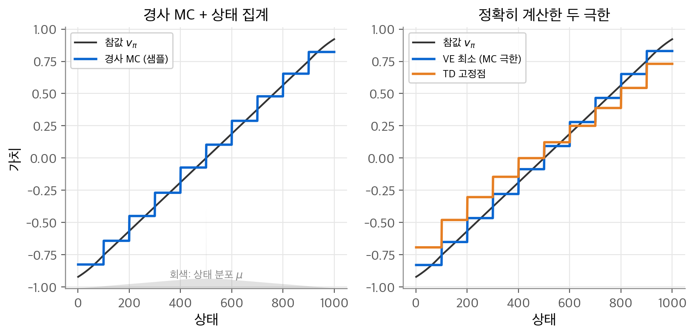
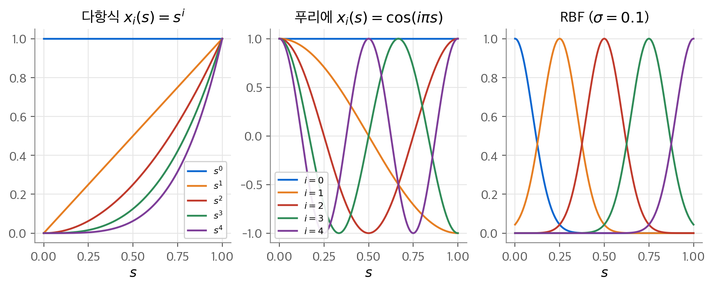
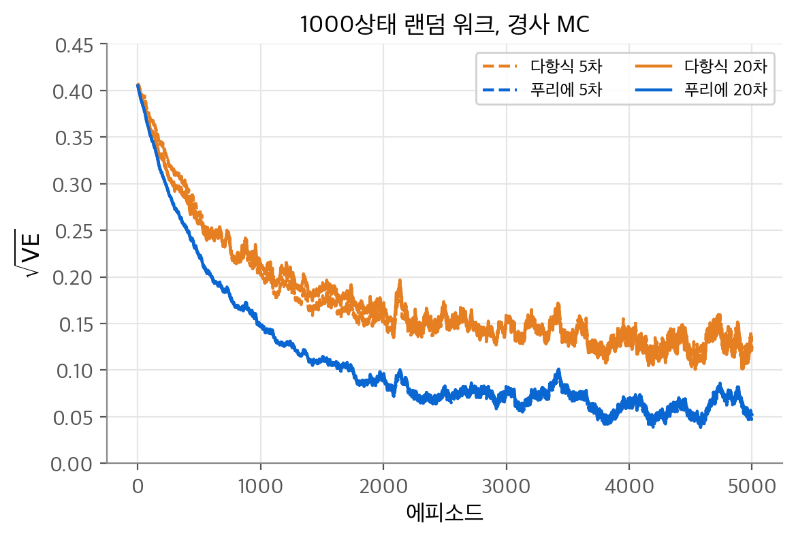
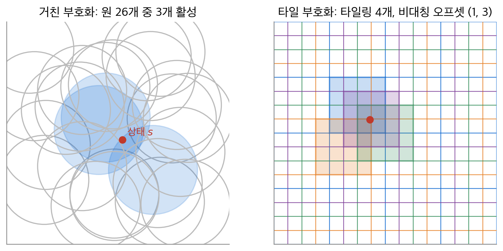
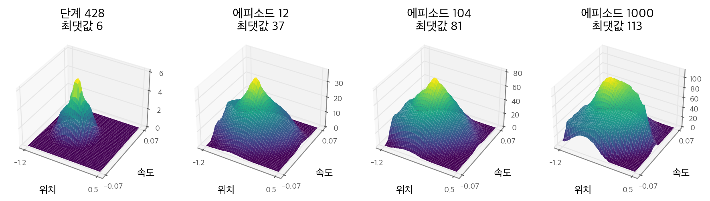
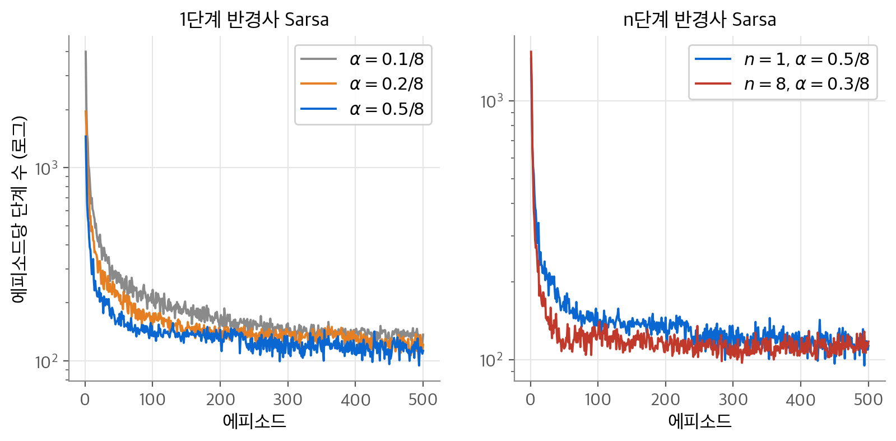

# 9. 함수 근사

지금까지는 상태마다 칸 하나를 두는 표에 가치를 저장했습니다. 상태가 수백만 개이거나 연속이면 표를 채울 수 없습니다. 메모리보다 더 큰 문제는 데이터입니다. 대부분의 상태는 한 번도 방문하지 않습니다. 이 장의 질문은 "방문한 일부 상태의 경험을 방문하지 않은 상태로 어떻게 일반화할까?"입니다. 결론은 가치 함수를 가중치 벡터 $\mathbf{w}$ 로 정의한 함수 $\hat v(s, \mathbf{w})$ 로 바꾸고, 지도 학습의 경사 하강을 쓰는 것입니다. 다만 TD처럼 부트스트래핑하는 목표는 $\mathbf{w}$ 에 의존하므로 진짜 경사가 아닙니다. 이 차이에서 **반경사(semi-gradient)** 방법과 TD 고정점이 나옵니다.

!!! info "원문과 자료"
    - 원문: 초안 9장 On-policy Approximation of Action Values (9.1 가치 예측, 9.2 경사 하강 방법, 9.3 선형 방법, 9.4 근사를 쓰는 제어, 9.5 부트스트래핑을 할 것인가, 9.6 요약)
    - 보충: 최종본 9장 On-policy Prediction with Approximation (9.1~9.8), 최종본 10장 On-policy Control with Approximation (10.1~10.2)
    - [David Silver, Lecture 6: Value Function Approximation (슬라이드 PDF)](https://davidstarsilver.wordpress.com/wp-content/uploads/2025/04/lecture-6-value-function-approximation-.pdf)
    - [Coursera, Prediction and Control with Function Approximation (Martha White, Adam White)](https://www.coursera.org/learn/prediction-control-function-approximation)
    - [Sutton & Barto 책 페이지](http://incompleteideas.net/book/the-book-2nd.html)
    - 함께 읽기: [6. 시간차 학습](06-td-learning.md), [7. n단계 TD와 적격 흔적](07-eligibility-traces.md), [10. 근사를 쓰는 off-policy 학습](10-off-policy-approximation.md), [딥러닝 3. 다층 퍼셉트론](../d2l/03-mlp.md)

## 1. 가치 예측을 지도 학습으로 보기

### 표 대신 함수

정책 $\pi$ 를 따를 때의 상태 가치 $v_\pi$ 를 추정하는 예측 문제부터 시작합니다. 이 장의 새 점은 가치를 표가 아니라 파라미터가 있는 함수로 표현한다는 것입니다.

$$
\hat v(s, \mathbf{w}) \approx v_\pi(s), \qquad \mathbf{w} \in \mathbb{R}^d
$$

$\hat v$ 는 선형 함수일 수도 있고, 신경망일 수도 있고, 결정 트리일 수도 있습니다. 보통 가중치 수 $d$ 는 상태 수 $|\mathcal{S}|$ 보다 훨씬 작습니다. 그래서 가중치 하나를 바꾸면 많은 상태의 추정값이 함께 바뀝니다. 한 상태에서 배운 것이 다른 상태로 퍼집니다. 이 성질을 **일반화(generalization)** 라고 합니다.

### 갱신을 학습 예제로 보기

앞 장의 모든 예측 방법은 "상태 $s$ 의 추정값을 목표 $u$ 쪽으로 옮긴다"로 쓸 수 있습니다. 이것을 $s \mapsto u$ 로 적습니다.

| 방법 | 갱신 | 목표 $U_t$ |
| --- | --- | --- |
| 몬테카를로 | $S_t \mapsto G_t$ | 실제 이득 |
| TD(0) | $S_t \mapsto R_{t+1} + \gamma \hat v(S_{t+1}, \mathbf{w}_t)$ | 1단계 부트스트랩 |
| $n$단계 TD | $S_t \mapsto G_{t:t+n}$ | $n$단계 이득 |
| DP | $s \mapsto \mathbb{E}_\pi[R_{t+1} + \gamma \hat v(S_{t+1}, \mathbf{w}_t) \mid S_t = s]$ | 기댓값 백업 |

표 형식에서는 $s$ 의 칸만 $u$ 쪽으로 옮겼습니다. 함수 근사에서는 각 $s \mapsto u$ 를 지도 학습의 입력-출력 예제 하나로 봅니다. 그러면 회귀 방법을 그대로 가져올 수 있습니다. 다만 강화 학습은 두 가지 요구를 더합니다.

1. 데이터가 하나씩 들어옵니다. 따라서 온라인으로 점진 학습을 해야 합니다.
2. 목표가 움직입니다. 정책이 바뀌고, 부트스트랩 목표는 $\mathbf{w}$ 자체에 의존합니다. 따라서 **비정상(nonstationary)** 목표를 다룰 수 있어야 합니다.

## 2. 예측 목적 함수 VE

### 정의

표 형식에서는 상태마다 정확한 값을 맞출 수 있었습니다. 함수 근사에서는 한 상태를 맞추면 다른 상태가 틀어집니다. 그래서 어느 상태를 얼마나 중요하게 볼지 정해야 합니다. 그 가중치가 분포 $\mu(s) \ge 0$, $\sum_s \mu(s) = 1$ 입니다. 목적 함수는 $\mu$ 로 가중한 제곱 오차입니다.

$$
\overline{\mathrm{VE}}(\mathbf{w}) \doteq \sum_{s \in \mathcal{S}} \mu(s) \left[ v_\pi(s) - \hat v(s, \mathbf{w}) \right]^2
$$

이것을 **평균 제곱 가치 오차(mean squared value error)** 라고 하고 이 노트에서는 VE로 줄여 씁니다. 제곱근 $\sqrt{\mathrm{VE}}$ 는 가치와 같은 단위의 오차입니다.

### on-policy 분포

보통 $\mu$ 는 정책 $\pi$ 를 따를 때 각 상태에 머무는 시간의 비율로 잡습니다. 이것을 **on-policy 분포(on-policy distribution)** 라고 합니다. 에피소드형 과제에서는 시작 분포 $h(s)$ 에 의존합니다. 한 에피소드에서 상태 $s$ 에 머무는 평균 시간 단계를 $\eta(s)$ 라고 합니다. $s$ 에 머무는 경우는 두 가지입니다. 에피소드가 $s$ 에서 시작하거나, 직전 상태 $\bar s$ 에서 $s$ 로 넘어오는 경우입니다.

$$
\eta(s) = h(s) + \sum_{\bar s} \eta(\bar s) \sum_a \pi(a \mid \bar s)\, p(s \mid \bar s, a), \qquad \mu(s) = \frac{\eta(s)}{\sum_{s'} \eta(s')}
$$

행렬로 쓰면 $\boldsymbol\eta = (I - P_\pi^\top)^{-1} \mathbf{h}$ 입니다. 여기서 $P_\pi$ 는 비종단 상태 사이의 전이 행렬입니다. 연속형 과제에서는 $\mu$ 가 $P_\pi$ 의 정상 분포이고 $\mu^\top P_\pi = \mu^\top$ 를 만족합니다.

### 1000상태 랜덤 워크

이 장의 예측 실험은 **1000상태 랜덤 워크**를 씁니다. 상태는 1부터 1000까지이고 모든 에피소드는 상태 500에서 시작합니다. 매 단계 왼쪽 100개 이웃과 오른쪽 100개 이웃 중 하나로 같은 확률로 옮깁니다. 가장자리에서 이웃이 모자라면 그 확률은 그쪽 종단으로 갑니다. 왼쪽 종단의 보상은 $-1$, 오른쪽 종단의 보상은 $+1$ 이고 나머지는 0입니다. $\gamma = 1$ 입니다.

전이 행렬을 만들고 $\boldsymbol\eta$ 를 위 식으로 풀었습니다. NumPy로 계산한 결과는 다음과 같습니다.

- 평균 에피소드 길이 $\sum_s \eta(s)$ 는 83.15 단계입니다.
- $\mu$ 의 최댓값은 시작 상태 500에서 0.0137입니다. 최솟값은 양 끝에서 0.000147입니다.
- 참값 $v_\pi = (I - P_\pi)^{-1} \mathbf{r}$ 은 거의 직선이고 양 끝 100개 상태에서만 조금 휩니다.

양 끝 상태는 거의 방문하지 않으므로 VE에서 비중이 작습니다. 그래서 근사가 그 근처를 덜 맞춰도 VE는 크게 늘지 않습니다.

## 3. 확률적 경사 하강과 반경사 방법

### SGD 유도

매 단계 상태 $S_t$ 와 그 참값 $v_\pi(S_t)$ 를 받는다고 가정합니다. 상태는 $\mu$ 를 따라 나옵니다. VE는 $\mu$ 에 대한 기댓값이므로, 샘플 하나의 제곱 오차를 줄이는 방향으로 조금씩 움직이면 평균적으로 VE를 줄입니다. 이것이 **확률적 경사 하강(SGD, stochastic gradient descent)** 입니다.

$$
\begin{aligned}
\mathbf{w}_{t+1} &= \mathbf{w}_t - \tfrac{1}{2} \alpha \nabla \left[ v_\pi(S_t) - \hat v(S_t, \mathbf{w}_t) \right]^2 \\
&= \mathbf{w}_t + \alpha \left[ v_\pi(S_t) - \hat v(S_t, \mathbf{w}_t) \right] \nabla \hat v(S_t, \mathbf{w}_t)
\end{aligned}
$$

둘째 줄은 연쇄 법칙의 결과입니다. 제곱을 미분하면 2가 나오고 $\tfrac{1}{2}$ 과 상쇄합니다. 괄호 안의 부호가 음이므로 $-\nabla \hat v$ 가 나오고 앞의 음수와 만나 양수가 됩니다.

한 번에 오차를 0으로 만들지 않고 작은 $\alpha$ 만큼만 움직이는 이유가 있습니다. 모든 상태의 오차를 0으로 만드는 $\mathbf{w}$ 는 보통 없습니다. 여러 상태 사이의 균형점을 찾아야 하므로 작은 걸음으로 평균을 냅니다.

### 참값 대신 목표 $U_t$

실제로는 $v_\pi(S_t)$ 를 모릅니다. 그 자리에 근사 목표 $U_t$ 를 넣습니다.

$$
\mathbf{w}_{t+1} = \mathbf{w}_t + \alpha \left[ U_t - \hat v(S_t, \mathbf{w}_t) \right] \nabla \hat v(S_t, \mathbf{w}_t)
$$

$U_t$ 가 **불편(unbiased)** 추정이면, 즉 $\mathbb{E}[U_t \mid S_t = s] = v_\pi(s)$ 이면 이 식은 여전히 SGD입니다. 스텝 크기를 표준 조건에 맞게 줄이면 VE의 국소 최소로 수렴합니다. 몬테카를로 이득 $G_t$ 는 정의상 $v_\pi(S_t)$ 의 불편 추정입니다. 그래서 다음 알고리즘을 **경사 몬테카를로(gradient Monte Carlo)** 라고 합니다.

```python
def gradient_mc_episode(w, states, G, alpha, v_hat, grad):
    # 감마 = 1, 종단 보상만 있는 과제에서는 모든 단계의 이득이 G 입니다.
    for s in states:
        w += alpha * (G - v_hat(s, w)) * grad(s, w)
    return w
```

### 부트스트랩 목표는 경사가 아닙니다

TD(0)의 목표 $U_t = R_{t+1} + \gamma \hat v(S_{t+1}, \mathbf{w}_t)$ 는 $\mathbf{w}_t$ 에 의존합니다. 진짜 경사라면 목표도 미분해야 합니다.

$$
\nabla \tfrac{1}{2}\left[ U_t(\mathbf{w}) - \hat v(S_t, \mathbf{w}) \right]^2 = \left[ U_t - \hat v(S_t, \mathbf{w}) \right] \left( \gamma \nabla \hat v(S_{t+1}, \mathbf{w}) - \nabla \hat v(S_t, \mathbf{w}) \right)
$$

TD 갱신은 이 식에서 $\gamma \nabla \hat v(S_{t+1}, \mathbf{w})$ 항을 버립니다. 추정값을 바꾸는 효과만 보고 목표를 바꾸는 효과는 무시합니다. 경사의 일부만 쓰므로 **반경사(semi-gradient)** 방법이라고 부릅니다. 반경사 TD(0)는 다음과 같습니다.

$$
\mathbf{w}_{t+1} = \mathbf{w}_t + \alpha \left[ R_{t+1} + \gamma \hat v(S_{t+1}, \mathbf{w}_t) - \hat v(S_t, \mathbf{w}_t) \right] \nabla \hat v(S_t, \mathbf{w}_t)
$$

| 성질 | 경사 MC | 반경사 TD(0) |
| --- | --- | --- |
| 목표 | $G_t$ (불편) | $R_{t+1} + \gamma \hat v(S_{t+1}, \mathbf{w})$ (편향) |
| 무엇을 최소화하는가 | VE (진짜 SGD) | 어떤 목적 함수의 경사도 아님 |
| 수렴 | 일반 미분 가능 근사에서 국소 최소 | 선형 + on-policy 분포에서 TD 고정점 |
| 학습 시점 | 에피소드 끝 | 매 단계 온라인 |
| 분산 | 큼 | 작음 |

반경사 방법은 수렴 보장이 약합니다. 그래도 학습이 빠르고, 온라인으로 동작하고, 연속형 과제에 쓸 수 있습니다. 선형 근사에서 어떤 점으로 가는지는 5절에서 정확히 계산합니다.

## 4. 상태 집계와 1000상태 랜덤 워크

### 상태 집계

가장 단순한 일반화는 상태를 묶음으로 나누고 묶음마다 값 하나를 두는 것입니다. 이것을 **상태 집계(state aggregation)** 라고 합니다. 상태 $s$ 가 묶음 $j$ 에 속하면 $\hat v(s, \mathbf{w}) = w_j$ 입니다. 경사는 $j$ 번째 성분만 1이고 나머지는 0입니다. 그래서 갱신은 그 묶음의 가중치만 바꿉니다.

1000개 상태를 100개씩 10묶음으로 나눴습니다. 경사 MC를 $\alpha = 2 \times 10^{-5}$ 로 100,000 에피소드 돌렸습니다.

<figure markdown>

<figcaption markdown>
<span class="fig-title"><b>Figure 1.</b> 상태 집계</span>

왼쪽은 경사 MC의 근사 가치와 참값(회색은 상태 분포 $\mu$), 오른쪽은 VE 최소점과 TD 고정점입니다.
</figcaption>
</figure>

### 계단의 모양

근사는 묶음 안에서 일정하고 묶음 경계에서 뛰는 계단입니다. 계단 높이는 묶음 안의 단순 평균이 아니라 $\mu$ 로 가중한 평균입니다. 정확한 VE 최소점은 묶음마다 다음과 같습니다.

$$
w_j^\ast = \frac{\sum_{s \in j} \mu(s)\, v_\pi(s)}{\sum_{s \in j} \mu(s)}
$$

가장 왼쪽 묶음(상태 1~100)에서 $\mu$ 는 오른쪽 끝(상태 100)으로 갈수록 큽니다. 그래서 $w_1^\ast = -0.830$ 이 묶음의 산술 평균보다 오른쪽 값 쪽으로 치우칩니다. 샘플로 학습한 값은 $w_1 = -0.826$ 이고 VE는 0.00308입니다. 정확한 최소 VE 0.00296에 가깝습니다.

## 5. 선형 방법

### 선형 근사

상태마다 **특징(feature)** 벡터 $\mathbf{x}(s) = (x_1(s), \ldots, x_d(s))^\top$ 를 정합니다. 근사는 특징과 가중치의 내적입니다.

$$
\hat v(s, \mathbf{w}) \doteq \mathbf{w}^\top \mathbf{x}(s) = \sum_{i=1}^d w_i x_i(s), \qquad \nabla \hat v(s, \mathbf{w}) = \mathbf{x}(s)
$$

경사가 특징 벡터 자체이므로 갱신이 아주 단순해집니다. 선형의 경우 VE의 국소 최소는 전역 최소 하나뿐입니다. 그래서 경사 MC는 전역 최소로 수렴합니다. 상태 집계는 특징이 원-핫 벡터인 선형 근사입니다.

### TD 고정점 유도

반경사 TD(0)를 선형으로 쓰고 $\mathbf{x}_t = \mathbf{x}(S_t)$ 로 줄입니다.

$$
\mathbf{w}_{t+1} = \mathbf{w}_t + \alpha \left( R_{t+1} + \gamma \mathbf{w}_t^\top \mathbf{x}_{t+1} - \mathbf{w}_t^\top \mathbf{x}_t \right) \mathbf{x}_t
= \mathbf{w}_t + \alpha \left( R_{t+1} \mathbf{x}_t - \mathbf{x}_t (\mathbf{x}_t - \gamma \mathbf{x}_{t+1})^\top \mathbf{w}_t \right)
$$

정상 상태에서 $\mathbf{w}_t$ 가 주어졌을 때 다음 가중치의 기댓값을 구합니다.

$$
\mathbb{E}[\mathbf{w}_{t+1} \mid \mathbf{w}_t] = \mathbf{w}_t + \alpha (\mathbf{b} - A \mathbf{w}_t), \qquad
\mathbf{b} \doteq \mathbb{E}[R_{t+1} \mathbf{x}_t], \quad
A \doteq \mathbb{E}\left[ \mathbf{x}_t (\mathbf{x}_t - \gamma \mathbf{x}_{t+1})^\top \right]
$$

수렴한다면 기대 변화량이 0인 점으로 가야 합니다. $\mathbf{b} - A \mathbf{w} = 0$ 을 풀면 됩니다.

$$
\mathbf{w}_{\mathrm{TD}} = A^{-1} \mathbf{b}
$$

이 점을 **TD 고정점(TD fixed point)** 이라고 합니다. 특징 행렬 $X$ (행이 $\mathbf{x}(s)^\top$), 대각 행렬 $D = \mathrm{diag}(\mu)$ 로 쓰면 $A = X^\top D (I - \gamma P_\pi) X$, $\mathbf{b} = X^\top D \mathbf{r}_\pi$ 입니다.

### 언제 수렴하는가

기대 갱신을 다시 쓰면 $\mathbf{w}_{t+1} - \mathbf{w}_{\mathrm{TD}} = (I - \alpha A)(\mathbf{w}_t - \mathbf{w}_{\mathrm{TD}})$ 입니다. $A$ 가 **양의 정부호(positive definite)** 이면 $\mathbf{y}^\top A \mathbf{y} > 0$ 이고 작은 $\alpha$ 에서 오차가 줄어듭니다. on-policy 분포에서는 핵심 행렬 $D(I - \gamma P_\pi)$ 의 열 합이 다음과 같습니다.

$$
\mathbf{1}^\top D (I - \gamma P_\pi) = \mu^\top - \gamma \mu^\top P_\pi = (1 - \gamma) \mu^\top > 0
$$

둘째 등호는 $\mu$ 가 정상 분포라는 사실 $\mu^\top P_\pi = \mu^\top$ 을 씁니다. 대각 성분은 양수이고 비대각 성분은 음수입니다. 행 합도 양수이므로 이 행렬과 전치 행렬의 합은 대각 우세 대칭 행렬이 됩니다. 그런 행렬은 양의 정부호이므로 핵심 행렬도 양의 정부호입니다. 따라서 $A$ 도 양의 정부호입니다. 이 증명은 $\mu$ 가 on-policy 분포라는 점에 기대고 있습니다. 다른 분포로 갱신하면 이 논리가 깨집니다. [10장](10-off-policy-approximation.md)이 그 경우를 다룹니다.

### VE 상한

연속형 과제에서 TD 고정점의 VE는 최소 VE의 $1/(1-\gamma)$ 배를 넘지 않는다는 것이 증명되어 있습니다.

$$
\overline{\mathrm{VE}}(\mathbf{w}_{\mathrm{TD}}) \le \frac{1}{1 - \gamma} \min_{\mathbf{w}} \overline{\mathrm{VE}}(\mathbf{w})
$$

$\gamma$ 가 1에 가까우면 이 배수가 매우 큽니다. 부트스트래핑은 분산을 줄이는 대가로 점근 오차를 키울 수 있습니다.

작은 예로 확인합니다. 상태 3개, 특징 2개($\mathbf{x}(s_1) = (1,0)$, $\mathbf{x}(s_2) = (0,1)$, $\mathbf{x}(s_3) = (1,1)$)인 연속형 마르코프 보상 과정을 무작위로 하나 만들었습니다. 정상 분포는 $\mu = (0.256, 0.347, 0.397)$ 이고 $s_3$ 에서만 보상 1을 받습니다.

| $\gamma$ | 최소 VE | $\mathrm{VE}(\mathbf{w}_{\mathrm{TD}})$ | 비율 | 상한 $1/(1-\gamma)$ |
| --- | --- | --- | --- | --- |
| 0.5 | 0.0575 | 0.0606 | 1.05 | 2 |
| 0.9 | 0.5835 | 1.5295 | 2.62 | 10 |
| 0.99 | 155.46 | 1194.41 | 7.68 | 100 |

$\gamma = 0.9$ 에서 $A = \begin{pmatrix} 0.1883 & 0.0109 \\ 0.0245 & 0.1727 \end{pmatrix}$, $\mathbf{b} = (0.397, 0.397)$ 이고 $\mathbf{w}_{\mathrm{TD}} = (1.993, 2.016)$ 입니다. VE 최소점은 $(2.588, 2.728)$ 입니다. 비율은 $\gamma$ 가 커질수록 커지지만 상한보다 훨씬 작습니다.

1000상태 랜덤 워크는 $\gamma = 1$ 인 에피소드형이라 위 상한이 쓸모없습니다. 그래도 같은 경향이 보입니다. 정확히 계산한 TD 고정점의 VE는 0.01363이고 최소 VE 0.00296의 약 4.6배입니다. 그림 오른쪽에서 TD 계단은 양 끝에서 참값보다 0 쪽으로 눌려 있습니다. 가장 왼쪽 묶음의 값은 $-0.693$ 으로, MC의 $-0.830$ 보다 덜 음수입니다. 묶음 안의 상태가 같은 묶음의 값으로 부트스트랩하므로 양 끝의 정보가 안쪽 값에 끌려갑니다.

### 최소 제곱 TD

TD 고정점이 $A^{-1}\mathbf{b}$ 라는 식은 다른 알고리즘도 줍니다. $A$ 와 $\mathbf{b}$ 를 샘플 평균으로 직접 추정하고 역행렬을 곱하면 됩니다. 이것이 **최소 제곱 TD(LSTD, least-squares TD)** 입니다.

$$
\hat A_t = \sum_{k=0}^{t-1} \mathbf{x}_k (\mathbf{x}_k - \gamma \mathbf{x}_{k+1})^\top + \varepsilon I, \qquad
\hat{\mathbf{b}}_t = \sum_{k=0}^{t-1} R_{k+1} \mathbf{x}_k, \qquad \mathbf{w}_t = \hat A_t^{-1} \hat{\mathbf{b}}_t
$$

스텝 크기가 없어서 데이터 효율이 높습니다. 대신 셔먼-모리슨 공식으로 역행렬을 갱신해도 단계마다 $O(d^2)$ 계산과 메모리가 듭니다. 반경사 TD는 $O(d)$ 입니다.

## 6. 특징 구성

선형 방법의 성능은 특징이 거의 전부를 결정합니다. 선형 근사는 특징 사이의 상호작용을 스스로 만들지 못합니다. 예를 들어 막대 균형 과제에서 각속도가 좋은지 나쁜지는 각도에 달려 있습니다. 이런 결합은 특징으로 미리 넣어야 합니다.

### 다항식과 푸리에 기저

상태 $s$ 를 $[0, 1]$ 로 정규화합니다. $n$차 **다항식 기저(polynomial basis)** 는 $x_i(s) = s^i$, $i = 0, \ldots, n$ 입니다. 차원 $k$ 개 상태에서는 $\prod_j s_j^{c_{i,j}}$ 꼴의 항을 모두 쓰므로 특징 수가 $(n+1)^k$ 입니다.

**푸리에 기저(Fourier basis)** 는 코사인을 씁니다. 1차원에서는 $x_i(s) = \cos(i \pi s)$ 입니다. $k$ 차원에서는 정수 벡터 $\mathbf{c}^i$ 마다 $x_i(\mathbf{s}) = \cos(\pi\, \mathbf{s}^\top \mathbf{c}^i)$ 입니다. 구간 $[0,1]$ 에서 코사인만으로 짝함수 연장을 하므로 사인 없이도 어떤 함수든 근사할 수 있습니다.

<figure markdown>

<figcaption markdown>
<span class="fig-title"><b>Figure 2.</b> 기저 함수</span>

다항식 기저 $s^0, \ldots, s^4$(왼쪽), 푸리에 기저(가운데), 가우스 RBF(오른쪽)입니다.
</figcaption>
</figure>

다항식 특징은 $s$ 가 커지면 모두 1 근처로 모여 서로 비슷해집니다. 그래서 차수가 높을수록 특징 사이의 상관이 커지고 경사 하강이 느려집니다. 푸리에 특징은 서로 직교에 가깝습니다.

1000상태 랜덤 워크에서 경사 MC로 두 기저를 비교했습니다. 스텝 크기는 원문을 따라 다항식 $\alpha = 10^{-4}$, 푸리에 $\alpha = 5 \times 10^{-5}$ 입니다.

<figure markdown>

<figcaption markdown>
<span class="fig-title"><b>Figure 3.</b> 푸리에와 다항식</span>

5,000 에피소드 동안의 $\sqrt{\mathrm{VE}}$ 입니다. 같은 기저의 5차와 20차 곡선은 거의 겹칩니다.
</figcaption>
</figure>

| 기저 | 1,000 에피소드 | 5,000 에피소드 |
| --- | --- | --- |
| 다항식 5차 | 0.204 | 0.134 |
| 다항식 20차 | 0.214 | 0.124 |
| 푸리에 5차 | 0.147 | 0.048 |
| 푸리에 20차 | 0.146 | 0.052 |

푸리에 기저의 오차가 5,000 에피소드에서 다항식의 약 3분의 1입니다. 이 과제는 $v_\pi$ 가 거의 직선이라서 차수를 높여도 이득이 작습니다. 원문도 온라인 학습에는 다항식을 권하지 않습니다.

### 거친 부호화

상태 공간에 겹치는 원을 여러 개 깝니다. 상태가 원 안에 있으면 그 특징은 1, 밖이면 0입니다. 이것을 **거친 부호화(coarse coding)** 라고 합니다. 한 상태에서 학습하면 그 상태를 덮는 원의 가중치가 모두 바뀝니다. 그래서 그 원들과 겹치는 상태로 일반화가 일어납니다. 원이 크면 넓게 일반화하고, 원이 작으면 좁게 일반화합니다. 원의 모양이 일반화의 방향을 정합니다.

<figure markdown>

<figcaption markdown>
<span class="fig-title"><b>Figure 4.</b> 거친 부호화와 타일 부호화</span>

거친 부호화(왼쪽)에서 빨간 점은 원 3개를 켜고, 타일 부호화(오른쪽)에서는 타일링마다 타일 하나가 켜집니다.
</figcaption>
</figure>

### 타일 부호화

**타일 부호화(tile coding)** 는 거친 부호화를 격자로 정리한 것입니다. 상태 공간을 겹치지 않는 타일로 나눈 격자 하나를 **타일링(tiling)** 이라고 합니다. 타일링 $n$ 개를 서로 조금씩 밀어서 겹칩니다. 장점은 세 가지입니다.

1. 켜지는 특징 수가 항상 $n$ 개입니다. 그래서 스텝 크기를 정하기 쉽습니다. $\alpha = 1/n$ 이면 한 번에 목표까지 갑니다. 보통 $\alpha = 1/(10n)$ 처럼 그보다 작게 잡습니다.
2. 특징이 0 또는 1이므로 $\hat v$ 는 켜진 가중치 $n$ 개의 합입니다. 곱셈이 필요 없습니다.
3. 오프셋 방향을 $(1, 3)$ 처럼 비대칭으로 잡으면 대각선 방향의 인공 무늬가 줄어듭니다. 원문은 $k$ 차원에서 첫 홀수 $(1, 3, 5, \ldots, 2k-1)$ 를 권합니다.

상태 공간이 크면 타일 수가 폭발합니다. 이때 **해싱(hashing)** 으로 많은 타일을 작은 배열에 겹쳐 넣습니다. 충돌이 생겨도 실제로 방문하는 영역은 작으므로 성능 손실이 작습니다.

### 방사형 기저 함수

**방사형 기저 함수(RBF, radial basis function)** 는 거친 부호화의 0/1 특징을 연속값으로 바꾼 것입니다.

$$
x_i(s) \doteq \exp\left( -\frac{\lVert s - c_i \rVert^2}{2 \sigma_i^2} \right)
$$

중심 $c_i$ 에서 멀어질수록 특징값이 부드럽게 줄어듭니다. 근사 함수가 매끄러워지고 미분 가능해집니다. 대신 계산량이 늘고, 상태 차원이 2를 넘으면 이득이 작다는 보고가 많습니다.

### 스텝 크기 고르기

선형 SGD에서 실무 규칙이 하나 있습니다. 같은 특징 벡터로 약 $\tau$ 번 경험해서 목표에 가까워지게 하려면 다음처럼 잡습니다.

$$
\alpha \doteq \left( \tau\, \mathbb{E}\left[ \mathbf{x}^\top \mathbf{x} \right] \right)^{-1}
$$

타일 부호화는 $\mathbf{x}^\top \mathbf{x} = n$ 이므로 $\alpha = 1/(\tau n)$ 입니다. 산악 자동차 실험의 $\alpha = 0.5/8$ 은 $\tau = 2$, $n = 8$ 에 해당합니다.

## 7. 신경망 근사로

선형 근사는 특징을 사람이 설계해야 합니다. 다층 신경망은 은닉층이 특징을 스스로 만듭니다. 구조와 역전파는 [딥러닝 3. 다층 퍼셉트론](../d2l/03-mlp.md)에서 다뤘습니다. 강화 학습에서 달라지는 점은 손실과 목표입니다.

- 경사 MC: 손실 $\tfrac12 (G_t - \hat v(S_t, \mathbf{w}))^2$ 를 역전파합니다. 진짜 SGD입니다.
- 반경사 TD: 목표 $R_{t+1} + \gamma \hat v(S_{t+1}, \mathbf{w})$ 를 상수로 고정한 뒤 손실을 역전파합니다. 자동 미분 코드에서는 목표에 `stop_gradient` 또는 `detach` 를 씌우는 것과 같습니다.

```python
# PyTorch 스타일 반경사 TD(0) 손실
target = r + gamma * v_net(s_next).detach() * (1 - done)
loss = 0.5 * (target - v_net(s)).pow(2).mean()
loss.backward()   # 목표 쪽으로는 경사가 흐르지 않습니다
```

비선형 근사에서는 반경사 TD의 수렴 보장이 없습니다. 실무에서는 목표를 천천히 따라가는 별도 가중치를 두거나, 경험을 저장했다가 섞어 쓰는 방법으로 안정성을 얻습니다. 입력 정규화, 배치 정규화, 적응형 옵티마이저도 같은 이유로 씁니다. 최적화 기법은 [딥러닝 9. 최적화](../d2l/09-optimization.md)를 참고합니다.

## 8. 반경사 Sarsa로 산악 자동차 제어

### 행동 가치로 확장

제어로 넘어가려면 행동 가치 $\hat q(s, a, \mathbf{w}) \approx q_\pi(s, a)$ 를 근사합니다. 학습 예제가 $S_t, A_t \mapsto U_t$ 로 바뀝니다.

$$
\mathbf{w}_{t+1} = \mathbf{w}_t + \alpha \left[ U_t - \hat q(S_t, A_t, \mathbf{w}_t) \right] \nabla \hat q(S_t, A_t, \mathbf{w}_t)
$$

1단계 Sarsa의 목표는 $U_t = R_{t+1} + \gamma \hat q(S_{t+1}, A_{t+1}, \mathbf{w}_t)$ 입니다. 이것을 **에피소드형 반경사 1단계 Sarsa** 라고 합니다. 행동이 이산이고 적으면 정책 개선은 앞 장과 같습니다. 행동마다 $\hat q$ 를 계산하고 ε-탐욕으로 고릅니다.

1. 에피소드 시작 상태 $S$ 에서 $A$ 를 ε-탐욕으로 고릅니다.
2. $A$ 를 하고 $R$, $S'$ 를 관측합니다.
3. $S'$ 가 종단이면 $\mathbf{w} \leftarrow \mathbf{w} + \alpha [R - \hat q(S, A, \mathbf{w})] \nabla \hat q(S, A, \mathbf{w})$ 를 하고 에피소드를 끝냅니다.
4. 아니면 $A'$ 를 $\hat q(S', \cdot, \mathbf{w})$ 에 대해 ε-탐욕으로 고르고 $\mathbf{w} \leftarrow \mathbf{w} + \alpha [R + \gamma \hat q(S', A', \mathbf{w}) - \hat q(S, A, \mathbf{w})] \nabla \hat q(S, A, \mathbf{w})$ 를 합니다.
5. $S \leftarrow S'$, $A \leftarrow A'$ 로 두고 2로 갑니다.

### 산악 자동차 과제

힘이 약한 자동차가 골짜기 바닥에서 오른쪽 산꼭대기로 올라가야 합니다. 엔진을 최대로 써도 중력을 이기지 못합니다. 유일한 해법은 먼저 왼쪽 비탈로 물러났다가 내려오는 힘으로 오른쪽을 오르는 것입니다. 목표에서 멀어져야 목표에 닿는 과제입니다.

상태는 위치 $x_t$ 와 속도 $\dot x_t$ 이고 행동은 $A_t \in \{-1, 0, +1\}$ (후진, 정지, 전진)입니다.

$$
\dot x_{t+1} = \mathrm{bound}\left[ \dot x_t + 0.001 A_t - 0.0025 \cos(3 x_t) \right], \qquad
x_{t+1} = \mathrm{bound}\left[ x_t + \dot x_{t+1} \right]
$$

경계는 $-1.2 \le x \le 0.5$, $-0.07 \le \dot x \le 0.07$ 입니다. 왼쪽 경계에 닿으면 속도를 0으로 둡니다. $x = 0.5$ 에 닿으면 에피소드가 끝납니다. 보상은 매 단계 $-1$ 이고 $\gamma = 1$ 입니다. 시작 위치는 $[-0.6, -0.4)$ 에서 균등하게 뽑고 속도는 0입니다.

### 타일 부호화 설정

타일링 8개를 썼습니다. 각 타일은 위치와 속도 범위의 1/8을 덮습니다. 오프셋은 타일 폭 단위로 $(1, 3)/8$ 씩 비대칭으로 밉니다. 밀린 타일링을 덮으려고 타일링마다 $9 \times 9$ 칸을 둡니다. 행동마다 별도 가중치를 두므로 $d = 3 \times 8 \times 81 = 1944$ 입니다. 원문은 해싱 타일 코드(크기 4096)를 썼으나 이 노트는 해싱 없이 격자로 직접 계산했습니다. ε = 0이고 초기 가중치는 0입니다.

### 낙관적 초기값과 비용-가는-곳 곡면

참 행동 가치는 모두 음수이므로 초기값 0은 낙관적입니다. 그래서 ε = 0이어도 탐험이 일어납니다. 방문한 상태의 값은 실제 보상 $-1$ 때문에 내려갑니다. 그러면 아직 가 보지 않은 상태가 더 좋아 보이고, 에이전트는 계속 새 곳으로 갑니다.

<figure markdown>

<figcaption markdown>
<span class="fig-title"><b>Figure 5.</b> 산악 자동차 비용-가는-곳</span>

학습한 **비용-가는-곳(cost-to-go)** 함수 $-\max_a \hat q(s, a, \mathbf{w})$ 가 에피소드가 쌓이며 바뀌는 모습입니다(왼쪽부터 첫 에피소드 중간, 12, 104, 1000 이후).
</figcaption>
</figure>

428단계에서는 첫 에피소드도 끝나지 않았습니다. 자동차가 골짜기에서 앞뒤로 흔들리며 상태 공간에서 원을 그립니다. 그 원 위의 값만 내려가서 가운데가 솟은 곡면이 됩니다. 최댓값은 6입니다. 에피소드가 진행되면 최댓값이 37, 81, 113으로 커집니다. 에피소드 1000에서는 곡면이 나선 모양으로 퍼집니다. 위치와 속도에 따라 목표까지 걸리는 단계 수가 크게 다르기 때문입니다.

### 스텝 크기에 따른 학습 곡선

<figure markdown>

<figcaption markdown>
<span class="fig-title"><b>Figure 6.</b> 산악 자동차 학습 곡선</span>

에피소드당 단계 수(10회 평균)입니다. 왼쪽은 스텝 크기별 1단계 반경사 Sarsa, 오른쪽은 1단계와 8단계의 비교입니다.
</figcaption>
</figure>

| 설정 | 첫 에피소드 | 에피소드 1~50 평균 | 에피소드 451~500 평균 |
| --- | --- | --- | --- |
| $n=1$, $\alpha = 0.1/8$ | 3985 | 574 | 136 |
| $n=1$, $\alpha = 0.2/8$ | 1956 | 407 | 122 |
| $n=1$, $\alpha = 0.5/8$ | 1452 | 282 | 117 |
| $n=8$, $\alpha = 0.3/8$ | 1545 | 231 | 114 |

이 범위에서는 스텝 크기가 클수록 빨리 배웁니다. 첫 에피소드는 낙관적 초기값 때문에 수천 단계가 걸립니다. 500 에피소드 뒤에는 모든 설정이 115~135 단계 근처로 모입니다.

## 9. n단계 반경사 Sarsa

### n단계 이득

[7장](07-eligibility-traces.md)의 $n$단계 이득을 함수 근사로 옮깁니다.

$$
G_{t:t+n} \doteq R_{t+1} + \gamma R_{t+2} + \cdots + \gamma^{n-1} R_{t+n} + \gamma^n \hat q(S_{t+n}, A_{t+n}, \mathbf{w}_{t+n-1}), \qquad t + n < T
$$

$t + n \ge T$ 이면 $G_{t:t+n} = G_t$ 입니다. 갱신은 $n$ 단계 늦게 일어납니다.

$$
\mathbf{w}_{t+n} \doteq \mathbf{w}_{t+n-1} + \alpha \left[ G_{t:t+n} - \hat q(S_t, A_t, \mathbf{w}_{t+n-1}) \right] \nabla \hat q(S_t, A_t, \mathbf{w}_{t+n-1})
$$

구현에서는 상태, 행동, 보상을 길이 $n+1$ 의 고리 버퍼에 저장합니다. 시각 $\tau = t - n + 1$ 의 쌍을 갱신하고, 에피소드가 끝나면 남은 쌍을 차례로 갱신합니다.

```python
tau = t - n + 1
if tau >= 0:
    G = sum(R[tau + 1 : min(tau + n, T) + 1])          # gamma = 1
    if tau + n < T:
        G += q_hat(S[tau + n], A[tau + n], w)
    idx = active(S[tau], A[tau])                        # 켜진 타일 인덱스
    w[idx] += alpha / 8 * (G - w[idx].sum())
```

### 결과

오른쪽 그림에서 $n = 8$ 이 초반에 더 빨리 배웁니다. 에피소드 1~50의 평균 단계 수가 $n=1$ 의 282에서 231로 줄었습니다. 보상 $-1$ 이 여러 단계 뒤까지 한 번에 전파되기 때문입니다. 원문은 $n$ 과 $\alpha$ 를 넓게 바꾼 실험에서 중간 정도의 부트스트래핑인 $n = 4$ 가 가장 좋았다고 보고합니다. 표 형식 랜덤 워크([7장](07-eligibility-traces.md))에서 본 것과 같은 모양입니다.

## 10. 부트스트래핑을 할 것인가

### 부트스트래핑하지 않는 쪽의 장점

이 장의 결과를 모으면 몬테카를로 쪽이 이론적으로 유리해 보입니다.

- 경사 MC는 진짜 SGD입니다. 비선형 근사에서도 국소 최소로 수렴합니다.
- 점근 오차가 가장 작습니다. TD 고정점은 최대 $1/(1-\gamma)$ 배까지 나빠질 수 있습니다.
- on-policy 분포가 아니어도 발산하지 않습니다. 부트스트래핑 방법은 [10장](10-off-policy-approximation.md)에서 보듯이 발산할 수 있습니다.

### 그래도 부트스트래핑을 씁니다

실험에서는 부트스트래핑 방법이 대개 훨씬 빨리 배웁니다. 원문 초안은 TD($\lambda$)의 $\lambda$ 를 0(완전 부트스트랩)에서 1(부트스트랩 없음)까지 바꾼 실험 네 개를 모았습니다. 산악 자동차, 막대 균형, 퍼들 월드, 랜덤 워크 예측 모두에서 $\lambda$ 가 1에 가까워질수록 성능이 크게 나빠졌습니다. 랜덤 워크는 예측 과제라 점근적으로는 $\lambda = 1$ 이 최선이어야 합니다. 그래도 실험 구간에서는 중간 $\lambda$ 가 이겼습니다.

이 장의 실험에서도 같은 두 얼굴이 보입니다.

| 관찰 | 부트스트래핑 쪽 | 부트스트래핑 없는 쪽 |
| --- | --- | --- |
| 1000상태 랜덤 워크 점근 VE (상태 집계) | TD 고정점 0.01363 | MC 극한 0.00296 |
| 산악 자동차 초반 학습 | $n=8$: 1~50 에피소드 평균 231 단계 | 해당 없음 (MC는 첫 에피소드가 끝나야 갱신) |

이유는 분산과 계산입니다. MC 이득은 긴 보상 합이라 분산이 큽니다. 또 에피소드가 끝날 때까지 모든 것을 저장해야 합니다. 부트스트래핑은 데이터가 생긴 곳에서 바로 처리하고 버립니다. 실무의 선택은 보통 둘 사이입니다. $n$단계 방법이나 적격 흔적으로 부트스트래핑의 정도를 조절합니다.

## 정리

- 함수 근사는 가치를 $\hat v(s, \mathbf{w})$ 로 표현해 방문하지 않은 상태로 일반화합니다. 각 백업 $s \mapsto u$ 를 지도 학습 예제로 봅니다.
- 목적 함수는 on-policy 분포 $\mu$ 로 가중한 VE입니다. 1000상태 랜덤 워크에서 $\mu$ 는 시작 상태에서 0.0137로 가장 크고 양 끝에서 작습니다.
- 목표가 불편이면(MC) 갱신은 진짜 SGD입니다. 목표가 $\mathbf{w}$ 에 의존하면(TD) 목표의 경사를 버린 반경사 방법이 됩니다.
- 선형 반경사 TD는 $\mathbf{w}_{\mathrm{TD}} = A^{-1}\mathbf{b}$ 로 수렴합니다. on-policy 분포에서 $A$ 가 양의 정부호이기 때문입니다. 이 점의 VE는 최소 VE의 $1/(1-\gamma)$ 배 이하입니다.
- 상태 집계 실험에서 MC 극한의 VE는 0.00296, TD 고정점은 0.01363이었습니다.
- 특징으로 다항식, 푸리에, 거친 부호화, 타일 부호화, RBF를 다뤘습니다. 랜덤 워크에서 푸리에 기저가 다항식보다 오차가 약 3배 작았습니다.
- 타일 부호화는 켜지는 특징 수가 일정해서 $\alpha = 1/(\tau n)$ 으로 스텝 크기를 정하기 쉽습니다.
- 신경망 근사에서는 반경사 TD 목표를 상수로 두고 역전파합니다. 수렴 보장은 없습니다.
- 반경사 Sarsa와 타일 부호화로 산악 자동차를 풀었습니다. 낙관적 초기값이 ε = 0에서도 탐험을 만듭니다. $n = 8$ 이 $n = 1$ 보다 초반에 빨리 배웠습니다.
- 부트스트래핑은 점근 오차와 안정성에서 불리하지만 학습 속도와 계산 효율에서 대개 이깁니다.
