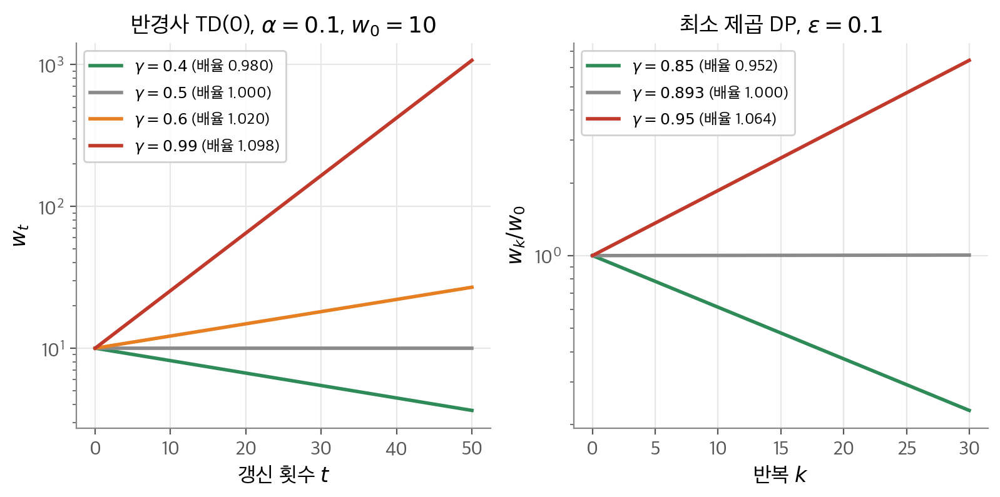
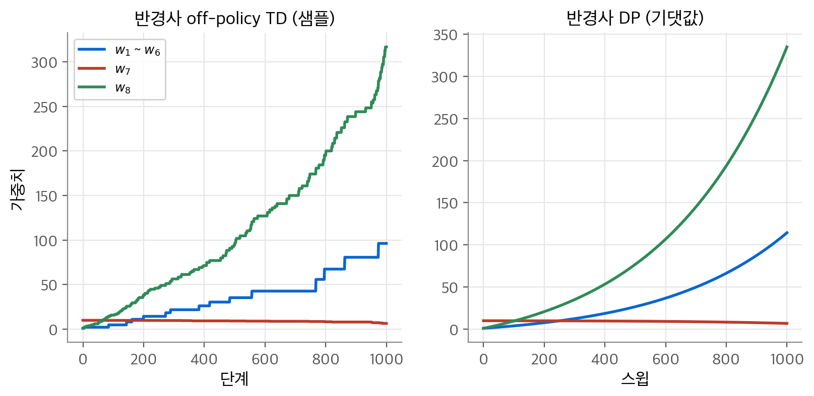
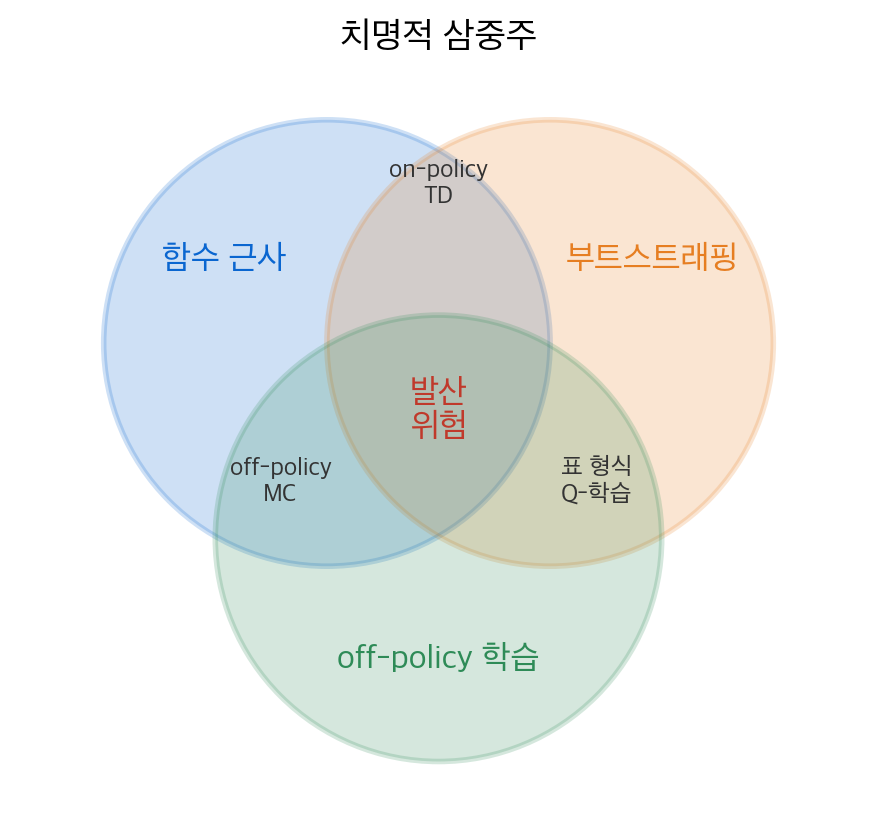
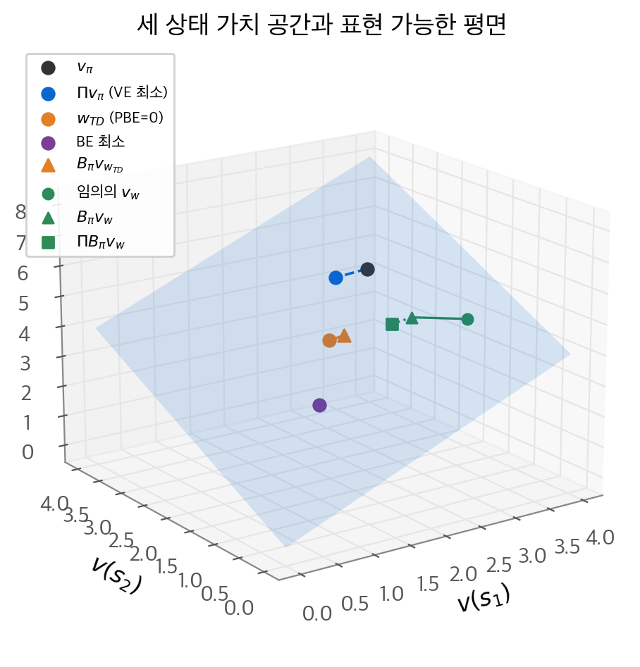
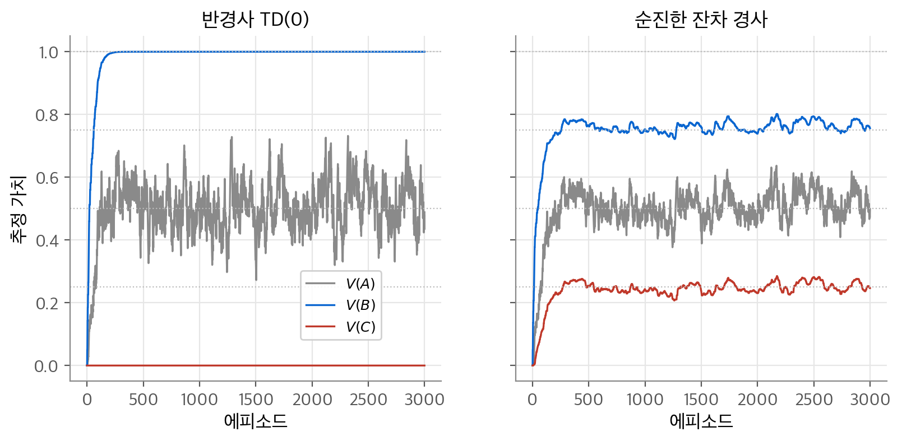
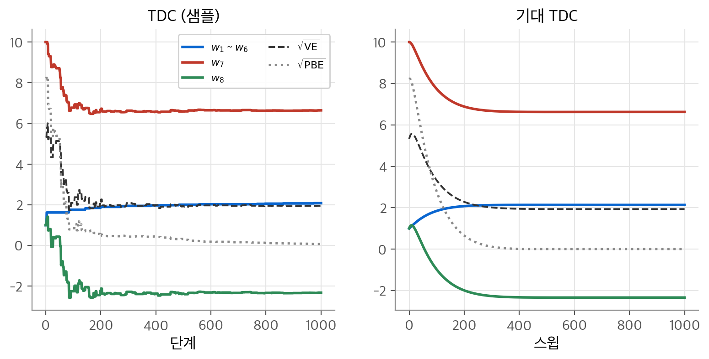
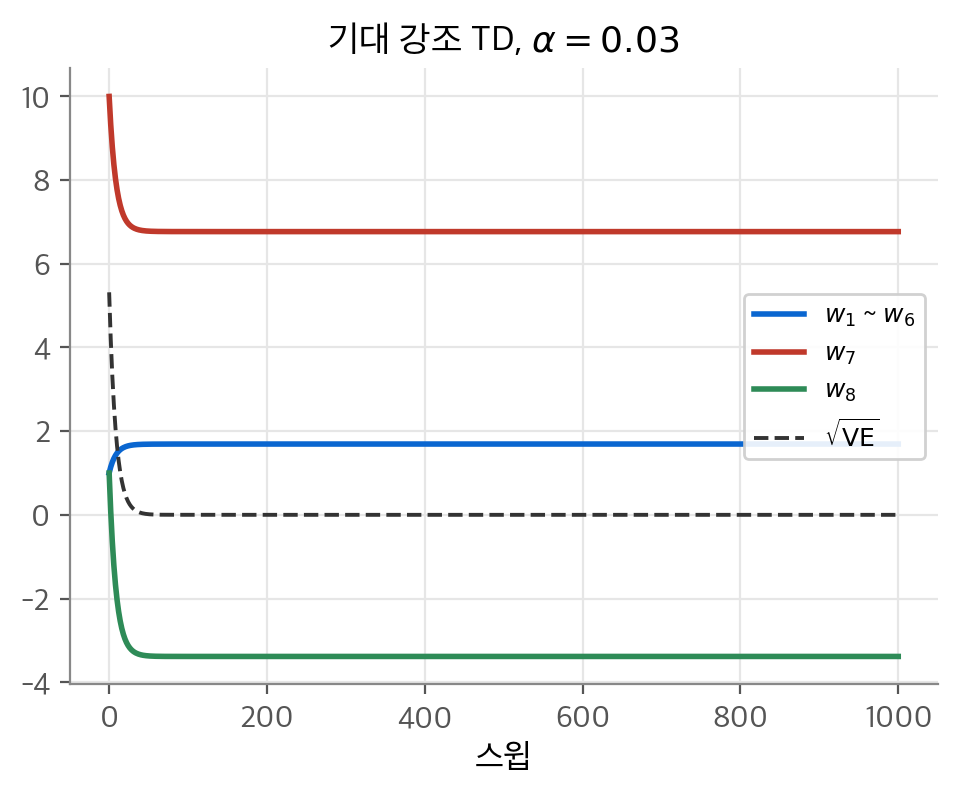

# 10. 근사를 쓰는 off-policy 학습

표 형식에서는 Q-학습 같은 off-policy 방법이 문제없이 수렴했습니다. 함수 근사를 붙이면 사정이 달라집니다. 이 장의 질문은 "행동 정책 $b$ 의 데이터로 목표 정책 $\pi$ 의 가치를 근사할 때 왜 가중치가 발산하고, 어떻게 막을까?"입니다. 결론은 함수 근사, 부트스트래핑, off-policy 학습 세 가지가 함께 있을 때 불안정이 생긴다는 것입니다. 이것을 **치명적 삼중주(deadly triad)** 라고 합니다. 해법은 두 갈래입니다. 투영 벨만 오차의 진짜 경사를 따르는 그래디언트 TD 방법과, 갱신 분포를 on-policy 분포로 되돌리는 강조 TD 방법입니다. 그 과정에서 벨만 오차는 데이터만으로 학습할 수 없는 목적 함수라는 점도 확인합니다.

!!! info "원문과 자료"
    - 원문: 최종본 11장 Off-policy Methods with Approximation (11.1 반경사 방법, 11.2 발산 예제, 11.3 치명적 삼중주, 11.4 선형 가치 함수 기하, 11.5 벨만 오차의 경사 하강, 11.6 벨만 오차는 학습 불가능, 11.7 그래디언트 TD, 11.8 강조 TD, 11.9 분산 줄이기, 11.10 요약). 초안 10장은 비어 있습니다.
    - [David Silver, Lecture 6: Value Function Approximation (슬라이드 PDF)](https://davidstarsilver.wordpress.com/wp-content/uploads/2025/04/lecture-6-value-function-approximation-.pdf): 수렴 표와 Gradient TD를 다룹니다.
    - [Berkeley CS285, Deep Reinforcement Learning](https://rail.eecs.berkeley.edu/deeprlcourse/): Lecture 7 Value-Based RL이 근사 가치 반복의 불안정성을 다룹니다.
    - [Coursera, Prediction and Control with Function Approximation (Martha White, Adam White)](https://www.coursera.org/learn/prediction-control-function-approximation)
    - [Sutton & Barto 책 페이지](http://incompleteideas.net/book/the-book-2nd.html)
    - 함께 읽기: [5. 몬테카를로 방법](05-monte-carlo.md) (중요도 샘플링), [7. n단계 TD와 적격 흔적](07-eligibility-traces.md), [9. 함수 근사](09-function-approximation.md)

## 1. 반경사 off-policy 방법

### 두 가지 어려움

off-policy 학습의 어려움은 두 부분으로 나뉩니다.

1. **갱신 목표**: 행동 정책 $b$ 로 얻은 이득을 목표 정책 $\pi$ 의 이득으로 고쳐야 합니다. 표 형식에서도 생기는 문제이고 [5장](05-monte-carlo.md)과 [7장](07-eligibility-traces.md)의 중요도 샘플링으로 풉니다.
2. **갱신 분포**: 상태가 $b$ 의 분포로 나옵니다. 함수 근사에서만 생기는 문제입니다. [9장](09-function-approximation.md)의 TD 수렴 증명은 on-policy 분포를 썼습니다. 이 가정이 깨집니다.

이 절의 반경사 방법은 첫째 문제만 풉니다.

### 반경사 off-policy TD(0)

단계별 중요도 샘플링 비를 씁니다.

$$
\rho_t \doteq \frac{\pi(A_t \mid S_t)}{b(A_t \mid S_t)}
$$

표 형식 알고리즘의 배열 갱신을 가중치 갱신으로 바꾸면 됩니다.

$$
\mathbf{w}_{t+1} \doteq \mathbf{w}_t + \alpha \rho_t \delta_t \nabla \hat v(S_t, \mathbf{w}_t), \qquad
\delta_t \doteq R_{t+1} + \gamma \hat v(S_{t+1}, \mathbf{w}_t) - \hat v(S_t, \mathbf{w}_t)
$$

$\rho_t$ 가 곱해지는 이유는 [5장](05-monte-carlo.md)과 같습니다. $\mathbb{E}_b[\rho_t f(A_t) \mid S_t] = \mathbb{E}_\pi[f(A_t) \mid S_t]$ 이므로, 행동 정책의 샘플로 목표 정책의 기대 TD 오차를 맞춥니다.

### 행동 가치와 다단계 형태

| 알고리즘 | 갱신의 핵심 | 중요도 샘플링 |
| --- | --- | --- |
| 반경사 기대 Sarsa | $\delta_t = R_{t+1} + \gamma \sum_a \pi(a \mid S_{t+1}) \hat q(S_{t+1}, a, \mathbf{w}) - \hat q(S_t, A_t, \mathbf{w})$ | 없음 |
| $n$단계 반경사 Sarsa | $\alpha \rho_{t+1} \cdots \rho_{t+n} [G_{t:t+n} - \hat q(S_t, A_t, \mathbf{w})] \nabla \hat q$ | $n$ 개의 곱 |
| $n$단계 반경사 트리 백업 | $G_{t:t+n} = \hat q(S_t, A_t, \mathbf{w}) + \sum_{k=t}^{t+n-1} \delta_k \prod_{i=t+1}^{k} \gamma \pi(A_i \mid S_i)$ | 없음 |

1단계 기대 Sarsa는 $A_t$ 가 이미 정해진 뒤의 값을 배우므로 비가 필요 없습니다. 다단계 Sarsa는 중간 행동을 고쳐야 하므로 비의 곱이 들어갑니다. 트리 백업은 비 대신 목표 정책의 확률을 곱합니다.

이 방법들은 표 형식에서는 안정적이고 점근적으로 편향이 없습니다. 함수 근사에서는 발산할 수 있습니다. 다음 절이 그 예입니다.

## 2. off-policy 발산의 예

### $w \to 2w$ 조각

큰 MDP의 일부로 상태 두 개가 있다고 합니다. 특징은 스칼라 1과 2이고 가중치도 스칼라 $w$ 하나입니다. 그래서 두 상태의 추정값은 $w$ 와 $2w$ 입니다. 첫 상태에서는 행동이 하나뿐이고 보상 0으로 둘째 상태로 갑니다. 이 전이의 TD 오차는 다음과 같습니다.

$$
\delta_t = 0 + \gamma \cdot 2w_t - w_t = (2\gamma - 1) w_t
$$

행동이 하나이므로 $\rho_t = 1$ 이고, 특징이 1이므로 경사도 1입니다. 갱신은 다음과 같습니다.

$$
w_{t+1} = w_t + \alpha \cdot 1 \cdot (2\gamma - 1) w_t \cdot 1 = \left( 1 + \alpha (2\gamma - 1) \right) w_t
$$

배율 $1 + \alpha(2\gamma - 1)$ 이 1보다 크면 $w$ 는 무한대로 갑니다. 그 조건은 $\gamma > 0.5$ 이고 $\alpha$ 와 무관합니다. 스텝 크기는 발산 속도만 바꿉니다.

수치로 따라가 봅니다. $w_0 = 10$, $\alpha = 0.1$, $\gamma = 0.99$ 이면 배율은 1.098입니다. $w$ 는 10, 10.98, 12.06, 13.24 로 커집니다. 첫 상태가 과소평가된 것처럼 보여서 $w$ 를 올리면, 둘째 상태의 값이 두 배로 올라 TD 오차가 오히려 커집니다.

<figure markdown>

<figcaption markdown>
<span class="fig-title"><b>Figure 1.</b> w→2w 발산</span>

$w \to 2w$ 전이만 반복하면 $\gamma > 0.5$ 에서 $w_t$ 가 발산합니다(왼쪽). 오른쪽은 최소 제곱 DP 반례입니다.
</figcaption>
</figure>

### 왜 off-policy에서만 문제인가

on-policy라면 $2w$ 상태에서도 나가는 전이가 있어야 합니다. 그 전이는 $w$ 를 줄입니다. 다음 상태가 $2w$ 보다 더 큰 값을 가지지 않는 한 그렇습니다. 그런 상태가 있다면 그 다음 상태는 더 커야 합니다. 결국 어디선가 약속한 보상을 갚아야 합니다. off-policy에서는 목표 정책이 고르지 않을 행동의 전이에서 $\rho_t = 0$ 이 됩니다. 그 전이는 갱신하지 않으므로 약속을 갚지 않고 넘어갈 수 있습니다.

### 매번 최소 제곱 해를 구해도 발산합니다

이 조각에 종단 상태를 붙인 **Tsitsiklis와 Van Roy의 반례**가 있습니다. $2w$ 상태에서 확률 $\varepsilon$ 으로 종단, $1 - \varepsilon$ 으로 자기 자신으로 갑니다. 매 반복에서 기대 1단계 이득에 대한 제곱 오차를 정확히 최소화합니다.

$$
w_{k+1} = \arg\min_w \left[ (w - 2\gamma w_k)^2 + \left( 2w - 2(1-\varepsilon)\gamma w_k \right)^2 \right]
$$

$w$ 로 미분해 0으로 두면 $(w - 2\gamma w_k) + 2(2w - 2(1-\varepsilon)\gamma w_k) = 0$ 이고, 정리하면 다음과 같습니다.

$$
w_{k+1} = \frac{6 - 4\varepsilon}{5} \gamma w_k
$$

$\varepsilon = 0.1$ 이면 배율이 $1.12\gamma$ 이고 $\gamma > 5/5.6 = 0.893$ 에서 발산합니다. 근사를 매번 가장 좋게 맞춰도 갱신 분포가 균등하면 안정이 보장되지 않습니다.

### Baird 반례

조각이 아닌 완전한 MDP의 예입니다. 상태 7개, 행동 2개입니다.

- 점선 행동은 위쪽 상태 6개 중 하나로 같은 확률로 갑니다. 실선 행동은 7번째 상태로 갑니다.
- 행동 정책: 점선 6/7, 실선 1/7. 그래서 다음 상태 분포가 균등합니다.
- 목표 정책: 항상 실선. 보상은 모두 0이고 $\gamma = 0.99$ 입니다.
- 근사: 위쪽 상태 $i$ 는 $2w_i + w_8$, 7번째 상태는 $w_7 + 2w_8$ 입니다. 예를 들어 $\mathbf{x}(1) = (2, 0, 0, 0, 0, 0, 0, 1)^\top$ 입니다.

참값은 모두 0이고 $\mathbf{w} = 0$ 으로 정확히 표현됩니다. 특징 벡터 7개는 선형 독립이고 가중치가 상태보다 많습니다. 선형 근사에 아주 유리해 보이는 문제입니다. 중요도 샘플링 비는 실선이면 $1/(1/7) = 7$, 점선이면 0입니다.

```python
X = np.zeros((7, 8))
for i in range(6):
    X[i, i], X[i, 7] = 2, 1
X[6, 6], X[6, 7] = 1, 2
w = np.array([1, 1, 1, 1, 1, 1, 10, 1.0])
for _ in range(1000):                       # 반경사 DP: 모든 상태를 균등하게 갱신
    delta = gamma * X[6] @ w - X @ w        # 목표 정책은 항상 7번째 상태로 갑니다
    w += alpha / 7 * X.T @ delta
```

<figure markdown>

<figcaption markdown>
<span class="fig-title"><b>Figure 2.</b> Baird 반례</span>

반경사 off-policy TD(0)(왼쪽)와 반경사 DP(오른쪽) 모두 가중치가 발산합니다.
</figcaption>
</figure>

DP 쪽은 무작위성이 전혀 없습니다. 그래도 1,000 스윕 뒤 $w_1 \sim w_6 = 114.4$, $w_8 = 335.0$ 으로 발산합니다. 샘플 TD도 1,000 단계 뒤 $w_8 = 316.7$ 입니다.

원인은 기대 갱신 행렬에 있습니다. 기대 갱신은 $\mathbf{w} \leftarrow \mathbf{w} + \alpha M \mathbf{w}$ 이고 $M = \sum_s d(s)\, \mathbf{x}(s) (\gamma \mathbf{x}(7) - \mathbf{x}(s))^\top$ 입니다. 균등 분포 $d$ 로 계산한 $M$ 의 고윳값에는 양수 0.239와 0.022가 있습니다. 양수 고윳값 방향으로는 $\alpha$ 가 아무리 작아도 커집니다. 같은 갱신을 on-policy 분포(7번째 상태만)로 하면 고윳값은 $-0.05$ 와 0뿐입니다.

## 3. 치명적 삼중주

### 세 요소

지금까지의 예를 모으면 다음 세 요소가 모두 있을 때 불안정이 생깁니다.

- **함수 근사**: 상태 공간보다 훨씬 작은 메모리로 일반화합니다. 선형 근사나 신경망입니다.
- **부트스트래핑**: 목표에 기존 추정값이 들어갑니다. DP와 TD가 그렇습니다.
- **off-policy 학습**: 목표 정책이 만드는 분포와 다른 분포로 갱신합니다. 상태 공간을 균등하게 쓸고 지나가는 DP도 여기에 속합니다.

<figure markdown>

<figcaption markdown>
<span class="fig-title"><b>Figure 3.</b> 치명적 삼중주</span>

두 요소만 겹치는 영역은 안정적이고, 세 원이 모두 겹치는 가운데에서 발산이 생길 수 있습니다.
</figcaption>
</figure>

불안정은 제어나 일반화 정책 반복 때문이 아닙니다. 예측 문제에서도 생깁니다. 환경을 모르는 탓도 아닙니다. 모델을 완전히 아는 DP에서도 생깁니다.

### 무엇을 포기할까

| 요소 | 포기하면 | 판단 |
| --- | --- | --- |
| 함수 근사 | 큰 문제를 풀 수 없습니다. 상태 집계나 LSTD는 너무 약하거나 $O(d^2)$ 입니다. | 포기할 수 없습니다. |
| 부트스트래핑 | MC는 에피소드 끝까지 저장해야 하고 데이터 효율이 낮습니다. | 가능하지만 비쌉니다. |
| off-policy | Sarsa로 충분한 경우가 많습니다. | 여러 목표 정책을 한 경험 흐름으로 병렬 학습하려면 필요합니다. |

off-policy가 꼭 필요한 이유는 병렬 학습입니다. 에이전트는 하나의 행동으로 많은 예측(눈을 돌리면 무엇이 보일지, 집까지 얼마나 걸릴지)을 동시에 배우고 싶어 합니다. 목표 정책은 많고 행동 정책은 하나이므로 off-policy가 됩니다. 그래서 세 요소를 모두 유지하면서 안정성을 얻는 방법이 필요합니다.

## 4. 선형 가치 함수의 기하

### 가치 함수를 벡터로 보기

상태를 $s_1, \ldots, s_{|\mathcal{S}|}$ 로 나열하면 가치 함수 $v$ 는 $|\mathcal{S}|$ 차원 벡터입니다. 선형 근사로 표현할 수 있는 가치 함수 $v_{\mathbf{w}} = X\mathbf{w}$ 는 $X$ 의 열이 펼치는 부분 공간입니다. 거리는 $\mu$ 로 가중한 노름으로 잽니다.

$$
\lVert v \rVert_\mu^2 \doteq \sum_s \mu(s) v(s)^2 = v^\top D v, \qquad \overline{\mathrm{VE}}(\mathbf{w}) = \lVert v_{\mathbf{w}} - v_\pi \rVert_\mu^2
$$

### 투영 연산자

임의의 $v$ 에서 가장 가까운 표현 가능한 함수로 보내는 연산이 **투영(projection)** $\Pi$ 입니다.

$$
\Pi v \doteq v_{\mathbf{w}}, \quad \mathbf{w} = \arg\min_{\mathbf{w}} \lVert v - v_{\mathbf{w}} \rVert_\mu^2
$$

목적 함수 $(v - X\mathbf{w})^\top D (v - X\mathbf{w})$ 를 $\mathbf{w}$ 로 미분해 0으로 두면 $X^\top D X \mathbf{w} = X^\top D v$ 입니다. 그래서 투영은 행렬 하나입니다.

$$
\Pi = X (X^\top D X)^{-1} X^\top D
$$

$v_\pi$ 의 투영 $\Pi v_\pi$ 가 VE 최소점이고, MC 방법이 점근적으로 가는 곳입니다.

### 벨만 오차와 투영 벨만 오차

벨만 연산자 $B_\pi$ 를 다음처럼 정의합니다.

$$
(B_\pi v)(s) \doteq \sum_a \pi(a \mid s) \sum_{s', r} p(s', r \mid s, a) \left[ r + \gamma v(s') \right]
$$

$v_\pi$ 는 $v_\pi = B_\pi v_\pi$ 를 만족하는 유일한 함수입니다. 근사 $v_{\mathbf{w}}$ 를 넣었을 때 양변의 차이가 **벨만 오차(Bellman error)** 입니다.

$$
\bar\delta_{\mathbf{w}} \doteq B_\pi v_{\mathbf{w}} - v_{\mathbf{w}}, \qquad
\bar\delta_{\mathbf{w}}(s) = \mathbb{E}_\pi\left[ R_{t+1} + \gamma v_{\mathbf{w}}(S_{t+1}) - v_{\mathbf{w}}(S_t) \mid S_t = s \right]
$$

둘째 식이 보여 주듯 벨만 오차는 TD 오차의 기댓값입니다. 여기서 목적 함수 두 개가 나옵니다.

$$
\overline{\mathrm{BE}}(\mathbf{w}) = \lVert \bar\delta_{\mathbf{w}} \rVert_\mu^2, \qquad
\overline{\mathrm{PBE}}(\mathbf{w}) = \lVert \Pi \bar\delta_{\mathbf{w}} \rVert_\mu^2
$$

$B_\pi v_{\mathbf{w}}$ 는 보통 부분 공간 밖으로 나갑니다. DP는 그 밖의 점에서 다시 $B_\pi$ 를 적용해 $v_\pi$ 로 갑니다. 근사에서는 밖의 점을 저장할 수 없으므로 매번 $\Pi$ 로 되돌립니다. $\Pi B_\pi$ 를 반복하는 과정의 고정점이 **투영 벨만 오차(PBE)** 가 0인 점입니다. 이 점이 [9장](09-function-approximation.md)의 TD 고정점 $\mathbf{w}_{\mathrm{TD}}$ 입니다.

### 세 상태 예제

상태 3개, 특징 2개인 연속형 마르코프 보상 과정에서 세 점을 정확히 계산했습니다. 특징은 $(1,0)$, $(0,1)$, $(1,1)$ 이고 $\gamma = 0.9$, 정상 분포는 $\mu = (0.256, 0.347, 0.397)$ 입니다. 참값은 $v_\pi = (3.566, 3.450, 4.686)$ 입니다.

<figure markdown>

<figcaption markdown>
<span class="fig-title"><b>Figure 4.</b> 선형 가치 함수의 기하</span>

파란 평면이 표현 가능한 가치 함수이고, $v_\pi$ 는 평면 밖에 있습니다. 초록색은 $B_\pi$ 를 적용한 뒤 $\Pi$ 로 되돌리는 과정입니다.
</figcaption>
</figure>

| 해 | $\mathbf{w}$ | VE | BE | PBE |
| --- | --- | --- | --- | --- |
| VE 최소 ($\Pi v_\pi$) | (2.588, 2.728) | **0.584** | 0.365 | 0.030 |
| TD 고정점 | (1.993, 2.016) | 1.530 | 0.127 | **0.000** |
| BE 최소 | (1.376, 1.334) | 4.331 | **0.049** | 0.030 |

세 목적 함수의 최소점이 모두 다릅니다. BE 최소점은 VE로 보면 가장 나쁩니다. TD 고정점의 VE 1.530은 상한 $10 \times 0.584 = 5.84$ 안에 있습니다.

## 5. 벨만 오차의 경사 하강

### 진짜 SGD를 원하는 이유

반경사 방법은 어떤 목적 함수의 경사도 아니어서 발산할 수 있습니다. 진짜 SGD는 기댓값으로 항상 목적 함수를 내려가므로 발산하지 않습니다. 그래서 TD 오차나 벨만 오차를 직접 최소화하는 방법을 시도해 봅니다.

### 순진한 잔차 경사

가장 직접적인 목적 함수는 TD 오차의 제곱 평균입니다.

$$
\overline{\mathrm{TDE}}(\mathbf{w}) = \sum_s \mu(s) \mathbb{E}\left[ \delta_t^2 \mid S_t = s, A_t \sim \pi \right] = \mathbb{E}_b\left[ \rho_t \delta_t^2 \right]
$$

마지막 식은 행동 정책의 샘플로 바로 추정할 수 있습니다. SGD를 적용합니다.

$$
\mathbf{w}_{t+1} = \mathbf{w}_t - \tfrac{1}{2} \alpha \nabla (\rho_t \delta_t^2)
= \mathbf{w}_t + \alpha \rho_t \delta_t \left( \nabla \hat v(S_t, \mathbf{w}_t) - \gamma \nabla \hat v(S_{t+1}, \mathbf{w}_t) \right)
$$

반경사 TD에 $-\gamma \nabla \hat v(S_{t+1})$ 항이 붙은 형태입니다. 이것을 **순진한 잔차 경사(naive residual-gradient)** 알고리즘이라고 합니다. 진짜 SGD이므로 안정적으로 수렴합니다. 문제는 수렴하는 곳입니다.

### A-split 예제

상태 A에서 시작해 반은 B로, 반은 C로 갑니다. 첫 전이의 보상은 0입니다. B는 보상 1, C는 보상 0으로 종단합니다. $\gamma = 1$ 이고 표 형식이고 on-policy입니다. 참값은 $V(A) = 1/2$, $V(B) = 1$, $V(C) = 0$ 입니다.

TDE를 계산해 봅니다. 참값에서는 첫 전이의 TD 오차가 $\pm 1/2$ 이고 둘째 전이는 0입니다. 두 전이 평균이 $(1/4 + 0)/2 = 1/8$ 입니다. $V(B) = 3/4$, $V(C) = 1/4$ 로 두면 첫 전이 오차가 $\pm 1/4$, 둘째도 $\pm 1/4$ 입니다. 평균이 $1/16$ 입니다. 참값보다 TDE가 작습니다.

<figure markdown>

<figcaption markdown>
<span class="fig-title"><b>Figure 5.</b> A-split</span>

반경사 TD(0)는 참값으로 가지만(왼쪽), 순진한 잔차 경사는 B와 C를 0.75와 0.25로 수렴시킵니다(오른쪽).
</figcaption>
</figure>

마지막 500 에피소드 평균은 반경사 TD가 $(0.514, 1.000, 0.000)$, 순진한 잔차 경사가 $(0.518, 0.766, 0.255)$ 입니다. TDE 최소화는 모든 TD 오차를 벌주므로 시간에 따라 값을 부드럽게 만드는 효과를 냅니다. 정확한 예측과는 다른 목표입니다.

### 잔차 경사와 이중 샘플링

다음 후보는 BE입니다. 정확한 값에서 BE는 0이므로 A-split 문제가 없습니다. 상태 $S_t$ 를 조건으로 기대 TD 오차의 제곱을 미분합니다.

$$
\begin{aligned}
\mathbf{w}_{t+1} &= \mathbf{w}_t - \tfrac{1}{2} \alpha \nabla \left( \mathbb{E}_b[\rho_t \delta_t]^2 \right)
= \mathbf{w}_t - \alpha\, \mathbb{E}_b[\rho_t \delta_t]\, \nabla \mathbb{E}_b[\rho_t \delta_t] \\
&= \mathbf{w}_t + \alpha \left[ \mathbb{E}_b\left[ \rho_t (R_{t+1} + \gamma \hat v(S_{t+1}, \mathbf{w})) \right] - \hat v(S_t, \mathbf{w}) \right]
\left[ \nabla \hat v(S_t, \mathbf{w}) - \gamma \mathbb{E}_b\left[ \rho_t \nabla \hat v(S_{t+1}, \mathbf{w}) \right] \right]
\end{aligned}
$$

이것이 **잔차 경사(residual-gradient)** 알고리즘입니다. 두 기댓값의 곱이 있고 둘 다 $S_{t+1}$ 에 의존합니다. 곱의 불편 추정을 얻으려면 같은 $S_t$ 에서 독립인 다음 상태 샘플이 두 개 필요합니다. 실제 환경에서는 하나만 얻습니다. 결정론적 환경이거나 시뮬레이터로 되돌아갈 수 있을 때만 동작합니다.

### 잔차 경사의 한계

잔차 경사는 BE 최소점으로 수렴합니다. 그래도 세 가지가 아쉽습니다.

1. 반경사 방법보다 훨씬 느립니다.
2. 진짜 함수 근사에서는 틀린 값으로 갑니다. **A-presplit 예제**가 그것을 보입니다. A1과 A2 두 상태가 근사에서는 같은 A로 보이고, A1은 결정론적으로 B로, A2는 C로 갑니다. 특징만 보면 A-split과 똑같습니다. 전이가 결정론적이므로 BE와 TDE가 같습니다. 따라서 BE 최소점이 B = 3/4, C = 1/4 입니다. 반경사 TD는 B = 1, C = 0, A = 1/2 로 갑니다.
3. BE는 데이터로 학습할 수 없습니다. 다음 절의 내용입니다.

## 6. 벨만 오차는 학습할 수 없습니다

### 학습 가능성

여기서 **학습 가능(learnable)** 은 "데이터가 무한히 많으면 결정할 수 있다"는 뜻입니다. 에이전트가 보는 것은 특징 벡터, 행동, 보상의 흐름뿐입니다. 같은 데이터 분포를 만드는 두 MDP에서 값이 다르면 그 양은 학습할 수 없습니다.

### VE는 학습할 수 없지만 최소점은 학습할 수 있습니다

두 MRP를 봅니다. 왼쪽은 상태 하나가 매 단계 보상 0과 2를 반반으로 냅니다. 오른쪽은 상태 두 개가 반반으로 머물거나 바꾸고, 한 상태는 항상 0, 다른 상태는 항상 2를 냅니다. 모든 상태의 특징이 같으므로 관측 데이터는 둘 다 0과 2의 무작위 수열입니다. $\gamma = 0$ 이고 $w = 1$ 이면 VE는 왼쪽에서 0, 오른쪽에서 1입니다. VE는 학습할 수 없습니다.

그러나 최소점 $w = 1$ 은 둘이 같습니다. 이유는 **이득 오차(RE, return error)** 에 있습니다. on-policy에서 상태 $s$ 를 조건으로 $v_\pi(s)$ 를 더하고 뺍니다.

$$
\begin{aligned}
\overline{\mathrm{RE}}(\mathbf{w}) &= \mathbb{E}\left[ (G_t - \hat v(S_t, \mathbf{w}))^2 \right]
= \mathbb{E}\left[ \left( (G_t - v_\pi(S_t)) + (v_\pi(S_t) - \hat v(S_t, \mathbf{w})) \right)^2 \right] \\
&= \overline{\mathrm{VE}}(\mathbf{w}) + \mathbb{E}\left[ (G_t - v_\pi(S_t))^2 \right] + 2\, \mathbb{E}\left[ (v_\pi(S_t) - \hat v(S_t, \mathbf{w}))\, \mathbb{E}[G_t - v_\pi(S_t) \mid S_t] \right]
\end{aligned}
$$

마지막 항의 안쪽 기댓값은 $v_\pi$ 의 정의에 따라 0입니다. 둘째 항은 $\mathbf{w}$ 와 무관한 분산입니다. 따라서 RE와 VE는 상수만큼 다르고 최소점이 같습니다. RE는 데이터로 계산할 수 있으므로 VE의 최소점도 학습할 수 있습니다.

### BE는 최소점조차 학습할 수 없습니다

다음 두 MRP는 같은 데이터를 만듭니다.

- MRP 1: 상태 A, B. A에서 보상 0으로 B. B에서 반반으로 보상 $-1$ 과 함께 B에 머물거나, 보상 1과 함께 A로 갑니다.
- MRP 2: 상태 A, B, B′. B와 B′ 는 같은 특징을 공유합니다. A에서 보상 0으로 B 또는 B′ 로 반반 갑니다. B는 보상 1로 A로 갑니다. B′ 는 보상 $-1$ 로 B′ 에 머물거나 B로 갑니다(반반).

두 경우 모두 A 하나, 보상 0, 그 뒤 B처럼 보이는 상태 $k$ 개가 이어집니다. 마지막 하나만 보상 1이고 나머지는 $-1$ 입니다. $k$ 개일 확률은 $2^{-k}$ 입니다. 가중치는 $(w_A, w_B)$ 두 개입니다.

$\mathbf{w} = 0$ 을 넣고 NumPy로 BE를 계산했습니다. MRP 1에서는 B의 기대 보상이 0이므로 BE = 0입니다. MRP 2에서는 B와 B′ 의 벨만 오차가 각각 $+1$, $-1$ 이고 $\mu = 1/3$ 씩이므로 BE = 2/3입니다. BE 값이 다릅니다.

최소점도 다릅니다. MRP 1의 BE 최소점은 모든 $\gamma$ 에서 $\mathbf{w} = 0$ 입니다. MRP 2의 BE 최소점을 위 구조로 계산하면 $\gamma = 0.99$ 에서 $(-0.333, 0.167)$ 이고, $\gamma \to 1$ 극한은 $(-1/3, 1/6)$ 입니다. 원문은 극한을 $(-1/2, 0)$ 으로 보고합니다. 위 구조는 원문 그림을 본문 설명으로 다시 만든 것이므로 세부가 원문과 다를 수 있습니다. 그래도 결론은 같습니다. 같은 데이터에서 BE 최소점이 MRP마다 다르므로 데이터만으로는 정할 수 없습니다.

반면 TD 고정점은 두 MRP에서 모두 $\mathbf{w} = 0$ 이었습니다. PBE와 TDE는 데이터로 결정됩니다. 잔차 경사가 BE를 최소화할 수 있었던 이유는 같은 상태로 되돌아가 두 번 샘플을 뽑았기 때문입니다. 특징이 같은 다른 상태가 아니라 진짜 같은 상태여야 합니다. 이것은 특징 너머의 MDP 상태에 접근한다는 뜻입니다. 그래서 관심은 PBE로 옮겨 갑니다.

## 7. 그래디언트 TD 방법

### PBE를 행렬로 쓰기

선형 근사에서 PBE를 펼칩니다. 투영 행렬의 성질 $\Pi^\top D \Pi = D X (X^\top D X)^{-1} X^\top D$ 를 씁니다.

$$
\overline{\mathrm{PBE}}(\mathbf{w}) = (\Pi \bar\delta_{\mathbf{w}})^\top D\, \Pi \bar\delta_{\mathbf{w}}
= \left( X^\top D \bar\delta_{\mathbf{w}} \right)^\top \left( X^\top D X \right)^{-1} \left( X^\top D \bar\delta_{\mathbf{w}} \right)
$$

세 인자를 행동 정책 분포의 기댓값으로 바꿉니다.

- $X^\top D \bar\delta_{\mathbf{w}} = \mathbb{E}[\rho_t \delta_t \mathbf{x}_t]$: 반경사 TD(0) 갱신의 기댓값입니다.
- $X^\top D X = \mathbb{E}[\mathbf{x}_t \mathbf{x}_t^\top]$
- $\nabla \mathbb{E}[\rho_t \delta_t \mathbf{x}_t]^\top = \mathbb{E}[\rho_t (\gamma \mathbf{x}_{t+1} - \mathbf{x}_t) \mathbf{x}_t^\top]$

그래서 경사는 다음과 같습니다.

$$
\nabla \overline{\mathrm{PBE}}(\mathbf{w}) = 2\, \mathbb{E}\left[ \rho_t (\gamma \mathbf{x}_{t+1} - \mathbf{x}_t) \mathbf{x}_t^\top \right] \mathbb{E}\left[ \mathbf{x}_t \mathbf{x}_t^\top \right]^{-1} \mathbb{E}[\rho_t \delta_t \mathbf{x}_t]
$$

첫째와 셋째 인자가 모두 $\mathbf{x}_{t+1}$ 에 의존합니다. 둘을 각각 샘플로 곱하면 잔차 경사처럼 편향이 생깁니다.

### 둘째 가중치 벡터

해법은 뒤의 두 인자의 곱을 따로 학습해 저장하는 것입니다.

$$
\mathbf{v} \approx \mathbb{E}\left[ \mathbf{x}_t \mathbf{x}_t^\top \right]^{-1} \mathbb{E}[\rho_t \delta_t \mathbf{x}_t]
$$

이 식은 특징으로 $\rho_t \delta_t$ 를 예측하는 선형 최소 제곱 해와 같습니다. 그래서 LMS 규칙으로 $O(d)$ 에 학습합니다.

$$
\mathbf{v}_{t+1} = \mathbf{v}_t + \beta \rho_t \left( \delta_t - \mathbf{v}_t^\top \mathbf{x}_t \right) \mathbf{x}_t
$$

### GTD2

$\mathbf{v}$ 를 경사 식에 넣고 남은 기댓값을 샘플로 바꿉니다.

$$
\mathbf{w}_{t+1} = \mathbf{w}_t - \tfrac{1}{2} \alpha \nabla \overline{\mathrm{PBE}} \approx \mathbf{w}_t + \alpha\, \mathbb{E}\left[ \rho_t (\mathbf{x}_t - \gamma \mathbf{x}_{t+1}) \mathbf{x}_t^\top \right] \mathbf{v}_t
\approx \mathbf{w}_t + \alpha \rho_t (\mathbf{x}_t - \gamma \mathbf{x}_{t+1})\, \mathbf{x}_t^\top \mathbf{v}_t
$$

이것이 **GTD2** 입니다. 내적 $\mathbf{x}_t^\top \mathbf{v}_t$ 를 먼저 계산하면 전체가 $O(d)$ 입니다.

### TDC

$\mathbf{v}$ 를 넣기 전에 식을 한 단계 더 정리합니다. $\mathbb{E}[\rho_t \mathbf{x}_t \mathbf{x}_t^\top] = \mathbb{E}[\mathbf{x}_t \mathbf{x}_t^\top]$ 입니다. $\rho_t$ 의 조건부 기댓값이 1이기 때문입니다.

$$
\begin{aligned}
\mathbf{w}_{t+1} &= \mathbf{w}_t + \alpha \left( \mathbb{E}[\mathbf{x}_t \mathbf{x}_t^\top] - \gamma \mathbb{E}[\rho_t \mathbf{x}_{t+1} \mathbf{x}_t^\top] \right) \mathbb{E}[\mathbf{x}_t \mathbf{x}_t^\top]^{-1} \mathbb{E}[\rho_t \delta_t \mathbf{x}_t] \\
&= \mathbf{w}_t + \alpha \left( \mathbb{E}[\rho_t \delta_t \mathbf{x}_t] - \gamma \mathbb{E}[\rho_t \mathbf{x}_{t+1} \mathbf{x}_t^\top]\, \mathbf{v} \right)
\approx \mathbf{w}_t + \alpha \rho_t \left( \delta_t \mathbf{x}_t - \gamma \mathbf{x}_{t+1} \mathbf{x}_t^\top \mathbf{v}_t \right)
\end{aligned}
$$

이것이 **TDC(TD with gradient correction)** 또는 GTD(0)입니다. 반경사 TD(0)의 갱신 $\rho_t \delta_t \mathbf{x}_t$ 에 보정 항 $-\gamma \rho_t \mathbf{x}_{t+1} (\mathbf{x}_t^\top \mathbf{v}_t)$ 가 붙은 꼴입니다.

```python
delta = r + gamma * x_next @ w - x @ w
w += alpha * rho * (delta * x - gamma * x_next * (x @ v))
v += beta * rho * (delta - v @ x) * x
```

### Baird 반례에서의 TDC

<figure markdown>

<figcaption markdown>
<span class="fig-title"><b>Figure 6.</b> Baird 반례의 TDC</span>

TDC로 갱신한 결과입니다(왼쪽은 샘플, 오른쪽은 기댓값). 점선은 $\sqrt{\mathrm{VE}}$, 점은 $\sqrt{\mathrm{PBE}}$ 입니다.
</figcaption>
</figure>

발산하지 않습니다. 기대 TDC의 $\sqrt{\mathrm{PBE}}$ 는 1,000 스윕 뒤 0.0074로 거의 0입니다. 그런데 $\sqrt{\mathrm{VE}}$ 는 1.936에 머뭅니다. 가중치는 $w_1 \sim w_6 = 2.135$, $w_7 = 6.628$, $w_8 = -2.338$ 입니다. 최적 해는 $(1,1,1,1,1,1,4,-2)$ 에 비례해야 합니다. 위쪽 상태가 $2 \cdot 1 - 2 = 0$, 7번째 상태가 $4 - 4 = 0$ 이 되기 때문입니다. TDC는 이 해로 가고 있지만, PBE가 이미 0에 가까워서 경사가 작고 진행이 아주 느립니다.

### 두 시간 척도

GTD2와 TDC는 학습 과정이 둘입니다. $\mathbf{w}$ 의 주 학습은 $\mathbf{v}$ 가 거의 수렴했다고 가정합니다. $\mathbf{v}$ 의 보조 학습은 $\mathbf{w}$ 의 영향을 받지 않습니다. 이런 비대칭 의존을 **캐스케이드(cascade)** 라고 합니다. 수렴 증명은 보통 $\beta \to 0$, $\alpha/\beta \to 0$ 을 요구합니다. 보조 학습이 더 빠른 시간 척도에서 움직여야 합니다. 그래디언트 TD는 행동 가치(GQ), 적격 흔적(GTD($\lambda$), GQ($\lambda$)), 비선형 근사로 확장되어 있습니다.

## 8. 강조 TD 방법

### 분포를 되돌리는 생각

선형 반경사 TD가 on-policy에서 안정적인 이유는 $A$ 가 양의 정부호이기 때문이었습니다. 그 증명은 상태 분포가 목표 정책의 전이와 맞는다는 점에 기댔습니다. off-policy에서는 $\rho_t$ 로 전이는 고쳤지만 상태 분포는 여전히 행동 정책의 것입니다. 그렇다면 상태마다 가중치를 줘서 갱신 분포를 on-policy 분포로 되돌리면 됩니다.

on-policy 분포는 하나가 아닙니다. 에피소드를 어디서 시작하든, 시작 후 목표 정책으로 끝까지 따라가며 갱신하면 on-policy 분포입니다. 할인은 매 단계 확률 $1 - \gamma$ 로 끝나고 다시 시작하는 것으로 볼 수 있습니다. 이것을 **유사 종료(pseudo termination)** 라고 합니다. 재시작은 마음대로 정할 수 있으므로, off-policy 데이터의 각 상태를 "새 시작"과 "앞에서 이어진 상태"의 섞임으로 해석할 수 있습니다.

### 알고리즘

1단계 **강조 TD(emphatic TD)** 는 다음과 같습니다.

$$
\begin{aligned}
\delta_t &= R_{t+1} + \gamma \hat v(S_{t+1}, \mathbf{w}_t) - \hat v(S_t, \mathbf{w}_t) \\
\mathbf{w}_{t+1} &= \mathbf{w}_t + \alpha M_t \rho_t \delta_t \nabla \hat v(S_t, \mathbf{w}_t) \\
M_t &= \gamma \rho_{t-1} M_{t-1} + I_t, \qquad M_{-1} = 0
\end{aligned}
$$

$I_t$ 는 **관심(interest)** 으로, 그 상태를 얼마나 정확히 알고 싶은지를 나타냅니다. $M_t$ 는 **강조(emphasis)** 입니다. 목표 정책을 따라왔다면 지금 상태에 얼마나 많은 앞선 관심이 흘러들었을지를 셉니다.

### 기대 갱신과 후속 가중

$M_t$ 의 상태별 기댓값에 행동 분포를 곱한 것을 $f(s) = d_b(s)\, \mathbb{E}[M_t \mid S_t = s]$ 로 둡니다. $I_t = 1$ 이면 재귀식에서 다음이 나옵니다.

$$
\mathbf{f} = \mathbf{d}_b + \gamma P_\pi^\top \mathbf{f} \quad \Rightarrow \quad \mathbf{f} = (I - \gamma P_\pi^\top)^{-1} \mathbf{d}_b
$$

Baird 반례에서는 $P_\pi$ 가 모든 상태를 7번째 상태로 보냅니다. NumPy로 풀면 위쪽 상태는 $f = 1/7 = 0.143$, 7번째 상태는 $f = 99.14$ 입니다. 목표 정책은 7번째 상태에 머무르므로 그곳을 강하게 강조합니다. 기대 갱신은 $\mathbf{w} \leftarrow \mathbf{w} + \alpha X^\top \mathrm{diag}(\mathbf{f})\, \bar\delta_{\mathbf{w}}$ 입니다.

<figure markdown>

<figcaption markdown>
<span class="fig-title"><b>Figure 7.</b> Baird 반례의 강조 TD</span>

기대 강조 TD는 진동 없이 약 50 스윕 안에 수렴합니다. 원문 그림은 진동하다가 수렴합니다.
</figcaption>
</figure>

1,000 스윕 뒤 가중치는 $w_1 \sim w_6 = 1.692$, $w_7 = 6.769$, $w_8 = -3.385$ 입니다. $(1,1,1,1,1,1,4,-2)$ 의 1.692배이므로 VE가 0입니다(계산값 $5 \times 10^{-15}$). 이론으로는 수렴이 보장됩니다. 그러나 원문은 샘플 버전의 분산이 너무 커서 이 문제에서 일관된 실험 결과를 얻기 어렵다고 말합니다. $M_t$ 에 $\rho$ 의 곱이 쌓이기 때문입니다.

## 9. 분산 줄이기

off-policy 학습은 on-policy보다 분산이 큽니다. 데이터가 목표 정책과 멀수록 그 정책에 대해 배우는 양이 적습니다. 요리를 해서 운전을 배울 수는 없습니다. 그래도 한 정책 주변에는 방문 상태와 행동이 많이 겹치는 이웃 정책이 많고, off-policy 학습의 목적은 그 이웃들로 일반화하는 것입니다.

중요도 샘플링 비의 곱은 기댓값이 1이지만 값은 0에서 매우 큰 수까지 퍼집니다. 이 비가 스텝 크기에 곱해지므로 가끔 아주 큰 걸음이 나옵니다. SGD는 여러 걸음의 평균에 기대는데, 한 샘플로 크게 움직이면 신뢰할 수 없게 됩니다. 스텝 크기를 줄여 막으면 학습이 너무 느려집니다. 원문이 소개하는 대책은 다음과 같습니다.

| 대책 | 생각 |
| --- | --- |
| 모멘텀, Polyak-Ruppert 평균 | 큰 걸음 하나의 영향을 여러 단계로 나눕니다. |
| 성분별 적응형 스텝 크기 | 가중치마다 스텝 크기를 따로 조절합니다. |
| 중요도 가중치 인식 갱신 | 큰 $\rho$ 를 한 번에 곱하지 않고 연속적으로 적용합니다. |
| 가중 중요도 샘플링 | [5장](05-monte-carlo.md)처럼 분산이 작습니다. 함수 근사에서는 $O(d)$ 근사만 가능합니다. |
| 트리 백업 계열 | 비를 쓰지 않습니다. Retrace, ABQ 같은 후속 방법이 있습니다. |
| 목표 정책을 행동 정책 근처로 정의 | 비가 커질 수 없게 합니다. 인식기(recognizer)가 예입니다. |

## 정리

- off-policy 학습의 어려움은 갱신 목표(중요도 샘플링으로 해결)와 갱신 분포(함수 근사에서만 생김) 두 부분입니다.
- 반경사 off-policy TD는 $\rho_t$ 로 목표를 고치지만 분포는 고치지 않습니다. 그래서 발산할 수 있습니다.
- $w \to 2w$ 조각에서는 배율 $1 + \alpha(2\gamma - 1)$ 이 $\gamma > 0.5$ 이면 1을 넘습니다. 매번 최소 제곱 해를 구하는 DP도 $\gamma > 0.893$ ($\varepsilon = 0.1$)에서 발산합니다.
- Baird 반례에서는 기댓값 DP도 발산합니다. 균등 분포의 기대 갱신 행렬에 양수 고윳값 0.239가 있습니다.
- 함수 근사, 부트스트래핑, off-policy 학습이 모두 있으면 불안정할 수 있습니다. 이것이 치명적 삼중주입니다.
- 가치 함수를 벡터로 보면 VE 최소점 $\Pi v_\pi$, TD 고정점(PBE = 0), BE 최소점이 모두 다릅니다. 세 상태 예제에서 VE는 각각 0.584, 1.530, 4.331이었습니다.
- TDE를 최소화하는 순진한 잔차 경사는 A-split에서 B = 0.75, C = 0.25로 갑니다. BE를 최소화하는 잔차 경사는 이중 샘플링이 필요하고 A-presplit에서 같은 실패를 합니다.
- VE는 학습할 수 없지만 최소점은 RE로 학습할 수 있습니다. BE는 값도 최소점도 학습할 수 없습니다.
- GTD2와 TDC는 보조 벡터 $\mathbf{v}$ 로 PBE의 진짜 경사를 $O(d)$ 로 따릅니다. Baird 반례에서 PBE는 거의 0이 되지만 VE는 아주 느리게 줄어듭니다.
- 강조 TD는 강조 $M_t$ 로 갱신 분포를 on-policy 쪽으로 되돌립니다. 기대 갱신은 Baird 반례에서 VE 0으로 수렴하지만 샘플 버전은 분산이 매우 큽니다.
- 안정한 방법을 얻은 뒤 남는 과제는 분산입니다.
