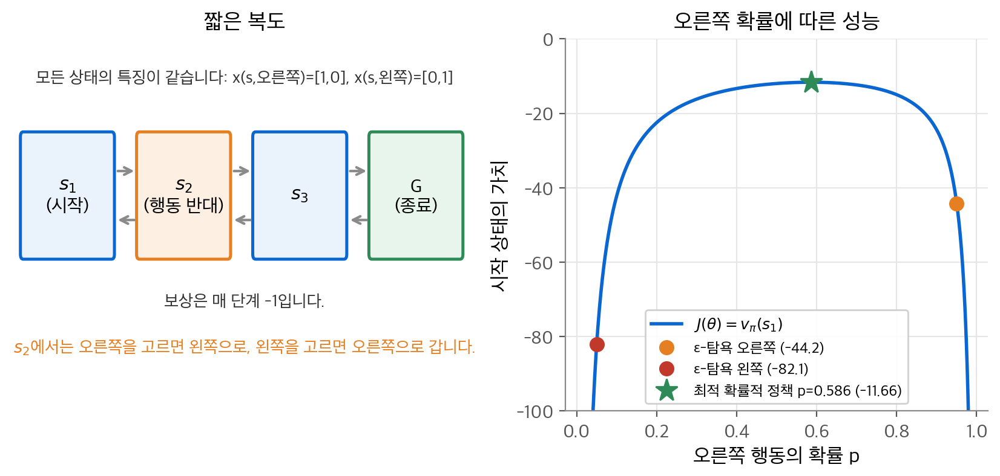
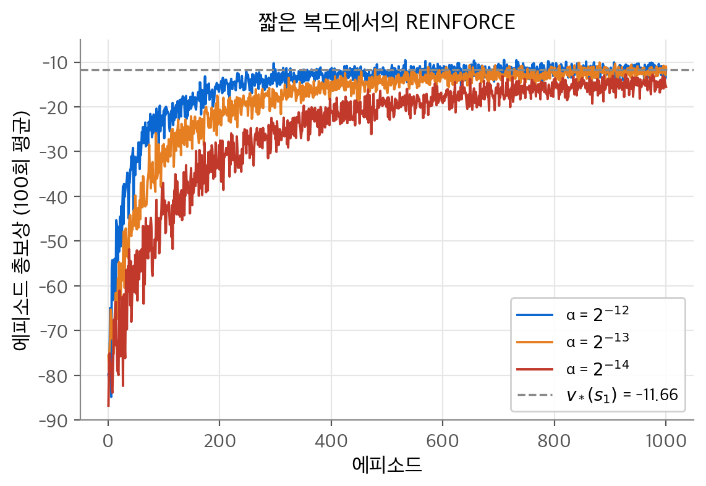
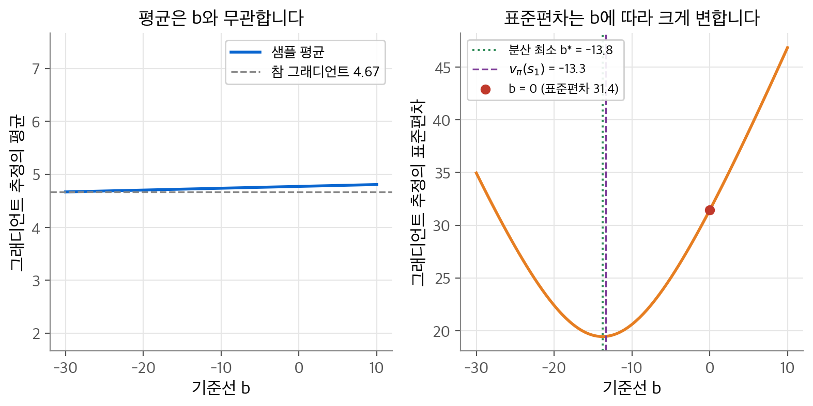
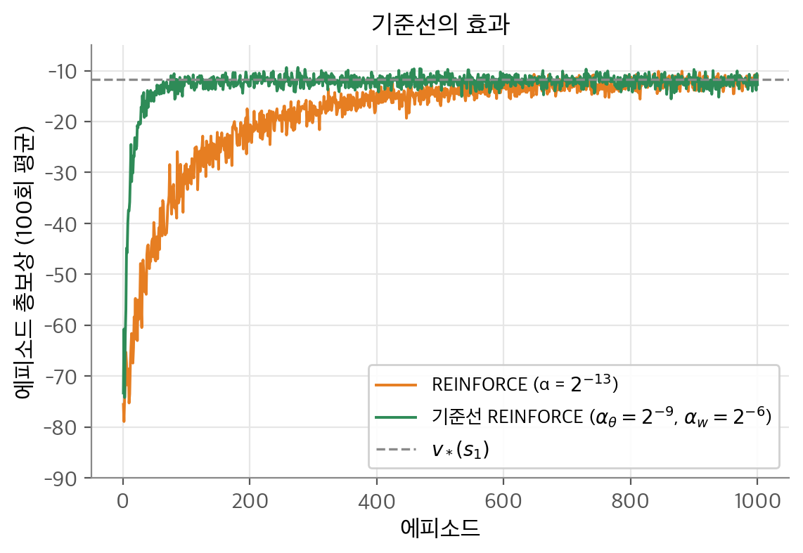
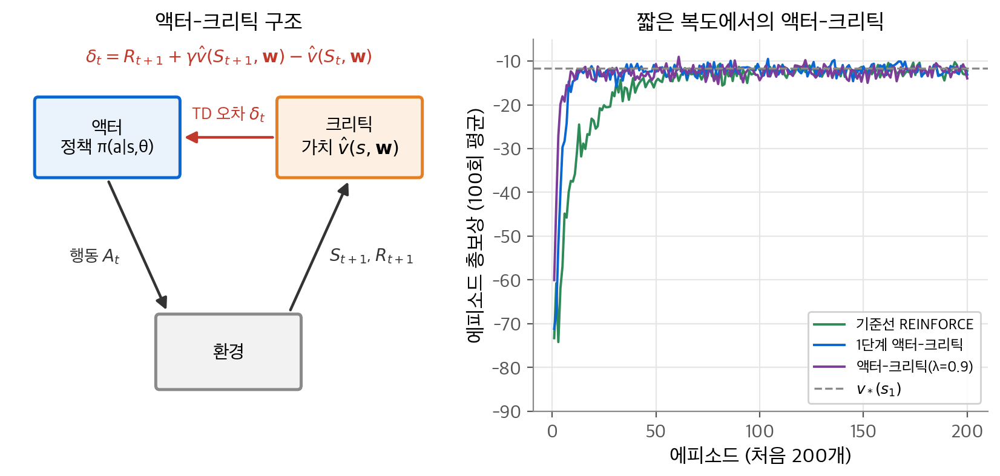
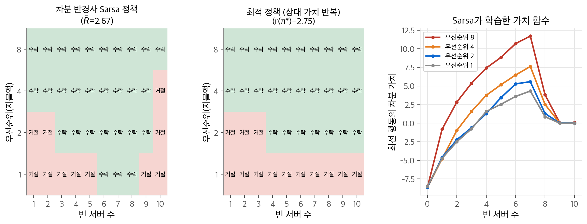
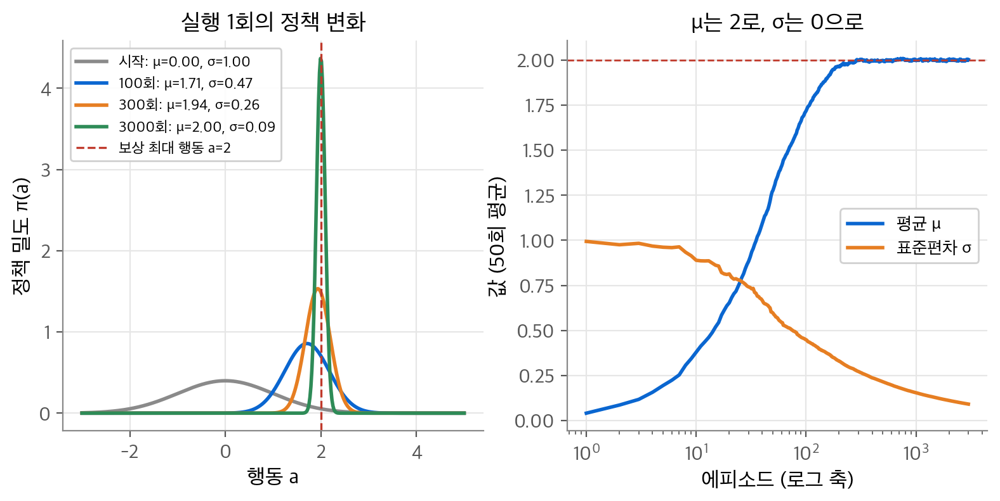

# 11. 정책 근사

지금까지의 제어 방법은 행동 가치를 배우고 그 값으로 행동을 골랐습니다. 이 장의 질문은 "가치 함수를 거치지 않고 정책 자체를 파라미터로 표현해 직접 개선할 수 있을까?"입니다. 결론은 성능 $J(\theta)$ 의 그래디언트를 따라 정책 파라미터 $\theta$ 를 올리는 것입니다. **정책 그래디언트 정리(policy gradient theorem)** 덕분에 상태 분포의 미분을 몰라도 그래디언트의 샘플을 얻을 수 있습니다. 이 샘플에 몬테카를로 이득을 쓰면 REINFORCE가 되고, TD 오차를 쓰면 액터-크리틱이 됩니다. 끝이 없는 과제에서는 할인 대신 평균 보상을 목표로 삼습니다.

!!! info "원문과 자료"
    - 원문: 초안 11장 Policy Approximation (11.1 액터-크리틱, 11.2 적격 흔적을 쓰는 액터-크리틱, 11.3 R-learning과 평균 보상 설정). 최종본 13장 Policy Gradient Methods (13.1~13.7)와 10.3~10.5(평균 보상, 할인의 폐기, 차분 $n$ 단계 Sarsa)로 보충했습니다.
    - [Sutton & Barto 책 페이지](http://incompleteideas.net/book/the-book-2nd.html)
    - [David Silver UCL RL 강의](https://www.davidsilver.uk/teaching/) 7강 Policy Gradient Methods
    - [OpenAI Spinning Up: Intro to Policy Optimization](https://spinningup.openai.com/en/latest/spinningup/rl_intro3.html)
    - [Berkeley CS285 Deep Reinforcement Learning](https://rail.eecs.berkeley.edu/deeprlcourse/) 정책 그래디언트, 액터-크리틱 강의
    - 함께 읽기: [2. 다중 선택 밴딧](02-bandits.md)(그래디언트 밴딧), [7. n단계 TD와 적격 흔적](07-eligibility-traces.md), [9. 함수 근사](09-function-approximation.md), [10. 근사를 쓰는 off-policy 학습](10-off-policy-approximation.md), [다층 퍼셉트론](../d2l/03-mlp.md)

## 1. 정책을 직접 근사하기

### 행동 가치 방법과 정책 방법

행동 가치를 배우고 그 값으로 행동을 고르는 방법을 **행동 가치 방법(action-value method)** 이라고 합니다. ε-탐욕 Sarsa와 Q-learning이 여기에 속합니다. 이 장에서는 정책을 별도의 파라미터 $\theta \in \mathbb{R}^{d'}$ 로 표현합니다.

$$
\pi(a \mid s, \theta) = \Pr\{A_t = a \mid S_t = s, \theta_t = \theta\}
$$

가치 함수를 함께 배울 수도 있습니다. 이때 가치 함수의 가중치는 $\mathbf{w} \in \mathbb{R}^d$ 로 따로 씁니다. 다만 행동을 고를 때 가치 함수가 필요하지는 않습니다. 정책 파라미터는 성능 척도 $J(\theta)$ 를 키우는 방향으로 갱신합니다.

$$
\theta_{t+1} = \theta_t + \alpha\, \widehat{\nabla J(\theta_t)}
$$

$\widehat{\nabla J}$ 는 기댓값이 $\nabla J$ 에 비례하는 확률적 추정입니다. 이 형태를 따르는 방법을 모두 **정책 그래디언트(policy gradient)** 방법이라고 합니다. 정책과 가치 함수를 함께 배우는 방법은 **액터-크리틱(actor-critic)** 이라고 부릅니다. 액터는 정책이고 크리틱은 가치 함수입니다.

### 소프트맥스 정책 파라미터화

조건은 하나입니다. $\pi(a \mid s, \theta)$ 가 $\theta$ 로 미분 가능해야 합니다. 탐험을 위해 보통 $\pi(a \mid s, \theta) \in (0, 1)$ 로 둡니다. 행동이 이산적이고 많지 않으면 상태-행동 쌍마다 **선호도(preference)** $h(s, a, \theta)$ 를 두고 소프트맥스로 확률을 만듭니다.

$$
\pi(a \mid s, \theta) = \frac{e^{h(s,a,\theta)}}{\sum_b e^{h(s,b,\theta)}}, \qquad h(s, a, \theta) = \theta^\top \mathbf{x}(s, a)
$$

선호도는 특징 $\mathbf{x}(s,a)$ 의 선형 함수일 수도 있고 신경망의 출력일 수도 있습니다. 분모는 확률의 합을 1로 맞추는 역할만 합니다. 이 형태를 **행동 선호도의 소프트맥스(soft-max in action preferences)** 라고 합니다.

행동 가치에 소프트맥스를 씌우는 것과는 다릅니다. 행동 가치는 참값으로 수렴합니다. 참값의 차이는 유한하므로 확률도 0이나 1이 아닌 특정 값에 머뭅니다. 선호도는 특정 값으로 수렴할 필요가 없습니다. 최적 정책이 결정적이면 최적 행동의 선호도가 한없이 커지고, 정책은 결정적 정책에 다가갑니다. ε-탐욕은 언제나 ε의 확률로 무작위 행동을 합니다.

### 확률적 정책이 나은 경우: 짧은 복도

**짧은 복도(short corridor)** 예제는 확률적 정책의 장점을 보여 줍니다. 비종료 상태가 셋이고 행동은 오른쪽과 왼쪽 둘입니다. 보상은 매 단계 $-1$ 입니다. $s_1$ 과 $s_3$ 에서 행동은 보통대로 움직입니다. $s_1$ 에서 왼쪽은 제자리입니다. $s_2$ 에서는 행동이 반대로 작동합니다. 어려운 점은 함수 근사에서 모든 상태가 같아 보인다는 것입니다. 특징은 모든 $s$ 에서 $\mathbf{x}(s, \text{오른쪽}) = [1, 0]^\top$, $\mathbf{x}(s, \text{왼쪽}) = [0, 1]^\top$ 입니다.

상태를 구분할 수 없으므로 정책은 "오른쪽 확률 $p$" 하나로 정해집니다. 각 상태의 가치는 다음 연립 방정식을 만족합니다.

$$
\begin{aligned}
v_1 &= -1 + p\, v_2 + (1-p)\, v_1 \\
v_2 &= -1 + p\, v_1 + (1-p)\, v_3 \\
v_3 &= -1 + p \cdot 0 + (1-p)\, v_2
\end{aligned}
$$

첫 식에서 $v_1 = v_2 - 1/p$ 입니다. 이 값과 셋째 식을 둘째 식에 넣고 정리합니다.

$$
v_2 = -\frac{3 - p}{p(1-p)}, \qquad J(p) = v_1 = -\frac{2(2-p)}{p(1-p)}
$$

$p = 0.5$ 를 넣으면 $J = -2(1.5)/0.25 = -12$ 입니다. $dJ/dp = 0$ 을 풀면 $p^2 - 4p + 2 = 0$ 이고, 구간 안의 근은 $p^* = 2 - \sqrt{2} \approx 0.586$ 입니다. 이때 $J(p^*) = -11.66$ 입니다.

<figure markdown>

<figcaption markdown>
<b>Figure 1.</b> 짧은 복도와 성능 곡선

$s_2$ 에서만 행동 효과가 반대인 복도(왼쪽)에서는 최적 확률적 정책(별)이 두 ε-탐욕 정책(점)보다 $J(p)$ 가 높습니다.
</figcaption>
</figure>

ε-탐욕 행동 가치 방법은 두 정책 중 하나만 고를 수 있습니다. 오른쪽을 $1 - \varepsilon/2 = 0.95$ 로 고르거나 왼쪽을 0.95로 고릅니다. NumPy로 계산한 두 정책의 가치는 각각 $-44.21$, $-82.11$ 입니다. 최적 확률적 정책 $-11.66$ 보다 훨씬 나쁩니다. 결정적 정책은 더 나쁩니다. $p = 1$ 이면 $s_2$ 와 $s_1$ 사이를 영원히 오가고, $p = 0$ 이면 $s_1$ 에 갇힙니다. 상태를 구분하지 못하는 근사에서는 무작위성이 정보 부족을 메웁니다. 포커의 블러핑처럼 불완전 정보 게임도 같은 이유로 확률적 정책이 최적입니다.

### 그 밖의 장점

| 장점 | 설명 |
| --- | --- |
| 결정적 정책에 다가감 | 선호도가 커지면 확률이 1에 다가갑니다. ε 일정을 정할 필요가 없습니다. |
| 임의의 확률 학습 | 최적 정책이 확률적일 때 그 확률을 배웁니다. |
| 더 단순한 함수 | 어떤 문제는 가치 함수보다 정책이 더 단순합니다(테트리스 사례). |
| 사전 지식 주입 | 정책의 형태를 정해 원하는 구조를 넣습니다. |
| 연속 행동 | 행동마다 확률을 두지 않고 분포의 통계량을 배웁니다(8절). |
| 매끄러운 변화 | 확률이 $\theta$ 에 연속적으로 의존합니다. ε-탐욕은 최대 행동이 바뀌면 정책이 급변합니다. 이 연속성 덕분에 수렴 보장이 더 강합니다. |

## 2. 정책 그래디언트 정리

### 무엇이 어려운가

에피소드형 과제에서 성능은 시작 상태 $s_0$ 의 가치로 정의합니다. 여기서는 $\gamma = 1$ 로 둡니다.

$$
J(\theta) = v_{\pi_\theta}(s_0)
$$

$\theta$ 를 바꾸면 두 가지가 바뀝니다. 각 상태에서 고르는 행동이 바뀌고, 방문하는 상태의 분포도 바뀝니다. 앞의 효과는 정책의 형태만 알면 계산할 수 있습니다. 뒤의 효과는 환경의 동역학에 달려 있어 보통 모릅니다. 정책 그래디언트 정리는 상태 분포의 미분이 없는 그래디언트 식을 줍니다.

$$
\nabla J(\theta) \propto \sum_s \mu(s) \sum_a q_\pi(s, a)\, \nabla \pi(a \mid s, \theta)
$$

$\mu$ 는 [9장](09-function-approximation.md)의 on-policy 분포입니다. 에피소드형에서 비례 상수는 평균 에피소드 길이이고, 연속형에서는 1입니다.

### 증명 (에피소드형)

$\pi$ 가 $\theta$ 의 함수라는 사실과 그래디언트가 $\theta$ 에 대한 것이라는 사실은 생략해 씁니다. 출발점은 $v_\pi(s) = \sum_a \pi(a \mid s) q_\pi(s,a)$ 입니다.

**1단계: 곱의 법칙.**

$$
\nabla v_\pi(s) = \sum_a \Big[ \nabla \pi(a \mid s)\, q_\pi(s,a) + \pi(a \mid s)\, \nabla q_\pi(s,a) \Big]
$$

**2단계: $q_\pi$ 를 한 단계 펼칩니다.** $q_\pi(s,a) = \sum_{s',r} p(s',r \mid s,a)\,[r + v_\pi(s')]$ 입니다. 보상 $r$ 과 전이 확률은 $\theta$ 와 무관하므로 미분하면 사라집니다.

$$
\nabla q_\pi(s,a) = \sum_{s'} p(s' \mid s, a)\, \nabla v_\pi(s')
$$

**3단계: 대입해 재귀식을 얻습니다.**

$$
\nabla v_\pi(s) = \sum_a \nabla \pi(a \mid s)\, q_\pi(s,a) + \sum_a \pi(a \mid s) \sum_{s'} p(s' \mid s,a)\, \nabla v_\pi(s')
$$

둘째 항의 $\sum_a \pi(a \mid s) p(s' \mid s, a)$ 는 정책을 따를 때 $s$ 에서 한 단계 만에 $s'$ 로 갈 확률입니다. 이것을 $\Pr(s \to s', 1, \pi)$ 로 씁니다. 첫째 항을 $\phi(s) = \sum_a \nabla \pi(a \mid s) q_\pi(s,a)$ 로 줄여 쓰면 다음과 같습니다.

$$
\nabla v_\pi(s) = \phi(s) + \sum_{s'} \Pr(s \to s', 1, \pi)\, \nabla v_\pi(s')
$$

**4단계: 반복해서 펼칩니다.** $\nabla v_\pi(s')$ 에 같은 식을 계속 넣습니다. $k$ 단계 전이 확률은 한 단계 전이 확률의 곱의 합입니다.

$$
\nabla v_\pi(s) = \sum_{x \in \mathcal{S}} \sum_{k=0}^{\infty} \Pr(s \to x, k, \pi)\, \phi(x)
$$

에피소드는 결국 끝나므로 이 합은 유한합니다.

**5단계: 시작 상태에 적용합니다.** $\eta(s) = \sum_{k} \Pr(s_0 \to s, k, \pi)$ 는 한 에피소드에서 $s$ 를 방문하는 기대 횟수입니다. on-policy 분포는 $\mu(s) = \eta(s) / \sum_{s'} \eta(s')$ 입니다.

$$
\nabla J(\theta) = \sum_s \eta(s)\, \phi(s) = \Big(\sum_{s'} \eta(s')\Big) \sum_s \mu(s) \sum_a \nabla \pi(a \mid s)\, q_\pi(s,a)
$$

괄호 안은 평균 에피소드 길이입니다. 양수 상수이므로 비례 관계가 성립합니다. 증명에서 상태 분포의 미분은 한 번도 나오지 않았습니다. 상태 분포의 효과는 $\eta(s)$ 라는 가중치로만 들어갔습니다.

## 3. REINFORCE: 몬테카를로 정책 그래디언트

### 유도

정리의 우변은 $\mu$ 에 대한 가중합입니다. 정책 $\pi$ 를 따르면 상태가 바로 이 비율로 나타납니다. 그러므로 합을 기댓값으로 바꿀 수 있습니다.

$$
\nabla J(\theta) \propto \mathbb{E}_\pi \Big[ \sum_a q_\pi(S_t, a)\, \nabla \pi(a \mid S_t, \theta) \Big]
$$

이 식에서 멈추고 학습한 $\hat{q}$ 를 넣으면 모든 행동을 쓰는 **all-actions** 방법이 됩니다. REINFORCE는 실제로 고른 행동 $A_t$ 하나만 씁니다. 합의 각 항에 $\pi(a \mid S_t, \theta)$ 를 곱하고 나눕니다.

$$
\begin{aligned}
\nabla J(\theta) &\propto \mathbb{E}_\pi \Big[ \sum_a \pi(a \mid S_t, \theta)\, q_\pi(S_t, a)\, \frac{\nabla \pi(a \mid S_t, \theta)}{\pi(a \mid S_t, \theta)} \Big] \\
&= \mathbb{E}_\pi \Big[ q_\pi(S_t, A_t)\, \frac{\nabla \pi(A_t \mid S_t, \theta)}{\pi(A_t \mid S_t, \theta)} \Big] \qquad (A_t \sim \pi) \\
&= \mathbb{E}_\pi \Big[ G_t\, \frac{\nabla \pi(A_t \mid S_t, \theta)}{\pi(A_t \mid S_t, \theta)} \Big] \qquad (\mathbb{E}_\pi[G_t \mid S_t, A_t] = q_\pi(S_t, A_t))
\end{aligned}
$$

괄호 안의 값은 매 시점 샘플링할 수 있습니다. 이 샘플로 확률적 경사 상승을 하면 **REINFORCE** 갱신이 됩니다(Williams, 1992).

$$
\theta_{t+1} = \theta_t + \alpha\, G_t\, \nabla \ln \pi(A_t \mid S_t, \theta_t)
$$

$\nabla \ln x = \nabla x / x$ 를 썼습니다. $\nabla \ln \pi(A_t \mid S_t, \theta)$ 를 **적격 벡터(eligibility vector)** 라고 합니다. 알고리즘에서 정책의 형태가 나타나는 곳은 이 벡터 하나입니다.

직관은 두 부분입니다. $\nabla \pi(A_t \mid S_t)$ 는 같은 상태에서 같은 행동을 다시 고를 확률을 가장 빨리 높이는 방향입니다. 이 방향으로 이득 $G_t$ 에 비례해 움직이므로 이득이 큰 행동이 강화됩니다. $\pi$ 로 나누는 부분은 자주 고르는 행동의 이점을 상쇄합니다. 나누지 않으면 자주 뽑히는 행동이 이득이 낮아도 더 자주 갱신되어 이길 수 있습니다.

### 소프트맥스 선형 정책의 적격 벡터

$\ln \pi(a \mid s) = \theta^\top \mathbf{x}(s,a) - \ln \sum_b e^{\theta^\top \mathbf{x}(s,b)}$ 를 미분합니다.

$$
\nabla \ln \pi(a \mid s, \theta) = \mathbf{x}(s,a) - \frac{\sum_b e^{\theta^\top \mathbf{x}(s,b)}\, \mathbf{x}(s,b)}{\sum_b e^{\theta^\top \mathbf{x}(s,b)}} = \mathbf{x}(s,a) - \sum_b \pi(b \mid s, \theta)\, \mathbf{x}(s,b)
$$

고른 행동의 특징에서 정책 아래 특징의 평균을 뺀 값입니다. 짧은 복도에서 $\theta = (-1.47, 1.47)$ 이면 오른쪽 확률은 $p = 1/(1 + e^{2.94}) = 0.050$ 입니다. 평균 특징은 $[p, 1-p] = [0.050, 0.950]$ 입니다. 오른쪽을 고르면 적격 벡터는 $[0.950, -0.950]$ 이고, 왼쪽을 고르면 $[-0.050, 0.050]$ 입니다. 드물게 고른 행동일수록 한 번의 갱신이 크게 움직입니다.

### 알고리즘

에피소드가 끝난 뒤에 이득을 계산하므로 REINFORCE는 몬테카를로 방법입니다. 에피소드 $S_0, A_0, R_1, \ldots, R_T$ 를 만든 뒤 $t = 0, \ldots, T-1$ 마다 $G \leftarrow \sum_{k=t+1}^{T} \gamma^{k-t-1} R_k$ 를 구하고 $\theta \leftarrow \theta + \alpha \gamma^t G\, \nabla \ln \pi(A_t \mid S_t, \theta)$ 로 갱신합니다. 할인이 있을 때 붙는 $\gamma^t$ 는 시작 상태의 가치를 목표로 삼은 결과입니다.

### 짧은 복도 실험

$\theta$ 의 초깃값은 $(-1.47, 1.47)$ 이고, 오른쪽 확률 0.05에서 시작합니다. 학습 도중 정책이 너무 결정적으로 가지 않도록 확률을 $[0.05, 0.95]$ 로 자릅니다. 원문은 이 처리를 밝히지 않았습니다. 이 노트에서 더한 설정입니다. 에피소드 1,000개를 100번 반복해 평균했습니다.

<figure markdown>

<figcaption markdown>
<b>Figure 2.</b> REINFORCE 학습 곡선

짧은 복도에서 스텝 크기 세 개로 REINFORCE를 돌린 결과입니다. 회색 점선은 최적 확률적 정책의 가치 $-11.66$ 입니다.
</figcaption>
</figure>

| α | 에피소드 1~10 | 에피소드 91~100 | 마지막 100개 |
| --- | --- | --- | --- |
| $2^{-12}$ | $-68.8$ | $-23.1$ | $-11.71$ |
| $2^{-13}$ | $-72.0$ | $-31.6$ | $-12.23$ |
| $2^{-14}$ | $-79.0$ | $-44.3$ | $-14.87$ |

세 경우 모두 최적값 쪽으로 다가갑니다. 기대 갱신이 $\nabla J$ 와 같은 방향이므로 α가 충분히 작으면 성능이 오릅니다. 대신 몬테카를로 이득의 분산이 커서 α를 키우기 어렵습니다. 처음에는 에피소드가 80단계쯤이고 $G_t$ 의 크기도 그만큼 큽니다. α가 $2^{-12}$ 보다 크면 한 번의 갱신이 너무 커집니다.

## 4. 기준선이 있는 REINFORCE

### 기준선은 기댓값을 바꾸지 않습니다

정책 그래디언트 정리에서 $q_\pi$ 대신 $q_\pi - b(s)$ 를 써도 됩니다. **기준선(baseline)** $b(s)$ 는 행동 $a$ 에 따라 변하지만 않으면 어떤 함수여도 됩니다.

$$
\sum_a b(s)\, \nabla \pi(a \mid s, \theta) = b(s)\, \nabla \sum_a \pi(a \mid s, \theta) = b(s)\, \nabla 1 = 0
$$

확률의 합은 언제나 1이므로 그 그래디언트는 0입니다. 그래서 빼는 항의 기댓값이 0이고, 편향이 생기지 않습니다. 샘플 식으로 쓰면 $\mathbb{E}[b(S_t)\, \nabla \ln \pi(A_t \mid S_t) \mid S_t] = 0$ 입니다. 갱신식은 다음과 같습니다.

$$
\theta_{t+1} = \theta_t + \alpha \big( G_t - b(S_t) \big) \nabla \ln \pi(A_t \mid S_t, \theta_t)
$$

### 분산은 크게 바뀝니다

한 상태만 보고 $\psi = \nabla \ln \pi(A \mid s)$ 를 스칼라로 둡니다. 갱신 크기는 $g(b) = (G - b)\psi$ 입니다. $\mathbb{E}[\psi] = 0$ 이므로 평균은 $b$ 와 무관합니다. 분산은 $b$ 의 이차식입니다.

$$
\operatorname{Var}[g(b)] = \mathbb{E}[G^2 \psi^2] - 2b\, \mathbb{E}[G \psi^2] + b^2\, \mathbb{E}[\psi^2] - (\mathbb{E}[G\psi])^2
$$

$b$ 로 미분해 0으로 두면 분산을 최소로 만드는 기준선을 얻습니다.

$$
b^* = \frac{\mathbb{E}[\psi^2\, G]}{\mathbb{E}[\psi^2]}
$$

$b^*$ 는 $\psi^2$ 으로 가중한 이득의 평균입니다. 가중치가 고르면 $b^* \approx \mathbb{E}[G \mid s] = v_\pi(s)$ 입니다. 그래서 상태 가치 추정 $\hat{v}(S_t, \mathbf{w})$ 를 기준선으로 쓰는 것이 자연스럽습니다. 상태마다 기준선이 달라야 하는 이유도 여기서 나옵니다. 모든 행동의 가치가 높은 상태에서는 높은 기준선이 있어야 행동 사이의 차이가 드러납니다.

짧은 복도에서 확인합니다. $p = 0.4$ 로 정책을 고정하고 에피소드 200,000개를 만들었습니다. 각 에피소드마다 $\sum_t (G_t - b)\psi_t$ 를 계산합니다. 이것은 $\theta_0$ 방향의 그래디언트 추정입니다. 해석적으로 구한 참 그래디언트는 $J'(p)\, p(1-p) = 4.67$ 입니다.

<figure markdown>

<figcaption markdown>
<b>Figure 3.</b> 기준선에 따른 그래디언트 추정의 평균과 표준편차

상수 기준선 $b$ 를 바꿔도 그래디언트 추정의 평균(왼쪽)은 그대로이고 표준편차(오른쪽)만 바뀝니다.
</figcaption>
</figure>

| 기준선 $b$ | 샘플 평균 | 표준편차 |
| --- | --- | --- |
| $0$ | $4.77$ | $31.44$ |
| $-10$ | $4.74$ | $20.61$ |
| $v_\pi(s_1) = -13.33$ | $4.73$ | $19.48$ |
| $b^* = -13.79$ | $4.73$ | $19.46$ |
| $-20$ | $4.71$ | $22.42$ |

평균은 모두 참값 4.67 근처입니다. 샘플 평균의 표준오차는 약 $31.4/\sqrt{200000} = 0.07$ 이므로 차이는 몬테카를로 잡음 수준입니다. 표준편차는 $b = 0$ 일 때 31.4이고 $b = v_\pi$ 일 때 19.5입니다. 분산으로는 2.6배 차이입니다. 최적 상수 $b^* = -13.79$ 는 $v_\pi(s_1) = -13.33$ 과 거의 같습니다.

### 학습 곡선 비교

기준선은 $\hat{v}(s, \mathbf{w}) = w$ 인 스칼라 하나입니다. 모든 상태의 특징이 같으므로 이것으로 충분합니다. $w$ 는 몬테카를로 방식으로 $w \leftarrow w + \alpha_w (G_t - w)$ 로 배우고, 정책은 $\theta \leftarrow \theta + \alpha_\theta \gamma^t (G_t - w) \nabla \ln \pi(A_t \mid S_t)$ 로 갱신합니다.

<figure markdown>

<figcaption markdown>
<b>Figure 4.</b> 기준선 유무의 학습 곡선

기준선이 있는 REINFORCE(초록)가 기준선 없는 REINFORCE(주황)보다 빨리 학습합니다(100번 평균).
</figcaption>
</figure>

기준선이 있으면 에피소드 91~100의 평균이 $-12.7$ 입니다. 같은 구간에서 기준선 없는 α=$2^{-13}$ 은 $-31.6$ 입니다. 분산이 줄었으므로 정책 스텝 크기를 $2^{-13}$ 에서 $2^{-9}$ 로 16배 키울 수 있었습니다. 마지막 100개 에피소드는 둘 다 $-12.2$ 근처입니다. 가치 스텝 크기 $\alpha_w$ 는 정하기 쉽습니다. 정책 스텝 크기 $\alpha_\theta$ 는 보상의 크기와 정책 형태에 따라 달라 정하기 어렵습니다.

## 5. 액터-크리틱

### 1단계 액터-크리틱

기준선 REINFORCE의 $\hat{v}(S_t)$ 는 전이의 첫 상태만 평가합니다. 행동을 고르기 전의 값이므로 행동 자체를 평가하지는 못합니다. 액터-크리틱은 전이의 둘째 상태에도 가치 함수를 씁니다. 전체 이득 $G_t$ 대신 1단계 이득 $G_{t:t+1} = R_{t+1} + \gamma \hat{v}(S_{t+1}, \mathbf{w})$ 를 씁니다.

$$
\begin{aligned}
\theta_{t+1} &= \theta_t + \alpha \big( G_{t:t+1} - \hat{v}(S_t, \mathbf{w}) \big) \nabla \ln \pi(A_t \mid S_t, \theta_t) \\
&= \theta_t + \alpha\, \delta_t\, \nabla \ln \pi(A_t \mid S_t, \theta_t), \qquad \delta_t = R_{t+1} + \gamma \hat{v}(S_{t+1}, \mathbf{w}) - \hat{v}(S_t, \mathbf{w})
\end{aligned}
$$

가치 함수가 행동을 평가하는 데 쓰이므로 **크리틱(critic)** 이라고 부릅니다. 크리틱은 반경사 TD(0)로 배웁니다. 이제 알고리즘은 완전히 온라인이고 증분적입니다.

1. $S$ 를 초기화하고 $I \leftarrow 1$ 로 둡니다.
2. $A \sim \pi(\cdot \mid S, \theta)$ 를 고르고 $R$, $S'$ 를 관측합니다.
3. $\delta \leftarrow R + \gamma \hat{v}(S', \mathbf{w}) - \hat{v}(S, \mathbf{w})$ 입니다. $S'$ 가 종료 상태이면 $\hat{v}(S') = 0$ 입니다.
4. $\mathbf{w} \leftarrow \mathbf{w} + \alpha_\mathbf{w}\, \delta\, \nabla \hat{v}(S, \mathbf{w})$
5. $\theta \leftarrow \theta + \alpha_\theta\, I\, \delta\, \nabla \ln \pi(A \mid S, \theta)$
6. $I \leftarrow \gamma I$, $S \leftarrow S'$ 로 두고 2로 돌아갑니다.

### TD 오차는 어드밴티지의 추정입니다

**어드밴티지(advantage)** 는 행동 가치와 상태 가치의 차이입니다. 그 행동이 정책의 평균보다 얼마나 나은지를 뜻합니다.

$$
A_\pi(s, a) = q_\pi(s, a) - v_\pi(s)
$$

크리틱이 정확하다고 가정하고($\hat{v} = v_\pi$) TD 오차의 조건부 기댓값을 계산합니다.

$$
\mathbb{E}[\delta_t \mid S_t = s, A_t = a] = \mathbb{E}[R_{t+1} + \gamma v_\pi(S_{t+1}) \mid s, a] - v_\pi(s) = q_\pi(s, a) - v_\pi(s)
$$

TD 오차는 어드밴티지의 불편 추정입니다. 그래서 $\delta_t$ 가 양수이면 방금 고른 행동을 강화하고, 음수이면 약화합니다. 실제 크리틱은 근사이므로 $\delta_t$ 는 편향을 가집니다. 이 편향은 부트스트래핑 자체 때문이 아니라 크리틱의 오차 때문입니다. 대신 분산이 크게 줄어듭니다. TD가 몬테카를로보다 자주 나은 이유와 같습니다. 이 관점이 A2C의 이름(advantage actor-critic)의 출처입니다.

### 초안의 표 형식 액터-크리틱

초안 11.1절은 표 형식 선호도 $H(s, a)$ 를 쓰는 고전적 액터-크리틱을 소개합니다. 갱신은 $H(S_t, A_t) \leftarrow H(S_t, A_t) + \beta \delta_t$ 입니다. 변형으로 $\beta\delta_t[1 - \pi(A_t \mid S_t)]$ 를 더하는 방식도 있습니다. 이 변형은 정책 그래디언트의 특수한 경우입니다. 표 형식 소프트맥스에서 특징은 상태-행동 쌍의 원-핫 벡터입니다. 적격 벡터의 $(S_t, A_t)$ 성분은 $1 - \pi(A_t \mid S_t)$ 이고, $(S_t, b)$ 성분은 $-\pi(b \mid S_t)$ 입니다. 초안의 변형은 첫 성분만 남긴 것입니다. 이 구조는 [2장](02-bandits.md)의 그래디언트 밴딧을 상태가 있는 문제로 넓힌 것입니다.

### 적격 흔적을 쓰는 액터-크리틱

1단계 이득은 $n$ 단계 이득 $G_{t:t+n}$ 이나 λ-이득 $G^\lambda_t$ 로 바꿀 수 있습니다. 후방 관점에서는 액터와 크리틱이 각자 적격 흔적을 가집니다. [7장](07-eligibility-traces.md)의 누적 흔적과 같은 형태입니다.

$$
\begin{aligned}
\mathbf{z}^\mathbf{w} &\leftarrow \gamma \lambda^\mathbf{w} \mathbf{z}^\mathbf{w} + \nabla \hat{v}(S, \mathbf{w}), & \mathbf{w} &\leftarrow \mathbf{w} + \alpha_\mathbf{w}\, \delta\, \mathbf{z}^\mathbf{w} \\
\mathbf{z}^\theta &\leftarrow \gamma \lambda^\theta \mathbf{z}^\theta + I\, \nabla \ln \pi(A \mid S, \theta), & \theta &\leftarrow \theta + \alpha_\theta\, \delta\, \mathbf{z}^\theta
\end{aligned}
$$

초안은 표 형식 선호도에 대해 같은 생각을 씁니다. 상태 흔적 하나와 상태-행동 흔적 하나를 둡니다. 상태-행동 흔적은 방문할 때 1 대신 $1 - \pi(A_t \mid S_t)$ 만큼 올립니다. 위 식에서 $\nabla \ln \pi$ 의 해당 성분과 같습니다.

### 짧은 복도 실험

액터는 이전과 같이 상태를 구분하지 못하는 특징을 씁니다. 크리틱은 세 상태를 구분하는 표 형식 가치를 씁니다. 크리틱이 모든 상태를 같게 보면 비종료 전이의 TD 오차가 늘 $-1$ 이 되어 행동을 평가할 수 없기 때문입니다. 이 설정은 원문의 실험이 아니고 이 노트에서 만든 것입니다. 스텝 크기는 $\alpha_\theta = 2^{-6}$, $\alpha_\mathbf{w} = 2^{-3}$ 입니다. 100번 반복해 평균했습니다.

<figure markdown>

<figcaption markdown>
<b>Figure 5.</b> 액터-크리틱 구조와 학습 곡선

크리틱이 내는 TD 오차 하나가 액터와 크리틱의 학습을 모두 이끕니다(왼쪽). 오른쪽은 학습 곡선입니다.
</figcaption>
</figure>

| 방법 | 에피소드 1~10 | 에피소드 1~50 | 마지막 100개 |
| --- | --- | --- | --- |
| 기준선 REINFORCE | $-53.3$ | $-26.8$ | $-12.28$ |
| 1단계 액터-크리틱 | $-35.9$ | $-17.2$ | $-12.23$ |
| 액터-크리틱(λ=0.9) | $-24.4$ | $-15.1$ | $-12.50$ |

액터-크리틱은 에피소드가 끝나기 전에도 매 단계 정책을 고칩니다. 처음 에피소드가 길 때 이 차이가 큽니다. λ=0.9의 흔적은 신용을 앞선 행동으로 빠르게 전달해 초기 학습을 더 앞당깁니다. 마지막 100개에서는 λ=0.9가 조금 낮습니다. 같은 스텝 크기에서 흔적이 갱신의 분산을 키우기 때문으로 보입니다.

## 6. 평균 보상 설정

### 왜 할인을 버리는가

초안은 "정책을 근사하면 대개 할인 보상 설정을 버려야 한다"고 말합니다. 끝이 없는 연속형 과제에서 근사를 쓰면 상태를 구분하지 못할 수 있습니다. 극단적으로 모든 특징 벡터가 같다면 남는 것은 보상의 열뿐입니다. 이때 성능을 평가하는 자연스러운 방법은 긴 구간의 평균 보상입니다.

할인을 살리려고 on-policy 분포로 할인 가치를 평균한다고 해 봅시다. $\mu_\pi$ 가 정상 분포라는 성질 $\sum_s \mu_\pi(s) \sum_a \pi(a \mid s) p(s' \mid s, a) = \mu_\pi(s')$ 를 씁니다.

$$
\begin{aligned}
J(\pi) &= \sum_s \mu_\pi(s)\, v^\gamma_\pi(s) = \sum_s \mu_\pi(s) \sum_a \pi(a \mid s) \sum_{s', r} p(s', r \mid s, a)\, [r + \gamma v^\gamma_\pi(s')] \\
&= r(\pi) + \gamma \sum_{s'} v^\gamma_\pi(s') \underbrace{\sum_s \mu_\pi(s) \sum_a \pi(a \mid s) p(s' \mid s, a)}_{\mu_\pi(s')} = r(\pi) + \gamma J(\pi)
\end{aligned}
$$

따라서 $J(\pi) = r(\pi)/(1-\gamma)$ 입니다. 정책의 순서는 평균 보상 $r(\pi)$ 의 순서와 똑같고 $\gamma$ 와 무관합니다. 세 상태 고리 A→B→C→A에서 A에 도착할 때만 보상 1을 받는 경우로 확인합니다. $r(\pi) = 1/3$ 입니다. NumPy로 할인 가치를 풀면 $\gamma = 0.9$ 에서 세 상태의 가치는 $(2.989, 3.321, 3.690)$ 이고 평균은 $3.333 = (1/3)/0.1$ 입니다. $\gamma = 0.5$ 에서는 평균이 $0.667 = (1/3)/0.5$ 입니다.

더 근본적인 문제도 있습니다. 함수 근사에서는 [4장](04-dynamic-programming.md)의 정책 개선 정리가 성립하지 않습니다. 한 상태의 할인 가치를 올려도 전체 정책이 나아진다는 보장이 없습니다. 정책 그래디언트 정리가 그 자리를 대신하는 보장입니다. 할인율 $\gamma$ 는 문제의 파라미터에서 해법의 파라미터로 바뀝니다.

### 평균 보상과 차분 이득

평균 보상 설정에서 정책의 질은 시간당 평균 보상입니다.

$$
r(\pi) = \lim_{h \to \infty} \frac{1}{h} \sum_{t=1}^{h} \mathbb{E}[R_t \mid S_0, A_{0:t-1} \sim \pi] = \sum_s \mu_\pi(s) \sum_a \pi(a \mid s) \sum_{s', r} p(s', r \mid s, a)\, r
$$

둘째 등식은 MDP가 **에르고딕(ergodic)** 일 때 성립합니다. 에르고딕이면 시작 상태와 초기 결정의 효과는 일시적입니다. 장기적으로는 정책과 전이 확률만 상태 분포를 정합니다.

평균보다 좋은 보상이 한동안 이어지는 상태도 있고 나쁜 보상이 이어지는 상태도 있습니다. 이 일시적 차이가 상태의 가치입니다. 보상에서 평균을 뺀 합을 **차분 이득(differential return)** 이라고 합니다.

$$
G_t = R_{t+1} - r(\pi) + R_{t+2} - r(\pi) + R_{t+3} - r(\pi) + \cdots
$$

$v_\pi(s) = \mathbb{E}_\pi[G_t \mid S_t = s]$ 와 $q_\pi(s,a)$ 도 이 이득으로 정의하고 **차분 가치 함수(differential value function)** 라고 부릅니다. 초안은 같은 개념을 상대 가치(relative value)라고 부릅니다. 벨만 방정식은 $\gamma$ 를 지우고 $r$ 을 $r - r(\pi)$ 로 바꾸면 됩니다.

$$
q_\pi(s, a) = \sum_{r, s'} p(s', r \mid s, a) \Big[ r - r(\pi) + \sum_{a'} \pi(a' \mid s') q_\pi(s', a') \Big]
$$

앞의 고리에서 차분 가치를 계산하면 A, B, C가 각각 $-1/3$, $0$, $1/3$ 입니다. C는 곧 보상 1을 받으므로 평균보다 유리합니다. 차분 TD 오차는 평균 보상 추정 $\bar{R}_t$ 를 씁니다.

$$
\delta_t = R_{t+1} - \bar{R}_t + \hat{q}(S_{t+1}, A_{t+1}, \mathbf{w}_t) - \hat{q}(S_t, A_t, \mathbf{w}_t)
$$

## 7. 차분 반경사 Sarsa와 R-learning

### 두 알고리즘

**차분 반경사 Sarsa(differential semi-gradient Sarsa)** 는 [9장](09-function-approximation.md)의 반경사 Sarsa에서 TD 오차만 차분 형태로 바꿉니다. 초안의 **R-learning** 은 Q-learning처럼 off-policy입니다(Schwartz, 1993).

| 단계 | 차분 반경사 Sarsa | R-learning |
| --- | --- | --- |
| TD 오차 | $\delta = R - \bar R + \hat q(S', A') - \hat q(S, A)$ | $\delta = R - \bar R + \max_a Q(S', a) - Q(S, A)$ |
| 가치 갱신 | $\mathbf{w} \leftarrow \mathbf{w} + \alpha \delta \nabla \hat q(S, A, \mathbf{w})$ | $Q(S, A) \leftarrow Q(S, A) + \alpha \delta$ |
| 평균 보상 갱신 | 매 단계 $\bar R \leftarrow \bar R + \beta \delta$ | $Q(S, A) = \max_a Q(S, a)$ 일 때만 $\bar R \leftarrow \bar R + \beta \delta$ |
| 추정하는 정책 | 행동 정책(ε-탐욕) | 탐욕적 목표 정책 |

$\bar R$ 을 $R - \bar R$ 대신 $\delta$ 로 갱신하는 데는 이유가 있습니다. 고리 예제에서 $\bar R = 1/3$ 이 정확해도 $R - \bar R$ 은 $-1/3, -1/3, 2/3$ 으로 계속 출렁입니다. 가치가 정확하면 $\delta$ 는 모두 0입니다. 그래서 $\delta$ 로 갱신하면 추정이 안정적입니다.

이 알고리즘은 차분 가치에 임의의 상수를 더한 값으로 수렴합니다. 모든 가치를 같은 양만큼 옮겨도 벨만 방정식과 TD 오차가 그대로이기 때문입니다. 정책은 가치의 차이만 쓰므로 실제로는 문제가 되지 않습니다.

### 접근 제어 대기열

**접근 제어 대기열(access-control queuing)** 과제는 서버 10대에 대한 접근을 결정합니다. 우선순위가 넷인 고객이 대기열 하나로 들어옵니다. 서버를 배정받은 고객은 우선순위에 따라 1, 2, 4, 8을 냅니다. 매 단계 대기열 맨 앞 고객을 수락하거나 거절합니다. 거절하면 보상은 0입니다. 빈 서버가 없으면 항상 거절합니다. 바쁜 서버는 매 단계 확률 $p = 0.06$ 으로 비게 됩니다. 우선순위는 균등 분포입니다. 상태는 (빈 서버 수, 우선순위)이고 할인 없이 장기 보상을 최대화합니다.

이 노트는 최종본 설정(균등 우선순위)으로 두 알고리즘을 200만 단계씩 돌렸습니다. 파라미터는 $\alpha = \beta = 0.01$, $\varepsilon = 0.1$ 이고 초기 가치와 $\bar R$ 은 0입니다. 비교를 위해 모델을 아는 상태에서 **상대 가치 반복(relative value iteration)** 으로 최적 정책도 구했습니다.

<figure markdown>

<figcaption markdown>
<b>Figure 6.</b> 접근 제어 대기열

차분 반경사 Sarsa가 학습한 정책(왼쪽), 최적 정책(가운데), 학습한 차분 가치(오른쪽)입니다.
</figcaption>
</figure>

| 정책 | $\bar R$ 추정 | 탐욕적 정책을 100만 단계 평가 |
| --- | --- | --- |
| 차분 반경사 Sarsa | $2.668$ | $2.735$ |
| R-learning | $2.731$ | $2.732$ |
| 최적(상대 가치 반복) | $r(\pi^*) = 2.748$ | $2.745$ |

최적 정책은 단순합니다. 우선순위 8과 4는 항상 수락합니다. 우선순위 2는 빈 서버가 4대 이상일 때 수락합니다. 우선순위 1은 항상 거절합니다. 학습한 정책은 빈 서버가 많은 쪽에서 최적 정책과 다릅니다. 서버가 거의 다 비는 상태는 드물게 나타나 데이터가 부족합니다. 오른쪽 그래프의 끝이 떨어지는 것도 같은 이유입니다. 그래도 학습한 탐욕적 정책의 평균 보상은 최적의 99.6%입니다.

Sarsa의 $\bar R$ 은 2.668로 탐욕적 정책의 값 2.735보다 낮습니다. Sarsa는 on-policy이므로 ε-탐욕 행동 정책의 평균 보상을 추정합니다. R-learning은 탐욕 행동일 때만 $\bar R$ 을 갱신하므로 목표 정책의 값에 더 가깝습니다. 원문은 $\bar R$ 을 Sarsa에서 약 2.31, 초안의 R-learning(고우선순위 비율 $h = 0.5$)에서 약 2.73으로 보고합니다. 이 노트의 Sarsa 값은 원문과 다릅니다. 서버가 비는 시점과 같은 세부 동역학이 원문과 다를 수 있습니다.

### 연속형 과제의 정책 그래디언트

연속형 과제에서는 $J(\theta) = r(\pi)$ 로 두고 가치를 차분 이득으로 정의합니다. 그러면 정책 그래디언트 정리가 같은 모양으로 성립하고 비례 상수는 1입니다. 증명의 앞부분은 에피소드형과 같습니다. 다른 점은 $q_\pi$ 를 펼칠 때 $-\nabla r(\theta)$ 항이 생긴다는 것입니다. $\sum_a \pi(a \mid s) = 1$ 이므로 $\nabla r(\theta)$ 에 대해 정리할 수 있습니다. 좌변 $\nabla r(\theta)$ 는 $s$ 와 무관합니다. 그래서 양변을 $\mu(s)$ 로 가중해 더해도 그대로입니다. 정상 분포 성질로 $\sum_s \mu(s) \sum_a \pi(a \mid s) p(s' \mid s, a) = \mu(s')$ 이므로 $\nabla v_\pi$ 항 두 개가 상쇄됩니다.

$$
\nabla J(\theta) = \sum_s \mu(s) \sum_a \nabla \pi(a \mid s)\, q_\pi(s, a)
$$

연속형 액터-크리틱은 에피소드형 알고리즘에서 세 곳만 바꿉니다. TD 오차는 $\delta = R - \bar R + \hat v(S') - \hat v(S)$ 입니다. 매 단계 $\bar R \leftarrow \bar R + \alpha_{\bar R}\, \delta$ 로 평균 보상을 갱신합니다. 흔적에서 $\gamma$ 와 $I$ 를 지웁니다.

## 8. 연속 행동을 위한 가우시안 정책

### 파라미터화

행동이 실수이면 행동마다 확률을 둘 수 없습니다. 대신 분포의 통계량을 배웁니다. 가장 흔한 선택은 정규 분포입니다.

$$
\pi(a \mid s, \theta) = \frac{1}{\sigma(s, \theta)\sqrt{2\pi}} \exp\Big( -\frac{(a - \mu(s, \theta))^2}{2\sigma(s, \theta)^2} \Big)
$$

$\pi(a \mid s)$ 는 확률이 아니라 밀도이므로 1보다 클 수 있습니다. 파라미터를 $\theta = [\theta_\mu, \theta_\sigma]^\top$ 로 나눕니다. 평균은 선형 함수로 둡니다. 표준편차는 양수여야 하므로 선형 함수의 지수로 둡니다.

$$
\mu(s, \theta) = \theta_\mu^\top \mathbf{x}_\mu(s), \qquad \sigma(s, \theta) = \exp\big(\theta_\sigma^\top \mathbf{x}_\sigma(s)\big)
$$

### 적격 벡터 유도

로그 밀도는 다음과 같습니다.

$$
\ln \pi(a \mid s, \theta) = -\ln \sigma - \tfrac{1}{2}\ln(2\pi) - \frac{(a - \mu)^2}{2\sigma^2}
$$

평균 쪽은 $\partial \mu / \partial \theta_\mu = \mathbf{x}_\mu(s)$ 이므로 연쇄 법칙으로 바로 나옵니다.

$$
\nabla_{\theta_\mu} \ln \pi(a \mid s, \theta) = \frac{a - \mu(s, \theta)}{\sigma(s, \theta)^2}\, \mathbf{x}_\mu(s)
$$

표준편차 쪽은 $\ln \sigma = \theta_\sigma^\top \mathbf{x}_\sigma$ 이고 $1/\sigma^2 = e^{-2\theta_\sigma^\top \mathbf{x}_\sigma}$ 입니다. 각각 미분하면 $\mathbf{x}_\sigma$ 와 $-2\mathbf{x}_\sigma/\sigma^2$ 이 나옵니다.

$$
\nabla_{\theta_\sigma} \ln \pi(a \mid s, \theta) = -\mathbf{x}_\sigma(s) + \frac{(a - \mu)^2}{2} \cdot \frac{2\mathbf{x}_\sigma(s)}{\sigma^2} = \Big( \frac{(a - \mu(s, \theta))^2}{\sigma(s, \theta)^2} - 1 \Big) \mathbf{x}_\sigma(s)
$$

해석은 직관적입니다. 평균보다 큰 행동이 좋은 결과를 내면 $\mu$ 가 그쪽으로 움직입니다. 표준편차 하나보다 멀리 떨어진 행동이 좋으면 $\sigma$ 가 커지고, 가까운 행동이 좋으면 $\sigma$ 가 작아집니다. 예를 들어 $\mu = 0$, $\sigma = 1$, $a = 1.5$ 이면 평균 쪽 성분은 $1.5$, 표준편차 쪽 성분은 $1.5^2 - 1 = 1.25$ 입니다.

### 실험: 한 단계 연속 행동 과제

상태가 하나이고 한 단계로 끝나는 과제를 만들었습니다. 보상은 $R = -(A - 2)^2$ 이고 최선 행동은 $a = 2$ 입니다. $\mathbf{x}_\mu = \mathbf{x}_\sigma = 1$ 로 두면 $\mu = \theta_\mu$, $\sigma = e^{\theta_\sigma}$ 입니다. 기준선은 보상의 지수 이동 평균(스텝 0.05)입니다. 정책 스텝 크기는 0.01이고, 초기 정책은 $\mu = 0$, $\sigma = 1$ 입니다. 50번 반복해 평균했습니다.

<figure markdown>

<figcaption markdown>
<b>Figure 7.</b> 가우시안 정책 학습

왼쪽은 실행 한 번에서 정책 밀도가 변하는 모습입니다. 오른쪽은 50번 실행의 평균 $\mu$ 와 $\sigma$ 이고, 가로축은 로그 눈금입니다.
</figcaption>
</figure>

50번 평균으로 $\mu$ 는 에피소드 100에서 1.718, 300에서 2.000, 3,000에서 2.003입니다. $\sigma$ 는 같은 시점에 0.448, 0.272, 0.091입니다. $\sigma$ 는 $\mu$ 가 2에 도달한 뒤에도 계속 줄어듭니다. 이 과제의 최적 정책은 결정적이므로 탐험의 폭이 스스로 줄어듭니다. 1절에서 말한 성질, 곧 선호도가 결정적 정책에 다가가는 성질과 같습니다. 반대로 최적 정책에 무작위성이 필요하면 $\sigma$ 는 0으로 가지 않습니다.

## 9. 현대 방법과의 연결

이 장의 식은 심층 강화 학습의 정책 방법에 그대로 이어집니다. 차이는 주로 분산을 줄이는 방법, 스텝 크기를 제어하는 방법, off-policy 데이터를 쓰는 방법에 있습니다.

| 방법 | 이 장과의 연결 | 원 논문 |
| --- | --- | --- |
| REINFORCE | 3절 그대로입니다. | [Williams (1992)](https://link.springer.com/article/10.1007/BF00992696) |
| 정책 그래디언트 정리 | 2절의 정리와 증명입니다. | [Sutton et al. (2000)](https://papers.nips.cc/paper/1999/hash/464d828b85b0bed98e80ade0a5c43b0f-Abstract.html) |
| A2C/A3C | $n$ 단계 이득으로 어드밴티지를 추정하는 액터-크리틱입니다. 엔트로피 보너스를 더하고, 여러 환경에서 병렬로 샘플을 모읍니다. | [Mnih et al. (2016)](https://arxiv.org/abs/1602.01783) |
| GAE | TD 오차를 λ로 가중합해 어드밴티지를 추정합니다. 5절 λ-이득의 어드밴티지 버전입니다. | [Schulman et al. (2015b)](https://arxiv.org/abs/1506.02438) |
| TRPO | 새 정책과 옛 정책의 KL 발산을 제한하고 대리 목적을 최대화합니다. 정책 스텝 크기를 정하기 어렵다는 문제(4절)에 대한 답입니다. | [Schulman et al. (2015a)](https://arxiv.org/abs/1502.05477) |
| PPO | 확률 비 $\pi_\theta/\pi_{\text{old}}$ 를 잘라 TRPO의 제약을 1차 방법으로 근사합니다. | [Schulman et al. (2017)](https://arxiv.org/abs/1707.06347) |
| DPG | 결정적 정책 $a = \mu_\theta(s)$ 에 대한 그래디언트 $\mathbb{E}[\nabla_\theta \mu_\theta(s) \nabla_a q(s,a)\vert_{a=\mu_\theta(s)}]$ 입니다. 가우시안 정책에서 $\sigma \to 0$ 인 극한입니다. | [Silver et al. (2014)](https://proceedings.mlr.press/v32/silver14.html) |
| DDPG | DPG에 심층 신경망 크리틱, 재현 버퍼, 목표 네트워크를 더한 off-policy 액터-크리틱입니다. | [Lillicrap et al. (2015)](https://arxiv.org/abs/1509.02971) |
| SAC | 보상에 정책 엔트로피를 더한 목표로 확률적 정책을 off-policy로 배웁니다. 1절의 확률적 정책과 8절의 가우시안 정책을 씁니다. | [Haarnoja et al. (2018)](https://arxiv.org/abs/1801.01290) |

## 정리

- 정책 근사는 $\pi(a \mid s, \theta)$ 를 직접 파라미터화하고 $\theta \leftarrow \theta + \alpha \widehat{\nabla J}$ 로 성능을 올립니다. 행동 선택에 가치 함수가 필요 없습니다.
- 행동 선호도의 소프트맥스는 결정적 정책에 다가갈 수 있고 임의의 확률도 배울 수 있습니다. 짧은 복도에서 최적 확률적 정책($p = 2 - \sqrt{2}$, $-11.66$)은 ε-탐욕 정책($-44.21$, $-82.11$)보다 훨씬 낫습니다.
- 정책 그래디언트 정리 $\nabla J \propto \sum_s \mu(s) \sum_a q_\pi(s,a) \nabla \pi(a \mid s)$ 에는 상태 분포의 미분이 없습니다. 증명은 곱의 법칙과 재귀를 반복해 펼치는 것이 전부입니다.
- REINFORCE는 $G_t \nabla \ln \pi(A_t \mid S_t)$ 를 샘플 그래디언트로 씁니다. 편향이 없지만 분산이 큽니다. 소프트맥스 선형 정책의 적격 벡터는 $\mathbf{x}(s,a) - \sum_b \pi(b \mid s)\mathbf{x}(s,b)$ 입니다.
- 기준선은 $\sum_a \nabla \pi = 0$ 이므로 기댓값을 바꾸지 않습니다. 분산 최소 기준선은 $\psi^2$ 으로 가중한 이득의 평균이고, 대개 $v_\pi(s)$ 에 가깝습니다. 짧은 복도에서 표준편차가 31.4에서 19.5로 줄었습니다.
- 액터-크리틱은 $G_t$ 대신 TD 오차 $\delta_t$ 를 씁니다. $\mathbb{E}[\delta_t \mid s, a] = q_\pi(s,a) - v_\pi(s)$ 이므로 $\delta_t$ 는 어드밴티지의 추정입니다. 크리틱이 편향을 들이는 대신 분산을 줄이고, 온라인으로 학습합니다. 적격 흔적은 액터와 크리틱이 따로 가집니다.
- 근사가 있는 연속형 과제에서 할인 가치의 평균은 $r(\pi)/(1-\gamma)$ 이므로 할인은 순서를 바꾸지 못합니다. 평균 보상 $r(\pi)$ 와 차분 이득 $\sum_k (R_{t+k} - r(\pi))$ 로 문제를 다시 씁니다.
- 차분 반경사 Sarsa와 R-learning은 TD 오차에서 $\gamma$ 를 지우고 $R - \bar R$ 을 씁니다. 접근 제어 대기열에서 학습한 정책은 최적 평균 보상 2.75의 99.6%를 얻었습니다.
- 연속 행동은 가우시안 정책으로 다룹니다. 적격 벡터는 평균 쪽이 $(a - \mu)\mathbf{x}_\mu/\sigma^2$, 표준편차 쪽이 $((a-\mu)^2/\sigma^2 - 1)\mathbf{x}_\sigma$ 입니다.
- A2C, GAE, TRPO, PPO, DPG, DDPG, SAC는 모두 이 장의 정책 그래디언트, 기준선, 어드밴티지, 가우시안 정책 위에 서 있습니다.
