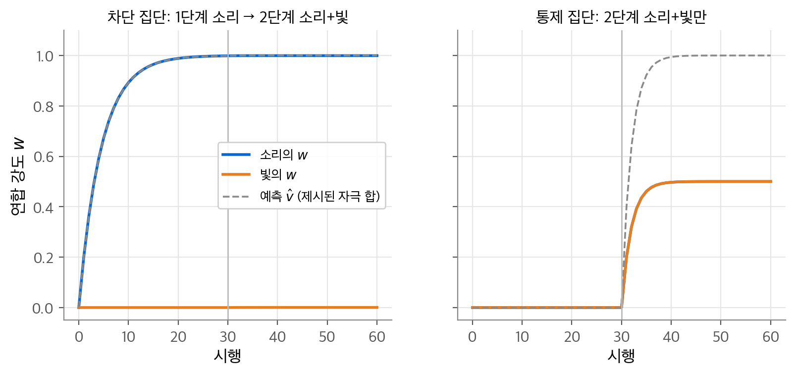
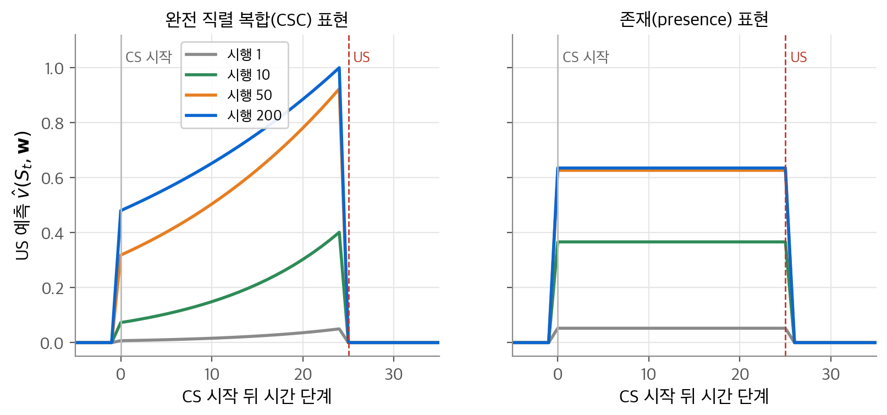
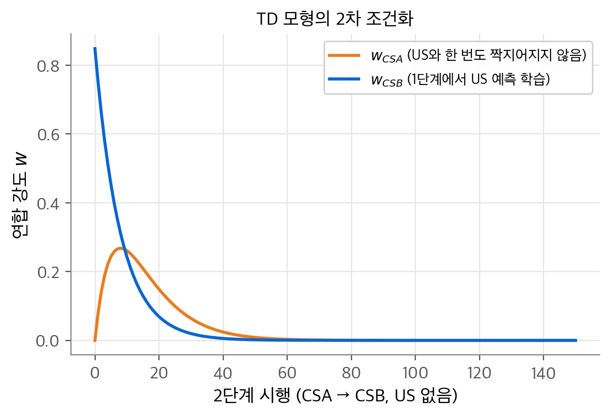
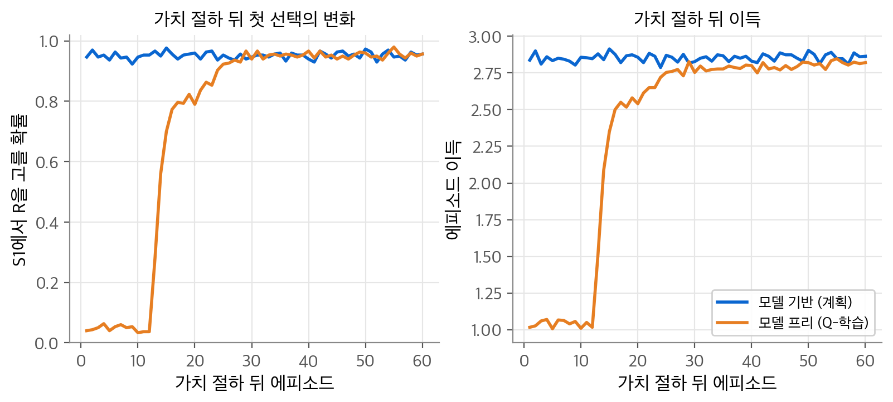
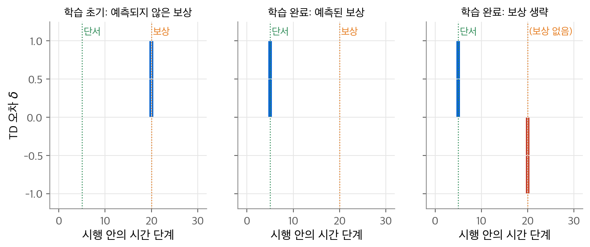
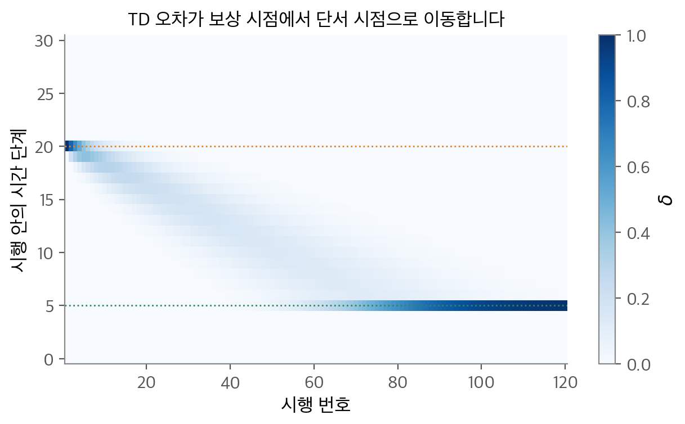
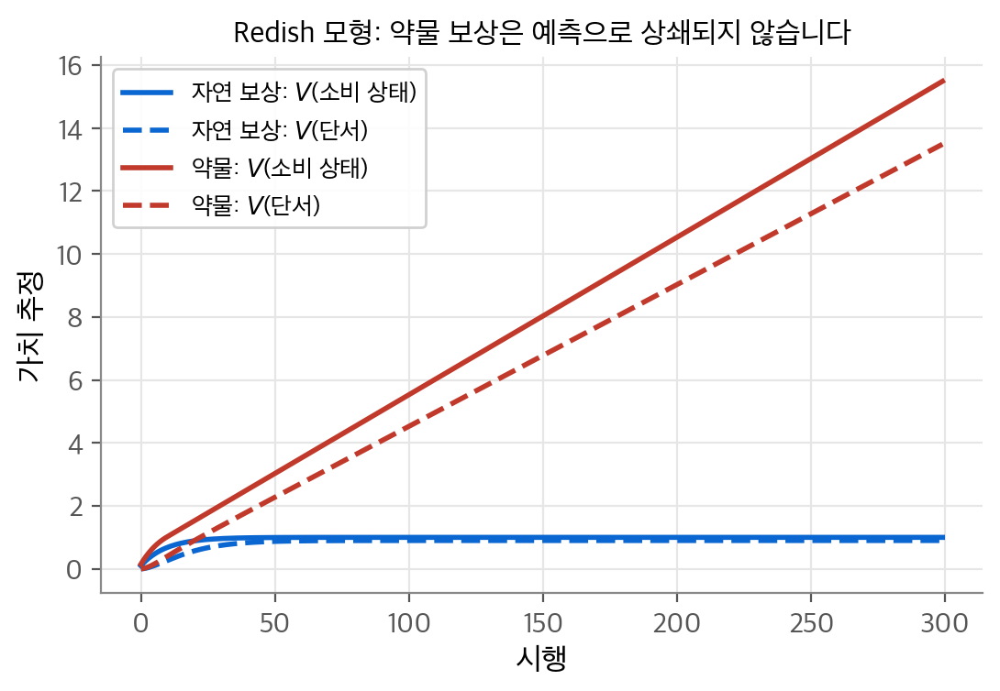

# 12. 심리학과 신경과학

앞 장까지의 알고리즘은 계산의 관점에서만 설계했습니다. 이 장의 질문은 "이 알고리즘들이 동물의 학습과 뇌의 작동 방식과 어떻게 맞닿는가?"입니다. 결론은 세 가지입니다. 첫째, 예측 알고리즘은 고전적 조건화에, 제어 알고리즘은 도구적 조건화에 대응합니다. 둘째, TD 학습은 Rescorla-Wagner 모형을 시간 축으로 확장한 조건화 모형이 됩니다. 셋째, 중뇌 도파민 뉴런의 위상성 반응은 TD 오차 $\delta_t$ 와 놀랄 만큼 비슷하게 움직입니다. 이 대응은 설계된 것이 아닙니다. TD 학습은 도파민 실험보다 먼저 계산의 필요에서 나왔습니다. 그래서 이 일치는 학습에 필요한 계산 원리를 드러낸다고 볼 수 있습니다.

!!! info "원문과 자료"
    - 원문: 초안 12장, 13장은 비어 있으므로 최종본 14장 Psychology(14.1~14.6), 15장 Neuroscience(15.1~15.12)를 원문으로 씁니다.
    - [Sutton & Barto, Reinforcement Learning: An Introduction 2판 책 페이지](http://incompleteideas.net/book/the-book-2nd.html)
    - [David Silver, UCL RL 강의](https://www.davidsilver.uk/teaching/): [Lecture 4 Model-Free Prediction (TD 학습) 슬라이드](https://davidstarsilver.wordpress.com/wp-content/uploads/2025/04/lecture-4-model-free-prediction-.pdf)
    - [Coursera Reinforcement Learning Specialization (Martha White, Adam White)](https://www.coursera.org/specializations/reinforcement-learning)
    - 함께 읽기: [6. 시간차 학습](06-td-learning.md), [7. n단계 TD와 적격 흔적](07-eligibility-traces.md), [8. 계획과 학습](08-planning-learning.md), [11. 정책 근사](11-policy-gradient.md)

## 1. 예측과 제어

이 책의 알고리즘은 두 갈래로 나뉩니다. **예측(prediction)** 알고리즘은 정책을 고정하고 미래 신호의 양을 추정합니다. 정책 평가가 여기에 속합니다. **제어(control)** 알고리즘은 정책 자체를 개선합니다. 심리학에도 비슷한 두 갈래가 있습니다.

| 강화 학습 | 동물 학습 실험 | 강화 자극이 행동에 달려 있는가 | 학습되는 것 |
| --- | --- | --- | --- |
| 예측 (정책 평가) | 고전적 조건화 (파블로프 조건화) | 아니요 | 다가올 자극의 예측 |
| 제어 (정책 개선) | 도구적 조건화 (조작적 조건화) | 예 | 보상받는 행동의 경향 |

고전적 조건화에서는 실험자가 동물의 행동과 무관하게 자극을 줍니다. 그래서 동물은 "무엇이 올지"만 배웁니다. 도구적 조건화에서는 동물이 한 행동에 따라 먹이나 벌이 주어집니다. 그래서 동물은 "무엇을 할지"를 배웁니다. 이 대응은 첫 근사일 뿐입니다. 고전적 조건화로 생긴 반응도 행동이므로 일종의 제어입니다. 이를 **파블로프 제어(Pavlovian control)** 라고 합니다. 실제 실험에서는 두 학습이 함께 일어납니다.

용어 하나를 짚습니다. 심리학의 **강화(reinforcement)** 는 행동 패턴을 강하게 하거나 약하게 하는 과정을 모두 가리킵니다. 그 원인이 된 자극을 **강화물(reinforcer)** 이라고 합니다. 이 책의 보상 $R_t$ 는 외부 사물보다 뇌 안에서 만들어지는 신호에 가깝습니다. 이 장은 이 구분을 유지합니다.

## 2. 고전적 조건화

### 용어

파블로프는 개의 침샘 반응을 측정했습니다. 먹이를 주면 개는 약 5초 뒤 침을 흘립니다. 먹이 직전에 메트로놈 소리를 여러 번 들려주자, 개는 소리만 들어도 침을 흘렸습니다. 이 실험에서 쓰는 용어는 다음과 같습니다.

| 용어 | 뜻 | 파블로프 실험의 예 |
| --- | --- | --- |
| **무조건 자극(US, unconditioned stimulus)** | 타고난 반응을 일으키는 자극 | 먹이 |
| **무조건 반응(UR, unconditioned response)** | US가 일으키는 타고난 반응 | 먹이에 대한 침 |
| **조건 자극(CS, conditioned stimulus)** | 처음에는 중립이지만 US를 예측하게 되는 자극 | 메트로놈 소리 |
| **조건 반응(CR, conditioned response)** | 학습 뒤 CS가 일으키는 반응 | 소리에 대한 침 |

CR은 보통 US보다 먼저 시작합니다. 동물은 US가 오기 전에 대비합니다. 그래서 고전적 조건화는 "예측을 배우는 과정"으로 해석됩니다.

CS와 US의 시간 관계는 두 가지가 대표적입니다. **지연 조건화(delay conditioning)** 에서는 CS가 US가 올 때까지 이어집니다. **흔적 조건화(trace conditioning)** 에서는 CS가 끝나고 빈 시간이 지난 뒤 US가 옵니다. CS 시작과 US 시작 사이의 간격을 **자극 간 간격(ISI, inter-stimulus interval)** 이라고 합니다.

### 차단

**차단(blocking)** 은 이미 US를 예측하는 CS가 있을 때 새 CS가 학습되지 않는 현상입니다. 토끼의 순막(눈꺼풀 안쪽 막) 실험이 대표 예입니다.

1. 1단계: 소리 CS 뒤에 공기 분사 US를 줍니다. 토끼는 소리에 순막을 닫습니다.
2. 2단계: 소리와 빛을 함께 준 뒤 같은 US를 줍니다.
3. 3단계: 빛만 줍니다. 토끼는 거의 반응하지 않습니다.

빛은 2단계 내내 US와 시간상 붙어 있었습니다. 그래도 학습되지 않았습니다. 따라서 "CS와 US가 시간상 가까우면 학습된다"는 근접성 원리만으로는 차단을 설명할 수 없습니다. 비교를 위한 통제 집단은 1단계 없이 소리+빛 시행만 받습니다. 이 집단은 빛을 정상적으로 학습합니다.

### 고차 조건화

**고차 조건화(higher-order conditioning)** 는 이미 조건화된 CS가 US처럼 작동해 다른 중립 자극을 조건화하는 현상입니다. 파블로프의 조수는 메트로놈을 먹이와 짝지은 뒤, 검은 사각형 뒤에 메트로놈만 들려주었습니다. 먹이는 주지 않았습니다. 10번의 시행 만에 개는 검은 사각형만 보고도 침을 흘렸습니다. 이것이 **2차 조건화(second-order conditioning)** 입니다.

도구적 상황에서도 같은 일이 일어납니다. 1차 강화물을 꾸준히 예측하는 자극은 그 자체로 강화물이 됩니다. 이를 **조건 강화물(conditioned reinforcer)** 이라고 합니다. 돈이 대표 예입니다. 액터-크리틱에서 크리틱의 가치 추정이 액터에게 주는 신호도 조건 강화입니다.

## 3. Rescorla-Wagner 모형

### 식

Rescorla와 Wagner(1972)는 차단을 설명하려고 모형을 만들었습니다. 핵심 생각은 "동물은 기대가 어긋날 때만 배운다"입니다. 이 책의 표기로 다시 씁니다. 시행 $t$ 의 유형을 상태 $S_t$ 로 보고, CS 성분 $i$ 가 있으면 $x_i(S_t)=1$, 없으면 0인 특징 벡터 $\mathbf{x}(S_t)$ 를 둡니다. 성분별 **연합 강도(associative strength)** 를 가중치 $\mathbf{w}$ 로 둡니다.

$$
\hat v(S_t,\mathbf{w}) = \mathbf{w}^\top \mathbf{x}(S_t)
$$

$$
\delta_t = R_t - \hat v(S_t,\mathbf{w}_t), \qquad
\mathbf{w}_{t+1} = \mathbf{w}_t + \alpha\,\delta_t\,\mathbf{x}(S_t)
$$

여기서 $t$ 는 시간 단계가 아니라 시행 번호입니다. $R_t$ 는 US의 크기입니다. $\hat v$ 는 제시된 성분들의 연합 강도의 합입니다. 이 합이 "전체 예측"이라는 가정이 모형의 핵심입니다.

이 식은 [9장](09-function-approximation.md)의 선형 함수 근사와 같은 꼴입니다. 기계 학습의 말로는 LMS(Widrow-Hoff) 규칙입니다. 오차 제곱 $\frac{1}{2}(R_t - \mathbf{w}^\top\mathbf{x})^2$ 을 $\mathbf{w}$ 로 미분하면 $-\delta_t\mathbf{x}$ 가 나옵니다. 그러므로 위 갱신은 확률적 경사 하강법 한 걸음입니다. $\mathbf{x}$ 가 곱해지므로 그 시행에 제시된 성분만 바뀝니다.

### 차단의 유도

1단계에서 소리만 제시하면 $\hat v = w_{\text{소리}}$ 입니다. 갱신은 $w_{\text{소리}} \leftarrow w_{\text{소리}} + \alpha(1-w_{\text{소리}})$ 이므로 $1-w_{\text{소리}}$ 가 매 시행 $(1-\alpha)$ 배로 줄어듭니다.

$$
w_{\text{소리}}^{(n)} = 1-(1-\alpha)^n
$$

2단계에서는 두 성분이 함께 나오므로 $\delta = 1 - w_{\text{소리}} - w_{\text{빛}}$ 입니다. 이미 $w_{\text{소리}}\approx 1$ 이면 $\delta \approx 0$ 이고, 빛의 가중치는 거의 움직이지 않습니다. 예측 오차가 없으므로 "놀람"이 없고, 놀람이 없으면 학습도 없습니다.

통제 집단은 처음부터 두 성분이 함께 나옵니다. 두 가중치는 같은 양씩 자라고, 합 $s = w_{\text{소리}}+w_{\text{빛}}$ 은 $s \leftarrow s + 2\alpha(1-s)$ 로 1에 다가갑니다. 대칭이므로 각각 $1/2$ 에 수렴합니다.

<figure markdown>

<figcaption markdown>
<b>Figure 1.</b> Rescorla-Wagner 모형의 차단

차단 집단(왼쪽)은 소리가 이미 예측을 맡아 빛의 $w$ 가 거의 자라지 않습니다. 통제 집단(오른쪽)은 두 자극이 각각 0.5로 나눕니다.
</figcaption>
</figure>

NumPy로 계산하면 1단계 30시행 뒤 $w_{\text{소리}} = 1-0.8^{30} = 0.9988$ 입니다. 2단계 30시행 뒤 빛의 가중치는 0.001에 그칩니다. 통제 집단은 두 가중치가 모두 0.500입니다. 같은 30번의 짝짓기가 앞선 학습 때문에 500배 작은 효과를 냅니다.

### 한계

Rescorla-Wagner 모형은 **시행 수준 모형(trial-level model)** 입니다. 한 시행을 한 걸음으로 봅니다. 그래서 시행 안의 시간 관계를 다루지 못합니다. ISI가 학습에 주는 영향, CR이 US보다 먼저 시작하는 이유를 설명하지 못합니다. 고차 조건화도 설명하지 못합니다. 2차 조건화 시행에는 US가 없으므로 $R_t = 0$ 이고, 새 자극의 가중치는 오히려 음수 쪽으로 갑니다.

## 4. TD 모형

### 식

TD 모형은 $t$ 를 시행 안의 짧은 시간 단계(예: 0.01초)로 바꿉니다. 시행은 상태의 수열이 됩니다. 사실 시행이라는 경계도 필요 없습니다. 동물은 끝없는 상태의 흐름을 경험합니다. 갱신은 [7장](07-eligibility-traces.md)의 선형 준 그래디언트 TD($\lambda$)와 같습니다.

$$
\delta_t = R_{t+1} + \gamma\,\hat v(S_{t+1},\mathbf{w}_t) - \hat v(S_t,\mathbf{w}_t)
$$

$$
\mathbf{z}_t = \gamma\lambda\,\mathbf{z}_{t-1} + \mathbf{x}(S_t), \qquad
\mathbf{w}_{t+1} = \mathbf{w}_t + \alpha\,\delta_t\,\mathbf{z}_t
$$

Rescorla-Wagner 식과 두 군데가 다릅니다. 첫째, $\mathbf{x}(S_t)$ 대신 적격 흔적 $\mathbf{z}_t$ 를 씁니다. 그래서 조금 전에 있었던 자극도 학습됩니다. 둘째, 오차에 $\gamma\hat v(S_{t+1})$ 이 들어갑니다. $\gamma=0$, $\lambda=0$ 이면 $\delta_t = R_{t+1} - \hat v(S_t)$ 가 되어 Rescorla-Wagner 모형으로 돌아갑니다. 차이는 $t$ 의 뜻과 목표의 한 단계 지연뿐입니다. 여기서 $R_{t+1}$ 은 꼭 보상일 필요가 없습니다. 예측 대상인 US의 크기면 됩니다.

### 자극 표현

TD 모형은 상태 표현을 정하지 않습니다. 같은 CS라도 뇌 안에서 어떻게 표현하는지에 따라 예측이 달라집니다. Ludvig, Sutton, Kehoe(2012)가 비교한 세 표현은 다음과 같습니다.

| 표현 | 특징 벡터 | 시간 일반화 | 비고 |
| --- | --- | --- | --- |
| **존재 표현(presence)** | CS가 있는 동안 1인 특징 하나 | 완전한 일반화 | 가중치가 CS당 하나 |
| **완전 직렬 복합(CSC, complete serial compound)** | CS 시작 뒤 $k$ 번째 단계에서만 1인 특징 $x_k$ | 일반화 없음 | 탭 지연선, 표 형식과 같음 |
| **미세 자극(MS, microstimulus)** | CS 시작 뒤 점점 넓고 낮아지는 겹친 종 모양 특징 | 중간 | 뇌의 표현으로 더 그럴듯함 |

CSC는 뇌가 정밀한 시계를 가진다는 가정이라 비현실적입니다. 그래도 TD 모형의 작동을 가장 깨끗하게 보여 주는 "유용한 허구"입니다. 9절의 도파민 모형도 CSC를 씁니다.

### CS-US 간격에 따른 예측 곡선

CSC 표현에서는 시점마다 가중치가 따로 있으므로 표 형식 TD와 같습니다. 학습이 끝나면 $\delta_t = 0$ 이 모든 시점에서 성립합니다. US 직전 시점 $u-1$ 에서는 $\hat v_{u-1} = R_u + \gamma\cdot 0 = 1$ 입니다. 그 앞에서는 $\hat v_t = \gamma\,\hat v_{t+1}$ 입니다. 따라서 US까지 $k$ 단계 남은 시점의 예측은 다음과 같습니다.

$$
\hat v_{u-k} = \gamma^{\,k-1}
$$

예측은 US에 다가갈수록 지수적으로 커집니다. 동물의 CR도 US 시점에 가까울수록 커집니다. 토끼의 순막은 US가 올 시점에 가장 많이 닫힙니다.

<figure markdown>

<figcaption markdown>
<b>Figure 2.</b> TD 모형의 US 예측 곡선

CSC 표현(왼쪽)은 US 직전에 1로 올라가는 지수 곡선을 배우고, 존재 표현(오른쪽)은 평평한 예측만 만듭니다.
</figcaption>
</figure>

NumPy 결과입니다. CSC 표현의 200번째 시행에서 US 직전 예측은 1.000이고, CS 시작 시점 예측은 0.480입니다. 이 값은 $\gamma^{24} = 0.97^{24} = 0.481$ 과 거의 같습니다. 존재 표현은 CS 동안 0.635로 일정합니다. 이 상수는 US 크기와 CS-US 간격 길이가 정합니다. 존재 표현에서 $\alpha=0.05$ 가 발산하는 이유는 흔적이 쌓이기 때문입니다. 26단계 동안 같은 특징이 켜지면 $z$ 는 최대 $1/(1-\gamma\lambda) \approx 12$ 까지 커지고, 실효 스텝 크기가 그만큼 커집니다.

조건화 강도가 ISI에 따라 어떻게 달라지는지도 TD 모형의 기본 성질로 나옵니다. ISI가 0이거나 음수면, 즉 US가 CS와 동시에 또는 먼저 오면 CS 특징이 켜지기 전에 오차가 지나갑니다. 그래서 학습이 거의 없습니다. ISI가 양수이면 학습이 일어나고, 너무 길면 할인과 흔적 감쇠 때문에 다시 약해집니다.

### 고차 조건화와 시간적 우선

TD 오차에서 $\gamma\hat v(S_{t+1}) - \hat v(S_t)$ 항은 $R_{t+1}$ 과 같은 자격을 가집니다. 학습 규칙 입장에서는 "예측이 올라간 것"과 "US가 온 것"이 구별되지 않습니다. 이것이 부트스트래핑이고, 그대로 2차 조건화가 됩니다.

<figure markdown>

<figcaption markdown>
<b>Figure 3.</b> TD 모형의 2차 조건화

CSA는 US와 한 번도 짝지어지지 않았는데도 CSB를 통해 연합 강도를 얻고, CSB가 소거되면 함께 사라집니다.
</figcaption>
</figure>

NumPy 결과로 1단계 뒤 $w_{CSB}=0.848$ 입니다. 2단계에서 $w_{CSA}$ 는 8번째 시행에 0.268로 정점을 찍습니다. 그 뒤 두 가중치는 모두 0으로 갑니다. 2단계 시행은 CSB에게는 US 없는 소거 시행이기 때문입니다. 동물 실험에서도 이 패턴이 보입니다. 그래서 고차 조건화를 보이려면 1차 시행을 중간중간 섞어 원래 관계를 새로 고쳐야 합니다.

부트스트래핑은 또 하나의 예측을 낳습니다. 이미 학습된 CS보다 **더 먼저** 시작하는 새 CS를 넣으면 차단이 일어나지 않습니다. 새 CS가 오히려 연합 강도를 빼앗고, 원래 CS는 강도를 잃습니다. 갱신이 각 시점의 예측을 **나중** 시점의 예측 쪽으로 옮기기 때문입니다. 이 예측은 모형이 나온 당시에는 관찰된 적이 없었습니다. Kehoe, Schreurs, Graham(1987)이 토끼 순막 실험으로 이를 확인했습니다.

TD 모형의 의의는 규범적 설명에 있습니다. 동물의 신경계는 표현의 한계 안에서 정확한 **장기** 예측을 만들려 한다는 설명입니다. 즉각 예측이 아니라 할인된 미래 전체의 예측이 핵심입니다.

## 5. 도구적 조건화

### 효과의 법칙

Thorndike는 고양이를 **문제 상자(puzzle box)** 에 넣었습니다. 고양이는 발판 누르기, 끈 당기기, 막대 밀기를 차례로 해야 문을 열 수 있었습니다. 탈출 시간은 시행을 거듭할수록 줄어, 예를 들어 300초에서 6~7초까지 내려갔습니다. 그는 이를 **효과의 법칙(Law of Effect)** 으로 정리했습니다. 만족스러운 결과가 따르는 행동은 그 상황과 더 강하게 연결되고, 불쾌한 결과가 따르는 행동은 약하게 연결된다는 법칙입니다.

효과의 법칙은 강화 학습의 두 성질과 맞습니다.

- **선택적(selectional)**: 여러 대안을 시도하고 결과를 비교해 고릅니다. 지도 학습은 정답을 알려 주므로 선택적이지 않습니다.
- **연합적(associative)**: 고른 대안을 특정 상황과 연결합니다. 진화의 자연 선택은 선택적이지만 연합적이지 않습니다.

계산의 말로 하면 효과의 법칙은 **탐색(search)** 과 **기억(memory)** 의 결합입니다. 상황마다 여러 행동을 시도하는 것이 탐색입니다. 지금까지 가장 잘 된 행동을 상황과 묶어 두는 것이 기억입니다. 정책, 가치 함수, 모델은 모두 이 기억의 형태입니다.

고양이는 아무 행동이나 시도하지 않았습니다. 좁은 곳에 갇힌 고양이가 본능적으로 하는 긁기, 할퀴기, 물기 중에서 골랐습니다. 이는 상태마다 허용 행동 집합 $\mathcal{A}(s)$ 를 두는 정식화와 같습니다. 이 집합을 잘 정하면 학습이 크게 쉬워집니다.

### 조성과 동기

Skinner는 원하는 행동에 점점 가까워지는 행동을 차례로 강화하는 **조성(shaping)** 을 강조했습니다. 비둘기에게 공을 부리로 치게 하려고, 처음에는 공을 쳐다보는 행동만 강화했습니다. 몇 분 만에 비둘기는 공을 벽에 튕겼습니다. 보상이 희소해 처음에는 아무 보상도 받기 어려운 문제에서, 쉬운 문제부터 점점 어렵게 바꾸는 방법은 계산 강화 학습에서도 효과적입니다. [13장](13-applications-frontiers.md)의 보상 설계 절에서 다시 다룹니다.

**동기(motivation)** 는 행동의 방향과 세기를 정하는 과정입니다. 강화 학습에서 동기는 두 층으로 대응됩니다. 가장 근본적인 동기는 장기 보상의 최대화입니다. 더 가까운 동기는 가치 함수의 기울기를 오르는 것, 즉 가치가 큰 다음 상태로 가는 것입니다. 배고픈 동물이 먹이에서 더 큰 보상을 받는 현상은 보상이 내부 상태(동기 상태)에 의존한다고 보면 설명됩니다. 배고픈 쥐가 더 빨리 달리는 "행동의 활력"은 이 틀에 잘 들어맞지 않습니다.

## 6. 지연 강화

효과의 법칙은 거꾸로 작용하는 효과를 요구합니다. 행동이 끝난 뒤에 온 결과가 이미 지나간 행동의 연결을 바꾸어야 합니다. 이것이 **지연 강화(delayed reinforcement)** 문제이고, Minsky가 말한 **신용 할당 문제(credit-assignment problem)** 입니다. 강화 학습은 두 기제로 이 문제를 풉니다. 둘 다 심리학의 가설에 대응합니다.

| 강화 학습 기제 | 심리학의 대응 | 하는 일 |
| --- | --- | --- |
| 적격 흔적 $\mathbf{z}_t$ | 파블로프의 자극 흔적, Hull의 몰 자극 흔적(molar stimulus trace) | 지난 상태·행동의 흔적을 남겨 늦게 온 신호가 닿게 합니다 |
| TD로 학습한 가치 함수 | 조건 강화, Hull의 목표 기울기(goal gradient) 연장 | 1차 보상이 늦어도 즉각적인 평가 신호를 줍니다 |

Hull은 행동이 남긴 내부 흔적이 지수적으로 줄어 30~40초 뒤 사라진다고 보았습니다. 이보다 긴 지연은 목표에서 거꾸로 전해지는 조건 강화로 설명했습니다. 지연 구간에 규칙적으로 나타나는 자극이 있으면 학습이 지연에 덜 민감해진다는 실험 결과가 이를 뒷받침합니다.

액터-크리틱이 이 대응을 가장 잘 보여 줍니다. 크리틱은 TD로 현재 정책의 가치를 배웁니다. 크리틱의 TD 오차 $\delta_t$ 는 액터에게 조건 강화 신호가 됩니다. 1차 보상이 한참 뒤에 와도 액터는 매 단계 평가를 받습니다. Q-학습과 Sarsa도 같은 원리로 지연 강화를 다룹니다.

## 7. 인지 지도와 잠재 학습

[8장](08-planning-learning.md)의 환경 모델은 두 부분으로 이루어집니다. 상태 전이 모델은 행동이 상태를 어떻게 바꾸는지 담습니다. 보상 모델은 상태나 상태-행동 쌍에서 기대되는 보상을 담습니다. 심리학의 **인지 지도(cognitive map)** 가 이 모델에 대응합니다.

Blodgett(1929)의 **잠재 학습(latent learning)** 실험은 다음과 같습니다. 실험 집단의 쥐는 1단계 동안 먹이 없이 미로를 돌아다닙니다. 2단계에서 목표 상자에 먹이를 넣습니다. 통제 집단은 처음부터 먹이를 받습니다. 실험 집단은 1단계에서 별로 배우지 않은 것처럼 보였지만, 먹이를 발견하자 곧바로 통제 집단을 따라잡았습니다. Tolman은 쥐가 보상 없이도 미로의 지도를 배웠고, 동기가 생기자 그 지도를 썼다고 해석했습니다.

강화 학습의 말로 바꾸면 이렇습니다. 모델은 보상 없이도 배울 수 있습니다. 학습 예제가 $SA \to S'$ 쌍이면 전이 모델을, $SA \to R$ 쌍이면 보상 모델을 지도 학습으로 배웁니다. 제어 공학에서는 이를 **시스템 식별(system identification)** 이라고 합니다. 보상이 나타나면 이 모델로 계획해 곧바로 좋은 정책을 얻습니다. 심리학의 **기대 이론(expectancy theory)** 이 말하는 자극-자극(S-S) 연합이 바로 이 전이 모델입니다.

## 8. 습관적 행동과 목표 지향 행동

### 두 가지 행동 제어

심리학은 학습된 행동을 두 가지로 나눕니다. **습관(habit)** 은 적절한 자극에 거의 자동으로 실행되는 행동입니다. 선행 자극이 습관을 제어합니다. **목표 지향 행동(goal-directed behavior)** 은 목표의 가치와 행동-결과 관계에 대한 지식이 제어합니다. 즉 결과가 제어합니다. 이 구분이 모델 프리와 모델 기반 강화 학습에 대응합니다.

| | 모델 프리 | 모델 기반 |
| --- | --- | --- |
| 심리학의 대응 | 습관 | 목표 지향 행동 |
| 저장하는 것 | 행동 가치 $q(s,a)$ 또는 정책 | 전이 모델과 보상 모델 |
| 결정 비용 | 표를 읽기만 하면 됩니다 | 계획(모의 실행)이 필요합니다 |
| 환경이 바뀌면 | 그 상태를 직접 다시 경험해야 합니다 | 모델만 고치면 계획이 정책을 바꿉니다 |

### 미로 예

쥐가 미로의 S1에서 L(왼쪽) 또는 R(오른쪽)을 고르고, 다음 갈림길 S2 또는 S3에서 다시 고릅니다. 네 목표 상자의 보상은 다음과 같습니다. (S2, L)은 0, (S2, R)은 4, (S3, L)은 2, (S3, R)은 3입니다. 모델 프리 쥐는 $q(\text{S1},L)=4$, $q(\text{S1},R)=3$ 을 저장하고 S1에서 L, S2에서 R을 고릅니다. 이득은 4입니다.

이제 쥐를 (S2, R) 목표 상자에 직접 넣고, 그곳 보상이 4에서 1로 떨어졌음을 경험하게 합니다. 모델 기반 쥐의 보상 모델은 바로 바뀝니다. 다시 계획하면 S2의 최대는 1, S3의 최대는 3이므로 S1에서 R, S3에서 R을 고릅니다. 미로를 한 번도 다시 달리지 않고 정책이 바뀝니다. 모델 프리 쥐는 미로를 달려 (S2, R)의 새 보상을 경험해야 합니다. 그 경험이 $q(\text{S2},R)$ 을 낮추고, 다시 $q(\text{S1},L)$ 을 낮춘 다음에야 정책이 바뀝니다.

<figure markdown>

<figcaption markdown>
<b>Figure 4.</b> 모델 프리와 모델 기반의 가치 절하 반응

가치 절하 뒤 모델 기반 쥐는 바뀐 보상으로 바로 계획하지만, 모델 프리 쥐는 다시 겪어 봐야 행동을 바꿉니다.
</figcaption>
</figure>

NumPy 결과입니다. 모델 기반 쥐는 첫 에피소드부터 R을 0.95의 확률로 고릅니다. 이 값은 $\varepsilon$ 탐험 때문에 1보다 조금 작습니다. 모델 프리 쥐는 첫 에피소드에 0.04, 10번째에 0.03입니다. 14번째 에피소드에서야 0.5를 넘고, 30번째에 0.94가 됩니다. 첫 에피소드의 평균 이득은 모델 프리 1.02, 모델 기반 2.84입니다. 모델 프리 쥐는 낮아진 (S2, R)의 값이 3 아래로 떨어지고, 그 값이 다시 S1으로 전해질 때까지 기다려야 합니다.

### 결과 가치 절하 실험

이 논리가 **결과 가치 절하(outcome devaluation)** 실험의 바탕입니다. Adams와 Dickinson(1981)은 쥐가 레버를 눌러 설탕 알갱이를 얻도록 훈련했습니다. 그다음 레버를 치우고 알갱이를 자유롭게 먹게 한 뒤, 한 집단에 구토를 일으키는 염화리튬을 주사했습니다. 이 집단은 알갱이를 먹지 않게 되었습니다. 다음 날 레버를 되돌려 놓되 알갱이는 나오지 않게 했습니다(소거 시행). 주사를 맞은 쥐는 처음부터 레버를 덜 눌렀습니다. 레버 누르기와 구토를 함께 경험한 적이 없는데도 그랬습니다. "레버 → 알갱이"와 "알갱이 → 불쾌함"을 결합한 것입니다. 모델 기반 계획으로 설명됩니다.

Adams(1982)는 훈련량을 바꾸었습니다. 보상된 레버 누르기 100회로 훈련한 쥐는 가치 절하에 민감했습니다. 500회로 과잉 훈련한 쥐는 거의 영향을 받지 않았습니다. 반복이 목표 지향 행동을 습관으로 바꾼 것입니다.

Daw, Niv, Dayan(2005)은 계산적 설명을 제안했습니다. 뇌는 두 과정을 함께 돌리고, 각 과정이 행동을 제안합니다. 확신도가 더 높은 쪽의 제안을 따릅니다. 학습 초기에는 짧은 예측을 이어 붙이는 모델 기반 과정이 더 믿을 만합니다. 짧은 예측은 적은 경험으로도 정확해지기 때문입니다. 경험이 쌓이면 모델 프리 과정이 더 믿을 만해집니다. 계획은 모델 오차와 가지치기 같은 지름길 때문에 실수하기 쉽습니다. 그래서 훈련이 길어지면 습관으로 넘어갑니다.

## 9. 도파민과 보상 예측 오차 가설

### 신경과학 기초

**뉴런(neuron)** 은 **활동 전위(action potential)**, 즉 스파이크를 내보내 신호를 전합니다. 뉴런 사이의 연결점이 **시냅스(synapse)** 이고, 시냅스의 효율이 학습으로 바뀝니다. **신경 조절 물질(neuromodulator)** 은 넓은 영역에 퍼져 여러 시냅스의 작동과 가소성을 바꿉니다. **도파민(dopamine)** 이 대표적입니다. 도파민 뉴런의 세포체는 중뇌의 흑질 치밀부(SNpc)와 복측 피개 영역(VTA)에 있습니다. 축삭은 선조체와 전두 피질로 넓게 뻗어, 한 뉴런이 수십만 개의 시냅스에 닿습니다.

도파민 뉴런의 활동은 두 종류입니다. 기저 수준의 **긴장성(tonic)** 활동과, 짧게 치솟거나 꺼지는 **위상성(phasic)** 활동입니다. 이 절의 주제는 위상성 활동입니다.

### 강화 학습의 신호 구분

뇌의 신호를 해석하려면 강화 학습의 신호를 먼저 구분해야 합니다.

| 신호 | 기호 | 뜻 |
| --- | --- | --- |
| 보상 신호 | $R_t$ | 지금 상황이 얼마나 좋은지의 1차 평가 |
| 가치 | $v(s)$ | 앞으로 받을 보상의 예측 |
| 예측 오차 | $\delta_t$ | 예측이 얼마나 빗나갔는지 |
| 강화 신호 | $\delta_t$ 등 | 파라미터 갱신을 이끄는 신호 |

TD 방법에서 강화 신호는 보상 $R_t$ 가 아니라 TD 오차 $\delta_t$ 입니다. 그래서 "도파민은 보상 신호인가, 강화 신호인가?"라는 질문이 중요해집니다.

### Schultz의 실험

Schultz와 동료들은 원숭이의 도파민 뉴런을 기록했습니다. 원숭이가 단서(빛)를 보고 일정 시간 뒤 올바르게 반응하면 사과 주스를 받습니다. 결과는 세 가지 패턴으로 요약됩니다.

1. **예측되지 않은 보상**: 훈련 초기에는 주스가 나올 때 도파민 뉴런이 크게 발화합니다.
2. **예측된 보상**: 훈련 뒤에는 주스에 대한 반응이 사라집니다. 대신 주스를 예측하는 가장 이른 단서에 반응합니다.
3. **생략된 보상**: 훈련 뒤 주스를 주지 않으면, 주스가 나왔어야 할 바로 그 시점에 발화가 기저 아래로 떨어집니다.

Montague, Dayan, Sejnowski(1996)는 이를 **보상 예측 오차 가설(reward prediction error hypothesis)** 로 정리했습니다. 도파민 뉴런의 위상성 반응은 보상 자체가 아니라 TD 오차를 전한다는 가설입니다.

### TD 오차로 세 패턴 유도하기

이상화된 과제를 둡니다. 행동은 이미 배웠다고 보고, 고정된 정책의 가치를 배우는 정책 평가만 다룹니다. CSC 표현을 써서 시행의 시점마다 별도 상태를 둡니다. 그러면 표 형식 TD(0)가 됩니다. 가치는 0으로 초기화하고 $\gamma \approx 1$ 로 둡니다. 단서 시점이 무작위라서, 단서 이전 상태는 보상을 예측하지 못하고 가치가 0이라고 가정합니다. 보상 $R^\star$ 는 마지막 예측 상태 다음에 옵니다. 시점 $t$ 에 관측되는 TD 오차는 다음과 같습니다.

$$
\delta_{t-1} = R_t + V_t - V_{t-1}
$$

**학습 초기.** 모든 $V$ 가 0입니다. 그러므로 $\delta_{t-1} = R_t$ 이고, 보상 시점에서만 $\delta = R^\star$ 입니다. 예측되지 않은 보상에 대한 도파민 반응과 같습니다.

**학습 완료.** 단서부터 보상 직전까지의 모든 예측 상태가 $V = R^\star$ 를 가집니다. 예측 상태끼리의 전이는 $\delta = 0 + R^\star - R^\star = 0$ 입니다. 마지막 예측 상태에서 보상 상태로의 전이는 $\delta = R^\star + 0 - R^\star = 0$ 입니다. 단서 직전 상태의 가치는 0이므로, 단서로의 전이에서 $\delta = 0 + R^\star - 0 = R^\star$ 입니다. 반응이 가장 이른 예측 단서로 옮겨 갑니다.

**보상 생략.** 학습이 끝난 뒤 보상을 빼면, 보상 시점에서 $\delta = 0 + 0 - R^\star = -R^\star$ 입니다. 발화가 기저 아래로 떨어지는 것과 같습니다. 음의 오차가 정확히 "보상이 왔어야 할 시점"에 나타난다는 점이 중요합니다. 뇌가 보상의 크기뿐 아니라 시점도 예측한다는 뜻입니다.

<figure markdown>

<figcaption markdown>
<b>Figure 5.</b> TD 오차로 재현한 도파민 반응의 세 패턴

학습 전에는 보상 시점(왼쪽), 학습 뒤에는 단서 시점(가운데)에 양의 오차가 납니다. 보상을 빼면 보상 시점에 음의 오차가 납니다(오른쪽).
</figcaption>
</figure>

NumPy 결과로 학습 초기 보상 시점의 $\delta$ 는 1.000입니다. 학습 뒤에는 단서 시점이 1.000, 보상 시점이 0.000입니다. 보상을 빼면 보상 시점이 $-1.000$ 입니다. 유도한 값과 같습니다.

오차가 옮겨 가는 과정도 볼 수 있습니다. TD(0)는 한 번에 한 단계씩만 값을 전합니다. 그래서 오차의 봉우리가 시행마다 한 칸씩 앞으로 이동하며 퍼집니다.

<figure markdown>

<figcaption markdown>
<b>Figure 6.</b> 시행에 따른 TD 오차의 이동

같은 시뮬레이션의 처음 120시행에서 시행 안의 $\delta$ 를 색으로 나타냈습니다. 오차가 보상 시점(주황 점선)에서 단서 시점(초록 점선)으로 서서히 옮겨 갑니다.
</figcaption>
</figure>

수치로 보면 시행 10에서 보상 시점의 $\delta$ 는 0.134이고, 그 사이 시점의 최댓값은 0.302입니다. 시행 30에서 보상 시점은 0.002, 사이 최댓값은 0.179입니다. 시행 120에서 단서 시점의 $\delta$ 는 0.987입니다. 실제 도파민 기록에서는 이런 중간 봉우리가 뚜렷하게 보이지 않습니다. 적격 흔적이나 다른 자극 표현을 쓰면 오차가 한꺼번에 단서로 옮겨 가 이 차이가 줄어듭니다.

### 일치하지 않는 점

보상이 예상보다 **일찍** 오면 어긋남이 생깁니다. 도파민 뉴런은 이른 보상에 양의 반응을 보입니다. 이는 TD 오차와 같습니다. 그러나 원래 보상 시점에서 CSC 기반 TD 오차는 음수가 되는데, 도파민 활동은 기저 아래로 떨어지지 않습니다(Hollerman과 Schultz, 1998). 미세 자극 표현을 쓰면 이 경우를 더 잘 맞춘다는 결과가 있습니다(Ludvig, Sutton, Kehoe, 2008). 이런 보완은 가설의 핵심을 버리지 않고 다듬습니다. 핵심은 "위상성 도파민 활동은 TD 오차로 잘 기술된다"입니다.

## 10. 신경 액터-크리틱

### 뇌 구조와의 대응

보상 예측 오차 가설은 뇌가 액터-크리틱과 비슷한 알고리즘을 구현한다는 가설로 이어집니다. 가설적 대응은 다음과 같습니다.

| 액터-크리틱 구성 요소 | 뇌 구조 (가설) |
| --- | --- |
| 상태 특징 $\mathbf{x}(S_t)$ | 대뇌 피질에서 선조체로 오는 입력 |
| 크리틱 (가치 $\hat v$) | 복측 선조체 |
| 액터 (정책 $\pi$) | 배측 선조체 |
| TD 오차 $\delta_t$ | 도파민 뉴런(VTA, SNpc)이 선조체 전체로 방송하는 신호 |

같은 $\delta_t$ 가 두 구조에 방송됩니다. 하지만 두 구조는 그 신호를 다르게 씁니다. 크리틱은 $|\delta|$ 를 0으로 줄이려 합니다. 액터는 $\delta$ 를 가능한 한 양수로 만들려 합니다.

### 학습 규칙

[11장](11-policy-gradient.md)의 적격 흔적이 있는 연속형 과제 액터-크리틱을 씁니다.

$$
\begin{aligned}
\delta_t &= R_{t+1} + \gamma\hat v(S_{t+1},\mathbf{w}) - \hat v(S_t,\mathbf{w}) \\
\mathbf{z}^{\mathbf{w}}_t &= \gamma\lambda^{\mathbf{w}}\mathbf{z}^{\mathbf{w}}_{t-1} + \nabla\hat v(S_t,\mathbf{w}), &
\mathbf{w} &\leftarrow \mathbf{w} + \alpha^{\mathbf{w}}\delta_t\mathbf{z}^{\mathbf{w}}_t \\
\mathbf{z}^{\boldsymbol\theta}_t &= \gamma\lambda^{\boldsymbol\theta}\mathbf{z}^{\boldsymbol\theta}_{t-1} + \nabla\ln\pi(A_t|S_t,\boldsymbol\theta), &
\boldsymbol\theta &\leftarrow \boldsymbol\theta + \alpha^{\boldsymbol\theta}\delta_t\mathbf{z}^{\boldsymbol\theta}_t
\end{aligned}
$$

크리틱을 선형 뉴런 하나로 둡니다. $\hat v(s,\mathbf{w}) = \mathbf{w}^\top\mathbf{x}(s)$ 이므로 $\nabla\hat v = \mathbf{x}(S_t)$ 입니다. 각 시냅스의 흔적은 그 시냅스로 들어오는 **시냅스 전(presynaptic)** 활동 $x_i$ 만 쌓습니다. 이를 **비수반 적격 흔적(non-contingent eligibility trace)** 이라고 합니다. 크리틱의 규칙은 4절의 TD 모형과 같습니다.

액터 뉴런은 **베르누이-로지스틱 단위**로 둡니다. 출력 $A_t \in \{0, 1\}$ 은 발화 여부입니다.

$$
\pi(1|s,\boldsymbol\theta) = \frac{1}{1+\exp(-\boldsymbol\theta^\top\mathbf{x}(s))}
$$

로그 확률의 그래디언트를 구합니다. $p = \pi(1|s,\boldsymbol\theta)$ 라 두면 $\ln\pi(1|s) = \ln p$, $\ln\pi(0|s) = \ln(1-p)$ 입니다. 로지스틱 함수의 미분 $\partial p/\partial\boldsymbol\theta = p(1-p)\mathbf{x}$ 를 쓰면 다음을 얻습니다.

$$
\nabla\ln\pi(1|s) = (1-p)\mathbf{x}, \quad \nabla\ln\pi(0|s) = -p\,\mathbf{x}
\quad\Longrightarrow\quad
\nabla\ln\pi(A_t|S_t,\boldsymbol\theta) = \big(A_t - \pi(1|S_t,\boldsymbol\theta)\big)\mathbf{x}(S_t)
$$

이 흔적은 시냅스 전 활동 $\mathbf{x}$ 와 **시냅스 후(postsynaptic)** 활동 $A_t$ 에 함께 의존합니다. 이를 **수반 적격 흔적(contingent eligibility trace)** 이라고 합니다. 예를 들어 $\boldsymbol\theta^\top\mathbf{x}=0$ 이면 $p=0.5$ 입니다. 뉴런이 발화하면($A_t=1$) 흔적에 $0.5\,\mathbf{x}$ 가 더해집니다. 이어서 $\delta=0.4$, $\alpha^{\boldsymbol\theta}=0.1$ 이 오면 활성 시냅스의 가중치는 $0.1\times0.4\times0.5 = 0.02$ 씩 커집니다. 발화하지 않았다면 같은 크기만큼 줄어듭니다. 그 상황에서 발화하는 경향이 양의 $\delta$ 쪽으로 움직입니다.

### 두 요인 규칙과 세 요인 규칙

크리틱과 액터 규칙의 차이는 적격 흔적 하나뿐입니다. 그런데 이 차이가 결정적입니다.

| | 크리틱 시냅스 | 액터 시냅스 |
| --- | --- | --- |
| 흔적의 재료 | 시냅스 전 활동 | 시냅스 전 활동 × 시냅스 후 활동 |
| 학습 규칙 | **두 요인(two-factor)**: $\delta$ × 흔적 | **세 요인(three-factor)**: $\delta$ × (전 × 후) 흔적 |
| 대응하는 학습 | 고전적 조건화 (TD 모형) | 도구적 조건화 (효과의 법칙) |

세 요인 규칙은 Hebb의 가설("함께 발화하면 함께 연결된다")과 닮았습니다. 다른 점은 시점입니다. 흔적이 있어서, 과거에 활성이었던 시냅스도 나중에 온 강화 신호로 바뀝니다. 신경과학의 **스파이크 시점 의존 가소성(STDP, spike-timing-dependent plasticity)** 이 이 가능성을 뒷받침합니다. STDP에서는 시냅스 전 스파이크가 시냅스 후 스파이크보다 조금 앞서면 시냅스가 강해집니다. 도파민이 정해진 시간 창 안에 와야만 STDP 변화가 남는 **보상 조절 STDP(reward-modulated STDP)** 도 보고되었습니다. Yagishita 등(2014)은 이 창이 최대 10초까지 갈 수 있음을 보였습니다. 이는 오래 지속되는 수반 적격 흔적의 간접 증거입니다.

## 11. 쾌락주의 뉴런

Klopf(1972, 1982)는 **쾌락주의 뉴런(hedonistic neuron)** 가설을 세웠습니다. 개별 뉴런이 보상성 입력과 처벌성 입력의 차이를 최대화하도록 자기 시냅스의 효율을 조정한다는 가설입니다. 뉴런 하나가 도구적 조건화를 받는 동물처럼 학습한다는 뜻입니다.

Klopf의 규칙은 다음과 같습니다. 뉴런이 발화하면 그 발화에 기여한 시냅스들이 **적격(eligible)** 상태가 됩니다. 적격이라는 말을 처음 쓴 사람이 Klopf입니다. 적절한 시간 안에 보상이 늘면 적격 시냅스가 강해지고, 처벌이 늘면 약해집니다. 이는 10절의 수반 적격 흔적과 세 요인 규칙 그 자체입니다. Barto 등(1983)의 액터-크리틱 망이 이 가설에서 나왔습니다.

Klopf는 흔적의 모양이 뉴런이 속한 피드백 고리들의 지속 시간 분포를 닮는다고 보았습니다. 이 책의 흔적은 $\gamma\lambda$ 로 지수적으로 줄어드는 단순한 형태입니다. 이는 계산과 이론을 쉽게 하려는 단순화입니다.

단일 세포가 자극을 찾고 피하는 예는 대장균에도 있습니다. 대장균은 편모를 돌려 헤엄치고, 회전 방향을 바꾸면 제자리에서 굴러 무작위 방향으로 갑니다. 유인 물질 농도가 높아지는 쪽으로 갈 때는 방향 전환 빈도가 줄고, 해로운 물질 쪽으로 갈 때는 늘어납니다. Selfridge는 이를 "잘되면 계속 가고, 아니면 이리저리 움직여라(run and twiddle)"라는 전략으로 불렀습니다. 대장균과 달리 뉴런은 과거의 시행착오를 시냅스에 기억합니다.

Klopf는 한 걸음 더 나아가, 지능이 자기 이익을 추구하는 뉴런들의 집단 행동에서 나온다고 보았습니다. 액터 망의 모든 단위가 같은 $\delta$ 를 받는다는 점에서, 액터 망은 같은 보상을 공유하는 강화 학습 에이전트들의 **팀(team)** 입니다. 각 단위는 자기 출력이 전체 보상에 준 영향만 통계적으로 배웁니다.

## 12. 중독

많은 중독성 약물은 선조체의 도파민 농도를 직접 또는 간접으로 높입니다. 그렇다면 정상적인 도파민 학습이 약물 앞에서 어떻게 달라질까요? Redish(2004)는 TD 학습으로 중독의 일부 특징을 설명하는 모형을 제안했습니다.

정상 보상에서는 예측이 커질수록 $\delta$ 가 줄어듭니다. 보상이 "예측으로 상쇄"되는 것입니다. Redish 모형은 약물이 가치 학습으로 상쇄할 수 없는 도파민 증가 $D > 0$ 을 더한다고 가정합니다.

$$
\delta_t = \max\big(R_{t+1} + \gamma\hat v(S_{t+1}) - \hat v(S_t) + D,\; D\big)
$$

$\delta_t \ge D > 0$ 이 항상 성립하므로 오차가 음수가 될 수 없습니다. 오차 교정이 멈춥니다. 정상 보상이면 $\hat v(S_t)$ 가 $R$ 에 이르러 $\delta$ 가 0이 되지만, 약물이면 $\hat v$ 가 $R$ 을 넘어도 $\delta = D$ 가 남습니다. 그래서 약물과 연결된 상태의 가치는 매 시행 $\alpha D$ 씩 끝없이 커집니다.

<figure markdown>

<figcaption markdown>
<b>Figure 7.</b> Redish 중독 모형

자연 보상(파랑)의 가치는 수렴하지만, 약물(빨강)의 가치는 직선으로 계속 커집니다.
</figcaption>
</figure>

NumPy 결과로 300시행 뒤 자연 보상의 소비 상태 가치는 1.000, 단서 가치는 $\gamma \times 1 = 0.900$ 입니다. 약물의 경우 소비 상태 가치는 15.48, 단서 가치는 13.48입니다. 가치가 끝없이 커지므로 약물로 이어지는 행동이 다른 모든 행동보다 선호됩니다.

이 모형은 중독의 한 조각일 뿐입니다. 모든 중독에 도파민이 핵심은 아닙니다. 사람마다 중독되기 쉬운 정도가 다르고, 반복 사용으로 효과가 줄어드는 현상도 모형에 없습니다. 모델 기반 과정도 관여할 가능성이 큽니다. 그래도 이 모형은 강화 학습 이론이 정신 질환을 수학으로 이해하려는 **계산 정신 의학(computational psychiatry)** 에 쓰일 수 있음을 보여 줍니다.

## 정리

- 예측 알고리즘은 고전적 조건화에, 제어 알고리즘은 도구적 조건화에 대응합니다. 강화 자극이 행동에 달려 있는지가 두 실험을 가릅니다.
- Rescorla-Wagner 모형 $\mathbf{w} \leftarrow \mathbf{w} + \alpha(R - \mathbf{w}^\top\mathbf{x})\mathbf{x}$ 는 LMS 규칙입니다. 예측 오차가 0이면 학습이 없으므로 차단을 설명합니다. $\alpha=0.2$ 에서 차단된 빛의 가중치는 0.001, 통제 집단은 0.5였습니다.
- TD 모형은 이 규칙에 $\gamma\hat v(S_{t+1})$ 과 적격 흔적을 더해 시간 축으로 확장합니다. $\gamma=0$ 이면 Rescorla-Wagner로 돌아갑니다. CSC 표현에서 예측은 $\gamma^{k-1}$ 꼴로 US에 다가갈수록 커지고, 부트스트래핑이 2차 조건화와 시간적 우선을 낳습니다.
- 효과의 법칙은 선택적이고 연합적인 학습, 즉 탐색과 기억의 결합입니다. 지연 강화는 적격 흔적과 조건 강화(가치 함수)라는 두 기제로 풉니다.
- 잠재 학습은 보상 없이 모델을 배울 수 있음을 보여 줍니다. 습관과 목표 지향 행동은 모델 프리와 모델 기반에 대응합니다. 가치 절하 뒤 모델 기반 쥐는 즉시, 모델 프리 쥐는 14 에피소드쯤 뒤에 행동을 바꾸었습니다.
- 도파민 뉴런의 위상성 반응은 TD 오차처럼 움직입니다. 예측되지 않은 보상에는 양의 오차, 예측된 보상에는 0, 생략된 보상에는 음의 오차가 보상 시점에 나타나고, 반응은 가장 이른 예측 단서로 옮겨 갑니다.
- 신경 액터-크리틱에서 크리틱은 두 요인 규칙(비수반 흔적), 액터는 세 요인 규칙(수반 흔적 $(A_t - \pi)\mathbf{x}$)을 씁니다. 보상 조절 STDP가 세 요인 규칙의 신경 기제 후보입니다.
- Klopf의 쾌락주의 뉴런은 적격 흔적과 액터 규칙의 기원입니다. Redish 모형은 상쇄되지 않는 도파민 증가로 가치가 끝없이 커지는 중독의 한 측면을 설명합니다.
