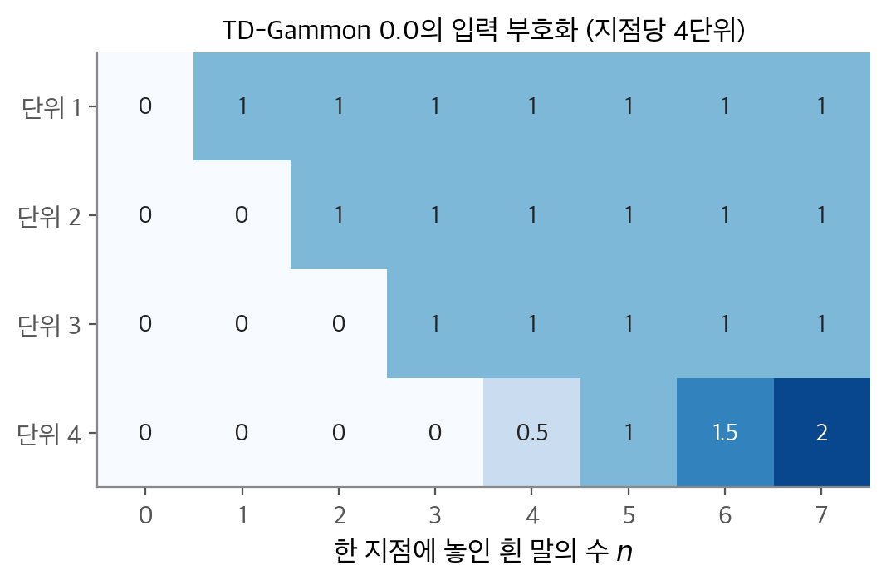
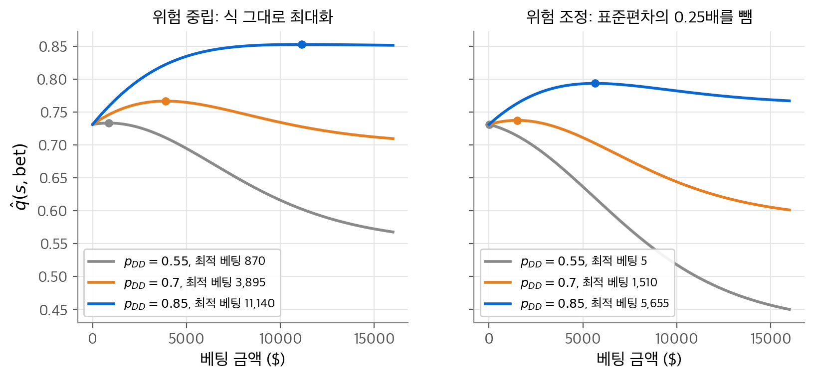
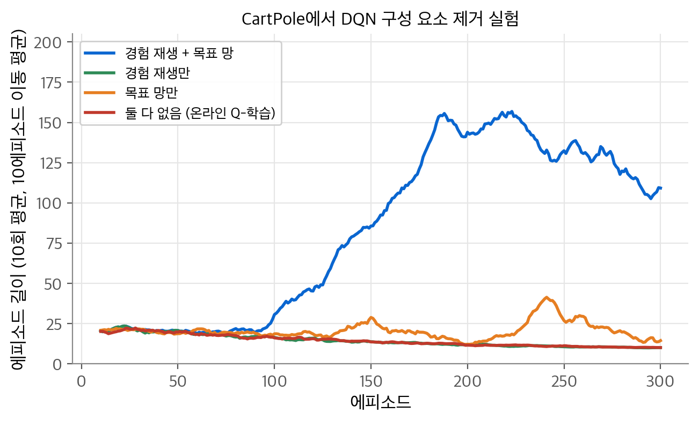
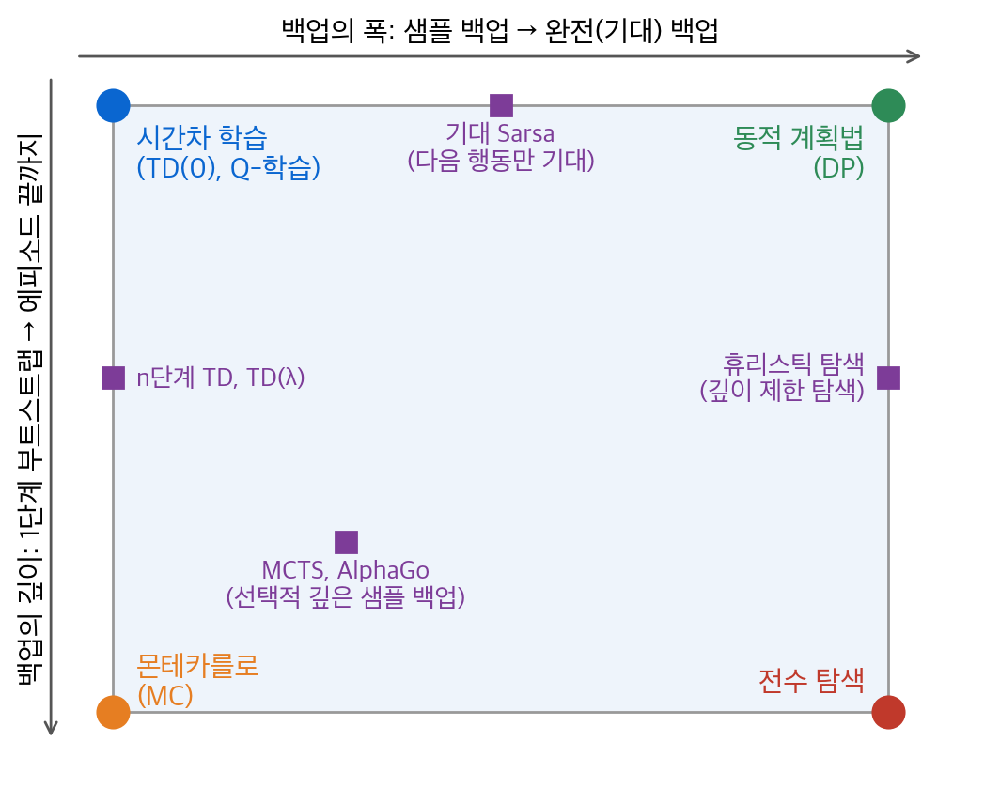
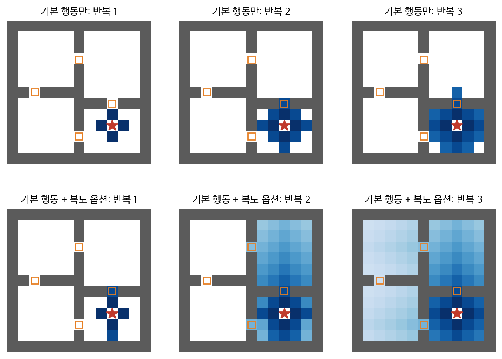

# 13. 응용 사례와 전망

앞 장까지는 방법을 하나씩 다루었습니다. 이 장의 질문은 두 가지입니다. "실제 문제에 강화 학습을 쓸 때 무엇이 성패를 가르는가?"와 "아직 풀리지 않은 문제는 무엇인가?"입니다. 사례에서 얻는 결론은 알고리즘보다 정식화가 더 중요하다는 것입니다. 상태를 어떻게 표현할지, 행동을 어디까지 제한할지, 보상을 무엇으로 정할지, 경험을 어디서 얻을지가 결과를 좌우합니다. 알고리즘 자체는 대부분 이 책의 기본 방법(TD($\lambda$), Q-학습, Sarsa, 정책 그래디언트, MCTS)에 함수 근사를 더한 것입니다. 전망 절에서는 이 책 전체를 백업의 깊이와 폭이라는 두 축으로 다시 묶고, 일반 가치 함수, 옵션, 부분 관측, 보상 설계라는 다음 과제로 넘어갑니다.

!!! info "원문과 자료"
    - 원문: 초안 14장 Applications and Case Studies(14.1~14.6), 15장 Prospects(15.1, 15.5). 최종본 16장(16.3 Watson, 16.5 DQN, 16.6 AlphaGo, 16.7 웹 서비스, 16.8 열 상승 비행)과 17장 Frontiers(17.1~17.5)로 보충합니다.
    - [Sutton & Barto, Reinforcement Learning: An Introduction 2판 책 페이지](http://incompleteideas.net/book/the-book-2nd.html)
    - [David Silver, UCL RL 강의](https://www.davidsilver.uk/teaching/): [Lecture 10 Case Study: RL in Classic Games 슬라이드](https://davidstarsilver.wordpress.com/wp-content/uploads/2025/04/lecture-10-case-study-rl-in-classic-games.pdf)
    - [Berkeley CS 285 Deep Reinforcement Learning](https://rail.eecs.berkeley.edu/deeprlcourse/)
    - [OpenAI Spinning Up: Key Papers in Deep RL](https://spinningup.openai.com/en/latest/spinningup/keypapers.html)
    - 함께 읽기: [6. 시간차 학습](06-td-learning.md), [8. 계획과 학습](08-planning-learning.md), [9. 함수 근사](09-function-approximation.md), [10. 근사를 쓰는 off-policy 학습](10-off-policy-approximation.md), [12. 심리학과 신경과학](12-psychology-neuroscience.md)

## 1. TD-Gammon

### 문제

백개먼은 말 15개씩을 24개 지점 위에서 움직이는 주사위 게임입니다. 주사위 한 번에 가능한 수는 약 20가지이고, 상대의 주사위까지 고려하면 게임 트리의 실효 분기 계수는 약 400입니다. 체스식 탐색은 쓸 수 없습니다. 반면 게임의 상태는 언제나 완전히 보이고, 게임은 승패로 끝납니다. 승패를 마지막 보상으로 보면 TD 학습에 잘 맞습니다.

### 신경망과 입력

Tesauro의 TD-Gammon은 $\hat v(s,\mathbf{w})$ 로 위치 $s$ 에서의 승리 확률을 추정합니다. 보상은 이길 때만 1이고 나머지는 0입니다. $\gamma=1$ 이므로 가치가 곧 승리 확률입니다. 망은 입력 198개, 시그모이드 은닉 단위 40~80개, 출력 하나인 다층 퍼셉트론입니다.

$$
h_j = \sigma\Big(\sum_i w_{ij}x_i\Big), \qquad \sigma(u) = \frac{1}{1+e^{-u}}
$$

TD-Gammon 0.0의 입력은 백개먼 지식을 거의 쓰지 않았습니다. 지점마다 흰 말 4단위, 검은 말 4단위로 말의 수 $n$ 을 부호화합니다.

<figure markdown>

<figcaption markdown>
<b>Figure 1.</b> TD-Gammon 입력 부호화

한 지점의 흰 말 수 $n$ 을 4개 단위로 나타낸 값입니다. 단위 1~3은 $n \ge 1, 2, 3$ 이면 켜지고, 단위 4는 $n>3$ 일 때 $(n-3)/2$ 입니다.
</figcaption>
</figure>

입력 수를 세면 다음과 같습니다. 24지점 × 2색 × 4단위 = 192개입니다. 바(bar)에 잡힌 말의 수 $n/2$ 가 색마다 1개씩 2개, 이미 빼낸 말의 수 $n/15$ 가 색마다 1개씩 2개, 차례를 나타내는 2개를 더해 198개입니다. 개념적으로 구별되는 경우마다 단위 하나를 주고 값의 범위를 0~1 근처로 맞춘 것이 설계 원칙입니다.

### 학습

[9장](09-function-approximation.md)의 준 그래디언트 TD($\lambda$)를 역전파로 씁니다.

$$
\mathbf{w}_{t+1} = \mathbf{w}_t + \alpha\big[R_{t+1} + \gamma\hat v(S_{t+1},\mathbf{w}_t) - \hat v(S_t,\mathbf{w}_t)\big]\mathbf{z}_t,
\qquad \mathbf{z}_t = \gamma\lambda\mathbf{z}_{t-1} + \nabla\hat v(S_t,\mathbf{w}_t)
$$

경험은 **자기 대국(self-play)** 으로 얻었습니다. 수를 둘 때는 가능한 20여 수의 결과 위치, 즉 [6장](06-td-learning.md)의 사후 상태를 모두 평가하고 가치가 가장 큰 수를 고릅니다. 같은 망이 양쪽을 둡니다. 초기 가중치가 무작위라 처음 게임은 수백~수천 수가 걸렸지만, 수십 게임 뒤 빠르게 좋아졌습니다.

| 버전 | 은닉 단위 | 학습 게임 수 | 상대 | 결과 |
| --- | --- | --- | --- | --- |
| TD-Gammon 0.0 | 40 | 300,000 | 기존 프로그램 | 최고 수준과 동률 |
| TD-Gammon 1.0 | 80 | 300,000 | Robertie, Magriel 등 | 51게임 −13점 |
| TD-Gammon 2.0 | 40 | 800,000 | 여러 그랜드마스터 | 38게임 −7점 |
| TD-Gammon 2.1 | 80 | 1,500,000 | Robertie | 40게임 −1점 |
| TD-Gammon 3.0 | 80 | 1,500,000 | Kazaros | 20게임 +6점 |

0.0은 지식 없이 Neurogammon과 비슷해졌습니다. Neurogammon은 전문가 기보로 지도 학습한, 1989년 컴퓨터 올림피아드 우승 프로그램입니다. 1.0은 전문 특징을 입력에 더했습니다. 2.0 이후는 결정 시점에 2~3수 앞을 보는 선택적 탐색을 더했습니다. 탐색은 수 선택에만 쓰였고, 학습은 그대로였습니다. 학습된 가치 함수와 결정 시점 탐색의 결합은 뒤의 AlphaGo로 이어집니다. TD-Gammon은 일부 오프닝에서 인간 고수의 정석을 바꾸기도 했습니다.

## 2. Samuel의 체커

Samuel(1959, 1967)의 체커 프로그램은 TD-Gammon의 선구자입니다. 프로그램은 현재 위치에서 미니맥스 탐색을 하고, 탐색 트리의 끝 위치를 선형 함수 근사인 "점수 다항식"으로 평가했습니다.

Samuel은 두 학습 방법을 썼습니다. **암기 학습(rote learning)** 은 만난 위치와 그 위치의 백업 값을 저장합니다. 저장된 위치가 다시 트리 끝에 나오면 탐색이 그만큼 깊어진 효과가 납니다. 승리로 가는 가장 짧은 길을 고르게 하려고, 값을 한 층 위로 올릴 때마다 조금씩 깎았습니다. 할인과 같은 아이디어입니다. **일반화 학습(learning by generalization)** 은 자기 대국에서 수를 둘 때마다 이전 위치의 값을 다음 위치에서 시작한 미니맥스 탐색 값 쪽으로 옮겼습니다. 실제 수 하나만큼 진행한 뒤 가상의 탐색으로 백업하는 구조입니다. TD-Gammon과 개념이 같습니다.

빠진 것이 하나 있었습니다. Samuel의 방법에는 보상도, 종료 상태의 고정값도 없었습니다. TD 학습은 가치 함수를 자기 자신과 일관되게 만듭니다. 그러나 일관성만으로는 부족하고, 가치를 실제 결과에 묶는 닻이 필요합니다. 상수 함수도 일관적입니다. Samuel은 말 개수 차이 특징의 가중치를 크게 고정해 이를 막으려 했지만 완전하지 않았습니다. 실제로 긴 자기 대국 중 성능이 떨어지는 현상을 보고했습니다. 그래도 프로그램은 "평균 이상" 수준에 이르렀습니다.

## 3. Acrobot

**Acrobot** 은 철봉에 매달린 체조 선수 같은 2링크 로봇입니다. 첫 관절(손)은 힘을 낼 수 없고, 둘째 관절(허리)만 토크 $\tau \in \{+1, 0, -1\}$ 을 냅니다. 상태는 두 각도와 두 각속도 $(\theta_1, \dot\theta_1, \theta_2, \dot\theta_2)$ 의 4차원 연속 공간입니다. 목표는 발끝을 첫 관절보다 링크 하나 길이만큼 높이 올리는 것입니다. 보상은 매 단계 −1이고 $\gamma=1$ 이므로 $v_*(s)$ 는 목표까지의 최소 단계 수의 음수입니다. 시뮬레이션 단계는 0.05초이고, 행동은 4단계마다 고릅니다.

Sutton(1996)은 [9장](09-function-approximation.md)의 Sarsa($\lambda$), 타일 코딩, 대체 흔적을 썼습니다. 각 차원을 6구간으로 나누고, 행동마다 48개 타일링을 두었습니다. 4차원 전부를 자르는 타일링 12개($6\times7\times6\times7=1764$ 타일), 3차원 조합 12개, 2차원 조합 12개, 1차원 12개입니다. 행동당 약 25,000개 타일입니다. 파라미터는 $\alpha = 0.2/48$, $\lambda = 0.9$, $\varepsilon = 0$ 입니다.

$\varepsilon = 0$ 이 핵심입니다. 이 과제는 긴 올바른 행동열이 필요합니다. 탐험 행동 하나가 쌓아 둔 흔들기를 망칠 수 있습니다. 탐험은 가치를 0으로 초기화하는 낙관적 초기화로 대신했습니다. 실제 보상이 −1이므로 에이전트는 늘 실망하고 새 행동을 시도합니다. 모든 실행이 약 75단계 만에 목표에 이르는 정책을 찾았습니다. 학습된 정책은 둘째 링크를 아래로 둔 채 대칭으로 여러 번 흔들어 에너지를 모은 뒤, 둘째 링크를 위로 휘둘러 올립니다.

## 4. 엘리베이터 배차

Crites와 Barto(1996)는 10층 건물의 엘리베이터 4대를 제어했습니다. 연속 변수를 대충 양자화해도 상태가 $10^{22}$ 개를 넘습니다. 상태 하나를 1마이크로초에 백업해도 한 번 훑는 데 1000년이 넘게 걸립니다.

목표는 평균 **대기 시간 제곱**을 줄이는 것입니다. 제곱을 쓰면 오래 기다리는 승객에게 큰 벌을 주어 공정성도 챙깁니다. 행동은 강하게 제한했습니다. 각 엘리베이터는 따로 결정하고, 실제로 남는 결정은 "승객이 기다리는 다가오는 층에 설 것인가"뿐입니다. 결정은 드문드문 일어나므로 문제는 **준 마르코프 결정 과정(SMDP, semi-Markov decision process)** 이 됩니다. 이득은 연속 시간 적분으로 바뀝니다.

$$
G_t = \sum_{k=0}^\infty \gamma^k R_{t+k+1}
\quad\longrightarrow\quad
G_t = \int_0^\infty e^{-\beta\tau} R_{t+\tau}\,d\tau
$$

결정 시각 $t_1$ 에 $(S, A)$ 를 고르고 다음 결정이 $t_2$ 에 $S'$ 에서 오면, SMDP Q-학습의 백업은 다음과 같습니다(Bradtke와 Duff, 1995). 보상이 비용이므로 min을 씁니다.

$$
Q(S,A) \leftarrow Q(S,A) + \alpha\Big[\int_{t_1}^{t_2} e^{-\beta(\tau-t_1)}R_\tau\,d\tau + e^{-\beta(t_2-t_1)}\min_a Q(S',a) - Q(S,A)\Big]
$$

$e^{-\beta(t_2-t_1)}$ 은 사건 사이 시간에 따라 바뀌는 할인율입니다. 행동 가치는 입력 47개, 은닉 20개, 출력 2개(서기, 지나가기)의 신경망으로 근사했습니다. 입력에는 홀 버튼마다 눌린 시간, 결정할 엘리베이터의 위치와 방향, 다른 엘리베이터의 "발자국"이 들어갔습니다. RL1은 엘리베이터마다 망을 따로 두었고, RL2는 망 하나를 공유했습니다. 학습에는 시뮬레이션 약 60,000시간이 들었습니다. 저녁 퇴근 시간대(하행 피크)에서 두 방식 모두 산업용 휴리스틱과 연구용 최적화 방법보다 좋은 성능을 냈습니다.

## 5. 동적 채널 할당

휴대전화망은 지역을 셀로 나누고, 서로 충분히 떨어진 셀끼리만 같은 주파수 채널을 씁니다. 이를 **채널 재사용 제약**이라고 합니다. 새 통화에 쓸 채널이 없으면 통화가 차단됩니다. 직관을 주는 예가 있습니다. 셀 세 개가 일렬로 있고 채널이 2개이며 이웃 셀은 같은 채널을 못 씁니다. 왼쪽이 채널 1, 오른쪽이 채널 2를 쓰면 가운데 셀의 새 통화는 차단됩니다. 양쪽이 모두 채널 1을 쓰면 가운데는 채널 2를 쓸 수 있습니다.

Singh과 Bertsekas(1997)는 49셀, 70채널 시스템을 SMDP로 정식화했습니다. 배치 상태만 $70^{49}$ 가지입니다. 보상은 진행 중인 통화 수이고, 이득은 엘리베이터와 같은 연속 시간 할인 적분입니다. 핵심은 **사후 상태**입니다. 통화를 어떤 채널에 넣으면 생기는 새 배치는 결정론적으로 계산됩니다. 그래서 배치에 대한 가치만 배우고, 가능한 배치 중 가치가 가장 큰 것을 고릅니다. 통화가 끝나면 진행 중인 통화를 비게 된 채널로 옮기는 재배치도 행동으로 둡니다.

가치는 선형 함수 근사였습니다. 특징은 셀마다 "추가로 받을 수 있는 통화 수"(가용성 특징)와 셀-채널 쌍마다 "반경 4셀 안에서 그 채널을 쓰는 횟수"(묶음 특징)입니다. SMDP 판 선형 TD(0)로 학습했습니다. 강화 학습 방법은 고정 할당(FA)과 당시 최고의 휴리스틱(BDCL)보다 모든 통화량에서 차단이 적었습니다. 통화량이 포화에 가까울수록 차이는 줄었습니다.

## 6. 잡숍 스케줄링

Zhang과 Dietterich(1995, 1996)는 NASA 우주왕복선 화물 처리 일정(SSPP)에 강화 학습을 썼습니다. 임무 하나에 34~164개 작업이 있고, 시간 제약과 자원 제약을 모두 지켜야 합니다. 일반형은 NP-완전입니다.

이 사례의 독특한 점은 **계획 공간(plan space)** 에서 학습한다는 것입니다. 상태는 일정 전체입니다. 시작 상태는 시간 제약만 지킨 임계 경로 일정입니다. 행동은 자원 제약을 어긴 작업에 적용하는 수리 연산자(Reassign-Pool, Move)이고, 보통 20개 정도입니다. 에피소드는 충돌 없는 일정을 얻으면 끝납니다. 보상은 두 목표를 섞습니다.

$$
\text{이득} = -\text{RDF}(S_f) - 0.001\,(N-1)
$$

$N$ 은 수리 횟수이고, RDF(resource dilation factor)는 문제 난이도를 보정한 일정 길이입니다. 수리 한 번이 RDF 0.001과 맞바뀝니다. 수리를 하나 더 하려면 최종 RDF가 0.001보다 더 줄어야 합니다. 학습은 TD($\lambda$)와 역전파 신경망, $\varepsilon$-탐욕 1단계 예견 탐색으로 했습니다. Lin(1992)의 경험 재생도 썼습니다. 지금까지 가장 좋았던 에피소드를 기억해 두고 4 에피소드마다 다시 학습했습니다. 학습된 스케줄러는 같은 품질의 일정을 기존 반복 수리법보다 훨씬 적은 수리로 찾았습니다. 하나의 일정이 아니라 비슷한 문제들의 일정을 빨리 찾는 기술을 배운 것입니다.

## 7. Watson의 Daily-Double 베팅

IBM Watson은 2011년 퀴즈 쇼 Jeopardy!에서 인간 챔피언을 이겼습니다. 강화 학습이 가장 많이 기여한 부분은 **Daily-Double(DD)** 베팅입니다. DD 칸을 고른 참가자는 문제를 보기 전에 베팅 금액을 정합니다. 맞히면 그만큼 얻고 틀리면 잃습니다.

Watson은 베팅마다 행동 가치를 계산했습니다. $p_{DD}$ 는 그 범주에서 Watson이 맞힐 확률이고, $S_W$ 는 Watson의 현재 점수입니다.

$$
\hat q(s, \text{bet}) = p_{DD}\,\hat v(S_W + \text{bet}, \ldots) + (1-p_{DD})\,\hat v(S_W - \text{bet}, \ldots)
$$

이 식은 "행동 가치는 그 행동 뒤 사후 상태 가치의 기댓값"이라는 관계 그대로입니다. $\hat v$ 는 TD-Gammon과 같은 비선형 TD($\lambda$)와 신경망으로 학습했습니다. 다만 자기 대국 대신 수백만 번의 시뮬레이션 게임에서 학습했습니다. 상대는 약 300,000개 문제의 기록에서 만든 인간 참가자 모형(평균, 챔피언, 그랜드 챔피언)이었습니다. Watson은 사람과 너무 달라서 자기 대국으로는 인간 상대의 상태 분포를 탐색할 수 없습니다. 게다가 Jeopardy!는 상대의 확신도를 모르는 불완전 정보 게임입니다.

식을 그대로 최대화하면 "무서울 만큼 큰 위험"이 생겼습니다. 그래서 정답/오답 사후 상태 가치의 표준편차의 일부를 빼고, 오답 시 가치가 일정 수준 아래로 떨어지는 베팅을 금지했습니다.

<figure markdown>

<figcaption markdown>
<b>Figure 2.</b> Watson식 베팅 계산의 toy 예제

toy 가치 함수로 계산한 베팅별 $\hat q$ 이고, 점은 각 $p_{DD}$ 의 최적 베팅입니다. 오른쪽은 위험 항을 뺀 값입니다(실제 Watson의 $\hat v$ 아님).
</figcaption>
</figure>

NumPy로 계산하면 위험 중립 최적 베팅은 $p_{DD} = 0.55, 0.70, 0.85$ 에서 870, 3,895, 11,140입니다. 위험 조정 뒤에는 5(최소 베팅), 1,510, 5,655로 줄어듭니다. 대가로 기대 승률은 조금 낮아집니다. $p_{DD}=0.85$ 에서 베팅을 11,140에서 5,655로 줄이면, 식 그대로의 $\hat q$ 는 0.853에서 0.840으로 0.013 떨어집니다. 대신 틀렸을 때의 승률은 0.144에서 0.398로 올라갑니다. 기대값을 조금 내주고 최악의 경우를 크게 줄이는 것이 원문이 말한 위험 감소입니다. 실제 시뮬레이션에서 Watson의 승률은 휴리스틱 베팅 61%, 학습된 가치와 기본 확신도 64%, 실시간 범주 확신도 67%였습니다. 게임 막바지에는 신경망 대신 몬테카를로 시행으로 베팅 가치를 추정해 더 좋아졌습니다.

## 8. DQN과 Atari

### 설정

Mnih 등(2015)의 **DQN(deep Q-network)** 은 같은 알고리즘, 같은 망 구조, 같은 하이퍼파라미터로 Atari 2600 게임 49개를 각각 학습했습니다. 입력은 210×160 화면을 84×84 밝기 값으로 줄이고 최근 4프레임을 쌓은 84×84×4 배열입니다. 프레임을 쌓은 이유는 한 화면만으로는 속도 같은 정보가 보이지 않기 때문입니다. 부분 관측을 줄이는 가장 간단한 방법입니다.

망은 합성곱 층 3개(특징 맵 32개 20×20, 64개 9×9, 64개 7×7), 512단위 완전 연결 층, 18개 출력으로 이루어집니다. 출력 하나가 행동 하나의 $\hat q(s,a)$ 입니다. 활성화는 ReLU입니다. 보상은 점수가 오르면 +1, 내리면 −1, 그대로면 0으로 잘랐습니다. 게임마다 점수 범위가 달라도 같은 스텝 크기가 통하게 하려는 것입니다. $\varepsilon$ 은 처음 100만 프레임 동안 선형으로 줄였습니다. 게임마다 5천만 프레임(약 38일 분량)을 학습했습니다.

### 갱신 식과 세 가지 수정

기본은 준 그래디언트 Q-학습입니다.

$$
\mathbf{w}_{t+1} = \mathbf{w}_t + \alpha\Big[R_{t+1} + \gamma\max_a \hat q(S_{t+1},a,\mathbf{w}_t) - \hat q(S_t,A_t,\mathbf{w}_t)\Big]\nabla\hat q(S_t,A_t,\mathbf{w}_t)
$$

Q-학습을 고른 이유는 모델 프리이면서 off-policy이기 때문입니다. 아래의 경험 재생은 off-policy 알고리즘이어야 쓸 수 있습니다. 32개 미니배치와 RMSProp를 썼고, 세 가지를 바꾸었습니다.

1. **경험 재생(experience replay)**: 전이 $(S_t, A_t, R_{t+1}, S_{t+1})$ 을 재생 메모리에 쌓습니다. 매 단계 메모리에서 균등하게 뽑은 미니배치로 갱신합니다. 한 경험을 여러 번 쓰므로 표본 효율이 좋아집니다. 연속된 갱신 사이의 상관이 끊겨 분산이 줄어듭니다. 데이터 분포가 현재 가중치에 덜 끌려가 불안정의 한 원인이 사라집니다.
2. **목표 망(target network)**: $C$ 번 갱신마다 가중치를 복사한 망 $\tilde q$ 를 두고, 다음 $C$ 번 동안 목표를 이 고정된 망으로 계산합니다.

    $$
    \mathbf{w}_{t+1} = \mathbf{w}_t + \alpha\Big[R_{t+1} + \gamma\max_a \tilde q(S_{t+1},a,\mathbf{w}^-) - \hat q(S_t,A_t,\mathbf{w}_t)\Big]\nabla\hat q(S_t,A_t,\mathbf{w}_t)
    $$

    목표가 갱신 대상 파라미터에 의존하면 [10장](10-off-policy-approximation.md)의 진동과 발산이 생길 수 있습니다. 목표를 잠시 고정하면 문제가 지도 학습의 회귀에 가까워집니다.
3. **오차 자르기**: 괄호 안의 TD 오차를 $[-1, 1]$ 로 자릅니다. 제곱 오차 대신 후버 손실을 쓰는 것과 같습니다.

### 작은 재현: CartPole 구성 요소 제거 실험

Mnih 등은 5개 게임에서 경험 재생과 목표 망을 넣고 빼는 네 가지 조합을 비교했습니다. 각각이 성능을 크게 올렸고, 함께 쓰면 훨씬 좋았습니다. 같은 실험을 작은 문제로 재현했습니다.

<figure markdown>

<figcaption markdown>
<b>Figure 3.</b> CartPole에서 DQN 구성 요소 제거 실험

경험 재생과 목표 망을 하나씩 뺀 DQN의 CartPole 학습 곡선입니다(시드 10개 평균). 4-64-64-2 MLP, 재생 메모리 10,000, 목표 망은 500단계마다 복사합니다.
</figcaption>
</figure>

NumPy 결과입니다. 마지막 50 에피소드의 평균 길이는 재생+목표 망 120.6, 목표 망만 20.1, 재생만 10.3, 둘 다 없음 10.4입니다. 실패 원인은 상태 분포에서 잰 평균 $\max_a\hat q$ 로 드러납니다. 이 과제의 참 가치는 $\sum_{k=0}^{199}0.99^k = 86.6$ 을 넘을 수 없습니다. 목표 망이 없는 두 조건은 평균 $\max_a \hat q$ 가 발산했습니다. 재생만 쓴 조건은 약 131만, 둘 다 없는 조건은 약 54만입니다. 목표 망이 있는 두 조건은 유한했습니다. 재생+목표 망은 40.6, 목표 망만은 12.1입니다. 이 작은 실험에서는 목표 망이 발산을 막고, 경험 재생이 실제 학습을 가능하게 했습니다. 재생+목표 망 조건도 에피소드 220 이후 성능이 다소 떨어졌습니다. 망이 새 데이터에 맞추며 앞서 배운 것을 잃는 불안정이 남아 있다는 뜻입니다. 시드별 마지막 50 에피소드 평균은 62.2에서 157.9까지 퍼졌습니다.

### 결과와 한계

DQN은 46개 게임 중 29개에서 인간 테스터 점수의 75% 이상을 얻었고, 22개에서 인간보다 높았습니다. 게임별 특징 설계 없이 이룬 결과입니다. 같은 입력의 선형 망과 비교하면 깊은 합성곱 망의 이득이 컸습니다. 반면 Montezuma's Revenge처럼 긴 계획이 필요한 게임에서는 무작위 정책 수준이었습니다.

## 9. AlphaGo와 AlphaGo Zero

### 바둑이 어려운 이유

바둑은 수당 합법수가 약 250개(체스 약 35개), 게임 길이가 약 150수(체스 약 80수)입니다. 그러나 탐색 공간의 크기가 핵심 장벽은 아닙니다. 좋은 위치 평가 함수를 만들기 어렵다는 것이 핵심입니다. [8장](08-planning-learning.md)의 **몬테카를로 트리 탐색(MCTS)** 이 도입되며 큰 진전이 있었지만, 고수 수준에는 이르지 못했습니다.

### AlphaGo

AlphaGo(Silver 등, 2016)는 학습된 정책과 가치로 MCTS를 이끕니다. 망과 학습 단계는 다음과 같습니다.

1. **SL 정책망** $p_\sigma$: 13층 합성곱 망입니다. 입력은 19×19×48 특징입니다. 인간 전문가의 수 약 3천만 개로 지도 학습해 다음 수를 57% 정확도로 맞혔습니다.
2. **RL 정책망** $p_\rho$: SL 정책망에서 시작해, 과거 버전 중 무작위로 고른 상대와의 대국에서 정책 그래디언트(보상 승 +1, 패 −1)로 개선합니다. SL 정책을 상대로 80% 이상 이겼습니다.
3. **가치망** $v_\theta$: RL 정책의 자기 대국에서 게임마다 위치 하나씩, 3천만 개 위치를 뽑아 승패를 회귀하는 몬테카를로 정책 평가로 학습합니다. 같은 게임의 위치들은 서로 강하게 상관되므로, 게임당 하나만 써서 과적합을 막았습니다.
4. **롤아웃 정책**: 인간 수 800만 개로 학습한 빠른 선형 망입니다. 스레드당 초당 약 1,000판을 끝까지 둘 수 있습니다.

AlphaGo의 MCTS(APV-MCTS)는 트리를 넓힐 때 SL 정책망의 확률을 사전 확률로 씁니다. 새 잎 노드 $s$ 는 가치망과 롤아웃 이득 $G$ 를 섞어 평가합니다.

$$
v(s) = (1-\eta)\,v_\theta(s) + \eta\,G
$$

$\eta=0$ 이면 가치망만, $\eta=1$ 이면 롤아웃만 씁니다. 가치망만 써도 당시의 모든 바둑 프로그램보다 강했고, 최고 성능은 $\eta = 0.5$ 에서 나왔습니다. 가치망은 너무 느려 실전에 못 쓰는 강한 RL 정책을 평가합니다. 롤아웃은 약하지만 빠른 정책으로 그 위치에 특화된 정밀도를 더합니다. 탐색이 끝나면 루트에서 가장 많이 방문한 수를 둡니다. 흥미롭게도 확장에는 RL 정책보다 SL 정책이 더 좋았습니다. 사람의 다양한 수를 더 넓게 다루기 때문으로 추정됩니다.

### AlphaGo Zero

AlphaGo Zero(Silver 등, 2017)는 인간 데이터와 손으로 만든 특징을 쓰지 않습니다. 망 하나 $f_\theta(s) = (\mathbf{p}, v)$ 가 수 확률 벡터 $\mathbf{p}$ (361점 + 패스)와 현재 둘 차례인 쪽의 승리 확률 $v$ 를 함께 냅니다. 입력은 19×19×17입니다. 내 돌의 현재와 과거 7개 배치 8면, 상대 돌 8면, 차례 1면입니다. 같은 배치의 반복이 금지되므로 현재 판만으로는 마르코프 상태가 아니기 때문입니다. 망은 잔차 연결이 있는 합성곱 층 41개 뒤에 두 머리로 갈라집니다.

알고리즘은 [4장](04-dynamic-programming.md)의 정책 반복 꼴입니다.

1. **정책 개선**: 각 위치에서 $f_\theta$ 가 이끄는 MCTS를 1,600번 반복합니다. 롤아웃 없이 잎에서 $v$ 로 평가합니다. MCTS의 방문 횟수에서 나온 분포 $\boldsymbol\pi$ 는 $\mathbf{p}$ 보다 좋은 정책입니다. 저자들은 MCTS를 "정책 개선 연산자"로 볼 수 있다고 썼습니다.
2. **자기 대국**: $\boldsymbol\pi$ 로 수를 두어 게임을 끝까지 두고 승자 $z \in \{-1, +1\}$ 을 얻습니다.
3. **정책 평가와 증류**: 최근 500,000판에서 뽑은 $(s, \boldsymbol\pi, z)$ 로 망을 학습합니다. 원 논문의 손실은 다음과 같습니다.

    $$
    \ell(\theta) = (z - v)^2 - \boldsymbol\pi^\top \log\mathbf{p} + c\,\|\theta\|^2
    $$

    $v$ 는 실제 결과 $z$ 로, $\mathbf{p}$ 는 탐색이 개선한 $\boldsymbol\pi$ 로 끌려갑니다.

490만 판의 자기 대국(약 3일) 뒤 Elo는 4,308이었습니다. 판 후이를 이긴 AlphaGo는 3,144, 이세돌을 이긴 버전은 3,739였습니다. 이세돌을 이긴 버전과의 100판에서 100승했습니다. 더 큰 망으로 40일 학습한 버전은 Elo 5,185에 이르렀습니다. 인간 데이터를 쓰는 AlphaGo Master(4,858)를 89승 11패로 이겼습니다. 같은 구조를 인간 기보로 지도 학습한 망은 처음에는 더 강했지만, 하루 학습한 AlphaGo Zero에 뒤처졌습니다.

## 10. 웹 서비스 개인화

뉴스나 광고 추천은 **문맥 밴딧(contextual bandit)** 으로 정식화할 수 있습니다. 사용자 특징이 문맥이고, 보여 줄 콘텐츠가 행동이고, 클릭이 보상입니다. Li 등(2010)은 Yahoo! 첫 페이지 기사 선택에서 비연합 밴딧보다 클릭률을 12.5% 높였습니다.

Theocharous, Thomas, Ghavamzadeh(2015)는 같은 사용자가 여러 번 방문한다는 점에 주목했습니다. 밴딧 정책은 매 방문을 새 사용자처럼 다룹니다. MDP 정책은 사용자를 "판매 깔때기" 아래로 차례로 이끌 수 있습니다. 예를 들어 금융 조건 소개, 정비 서비스 소개, 마지막 할인 제안 순서로 보여 줄 수 있습니다. 두 지표는 분모가 다릅니다.

$$
\text{CTR} = \frac{\text{총 클릭 수}}{\text{총 방문 수}}, \qquad
\text{LTV} = \frac{\text{총 클릭 수}}{\text{총 방문자 수}}
$$

원문의 예에서 같은 클릭 기록의 CTR은 0.35, LTV는 1.5입니다. LTV는 사용자가 다시 찾아와 계속 상호작용할수록 커집니다.

LTV 최적화에는 랜덤 포레스트를 회귀기로 쓴 **적합 Q 반복(FQI, fitted Q iteration)** 을 썼습니다. 미리 모아 둔 데이터로 학습하는 배치 방식입니다. 은행 웹사이트 데이터 두 개(약 20만 건·제안 7개, 400만 건·제안 12개)를 썼습니다. 새 정책을 실제로 배포하면 위험하므로, 무작위 정책이 모은 데이터로 **고신뢰 off-policy 평가(high-confidence off-policy evaluation)** 를 했습니다. 예상대로 탐욕 최적화는 CTR에서, LTV 최적화는 LTV에서 앞섰습니다. 이 확률적 보장에 기대어 Adobe는 2016년 LTV 알고리즘을 Marketing Cloud의 표준 구성 요소로 넣었습니다.

## 11. 열 상승 글라이더

새와 글라이더는 상승 기류(열기둥)를 타고 에너지 없이 고도를 얻습니다. Reddy 등(2016)은 난류가 강한 열기둥 안에서 고도를 얻는 정책을 강화 학습으로 찾았습니다. 환경은 한 변 1km인 공기 상자를 편미분 방정식으로 모사한 물리 모델입니다.

| 요소 | 설계 |
| --- | --- |
| 행동 | 경사각(bank angle)을 ±5°, 받음각(angle of attack)을 ±2.5° 바꾸거나 유지합니다. $3^2 = 9$ 개 행동입니다. 경사각은 ±15° 안에 둡니다. |
| 상태 | 국소 수직 풍속, 수직 풍속 가속도, 양 날개 끝 풍속 차이에서 생기는 토크, 온도입니다. 각각을 3구간(큰 양수, 큰 음수, 작음)으로 나눈 상태 집계입니다. |
| 보상 | 직전 단계의 수직 풍속과 수직 풍속 가속도의 선형 결합입니다. |
| 알고리즘 | 1단계 Sarsa와 정규화된 행동 가치의 소프트맥스입니다. $\alpha=0.1$, $\gamma=0.98$ 입니다. |

소프트맥스의 선호도는 행동 가치를 $[0, 1]$ 로 정규화한 뒤 온도 $\tau$ 로 나눕니다.

$$
h(s,a,\boldsymbol\theta) = \frac{\hat q(s,a,\boldsymbol\theta) - \min_b \hat q(s,b,\boldsymbol\theta)}{\tau\,\big(\max_b \hat q(s,b,\boldsymbol\theta) - \min_b \hat q(s,b,\boldsymbol\theta)\big)}
$$

$\tau$ 는 2.0에서 0.2로 줄였습니다. 에피소드 끝에 얻은 고도만 보상으로 주는 단순한 설계는 실패했고, 적격 흔적도 도움이 되지 않았습니다. 매 단계의 밀도 있는 보상이 필요했습니다. 수백 에피소드 뒤 글라이더는 열기둥 안에서 나선을 그리며 고도를 얻었습니다. 핵심 단서는 수직 풍속 가속도와 토크 두 가지였습니다. 이 둘은 두 방향의 수직 풍속 기울기를 알려 줍니다. 온도는 거의 쓸모가 없었습니다. $\gamma$ 를 키울수록 고도 이득이 커져 $\gamma = 0.99$ 에서 가장 좋았습니다. 장기 효과를 고려해야 한다는 뜻입니다. 이 연구는 2018년 실제 글라이더 실험으로 이어졌습니다.

## 12. 사례 비교

| 사례 | 상태 | 행동 | 보상 | 알고리즘 | 핵심 아이디어 |
| --- | --- | --- | --- | --- | --- |
| TD-Gammon | 판 배치 198개 입력 | 주사위 결과에서 가능한 수 | 승리 시 1 | 비선형 TD($\lambda$) + MLP | 자기 대국, 사후 상태 평가, 나중에 얕은 탐색 |
| Samuel 체커 | 판 배치 특징 | 합법수 | 없음(말 차이 가중치 고정) | 미니맥스 + TD식 백업 | 탐색 값으로 백업, 닻이 없는 위험 |
| Acrobot | $(\theta_1,\dot\theta_1,\theta_2,\dot\theta_2)$ | 토크 $\{+1,0,-1\}$ | 매 단계 −1 | Sarsa($\lambda$) + 타일 코딩 | $\varepsilon=0$ 과 낙관적 초기화 |
| 엘리베이터 | 버튼 대기 시간, 엘리베이터 위치 47개 입력 | 설 것인가, 지나갈 것인가 | −대기 시간 제곱 합 | SMDP Q-학습 + MLP | 행동 제한, 연속 시간 할인 |
| 채널 할당 | 셀별 채널 사용 배치 | 채널 배정, 재배치 | 진행 중 통화 수 | SMDP 선형 TD(0) | 사후 상태 가치, 가용성·묶음 특징 |
| 잡숍 스케줄링 | 일정 전체 | 수리 연산자 약 20개 | 단계당 −0.001, 끝에 −RDF | TD($\lambda$) + MLP | 계획 공간 학습, 경험 재생 |
| Watson DD | 점수, 남은 문제 등 | 베팅 금액 | 승리 | TD($\lambda$) + MLP, 끝판 MC | 인간 모형 상대 시뮬레이션, 위험 조정 |
| DQN | 84×84×4 화면 | 조이스틱 4~18개 | 점수 변화의 부호 | 준 그래디언트 Q-학습 + CNN | 경험 재생, 목표 망, 오차 자르기 |
| AlphaGo | 19×19×48 특징 | 착점 | 승 +1, 패 −1 | 지도 학습 + 정책 그래디언트 + MC 평가 + MCTS | 정책·가치망이 이끄는 탐색 |
| AlphaGo Zero | 19×19×17 원시 배치 | 착점, 패스 | 승 +1, 패 −1 | MCTS 정책 반복 + 두 머리 ResNet | 탐색이 정책 개선 연산자 |
| 웹 개인화 | 사용자 특징 | 보여 줄 제안 | 클릭 1 | FQI + 랜덤 포레스트 | 장기 가치(LTV), 고신뢰 off-policy 평가 |
| 열 상승 글라이더 | 풍속 가속도, 토크 등 3구간 집계 | 경사각·받음각 조정 9개 | 수직 풍속과 가속도 | Sarsa + 소프트맥스 | 최소 감각 단서 찾기, 밀도 있는 보상 |

표에서 반복되는 교훈은 네 가지입니다. 첫째, 행동 공간을 줄이는 사전 지식(엘리베이터, Acrobot의 3토크)이 문제를 다룰 만하게 만듭니다. 둘째, 사후 상태(백개먼, 채널, Watson)는 결정론적인 부분을 모델로 처리해 학습을 줄입니다. 셋째, 경험의 출처가 중요합니다. 자기 대국, 인간 모형, 시뮬레이터, 기록 데이터 중 무엇을 쓸지가 정식화의 일부입니다. 넷째, 보상은 목표를 정확히 담으면서도 충분히 자주 와야 합니다.

## 13. 통합된 관점

### 세 가지 공통 아이디어

이 책의 모든 방법은 세 가지를 공유합니다. 가치 함수를 추정합니다. 실제 또는 가능한 궤적을 따라 값을 백업합니다. **일반화된 정책 반복(GPI)** 을 따릅니다. 즉 근사 가치 함수와 근사 정책을 함께 두고 서로를 개선합니다.

### 백업의 깊이와 폭

방법을 가르는 가장 중요한 두 축은 백업의 종류입니다. 가로축은 **폭(width)** 입니다. 샘플 궤적 하나로 백업하는지(샘플 백업), 가능한 모든 다음 상태의 분포로 백업하는지(완전 백업)를 나타냅니다. 세로축은 **깊이(depth)** 입니다. 한 단계 뒤에서 부트스트랩하는지, 에피소드 끝까지 가는지를 나타냅니다.

<figure markdown>

<figcaption markdown>
<b>Figure 4.</b> 백업 공간의 두 축

백업의 깊이와 폭으로 방법을 배치했습니다. 네 모서리는 TD, DP, MC, 전수 탐색입니다.
</figcaption>
</figure>

완전 백업은 모델이 필요합니다. 샘플 백업은 모델이 있어도 되고 없어도 됩니다. 이 두 축 말고도 방법을 가르는 차원이 많습니다.

| 차원 | 선택지 |
| --- | --- |
| 함수 근사 | 표 → 상태 집계 → 선형 → 비선형 |
| 정책 관계 | on-policy, off-policy |
| 이득의 정의 | 에피소드형/연속형, 할인/평균 보상 |
| 추정하는 값 | 상태 가치, 행동 가치, 사후 상태 가치 |
| 행동 선택 | $\varepsilon$-탐욕, 소프트맥스, UCB, 낙관적 초기화 |
| 경험의 출처 | 실제 경험, 모의 경험, 둘의 혼합(Dyna) |
| 백업 위치와 시점 | 어떤 상태를 백업할지, 행동 선택 중인지 이후인지 |
| 백업 값의 보존 | 영구 저장인지, 결정 동안만인지(휴리스틱 탐색) |

[10장](10-off-policy-approximation.md)의 죽음의 삼중주는 이 차원 분석의 좋은 예입니다. 부트스트래핑, 함수 근사, off-policy라는 세 차원의 상호작용만으로 발산 문제를 설명했고, 다른 차원들은 무관했습니다. 8절 실험의 발산도 같은 삼중주에서 나왔습니다.

## 14. 일반 가치 함수와 보조 과제

[12장](12-psychology-neuroscience.md)의 TD 모형에서 예측 대상은 보상이 아니어도 되었습니다. 이 생각을 끝까지 밀면 **일반 가치 함수(GVF, general value function)** 가 됩니다. 보상 대신 임의의 신호 $C_t$ 를 누적합니다. 이를 **누적량(cumulant)** 이라고 합니다. 할인도 상태마다 다른 **종료 함수(termination function)** $\gamma: \mathcal{S} \to [0,1]$ 로 일반화합니다.

$$
v_{\pi,\gamma,C}(s) = \mathbb{E}\left[\sum_{k=t}^{\infty}\Big(\prod_{i=t+1}^{k}\gamma(S_i)\Big)C_{k+1}\,\middle|\, S_t = s,\ A_{t:\infty}\sim\pi\right]
$$

$C_t = R_t$ 이고 $\gamma$ 가 상수면 보통의 $v_\pi$ 입니다. GVF는 가치 함수 꼴이므로 이 책의 모든 방법으로 배울 수 있습니다. 목표 정책 $\pi$ 가 행동 정책과 다르므로 보통 off-policy 학습이 필요합니다.

보상 외의 신호를 예측하고 제어하는 일을 **보조 과제(auxiliary task)** 라고 합니다. 쓸모는 세 가지입니다.

1. **표현 공유**: 신경망의 몸통을 공유하고 머리를 여러 개 둡니다. 한 머리는 주 과제의 가치를, 나머지는 픽셀 변화, 다음 보상, 이득의 분포 같은 보조 예측을 냅니다. 쉬운 보조 과제가 좋은 특징을 먼저 찾아 주 과제 학습을 빠르게 할 수 있습니다(Jaderberg 등, 2017).
2. **반사와 결합**: 학습된 예측에 미리 정한 행동을 연결합니다. 고전적 조건화에서 "눈 찔림 예측 → 눈 깜빡임"이 타고난 반사인 것과 같습니다. 충돌 예측이 문턱을 넘으면 멈추는 자율 주행차, 배터리 부족 예측이 0이 아니면 충전기로 가는 청소 로봇이 예입니다.
3. **상태 구성**: 여러 예측을 상태 특징으로 삼아 상태 표현 자체를 만듭니다. 16절에서 다룹니다.

## 15. 옵션을 통한 시간 추상화

### 옵션의 정의

근육 움직임부터 비행기 표 고르기까지, 사람은 여러 시간 척도에서 결정합니다. **옵션(option)** $\omega = \langle\pi_\omega, \gamma_\omega\rangle$ 은 정책과 종료 함수의 쌍입니다. 옵션을 실행하면 $\pi_\omega$ 로 행동을 고르고, 다음 상태 $S_{t+1}$ 에서 확률 $1-\gamma_\omega(S_{t+1})$ 로 끝납니다. 기본 행동 $a$ 는 항상 $a$ 를 고르고 한 단계 뒤 반드시 끝나는($\gamma_\omega = 0$) 옵션입니다. 옵션은 행동 공간을 넓힙니다.

### 옵션 모델과 벨만 방정식

옵션의 모델도 두 부분입니다. $\tau$ 는 옵션이 끝나는 무작위 시점입니다.

$$
r(s,\omega) = \mathbb{E}\big[R_1 + \gamma R_2 + \cdots + \gamma^{\tau-1}R_\tau \,\big|\, S_0=s,\ A_{0:\tau-1}\sim\pi_\omega,\ \tau\sim\gamma_\omega\big]
$$

$$
p(s'|s,\omega) = \sum_{k=1}^{\infty}\gamma^k \Pr\{S_k = s',\ \tau = k \mid S_0 = s,\ A_{0:k-1}\sim\pi_\omega,\ \tau\sim\gamma_\omega\}
$$

할인이 $p$ 안에 들어가므로 $p$ 의 합은 1보다 작습니다. 이렇게 정의하면 벨만 방정식에서 $\gamma$ 가 사라지고, 기본 행동과 옵션을 같은 식으로 다룹니다.

$$
v_\pi(s) = \sum_{\omega\in\Omega(s)}\pi(\omega|s)\Big[r(s,\omega) + \sum_{s'}p(s'|s,\omega)\,v_\pi(s')\Big],
\qquad
v_{k+1}(s) = \max_{\omega\in\Omega(s)}\Big[r(s,\omega) + \sum_{s'}p(s'|s,\omega)\,v_k(s')\Big]
$$

$\Omega(s)$ 가 기본 행동만 담으면 [4장](04-dynamic-programming.md)의 가치 반복입니다. 옵션을 더하면 한 번의 백업이 여러 단계를 건너뜁니다.

옵션 모델은 GVF로 배울 수 있습니다. 보상 부분은 누적량 $C_t = R_t$, 정책 $\pi_\omega$, 종료 함수 $\gamma\cdot\gamma_\omega$ 인 GVF입니다. 전이 부분은 종료 상태 $s'$ 마다 GVF 하나를 두고, 누적량을 $C_t = (1-\gamma_\omega(S_t))\,\mathbf{1}[S_t = s']$ 로 둡니다.

### 네 방 문제의 가치 반복

<figure markdown>

<figcaption markdown>
<b>Figure 5.</b> 네 방 문제에서 옵션의 효과

기본 행동만 쓴 가치 반복(위)보다 복도 옵션을 더한 가치 반복(아래)이 같은 반복 횟수에 가치를 훨씬 멀리 퍼뜨립니다.
</figcaption>
</figure>

NumPy 결과입니다. 기본 행동만 쓰면 반복 1, 2, 3, 4 뒤 가치가 0이 아닌 칸이 4, 12, 19, 25개입니다. 값이 한 번에 한 칸씩만 퍼집니다. 옵션을 더하면 6, 52, 103, 103개입니다. 반복 2에서 옆 방 전체가, 반복 3에서 거의 모든 칸이 값을 얻습니다. $10^{-9}$ 오차까지 수렴하는 데 기본 행동은 16번, 옵션은 6번 반복했습니다. 기본 행동이 $\Omega(s)$ 에 모두 들어 있으므로 두 해는 같은 $v_*$ 로 수렴합니다(최대 차이 $3\times10^{-17}$). 옵션 일부만 쓰면 더 빨리 수렴하지만, 그 옵션들로 만들 수 있는 최선의 계층적 정책에 머무를 수 있습니다.

## 16. 관측과 상태

### 관측, 이력, 마르코프 상태

지금까지는 에이전트가 환경의 상태를 본다고 가정했습니다. 실제로는 **관측(observation)** $O_t$ 만 받습니다. 상호작용은 $A_0, O_1, A_1, O_2, \ldots$ 의 흐름입니다. 지금까지의 흐름 전체가 **이력(history)** $H_t = A_0, O_1, \ldots, A_{t-1}, O_t$ 입니다. 상태는 이력의 요약 $S_t = f(H_t)$ 입니다. 같은 상태로 가는 두 이력이 미래의 모든 **검사(test)**, 즉 행동-관측 열의 확률을 똑같이 예측하면 $f$ 는 마르코프입니다.

$$
f(h) = f(h') \;\Longrightarrow\; p(\tau|h) = p(\tau|h') \quad \text{모든 검사 } \tau
$$

실용적인 상태는 크기가 고정되고, 다음과 같은 **상태 갱신 함수(state-update function)** $u$ 로 점화식으로 계산되어야 합니다.

$$
S_{t+1} = u(S_t, A_t, O_{t+1})
$$

$u$ 가 점화식이면, 한 단계 예측 $\Pr\{O_{t+1}=o \mid H_t, A_t=a\}$ 를 모두 정확히 맞힐 때 $f$ 는 마르코프입니다. 다만 한 단계 예측의 작은 오차는 긴 예측에서 크게 불어납니다.

### POMDP와 믿음 상태

**부분 관측 MDP(POMDP)** 는 숨은 상태 $X_t \in \{1,\ldots,d\}$ 를 가정합니다. 마르코프 상태는 숨은 상태의 사후 분포, 즉 **믿음 상태(belief state)** $s_t[i] = \Pr\{X_t = i \mid H_t\}$ 입니다. 환경 모델 $p(x', o|x, a)$ 를 알면 베이즈 규칙으로 갱신합니다.

$$
u(s,a,o)[i] = \frac{\sum_x s[x]\,p(i, o|x, a)}{\sum_x\sum_{x'} s[x]\,p(x', o|x, a)}
$$

예를 듭니다. 숨은 상태가 둘(왼쪽, 오른쪽)이고, "듣기" 행동은 상태를 바꾸지 않습니다. 참 상태 쪽 소리를 0.85 확률로 듣습니다. 믿음 $[0.5, 0.5]$ 에서 "왼쪽"을 들으면 $[0.85, 0.15]$ 가 됩니다. 한 번 더 들으면 $0.85^2/(0.85^2+0.15^2)$ 이므로 NumPy로 $[0.9698, 0.0302]$ 입니다. 그다음 "오른쪽"을 들으면 다시 $[0.85, 0.15]$ 로 돌아갑니다. 믿음 상태의 크기는 $t$ 가 커져도 $d$ 로 고정됩니다. 그러나 완전한 모델이 필요하고 계산이 잘 확장되지 않습니다.

**예측 상태 표현(PSR, predictive state representation)** 은 상태의 의미를 관측할 수 있는 미래 검사들의 확률에 둡니다. 숨은 상태보다 배우기 쉽습니다. 가장 단순한 근사 상태는 최근 $k$ 개의 관측과 행동 $S_t = (O_t, A_{t-1}, O_{t-1}, \ldots, A_{t-k})$ 입니다. DQN의 4프레임 쌓기가 바로 이 방법입니다. 함수 근사는 이미 부분 관측의 일부를 포함합니다. 관측되지 않는 상태 변수에 의존하지 않도록 파라미터화하면, 그 변수가 보이지 않는 것과 같은 효과가 납니다. 앞으로의 방향은 14절과 같습니다. 여러 예측을 동시에 배우고, 그 예측에 좋은 표현이 다른 예측에도 좋다는 가정으로 상태 갱신 함수를 배웁니다.

## 17. 보상 신호 설계

강화 학습은 정답 행동을 몰라도 보상만 정하면 배울 수 있습니다. 대신 보상이 설계자의 목표를 정확히 담아야 합니다. 어려움은 두 가지입니다. 하나는 복잡한 목표를 스칼라 신호로 옮기는 일입니다. 에이전트는 보상을 얻는 의외의, 때로는 위험한 방법을 찾습니다. 다른 하나는 **희소 보상(sparse reward)** 입니다. 보상이 너무 드물면 에이전트는 오래 헤맵니다. Minsky는 이를 "고원 문제(plateau problem)"라고 불렀습니다.

| 방법 | 내용 | 주의할 점 |
| --- | --- | --- |
| 하위 목표 보상 | 중간 목표에 보상을 더합니다 | 의도와 다른 행동을 배울 수 있습니다 |
| 가치 초기 추정 | 보상은 그대로 두고 $\hat v(s,\mathbf{w}) = \mathbf{w}^\top\mathbf{x}(s) + v_0(s)$ 로 시작합니다 | 점근 해는 특징이 정합니다. 학습 가속은 보장되지 않습니다 |
| 조성 | 처음에는 쉽게 받는 보상으로 시작해 점차 원래 문제로 바꿉니다 | 단계마다 현재 행동으로 보상을 자주 받게 해야 합니다 |
| 모방 학습, 역강화 학습 | 전문가의 행동에서 직접 배우거나 보상을 추정합니다(Ng와 Russell, 2000) | 상수 보상에서는 모든 정책이 최적이므로 보상이 하나로 정해지지 않습니다 |
| 이중 최적화 | 상위 목표로 보상 신호 후보를 평가해 자동으로 찾습니다 | 진화가 보상을 설계한 방식과 닮았습니다 |

가치 초기 추정은 하위 목표 보상과 다릅니다. 보상을 바꾸지 않으므로 최적 정책이 바뀌지 않습니다. $\mathbf{w}=\mathbf{0}$ 에서 시작하면 초기 가치는 $v_0$ 이고, 이후 학습은 보통처럼 진행됩니다.

이중 최적화 실험은 직관에 어긋나는 결과를 보여 주었습니다. 에이전트의 보상이 설계자의 목표와 같지 않을 때 오히려 설계자의 목표를 더 잘 달성하기도 합니다. 에이전트는 계산, 정보, 시간이 제한되기 때문입니다. 사람이 영양가를 직접 느끼지 못하는 대신 맛을 보상으로 받는 것과 같습니다. 보상은 학습 진척도처럼 에이전트 내부의 요인에도 의존할 수 있습니다. 이것이 **내재적 동기(intrinsic motivation)** 강화 학습의 출발점입니다.

## 18. 남은 과제

이 책의 내용과 이 장의 방향을 모두 받아들여도 남는 문제가 있습니다. 원문은 여섯 가지를 듭니다.

1. **완전 온라인 함수 근사**: 깊은 학습은 대규모 배치, 오프라인 자기 대국, 여러 에이전트의 경험을 섞을 때 잘 됩니다. 점진적 온라인 학습에서는 새로 배운 것이 이전 것을 덮어쓰는 **파국적 간섭(catastrophic interference)** 이 생깁니다. 재생 버퍼는 이 한계를 우회할 뿐 없애지는 못합니다. 8절 실험 후반의 성능 하락도 같은 현상입니다.
2. **표현 학습**: 다음 학습이 잘 일반화되도록 특징을 배우는 방법입니다. 강화 학습에서는 상태 갱신 함수 $u$ 를 배우는 문제와 같습니다.
3. **학습된 모델로 확장 가능한 계획**: AlphaGo Zero처럼 모델이 규칙으로 주어지면 계획이 매우 효과적입니다. 모델을 데이터로 배우고 계획에 쓰는 사례는 드뭅니다. 계획에 중요한 결과만 선택적으로 모델링해야 합니다.
4. **과제의 자동 선택**: GVF의 누적량, 정책, 종료 함수를 지금은 사람이 고릅니다. 에이전트가 스스로 질문(과제)을 만들고, 그 위에 다시 질문을 쌓아야 합니다.
5. **호기심**: 보상이 없을 때 학습 진척도 같은 내재적 보상으로 행동을 고르면, 미래 과제에 쓸 기술을 놀이처럼 익힐 수 있습니다.
6. **안전**: 물리 세계에 강화 학습 에이전트를 넣어도 안전하게 만드는 방법입니다. 가장 시급한 과제입니다.

## 정리

- 응용의 성패는 알고리즘보다 정식화가 가릅니다. 상태 표현, 행동 제한, 보상 정의, 경험의 출처를 정하는 것이 일의 대부분입니다.
- TD-Gammon은 198개 입력, 40~80개 은닉 단위 MLP와 TD($\lambda$) 자기 대국만으로 세계 최정상급에 이르렀습니다. Samuel의 체커는 같은 아이디어를 먼저 썼지만, 가치를 실제 결과에 묶는 닻이 없었습니다.
- Acrobot($\varepsilon=0$ 과 낙관적 초기화), 엘리베이터(SMDP Q-학습, 연속 시간 할인), 채널 할당(사후 상태 선형 TD), 잡숍 스케줄링(계획 공간 학습)은 문제 구조를 정식화에 넣는 방법을 보여 줍니다.
- Watson은 $\hat q = p\,\hat v(S+b) + (1-p)\,\hat v(S-b)$ 로 베팅하고 위험을 조정했습니다. toy 계산에서 위험 조정은 최적 베팅을 870~11,140에서 5~5,655로 줄였습니다.
- DQN은 준 그래디언트 Q-학습에 경험 재생, 목표 망, 오차 자르기를 더했습니다. CartPole 재현에서 목표 망이 없으면 $\max_a \hat q$ 가 수십만 이상으로 발산했고, 두 요소를 함께 쓴 조건만 마지막 50 에피소드 평균 120.6단계를 버텼습니다.
- AlphaGo는 정책망과 가치망이 MCTS를 이끌게 했습니다($v = (1-\eta)v_\theta + \eta G$, $\eta=0.5$). AlphaGo Zero는 MCTS를 정책 개선 연산자로 쓰는 정책 반복으로, 인간 데이터 없이 Elo 5,185에 이르렀습니다.
- 웹 개인화는 CTR 대신 LTV를 최적화하려고 MDP와 고신뢰 off-policy 평가를 썼습니다. 열 상승 글라이더는 최소 감각 단서와 밀도 있는 보상의 중요성을 보여 줍니다.
- 모든 방법은 가치 함수, 백업, GPI를 공유합니다. 백업의 폭(샘플/완전)과 깊이(1단계/끝까지)가 TD, DP, MC, 전수 탐색을 네 모서리로 하는 공간을 만듭니다.
- GVF는 임의의 누적량과 종료 함수로 가치 함수를 일반화합니다. 옵션은 정책과 종료 함수의 쌍입니다. 네 방 문제에서 복도 옵션은 가치 반복 수렴을 16회에서 6회로 줄였습니다.
- 부분 관측에서는 상태 갱신 함수 $S_{t+1}=u(S_t,A_t,O_{t+1})$ 가 핵심입니다. 보상 설계에서는 하위 목표 보상보다 가치 초기 추정과 조성이 더 안전합니다. 남은 과제는 온라인 표현 학습, 학습된 모델로의 계획, 과제 자동 선택, 호기심, 안전입니다.
