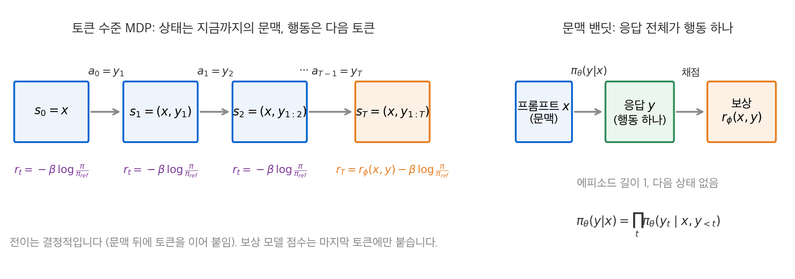
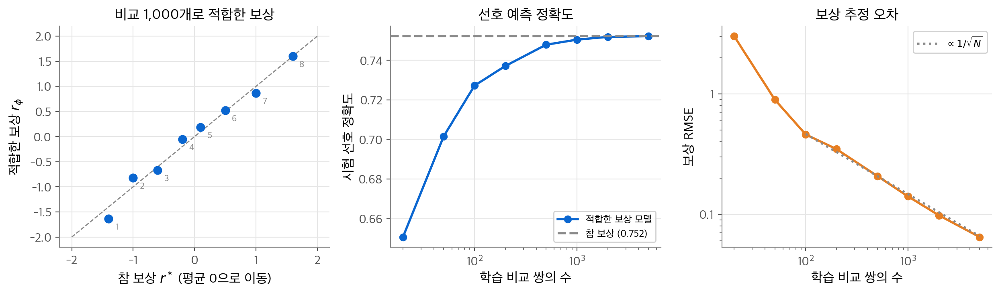
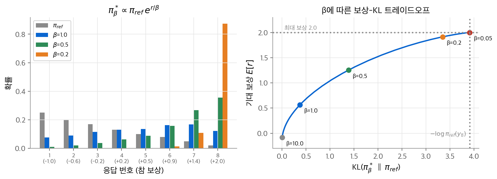
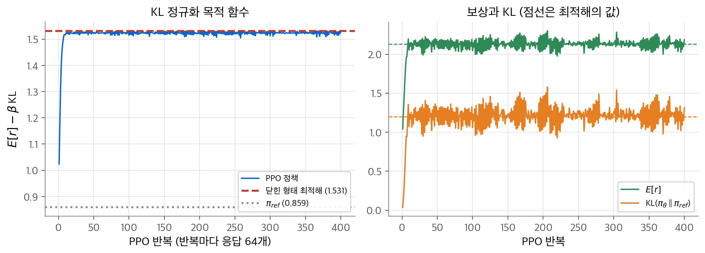
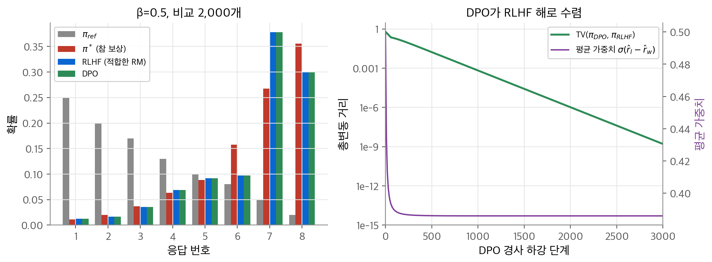
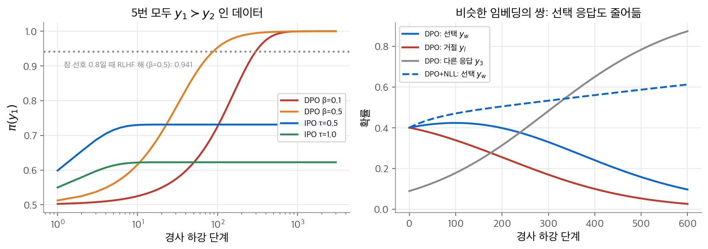
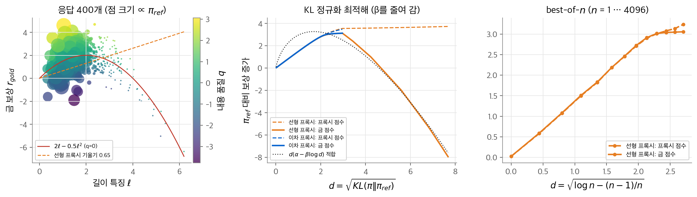

# 14. 선호 학습과 RLHF

대형 언어 모델(LLM)의 후속 학습(post-training)은 "좋은 답"을 직접 정의하기 어렵습니다. 사람은 점수를 매기기는 어려워도 두 답 중 나은 쪽은 고를 수 있습니다. 이 장의 질문은 "두 응답의 비교만으로 정책을 어떻게 개선할까?"입니다. 결론은 두 갈래입니다. 하나는 비교로 보상 모델을 배우고, KL 정규화 목적 함수를 PPO로 최대화하는 RLHF입니다. 다른 하나는 KL 정규화 목적 함수의 닫힌 형태 해를 써서 보상 모델과 강화 학습 단계를 없앤 DPO입니다. 두 방법은 같은 최적해를 겨냥합니다. 그러나 유한한 오프라인 데이터에서는 과적합, 선택 응답의 확률 하락, 보상 해킹 같은 서로 다른 약점이 드러납니다.

!!! info "원문과 자료"
    - 이 장은 Sutton & Barto의 책에 없는 내용입니다. 원 논문을 기준으로 정리했습니다.
    - [Learning to summarize from human feedback](https://arxiv.org/abs/2009.01325) (Stiennon et al., 2020)
    - [Training language models to follow instructions with human feedback](https://arxiv.org/abs/2203.02155) (Ouyang et al., 2022)
    - [Scaling Laws for Reward Model Overoptimization](https://arxiv.org/abs/2210.10760) (Gao et al., 2022, ICML 2023)
    - [Direct Preference Optimization: Your Language Model is Secretly a Reward Model](https://arxiv.org/abs/2305.18290) (Rafailov et al., 2023)
    - [A General Theoretical Paradigm to Understand Learning from Human Preferences](https://arxiv.org/abs/2310.12036) (Azar et al., 2023), IPO
    - [Iterative Preference Learning from Human Feedback: Bridging Theory and Practice for RLHF under KL-constraint](https://arxiv.org/abs/2312.11456) (Xiong et al., 2023)
    - [KTO: Model Alignment as Prospect Theoretic Optimization](https://arxiv.org/abs/2402.01306) (Ethayarajh et al., 2024)
    - [Direct Language Model Alignment from Online AI Feedback](https://arxiv.org/abs/2402.04792) (Guo et al., 2024)
    - [ORPO: Monolithic Preference Optimization without Reference Model](https://arxiv.org/abs/2403.07691) (Hong et al., 2024)
    - [From r to Q*: Your Language Model is Secretly a Q-Function](https://arxiv.org/abs/2404.12358) (Rafailov et al., 2024)
    - [SimPO: Simple Preference Optimization with a Reference-Free Reward](https://arxiv.org/abs/2405.14734) (Meng et al., 2024)
    - [Unintentional Unalignment: Likelihood Displacement in Direct Preference Optimization](https://arxiv.org/abs/2410.08847) (Razin et al., 2024)
    - [A Survey of Direct Preference Optimization](https://arxiv.org/abs/2503.11701) (Liu et al., 2025)
    - 해설: [Nathan Lambert, RLHF Book](https://rlhfbook.com), [Hugging Face TRL DPO Trainer](https://huggingface.co/docs/trl/dpo_trainer), [Stanford CS234](https://web.stanford.edu/class/cs234/) (Offline RL, RLHF 강의)
    - 함께 읽기: [2. 다중 선택 밴딧](02-bandits.md), [5. 몬테카를로 방법](05-monte-carlo.md)(중요도 샘플링), [11. 정책 근사](11-policy-gradient.md)(정책 그래디언트, 기준선, PPO), [15. 검증 가능한 보상의 강화 학습](15-rlvr-grpo.md), [MOPD 논문 리뷰](../../papers/2026-mopd.md)(on-policy 증류)

## 1. LLM 생성을 강화 학습으로 보기

### 토큰 수준 MDP

언어 모델은 프롬프트 $x$ 를 받아 토큰을 하나씩 냅니다. 응답 $y = (y_1, \ldots, y_T)$ 의 확률은 토큰 확률의 곱입니다.

$$
\pi_\theta(y \mid x) = \prod_{t=1}^{T} \pi_\theta(y_t \mid x, y_{<t})
$$

이 과정을 [3장](03-finite-mdp.md)의 MDP로 옮기면 다음과 같습니다.

| MDP 요소 | LLM 생성 |
| --- | --- |
| 상태 $S_t$ | 프롬프트와 지금까지의 토큰 $(x, y_{<t+1})$ |
| 행동 $A_t$ | 다음 토큰 $y_{t+1}$, 행동 공간은 어휘 전체 |
| 전이 $p(s' \mid s, a)$ | 결정적입니다. 문맥 뒤에 토큰을 이어 붙입니다. |
| 에피소드 | 프롬프트 하나에 대한 응답 하나. 종료 토큰이나 최대 길이에서 끝납니다. |
| 보상 | 응답 전체에 대한 점수 하나. 마지막 토큰에만 붙습니다. |
| 정책 | 언어 모델 $\pi_\theta(y_t \mid x, y_{<t})$ |

상태는 지금까지의 문맥 전체이므로 마르코프 성질이 저절로 성립합니다. 대신 상태 공간이 어휘 크기의 길이 제곱만큼 큽니다. 같은 상태를 두 번 방문하는 일은 거의 없습니다. 그래서 표 형식 방법은 쓸 수 없고, [9장](09-function-approximation.md)의 함수 근사가 필수입니다.

### 문맥 밴딧 관점

보상이 응답 전체에 하나만 붙는다면 응답 $y$ 전체를 행동 하나로 볼 수도 있습니다. 그러면 에피소드 길이가 1이고 다음 상태가 없습니다. 프롬프트 $x$ 는 문맥입니다. 이것은 [2장](02-bandits.md)의 밴딧에 문맥을 더한 **문맥 밴딧(contextual bandit)** 입니다. InstructGPT 논문도 RL 환경을 "프롬프트를 보여 주고 응답을 받아 보상을 준 뒤 에피소드를 끝내는 밴딧 환경"으로 설명합니다.

<figure markdown>

<figcaption markdown>
<b>Figure 1.</b> 토큰 수준 MDP와 문맥 밴딧

왼쪽은 토큰 수준 MDP입니다. 토큰마다 KL 패널티가 붙고, 보상 모델 점수는 마지막 토큰에 더해집니다(4절). 오른쪽은 응답 전체를 행동 하나로 보는 문맥 밴딧입니다.
</figcaption>
</figure>

두 관점은 목적 함수가 같습니다. 차이는 학습 신호를 어디에 두느냐입니다.

| | 토큰 수준 MDP | 문맥 밴딧 |
| --- | --- | --- |
| 행동 | 토큰 하나 | 응답 전체 |
| 신용 할당 | 가치 함수로 토큰마다 어드밴티지를 추정합니다. | 응답 전체가 같은 신호를 받습니다. |
| 대표 방법 | PPO(4절) | REINFORCE, DPO(5절), GRPO([15장](15-rlvr-grpo.md)) |
| 정책 그래디언트 | $\sum_t \hat A_t \nabla \ln \pi(y_t \mid s_t)$ | $(r(x,y) - b)\, \nabla \ln \pi(y \mid x)$ |

$\nabla \ln \pi(y \mid x) = \sum_t \nabla \ln \pi(y_t \mid x, y_{<t})$ 이므로 밴딧 관점의 그래디언트도 토큰별 항의 합입니다. 다만 모든 토큰이 같은 크기 $r - b$ 를 받습니다. DPO는 원래 밴딧 관점에서 유도했습니다. Rafailov et al. (2024)는 같은 손실을 토큰 수준 MDP에서도 유도할 수 있음을 보였습니다. 이때 언어 모델의 로짓이 최적 Q 함수 역할을 합니다.

## 2. 보상 모델

### Bradley-Terry 선호 모형

사람은 응답 쌍 $(y_1, y_2)$ 를 보고 나은 쪽을 고릅니다. 고른 쪽을 $y_w$, 버린 쪽을 $y_l$ 로 씁니다. **Bradley-Terry 모형(Bradley-Terry model)** 은 숨은 보상 $r^*$ 가 있다고 가정합니다. 선호 확률은 보상 차이의 로지스틱 함수입니다.

$$
p^*(y_1 \succ y_2 \mid x) = \frac{\exp r^*(x, y_1)}{\exp r^*(x, y_1) + \exp r^*(x, y_2)} = \sigma\big(r^*(x, y_1) - r^*(x, y_2)\big)
$$

$\sigma(z) = 1/(1+e^{-z})$ 입니다. 보상 차이가 1이면 선호 확률은 $\sigma(1) = 0.731$ 이고, 차이가 0이면 0.5입니다. 이 모형은 차이만 봅니다. 모든 응답의 보상에 같은 상수를 더해도 선호 확률은 같습니다. 그래서 보상은 프롬프트마다 상수 하나만큼 정해지지 않습니다. InstructGPT는 RL 전에 시연 응답의 평균 점수가 0이 되도록 편향을 맞춥니다.

### 음의 로그 우도 손실

비교 데이터 $\mathcal{D} = \{(x, y_w, y_l)\}$ 로 보상 모델 $r_\phi$ 를 최대 우도로 적합합니다. 이진 분류의 교차 엔트로피와 같은 꼴입니다.

$$
\mathcal{L}_R(\phi) = -\mathbb{E}_{(x, y_w, y_l) \sim \mathcal{D}} \big[ \log \sigma\big(r_\phi(x, y_w) - r_\phi(x, y_l)\big) \big]
$$

$\Delta = r_\phi(x, y_w) - r_\phi(x, y_l)$ 로 두고 미분합니다. $\frac{d}{d\Delta} \log \sigma(\Delta) = 1 - \sigma(\Delta) = \sigma(-\Delta)$ 입니다.

$$
\nabla_\phi \mathcal{L}_R = -\mathbb{E}\big[ \sigma(-\Delta)\, \big( \nabla_\phi r_\phi(x, y_w) - \nabla_\phi r_\phi(x, y_l) \big) \big]
$$

모델이 순서를 틀리게 매길수록($\Delta < 0$) 가중치 $\sigma(-\Delta)$ 가 1에 가깝습니다. 이미 확실히 맞힌 쌍은 거의 갱신하지 않습니다. 이 가중치 구조는 5절의 DPO 그래디언트에 그대로 다시 나옵니다. 실제 보상 모델은 SFT 모델의 마지막 층 위에 스칼라 출력 층을 얹습니다. Stiennon et al. (2020)과 InstructGPT가 이 방식을 씁니다. InstructGPT는 프롬프트마다 응답 $K = 4 \sim 9$ 개의 순위를 받습니다. 여기서 쌍 $\binom{K}{2}$ 개를 만들고, 한 프롬프트의 쌍을 한 배치 원소로 묶습니다. 쌍을 따로 섞으면 한 에폭 만에 과적합했다고 보고합니다. 보상 모델 크기는 6B입니다.

### toy 실험: 응답 8개의 보상 모델

프롬프트 하나에 후보 응답이 8개 있습니다. 참 보상은 $r^* = (-1.0, -0.6, -0.2, 0.2, 0.5, 0.9, 1.4, 2.0)$ 입니다. 서로 다른 두 응답을 균등하게 뽑고 Bradley-Terry 모형으로 승자를 정합니다. 보상 모델은 응답마다 값 하나를 두는 표 형식입니다. 손실에 아주 작은 L2 항($10^{-4}$)을 더하고 전체 배치 경사 하강으로 적합합니다. 학습 쌍의 수마다 20번 반복했고, 시험 쌍 20,000개로 평가했습니다.

<figure markdown>

<figcaption markdown>
<b>Figure 2.</b> 보상 모델 적합

비교 1,000개로 적합한 보상(왼쪽, 평균을 0으로 맞춤)과 선호 예측 정확도(가운데), 보상 RMSE(오른쪽)입니다.
</figcaption>
</figure>

| 학습 쌍 | 시험 정확도 | 시험 NLL | 보상 RMSE |
| --- | --- | --- | --- |
| 20 | 0.651 | 1.328 | 3.024 |
| 100 | 0.727 | 0.565 | 0.461 |
| 1,000 | 0.750 | 0.529 | 0.141 |
| 5,000 | 0.752 | 0.526 | 0.065 |
| 참 보상 $r^*$ | 0.752 | 0.525 | 0 |

참 보상으로도 정확도는 0.752에 그칩니다. 선호 자체가 확률적이기 때문입니다. 보상 차이가 작은 쌍은 사람도 자주 뒤집습니다. 비교 20개에서는 한 번도 지지 않은 응답이 생기고, 그 보상이 한없이 커지려 합니다. 그래서 RMSE가 3.0까지 커집니다. 이 현상은 6절의 IPO가 지적하는 DPO 과적합과 같은 뿌리입니다. 데이터가 늘면 RMSE는 대략 $1/\sqrt{N}$ 으로 줄어듭니다.

## 3. KL 정규화 목적 함수

### 목적 함수

보상 모델만 최대화하면 정책은 보상 모델이 가장 높게 매기는 응답 하나로 무너집니다. 그 응답이 보상 모델이 학습 중에 본 분포 밖에 있으면 점수는 믿을 수 없습니다(7절). 그래서 RLHF는 **참조 정책(reference policy)** $\pi_{\text{ref}}$ 에서 멀어지는 정도에 벌점을 줍니다. 참조 정책은 보통 SFT 모델입니다.

$$
\max_{\pi} \; \mathbb{E}_{x \sim \mathcal{D},\, y \sim \pi(\cdot \mid x)} \big[ r(x, y) \big] - \beta\, \mathbb{D}_{\text{KL}}\big[ \pi(\cdot \mid x) \,\|\, \pi_{\text{ref}}(\cdot \mid x) \big]
$$

$\beta > 0$ 는 정규화의 세기입니다. Stiennon et al.은 이 KL 항의 역할을 둘로 설명합니다. 하나는 엔트로피 보너스처럼 탐험을 돕고 한 모드로 무너지는 것을 막는 것입니다. 다른 하나는 보상 모델이 본 적 없는 출력으로 가지 않게 하는 것입니다.

### 닫힌 형태 최적해 유도

프롬프트 $x$ 하나를 고정합니다. 정책 클래스에 제약이 없다고 가정합니다. KL을 기댓값으로 풀어 씁니다.

$$
\mathbb{E}_{y \sim \pi}[r(x,y)] - \beta\, \mathbb{E}_{y \sim \pi}\Big[\log \frac{\pi(y \mid x)}{\pi_{\text{ref}}(y \mid x)}\Big]
= -\beta\, \mathbb{E}_{y \sim \pi}\Big[ \log \frac{\pi(y \mid x)}{\pi_{\text{ref}}(y \mid x)} - \frac{1}{\beta} r(x, y) \Big]
$$

괄호 안의 $\frac{1}{\beta} r$ 을 로그 안으로 넣으면 분모가 $\pi_{\text{ref}}(y \mid x) \exp(r(x,y)/\beta)$ 가 됩니다. 이것은 확률 분포가 아닙니다. 합이 1이 되도록 **분할 함수(partition function)** $Z(x)$ 로 나눕니다.

$$
Z(x) = \sum_y \pi_{\text{ref}}(y \mid x) \exp\Big(\frac{1}{\beta} r(x, y)\Big), \qquad
\pi^*(y \mid x) = \frac{1}{Z(x)}\, \pi_{\text{ref}}(y \mid x) \exp\Big(\frac{1}{\beta} r(x, y)\Big)
$$

$Z(x)$ 는 $\pi$ 와 무관합니다. 목적 함수를 $\pi^*$ 로 다시 씁니다.

$$
-\beta\, \mathbb{E}_{y \sim \pi}\Big[ \log \frac{\pi(y \mid x)}{\pi^*(y \mid x)} - \log Z(x) \Big]
= -\beta\, \mathbb{D}_{\text{KL}}\big[\pi(\cdot \mid x) \,\|\, \pi^*(\cdot \mid x)\big] + \beta \log Z(x)
$$

KL 발산은 0 이상이고, 두 분포가 같을 때만 0입니다. 그래서 목적 함수는 $\pi = \pi^*$ 에서 최대이고, 최댓값은 $\beta \log Z(x)$ 입니다.

$$
\boxed{\;\pi^*(y \mid x) \propto \pi_{\text{ref}}(y \mid x)\, \exp\big(r(x, y)/\beta\big)\;}
$$

해석은 단순합니다. 참조 정책을 보상의 지수로 다시 가중합니다. $\beta \to \infty$ 이면 $\pi^* \to \pi_{\text{ref}}$ 이고, $\beta \to 0$ 이면 $\pi_{\text{ref}}$ 의 지지 집합 안에서 보상이 가장 큰 응답으로 모입니다. 같은 꼴이 [2장](02-bandits.md)의 소프트맥스 행동 선택과 최대 엔트로피 강화 학습(SAC, [11장](11-policy-gradient.md) 9절)에도 나옵니다. 차이는 균등 분포 대신 $\pi_{\text{ref}}$ 를 사전 분포로 쓴다는 점입니다.

### 수치 확인: 보상-KL 트레이드오프

2절의 응답 8개를 그대로 씁니다. 참조 정책은 보상이 낮은 응답에 확률을 더 많이 둡니다. $\pi_{\text{ref}} = (0.25, 0.20, 0.17, 0.13, 0.10, 0.08, 0.05, 0.02)$ 이고 기대 보상은 $-0.146$ 입니다.

<figure markdown>

<figcaption markdown>
<b>Figure 3.</b> KL 정규화 최적해와 보상-KL 트레이드오프

β 세 값의 최적 정책(왼쪽)과, β를 바꾸며 그린 기대 보상-KL 곡선(오른쪽)입니다. β가 작을수록 보상과 KL이 함께 커집니다.
</figcaption>
</figure>

| β | $\mathbb{E}[r]$ | KL | 목적 함수 값 | $\beta \log Z$ |
| --- | --- | --- | --- | --- |
| 10 | $-0.086$ | $0.003$ | $-0.1164$ | $-0.1164$ |
| 1 | $0.565$ | $0.373$ | $0.1922$ | $0.1922$ |
| 0.5 | $1.254$ | $1.386$ | $0.5612$ | $0.5612$ |
| 0.2 | $1.914$ | $3.346$ | $1.2446$ | $1.2446$ |
| 0.05 | $2.000$ | $3.912$ | $1.8044$ | $1.8044$ |

목적 함수 값은 모든 β에서 $\beta \log Z$ 와 같습니다. β=0.5에서 디리클레 분포로 무작위 정책 10,000개를 뽑아 목적 함수를 계산했습니다. 10,000개 모두 닫힌 형태 해보다 낮았습니다. 곡선은 오목합니다. 처음의 KL 1 단위는 보상을 많이 올립니다. 뒤로 갈수록 같은 보상을 얻는 데 KL이 더 많이 듭니다. β가 아주 작으면 KL은 $-\log \pi_{\text{ref}}(y_8)$ 에 다가갑니다. 최선의 응답 하나에 확률을 모두 모으는 비용입니다.

## 4. RLHF-PPO

### 파이프라인

Stiennon et al. (2020)과 InstructGPT(Ouyang et al., 2022)의 RLHF는 세 단계입니다.

1. **SFT**: 사람이 쓴 시연 응답으로 사전 학습 모델을 지도 학습합니다. 이 모델이 $\pi_{\text{ref}}$ 이고 정책의 초깃값입니다.
2. **보상 모델**: SFT 모델의 응답을 사람이 비교하고, 2절의 손실로 $r_\phi$ 를 학습합니다.
3. **PPO**: 3절의 목적 함수를 PPO로 최대화합니다.

3절의 닫힌 형태 해는 모든 응답 $y$ 에 대한 합 $Z(x)$ 가 필요합니다. 응답 공간이 너무 커서 계산할 수 없습니다. 또 해를 알아도 그 분포에서 샘플링하는 방법이 없습니다. 그래서 파라미터 정책을 두고 정책 그래디언트로 목적 함수를 올립니다.

### 토큰별 KL 패널티 보상

Stiennon et al.은 보상을 $R(x, y) = r_\phi(x, y) - \beta \log[\pi^{\text{RL}}_\phi(y \mid x) / \pi^{\text{SFT}}(y \mid x)]$ 로 씁니다. 로그 비는 토큰별 로그 비의 합으로 쪼개집니다.

$$
\log \frac{\pi_\theta(y \mid x)}{\pi_{\text{ref}}(y \mid x)} = \sum_{t=1}^{T} \log \frac{\pi_\theta(y_t \mid s_t)}{\pi_{\text{ref}}(y_t \mid s_t)}, \qquad s_t = (x, y_{<t})
$$

그래서 토큰 수준 MDP의 보상을 다음과 같이 둡니다.

$$
r_t = -\beta \log \frac{\pi_\theta(y_t \mid s_t)}{\pi_{\text{ref}}(y_t \mid s_t)} + \mathbf{1}[t = T]\; r_\phi(x, y)
$$

할인 없는($\gamma = 1$) 이득 $\sum_t r_t$ 는 정확히 $R(x, y)$ 입니다. 그 기댓값은 3절의 목적 함수입니다. KL 항이 토큰마다 들어가므로 가치 함수는 마지막 보상만 기다리지 않습니다. 참조 정책에서 멀어지는 토큰은 즉시 음의 보상을 받습니다. InstructGPT는 이것을 "토큰마다 SFT 모델로부터의 KL 패널티"라고 부르고 $\beta = 0.02$ 를 씁니다. Stiennon et al.의 주 실험은 $\beta = 0.05$ 입니다.

### 가치 망, GAE, 클립 목적 함수

나머지는 [11장](11-policy-gradient.md)의 액터-크리틱과 PPO 그대로입니다.

- **가치 망(value network)**: $\hat v_\psi(s_t)$ 가 토큰 위치마다 남은 이득을 예측합니다. 두 논문 모두 가치 망을 보상 모델 가중치로 초기화합니다. Stiennon et al.은 정책과 파라미터를 공유하지 않는 별도 Transformer를 씁니다. 공유하면 초기 가치 갱신이 사전 학습 정책을 망가뜨린다고 보고합니다.
- **GAE**: TD 오차 $\delta_t = r_t + \gamma \hat v(s_{t+1}) - \hat v(s_t)$ 를 λ로 가중합해 어드밴티지를 추정합니다. [7장](07-eligibility-traces.md)의 λ-이득의 어드밴티지 버전입니다.

$$
\hat A_t = \sum_{l=0}^{T-t} (\gamma \lambda)^l\, \delta_{t+l}
$$

- **클립 목적 함수**: 롤아웃을 만든 정책 $\pi_{\text{old}}$ 와 현재 정책의 비 $\rho_t = \pi_\theta(y_t \mid s_t) / \pi_{\text{old}}(y_t \mid s_t)$ 는 [5장](05-monte-carlo.md)의 중요도 샘플링 비입니다. PPO는 이 비를 $[1-\epsilon, 1+\epsilon]$ 로 잘라 같은 배치를 여러 번 재사용합니다.

$$
L^{\text{CLIP}}(\theta) = \mathbb{E}_t \Big[ \min\big( \rho_t \hat A_t,\; \operatorname{clip}(\rho_t, 1-\epsilon, 1+\epsilon)\, \hat A_t \big) \Big]
$$

두 논문의 설정은 다음과 같습니다.

| 설정 | Stiennon et al. (2020) | InstructGPT (2022) |
| --- | --- | --- |
| KL 계수 β | 0.05 | 0.02 |
| GAE | $\gamma = 1$, $\lambda = 0.95$ | 할인 없음 |
| 배치당 최적화 | 4 에폭 | 1 에폭(미니배치 8개) |
| 가치 망 | 보상 모델로 초기화, 별도 파라미터 | 6B, 보상 모델로 초기화 |
| 그 밖 | | PPO-ptx: 사전 학습 로그 우도를 계수 27.8로 혼합 |

### toy 실험: 27개 시퀀스의 PPO

토큰 A, B, C 세 개로 길이 3인 응답을 만듭니다. 응답은 $3^3 = 27$ 개이고, 끝나지 않은 접두사(상태)는 $1 + 3 + 9 = 13$ 개입니다. 보상은 A 하나마다 +1, 마지막 토큰이 C면 +0.5, 첫 토큰이 B면 −1입니다. 참조 정책은 접두사마다 로짓을 $\mathcal{N}(0, 0.8^2)$ 에서 뽑은 표 형식 정책입니다. 정책과 가치도 표 형식입니다. PPO 설정은 β=0.5, 반복마다 응답 64개, 4 에폭, 미니배치 응답 16개, 정책 스텝 0.5, 가치 스텝 0.2, ε=0.2, γ=1, λ=0.95입니다. 어드밴티지는 배치 안에서 표준화했습니다. 400번 반복했습니다. 응답이 27개뿐이므로 닫힌 형태 해 $\pi^* \propto \pi_{\text{ref}} e^{r/\beta}$ 와 정책의 기대 보상, KL을 정확히 계산할 수 있습니다.

<figure markdown>

<figcaption markdown>
<b>Figure 4.</b> toy RLHF-PPO

PPO의 목적 함수(왼쪽)와 기대 보상·KL(오른쪽)이 닫힌 형태 해의 값(점선, 목적 함수 1.531)으로 다가갑니다.
</figcaption>
</figure>

| | $\mathbb{E}[r]$ | KL | $\mathbb{E}[r] - \beta \text{KL}$ |
| --- | --- | --- | --- |
| $\pi_{\text{ref}}$ | 0.859 | 0 | 0.859 |
| PPO 반복 10 | 2.053 | 1.074 | 1.516 |
| PPO 마지막 50회 평균 | 2.134 | 1.220 | 1.523 |
| 닫힌 형태 해 | 2.132 | 1.201 | 1.531 |

PPO는 반복 10번 만에 목적 함수가 최적값의 99%에 이릅니다. 마지막 정책과 닫힌 형태 해의 총변동 거리는 0.054입니다. 토큰별 KL 보상, GAE, 클립을 거친 정책이 3절의 해로 간다는 것을 확인했습니다. 기대 보상과 KL은 계속 흔들립니다. 목적 함수 근처에서는 보상을 조금 올리고 KL을 조금 더 쓰는 방향이 거의 평평하기 때문입니다.

## 5. DPO

### 보상의 재매개화

3절의 해를 보상에 대해 풉니다. 양변에 로그를 취하고 정리합니다.

$$
r(x, y) = \beta \log \frac{\pi^*(y \mid x)}{\pi_{\text{ref}}(y \mid x)} + \beta \log Z(x)
$$

이 식은 보상과 최적 정책이 일대일로 대응한다는 뜻입니다. 단, 프롬프트마다 상수 $\beta \log Z(x)$ 만큼은 정해지지 않습니다. Rafailov et al. (2023)은 $x$ 에만 의존하는 함수만큼 다른 두 보상을 **동치(equivalent)** 라고 정의합니다. 같은 동치류의 보상은 같은 선호 분포를 만들고(보조정리 1), 같은 최적 정책을 만듭니다(보조정리 2).

### 분할 함수의 상쇄

이 보상을 Bradley-Terry 모형에 넣습니다. Bradley-Terry는 보상 차이만 쓰므로 $\beta \log Z(x)$ 가 사라집니다.

$$
\begin{aligned}
p^*(y_w \succ y_l \mid x) &= \sigma\Big( \beta \log \frac{\pi^*(y_w \mid x)}{\pi_{\text{ref}}(y_w \mid x)} + \beta \log Z(x) - \beta \log \frac{\pi^*(y_l \mid x)}{\pi_{\text{ref}}(y_l \mid x)} - \beta \log Z(x) \Big) \\
&= \sigma\Big( \beta \log \frac{\pi^*(y_w \mid x)}{\pi_{\text{ref}}(y_w \mid x)} - \beta \log \frac{\pi^*(y_l \mid x)}{\pi_{\text{ref}}(y_l \mid x)} \Big)
\end{aligned}
$$

선호 확률이 정책만으로 쓰였습니다. 계산할 수 없던 $Z(x)$ 가 필요 없어졌습니다.

### 손실 유도

이제 정책 $\pi_\theta$ 를 최적 정책의 후보로 두고, 2절처럼 비교 데이터의 음의 로그 우도를 최소화합니다.

$$
\mathcal{L}_{\text{DPO}}(\pi_\theta; \pi_{\text{ref}}) = -\mathbb{E}_{(x, y_w, y_l) \sim \mathcal{D}} \Big[ \log \sigma\Big( \beta \log \frac{\pi_\theta(y_w \mid x)}{\pi_{\text{ref}}(y_w \mid x)} - \beta \log \frac{\pi_\theta(y_l \mid x)}{\pi_{\text{ref}}(y_l \mid x)} \Big) \Big]
$$

정리하면 DPO는 KL 정규화 해를 뒤집어 보상을 정책으로 쓰고, 그 보상을 보상 모델의 NLL 손실에 넣은 것입니다. 일종의 **변수 변환(change of variables)** 입니다. 정책이 곧 보상 모델이고, 그 보상의 최적 정책이 곧 자기 자신입니다. 강화 학습 단계와 정책 샘플링이 모두 없어집니다. 필요한 것은 $\pi_\theta$ 와 $\pi_{\text{ref}}$ 로 $y_w$, $y_l$ 의 로그 확률을 계산하는 순전파뿐입니다.

### 그래디언트의 가중치 해석

**암묵적 보상(implicit reward)** 을 $\hat r_\theta(x, y) = \beta \log \frac{\pi_\theta(y \mid x)}{\pi_{\text{ref}}(y \mid x)}$ 로 정의합니다. 손실은 $-\log \sigma(\hat r_\theta(x, y_w) - \hat r_\theta(x, y_l))$ 입니다. 2절의 미분을 그대로 쓰고 $\nabla_\theta \hat r_\theta = \beta \nabla_\theta \log \pi_\theta$ 를 넣습니다.

$$
\nabla_\theta \mathcal{L}_{\text{DPO}} = -\beta\, \mathbb{E}_{\mathcal{D}} \Big[ \underbrace{\sigma\big(\hat r_\theta(x, y_l) - \hat r_\theta(x, y_w)\big)}_{\text{암묵적 보상이 틀릴수록 큼}} \big( \underbrace{\nabla_\theta \log \pi_\theta(y_w \mid x)}_{y_w \text{ 확률을 올림}} - \underbrace{\nabla_\theta \log \pi_\theta(y_l \mid x)}_{y_l \text{ 확률을 내림}} \big) \Big]
$$

[11장](11-policy-gradient.md)의 REINFORCE와 비교하면 구조가 보입니다. $\nabla \log \pi$ 는 적격 벡터이고, 앞의 가중치가 이득 역할을 합니다. $y_w$ 에는 양의 이득, $y_l$ 에는 음의 이득을 주는 셈입니다. 다만 샘플이 현재 정책에서 나오지 않습니다. 고정된 데이터에서 나오므로 DPO는 오프라인 방법입니다. 가중치는 암묵적 보상이 쌍의 순서를 얼마나 틀렸는지에 비례합니다. Rafailov et al.은 이 가중치를 뺀 단순 버전이 모델을 망가뜨린다고 보고합니다.

### toy 실험: DPO와 RLHF의 비교

2~3절의 응답 8개, 같은 $\pi_{\text{ref}}$, β=0.5를 씁니다. $\pi_{\text{ref}}$ 에서 두 응답을 독립으로 뽑아 비교 2,000개를 만들고, $r^*$ 의 Bradley-Terry로 승자를 정했습니다. 같은 데이터로 두 방법을 돌립니다.

- **RLHF**: 표 형식 보상 모델을 NLL 손실로 적합합니다. 그 보상으로 3절의 정확한 KL 정규화 해 $\pi_{\text{RLHF}} \propto \pi_{\text{ref}} e^{r_\phi/\beta}$ 를 구합니다. PPO가 완벽하게 최적화한 경우에 해당합니다.
- **DPO**: 정책 로짓 8개를 $\log \pi_{\text{ref}}$ 에서 시작해 DPO 손실의 전체 배치 경사 하강(스텝 5.0, 6,000회)으로 학습합니다.

<figure markdown>

<figcaption markdown>
<b>Figure 5.</b> DPO와 RLHF

네 정책의 비교(왼쪽, $\pi^*$ 는 참 보상의 해)와 DPO 학습 중 $\pi_{\text{RLHF}}$ 와의 총변동 거리(오른쪽)입니다.
</figcaption>
</figure>

| 응답 | 1 | 2 | 3 | 4 | 5 | 6 | 7 | 8 |
| --- | --- | --- | --- | --- | --- | --- | --- | --- |
| 데이터 등장 횟수 | 877 | 743 | 698 | 534 | 464 | 349 | 245 | 90 |
| $\pi^*$ (참 보상) | 0.011 | 0.020 | 0.037 | 0.063 | 0.088 | 0.158 | 0.268 | 0.355 |
| $\pi_{\text{RLHF}}$ | 0.012 | 0.016 | 0.035 | 0.069 | 0.092 | 0.097 | 0.378 | 0.300 |
| $\pi_{\text{DPO}}$ | 0.012 | 0.016 | 0.035 | 0.069 | 0.092 | 0.097 | 0.378 | 0.300 |

DPO 정책은 RLHF 정책과 일치합니다. 총변동 거리는 $7 \times 10^{-15}$ 입니다. DPO의 마지막 손실 0.5694는 적합한 보상 모델의 NLL과 소수점 넷째 자리까지 같습니다. 평균 암묵적 보상을 빼면 $\hat r_\theta$ 는 $r_\phi$ 와 같습니다. 예를 들어 응답 8은 둘 다 1.533입니다. 표 형식 정책은 모든 분포를 표현할 수 있습니다. 그래서 DPO 손실의 최소화는 재매개화된 보상 모델의 최대 우도 추정과 같은 문제가 됩니다. 두 방법 모두 $\pi^*$ 와는 다릅니다. 응답 6과 7의 확률이 뒤바뀌었습니다. 응답 8은 데이터에 90번만 나와 보상 추정이 거칩니다. 기대 보상은 $\pi^*$ 가 1.254, 두 방법이 1.247입니다. KL은 1.386과 1.410입니다. 이 차이는 알고리즘이 아니라 데이터에서 옵니다. 평균 가중치는 0.5에서 0.386으로 줄고 그 뒤로 거의 변하지 않습니다. 선호가 확률적이므로 쌍의 상당수는 끝까지 "틀린" 쌍으로 남습니다. 이 균형이 유한한 해를 만듭니다. 6절에서는 이 균형이 깨지는 경우를 봅니다.

## 6. DPO의 한계와 변형

### IPO: 결정적 선호와 과적합

Azar et al. (2023)은 DPO와 RLHF를 일반화한 $\Psi$PO 목적 함수를 제시합니다. 그리고 DPO가 과적합하기 쉬운 이유를 설명합니다. $y$ 가 $y'$ 보다 항상 선호되면($p^* = 1$) Bradley-Terry 보상 차이는 무한대여야 합니다. 그러면 β와 상관없이 $\pi^*(y') = 0$ 입니다. 데이터가 적으면 참 선호가 0.8이어도 경험적 선호가 1일 수 있습니다. 명시적 보상 모델은 정규화와 조기 종료로 덜 적합되어 이 문제를 피합니다. DPO는 보상 모델을 건너뛰므로 그 안전장치도 함께 잃는다는 것이 IPO 논문의 주장입니다.

IPO는 로지스틱 대신 항등 함수를 씁니다. 로그 비의 차 $h_\pi$ 를 정해진 목표 $1/(2\tau)$ 로 회귀합니다.

$$
h_\pi(y_w, y_l, x) = \log \frac{\pi(y_w \mid x)\, \pi_{\text{ref}}(y_l \mid x)}{\pi(y_l \mid x)\, \pi_{\text{ref}}(y_w \mid x)}, \qquad
\mathcal{L}_{\text{IPO}} = \mathbb{E}_{\mathcal{D}} \Big[ \Big( h_\pi(y_w, y_l, x) - \frac{1}{2\tau} \Big)^2 \Big]
$$

$\tau$ 는 DPO의 β와 같은 역할입니다. DPO의 $-\log \sigma(\beta h)$ 는 $h \to \infty$ 에서만 0에 다가갑니다. 그래서 모든 쌍을 맞힌 데이터에서는 $h$ 를 끝없이 키웁니다. IPO의 제곱 손실은 $h = 1/(2\tau)$ 에서 최소이므로 멈춥니다.

실험은 IPO 논문 5.3절의 예와 같은 설정입니다. 응답은 두 개이고 $\pi_{\text{ref}}$ 는 균등합니다. 비교 5개가 모두 $y_1 \succ y_2$ 입니다. 로짓 두 개를 스텝 0.1로 3,000번 경사 하강했습니다.

<figure markdown>

<figcaption markdown>
<b>Figure 6.</b> DPO 변형의 두 현상

왼쪽은 결정적 선호 데이터에서 $\pi(y_1)$ 의 변화입니다. 오른쪽은 비슷한 임베딩을 가진 선택-거절 쌍에서 DPO가 확률을 옮기는 모습입니다(아래 "선택 응답의 확률 하락").
</figcaption>
</figure>

| 방법 | 단계 100 | 단계 3,000 | 이론적 극한 |
| --- | --- | --- | --- |
| DPO β=0.1 | 0.726 | 1.000 | 1 |
| DPO β=0.5 | 0.953 | 1.000 | 1 |
| IPO τ=0.5 | 0.731 | 0.731 | $\sigma(1) = 0.731$ |
| IPO τ=1.0 | 0.622 | 0.622 | $\sigma(0.5) = 0.622$ |

DPO는 β에 상관없이 $\pi(y_2) \to 0$ 으로 갑니다. β는 속도만 바꿉니다. 참 선호가 0.8이었다면 RLHF 해(β=0.5)는 $\sigma(\log 4 / 0.5) = 0.941$ 입니다. DPO는 다섯 개의 표본만 보고 이 값을 지나쳐 1로 갑니다. IPO는 데이터와 상관없이 $\pi_{\text{ref}}$ 와의 거리를 τ로 묶어 둡니다.

### KTO: 쌍이 없는 데이터

Ethayarajh et al. (2024)의 **KTO** 는 쌍 대신 "좋음/나쁨" 표시가 붙은 응답 하나를 씁니다. 손실은 Kahneman-Tversky의 전망 이론 가치 함수를 본뜹니다. 기준점 $z_0$ 는 정책과 참조 정책의 KL입니다.

$$
r_\theta(x, y) = \log \frac{\pi_\theta(y \mid x)}{\pi_{\text{ref}}(y \mid x)}, \qquad z_0 = \mathrm{KL}\big(\pi_\theta(y' \mid x) \,\|\, \pi_{\text{ref}}(y' \mid x)\big)
$$

$$
v(x, y) = \begin{cases} \lambda_D\, \sigma\big(\beta (r_\theta(x, y) - z_0)\big) & y \text{ 가 바람직함} \\ \lambda_U\, \sigma\big(\beta (z_0 - r_\theta(x, y))\big) & y \text{ 가 바람직하지 않음} \end{cases}, \qquad
\mathcal{L}_{\text{KTO}} = \mathbb{E}_{x, y \sim \mathcal{D}} [\lambda_y - v(x, y)]
$$

$\lambda_D$, $\lambda_U$ 는 좋은 예와 나쁜 예의 가중치입니다. 논문은 $z_0$ 를 정의대로 추정하기 어렵다고 말합니다. 대신 미니배치 안에서 프롬프트와 응답을 어긋나게 짝지어 로그 비의 평균을 구하고, 0 아래로 내려가지 않게 자릅니다. 쌍 데이터를 모으기 어려운 상황, 예를 들어 사용자의 "좋아요/싫어요" 기록에 맞습니다.

### SimPO: 길이 정규화와 참조 모델 제거

Meng et al. (2024)은 DPO의 암묵적 보상이 생성할 때 쓰는 기준과 다르다고 지적합니다. 생성은 토큰 평균 로그 확률이 높은 응답을 고릅니다. DPO 보상은 토큰 로그 확률의 합에 기반합니다. 합은 응답이 길수록 작아집니다. 토큰당 로그 확률이 $-0.5$ 이면 5토큰 응답의 합은 $-2.5$ 이고 20토큰 응답은 $-10$ 입니다. SimPO는 길이로 나눈 평균 로그 확률을 보상으로 쓰고 참조 모델을 없앱니다. 또 목표 여유 $\gamma > 0$ 를 둡니다.

$$
\mathcal{L}_{\text{SimPO}} = -\mathbb{E}_{\mathcal{D}} \Big[ \log \sigma\Big( \frac{\beta}{|y_w|} \log \pi_\theta(y_w \mid x) - \frac{\beta}{|y_l|} \log \pi_\theta(y_l \mid x) - \gamma \Big) \Big]
$$

참조 모델이 없으므로 메모리와 계산이 줄어듭니다. 대신 KL 정규화의 해석은 사라집니다. 정책이 참조 정책에서 얼마나 멀어지는지는 학습률, 학습 길이, γ가 간접적으로 정합니다. 논문은 β를 2.0~2.5, γ를 0.5~1.5로 둘 때 좋았다고 보고합니다.

### ORPO: SFT와 선호 학습을 한 단계로

Hong et al. (2024)의 **ORPO** 는 SFT 손실에 오즈비 항을 더합니다. 참조 모델과 별도의 SFT 단계가 모두 필요 없습니다. 길이 $m$ 인 응답의 확률을 토큰 평균으로 정의합니다. 그 확률의 오즈를 씁니다.

$$
\log P_\theta(y \mid x) = \frac{1}{m} \sum_{t=1}^{m} \log P_\theta(y_t \mid x, y_{<t}), \qquad \operatorname{odds}_\theta(y \mid x) = \frac{P_\theta(y \mid x)}{1 - P_\theta(y \mid x)}
$$

$$
\mathcal{L}_{\text{ORPO}} = \mathbb{E}_{\mathcal{D}} \big[ \mathcal{L}_{\text{SFT}} + \lambda\, \mathcal{L}_{\text{OR}} \big], \qquad
\mathcal{L}_{\text{OR}} = -\log \sigma\Big( \log \frac{\operatorname{odds}_\theta(y_w \mid x)}{\operatorname{odds}_\theta(y_l \mid x)} \Big)
$$

$\mathcal{L}_{\text{SFT}}$ 는 선택 응답 $y_w$ 의 음의 로그 우도입니다. 이 항이 선택 응답의 확률을 직접 올립니다. 아래의 확률 하락 문제와 연결됩니다.

### 손실 비교

| 방법 | 손실 | 참조 모델 | 데이터 | 비고 |
| --- | --- | --- | --- | --- |
| RLHF | 보상 모델 $-\log\sigma(r_\phi(y_w) - r_\phi(y_l))$, 그다음 PPO로 $\mathbb{E}[r_\phi] - \beta\text{KL}$ | 필요 | 쌍 + 온라인 샘플 | 정책 샘플링 필요 |
| DPO | $-\log \sigma\big(\beta \log\frac{\pi_\theta(y_w)}{\pi_{\text{ref}}(y_w)} - \beta \log\frac{\pi_\theta(y_l)}{\pi_{\text{ref}}(y_l)}\big)$ | 필요 | 쌍 | 결정적 선호에서 과적합 |
| IPO | $\big(h_\pi(y_w, y_l) - \frac{1}{2\tau}\big)^2$ | 필요 | 쌍 | 로그 비의 차를 유한한 목표로 회귀 |
| KTO | $\lambda_y - v(x, y)$, 기준점 $z_0 = \text{KL}$ | 필요 | 좋음/나쁨 표시 하나 | 쌍이 필요 없음 |
| SimPO | $-\log\sigma\big(\frac{\beta}{\lvert y_w \rvert}\log\pi_\theta(y_w) - \frac{\beta}{\lvert y_l \rvert}\log\pi_\theta(y_l) - \gamma\big)$ | 없음 | 쌍 | 길이 정규화, 목표 여유 γ |
| ORPO | $\mathcal{L}_{\text{SFT}} - \lambda \log\sigma\big(\log\frac{\text{odds}_\theta(y_w)}{\text{odds}_\theta(y_l)}\big)$ | 없음 | 쌍 | SFT와 정렬을 한 단계로 |

### 선택 응답의 확률도 떨어지는 현상

DPO는 $\log \pi(y_w) - \log \pi(y_l)$ 의 차이만 키웁니다. 차이가 커지면서 두 확률이 함께 떨어질 수 있습니다. 실제 DPO 학습에서 선택 응답의 로그 확률이 줄어드는 일이 자주 관찰됩니다. Razin et al. (2024)은 이것을 **likelihood displacement** 라고 부릅니다. 이 현상은 해로울 수 있습니다. "No"를 "Never"보다 선호하도록 학습하면 "Yes"의 확률이 오를 수 있습니다. 안전 거절 응답으로 학습했더니 Llama-3-8B-Instruct의 거절률이 74.4%에서 33.4%로 떨어진 사례도 보고합니다. 원인은 선택 응답과 거절 응답의 은닉 임베딩이 비슷한 쌍입니다. 논문은 이 유사도를 CHES 점수로 측정합니다.

원리는 로그 선형 정책에서 바로 보입니다. $\pi_\theta(y) \propto \exp(\theta^\top \phi_y)$ 이면 정규화 항이 차에서 상쇄됩니다.

$$
\nabla_\theta \big[ \log \pi_\theta(y_w) - \log \pi_\theta(y_l) \big] = \phi_{y_w} - \phi_{y_l}
$$

한 번의 갱신은 $\theta$ 를 $\phi_{y_w} - \phi_{y_l}$ 방향으로 옮깁니다. 응답 $y$ 의 로짓은 $\phi_y^\top(\phi_{y_w} - \phi_{y_l})$ 에 비례해 바뀝니다. $\phi_{y_w} \approx \phi_{y_l}$ 이면 이 방향은 두 응답과 거의 수직입니다. 그 방향에 놓인 다른 응답의 로짓이 가장 크게 오릅니다.

실험은 2차원 임베딩을 가진 응답 5개입니다. $\phi_{y_w} = (1, 0.15)$, $\phi_{y_l} = (1, -0.15)$, $\phi_{y_3} = (0, 1)$, $\phi_{y_4} = (0, -1)$, $\phi_{y_5} = (-1, 0)$ 입니다. 초기 파라미터는 $\theta = (1.5, 0)$ 이고 이것이 참조 정책입니다. 갱신 방향은 $\phi_{y_w} - \phi_{y_l} = (0, 0.3)$ 입니다. 로짓 변화는 $y_w$ 가 $+0.045$, $y_l$ 이 $-0.045$, $y_3$ 이 $+0.3$ 에 비례합니다. β=0.1, 스텝 0.5로 600번 갱신했습니다. 비교로 선택 응답의 NLL을 계수 0.05로 더한 경우도 돌렸습니다.

| 단계 | $\pi(y_w)$ | $\pi(y_l)$ | $\pi(y_3)$ | DPO+NLL의 $\pi(y_w)$ |
| --- | --- | --- | --- | --- |
| 0 | 0.401 | 0.401 | 0.089 | 0.401 |
| 100 | 0.424 | 0.339 | 0.178 | 0.470 |
| 300 | 0.330 | 0.170 | 0.483 | 0.533 |
| 600 | 0.097 | 0.026 | 0.874 | 0.612 |

DPO의 목표는 이루어졌습니다. $\pi(y_w)/\pi(y_l)$ 은 1에서 3.7로 커졌습니다. 그러나 선택 응답의 확률은 0.401에서 0.097로 떨어졌습니다. 확률은 어떤 데이터에도 없던 $y_3$ 로 옮겨 갔습니다. 선택 응답의 NLL을 더하면 $\pi(y_w)$ 가 0.612로 오릅니다. ORPO의 SFT 항이 같은 역할을 합니다. Razin et al.은 CHES 점수가 높은 쌍을 걸러 내는 방법을 제안합니다.

## 7. 보상 해킹과 과최적화

### 굿하트의 법칙

보상 모델은 사람 선호의 **프록시(proxy)** 입니다. 프록시를 세게 최적화하면 프록시 점수는 오르지만 실제 품질은 어느 지점부터 떨어집니다. 이것을 **보상 해킹(reward hacking)** 또는 **과최적화(overoptimization)** 라고 합니다. Stiennon et al.은 KL 패널티를 바꿔 가며 보상 모델에 대한 최적화 세기를 조절했습니다. 처음에는 요약이 나아지지만 결국 과적합해 사람 평가가 나빠졌습니다(논문 그림 5). 과최적화한 정책의 요약은 길고 품질이 낮았습니다. InstructGPT는 모델이 지나치게 얼버무리는 행동을 보였습니다. 저자들은 이 행동을 보상 모델이 학습했을 것으로 추정합니다.

Gao et al. (2022)은 이 현상을 정량화했습니다. 사람 대신 InstructGPT의 6B 보상 모델을 "금(gold)" 보상으로 정합니다. 금 보상으로 비교에 표시를 붙이고, 3M~3B 크기의 프록시 보상 모델을 학습합니다. 거리 척도는 $d := \sqrt{D_{\text{KL}}(\pi \,\|\, \pi_{\text{init}})}$ 입니다. 금 보상은 최적화 방법에 따라 다른 함수 꼴을 따랐습니다.

$$
R_{\text{bon}}(d) = d\,(\alpha_{\text{bon}} - \beta_{\text{bon}} d), \qquad R_{\text{RL}}(d) = d\,(\alpha_{\text{RL}} - \beta_{\text{RL}} \log d)
$$

best-of-$n$ 은 $n$ 개를 샘플링해 프록시 점수가 가장 높은 것을 고르는 방법입니다. 그 KL은 해석적으로 $\log n - (n-1)/n$ 입니다. 두 식 모두 처음에는 $d$ 에 비례해 오르다가 최댓값을 지나 떨어집니다. 보상 모델이 클수록, 데이터가 많을수록 계수는 부드럽게 좋아집니다.

### toy 실험: 길이로 보상 해킹하기

응답 400개를 만듭니다. 각 응답은 내용 품질 $q \sim \mathcal{N}(0, 1)$ 과 길이 특징 $\ell \sim \text{Gamma}(4, 0.5)$ 를 가집니다. 금 보상은 길이가 2까지만 이롭습니다.

$$
r_{\text{gold}} = q + 2\ell - 0.5\ell^2, \qquad \pi_{\text{ref}}(y) \propto \exp\big(-2(\ell - 1)^2\big)
$$

참조 정책은 짧은 응답을 선호합니다. $\pi_{\text{ref}}$ 아래 평균 길이는 1.22이고, $\ell > 3$ 인 응답의 확률은 합쳐서 $2.0 \times 10^{-5}$ 입니다. $\pi_{\text{ref}}$ 에서 비교 3,000개를 뽑고 금 보상의 Bradley-Terry로 표시합니다. 프록시는 두 가지입니다.

- 선형 프록시: 특징 $[q, \ell]$ 의 선형 함수입니다. 적합 결과는 $0.994q + 0.653\ell$ 입니다.
- 이차 프록시: 특징 $[q, \ell, \ell^2]$ 입니다. 적합 결과는 $0.994q + 0.818\ell - 0.067\ell^2$ 입니다.

각 프록시로 KL 정규화 해 $\pi_\beta \propto \pi_{\text{ref}} e^{r_{\text{proxy}}/\beta}$ 를 구합니다. β를 $10^{1.5}$ 에서 $10^{-3}$ 까지 400단계로 줄였습니다. PPO가 완벽하게 최적화한 경우에 해당합니다. best-of-$n$ 은 선형 프록시로 $n = 1, 2, 4, \ldots, 4096$ 을 각각 2,000번 샘플링했습니다.

<figure markdown>

<figcaption markdown>
<b>Figure 7.</b> 보상 과최적화

KL 정규화 해(가운데)와 best-of-$n$(오른쪽)에서 프록시 점수(점선)와 금 점수(실선)를 비교했습니다. 값은 $\pi_{\text{ref}}$ 대비 증가량입니다.
</figcaption>
</figure>

| 프록시 | 금 점수 최댓값 (그때 $d$) | 최대 $d$ 에서 금 점수 | 최대 $d$ 에서 프록시 점수 |
| --- | --- | --- | --- |
| 선형 $[q, \ell]$ | 3.118 ($d = 2.97$) | $-7.942$ ($d = 7.68$) | 3.722 |
| 이차 $[q, \ell, \ell^2]$ | 3.118 ($d = 2.97$) | 3.118 ($d = 2.97$) | 3.468 |

선형 프록시는 짧은 응답 구간에서 "길수록 좋다"를 배웠습니다. 그 구간에서는 맞는 규칙입니다. β를 줄이면 정책은 먼저 금 보상이 가장 높은 응답($\ell = 2.36$, $q = 2.76$)으로 갑니다. 그다음 프록시가 더 높게 매기는 긴 응답으로 넘어갑니다. 최종 응답은 $\ell = 6.19$, 금 보상 $-6.37$ 이고, $\pi_{\text{ref}}$ 확률은 $2.4 \times 10^{-26}$ 입니다. 보상 모델이 한 번도 본 적 없는 영역입니다. 프록시 점수는 끝까지 오르고 금 점수는 무너집니다. $R_{\text{RL}}(d) = d(\alpha - \beta \log d)$ 를 최소 제곱으로 적합하면 $\alpha = 2.94$, $\beta = 1.93$ 입니다. 꼴은 비슷하지만 이 toy 예제에서는 오르막이 거의 직선입니다. 이차 프록시는 곡률을 $-0.067$ 로 크게 과소 추정합니다. 그래도 프록시가 가장 높게 매기는 응답이 금 보상 최선과 같습니다. 그래서 과최적화가 일어나지 않습니다. Gao et al.에서 큰 보상 모델의 과최적화가 덜한 것과 같은 방향입니다. 다만 이 결과는 응답 집합에 달려 있습니다. 더 긴 응답이 있었다면 이차 프록시도 결국 틀렸을 것입니다.

best-of-$n$ 은 $n = 4096$ 에서도 $d = 2.71$ 에 그칩니다. 금 점수는 $n = 512$ 부터 3.0 근처에서 멈춥니다. 프록시 점수는 3.24까지 계속 오릅니다. 참조 정책이 긴 응답에 거의 확률을 주지 않으므로, 샘플링만으로는 해킹 영역에 닿지 못합니다. 같은 프록시라도 최적화 방법에 따라 KL 비용과 결과가 다릅니다.

과최적화를 줄이는 방법은 세 가지 방향입니다. β를 충분히 크게 두고 KL을 감시합니다. 정책이 옮겨 간 영역에서 비교를 새로 모아 보상 모델을 다시 학습합니다(8절). 보상을 검증 가능한 신호로 바꿉니다([15장](15-rlvr-grpo.md)).

## 8. 온라인과 오프라인 선호 학습

### 데이터가 어디서 오는가

RLHF-PPO는 학습 중에 현재 정책으로 응답을 만들고 보상 모델로 점수를 매깁니다. 이것은 on-policy입니다. DPO는 미리 모은 비교 데이터만 씁니다. 그 응답은 대개 다른 모델이나 학습 전의 SFT 모델이 만든 것입니다. 이것은 오프라인이고 off-policy입니다. 정책이 바뀌어도 데이터는 바뀌지 않습니다.

[5장](05-monte-carlo.md)과 [10장](10-off-policy-approximation.md)의 off-policy 학습과 같은 문제가 생깁니다. 정책이 확률을 많이 두는 응답이 데이터에는 드물 수 있습니다. 그 응답의 암묵적 보상은 비교 몇 개로 정해지고, 6절의 과적합이 그 부분에서 일어납니다.

- **온라인 DPO**: Guo et al. (2024)의 OAIF는 학습 반복마다 현재 모델에서 응답 두 개를 뽑습니다. LLM 평가자가 나은 쪽을 고르고, 그 쌍으로 DPO 손실을 계산합니다. 사람 평가에서 오프라인 DPO와 RLHF보다 나았다고 보고합니다.
- **반복 DPO**: Xiong et al. (2023)은 RLHF를 역 KL 정규화 문맥 밴딧으로 정식화합니다. 오프라인 방법의 문제를 전략적 탐험의 부재로 봅니다. 현재 정책으로 데이터를 모으고 DPO를 다시 돌리는 과정을 반복하는 알고리즘을 제안합니다.

### toy 실험: 오프라인 DPO와 반복 DPO

응답 8개와 $r^*$ 는 그대로 둡니다. 참조 정책은 좋은 응답에 더 적은 확률을 줍니다. $\pi_{\text{ref}} = (0.30, 0.25, 0.20, 0.12, 0.08, 0.04, 0.008, 0.002)$ 입니다. β=0.5이고, 비교 예산은 600개입니다.

- 오프라인: 비교 600개를 모두 $\pi_{\text{ref}}$ 에서 뽑고 DPO를 한 번 돌립니다.
- 반복(온라인): 6라운드로 나눕니다. 라운드마다 현재 정책에서 쌍 100개를 뽑아 표시하고 데이터에 더합니다. 그리고 $\pi_{\text{ref}}$ 에서 DPO를 다시 학습합니다. 참조 정책은 바꾸지 않습니다.

표시는 $r^*$ 의 Bradley-Terry입니다. DPO는 전체 배치 경사 하강(스텝 5.0, 3,000회)입니다. 횟수가 유한하므로 약한 조기 종료 효과가 있습니다. 씨앗 50개의 평균과 표준편차입니다. 목표는 참 보상의 KL 정규화 해 $\pi^*$ 입니다.

| 정책 | $\mathbb{E}[r]$ | KL | $\mathbb{E}[r] - \beta\text{KL}$ | $\pi^*$ 와의 총변동 거리 |
| --- | --- | --- | --- | --- |
| $\pi_{\text{ref}}$ | $-0.375$ | 0 | $-0.375$ | 0.529 |
| $\pi^*$ (목표) | 0.578 | 1.034 | 0.061 | 0 |
| 오프라인 DPO | $0.836 \pm 0.394$ | 2.035 | $-0.182$ | $0.343 \pm 0.210$ |
| 반복 DPO (6라운드) | $0.614 \pm 0.231$ | 1.244 | $-0.008$ | $0.171 \pm 0.108$ | 반복 DPO의 라운드별 총변동 거리는 0.670, 0.443, 0.251, 0.238, 0.172, 0.171입니다. 첫 라운드는 데이터 100개뿐이라 크게 빗나갑니다. 데이터가 정책 근처에서 쌓이면서 $\pi^*$ 에 다가갑니다.

오프라인 DPO의 기대 보상이 더 높다는 점에 주의해야 합니다. 목표는 보상이 아니라 KL 정규화 목적 함수입니다. 오프라인 DPO는 KL을 목표의 두 배 가까이 썼고 목적 함수는 더 낮습니다. 씨앗마다 결과의 편차도 큽니다. 응답 7과 8은 $\pi_{\text{ref}}$ 확률이 1% 뿐이라 비교에 몇 번만 나옵니다. 그 몇 번의 승패가 암묵적 보상을 크게 좌우합니다. 이 toy 예제에서는 드문 응답이 좋은 응답이라 과적합이 보상을 올리는 쪽으로 나타났습니다. 드문 응답이 나쁜 응답이었다면 반대로 나타났을 것입니다.

### 15장으로

이 장의 방법은 모두 학습된 보상, 즉 사람 선호의 근사에 기댑니다. 7절에서 본 것처럼 근사 보상은 세게 최적화할수록 믿기 어렵습니다. 수학 문제의 정답이나 코드의 단위 테스트처럼 보상을 프로그램으로 확인할 수 있는 과제도 있습니다. 이때는 보상 모델 없이 정답 여부를 그대로 보상으로 씁니다. [15장](15-rlvr-grpo.md)은 이런 **검증 가능한 보상(verifiable reward)** 의 강화 학습과 GRPO를 다룹니다. GRPO는 PPO의 가치 망 대신 같은 프롬프트의 여러 응답으로 기준선을 만듭니다. [11장](11-policy-gradient.md)의 기준선 있는 REINFORCE와 같은 생각입니다. 교사 모델이 토큰마다 신호를 주는 on-policy 증류도 같은 온라인 틀에 있습니다. [MOPD 논문 리뷰](../../papers/2026-mopd.md)는 학생 자신의 롤아웃 위에서 교사와의 토큰별 역 KL을 줄이는 방법을 다룹니다.

## 정리

- LLM 생성은 상태가 문맥, 행동이 다음 토큰인 결정적 전이의 토큰 수준 MDP입니다. 보상이 응답 끝에 하나뿐이므로 응답 전체를 행동 하나로 보는 문맥 밴딧으로도 볼 수 있습니다.
- 보상 모델은 Bradley-Terry 모형 $p(y_w \succ y_l) = \sigma(r(y_w) - r(y_l))$ 의 음의 로그 우도로 학습합니다. 보상은 프롬프트마다 상수만큼 정해지지 않습니다. toy 예제에서 비교 5,000개로 참 보상의 정확도 0.752에 도달했습니다.
- KL 정규화 목적 함수 $\mathbb{E}[r] - \beta\,\text{KL}(\pi \| \pi_{\text{ref}})$ 의 해는 $\pi^* \propto \pi_{\text{ref}}\, e^{r/\beta}$ 이고 최댓값은 $\beta \log Z$ 입니다. β는 보상과 KL의 오목한 트레이드오프를 정합니다.
- RLHF-PPO는 토큰별 KL 패널티 $-\beta \log(\pi/\pi_{\text{ref}})$ 와 마지막 토큰의 보상 모델 점수를 보상으로 씁니다. 가치 망, GAE, 클립 목적 함수는 11장 그대로입니다. 27개 시퀀스 toy 예제에서 PPO는 닫힌 형태 해의 목적 함수 1.531에 1.523으로 다가갔습니다.
- DPO는 $r = \beta \log(\pi^*/\pi_{\text{ref}}) + \beta \log Z$ 로 보상을 재매개화합니다. Bradley-Terry에서 $Z$ 가 상쇄되어 정책만의 분류 손실이 됩니다. 그래디언트는 암묵적 보상이 틀린 정도 $\sigma(\hat r_l - \hat r_w)$ 로 가중됩니다. 표 형식 정책에서 DPO와 RLHF의 해는 수치 오차 안에서 같았습니다.
- 결정적 선호 데이터에서 DPO는 β와 상관없이 거절 응답의 확률을 0으로 보냅니다. IPO는 로그 비의 차를 $1/(2\tau)$ 로 회귀해 이를 막습니다. KTO는 쌍 없는 데이터를, SimPO는 길이 정규화와 참조 모델 제거를, ORPO는 SFT와 오즈비 손실의 결합을 제안합니다.
- DPO는 차이만 키우므로 선택 응답의 확률도 떨어질 수 있습니다. 임베딩이 비슷한 쌍에서는 확률이 데이터에 없던 응답으로 옮겨 갑니다. toy 예제에서 $\pi(y_w)$ 는 0.401에서 0.097로 떨어졌고, 선택 응답의 NLL을 더하면 0.612로 올랐습니다.
- 프록시 보상을 세게 최적화하면 금 보상은 오르다가 떨어집니다. toy 예제의 선형 프록시는 길이를 과대평가해 금 점수가 3.12에서 $-7.94$ 로 무너졌습니다. best-of-$n$ 은 KL 비용이 작아 같은 프록시로도 해킹 영역에 닿지 못했습니다.
- 오프라인 DPO는 데이터에 드문 응답에서 과적합합니다. 현재 정책으로 데이터를 다시 모으는 반복 DPO는 toy 예제에서 목표 정책과의 거리를 0.343에서 0.171로 줄였습니다. 보상 자체를 검증할 수 있는 과제는 [15장](15-rlvr-grpo.md)에서 다룹니다.
