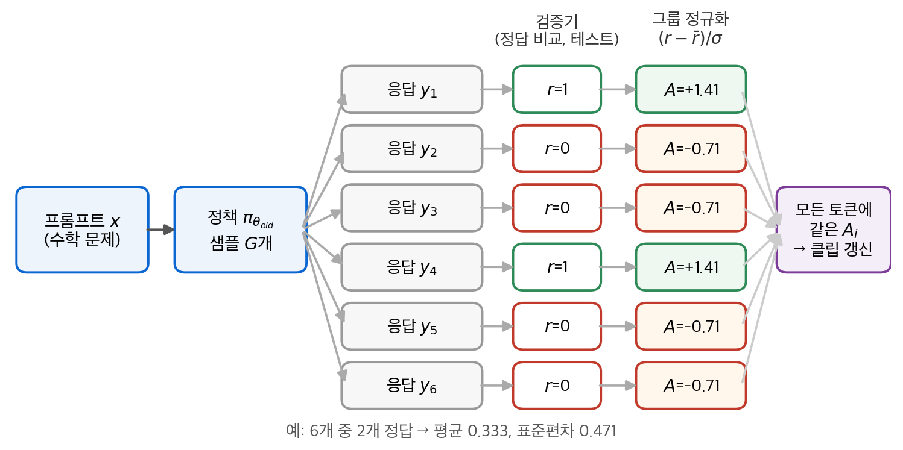
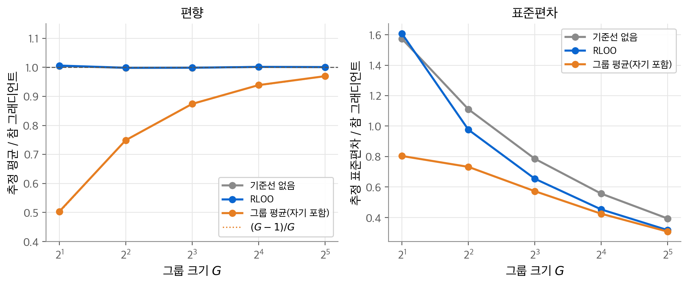
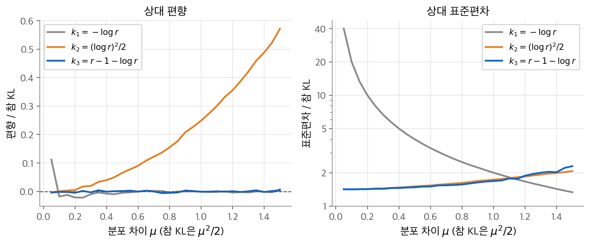
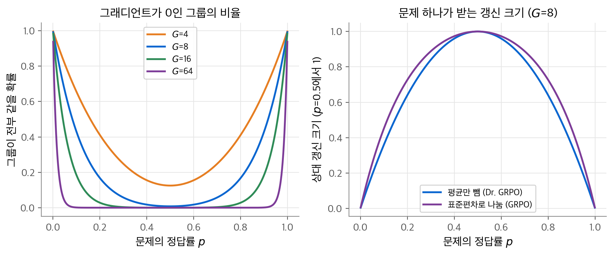
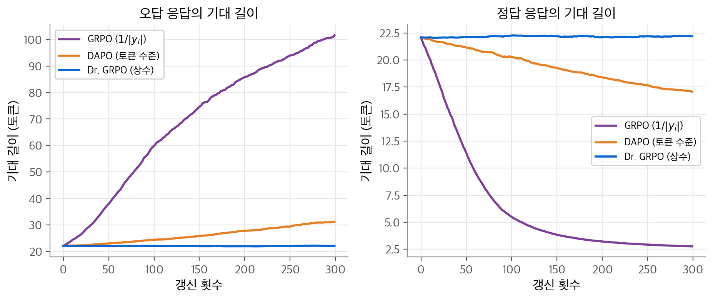
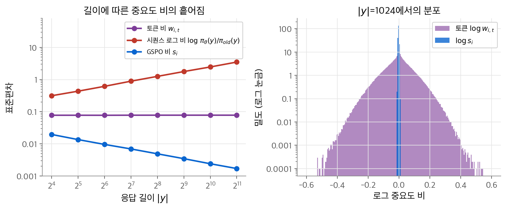
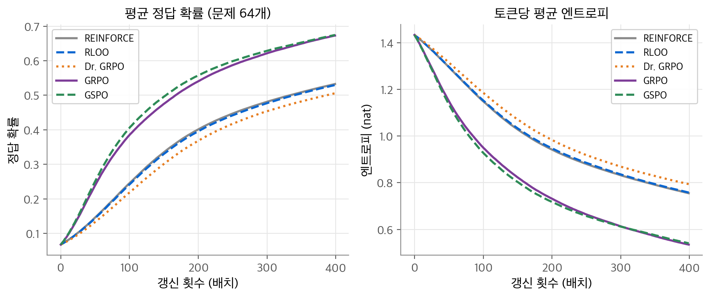

# 15. 검증 가능한 보상의 강화 학습

수학 문제의 답이나 코드의 테스트 결과는 규칙으로 채점할 수 있습니다. 이 장의 질문은 "이런 0/1 보상만으로 대형 언어 모델(LLM)의 추론을 강화 학습할 때 정책 그래디언트를 어떻게 추정해야 하는가?"입니다. 결론은 다음과 같습니다. 가치 망 대신 같은 프롬프트에서 뽑은 응답 여러 개를 기준선으로 씁니다. 이것이 RLOO와 GRPO입니다. GRPO의 길이 정규화와 표준편차 정규화는 편향을 만듭니다. Dr. GRPO와 DAPO가 이 편향을 고칩니다. 토큰 수준 중요도 비는 긴 응답에서 잡음이 많습니다. GSPO는 비를 시퀀스 수준으로 옮겨 이 문제를 줄입니다.

!!! info "원문과 자료"
    - 이 장은 Sutton & Barto에 없는 내용입니다. 다음 원 논문을 직접 확인해 정리했습니다.
        - [Tulu 3: Pushing Frontiers in Open Language Model Post-Training](https://arxiv.org/abs/2411.15124) (Lambert et al., 2024): RLVR이라는 이름
        - [Back to Basics: Revisiting REINFORCE Style Optimization for Learning from Human Feedback in LLMs](https://arxiv.org/abs/2402.14740) (Ahmadian et al., 2024): RLOO
        - [DeepSeekMath: Pushing the Limits of Mathematical Reasoning in Open Language Models](https://arxiv.org/abs/2402.03300) (Shao et al., 2024): GRPO
        - [DeepSeek-R1: Incentivizing Reasoning Capability in LLMs via Reinforcement Learning](https://arxiv.org/abs/2501.12948) (DeepSeek-AI, 2025)
        - [Understanding R1-Zero-Like Training: A Critical Perspective](https://arxiv.org/abs/2503.20783) (Liu et al., 2025): Dr. GRPO
        - [DAPO: An Open-Source LLM Reinforcement Learning System at Scale](https://arxiv.org/abs/2503.14476) (Yu et al., 2025)
        - [Group Sequence Policy Optimization](https://arxiv.org/abs/2507.18071) (Zheng et al., 2025): GSPO
        - [On a few pitfalls in KL divergence gradient estimation for RL](https://arxiv.org/abs/2506.09477) (Tang & Munos, 2025)
    - [Stanford CS336 Language Modeling from Scratch (2025 봄)](https://stanford-cs336.github.io/spring2025/) Alignment - RL 강의와 Assignment 5 (Alignment and Reasoning RL)
    - [Nathan Lambert, RLHF Book](https://rlhfbook.com) 정책 그래디언트(REINFORCE, PPO, GRPO)와 추론 장
    - [Hugging Face TRL: GRPO Trainer](https://huggingface.co/docs/trl/main/en/grpo_trainer) `loss_type`, `importance_sampling_level` 옵션
    - 함께 읽기: [2. 다중 선택 밴딧](02-bandits.md), [5. 몬테카를로 방법](05-monte-carlo.md)(중요도 샘플링), [11. 정책 근사](11-policy-gradient.md)(REINFORCE, 기준선, PPO), [14. 선호 학습과 RLHF](14-preference-rlhf.md), [MOPD 논문 리뷰](../../papers/2026-mopd.md)

## 1. 검증 가능한 보상

### 정의

**검증 가능한 보상의 강화 학습(RLVR, reinforcement learning with verifiable rewards)** 은 규칙으로 계산하는 보상을 씁니다. 이름은 Tulu 3(Lambert et al., 2024)이 붙였습니다. 프롬프트 $x$ 와 응답 $y$ 에 대해 보상은 다음과 같습니다.

$$
r(x, y) = \begin{cases} 1 & \text{검증기가 } y \text{ 를 정답으로 판정} \\ 0 & \text{그 밖의 경우} \end{cases}
$$

검증기는 과제마다 다릅니다. 수학은 최종 답을 추출해 기준 답과 비교합니다. 코드는 테스트 케이스를 실행합니다. DeepSeek-R1은 여기에 **형식 보상(format reward)** 을 더했습니다. 추론을 `<think>` 태그 안에 쓰면 보상을 줍니다.

### 밴딧 관점

LLM 강화 학습에서 상태는 프롬프트이고, 응답 하나가 끝나면 에피소드가 끝납니다. 보상은 응답이 끝난 뒤 한 번만 나옵니다. 그래서 응답 전체를 행동 하나로 보면 [2장](02-bandits.md)의 문맥 밴딧과 같습니다. RLOO 논문도 응답 생성 전체를 행동 하나로 보는 밴딧 정식화를 씁니다. 정책은 토큰을 하나씩 냅니다.

$$
\pi_\theta(y \mid x) = \prod_{t=1}^{|y|} \pi_\theta(y_t \mid x, y_{<t}), \qquad \nabla_\theta \log \pi_\theta(y \mid x) = \sum_{t=1}^{|y|} \nabla_\theta \log \pi_\theta(y_t \mid x, y_{<t})
$$

목표는 $J(\theta) = \mathbb{E}_{x}\, \mathbb{E}_{y \sim \pi_\theta(\cdot \mid x)}[r(x, y)]$ 입니다. 0/1 보상이면 $J$ 는 평균 정답률입니다.

### 보상 모델이 필요 없는 이유

[14장](14-preference-rlhf.md)의 RLHF는 사람의 선호로 학습한 신경망 보상 모델을 씁니다. 보상 모델은 근사이므로 정책이 그 약점을 찾아냅니다. DeepSeek-R1 논문은 신경망 보상 모델을 쓰지 않은 이유를 둘로 듭니다. 대규모 RL에서 보상 해킹이 생길 수 있다는 점과 보상 모델을 다시 학습하는 비용입니다. 규칙 기반 검증기는 정답 여부를 직접 확인합니다. 정책이 검증기를 속이기는 훨씬 어렵습니다. 학습할 보상 망도, 그 망을 담을 메모리도 필요 없습니다.

DeepSeek-R1-Zero는 SFT 없이 기본 모델에 바로 이 방식의 RL을 적용했습니다. 논문은 AIME 2024 pass@1이 학습 초기 15.6%에서 71.0%로 올랐다고 보고합니다. 학습하는 동안 응답 길이도 수백 토큰에서 수천 토큰으로 늘었습니다.

### 희소 보상의 문제

0/1 보상은 매우 희소합니다. 응답 하나에 토큰이 수천 개 있어도 신호는 비트 하나입니다. 어느 토큰이 답을 맞히게 했는지는 알려 주지 않습니다. 더 큰 문제는 정답률이 낮은 문제입니다. 정답률이 $p$ 인 문제에서 응답 $G$ 개를 뽑으면 모두 오답일 확률은 $(1-p)^G$ 입니다. $p = 0.01$, $G = 8$ 이면 이 값은 $0.92$ 입니다. 그러면 기준선을 쓰는 방법은 그래디언트를 얻지 못합니다. 이 문제는 4절에서 다시 다룹니다.

<figure markdown>

<figcaption markdown>
<b>Figure 1.</b> GRPO의 한 단계

응답 $G$ 개의 0/1 보상을 그룹 안에서 표준화해 어드밴티지를 만들고, 응답의 모든 토큰에 같은 값을 줍니다.
</figcaption>
</figure>

## 2. 가치 망 없는 기준선

### REINFORCE와 기준선

[11장](11-policy-gradient.md)의 REINFORCE를 밴딧 형태로 쓰면 다음과 같습니다.

$$
\nabla_\theta J = \mathbb{E}_{y \sim \pi_\theta}\big[ (r(x,y) - b(x))\, \nabla_\theta \log \pi_\theta(y \mid x) \big]
$$

기준선 $b(x)$ 는 응답 $y$ 에 의존하지 않으면 기댓값을 바꾸지 않습니다. 근거는 $\sum_y \nabla \pi_\theta(y \mid x) = \nabla 1 = 0$ 입니다. 11장에서 본 것처럼 분산을 최소로 만드는 기준선은 상태 가치 $v_\pi(x)$ 에 가깝습니다. 여기서 $v_\pi(x)$ 는 그 프롬프트의 정답률 $p(x)$ 입니다.

PPO는 이 값을 가치 망(크리틱)으로 배웁니다. LLM에서는 가치 망도 정책과 비슷한 크기의 모델입니다. 메모리와 계산이 두 배 가까이 듭니다. 게다가 보상이 마지막에 한 번만 나오면 중간 토큰의 가치를 배우기도 어렵습니다. 그래서 가치 망 없이 $p(x)$ 를 추정하는 방법이 필요합니다.

### RLOO: leave-one-out 기준선

같은 프롬프트에서 응답 $k$ 개 $y_{(1)}, \ldots, y_{(k)}$ 를 독립으로 뽑습니다. 각 응답의 기준선으로 **나머지** $k-1$ 개 보상의 평균을 씁니다. Ahmadian et al.(2024)의 추정량은 다음과 같습니다.

$$
\widehat{\nabla J} = \frac{1}{k} \sum_{i=1}^{k} \Big[ R(y_{(i)}, x) - \frac{1}{k-1} \sum_{j \ne i} R(y_{(j)}, x) \Big] \nabla \log \pi(y_{(i)} \mid x)
$$

**비편향성.** $b_i = \frac{1}{k-1}\sum_{j \ne i} R(y_{(j)})$ 는 $y_{(i)}$ 와 독립인 샘플로만 만든 값입니다. 따라서 조건부 기댓값을 나눠 쓸 수 있습니다.

$$
\mathbb{E}\big[ b_i\, \nabla \log \pi(y_{(i)}) \big] = \mathbb{E}[b_i]\; \mathbb{E}\big[ \nabla \log \pi(y_{(i)}) \big] = \mathbb{E}[b_i] \cdot 0 = 0
$$

빼는 항의 기댓값이 0이므로 추정량은 비편향입니다. 기준선이 자기 자신의 보상을 포함하면 이 독립성이 깨집니다. 논문의 실험은 $k = 2$ 와 $k = 4$ 를 썼습니다.

### 그룹 평균 기준선

자기 보상까지 포함한 그룹 평균 $\bar r = \frac{1}{G}\sum_j r_j$ 를 기준선으로 쓰면 어떻게 될까요? 다음 항등식이 답입니다.

$$
r_i - \bar r = r_i - \frac{r_i}{G} - \frac{1}{G}\sum_{j \ne i} r_j = \frac{G-1}{G}\Big( r_i - \frac{1}{G-1}\sum_{j \ne i} r_j \Big)
$$

그룹 평균 기준선은 RLOO에 상수 $(G-1)/G$ 를 곱한 것과 정확히 같습니다. 방향은 같고 크기만 줄어듭니다. 그래서 기댓값이 $(G-1)/G$ 배로 편향되지만, 스텝 크기를 조정하면 RLOO와 같습니다. GRPO는 여기에 표준편차 정규화를 더합니다.

### 실험: 기준선에 따른 그래디언트 추정

행동 4개인 범주형 정책을 씁니다. 로짓은 $(0, 0.5, 0.5, 0.5)$ 이고, 0번 행동만 정답입니다. 정답 확률은 $p = 0.1682$ 입니다. 정답 행동 로짓에 대한 참 그래디언트는 $p(1-p) = 0.1399$ 입니다. 그룹 크기 $G$ 마다 그룹 200,000개를 뽑아 추정량의 평균과 표준편차를 구했습니다.

<figure markdown>

<figcaption markdown>
<b>Figure 2.</b> 기준선에 따른 그래디언트 추정

기준선별 그래디언트 추정의 평균(왼쪽)과 표준편차(오른쪽)를 참 그래디언트로 나눈 값입니다.
</figcaption>
</figure>

| $G$ | 기준선 없음 (평균, 표준편차) | RLOO | 그룹 평균 | GRPO (평균만) |
| --- | --- | --- | --- | --- |
| 2 | 1.00, 1.57 | 1.01, 1.61 | 0.50, 0.80 | 1.01 |
| 8 | 1.00, 0.79 | 1.00, 0.65 | 0.87, 0.57 | 2.17 |
| 32 | 1.00, 0.39 | 1.00, 0.32 | 0.97, 0.31 | 2.59 |

RLOO는 모든 $G$ 에서 평균이 1입니다. 그룹 평균은 정확히 $(G-1)/G$ 입니다. $G = 2$ 에서 RLOO의 표준편차는 기준선 없음보다 조금 큽니다. 기준선이 다른 샘플 하나뿐이라 그 자체의 잡음이 크기 때문입니다. $G = 8$ 부터는 RLOO가 분산을 줄입니다. GRPO 열은 표준편차로 나눈 효과를 보여 줍니다. 평균이 참값의 2배가 넘습니다. 표준편차 $\sqrt{p(1-p)} = 0.374$ 로 나누므로 큰 $G$ 에서 $1/0.374 = 2.67$ 배에 다가갑니다. 방향은 같지만 크기가 문제의 정답률에 따라 달라집니다.

## 3. GRPO

### PPO의 클립 목적

GRPO는 PPO의 대리 목적을 빌려 옵니다. 응답을 한 번 뽑고 여러 번 갱신하려면 [5장](05-monte-carlo.md)의 중요도 샘플링 비가 필요합니다. 응답을 뽑은 정책을 $\pi_{\theta_{old}}$ 라고 하면 토큰 $t$ 의 비는 다음과 같습니다.

$$
w_{i,t}(\theta) = \frac{\pi_\theta(y_{i,t} \mid x, y_{i,<t})}{\pi_{\theta_{old}}(y_{i,t} \mid x, y_{i,<t})}
$$

PPO는 $\min\big(w A,\ \operatorname{clip}(w, 1-\varepsilon, 1+\varepsilon) A\big)$ 를 최대화합니다. $A > 0$ 이면 $w$ 가 $1+\varepsilon$ 을 넘는 순간 그래디언트가 0이 됩니다. $A < 0$ 이면 $w$ 가 $1-\varepsilon$ 아래로 내려갈 때 0이 됩니다. 한 배치로 정책이 너무 멀리 가지 않게 막는 장치입니다. [11장](11-policy-gradient.md) 9절의 TRPO와 PPO 설명을 참고하십시오.

### 그룹 정규화 어드밴티지

GRPO(Shao et al., 2024)는 가치 망을 버리고 그룹 통계로 어드밴티지를 만듭니다. 결과 보상만 있을 때 정의는 다음과 같습니다.

$$
\hat A_{i,t} = \tilde r_i = \frac{r_i - \operatorname{mean}(\{r_1, \ldots, r_G\})}{\operatorname{std}(\{r_1, \ldots, r_G\})}
$$

응답 $i$ 의 모든 토큰 $t$ 가 같은 값을 받습니다. 그림의 예처럼 6개 중 2개가 정답이면 평균은 $1/3$, 표준편차는 $0.471$ 입니다. 정답은 $+1.41$, 오답은 $-0.71$ 을 받습니다. DeepSeekMath는 단계별 보상이 있는 과정 감독 변형도 제시합니다. 그때는 토큰 $t$ 이후 단계들의 정규화 보상을 더해 $\hat A_{i,t}$ 로 씁니다.

### 목적 함수 전체

DeepSeekMath의 식에 이 장의 기호($x$, $y_i$)를 쓰면 다음과 같습니다.

$$
\mathcal{J}_{\text{GRPO}}(\theta) = \mathbb{E}_{x,\ \{y_i\}_{i=1}^G \sim \pi_{\theta_{old}}(\cdot \mid x)} \frac{1}{G} \sum_{i=1}^{G} \frac{1}{|y_i|} \sum_{t=1}^{|y_i|} \Big\{ \min\big[ w_{i,t} \hat A_{i,t},\ \operatorname{clip}(w_{i,t}, 1-\varepsilon, 1+\varepsilon)\, \hat A_{i,t} \big] - \beta\, \mathbb{D}_{KL}\big[\pi_\theta \,\|\, \pi_{ref}\big] \Big\}
$$

구성 요소는 넷입니다. 그룹 정규화 어드밴티지, 토큰 수준 비와 클립, 응답 길이로 나누는 평균 $1/|y_i|$, 기준 정책 $\pi_{ref}$ (보통 SFT 모델)에 대한 KL 벌점입니다. PPO는 KL 벌점을 보상에 섞습니다. GRPO는 손실에 직접 더합니다. 그래서 어드밴티지 계산이 KL과 분리됩니다.

DeepSeekMath의 RL 설정은 질문당 출력 64개, $\beta = 0.04$, 정책 학습률 $10^{-6}$, 최대 길이 1024입니다. DeepSeek-R1 논문은 같은 목적을 응답 단위 비 $\pi_\theta(o_i \mid q)/\pi_{\theta_{old}}(o_i \mid q)$ 로 적고 $1/|o_i|$ 를 쓰지 않았습니다. 구현이 토큰 수준인지는 논문에 적혀 있지 않습니다.

### KL 추정량 $k_3$

KL 발산 $\mathbb{D}_{KL}[\pi_\theta \| \pi_{ref}] = \mathbb{E}_{y \sim \pi_\theta}[\log (\pi_\theta/\pi_{ref})]$ 는 모든 토큰에 대한 합이라 정확히 계산하기 어렵습니다. 샘플된 토큰 하나로 추정합니다. $r = \pi_{ref}(y_{i,t} \mid \cdot)/\pi_\theta(y_{i,t} \mid \cdot)$ 로 두면 GRPO의 추정량은 다음과 같습니다.

$$
k_3 = r - \log r - 1
$$

[John Schulman의 글](http://joschu.net/blog/kl-approx.html)은 세 추정량 $k_1 = -\log r$, $k_2 = (\log r)^2/2$, $k_3$ 을 비교합니다. $k_3$ 의 성질 두 가지를 유도합니다.

**비편향성.** 샘플이 $\pi_\theta$ 에서 나오므로 $\mathbb{E}_{\pi_\theta}[r] = \sum_y \pi_\theta(y) \frac{\pi_{ref}(y)}{\pi_\theta(y)} = \sum_y \pi_{ref}(y) = 1$ 입니다.

$$
\mathbb{E}_{\pi_\theta}[k_3] = \mathbb{E}[r] - \mathbb{E}[\log r] - 1 = 1 + \mathbb{E}_{\pi_\theta}\Big[\log \frac{\pi_\theta}{\pi_{ref}}\Big] - 1 = \mathbb{D}_{KL}[\pi_\theta \| \pi_{ref}]
$$

$k_1$ 도 비편향입니다. $k_3$ 은 $k_1$ 에 기댓값이 0인 $r - 1$ 을 더한 것입니다. $r - 1$ 은 $-\log r$ 과 음의 상관을 가지므로 분산이 줄어듭니다. 이것은 제어 변량(control variate)입니다.

**음이 아님.** $\log r \le r - 1$ 이 모든 $r > 0$ 에서 성립하므로 $k_3 \ge 0$ 입니다. $k_1$ 은 샘플마다 음수가 될 수 있습니다.

정규 분포로 확인합니다. $\pi_\theta = \mathcal{N}(0, 1)$ 에서 샘플을 뽑고 $\pi_{ref} = \mathcal{N}(\mu, 1)$ 로 둡니다. 참 KL은 $\mu^2/2$ 입니다. 샘플 2,000,000개로 계산했습니다.

<figure markdown>

<figcaption markdown>
<b>Figure 3.</b> KL 추정량의 편향과 표준편차

분포 차이 $\mu$ 에 따른 세 추정량의 상대 편향(왼쪽)과 상대 표준편차(오른쪽)입니다. $\mu$ 가 크면 $k_3$ 곡선이 흔들립니다.
</figcaption>
</figure>

| $\mu$ (참 KL) | 추정량 | 편향 / KL | 표준편차 / KL | 최솟값 |
| --- | --- | --- | --- | --- |
| 0.1 (0.005) | $k_1$ | 0.011 | 19.99 | $-0.563$ |
| | $k_2$ | 0.001 | 1.42 | 0 |
| | $k_3$ | $-0.001$ | 1.42 | 0 |
| 1.0 (0.5) | $k_1$ | 0.000 | 2.00 | $-4.374$ |
| | $k_2$ | 0.250 | 1.73 | 0 |
| | $k_3$ | 0.001 | 1.70 | 0 |

분포가 가까우면($\mu = 0.1$) $k_3$ 의 표준편차가 $k_1$ 의 약 14분의 1입니다. $k_2$ 는 분포가 멀어지면 편향이 25%까지 커집니다. $k_3$ 은 두 경우 모두 편향이 잡음 수준이고 표준편차도 가장 작습니다.

!!! note "추정량을 미분하면 다른 KL의 그래디언트가 나옵니다"
    $k_3$ 은 KL의 값을 비편향으로 추정합니다. 하지만 GRPO처럼 손실에 넣고 자동 미분하면 그 그래디언트는 $\nabla \mathbb{D}_{KL}[\pi_\theta \| \pi_{ref}]$ 가 아닙니다. $\nabla k_3 = (1 - r)\nabla \log \pi_\theta$ 이고, 기댓값은 $\mathbb{E}_{\pi_\theta}[(1-r)\nabla \log \pi_\theta] = -\sum_y \pi_{ref}(y) \nabla \log \pi_\theta(y)$ 입니다. 이것은 반대 방향 KL $\mathbb{D}_{KL}[\pi_{ref} \| \pi_\theta]$ 의 그래디언트입니다. 행동 4개인 소프트맥스(로짓 $(1, 0, -0.5, 0.3)$, 기준 정책은 균등)에서 계산하면 $k_3$ 미분의 기댓값은 $(0.229, -0.074, -0.143, -0.012)$ 입니다. $\nabla \mathbb{D}_{KL}[\pi_{ref}\|\pi_\theta]$ 와 정확히 같고, $\nabla \mathbb{D}_{KL}[\pi_\theta\|\pi_{ref}] = (0.241, -0.088, -0.107, -0.047)$ 와는 다릅니다. Tang & Munos(2025)는 KL 추정값을 미분해 손실로 쓰는 구현이 일반적으로 원하는 KL 그래디언트를 주지 않는다고 지적합니다. 두 KL은 분포가 가까우면 비슷하므로 실무에서는 정규화로 여전히 작동합니다.

## 4. GRPO의 편향과 수정

### 전부 같은 그룹은 그래디언트가 0입니다

그룹의 보상이 모두 1이거나 모두 0이면 $r_i - \bar r = 0$ 이고 어드밴티지가 모두 0입니다. 표준편차도 0이라 구현은 보통 작은 수를 더해 나눗셈을 막습니다. 결과는 같습니다. 그 프롬프트의 응답 $G$ 개가 계산만 쓰고 그래디언트에 기여하지 않습니다. 정답률 $p$ 인 문제에서 이런 그룹이 나올 확률은 다음과 같습니다.

$$
P(\text{그룹이 전부 같음}) = p^G + (1-p)^G
$$

<figure markdown>

<figcaption markdown>
<b>Figure 4.</b> 그래디언트가 0인 그룹과 표준편차 정규화의 가중치

왼쪽은 정답률 $p$ 별로 그룹 보상이 전부 같아 그래디언트가 0일 확률, 오른쪽은 $G = 8$ 에서의 기대 갱신 크기입니다.
</figcaption>
</figure>

| $G$ | $p = 0.05$ | $p = 0.1$ | $p = 0.5$ | $p = 0.9$ |
| --- | --- | --- | --- | --- |
| 4 | 0.815 | 0.656 | 0.125 | 0.656 |
| 8 | 0.663 | 0.431 | 0.008 | 0.431 |
| 16 | 0.440 | 0.185 | 0.000 | 0.185 |
| 64 | 0.038 | 0.001 | 0.000 | 0.001 |

$G = 8$ 이면 정답률 10%인 문제의 그룹 43%가 버려집니다. 학습이 진행되면 쉬운 문제는 $p \to 1$ 로 가서 버려지고, 어려운 문제는 처음부터 $p \approx 0$ 이라 버려집니다. 유효 배치가 점점 작아집니다. 그룹을 키우면 줄어들지만 비용이 $G$ 에 비례합니다.

### 표준편차 정규화의 난이도 편향

그룹에 정답이 $k$ 개 있으면 $q = k/G$ 로 두고 평균은 $q$, 표준편차는 $\sqrt{q(1-q)}$ 입니다. 평균만 빼면 정답은 $1-q$, 오답은 $-q$ 를 받습니다. 그룹 전체의 $\sum_i |A_i|$ 는 $2Gq(1-q)$ 입니다. 표준편차로 나누면 $2G\sqrt{q(1-q)}$ 가 됩니다. 두 값의 비는 $1/\sqrt{q(1-q)}$ 입니다. $q = 1/2$ 에서 2이고 $q = 1/8$ 에서 3.02입니다. 표준편차 정규화는 거의 다 맞히거나 거의 다 틀리는 문제에 상대적으로 큰 가중치를 줍니다. Liu et al.(2025)은 이것을 **질문 수준 난이도 편향(question-level difficulty bias)** 이라고 부릅니다.

오른쪽 그림에서 기대 갱신 크기는 $p = 0.05$ 에서 평균만 빼면 0.085, 표준편차로 나누면 0.239입니다. $p = 0.5$ 에서는 각각 0.438, 0.928입니다. 상대 가중치로 보면 $p = 0.05$ 인 문제가 GRPO에서 1.33배 더 큰 몫을 받습니다. 이것이 해로운지는 과제에 따라 다릅니다. 하지만 목적 함수 $J$ 의 그래디언트와는 다른 가중을 쓴다는 점은 분명합니다.

### 길이 정규화의 응답 수준 편향

GRPO는 응답 $i$ 의 토큰 손실을 $|y_i|$ 로 나눠 평균합니다. 같은 어드밴티지라도 짧은 응답의 토큰은 큰 가중치를, 긴 응답의 토큰은 작은 가중치를 받습니다. 결과는 비대칭입니다. 정답($A > 0$)이면 짧을수록 더 크게 강화합니다. 오답($A < 0$)이면 길수록 벌점이 희석됩니다. Liu et al.(2025)은 이것을 **응답 수준 길이 편향(response-level length bias)** 이라고 부릅니다. 정책은 틀릴 때 길게 말하는 쪽으로 움직입니다.

**toy 모델로 유도합니다.** 정책은 먼저 답 토큰 하나를 고르고, 그 뒤 매 토큰마다 확률 $\sigma = \operatorname{sigmoid}(b)$ 로 멈춥니다. 답이 끝난 뒤 낸 토큰 수를 $n \ge 1$ 이라고 하면 $|y| = 1 + n$ 입니다. 멈춤 로짓 $b$ 에 대한 로그 확률의 미분은 다음과 같습니다.

$$
\log \pi(y) = \log \pi(a) + (n-1)\log(1-\sigma) + \log \sigma, \qquad \frac{\partial \log \pi(y)}{\partial b} = 1 - n\sigma
$$

$n$ 은 기하 분포이고 $\mathbb{E}[n] = 1/\sigma$ 이므로 $\mathbb{E}[1 - n\sigma] = 0$ 입니다. 보상이 길이와 무관하면 길이를 바꿀 이유가 없습니다. 그런데 $1/|y|$ 를 곱하면 기댓값이 0이 아닙니다. $\sigma = 0.0474$ 에서 $\mathbb{E}[(1 - n\sigma)/(1+n)] = 0.067$ 입니다. 짧은 응답에서 $1 - n\sigma > 0$ 이고 가중치 $1/(1+n)$ 도 크기 때문입니다. 이 값에 어드밴티지가 곱해집니다. 오답이면 $b$ 가 내려가서 응답이 길어지고, 정답이면 $b$ 가 올라가서 짧아집니다.

**실험.** 답은 4개이고 0번이 정답입니다. 답 로짓은 $(-0.5, 0, 0, 0)$ 이라 처음 정답률은 0.168입니다. 멈춤 로짓은 정답 갈래와 오답 갈래에 하나씩 두고 모두 $-3$ 에서 시작합니다. 처음 기대 길이는 22.1토큰입니다. 최대 길이는 200토큰입니다. $G = 8$, 스텝 크기 0.5로 300번 갱신하고 30번 반복해 평균했습니다. 세 정규화를 비교합니다. GRPO는 $1/|y_i|$ 로, DAPO는 그룹의 전체 토큰 수 $\sum_j |y_j|$ 로, Dr. GRPO는 상수 20으로 나눕니다. Dr. GRPO는 표준편차로도 나누지 않습니다.

<figure markdown>

<figcaption markdown>
<b>Figure 5.</b> 길이 정규화에 따른 응답 길이

보상이 길이와 무관해도 길이 정규화 방식에 따라 오답(왼쪽)과 정답(오른쪽) 응답의 기대 길이가 달라집니다.
</figcaption>
</figure>

| 정규화 | 오답 길이 (100번 / 300번) | 정답 길이 (100번 / 300번) | 300번 뒤 정답률 |
| --- | --- | --- | --- |
| GRPO $1/\lvert y_i \rvert$ | 59.6 / 101.6 | 5.6 / 2.8 | 0.957 |
| DAPO 토큰 수준 | 24.4 / 31.2 | 20.3 / 17.1 | 0.902 |
| Dr. GRPO 상수 | 22.1 / 22.1 | 22.2 / 22.2 | 0.549 |

GRPO는 오답을 22토큰에서 102토큰으로 늘리고 정답을 3토큰으로 줄입니다. 보상은 길이를 전혀 요구하지 않았습니다. Dr. GRPO는 길이를 그대로 둡니다. DAPO의 토큰 수준 정규화도 약한 편향을 보입니다. 긴 응답이 분모 $\sum_j |y_j|$ 를 키워 자기 가중치를 낮추기 때문입니다. 분모를 공유하는 응답이 많아지면 이 상관은 약해집니다. 정답률의 차이는 주로 유효 스텝 크기의 차이입니다. GRPO는 짧은 정답 응답에 큰 가중치를 주고 표준편차로도 나누므로 갱신이 큽니다.

### Dr. GRPO

Liu et al.(2025)의 수정은 단순합니다. $1/|y_i|$ 와 $\operatorname{std}$ 를 지웁니다.

$$
\tilde A_{i,t} = R(x, y_i) - \operatorname{mean}\big(\{R(x, y_1), \ldots, R(x, y_G)\}\big)
$$

토큰 손실은 응답마다 다른 길이 대신 전역 상수로 나눕니다. 논문은 마스크 평균의 분모 `mask.sum(axis=dim)` 을 생성 예산 같은 상수 `MAX_TOKENS` 로 바꾸라고 제안합니다. 이렇게 하면 목적이 원래 정책 그래디언트(그룹 평균 기준선 REINFORCE)와 같은 방향이 됩니다. 2절의 항등식에 따라 이것은 RLOO에 $(G-1)/G$ 를 곱한 것입니다.

### DAPO

DAPO(Yu et al., 2025)는 대규모 RLVR 시스템에서 네 가지를 바꿉니다. 목적 함수는 다음과 같습니다.

$$
\mathcal{J}_{\text{DAPO}}(\theta) = \mathbb{E}\Bigg[ \frac{1}{\sum_{i=1}^G |y_i|} \sum_{i=1}^{G} \sum_{t=1}^{|y_i|} \min\Big( w_{i,t} \hat A_{i,t},\ \operatorname{clip}\big(w_{i,t}, 1 - \varepsilon_{low}, 1 + \varepsilon_{high}\big) \hat A_{i,t} \Big) \Bigg] \quad \text{s.t.}\ \ 0 < \big|\{y_i : \text{정답}\}\big| < G
$$

1. **Clip-higher.** 위쪽 클립을 $\varepsilon_{high} = 0.28$ 로 넓히고 아래쪽은 $\varepsilon_{low} = 0.2$ 로 둡니다. 대칭 클립은 확률이 낮은 토큰을 키우지 못합니다. $\pi_{old} = 0.01$ 인 토큰은 $\varepsilon = 0.2$ 에서 한 라운드에 0.012까지만 오릅니다. $\varepsilon_{high} = 0.28$ 이면 0.0128까지 오릅니다. $\pi_{old} = 0.9$ 인 토큰의 상한은 1.08이라 사실상 제한이 없습니다. 대칭 클립은 이미 확률이 높은 토큰만 더 키우고 탐험을 줄입니다.
2. **동적 샘플링(dynamic sampling).** 정답 수가 0이거나 $G$ 인 그룹을 버리고, 배치가 찰 때까지 더 뽑습니다. 위 그림의 버려지는 그룹 문제에 대한 직접적인 처리입니다.
3. **토큰 수준 손실.** 그룹의 전체 토큰 수 $\sum_i |y_i|$ 로 나눕니다. 모든 토큰이 같은 가중치를 받으므로 긴 응답의 토큰이 희석되지 않습니다.
4. **과도한 길이 처리.** 최대 길이를 넘어 잘린 응답을 그냥 0점으로 두면 추론이 맞았어도 벌을 받습니다. DAPO는 잘린 응답을 학습에서 빼는 필터를 쓰고, 다음과 같은 부드러운 길이 벌점을 더합니다.

$$
R_{length}(y) = \begin{cases} 0, & |y| \le L_{max} - L_{cache} \\ \dfrac{(L_{max} - L_{cache}) - |y|}{L_{cache}}, & L_{max} - L_{cache} < |y| \le L_{max} \\ -1, & |y| > L_{max} \end{cases}
$$

논문은 $L_{max} = 16{,}384$, $L_{cache} = 4{,}096$ 을 씁니다. 전체 생성 한도는 20,480토큰입니다. Qwen2.5-32B 기본 모델에서 DAPO는 AIME 2024 50점을 얻었고, 단순 GRPO는 30점이었다고 보고합니다. 논문의 단계별 절제 표는 기법을 하나씩 더한 점수를 보입니다. 잘린 응답 필터 36점, clip-higher 38점, 부드러운 길이 벌점 41점, 토큰 수준 손실 42점, 동적 샘플링 50점입니다. 가장 큰 증가는 동적 샘플링에서 나왔습니다.

## 5. GSPO: 시퀀스 수준 중요도 비

### 토큰 수준 비가 불안정한 이유

중요도 샘플링은 $\mathbb{E}_{\pi_{old}}[w\, f]$ 가 $\mathbb{E}_{\pi_\theta}[f]$ 와 같다는 성질을 씁니다. 이 등식은 같은 분포에서 뽑은 샘플 여러 개를 평균할 때 의미가 있습니다. GSPO 논문(Zheng et al., 2025)은 이 점을 지적합니다. GRPO의 $w_{i,t}$ 는 각 위치 $(x, y_{i,<t})$ 에서 토큰 하나만 뽑아 계산한 비입니다. 그 위치에서 평균할 샘플이 없으므로 분포 보정의 역할을 하지 못합니다. 대신 잡음만 더합니다. 이 잡음은 응답이 길수록 누적되고 클립과 맞물려 커집니다.

더 근본적으로는 보상과 비의 단위가 맞지 않습니다. 보상과 어드밴티지는 응답 하나에 붙습니다. 그렇다면 비도 응답 하나에 붙어야 합니다. 응답 전체의 비는 토큰 비의 곱입니다.

$$
\frac{\pi_\theta(y_i \mid x)}{\pi_{\theta_{old}}(y_i \mid x)} = \prod_{t=1}^{|y_i|} w_{i,t}
$$

그러나 이 곱을 그대로 쓸 수는 없습니다. 로그로 보면 $\sum_t \log w_{i,t}$ 이고, 그 분산은 길이에 비례해 커집니다. 길이 1,000인 응답에서는 비가 0 근처나 매우 큰 값으로 흩어집니다. 응답마다 길이가 다르면 같은 클립 범위를 쓸 수도 없습니다.

### 길이 정규화한 시퀀스 비

GSPO는 곱에 $1/|y_i|$ 제곱근을 씌웁니다.

$$
s_i(\theta) = \left( \frac{\pi_\theta(y_i \mid x)}{\pi_{\theta_{old}}(y_i \mid x)} \right)^{\frac{1}{|y_i|}} = \exp\Big( \frac{1}{|y_i|} \sum_{t=1}^{|y_i|} \log w_{i,t}(\theta) \Big)
$$

$s_i$ 는 토큰 비의 기하 평균입니다. 로그 비의 평균이므로 길이가 길수록 분산이 $1/|y_i|$ 로 줄어듭니다. 길이가 다른 응답도 같은 범위의 값을 가집니다. 목적 함수는 응답 단위로 클립합니다.

$$
\mathcal{J}_{\text{GSPO}}(\theta) = \mathbb{E}_{x,\ \{y_i\} \sim \pi_{\theta_{old}}} \Bigg[ \frac{1}{G} \sum_{i=1}^{G} \min\Big( s_i(\theta) \hat A_i,\ \operatorname{clip}\big(s_i(\theta), 1 - \varepsilon, 1 + \varepsilon\big) \hat A_i \Big) \Bigg]
$$

어드밴티지 $\hat A_i$ 는 GRPO와 같은 그룹 정규화 값입니다. 클립이 응답 전체에 걸리므로 한 응답의 토큰은 모두 함께 남거나 함께 빠집니다. $s_i$ 는 1에 매우 가깝습니다. 그래서 논문은 왼쪽 클립 범위 $3 \times 10^{-4}$, 오른쪽 $4 \times 10^{-4}$ 를 씁니다. 비교한 GRPO는 0.2와 0.27을 썼습니다. 논문은 잘린 토큰의 비율이 두 방법에서 두 자릿수 차이가 난다고 보고합니다. GSPO가 훨씬 많이 자르지만 학습 효율은 더 좋았습니다. 저자들은 이것을 GRPO의 토큰 수준 그래디언트가 잡음이 많다는 증거로 해석합니다.

### 그래디언트 비교

클립을 빼고 두 그래디언트를 나란히 씁니다. 기호 $\nabla \log \pi_{i,t}$ 는 $\nabla_\theta \log \pi_\theta(y_{i,t} \mid x, y_{i,<t})$ 입니다.

$$
\begin{aligned}
\nabla \mathcal{J}_{\text{GRPO}} &= \mathbb{E}\Bigg[ \frac{1}{G} \sum_{i=1}^{G} \hat A_i \cdot \frac{1}{|y_i|} \sum_{t=1}^{|y_i|} w_{i,t}(\theta)\, \nabla \log \pi_{i,t} \Bigg] \\
\nabla \mathcal{J}_{\text{GSPO}} &= \mathbb{E}\Bigg[ \frac{1}{G} \sum_{i=1}^{G} s_i(\theta)\, \hat A_i \cdot \frac{1}{|y_i|} \sum_{t=1}^{|y_i|} \nabla \log \pi_{i,t} \Bigg]
\end{aligned}
$$

GSPO의 식은 $\nabla s_i = s_i \nabla \log s_i = s_i \cdot \frac{1}{|y_i|}\sum_t \nabla \log \pi_{i,t}$ 에서 바로 나옵니다. 차이는 토큰 가중치입니다. GRPO는 토큰마다 자기 비 $w_{i,t}$ 로 가중합니다. 이 값은 토큰마다 제각각 흔들립니다. GSPO는 한 응답의 모든 토큰에 같은 가중치 $s_i$ 를 줍니다. 논문은 이것이 GRPO의 불안정 요인을 없앤다고 말합니다.

### GSPO-token

멀티턴 과제처럼 토큰마다 다른 어드밴티지 $\hat A_{i,t}$ 가 필요할 때가 있습니다. GSPO-token은 정지 그래디언트 연산자 $\operatorname{sg}[\cdot]$ 를 써서 비를 다음과 같이 정의합니다.

$$
s_{i,t}(\theta) = \operatorname{sg}\big[s_i(\theta)\big] \cdot \frac{\pi_\theta(y_{i,t} \mid x, y_{i,<t})}{\operatorname{sg}\big[\pi_\theta(y_{i,t} \mid x, y_{i,<t})\big]}
$$

값으로는 $s_{i,t} = s_i$ 입니다. 둘째 인자는 값이 1이고 그래디언트만 $\nabla \log \pi_{i,t}$ 를 줍니다. 그래서 그래디언트는 $\frac{1}{G}\sum_i s_i \cdot \frac{1}{|y_i|}\sum_t \hat A_{i,t} \nabla \log \pi_{i,t}$ 가 됩니다. 모든 토큰의 어드밴티지가 같으면 GSPO와 수치적으로 같습니다. TRL은 GSPO의 시퀀스 수준 비를 `importance_sampling_level="sequence"` 옵션으로 제공합니다.

### MoE 학습 안정성

GSPO 논문이 강조하는 실무 이점은 전문가 혼합(MoE) 모델입니다. 저자들은 48층 Qwen3-30B-A3B-Base를 GRPO로 학습할 때 갱신 한 번마다 새 정책에서 활성화되는 전문가의 약 10%가 옛 정책과 달라진다고 보고합니다. 라우팅이 바뀌면 같은 토큰의 $w_{i,t}$ 가 크게 출렁입니다. 그들은 이전에 **Routing Replay** 를 썼습니다. 옛 정책이 고른 전문가를 저장해 두고 새 정책 계산에서 그대로 재사용하는 방법입니다. GSPO는 시퀀스 가능도를 쓰는데, 이 값은 개별 토큰 확률만큼 출렁이지 않습니다. 저자들은 그래서 GSPO가 Routing Replay 없이도 안정적으로 학습된다고 주장합니다. 이 주장은 논문의 실험 결과이고 이 노트에서 재현하지 않았습니다.

### 실험: 길이에 따른 비의 분산

toy 시퀀스 정책을 만듭니다. 어휘는 32개입니다. 위치마다 옛 정책의 로짓을 표준편차 3인 정규 분포에서 뽑아 LLM처럼 뾰족한 분포를 만듭니다. 새 정책은 로짓에 표준편차 0.1인 잡음을 더한 것입니다. 한 번의 갱신이나 학습-추론 엔진의 수치 차이를 흉내 낸 설정입니다. 옛 정책에서 길이 $|y|$ 인 응답 2,000개를 뽑아 세 값을 계산했습니다.

<figure markdown>

<figcaption markdown>
<b>Figure 6.</b> 길이에 따른 중요도 비의 분산

응답 길이에 따른 세 중요도 비의 표준편차(왼쪽)와 길이 1,024에서의 분포(오른쪽)입니다.
</figcaption>
</figure>

| 길이 $\lvert y \rvert$ | 토큰 비 $w_{i,t}$ | 시퀀스 로그 비 $\sum_t \log w_{i,t}$ | GSPO 비 $s_i$ |
| --- | --- | --- | --- |
| 16 | 0.0775 | 0.314 | 0.0196 |
| 128 | 0.0778 | 0.890 | 0.0069 |
| 1,024 | 0.0779 | 2.464 | 0.0024 |
| 2,048 | 0.0779 | 3.499 | 0.0017 |

토큰 비의 흩어짐은 길이와 무관하게 0.078입니다. GRPO에서는 응답의 모든 토큰이 이 크기의 독립 잡음을 하나씩 받습니다. 시퀀스 로그 비의 표준편차는 $\sqrt{|y|}$ 에 비례해 커집니다. 길이 2,048에서 3.5이므로 비 자체는 $e^{\pm 3.5}$ 범위로 흩어집니다. 정규화하지 않은 곱은 쓸 수 없다는 뜻입니다. $s_i$ 는 반대로 $1/\sqrt{|y|}$ 로 줄어듭니다. 길이 1,024에서 0.0024이고 토큰 비의 약 32분의 1입니다. 이 크기가 GSPO가 $10^{-4}$ 단위의 클립 범위를 쓰는 이유입니다. $s_i$ 의 평균은 1보다 약간 작습니다. $\mathbb{E}_{\pi_{old}}[\log w] = -\mathbb{D}_{KL}[\pi_{old}\|\pi_\theta]$ 이기 때문입니다.

## 6. 그 밖의 최근 방법

2025~2026년에는 GRPO의 구성 요소를 하나씩 바꾸는 후속 연구가 많이 나왔습니다. 다음 표는 arXiv 초록이나 본문에서 확인한 것만 정리했습니다. 표의 칸은 그 방법이 GRPO에서 바꾸는 부분입니다. "같음"은 GRPO와 같다는 뜻입니다.

| 방법 | 출처 | 기준선·어드밴티지 | 중요도 비 | 클립 | 손실 정규화 |
| --- | --- | --- | --- | --- | --- |
| RLOO | [Ahmadian et al., 2024](https://arxiv.org/abs/2402.14740) | leave-one-out 평균 | 없음(on-policy) | 없음 | 응답 단위 |
| GRPO | [Shao et al., 2024](https://arxiv.org/abs/2402.03300) | 그룹 평균, 표준편차 | 토큰 | 토큰, 대칭 | $1/\lvert y_i \rvert$ 후 $1/G$ |
| Dr. GRPO | [Liu et al., 2025](https://arxiv.org/abs/2503.20783) | 그룹 평균만 | 같음 | 같음 | 전역 상수 |
| DAPO | [Yu et al., 2025](https://arxiv.org/abs/2503.14476) | 같음, 전부 같은 그룹 제거 | 같음 | 비대칭(0.2, 0.28) | 그룹 전체 토큰 수 |
| GSPO | [Zheng et al., 2025](https://arxiv.org/abs/2507.18071) | 같음 | 시퀀스 기하 평균 $s_i$ | 응답 단위 | 응답 단위 $1/G$ |
| CISPO | [MiniMax, 2025](https://arxiv.org/abs/2506.13585) (MiniMax-M1) | 같음 | 토큰 | 갱신 대신 비를 잘라 정지 그래디언트 가중치로 씀 | 토큰 수준 |
| REINFORCE++ | [Hu et al., 2025](https://arxiv.org/abs/2501.03262) | 배치 전체로 정규화 | 크리틱 없음 | — | — |
| VAPO | [Yue et al., 2025](https://arxiv.org/abs/2504.05118) | 학습한 가치 모델(크리틱) | — | — | — |
| GMPO | [Zhao et al., 2025](https://arxiv.org/abs/2507.20673) | 같음 | 토큰 목적의 기하 평균 | — | — |
| DHPO | [Min et al., 2026](https://arxiv.org/abs/2601.05607) | 같음 | 토큰 비와 시퀀스 비를 섞음 | 갈래마다 따로 | — |

"—"은 초록에서 확인하지 못한 항목입니다. 몇 가지를 덧붙입니다.

- **CISPO** 의 목적은 $\frac{1}{\sum_i |o_i|}\sum_i\sum_t \operatorname{sg}(\hat r_{i,t})\, \hat A_{i,t} \log \pi_\theta(o_{i,t} \mid \cdot)$ 입니다. $\hat r_{i,t}$ 는 잘린 토큰 비입니다. PPO의 클립은 범위를 넘은 토큰의 그래디언트를 0으로 만듭니다. CISPO는 가중치만 잘라 모든 토큰이 그래디언트에 남습니다. 논문은 "However", "Recheck", "Wait" 같은 반성 토큰이 기본 모델에서 확률이 낮고, 첫 갱신 뒤 비가 커져 PPO/GRPO에서 잘려 나간다고 설명합니다.
- **REINFORCE++** 는 프롬프트별 작은 그룹 대신 전역 배치 전체로 어드밴티지를 정규화합니다. 크리틱이 없는 방법입니다.
- **VAPO** 는 반대 방향입니다. 가치 모델을 유지하고 가치 모델 편향, 길이가 제각각인 시퀀스, 희소 보상을 함께 다룹니다. 초록은 Qwen 32B 기반 AIME 2024 60.4점을 보고합니다.

## 7. toy RLVR 실험

### 설정

작은 소프트맥스 시퀀스 정책으로 "정답이면 1" 과제를 만들었습니다. 설정은 다음과 같습니다.

- 문제 64개. 각 문제는 길이 5, 어휘 6개인 목표 시퀀스를 하나 가집니다. 다섯 토큰이 모두 맞아야 보상 1입니다.
- 정책은 문제와 위치마다 독립 로짓 $z_{x,t} \in \mathbb{R}^6$ 을 가집니다. 초기 로짓은 $\mathcal{N}(0, 0.3^2)$ 이고, 목표 토큰에 문제마다 $U(0, 3)$ 의 보너스를 더합니다. 사전 학습으로 얻은 사전 지식을 흉내 낸 것입니다. 처음 평균 정답률은 0.068이고, 64개 중 28개는 정답률이 0.01 미만입니다.
- 매 배치에서 문제 16개를 고르고 문제마다 응답 $G = 8$ 개를 뽑습니다. 같은 배치로 로짓을 4번 갱신합니다. 스텝 크기는 1.0인 경사 상승입니다.
- REINFORCE는 $A = r$, RLOO는 leave-one-out 기준선, Dr. GRPO는 그룹 평균만 뺀 값, GRPO와 GSPO는 그룹 정규화 어드밴티지를 씁니다. 4번 갱신하는 동안 REINFORCE와 RLOO는 자르지 않은 토큰 비를 씁니다. GRPO와 Dr. GRPO는 토큰 클립($\varepsilon = 0.2$), GSPO는 시퀀스 클립($\varepsilon = 0.1$)을 씁니다. 길이가 5로 고정이므로 길이 정규화의 차이는 없습니다.
- 과제는 하나로 고정하고 샘플링 시드만 바꿔 20번 반복했습니다.

<figure markdown>

<figcaption markdown>
<b>Figure 7.</b> toy RLVR 학습 곡선

문제 64개의 평균 정답 확률(왼쪽)과 토큰당 평균 엔트로피(오른쪽)입니다(20번 평균).
</figcaption>
</figure>

| 방법 | 50번 | 100번 | 200번 | 400번 | 400번 엔트로피 | 정답률 < 0.01인 문제 |
| --- | --- | --- | --- | --- | --- | --- |
| REINFORCE | 0.146 | 0.245 | 0.401 | 0.533 | 0.755 | 19.6 |
| RLOO | 0.144 | 0.242 | 0.396 | 0.530 | 0.758 | 19.6 |
| Dr. GRPO | 0.133 | 0.218 | 0.368 | 0.506 | 0.794 | 20.0 |
| GRPO | 0.239 | 0.385 | 0.541 | 0.673 | 0.535 | 14.7 |
| GSPO | 0.251 | 0.406 | 0.557 | 0.675 | 0.541 | 16.1 |

### 해석

**REINFORCE와 RLOO가 거의 같습니다.** 이 과제의 보상은 0/1이고 파라미터를 문제끼리 공유하지 않습니다. 보상 0인 응답은 REINFORCE에서 그래디언트를 내지 않습니다. 보상 1인 응답은 정답 토큰을 강화하는데, RLOO도 같은 방향입니다. 기준선의 분산 감소가 크게 드러나지 않는 구조입니다. 파라미터를 공유하는 실제 모델에서는 기준선이 없으면 쉬운 문제의 큰 보상이 다른 문제의 갱신을 흔듭니다.

**GRPO가 빠른 이유는 대부분 스텝 크기입니다.** Dr. GRPO는 $(G-1)/G$ 배인 RLOO와 같고 곡선도 그만큼 조금 느립니다. GRPO는 표준편차로 나눠 갱신을 2~3배 키웁니다. 같은 RLOO를 스텝 크기 2.0으로 돌리면 400번 뒤 0.651, 3.0이면 0.715였습니다. 스텝 크기 1.0인 GRPO(0.673)는 그 사이에 있습니다. 차이의 대부분은 알고리즘의 원리보다 유효 학습률에서 옵니다. 실험에서 방법을 비교할 때 이 점을 통제해야 합니다.

**GSPO와 GRPO는 이 길이에서 비슷합니다.** 응답이 다섯 토큰이면 토큰 비의 잡음이 누적될 여지가 적습니다. 5절의 표처럼 GSPO의 이점은 응답이 길 때 커집니다.

**풀리지 않는 문제가 남습니다.** 처음 정답률이 0.01 미만인 28개 중 15~20개는 400번 뒤에도 0.01 미만입니다. 정답을 한 번도 뽑지 못하면 그룹이 전부 0이고 그래디언트가 0입니다. RLVR은 정책이 이미 가끔 맞히는 문제를 더 자주 맞히게 만듭니다. 전혀 못 푸는 문제를 풀게 만들지는 못합니다.

## 8. 실무 쟁점

### 엔트로피 붕괴

위 실험에서 엔트로피는 1.43 nat에서 0.54 nat까지 떨어졌습니다. 갱신이 큰 방법일수록 빨리 떨어집니다. 정답 응답을 강화하면 그 토큰의 확률이 커지고 다른 토큰의 확률은 줄어듭니다. 0/1 보상에서는 탐험을 유지할 신호가 따로 없습니다. 엔트로피가 붕괴하면 그룹의 응답이 모두 같아지고 4절의 그래디언트 0 문제가 커집니다. DAPO의 clip-higher와 CISPO의 가중치 클립은 확률이 낮은 토큰이 자랄 여지를 남겨 이 문제를 완화합니다. 엔트로피 보너스를 더하는 방법도 있습니다. [11장](11-policy-gradient.md) 1절에서 본 것처럼 소프트맥스 정책은 결정적 정책에 다가갈 수 있습니다. 최적 정책이 결정적이면 붕괴 자체는 자연스럽습니다. 문제는 붕괴가 탐험이 끝나기 전에 일어난다는 점입니다.

### 보상 해킹

규칙 기반 검증기도 해킹될 수 있습니다. 답 추출 규칙이 느슨하면 여러 답을 나열해 하나라도 맞히는 응답이 보상을 받습니다. 코드 과제에서 테스트가 약하면 테스트만 통과하는 코드가 보상을 받습니다. 4절의 길이 편향처럼 목적 함수 자체가 보상과 무관한 행동을 만들기도 합니다. 그래서 검증기를 엄격하게 만들고, 응답 길이와 형식을 함께 감시해야 합니다. 정답을 맞혔는지와 별개로 추론 과정이 읽을 만한지도 확인해야 합니다. DeepSeek-R1 논문은 R1-Zero의 출력이 여러 언어를 섞어 쓰는 문제를 보고했습니다.

### On-policy 증류와의 관계

RLVR의 신호는 응답당 1비트입니다. [MOPD 논문 리뷰](../../papers/2026-mopd.md)의 on-policy 증류는 같은 on-policy 구조에서 신호를 토큰 단위로 바꿉니다. 학생이 응답을 생성하면 교사가 prefill로 토큰마다 확률을 매깁니다. 학생은 교사와의 토큰별 reverse KL을 줄입니다. 이것은 토큰마다 $\log \pi_{teacher} - \log \pi_\theta$ 를 보상으로 쓰는 정책 그래디언트로 볼 수 있습니다. 응답은 학생의 분포에서 나오므로 RLVR처럼 노출 편향이 없습니다. 대신 보상이 조밀하므로 희소 보상과 그래디언트 0 문제가 없습니다. MOPD의 교사들은 도메인별 RLVR로 만들어집니다. RLVR로 각 능력을 키우고, on-policy 증류로 하나의 모델에 모으는 구조입니다.

### 선호 학습(14장)과의 차이

| 구분 | 선호 학습과 RLHF ([14장](14-preference-rlhf.md)) | RLVR (이 장) |
| --- | --- | --- |
| 보상 출처 | 사람의 선호로 학습한 보상 모델, 또는 선호 쌍 자체 | 규칙 기반 검증기 |
| 보상 형태 | 실수 값, 상대 비교 | 0/1 정답 여부 |
| 주요 위험 | 보상 모델의 과최적화 | 희소성, 검증기의 허점, 길이 편향 |
| KL 벌점의 역할 | 보상 모델이 믿을 만한 영역에 정책을 묶음 | 선택 사항. TRL 기본값은 $\beta = 0$ |
| 적합한 과제 | 대화 품질, 어조, 안전성처럼 정답이 없는 과제 | 수학, 코드, 형식 제약처럼 확인 가능한 과제 |
| 가치 망 | PPO는 사용, DPO 계열은 강화 학습 자체를 생략 | 대개 그룹 기준선으로 대체 |

두 접근은 함께 씁니다. 추론 능력은 RLVR로 키우고, 정답이 없는 영역은 선호 학습으로 다듬습니다. TRL 문서는 기본 $\beta = 0$ 으로 KL 벌점을 끄고, 그러면 기준 모델을 메모리에 올리지 않는다고 설명합니다. 검증기가 믿을 만하면 정책을 기준 모델에 묶어 둘 이유가 약해지기 때문입니다.

## 정리

- RLVR은 규칙으로 채점하는 0/1 보상을 씁니다. 보상 모델이 없으므로 보상 해킹의 여지와 계산 비용이 줄어듭니다. 대신 신호가 응답당 1비트로 희소합니다.
- 응답 전체를 행동 하나로 보면 문맥 밴딧입니다. 가치 망 없이 같은 프롬프트의 응답 여러 개로 기준선을 만듭니다.
- RLOO의 leave-one-out 기준선은 자기 샘플과 독립이므로 비편향입니다. 그룹 평균 기준선은 RLOO에 정확히 $(G-1)/G$ 를 곱한 것입니다.
- GRPO는 그룹 평균과 표준편차로 어드밴티지를 정규화하고, 토큰 수준 비와 PPO 클립, $1/|y_i|$ 평균, $k_3$ KL 벌점을 씁니다.
- $k_3 = r - \log r - 1$ 은 음이 아니고 비편향이며, $k_1$ 보다 분산이 훨씬 작습니다($\mu = 0.1$ 에서 표준편차 1.42 대 19.99). 하지만 미분하면 반대 방향 KL의 그래디언트가 나옵니다.
- 그룹이 전부 맞거나 전부 틀리면 그래디언트가 0입니다. 확률은 $p^G + (1-p)^G$ 이고, $G = 8$, $p = 0.1$ 에서 0.43입니다. DAPO의 동적 샘플링이 이 그룹을 버리고 다시 뽑습니다.
- $1/|y_i|$ 는 틀린 응답을 길게, 맞는 응답을 짧게 만듭니다. toy 실험에서 오답 길이가 22에서 102토큰으로 늘었습니다. 표준편차 정규화는 극단 난이도의 문제에 큰 가중치를 줍니다. Dr. GRPO는 둘을 지워 원래 정책 그래디언트로 돌아갑니다.
- DAPO는 clip-higher($\varepsilon_{high} = 0.28$), 동적 샘플링, 토큰 수준 손실, 부드러운 길이 벌점을 더합니다.
- GSPO는 길이 정규화한 시퀀스 비 $s_i = (\pi_\theta(y_i|x)/\pi_{old}(y_i|x))^{1/|y_i|}$ 와 응답 단위 클립을 씁니다. 토큰 비의 흩어짐은 길이와 무관하게 일정하지만 $s_i$ 는 $1/\sqrt{|y|}$ 로 줄어듭니다. 저자들은 MoE 학습에서 Routing Replay가 필요 없어진다고 보고합니다.
- toy 실험에서 GRPO의 빠른 학습은 대부분 표준편차 정규화가 키운 유효 스텝 크기에서 왔습니다. 처음에 거의 못 푸는 문제는 끝까지 풀리지 않았고, 엔트로피는 빠르게 줄었습니다.
- RLVR은 정답이 확인되는 과제의 능력을 키우고, 선호 학습은 정답이 없는 품질을 다듬습니다. On-policy 증류는 같은 on-policy 구조에서 신호를 토큰 단위로 조밀하게 만듭니다.
