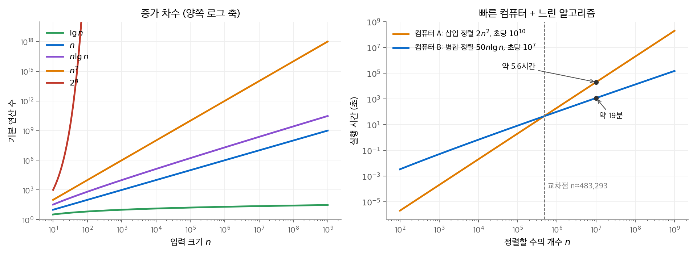
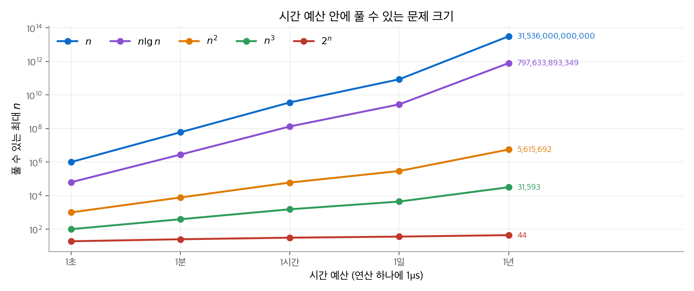

# 1. 컴퓨팅에서 알고리즘의 역할

이 장은 책 전체의 출발점입니다. 알고리즘이 무엇인지 정의하고, 어떤 문제를 알고리즘으로 푸는지 예를 듭니다.
이어서 "컴퓨터가 충분히 빠르면 알고리즘을 고를 필요가 없는가?"라는 질문에 숫자로 답합니다.
결론은 하드웨어보다 알고리즘의 **증가 차수**(order of growth)가 실행 시간을 더 크게 좌우한다는 것입니다.

!!! info "원문과 자료"
    - 원문: CLRS 4판 1장 The Role of Algorithms in Computing (1.1 Algorithms, 1.2 Algorithms as a technology)
    - 책 페이지: [MIT Press, Introduction to Algorithms, 4th ed.](https://mitpress.mit.edu/9780262046305/introduction-to-algorithms/)
    - 강의: [MIT OCW 6.006 Introduction to Algorithms (Spring 2020)](https://ocw.mit.edu/courses/6-006-introduction-to-algorithms-spring-2020/)
    - 함께 읽기: [2. 삽입 정렬과 병합 정렬](02-getting-started.md), [3. 실행 시간의 점근 표기](03-running-times.md), [34. NP-완전성](34-np-completeness.md)

## 1. 알고리즘이란

### 정의

**알고리즘**(algorithm)은 입력(input)을 받아 출력(output)을 내는, 잘 정의된 계산 절차입니다.
알고리즘은 하나의 **계산 문제**(computational problem)를 풉니다. 계산 문제는 입력과 출력 사이에 성립해야 하는 관계를 적은 것입니다.

정렬 문제를 예로 듭니다.

- **입력:** 수 $n$ 개의 수열 $\langle a_1, a_2, \ldots, a_n \rangle$
- **출력:** 입력을 재배열한 수열 $\langle a'_1, a'_2, \ldots, a'_n \rangle$. 이때 $a'_1 \le a'_2 \le \cdots \le a'_n$ 입니다.

입력 $\langle 31, 41, 59, 26, 41, 58 \rangle$ 은 정렬 문제의 한 **인스턴스**(instance)입니다.
올바른 정렬 알고리즘은 이 인스턴스에 $\langle 26, 31, 41, 41, 58, 59 \rangle$ 을 냅니다.

### 올바름

알고리즘이 모든 인스턴스에서 올바른 출력을 내고 멈추면 그 알고리즘은 **올바르다**(correct)고 합니다.
틀린 알고리즘은 어떤 입력에서 멈추지 않거나, 틀린 답을 내고 멈춥니다.
틀린 알고리즘도 쓸모가 있을 때가 있습니다. 오류율을 통제할 수 있으면 됩니다. 31장의 소수 판정이 그런 예입니다.

알고리즘은 자연어, 의사 코드(pseudocode), 프로그램 어느 형태로도 적을 수 있습니다.
요구 조건은 하나입니다. 계산 절차를 정확하게 기술해야 합니다. 이 교재에서는 짧은 파이썬 코드로 적습니다.

```python
def is_sorted(a):
    # 정렬 문제의 출력 조건을 그대로 검사합니다.
    return all(a[i] <= a[i + 1] for i in range(len(a) - 1))
```

## 2. 알고리즘으로 푸는 문제들

### 응용 분야

책은 알고리즘이 쓰이는 곳을 넓게 나열합니다. 아래 표는 그 가운데 대표적인 예를 이 교재의 장과 연결한 것입니다.

| 분야 | 문제 | 관련 장 |
| --- | --- | --- |
| 생명 정보학 | DNA 서열 사이의 최장 공통 부분 수열 | [14. 동적 계획법](14-dynamic-programming.md) |
| 인터넷 | 패킷 경로 찾기, 웹 문서 검색 | [22. 단일 출발점 최단 경로](22-single-source-sp.md), [32. 문자열 매칭](32-string-matching.md) |
| 전자 상거래 | 공개 키 암호와 전자 서명 | [31. 정수론 알고리즘](31-number-theory.md) |
| 제조와 물류 | 자원 배분, 운송 계획 | [29. 선형 계획법](29-linear-programming.md), [24. 최대 흐름](24-max-flow.md) |
| 기계 학습 | 군집화, 경사 하강법 | [33. 머신러닝 알고리즘](33-ml-algorithms.md) |

이 문제들에는 두 가지 공통점이 있습니다.

1. 후보 해가 아주 많습니다. 후보를 모두 살펴보는 방법은 현실적인 시간 안에 끝나지 않습니다.
2. 실제 응용이 있습니다. 같은 문제를 더 빨리 풀면 비용이나 시간이 줄어듭니다.

### 자료 구조와 기법

**자료 구조**(data structure)는 데이터에 접근하고 수정하기 쉽게 저장하고 조직하는 방법입니다.
모든 목적에 맞는 자료 구조는 없습니다. 그래서 여러 자료 구조의 장단점을 알아야 합니다. 3부와 5부가 이 내용입니다.

책은 알고리즘 목록을 외우게 하지 않습니다. 대신 알고리즘을 설계하고 분석하는 **기법**(technique)을 가르칩니다.
분할 정복(4장), 동적 계획법(14장), 탐욕 알고리즘(15장), 분할 상환 분석(16장)이 그 기법입니다.
책에 없는 문제를 만나도 이 기법으로 새 알고리즘을 만들 수 있습니다.

### 어려운 문제

효율적인 알고리즘을 아무도 찾지 못한 문제들이 있습니다. 그 가운데 큰 묶음을 **NP-완전**(NP-complete) 문제라고 합니다.
NP-완전 문제에는 세 가지 성질이 있습니다.

- 효율적인 알고리즘이 없다는 증명도 아직 없습니다.
- 한 NP-완전 문제에 효율적인 알고리즘이 있으면, 모든 NP-완전 문제에 효율적인 알고리즘이 있습니다.
- 여러 NP-완전 문제가 이미 알려진 쉬운 문제와 겉보기에 비슷합니다.

배송 트럭이 모든 거점을 한 번씩 돌고 돌아오는 가장 짧은 경로를 찾는 **외판원 문제**(traveling-salesperson problem)가 대표적인 예입니다.
문제가 NP-완전이라는 것을 알면, 최적해 대신 좋은 근사해를 찾는 쪽으로 방향을 바꿀 수 있습니다. 34장과 35장이 이 내용입니다.

### 다른 계산 모형

책은 계산 모형 두 가지를 더 다룹니다.

- **병렬 계산:** 한 칩에 코어가 여러 개 있는 **다중 코어**(multicore) 컴퓨터에서 효율을 내려면 병렬성을 고려해 알고리즘을 설계해야 합니다. 26장이 이 내용입니다.
- **온라인 계산:** 입력 전체를 미리 알지 못하고, 입력이 도착하는 대로 결정해야 하는 문제가 있습니다. 응급실 환자 배정이 그 예입니다. 27장이 이 내용입니다.

## 3. 기술로서의 알고리즘

### 무한히 빠른 컴퓨터가 있다면

컴퓨터가 무한히 빠르고 메모리가 공짜라면, 올바른 방법이면 무엇이든 괜찮습니다. 가장 구현하기 쉬운 방법을 쓰면 됩니다.
실제 컴퓨터는 빠르지만 무한히 빠르지 않습니다. 계산 시간과 메모리는 한정된 자원입니다.
따라서 시간과 공간을 적게 쓰는 알고리즘을 골라야 합니다.

### 상수보다 증가 차수가 중요한 이유

같은 정렬 문제를 푸는 두 알고리즘을 비교합니다. 2장에서 자세히 다룹니다.

- **삽입 정렬**(insertion sort): 실행 시간이 대략 $c_1 n^2$ 입니다.
- **병합 정렬**(merge sort): 실행 시간이 대략 $c_2 n \lg n$ 입니다. $\lg n$ 은 $\log_2 n$ 입니다.

보통 $c_1 < c_2$ 입니다. 두 식을 $c_1 n \cdot n$ 과 $c_2 n \cdot \lg n$ 으로 다시 쓰면 차이가 보입니다.
삽입 정렬에는 $n$ 이 곱해지고, 병합 정렬에는 $\lg n$ 이 곱해집니다.
$n = 1000$ 이면 $\lg n \approx 10$ 이고, $n = 10^6$ 이면 $\lg n \approx 20$ 입니다.
따라서 $c_1$ 이 아무리 작아도, $n$ 이 어떤 값을 넘으면 병합 정렬이 더 빠릅니다. 이 값을 **교차점**(crossover point)이라고 합니다.

### 수치 예: 빠른 컴퓨터와 느린 컴퓨터

책은 두 컴퓨터를 대결시킵니다. 수 $10^7$ 개를 정렬합니다.

| | 컴퓨터 A | 컴퓨터 B |
| --- | --- | --- |
| 속도 | 초당 $10^{10}$ 명령 | 초당 $10^{7}$ 명령 |
| 알고리즘 | 삽입 정렬 | 병합 정렬 |
| 구현 품질 | 기계어로 최적화, $2n^2$ 명령 | 평범한 고급 언어, $50 n \lg n$ 명령 |

A는 B보다 1000배 빠르고, 코드의 상수도 25배 작습니다. 계산하면 다음과 같습니다.

$$
\text{A:}\ \frac{2 \cdot (10^7)^2}{10^{10}} = 20{,}000\ \text{초} \approx 5.6\ \text{시간}
$$

$$
\text{B:}\ \frac{50 \cdot 10^7 \cdot \lg 10^7}{10^7} \approx 50 \times 23.25 \approx 1{,}163\ \text{초} \approx 19\ \text{분}
$$

느린 컴퓨터 B가 17배 이상 빠릅니다. $n = 10^8$ 이면 차이는 더 커집니다. A는 23일 넘게 걸리고, B는 4시간이 안 걸립니다.

교차점도 계산할 수 있습니다. $2n^2 / 10^{10} = 50 n \lg n / 10^7$ 을 정리하면 $n = 25{,}000 \lg n$ 입니다.
이 식의 해는 약 $n \approx 4.8 \times 10^5$ 입니다. 그보다 작은 입력에서는 A가 이깁니다.

<figure markdown>

<figcaption markdown>
<span class="fig-title"><b>Figure 1.</b> 증가 차수와 두 컴퓨터의 실행 시간</span>

왼쪽은 대표적인 증가 차수입니다. 오른쪽에서 1000배 빠른 컴퓨터 A는 $n \approx 4.8 \times 10^5$ 부터 컴퓨터 B에게 집니다.
</figcaption>
</figure>

### 시간 예산으로 보기

같은 내용을 반대로 물을 수도 있습니다. "주어진 시간 안에 풀 수 있는 가장 큰 $n$ 은 얼마인가?"
연산 하나에 $1\mu s$ 가 걸린다고 가정하고 $f(n) \le$ (시간 예산 / $1\mu s$) 를 만족하는 최대 $n$ 을 구합니다.
아래 표는 그림 2를 만든 코드로 계산한 값입니다.

| $f(n)$ | 1초 | 1시간 | 1년 |
| --- | --- | --- | --- |
| $n$ | $10^6$ | $3.6 \times 10^9$ | $3.15 \times 10^{13}$ |
| $n \lg n$ | 약 62,746 | 약 $1.3 \times 10^8$ | 약 $8.0 \times 10^{11}$ |
| $n^2$ | 1,000 | 60,000 | 약 5,615,692 |
| $n^3$ | 100 | 1,532 | 31,593 |
| $2^n$ | 19 | 31 | 44 |

$2^n$ 알고리즘은 시간을 1초에서 1년으로 3천만 배 늘려도 $n$ 이 19에서 44로만 늘어납니다.
$n$ 알고리즘은 같은 시간에 $n$ 이 3천만 배 늘어납니다. 하드웨어가 빨라질 때도 같은 일이 생깁니다.
컴퓨터가 1000배 빨라지면 $n^2$ 알고리즘의 $n$ 은 약 32배 늘고, $2^n$ 알고리즘의 $n$ 은 $\lg 1000 \approx 10$ 만큼만 커집니다.

<figure markdown>

<figcaption markdown>
<span class="fig-title"><b>Figure 2.</b> 시간 예산 안에 풀 수 있는 최대 문제 크기</span>

세로축은 로그 축입니다. 지수 시간 알고리즘은 예산을 아무리 늘려도 풀 수 있는 크기가 거의 늘지 않습니다.
</figcaption>
</figure>

```python
import math

def max_n(f, ops):
    # f(m) <= ops 를 만족하는 가장 큰 정수 m 을 이분 탐색으로 찾습니다.
    lo, hi = 1, 10**18
    while lo < hi:
        m = (lo + hi + 1) // 2
        if f(m) <= ops:
            lo = m
        else:
            hi = m - 1
    return lo

year = 365 * 24 * 3600 * 10**6          # 1년 동안의 연산 수 (1μs/연산)
print(max_n(lambda m: m * m, year))      # 5615692
print(max_n(lambda m: 2.0**m, year))     # 44
```

### 알고리즘과 다른 기술

알고리즘은 하드웨어처럼 하나의 **기술**(technology)입니다. 시스템 전체 성능은 하드웨어만큼 알고리즘 선택에 달려 있습니다.
경로 안내 웹 서비스를 예로 듭니다. 이 서비스는 빠른 하드웨어, 그래픽 인터페이스, 네트워크를 씁니다.
동시에 최단 경로 알고리즘, 지도 렌더링, 보간 알고리즘이 필요합니다.

하드웨어 설계, 컴파일러, 기계 학습 자체도 알고리즘을 씁니다.
기계 학습은 알고리즘 설계를 대신하지 않습니다. 사람이 문제를 잘 이해하는 영역에서는 설계한 알고리즘이 보통 더 효율적입니다.
기계 학습은 사람이 규칙을 적기 어려운 문제에 적합합니다. 33장은 기계 학습의 기본 알고리즘을 다룹니다.

## 4. 정리

- 알고리즘은 입력을 출력으로 바꾸는, 정확하게 기술한 계산 절차입니다. 모든 인스턴스에서 올바른 답을 내고 멈춰야 올바릅니다.
- 효율의 차이는 하드웨어 차이보다 클 수 있습니다. 그 차이는 상수 인자가 아니라 증가 차수에서 나옵니다.
- $n^2$ 과 $n \lg n$ 사이에는 반드시 교차점이 있습니다. 문제가 커질수록 증가 차수가 낮은 알고리즘의 이점이 커집니다.
- 효율적인 해법이 알려지지 않은 NP-완전 문제가 있습니다. 이런 문제에서는 근사 알고리즘을 찾습니다.

이 장의 연습 문제와 장 끝 문제 1-1(실행 시간 비교 표)은 옮기지 않았습니다. 대신 3절의 "시간 예산" 표와 그림 2가 같은 내용을 계산합니다.
