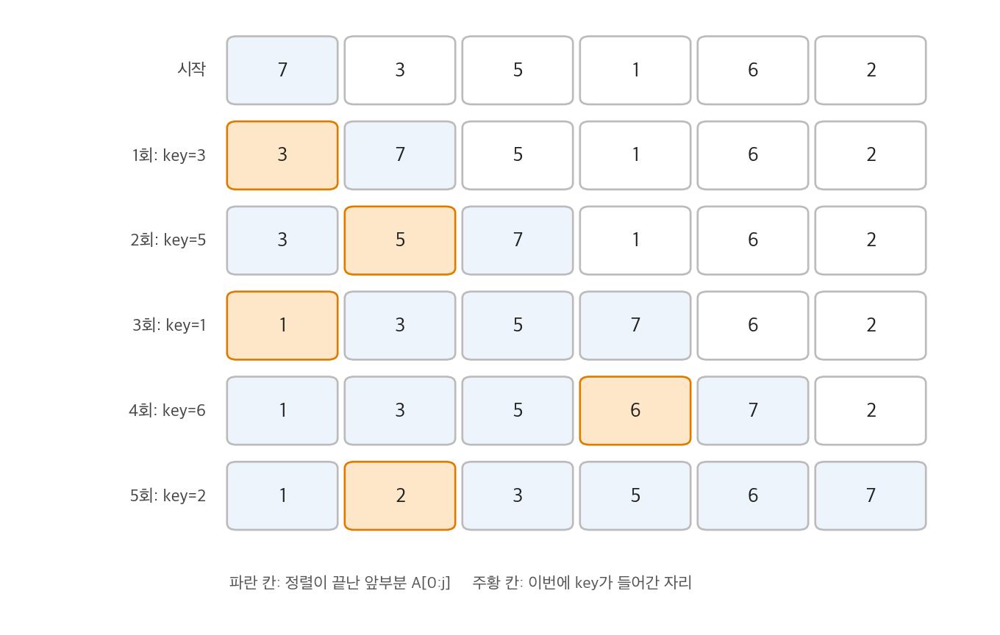
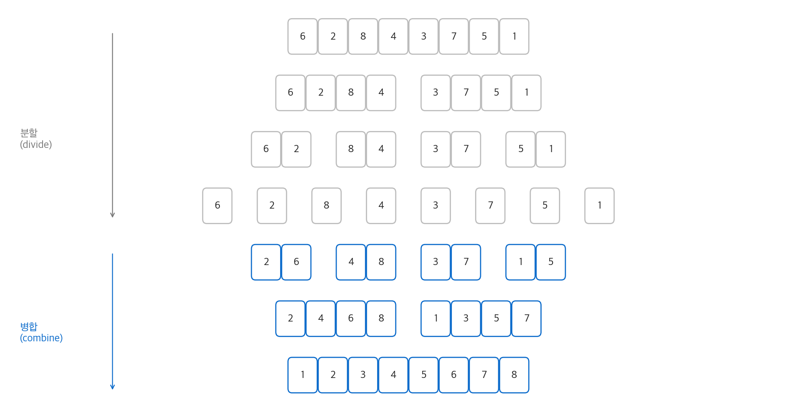
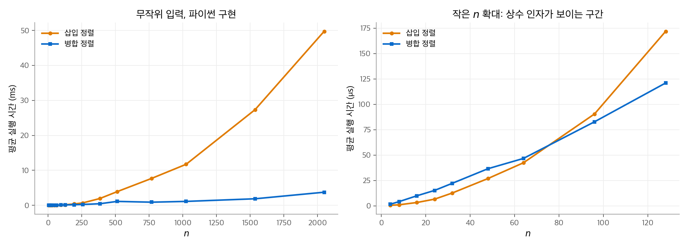

# 2. 삽입 정렬과 병합 정렬

이 장은 책 전체에서 쓰는 도구를 두 정렬 알고리즘으로 소개합니다.
삽입 정렬로 **루프 불변식**(loop invariant)을 써서 올바름을 증명하는 방법과, 줄 단위로 실행 시간을 세는 방법을 배웁니다.
병합 정렬로 **분할 정복**(divide-and-conquer) 설계와 **점화식**(recurrence)으로 실행 시간을 구하는 방법을 배웁니다.
결론은 삽입 정렬의 최악 실행 시간이 $\Theta(n^2)$ 이고 병합 정렬은 $\Theta(n \lg n)$ 이라는 것입니다.

!!! info "원문과 자료"
    - 원문: CLRS 4판 2장 Getting Started (2.1 Insertion sort, 2.2 Analyzing algorithms, 2.3 Designing algorithms)
    - 책 페이지: [MIT Press, Introduction to Algorithms, 4th ed.](https://mitpress.mit.edu/9780262046305/introduction-to-algorithms/)
    - 강의: [MIT OCW 6.006 Introduction to Algorithms (Spring 2020)](https://ocw.mit.edu/courses/6-006-introduction-to-algorithms-spring-2020/)
    - 함께 읽기: [1. 컴퓨팅에서 알고리즘의 역할](01-role-of-algorithms.md), [3. 실행 시간의 점근 표기](03-running-times.md), [4. 분할 정복](04-divide-and-conquer.md), [7. 퀵 정렬](07-quicksort.md)

## 1. 삽입 정렬

### 아이디어

손에 든 카드를 정리하는 방법과 같습니다. 왼손의 카드는 항상 정렬되어 있습니다.
테이블에서 카드를 한 장 집으면, 왼손 카드를 오른쪽부터 비교하며 들어갈 자리를 찾아 끼웁니다.
정렬할 수를 **키**(key)라고 부릅니다. 삽입 정렬은 배열 안에서 자리를 바꾸므로 추가 배열이 필요 없습니다.
이런 정렬을 **제자리 정렬**(in-place sort)이라고 합니다.

### 코드

책의 의사 코드는 첨자를 1부터 셉니다. 이 교재의 파이썬 코드는 0부터 셉니다.

```python
def insertion_sort(a):
    for j in range(1, len(a)):       # a[0:j] 는 이미 정렬되어 있습니다.
        key = a[j]
        i = j - 1
        while i >= 0 and a[i] > key:   # key 보다 큰 원소를 한 칸씩 오른쪽으로 밉니다.
            a[i + 1] = a[i]
            i -= 1
        a[i + 1] = key                 # 빈 자리에 key 를 넣습니다.
```

### 수치 예

입력 $\langle 7, 3, 5, 1, 6, 2 \rangle$ 에서 바깥 루프가 한 번 돌 때마다 배열이 어떻게 바뀌는지 봅니다.

| 회차 | key | 밀린 원소 | 결과 |
| --- | --- | --- | --- |
| 1 | 3 | 7 | ⟨3, 7, 5, 1, 6, 2⟩ |
| 2 | 5 | 7 | ⟨3, 5, 7, 1, 6, 2⟩ |
| 3 | 1 | 7, 5, 3 | ⟨1, 3, 5, 7, 6, 2⟩ |
| 4 | 6 | 7 | ⟨1, 3, 5, 6, 7, 2⟩ |
| 5 | 2 | 7, 6, 5, 3 | ⟨1, 2, 3, 5, 6, 7⟩ |

<figure markdown>

<figcaption markdown>
<span class="fig-title"><b>Figure 1.</b> 삽입 정렬의 단계별 배열 상태</span>

매 회차가 끝나면 앞부분이 한 칸씩 늘어난 정렬 상태가 됩니다. 주황 칸은 key가 들어간 자리입니다.
</figcaption>
</figure>

### 루프 불변식으로 올바름 증명

바깥 루프에 대해 다음 성질을 세웁니다.

> **불변식:** 바깥 루프의 각 반복이 시작될 때, 부분 배열 `a[0:j]` 는 원래 `a[0:j]` 의 원소로 이루어져 있고 정렬되어 있습니다.

루프 불변식은 수학적 귀납법과 같은 구조로 세 가지를 보입니다.

1. **초기 조건**(initialization): 첫 반복 전에 $j = 1$ 입니다. `a[0:1]` 은 원소 하나이므로 정렬되어 있습니다.
2. **유지 조건**(maintenance): 안쪽 루프는 `a[j-1], a[j-2], ...` 가운데 key보다 큰 원소를 한 칸씩 오른쪽으로 밉니다. 그 뒤 빈 자리에 key를 넣습니다. 따라서 `a[0:j+1]` 은 원래 원소로 이루어지고 정렬됩니다. $j$ 를 1 늘리면 불변식이 다시 성립합니다.
3. **종료 조건**(termination): 루프는 $j = n$ 에서 끝납니다. 불변식에 $j = n$ 을 넣으면 `a[0:n]` 전체가 정렬되어 있습니다.

귀납법과 다른 점은 3단계입니다. 귀납법은 무한히 이어지지만, 루프 불변식은 루프가 끝날 때 멈추고 그 시점의 성질을 씁니다.

## 2. 알고리즘 분석

### RAM 모형

실행 시간을 세려면 계산 모형을 정해야 합니다. 책은 **RAM 모형**(random-access machine)을 씁니다.

- 명령은 하나씩 순서대로 실행됩니다. 동시 실행은 없습니다.
- 산술(덧셈, 곱셈, 나눗셈, 나머지), 데이터 이동(읽기, 쓰기, 복사), 제어(분기, 호출, 반환) 명령은 각각 상수 시간이 걸립니다.
- 한 워드(word)의 크기는 $c \lg n$ 비트 정도로 제한합니다. 워드 크기를 무제한으로 두면 한 워드에 모든 데이터를 넣는 속임수가 가능하기 때문입니다.

RAM 모형은 캐시와 가상 메모리를 무시합니다. 그래도 실제 컴퓨터의 성능을 예측하는 데 대부분 충분합니다.

### 입력 크기와 실행 시간

**입력 크기**(input size)는 문제마다 다릅니다. 정렬에서는 원소 개수 $n$ 입니다.
정수 곱셈에서는 비트 수입니다. 그래프에서는 정점 수와 간선 수 두 값으로 씁니다.
**실행 시간**(running time)은 실행된 명령의 개수입니다. 줄 $k$ 를 한 번 실행하는 데 상수 $c_k$ 가 걸린다고 둡니다.

### 삽입 정렬의 줄 단위 비용

$t_j$ 를 $j$ 번째 바깥 반복에서 `while` 조건을 검사한 횟수라고 둡니다. 첨자는 책처럼 $j = 2, \ldots, n$ 으로 씁니다.

| 줄 | 비용 | 실행 횟수 |
| --- | --- | --- |
| `for j` | $c_1$ | $n$ |
| `key = a[j]` | $c_2$ | $n - 1$ |
| `i = j - 1` | $c_4$ | $n - 1$ |
| `while` 조건 | $c_5$ | $\sum_{j=2}^{n} t_j$ |
| `a[i+1] = a[i]` | $c_6$ | $\sum_{j=2}^{n} (t_j - 1)$ |
| `i -= 1` | $c_7$ | $\sum_{j=2}^{n} (t_j - 1)$ |
| `a[i+1] = key` | $c_8$ | $n - 1$ |

전체 실행 시간은 비용과 횟수를 곱해 더한 값입니다.

$$
T(n) = c_1 n + (c_2 + c_4 + c_8)(n-1) + c_5 \sum_{j=2}^{n} t_j + (c_6 + c_7) \sum_{j=2}^{n} (t_j - 1)
$$

### 최선, 최악, 평균

- **최선의 경우:** 입력이 이미 정렬되어 있으면 `while` 조건을 한 번만 검사합니다. $t_j = 1$ 이므로 $T(n) = an + b$ 꼴의 **선형 함수**입니다.
- **최악의 경우:** 입력이 역순이면 key를 앞의 모든 원소와 비교합니다. $t_j = j$ 입니다. 다음 합을 대입합니다.

$$
\sum_{j=2}^{n} j = \frac{n(n+1)}{2} - 1, \qquad \sum_{j=2}^{n} (j - 1) = \frac{n(n-1)}{2}
$$

  그러면 $T(n) = an^2 + bn + c$ 꼴의 **이차 함수**가 됩니다.
- **평균의 경우:** 무작위 입력에서 key는 앞부분 원소의 절반 정도보다 작습니다. $t_j \approx j/2$ 이므로 평균도 이차 함수입니다.

책은 주로 **최악 실행 시간**(worst-case running time)을 분석합니다. 이유는 세 가지입니다.
최악 실행 시간은 모든 입력에 대한 보장입니다. 데이터베이스에서 없는 항목을 찾는 경우처럼 최악이 자주 일어나는 응용이 있습니다.
평균의 경우도 최악의 경우와 차수가 같을 때가 많습니다.

### 증가 차수

$an^2 + bn + c$ 에서 $n$ 이 커지면 $an^2$ 항만 중요합니다. 계수 $a$ 도 실제 컴퓨터마다 달라지므로 버립니다.
남은 $n^2$ 을 **증가 차수**라고 하고 $\Theta(n^2)$ 으로 씁니다. 정확한 정의는 [3장](03-running-times.md)에 있습니다.
따라서 삽입 정렬의 최악 실행 시간은 $\Theta(n^2)$ 이고, 최선 실행 시간은 $\Theta(n)$ 입니다.

## 3. 분할 정복과 병합 정렬

### 분할 정복의 세 단계

**분할 정복**은 문제를 작은 부분 문제로 나누어 재귀적으로 풀고, 그 해를 합칩니다.
부분 문제가 충분히 작으면 직접 풉니다. 이 경우를 **기저 사례**(base case)라고 합니다. 그렇지 않으면 세 단계를 거칩니다.

1. **분할**(divide): 문제를 같은 종류의 더 작은 부분 문제로 나눕니다.
2. **정복**(conquer): 부분 문제를 재귀적으로 풉니다.
3. **결합**(combine): 부분 문제의 해를 합쳐 원래 문제의 해를 만듭니다.

병합 정렬에 대입하면 다음과 같습니다. 부분 배열 `a[p:r+1]` 을 정렬합니다.

1. 분할: 중간 지점 $q = \lfloor (p + r)/2 \rfloor$ 로 `a[p:q+1]` 과 `a[q+1:r+1]` 을 만듭니다.
2. 정복: 두 부분 배열을 병합 정렬로 재귀적으로 정렬합니다.
3. 결합: 정렬된 두 부분 배열을 하나로 **병합**(merge)합니다.

### 병합 절차

핵심은 결합 단계의 `merge` 입니다. 정렬된 카드 더미 두 개를 앞면이 보이게 놓는 것과 같습니다.
두 더미의 맨 위 카드 가운데 작은 쪽을 집어 출력 더미에 놓습니다. 한쪽이 비면 남은 쪽을 그대로 옮깁니다.

```python
def merge(a, p, q, r):
    L, R = a[p:q + 1], a[q + 1:r + 1]   # 두 반쪽을 복사합니다.
    i = j = 0
    k = p
    while i < len(L) and j < len(R):    # 두 더미의 맨 앞을 비교합니다.
        if L[i] <= R[j]:
            a[k] = L[i]; i += 1
        else:
            a[k] = R[j]; j += 1
        k += 1
    while i < len(L):                    # 남은 원소를 그대로 옮깁니다.
        a[k] = L[i]; i += 1; k += 1
    while j < len(R):
        a[k] = R[j]; j += 1; k += 1

def merge_sort(a, p, r):
    if p >= r:                           # 원소가 0개 또는 1개이면 이미 정렬되어 있습니다.
        return
    q = (p + r) // 2
    merge_sort(a, p, q)
    merge_sort(a, q + 1, r)
    merge(a, p, q, r)
```

`L[i] <= R[j]` 에서 같을 때 왼쪽을 먼저 고릅니다. 그래서 같은 키의 원래 순서가 유지됩니다. 이런 정렬을 **안정 정렬**(stable sort)이라고 합니다.

`merge` 의 실행 시간은 $\Theta(n)$ 입니다. 여기서 $n = r - p + 1$ 입니다. 반복마다 원소 하나를 출력에 놓기 때문입니다.
`merge` 의 올바름은 다음 불변식으로 보입니다.

> **불변식:** 첫 `while` 루프의 각 반복이 시작될 때, `a[p:k]` 는 `L` 과 `R` 의 원소 가운데 가장 작은 $k - p$ 개를 정렬된 순서로 담습니다. `L[i]` 와 `R[j]` 는 각 더미에서 아직 복사하지 않은 가장 작은 원소입니다.

### 수치 예

입력 $\langle 6, 2, 8, 4, 3, 7, 5, 1 \rangle$ 을 정렬합니다. 크기 1이 될 때까지 나눈 뒤, 아래에서 위로 병합합니다.

| 단계 | 상태 |
| --- | --- |
| 크기 1 | ⟨6⟩ ⟨2⟩ ⟨8⟩ ⟨4⟩ ⟨3⟩ ⟨7⟩ ⟨5⟩ ⟨1⟩ |
| 크기 2로 병합 | ⟨2, 6⟩ ⟨4, 8⟩ ⟨3, 7⟩ ⟨1, 5⟩ |
| 크기 4로 병합 | ⟨2, 4, 6, 8⟩ ⟨1, 3, 5, 7⟩ |
| 크기 8로 병합 | ⟨1, 2, 3, 4, 5, 6, 7, 8⟩ |

마지막 병합에서 비교 순서는 $2 > 1$, $2 < 3$, $4 > 3$, $4 < 5$, $6 > 5$, $6 < 7$, $8 > 7$ 입니다.
비교 7번 뒤 오른쪽 더미가 비고, 남은 8을 옮깁니다.

<figure markdown>

<figcaption markdown>
<span class="fig-title"><b>Figure 2.</b> 병합 정렬의 분할과 병합</span>

위쪽 네 줄은 크기 1까지 나누는 단계, 아래쪽 세 줄은 정렬된 조각을 병합하는 단계입니다.
</figcaption>
</figure>

## 4. 분할 정복 알고리즘의 분석

### 점화식 세우기

$T(n)$ 을 크기 $n$ 문제의 최악 실행 시간이라고 둡니다. 분할 정복 알고리즘은 다음 꼴의 점화식을 만듭니다.
문제를 크기 $n/b$ 인 부분 문제 $a$ 개로 나누고, 분할에 $D(n)$, 결합에 $C(n)$ 이 걸린다고 둡니다.

$$
T(n) =
\begin{cases}
\Theta(1) & n < n_0 \\
a\,T(n/b) + D(n) + C(n) & n \ge n_0
\end{cases}
$$

병합 정렬은 $a = b = 2$ 입니다. 분할은 중간 지점만 계산하므로 $D(n) = \Theta(1)$ 이고, 결합은 `merge` 이므로 $C(n) = \Theta(n)$ 입니다.

$$
T(n) = 2T(n/2) + \Theta(n)
$$

$n$ 이 홀수이면 두 부분 문제의 크기가 $\lfloor n/2 \rfloor$ 과 $\lceil n/2 \rceil$ 입니다. 이 차이는 점근적 결과를 바꾸지 않습니다. 4장에서 이 점을 다룹니다.

### 재귀 트리로 풀기

$\Theta(n)$ 을 $cn$ 으로 두고, $n$ 이 2의 거듭제곱이라고 가정합니다.
**재귀 트리**(recursion tree)는 각 재귀 호출을 노드로 두고, 노드에 그 호출이 직접 하는 일의 비용을 적은 트리입니다.

- 뿌리의 비용은 $cn$ 입니다. 자식 두 개의 비용은 각각 $cn/2$ 입니다.
- 깊이 $i$ 에는 노드가 $2^i$ 개 있고, 각 노드의 비용은 $cn / 2^i$ 입니다. 따라서 층마다 비용이 $cn$ 입니다.
- 크기가 1이 되는 깊이는 $\lg n$ 입니다. 층은 $\lg n + 1$ 개입니다.

$$
T(n) = cn(\lg n + 1) = cn \lg n + cn = \Theta(n \lg n)
$$

$n = 8$ 이면 층은 4개(크기 8, 4, 2, 1)입니다. 각 층의 비용은 $8c$ 이고 합은 $32c$ 입니다. $cn \lg n + cn = 24c + 8c$ 와 같습니다.

### 실측: 교차점

1장의 교차점 논리를 직접 확인합니다. 위의 두 파이썬 구현으로 무작위 실수 배열을 정렬하고 평균 시간을 쟀습니다.

| $n$ | 삽입 정렬 | 병합 정렬 |
| --- | --- | --- |
| 8 | 1.2 μs | 4.1 μs |
| 32 | 12.4 μs | 21.6 μs |
| 64 | 46.1 μs | 47.2 μs |
| 256 | 625 μs | 229 μs |
| 2048 | 46.4 ms | 2.6 ms |

이 환경에서 교차점은 $n \approx 64$ 입니다. 그보다 작은 배열에서는 상수 인자가 작은 삽입 정렬이 빠릅니다.
실제 라이브러리(예: Python의 Timsort)가 작은 구간을 삽입 정렬로 처리하는 이유가 이것입니다.
값은 측정 환경에 따라 달라집니다. 그러나 $n$ 이 8배 커질 때 삽입 정렬은 이론값 64배에 가까운 약 74배, 병합 정렬은 이론값 $8 \times 11/8 = 11$ 배에 가까운 약 11.5배 느려집니다. 256에서 2048로 갈 때의 측정값입니다. 이 경향은 환경이 바뀌어도 같습니다.

<figure markdown>

<figcaption markdown>
<span class="fig-title"><b>Figure 3.</b> 삽입 정렬과 병합 정렬의 실측 실행 시간</span>

큰 $n$ 에서는 이차 함수와 $n \lg n$ 의 차이가 뚜렷합니다. 오른쪽 확대 그림에서 두 곡선은 $n \approx 64$ 에서 교차합니다.
</figcaption>
</figure>

## 5. 정리

| 알고리즘 | 최선 | 최악 | 추가 메모리 | 안정성 |
| --- | --- | --- | --- | --- |
| 삽입 정렬 | $\Theta(n)$ | $\Theta(n^2)$ | $\Theta(1)$ (제자리) | 안정 |
| 병합 정렬 | $\Theta(n \lg n)$ | $\Theta(n \lg n)$ | $\Theta(n)$ | 안정 |

- 루프 불변식은 초기 조건, 유지 조건, 종료 조건의 세 단계로 반복문의 올바름을 증명합니다.
- 실행 시간은 줄 단위 비용과 실행 횟수의 곱을 더해 구하고, 최고차항만 남겨 증가 차수로 씁니다.
- 분할 정복 알고리즘의 실행 시간은 점화식으로 쓰고, 재귀 트리로 풀 수 있습니다. 일반적인 풀이 방법은 [4장](04-divide-and-conquer.md)에 있습니다.

연습 문제와 장 끝 문제(버블 정렬, 호너 규칙, 역전 쌍 세기)는 옮기지 않았습니다.
역전 쌍 세기는 `merge` 에서 오른쪽 원소를 먼저 고를 때 왼쪽에 남은 원소 수를 더하는 방식으로 $\Theta(n \lg n)$ 에 풀 수 있습니다.
