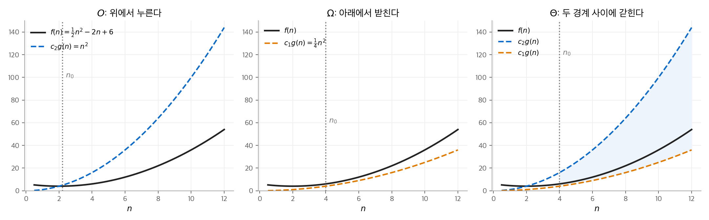
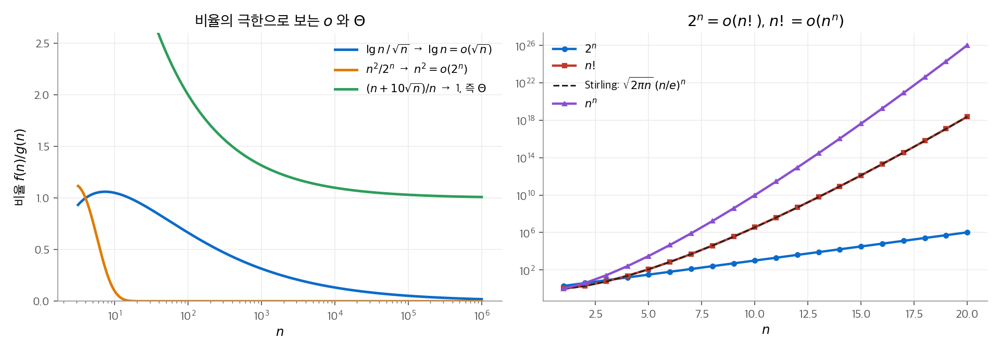

# 3. 실행 시간의 점근 표기

2장에서 삽입 정렬의 실행 시간 $an^2 + bn + c$ 를 $\Theta(n^2)$ 으로 줄여 썼습니다.
이 장은 그렇게 줄여 쓰는 규칙을 정확하게 정의합니다. $O$, $\Omega$, $\Theta$, $o$, $\omega$ 다섯 가지 **점근 표기**(asymptotic notation)를 다룹니다.
뒤에서 계속 쓰는 표준 함수(바닥과 천장, 다항식, 지수, 로그, 계승, 반복 로그, 피보나치 수)의 성질도 정리합니다.

!!! info "원문과 자료"
    - 원문: CLRS 4판 3장 Characterizing Running Times (3.1 $O$-notation, $\Omega$-notation, and $\Theta$-notation, 3.2 Asymptotic notation: formal definitions, 3.3 Standard notations and common functions)
    - 책 페이지: [MIT Press, Introduction to Algorithms, 4th ed.](https://mitpress.mit.edu/9780262046305/introduction-to-algorithms/)
    - 강의: [MIT OCW 6.006 Introduction to Algorithms (Spring 2020)](https://ocw.mit.edu/courses/6-006-introduction-to-algorithms-spring-2020/)
    - 함께 읽기: [2. 삽입 정렬과 병합 정렬](02-getting-started.md), [4. 분할 정복](04-divide-and-conquer.md). 수학 섹션의 [선형대수 1장](../../math/linear-algebra/01-gaussian-elimination.md)은 소거법의 연산 수를 같은 방식($n^3/3$ 의 최고차항)으로 셉니다. 기댓값과 확률은 [확률론](../../math/probability/index.md)을 참고합니다.

## 1. 세 가지 표기의 직관

### 무엇을 버리는가

점근 표기는 $n$ 이 충분히 클 때의 행동만 봅니다. 두 가지를 버립니다.

- **낮은 차수의 항:** $n$ 이 크면 최고차항이 나머지를 압도합니다.
- **최고차항의 계수:** 컴퓨터와 구현마다 달라지는 상수입니다.

세 표기는 각각 다른 방향의 경계를 말합니다.

| 표기 | 의미 | 예 |
| --- | --- | --- |
| $O(g(n))$ | $f$ 는 $g$ 의 상수배보다 **빨리 자라지 않습니다** (상한). | $7n^3 + 100n^2 - 20n + 6 = O(n^3)$ |
| $\Omega(g(n))$ | $f$ 는 $g$ 의 상수배보다 **느리게 자라지 않습니다** (하한). | 같은 함수 $= \Omega(n^3)$, $= \Omega(n^2)$ |
| $\Theta(g(n))$ | $O$ 와 $\Omega$ 가 함께 성립합니다 (딱 맞는 경계). | 같은 함수 $= \Theta(n^3)$ |

같은 함수가 $O(n^4)$ 이기도 합니다. $O$ 는 상한만 말하므로 느슨한 상한도 참입니다. $\Theta$ 는 그렇지 않습니다. $\Theta(n^3)$ 만 참입니다.

### 삽입 정렬의 예

삽입 정렬의 최악 실행 시간이 $\Theta(n^2)$ 임을 두 방향으로 보입니다.

- **상한 $O(n^2)$:** 바깥 루프는 $n - 1$ 번 돌고, 안쪽 루프는 한 번에 최대 $n - 1$ 번 돕니다. 따라서 전체는 $O(n^2)$ 입니다.
- **하한 $\Omega(n^2)$:** $n$ 이 3의 배수라고 둡니다. 가장 큰 $n/3$ 개 값이 앞쪽 $n/3$ 칸에 있는 입력을 생각합니다. 이 값들은 각각 가운데 $n/3$ 칸을 지나 뒤쪽 $n/3$ 칸으로 가야 합니다. 한 칸 이동은 한 번에 한 칸씩이므로 이동 횟수는 적어도 $(n/3)(n/3) = n^2/9$ 입니다.

두 경계가 같은 차수이므로 최악 실행 시간은 $\Theta(n^2)$ 입니다.
"삽입 정렬의 실행 시간은 $\Theta(n^2)$ 이다"라고 쓰면 틀립니다. 최선 실행 시간은 $\Theta(n)$ 이기 때문입니다.
정확한 표현은 "삽입 정렬의 **최악** 실행 시간은 $\Theta(n^2)$ 이다"입니다. "실행 시간은 $O(n^2)$ 이다"는 모든 입력에서 참입니다.

## 2. 형식적 정의

### O, Ω, Θ

각 표기는 함수의 **집합**입니다. $f(n) = O(g(n))$ 은 $f(n) \in O(g(n))$ 의 관례적인 표현입니다.

$$
O(g(n)) = \{ f(n) : \exists\, c > 0,\ n_0 > 0 \ \text{s.t.}\ 0 \le f(n) \le c\,g(n) \ \ \forall n \ge n_0 \}
$$

$$
\Omega(g(n)) = \{ f(n) : \exists\, c > 0,\ n_0 > 0 \ \text{s.t.}\ 0 \le c\,g(n) \le f(n) \ \ \forall n \ge n_0 \}
$$

$$
\Theta(g(n)) = \{ f(n) : \exists\, c_1, c_2 > 0,\ n_0 > 0 \ \text{s.t.}\ 0 \le c_1 g(n) \le f(n) \le c_2 g(n) \ \ \forall n \ge n_0 \}
$$

정의는 $f$ 와 $g$ 가 충분히 큰 $n$ 에서 음이 아니라고 가정합니다. 실행 시간은 음이 될 수 없으므로 문제가 없습니다.

**정리 3.1.** 두 함수 $f, g$ 에 대해, $f(n) = \Theta(g(n))$ 일 필요충분조건은 $f(n) = O(g(n))$ 이고 $f(n) = \Omega(g(n))$ 인 것입니다.

### 수치 예: 상수 찾기

$f(n) = \tfrac{1}{2} n^2 - 2n + 6$ 이 $\Theta(n^2)$ 임을 보입니다. 모든 $n \ge n_0$ 에서 다음을 만족하는 $c_1, c_2, n_0$ 을 찾습니다.

$$
c_1 n^2 \le \tfrac{1}{2} n^2 - 2n + 6 \le c_2 n^2
$$

- **오른쪽 부등식:** $c_2 = 1$ 로 둡니다. $n^2 - (\tfrac{1}{2} n^2 - 2n + 6) = \tfrac{1}{2} n^2 + 2n - 6$ 이고, 이 값은 $n \ge 2$ 에서 0 이상입니다($n = 2$ 에서 $2 + 4 - 6 = 0$).
- **왼쪽 부등식:** $c_1 = \tfrac{1}{4}$ 로 둡니다. $(\tfrac{1}{2} n^2 - 2n + 6) - \tfrac{1}{4} n^2 = \tfrac{1}{4}(n - 4)^2 + 2 > 0$ 이므로 모든 $n$ 에서 성립합니다.

따라서 $c_1 = 1/4$, $c_2 = 1$, $n_0 = 2$ 가 정의를 만족합니다. 상수는 하나로 정해지지 않습니다. 정의는 "존재한다"만 요구합니다.

<figure markdown>

<figcaption markdown>
<b>Figure 1.</b> $O$, $\Omega$, $\Theta$ 의 기하학적 의미

$n_0$ 오른쪽에서 $f(n)$ 이 $c_2 g(n)$ 아래에 있으면 $O$, $c_1 g(n)$ 위에 있으면 $\Omega$, 두 곡선 사이에 있으면 $\Theta$ 입니다.
</figcaption>
</figure>

반대로 $6n^3 \ne \Theta(n^2)$ 입니다. $6n^3 \le c_2 n^2$ 이 모든 큰 $n$ 에서 성립하려면 $n \le c_2 / 6$ 이어야 하는데, 상수 $c_2$ 로는 불가능합니다.

### 등식 안의 점근 표기

점근 표기가 등식의 오른쪽에 혼자 있으면 집합의 원소라는 뜻입니다. 식 안에 들어가면 **이름 없는 함수**를 뜻합니다.

- $2n^2 + 3n + 1 = 2n^2 + \Theta(n)$ 은 "$\Theta(n)$ 에 속하는 어떤 함수 $h(n)$ 이 있어 $2n^2 + 3n + 1 = 2n^2 + h(n)$" 이라는 뜻입니다. 여기서 $h(n) = 3n + 1$ 입니다.
- 왼쪽에도 표기가 있으면 다음 규칙을 씁니다. "왼쪽의 이름 없는 함수를 **어떻게** 고르든, 오른쪽의 이름 없는 함수를 **적당히** 골라 등식을 성립시킬 수 있다." 예를 들어 $2n^2 + \Theta(n) = \Theta(n^2)$ 입니다.
- 이 등호는 대칭이 아닙니다. $n = O(n^2)$ 은 참이지만 $O(n^2) = n$ 이라고 쓰지 않습니다.

점근 표기를 쓸 때 흔한 실수가 두 가지 있습니다.

1. **$O$ 로 하한을 말하는 실수:** "알고리즘 A의 실행 시간이 적어도 $O(n^2)$ 이다"는 의미가 없는 문장입니다. 하한은 $\Omega$ 로 씁니다.
2. **변수를 고정하지 않는 실수:** "$T(n) = O(n)$ 이므로 $n = 1, 2, \ldots$ 에 대해 귀납적으로 성립한다" 같은 논증은 매 단계 상수를 바꾸어 틀린 결론에 이릅니다. 4장의 치환법에서 다시 봅니다.

### o 와 ω

$O$ 는 딱 맞을 수도 있고 느슨할 수도 있습니다. $2n^2 = O(n^2)$ 은 딱 맞고, $2n = O(n^2)$ 은 느슨합니다.
**느슨한 경계만** 말하는 표기가 $o$ 와 $\omega$ 입니다.

$$
o(g(n)) = \{ f(n) : \forall\, c > 0,\ \exists\, n_0 > 0 \ \text{s.t.}\ 0 \le f(n) < c\,g(n) \ \ \forall n \ge n_0 \}
$$

$$
\omega(g(n)) = \{ f(n) : \forall\, c > 0,\ \exists\, n_0 > 0 \ \text{s.t.}\ 0 \le c\,g(n) < f(n) \ \ \forall n \ge n_0 \}
$$

$O$ 와 다른 점은 "어떤 $c$ 에 대해"가 "모든 $c$ 에 대해"로 바뀐 것입니다. 극한이 있으면 다음과 같이 판정할 수 있습니다.

$$
f(n) = o(g(n)) \iff \lim_{n \to \infty} \frac{f(n)}{g(n)} = 0, \qquad f(n) = \omega(g(n)) \iff \lim_{n \to \infty} \frac{f(n)}{g(n)} = \infty
$$

비율이 0도 무한대도 아닌 양의 상수로 수렴하면 $\Theta$ 입니다.

### 함수 비교의 성질

실수의 대소 비교와 점근 비교는 다음처럼 대응합니다.

| 점근 비교 | 실수 비교 |
| --- | --- |
| $f(n) = O(g(n))$ | $a \le b$ |
| $f(n) = \Omega(g(n))$ | $a \ge b$ |
| $f(n) = \Theta(g(n))$ | $a = b$ |
| $f(n) = o(g(n))$ | $a < b$ |
| $f(n) = \omega(g(n))$ | $a > b$ |

다섯 표기 모두 **추이성**(transitivity)이 있습니다. $O, \Omega, \Theta$ 는 **반사성**(reflexivity)도 있습니다. $\Theta$ 는 **대칭성**(symmetry)이 있습니다.
**전치 대칭성**(transpose symmetry)도 성립합니다. $f = O(g) \iff g = \Omega(f)$ 이고, $f = o(g) \iff g = \omega(f)$ 입니다.

실수와 다른 점이 하나 있습니다. 실수는 $a < b$, $a = b$, $a > b$ 가운데 하나가 반드시 성립합니다(삼분법). 함수에서는 그렇지 않습니다.
$n$ 과 $n^{1 + \sin n}$ 은 지수가 0과 2 사이를 오가므로 어느 쪽도 다른 쪽의 $O$ 나 $\Omega$ 가 아닙니다.

## 3. 표준 표기와 자주 쓰는 함수

### 바닥, 천장, 나머지

실수 $x$ 에 대해 $\lfloor x \rfloor$ 는 $x$ 이하인 가장 큰 정수이고, $\lceil x \rceil$ 는 $x$ 이상인 가장 작은 정수입니다.

$$
x - 1 < \lfloor x \rfloor \le x \le \lceil x \rceil < x + 1, \qquad \lceil n/2 \rceil + \lfloor n/2 \rfloor = n
$$

정수 $a$ 와 양의 정수 $n$ 에 대해 $a \bmod n = a - n \lfloor a/n \rfloor$ 이고, 결과는 $0 \le a \bmod n < n$ 입니다. 예: $(-7) \bmod 3 = -7 - 3 \cdot (-3) = 2$.

### 다항식과 지수

차수가 $d$ 이고 최고차 계수가 양수인 다항식 $p(n) = \sum_{i=0}^{d} a_i n^i$ 는 $\Theta(n^d)$ 입니다.
$f(n) = O(n^k)$ 인 상수 $k$ 가 있으면 $f$ 를 **다항식 유계**(polynomially bounded)라고 합니다.

지수 함수는 모든 다항식보다 빨리 자랍니다. $a > 1$ 과 상수 $b$ 에 대해 다음이 성립합니다.

$$
\lim_{n \to \infty} \frac{n^b}{a^n} = 0 \quad \Longrightarrow \quad n^b = o(a^n)
$$

$e^x$ 의 근삿값도 자주 씁니다. 모든 실수 $x$ 에서 $e^x \ge 1 + x$ 이고, $|x| \le 1$ 이면 $1 + x \le e^x \le 1 + x + x^2$ 입니다.

### 로그

책의 로그 표기는 다음과 같습니다.

| 표기 | 의미 |
| --- | --- |
| $\lg n$ | $\log_2 n$ (이진 로그) |
| $\ln n$ | $\log_e n$ (자연 로그) |
| $\lg^k n$ | $(\lg n)^k$ (거듭제곱) |
| $\lg \lg n$ | $\lg(\lg n)$ (합성) |

밑을 바꾸면 상수배만 달라집니다. $\log_b n = \log_a n / \log_a b$ 입니다. 그래서 점근 표기 안에서는 로그의 밑을 쓰지 않습니다.
로그의 거듭제곱은 모든 양의 거듭제곱보다 느리게 자랍니다. 상수 $a > 0$, $b$ 에 대해 다음이 성립합니다.

$$
\lg^b n = o(n^a)
$$

앞의 지수 극한에서 $n$ 대신 $\lg n$, $a$ 대신 $2^a$ 를 넣으면 이 식이 나옵니다.
$n^{\lg 7}$ 처럼 지수에 로그가 있는 식은 $a^{\log_b c} = c^{\log_b a}$ 로 바꾸면 계산이 쉽습니다. 4장의 마스터 정리에서 씁니다.

### 계승

$n! = 1 \cdot 2 \cdots n$ 입니다. **스털링 근사**(Stirling's approximation)는 다음과 같습니다.

$$
n! = \sqrt{2\pi n} \left( \frac{n}{e} \right)^n \left( 1 + \Theta\!\left( \frac{1}{n} \right) \right)
$$

이 식에서 세 결과가 나옵니다.

$$
n! = o(n^n), \qquad n! = \omega(2^n), \qquad \lg(n!) = \Theta(n \lg n)
$$

$\lg(n!) = \Theta(n \lg n)$ 은 8장에서 비교 정렬의 하한 $\Omega(n \lg n)$ 을 증명할 때 씁니다.
수치로 확인하면 $10! = 3{,}628{,}800$ 이고 스털링 근사는 $3{,}598{,}696$ 입니다. 상대 오차는 약 0.8%로, $1/(12n)$ 과 거의 같습니다.

<figure markdown>

<figcaption markdown>
<b>Figure 2.</b> 비율의 극한과 계승의 증가 속도

왼쪽에서 비율이 0으로 가면 $o$, 양의 상수로 가면 $\Theta$ 입니다. 오른쪽에서 $n!$ 은 $2^n$ 과 $n^n$ 사이에 있고, 스털링 근사(점선)와 거의 겹칩니다.
</figcaption>
</figure>

### 반복 함수와 반복 로그

$f^{(i)}(n)$ 은 $f$ 를 $n$ 에 $i$ 번 적용한 값입니다. $f^{(0)}(n) = n$ 입니다.
**반복 로그**(iterated logarithm) $\lg^* n$ 은 $\lg$ 를 몇 번 적용해야 1 이하가 되는지 셉니다.

$$
\lg^* n = \min \{ i \ge 0 : \lg^{(i)} n \le 1 \}
$$

| $n$ | 2 | 4 | 16 | 65536 | $2^{65536}$ |
| --- | --- | --- | --- | --- | --- |
| $\lg^* n$ | 1 | 2 | 3 | 4 | 5 |

관측 가능한 우주의 원자 수(약 $10^{80}$)는 $2^{65536}$ 보다 훨씬 작습니다. 따라서 실제 입력에서 $\lg^* n$ 은 5를 넘지 않습니다.
19장의 서로소 집합 자료 구조에서 이와 비슷하게 아주 느리게 자라는 함수가 나옵니다.

### 피보나치 수

$F_0 = 0$, $F_1 = 1$, $F_i = F_{i-1} + F_{i-2}$ 입니다. 수열은 0, 1, 1, 2, 3, 5, 8, 13, 21, 34, … 입니다.
피보나치 수는 **황금비**(golden ratio) $\phi = (1 + \sqrt{5})/2 \approx 1.618$ 과 켤레 $\hat\phi = (1 - \sqrt{5})/2 \approx -0.618$ 로 쓸 수 있습니다.

$$
F_i = \frac{\phi^i - \hat\phi^i}{\sqrt{5}}
$$

$|\hat\phi| < 1$ 이므로 $|\hat\phi^i| / \sqrt{5} < 1/2$ 입니다. 따라서 $F_i$ 는 $\phi^i / \sqrt{5}$ 를 가장 가까운 정수로 반올림한 값입니다.
예: $\phi^{10} / \sqrt{5} \approx 122.99 / 2.236 \approx 55.004$ 이고 $F_{10} = 55$ 입니다. 피보나치 수는 지수적으로 자랍니다. 즉 $F_i = \Theta(\phi^i)$ 입니다.

## 4. 정리

- $O$ 는 상한, $\Omega$ 는 하한, $\Theta$ 는 두 경계를 함께 말합니다. 정의는 "충분히 큰 $n$ 에서 상수배 안에 갇힌다"입니다.
- $o$ 와 $\omega$ 는 느슨한 경계만 말합니다. 비율의 극한이 0이면 $o$, 무한대이면 $\omega$ 입니다.
- 증가 속도 순서: $\lg^* n \ll \lg n \ll \lg^k n \ll n^\epsilon \ll n \ll n \lg n \ll n^2 \ll 2^n \ll n! \ll n^n$ ($\epsilon > 0$, 각 $\ll$ 는 $o$).
- 로그의 밑은 점근 표기에서 무의미합니다. 지수의 밑은 그렇지 않습니다. $2^n = o(3^n)$ 입니다.

3.3절 연습 문제와 장 끝 문제(함수의 증가 순서 정렬, 점근 표기의 변형)는 옮기지 않았습니다.
