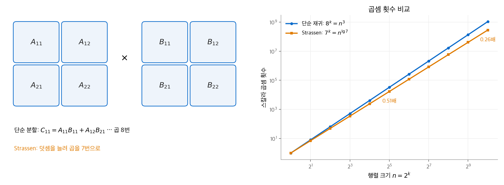
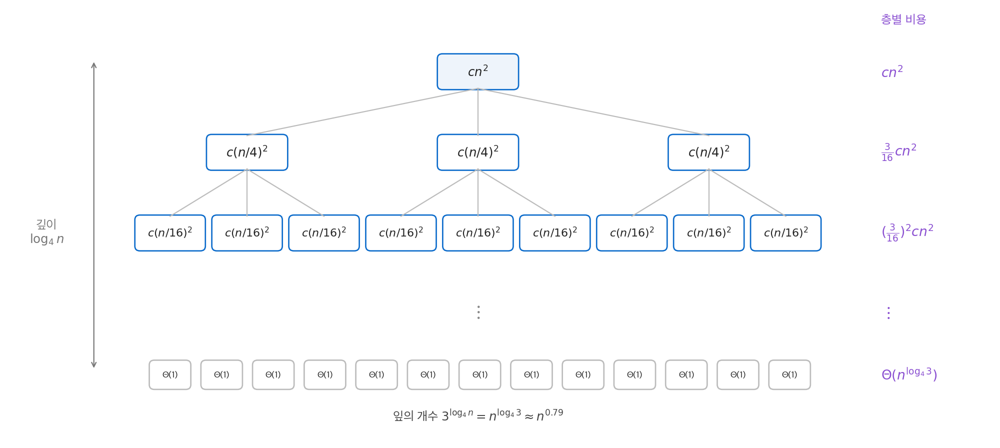
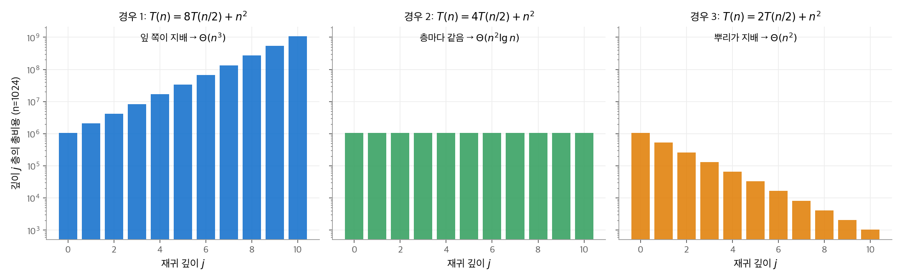

# 4. 분할 정복

2장의 병합 정렬은 분할 정복으로 설계했고, 실행 시간은 점화식 $T(n) = 2T(n/2) + \Theta(n)$ 이었습니다.
이 장은 분할 정복의 두 번째 예로 행렬 곱셈을 다룹니다. 단순한 분할은 곱셈 8번으로 $\Theta(n^3)$ 에 머뭅니다.
**Strassen 알고리즘**은 곱셈을 7번으로 줄여 $\Theta(n^{\lg 7}) \approx \Theta(n^{2.81})$ 을 얻습니다.
이어서 점화식을 푸는 세 방법을 다룹니다. **치환법**(substitution method), **재귀 트리법**(recursion-tree method), **마스터 방법**(master method)입니다.

!!! info "원문과 자료"
    - 원문: CLRS 4판 4장 Divide-and-Conquer (4.1 Multiplying square matrices, 4.2 Strassen's algorithm, 4.3 The substitution method, 4.4 The recursion-tree method, 4.5 The master method, ★4.6 Proof of the continuous master theorem, ★4.7 Akra-Bazzi recurrences)
    - 책 페이지: [MIT Press, Introduction to Algorithms, 4th ed.](https://mitpress.mit.edu/9780262046305/introduction-to-algorithms/)
    - 강의: [MIT OCW 6.046J Design and Analysis of Algorithms (Spring 2015)](https://ocw.mit.edu/courses/6-046j-design-and-analysis-of-algorithms-spring-2015/)
    - 함께 읽기: [2. 삽입 정렬과 병합 정렬](02-getting-started.md), [3. 실행 시간의 점근 표기](03-running-times.md), [9. 중앙값과 순서 통계량](09-order-statistics.md), [28. 행렬 연산](28-matrix-operations.md), [30. 다항식과 FFT](30-fft.md). 행렬 곱의 정의는 수학 섹션의 [선형대수 1장](../../math/linear-algebra/01-gaussian-elimination.md)에 있습니다.

## 1. 점화식과 분할 정복

### 알고리즘 점화식

**점화식**은 함수를 더 작은 인자에서의 자기 자신으로 기술한 식입니다.
분할 정복 알고리즘의 실행 시간을 쓴 점화식을 책은 **알고리즘 점화식**(algorithmic recurrence)이라고 부릅니다.
알고리즘 점화식은 다음 성질을 만족한다고 가정합니다.

- 어떤 임계값 $n_0$ 보다 작은 $n$ 에서 $T(n) = \Theta(1)$ 입니다.
- $n \ge n_0$ 에서는 재귀 경로가 유한한 단계 안에 기저 사례에 도달합니다.

이 가정 덕분에 기저 사례를 생략하고 $T(n) = 2T(n/2) + \Theta(n)$ 처럼 씁니다.
기저 사례의 상수를 바꾸어도 점근적 해는 바뀌지 않습니다. 바닥과 천장도 대부분 생략할 수 있습니다.

### 이 장에서 보는 점화식

| 점화식 | 출처 | 해 |
| --- | --- | --- |
| $T(n) = 2T(n/2) + \Theta(n)$ | 병합 정렬 | $\Theta(n \lg n)$ |
| $T(n) = 8T(n/2) + \Theta(1)$ | 단순 재귀 행렬 곱셈 | $\Theta(n^3)$ |
| $T(n) = 7T(n/2) + \Theta(n^2)$ | Strassen | $\Theta(n^{\lg 7})$ |
| $T(n) = 3T(n/4) + \Theta(n^2)$ | 재귀 트리 예 | $\Theta(n^2)$ |
| $T(n) = T(n/3) + T(2n/3) + \Theta(n)$ | 불균형 분할 예 | $\Theta(n \lg n)$ |

## 2. 정사각 행렬 곱셈

### 정의에 따른 계산

$n \times n$ 행렬 $A = (a_{ik})$, $B = (b_{kj})$ 의 곱 $C = AB$ 는 다음과 같습니다.

$$
c_{ij} = \sum_{k=1}^{n} a_{ik} \, b_{kj}
$$

책은 이 계산을 $C \leftarrow C + A \cdot B$ 꼴로 씁니다. $C$ 를 0으로 초기화하면 보통의 곱입니다.

```python
def matrix_multiply(A, B, C, n):
    for i in range(n):
        for j in range(n):
            for k in range(n):
                C[i][j] += A[i][k] * B[k][j]
```

세 겹의 루프가 각각 $n$ 번 돌므로 실행 시간은 $\Theta(n^3)$ 입니다.

### 단순한 분할 정복

$n$ 이 2의 거듭제곱이라고 둡니다. 각 행렬을 $n/2 \times n/2$ 블록 네 개로 나눕니다.

$$
\begin{pmatrix} C_{11} & C_{12} \\ C_{21} & C_{22} \end{pmatrix}
=
\begin{pmatrix} A_{11} & A_{12} \\ A_{21} & A_{22} \end{pmatrix}
\begin{pmatrix} B_{11} & B_{12} \\ B_{21} & B_{22} \end{pmatrix}
$$

블록 곱의 규칙은 스칼라 곱과 같습니다.

$$
\begin{aligned}
C_{11} &= A_{11} B_{11} + A_{12} B_{21}, & C_{12} &= A_{11} B_{12} + A_{12} B_{22}, \\
C_{21} &= A_{21} B_{11} + A_{22} B_{21}, & C_{22} &= A_{21} B_{12} + A_{22} B_{22}
\end{aligned}
$$

$n/2$ 크기의 곱이 8번 필요합니다. 책의 구현은 블록을 복사하지 않고 **첨자 계산**(index calculation)으로 나눕니다.
그러면 분할이 $\Theta(1)$ 이고, $C \leftarrow C + AB$ 꼴이라 덧셈도 재귀 호출 안에서 처리됩니다. 점화식은 다음과 같습니다.

$$
T(n) = 8T(n/2) + \Theta(1)
$$

이 점화식의 해는 $\Theta(n^3)$ 입니다(6절 마스터 방법, 경우 1). 분할 정복만으로는 이득이 없습니다.
블록을 복사하면 분할에 $\Theta(n^2)$ 이 들지만, 해는 여전히 $\Theta(n^3)$ 입니다. 재귀 호출 8번이 비용을 지배하기 때문입니다.

## 3. Strassen 알고리즘

### 아이디어: 곱셈 하나를 덧셈 여러 개로

곱셈 8번이 재귀 트리를 "덤불처럼" 넓힙니다. 깊이마다 노드 수가 8배가 됩니다.
Strassen(1969)은 덧셈과 뺄셈을 상수 번 더 하는 대신, 곱셈을 7번으로 줄였습니다.
덧셈은 $\Theta(n^2)$ 이고 곱셈은 재귀적으로 비쌉니다. 따라서 곱셈 하나를 줄이는 것이 덧셈 여러 개를 늘리는 것보다 이득입니다.

비유하면 $x^2 - y^2$ 을 계산할 때 $x \cdot x - y \cdot y$ (곱셈 2번) 대신 $(x + y)(x - y)$ (곱셈 1번, 덧셈 1번 추가)를 쓰는 것과 같습니다.

### 네 단계

1. 블록으로 나눕니다. 첨자 계산을 쓰면 $\Theta(1)$ 입니다.
2. $n/2 \times n/2$ 행렬 10개를 덧셈과 뺄셈으로 만듭니다. $\Theta(n^2)$ 입니다.

    $$
    \begin{aligned}
    S_1 &= B_{12} - B_{22}, & S_2 &= A_{11} + A_{12}, & S_3 &= A_{21} + A_{22}, & S_4 &= B_{21} - B_{11}, & S_5 &= A_{11} + A_{22}, \\
    S_6 &= B_{11} + B_{22}, & S_7 &= A_{12} - A_{22}, & S_8 &= B_{21} + B_{22}, & S_9 &= A_{11} - A_{21}, & S_{10} &= B_{11} + B_{12}
    \end{aligned}
    $$

3. 곱 7개를 재귀적으로 계산합니다. $7T(n/2)$ 입니다.

    $$
    \begin{aligned}
    P_1 &= A_{11} S_1, & P_2 &= S_2 B_{22}, & P_3 &= S_3 B_{11}, & P_4 &= A_{22} S_4, \\
    P_5 &= S_5 S_6, & P_6 &= S_7 S_8, & P_7 &= S_9 S_{10}
    \end{aligned}
    $$

4. 곱을 더하고 빼서 결과 블록을 만듭니다. $\Theta(n^2)$ 입니다.

    $$
    C_{11} = P_5 + P_4 - P_2 + P_6, \quad C_{12} = P_1 + P_2, \quad C_{21} = P_3 + P_4, \quad C_{22} = P_5 + P_1 - P_3 - P_7
    $$

### 올바름 확인

$C_{12}$ 를 펼쳐 봅니다.

$$
P_1 + P_2 = A_{11}(B_{12} - B_{22}) + (A_{11} + A_{12}) B_{22} = A_{11} B_{12} + A_{12} B_{22}
$$

$-A_{11} B_{22}$ 와 $+A_{11} B_{22}$ 가 지워집니다. $C_{11}$ 은 펼친 항 열두 개 가운데 열 개가 지워지고 $A_{11}B_{11} + A_{12}B_{21}$ 만 남습니다.
블록 곱은 교환 법칙이 성립하지 않으므로, 펼칠 때 곱의 순서를 바꾸지 않아야 합니다. 위 공식은 곱의 순서를 바꾸지 않고 성립합니다.

### 수치 예

$2 \times 2$ 행렬로 확인합니다. 블록이 스칼라입니다.

$$
A = \begin{pmatrix} 1 & 3 \\ 7 & 5 \end{pmatrix}, \qquad B = \begin{pmatrix} 6 & 8 \\ 4 & 2 \end{pmatrix}
$$

| 단계 | 값 |
| --- | --- |
| $S_1, \ldots, S_{10}$ | $6, 4, 12, -2, 6, 8, -2, 6, -6, 14$ |
| $P_1, \ldots, P_7$ | $6, 8, 72, -10, 48, -12, -84$ |
| $C_{11} = 48 - 10 - 8 - 12$ | $18$ |
| $C_{12} = 6 + 8$ | $14$ |
| $C_{21} = 72 - 10$ | $62$ |
| $C_{22} = 48 + 6 - 72 + 84$ | $66$ |

정의대로 계산하면 $C_{11} = 1 \cdot 6 + 3 \cdot 4 = 18$, $C_{22} = 7 \cdot 8 + 5 \cdot 2 = 66$ 입니다. 결과가 같습니다.

### 실행 시간

$$
T(n) = 7T(n/2) + \Theta(n^2) = \Theta(n^{\lg 7}), \qquad \lg 7 \approx 2.807
$$

$n = 2^k$ 일 때 스칼라 곱셈 횟수는 단순 재귀가 $8^k$, Strassen이 $7^k$ 입니다. 비율은 $(7/8)^k$ 입니다.
$n = 1024$ 이면 $k = 10$ 이고 Strassen의 곱셈 수는 약 26% 입니다.

<figure markdown>

<figcaption markdown>
<span class="fig-title"><b>Figure 1.</b> 블록 분할과 곱셈 횟수 비교</span>

곱셈 하나를 줄이면 재귀 깊이마다 $7/8$ 배가 누적됩니다. $n = 1024$ 에서 곱셈 수는 단순 재귀의 약 26% 입니다.
</figcaption>
</figure>

### 실제로 쓸 때의 고려 사항

- 숨은 상수가 큽니다. 작은 $n$ 에서는 정의에 따른 $\Theta(n^3)$ 계산이 빠릅니다. 구현은 보통 일정 크기 이하에서 재귀를 멈추고 단순 곱셈으로 바꿉니다.
- 뺄셈 때문에 부동소수점 오차가 정의대로 계산할 때보다 큽니다.
- 희소 행렬에는 전용 방법이 더 빠릅니다.
- 이론적 최선은 계속 내려가고 있습니다. 책이 소개하는 최근 결과는 $O(n^{2.37286})$ 입니다. 이 알고리즘들은 상수가 너무 커서 실용적이지 않습니다.

## 4. 치환법

### 두 단계

**치환법**은 해의 꼴을 추측하고, 수학적 귀납법으로 그 추측이 맞음을 보입니다.

1. 상수를 기호로 둔 해의 꼴을 추측합니다. 예: $T(n) \le c\, n \lg n$.
2. 귀납법으로 증명하고, 증명이 성립하는 상수를 찾습니다.

### 예: 병합 정렬 점화식

$T(n) = 2T(\lfloor n/2 \rfloor) + \Theta(n)$ 에 대해 $T(n) = O(n \lg n)$ 을 보입니다.
$\Theta(n)$ 항이 어떤 상수 $d$ 에 대해 $dn$ 이하라고 둡니다. 추측은 $T(n) \le c\, n \lg n$ 입니다.

귀납 가정으로 $T(\lfloor n/2 \rfloor) \le c \lfloor n/2 \rfloor \lg \lfloor n/2 \rfloor$ 를 씁니다.

$$
\begin{aligned}
T(n) &\le 2 c \lfloor n/2 \rfloor \lg \lfloor n/2 \rfloor + dn \\
&\le c\, n \lg(n/2) + dn \\
&= c\, n \lg n - c\, n + dn \\
&\le c\, n \lg n \qquad (c \ge d \text{ 일 때})
\end{aligned}
$$

**기저 사례**를 확인합니다. $n = 1$ 이면 $c \cdot 1 \cdot \lg 1 = 0$ 이라 $T(1) > 0$ 을 덮지 못합니다.
점근 표기는 $n \ge n_0$ 만 요구하므로 $n_0 = 2$ 로 둡니다. $n = 2, 3$ 은 $\lfloor n/2 \rfloor = 1$ 로 재귀하므로 이 둘을 기저 사례로 삼습니다.
$c$ 를 $T(2)/2$ 와 $T(3)/(3 \lg 3)$ 보다 크게 잡으면 기저 사례가 성립합니다. $n \ge 4$ 는 위 귀납 단계가 처리합니다.

### 추측이 조금 틀릴 때: 낮은 차수 항 빼기

$T(n) = 8T(n/2) + \Theta(n^2)$ 에서 $T(n) = O(n^3)$ 을 보입니다. $\Theta(n^2)$ 을 $dn^2$ 이하로 둡니다.
추측 $T(n) \le c n^3$ 을 그대로 넣으면 실패합니다.

$$
T(n) \le 8 c (n/2)^3 + dn^2 = c n^3 + dn^2 \not\le c n^3
$$

남는 $dn^2$ 때문입니다. 추측이 틀린 것이 아니라 너무 약한 것입니다. 낮은 차수 항을 빼서 추측을 **강화**합니다. $T(n) \le c n^3 - e n^2$ 로 둡니다.

$$
T(n) \le 8\big(c (n/2)^3 - e (n/2)^2\big) + dn^2 = c n^3 - 2 e n^2 + d n^2 = c n^3 - e n^2 - (e - d) n^2 \le c n^3 - e n^2
$$

$e \ge d$ 이면 성립합니다. 더 강한 명제가 귀납법에서는 더 쉽게 증명됩니다. 귀납 가정도 함께 강해지기 때문입니다.

### 흔한 실수

$T(n) = 2T(n/2) + \Theta(n)$ 에서 $T(n) = O(n)$ 을 "증명"해 봅니다. 추측 $T(n) \le cn$ 을 넣습니다.

$$
T(n) \le 2c(n/2) + dn = cn + dn = O(n) \quad \leftarrow \text{틀림}
$$

마지막 단계가 틀렸습니다. 귀납 단계에서는 추측한 꼴 $T(n) \le cn$ 을 **같은 상수 $c$** 로 정확히 보여야 합니다. $cn + dn$ 은 $cn$ 보다 큽니다.
"$O(n)$ 이므로 됐다"고 하면 매 단계 상수가 커져, $n$ 에 따라 자라는 "상수"가 됩니다. 2장의 재귀 트리대로 실제 해는 $\Theta(n \lg n)$ 입니다.

## 5. 재귀 트리법

### 방법

재귀 트리의 각 노드에 한 재귀 호출이 직접 하는 일의 비용을 적습니다. 층별 비용을 더하고, 층별 합을 모두 더합니다.
재귀 트리는 좋은 추측을 만드는 데 씁니다. 엄밀한 증명은 그 추측을 치환법으로 확인합니다.
트리를 세심하게 계산하면 그 자체로 증명이 됩니다.

### 예: $T(n) = 3T(n/4) + \Theta(n^2)$

$\Theta(n^2)$ 을 $cn^2$ 으로 두고 $n$ 이 4의 거듭제곱이라고 둡니다.

- 깊이 $i$ 의 노드 수는 $3^i$ 이고, 각 노드의 크기는 $n/4^i$, 비용은 $c(n/4^i)^2$ 입니다. 층의 비용은 $(3/16)^i c n^2$ 입니다.
- 잎은 깊이 $\log_4 n$ 에 있고, 개수는 $3^{\log_4 n} = n^{\log_4 3} \approx n^{0.79}$ 입니다. 잎 전체 비용은 $\Theta(n^{\log_4 3})$ 입니다.

$$
T(n) = \sum_{i=0}^{\log_4 n - 1} \left( \frac{3}{16} \right)^i c n^2 + \Theta(n^{\log_4 3})
< \sum_{i=0}^{\infty} \left( \frac{3}{16} \right)^i c n^2 + \Theta(n^{\log_4 3})
= \frac{16}{13} c n^2 + \Theta(n^{\log_4 3}) = O(n^2)
$$

층별 비용이 공비 $3/16$ 의 기하급수로 줄어듭니다. 따라서 뿌리의 비용 $cn^2$ 이 전체를 지배합니다.
뿌리 하나만으로 $\Omega(n^2)$ 이므로 $T(n) = \Theta(n^2)$ 입니다.

<figure markdown>

<figcaption markdown>
<span class="fig-title"><b>Figure 2.</b> $T(n) = 3T(n/4) + cn^2$ 의 재귀 트리</span>

층별 비용이 $3/16$ 배씩 줄어듭니다. 합은 뿌리 비용의 $16/13$ 배를 넘지 않습니다.
</figcaption>
</figure>

수치로 확인합니다. $T(1) = 1$, $T(n) = 3T(\lfloor n/4 \rfloor) + n^2$ 을 직접 계산하면 $T(n)/n^2$ 이 다음과 같습니다.

| $n$ | 4 | 16 | 256 | 4096 | $4^{10}$ |
| --- | --- | --- | --- | --- | --- |
| $T(n)/n^2$ | 1.1875 | 1.2227 | 1.2305 | 1.2308 | 1.2308 |

$16/13 \approx 1.2308$ 로 수렴합니다.

### 예: 불균형 분할 $T(n) = T(n/3) + T(2n/3) + \Theta(n)$

트리의 왼쪽 가지는 $n/3$ 씩, 오른쪽 가지는 $2n/3$ 씩 줄어듭니다. 그래서 잎의 깊이가 고르지 않습니다.

- 가장 짧은 경로는 $\log_3 n$ 층이고, 가장 긴 경로는 $\log_{3/2} n$ 층입니다.
- 위쪽 층은 모두 꽉 차 있고 층별 비용이 정확히 $cn$ 입니다. 아래로 가면 가지가 일찍 끝나므로 층 비용이 $cn$ 이하가 됩니다.

따라서 위쪽 $\log_3 n$ 층만으로 $\Omega(n \lg n)$ 이고, 전체 $\log_{3/2} n$ 층으로 $O(n \lg n)$ 입니다.
잎이 너무 많지 않은지도 확인해야 합니다. 잎의 수를 $L(n) = L(n/3) + L(2n/3)$ 로 세면 $L(n) = \Theta(n)$ 이므로 잎 전체 비용은 $\Theta(n)$ 입니다.
결론은 $T(n) = \Theta(n \lg n)$ 입니다. 7장의 퀵 정렬에서 1 : 2 분할이 계속되어도 $\Theta(n \lg n)$ 인 이유가 이것입니다.

## 6. 마스터 방법

### 마스터 점화식

다음 꼴을 **마스터 점화식**(master recurrence)이라고 합니다. $a > 0$, $b > 1$ 은 상수입니다.

$$
T(n) = a\,T(n/b) + f(n)
$$

크기 $n$ 문제를 크기 $n/b$ 부분 문제 $a$ 개로 나누는 알고리즘입니다. $f(n)$ 은 분할과 결합의 비용이고, **구동 함수**(driving function)라고 부릅니다.
$a T(n/b)$ 는 실제로 $a' T(\lfloor n/b \rfloor) + a'' T(\lceil n/b \rceil)$ ($a' + a'' = a$) 이어도 결과가 같습니다.

### 마스터 정리

$n^{\log_b a}$ 를 **분수령 함수**(watershed function)라고 합니다. 재귀 트리의 잎 개수와 같습니다. 구동 함수 $f(n)$ 을 분수령 함수와 비교합니다.

**정리 4.1 (마스터 정리).**

1. 어떤 상수 $\epsilon > 0$ 에 대해 $f(n) = O(n^{\log_b a - \epsilon})$ 이면, $T(n) = \Theta(n^{\log_b a})$ 입니다.
2. 어떤 상수 $k \ge 0$ 에 대해 $f(n) = \Theta(n^{\log_b a} \lg^k n)$ 이면, $T(n) = \Theta(n^{\log_b a} \lg^{k+1} n)$ 입니다.
3. 어떤 상수 $\epsilon > 0$ 에 대해 $f(n) = \Omega(n^{\log_b a + \epsilon})$ 이고, 어떤 상수 $c < 1$ 과 충분히 큰 $n$ 에서 **정칙 조건**(regularity condition) $a f(n/b) \le c f(n)$ 을 만족하면, $T(n) = \Theta(f(n))$ 입니다.

### 재귀 트리로 보는 세 경우

깊이 $j$ 층의 비용은 $a^j f(n/b^j)$ 입니다. 세 경우는 이 값이 깊이에 따라 어떻게 변하는지로 구분됩니다.

- **경우 1:** 층별 비용이 뿌리에서 잎으로 갈수록 기하급수적으로 **늘어납니다**. 잎 전체 $\Theta(n^{\log_b a})$ 가 지배합니다.
- **경우 2:** 층별 비용이 거의 **같습니다**. 층 하나의 비용 $\Theta(n^{\log_b a} \lg^k n)$ 에 층 수 $\Theta(\lg n)$ 을 곱합니다. 가장 흔한 형태는 $k = 0$ 입니다.
- **경우 3:** 층별 비용이 기하급수적으로 **줄어듭니다**. 뿌리 비용 $f(n)$ 이 지배합니다. 정칙 조건은 이 감소를 보장합니다.

<figure markdown>

<figcaption markdown>
<span class="fig-title"><b>Figure 3.</b> 마스터 정리 세 경우의 층별 비용</span>

같은 $f(n) = n^2$ 에서 $a$ 만 8, 4, 2로 바꾼 결과입니다. 비용이 잎 쪽에 몰리는지, 층마다 같은지, 뿌리에 몰리는지가 세 경우를 가릅니다.
</figcaption>
</figure>

경우 1과 경우 3에서는 **다항식만큼의 차이**가 필요합니다. $f(n)$ 과 $n^{\log_b a}$ 의 비율이 $n^\epsilon$ 이상 벌어져야 합니다.
차이는 아주 작아도 됩니다. 예를 들어 $T(n) = 4T(n/2) + n^{1.99}$ 은 분수령 함수가 $n^2$ 이고 $\epsilon = 0.01$ 로 경우 1입니다.

### 풀이 예

| 점화식 | $a$, $b$ | $n^{\log_b a}$ | $f(n)$ 과의 비교 | 경우 | 해 |
| --- | --- | --- | --- | --- | --- |
| $9T(n/3) + n$ | 9, 3 | $n^2$ | $n = O(n^{2 - 1})$ | 1 | $\Theta(n^2)$ |
| $T(2n/3) + 1$ | 1, 3/2 | $n^0 = 1$ | $1 = \Theta(1 \cdot \lg^0 n)$ | 2 | $\Theta(\lg n)$ |
| $3T(n/4) + n \lg n$ | 3, 4 | $n^{0.793}$ | $n \lg n = \Omega(n^{0.793 + 0.2})$ | 3 | $\Theta(n \lg n)$ |
| $2T(n/2) + n \lg n$ | 2, 2 | $n$ | $n \lg n = \Theta(n \lg^1 n)$ | 2 ($k = 1$) | $\Theta(n \lg^2 n)$ |
| $2T(n/2) + \Theta(n)$ | 2, 2 | $n$ | 같음 | 2 | $\Theta(n \lg n)$ (병합 정렬) |
| $8T(n/2) + \Theta(1)$ | 8, 2 | $n^3$ | $1 = O(n^{3 - \epsilon})$ | 1 | $\Theta(n^3)$ |
| $7T(n/2) + \Theta(n^2)$ | 7, 2 | $n^{2.807}$ | $n^2 = O(n^{2.807 - 0.8})$ | 1 | $\Theta(n^{\lg 7})$ (Strassen) |

세 번째 줄은 정칙 조건도 확인해야 합니다. $3 (n/4) \lg(n/4) \le (3/4) n \lg n$ 이므로 $c = 3/4$ 로 성립합니다.

마스터 방법의 결과를 직접 계산으로 확인합니다. $M(1) = 1$, $M(n) = 2M(n/2) + n$ 을 $n = 2^k$ 에서 풀면 $M(n) = n \lg n + n$ 입니다.
따라서 $M(n) / (n \lg n) = 1 + 1/\lg n$ 이 1로 천천히 다가갑니다. $n = 2^{20}$ 에서 1.05 입니다.

### 마스터 방법이 적용되지 않는 경우

세 경우 사이에는 **틈**이 있습니다. $f(n)$ 이 분수령 함수보다 작지만 다항식만큼 작지 않으면 경우 1도 경우 2도 아닙니다.

$$
T(n) = 2T(n/2) + \frac{n}{\lg n}
$$

분수령 함수는 $n$ 이고 $f(n) = n / \lg n = o(n)$ 입니다. 그러나 $n / \lg n$ 은 어떤 $\epsilon > 0$ 에 대해서도 $O(n^{1 - \epsilon})$ 이 아닙니다.
경우 2의 $k$ 는 음이 될 수 없으므로 경우 2도 아닙니다. 재귀 트리로 풀면 깊이 $j$ 의 층 비용이 $n / \lg(n/2^j) = n/(\lg n - j)$ 입니다.

$$
T(n) = \sum_{j=0}^{\lg n - 1} \frac{n}{\lg n - j} + \Theta(n) = n \sum_{i=1}^{\lg n} \frac{1}{i} + \Theta(n) = \Theta(n \lg \lg n)
$$

조화수 $\sum_{i=1}^{m} 1/i = \Theta(\lg m)$ 을 썼습니다.

```python
import math

def master(a, b, p, k=0):
    """f(n) = Θ(n^p lg^k n) 꼴일 때 마스터 정리의 결과를 문자열로 돌려줍니다.
    경우 3의 정칙 조건은 이 꼴에서 항상 성립합니다."""
    w = math.log(a, b)                       # 분수령 지수 log_b a
    if abs(p - w) < 1e-12:
        if k < 0:
            return "마스터 정리 적용 불가"
        return f"Θ(n^{w:.3f} lg^{k + 1} n)"   # 경우 2
    if p < w:
        return f"Θ(n^{w:.3f})"               # 경우 1
    return f"Θ(n^{p} lg^{k} n)"              # 경우 3

print(master(7, 2, 2))      # Θ(n^2.807)
print(master(2, 2, 1, 1))   # Θ(n^1.000 lg^2 n)
print(master(2, 2, 1, -1))  # 마스터 정리 적용 불가: n / lg n
```

## 7. 별표 절 요약

### ★ 연속 마스터 정리의 증명 (4.6절)

책은 먼저 $n$ 을 실수로 둔 연속 점화식에서 정리를 증명합니다. 재귀 트리의 층별 합을 $g(n) = \sum_j a^j f(n/b^j)$ 로 두고 세 경우마다 $g(n)$ 을 계산합니다.
그 뒤 바닥과 천장이 결과를 바꾸지 않음을 보입니다. 이 교재는 위 재귀 트리 설명으로 증명을 대신합니다.

### ★ Akra-Bazzi 점화식 (4.7절)

부분 문제의 크기가 서로 다른 점화식을 일반적으로 풉니다.

$$
T(n) = f(n) + \sum_{i=1}^{k} a_i\, T(n / b_i)
$$

$\sum_{i=1}^{k} a_i / b_i^{\,p} = 1$ 을 만족하는 유일한 실수 $p$ 를 구합니다. $f$ 가 "다항식처럼 자라는" 조건을 만족하면 다음이 성립합니다.

$$
T(n) = \Theta\!\left( n^p \left( 1 + \int_1^n \frac{f(x)}{x^{p+1}} \, dx \right) \right)
$$

불균형 분할 예 $T(n) = T(n/3) + T(2n/3) + n$ 에서는 $(1/3)^p + (2/3)^p = 1$ 이므로 $p = 1$ 입니다.
적분은 $\int_1^n x / x^2 \, dx = \ln n$ 이므로 $T(n) = \Theta(n \lg n)$ 입니다. 5절의 재귀 트리 결과와 같습니다.

## 8. 정리

- 분할 정복의 실행 시간은 $T(n) = aT(n/b) + f(n)$ 꼴의 점화식으로 씁니다.
- Strassen 알고리즘은 블록 곱셈 8번을 7번으로 줄여 $\Theta(n^3)$ 을 $\Theta(n^{\lg 7})$ 로 낮춥니다. 재귀 호출 수 $a$ 가 지수를 정합니다.
- 치환법은 추측과 귀납법입니다. 귀납 단계에서는 같은 상수로 정확한 꼴을 보여야 하고, 막히면 낮은 차수 항을 빼서 추측을 강화합니다.
- 재귀 트리는 층별 비용의 합으로 좋은 추측을 만듭니다. 층별 비용이 기하급수이면 가장 큰 쪽 끝이 지배합니다.
- 마스터 정리는 $f(n)$ 과 분수령 함수 $n^{\log_b a}$ 를 비교해 세 경우로 답합니다. 경우 사이의 틈에서는 재귀 트리나 Akra-Bazzi 방법을 씁니다.

연습 문제와 장 끝 문제(점화식 예제 모음, 매개변수 전달 비용, Fibonacci 생성 함수, 칩 검사, Monge 배열)는 옮기지 않았습니다.
4.6절과 4.7절의 증명은 7절에 요약만 적었습니다.
