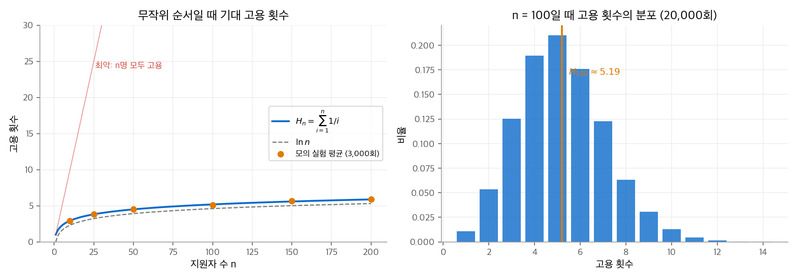
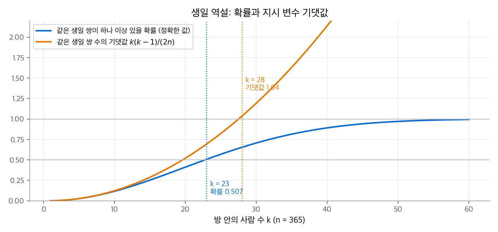
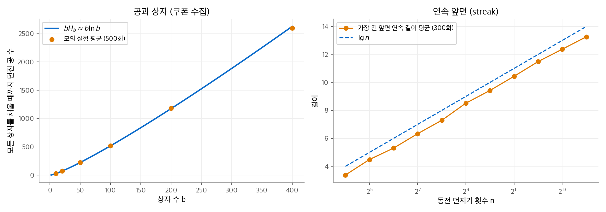
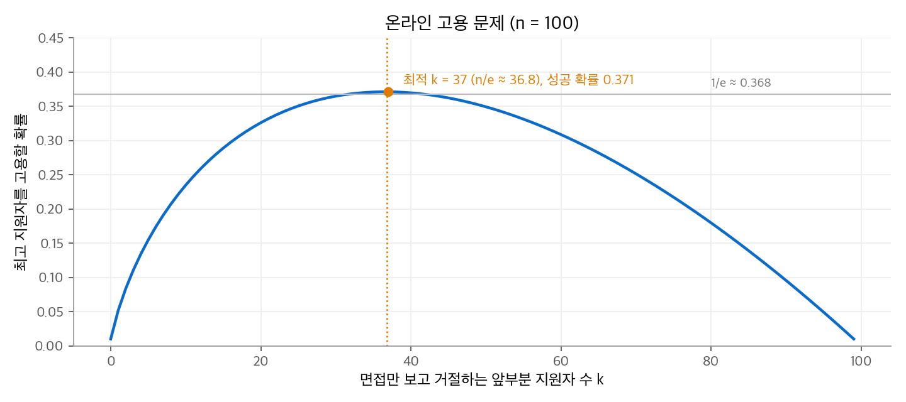

# 5. 확률적 분석과 무작위 알고리즘

지금까지는 최악의 입력을 기준으로 실행 시간을 셌습니다. 이 장은 두 가지 다른 시각을 다룹니다. **확률적 분석(probabilistic analysis)** 은 입력이 어떤 분포를 따른다고 가정하고 비용의 기댓값을 구합니다. **무작위 알고리즘(randomized algorithm)** 은 알고리즘이 직접 난수를 써서, 입력과 무관하게 같은 기댓값을 보장합니다. 두 분석의 공통 도구는 **지시 확률 변수(indicator random variable)** 입니다. 복잡한 개수를 "일어났으면 1, 아니면 0"의 합으로 쪼개고 기댓값의 선형성으로 더합니다. 이 도구는 7장 퀵 정렬, 8장 버킷 정렬, 11장 해싱의 분석에 그대로 쓰입니다.

!!! info "원문과 자료"
    - 원문: Cormen, Leiserson, Rivest, Stein, *Introduction to Algorithms*, 4th ed. (MIT Press, 2022), 5장 Probabilistic Analysis and Randomized Algorithms (5.1~5.4)
    - [MIT Press 책 페이지](https://mitpress.mit.edu/9780262046305/introduction-to-algorithms/)
    - [MIT OCW 6.046J Design and Analysis of Algorithms (Spring 2015)](https://ocw.mit.edu/courses/6-046j-design-and-analysis-of-algorithms-spring-2015/)
    - 확률 배경: [확률론 2. 확률 변수와 분포](../../math/probability/02-random-variables.md)(베르누이·기하 분포), [확률론 3. 기댓값](../../math/probability/03-expectation.md)(기댓값의 선형성)
    - 함께 읽기: [7. 퀵 정렬](07-quicksort.md), [8. 선형 시간 정렬](08-linear-sorting.md)

## 1. 고용 문제

### 문제 설정

비서를 한 명 고용해야 합니다. 인력 회사는 하루에 지원자 한 명씩, 모두 $n$ 명을 보냅니다. 면접 비용은 $c_i$ 로 작고, 고용 비용은 $c_h$ 로 큽니다. 고용 비용에는 기존 비서를 해고하고 수수료를 내는 비용이 들어 있습니다. 전략은 하나입니다. 지금 면접 본 지원자가 지금까지 본 누구보다 나으면 즉시 고용합니다.

```text
HIRE-ASSISTANT(n)
1  best = 0                       // 후보 0은 가장 못한 가상의 후보
2  for i = 1 to n
3      지원자 i를 면접한다
4      if 지원자 i가 지원자 best보다 낫다
5          best = i
6          지원자 i를 고용한다
```

면접은 $n$ 번, 고용은 $m$ 번 하면 총비용은 $O(c_i n + c_h m)$ 입니다. 면접 비용 $c_i n$ 은 고정이므로 관심은 고용 횟수 $m$ 입니다. 이 문제는 "배열을 훑으며 지금까지의 최댓값을 몇 번 갱신하는가"와 같은 문제입니다.

### 최악의 경우와 평균의 경우

지원자가 실력 순서대로 오면 매번 고용하므로 $m = n$, 비용은 $O(c_h n)$ 입니다. 그러나 현실의 순서는 보통 이렇게 나쁘지 않습니다. 지원자의 순위가 $1, \dots, n$ 의 순열이고 $n!$ 개의 순열이 모두 같은 확률로 나온다고 가정합니다. 이 순서를 **균등 무작위 순열(uniform random permutation)** 이라고 합니다. 이 가정 아래에서 $m$ 의 기댓값을 구하는 것이 확률적 분석입니다.

| 용어 | 뜻 |
| --- | --- |
| 확률적 분석 | 입력 분포를 가정하고 실행 시간이나 비용의 기댓값을 구합니다. 결과는 **평균 실행 시간(average-case running time)** 입니다. |
| 무작위 알고리즘 | 알고리즘이 난수 생성기 `RANDOM(a, b)` 를 호출합니다. 결과는 **기대 실행 시간(expected running time)** 이고, 기댓값은 알고리즘의 난수에 대해 취합니다. |

두 용어의 차이가 핵심입니다. 평균 실행 시간은 가정이 틀리면 의미를 잃습니다. 기대 실행 시간은 어떤 입력에도 성립합니다. 나쁜 입력이 따로 존재하지 않고, 나쁜 난수만 존재합니다.

## 2. 지시 확률 변수

### 정의와 기본 보조정리

표본 공간 $S$ 와 사건 $A$ 에 대해 지시 확률 변수를 다음과 같이 정의합니다.

$$
I\{A\} = \begin{cases} 1 & A \text{가 일어날 때} \\ 0 & A \text{가 일어나지 않을 때} \end{cases}
$$

**보조정리 5.1.** $X_A = I\{A\}$ 이면 $\mathrm{E}[X_A] = \Pr\{A\}$ 입니다.

증명은 정의 그대로입니다. $\mathrm{E}[X_A] = 1 \cdot \Pr\{A\} + 0 \cdot \Pr\{\bar A\} = \Pr\{A\}$ 입니다. 예를 들어 동전 $n$ 번을 던질 때 앞면 수 $X$ 는 $X = \sum_{j=1}^{n} X_j$ 이고 $X_j = I\{j\text{번째가 앞면}\}$ 입니다. 기댓값의 선형성으로 바로 $\mathrm{E}[X] = \sum_j \mathrm{E}[X_j] = n/2$ 를 얻습니다. 이항 분포의 확률 질량 함수를 합산할 필요가 없습니다.

!!! note "선형성에는 독립이 필요 없습니다"
    $\mathrm{E}[X + Y] = \mathrm{E}[X] + \mathrm{E}[Y]$ 는 $X, Y$ 가 종속이어도 성립합니다([확률론 3장](../../math/probability/03-expectation.md)). 지시 변수 기법이 강한 이유가 여기에 있습니다. 사건들이 서로 얽혀 있어도 각 사건의 확률만 알면 됩니다.

### 고용 횟수의 기댓값

$X$ 를 고용 횟수, $X_i = I\{\text{지원자 } i \text{를 고용}\}$ 이라고 합니다. 지원자 $i$ 를 고용하는 사건은 "지원자 $i$ 가 지원자 $1, \dots, i$ 중 가장 낫다"와 같습니다. 균등 무작위 순열에서는 처음 $i$ 명 중 누구든 최고일 확률이 같으므로 $\Pr = 1/i$ 입니다.

$$
\mathrm{E}[X] = \sum_{i=1}^{n} \mathrm{E}[X_i] = \sum_{i=1}^{n} \frac{1}{i} = H_n = \ln n + O(1)
$$

$H_n$ 은 $n$ 번째 조화수입니다. 따라서 평균 고용 비용은 $O(c_h \ln n)$ 이고, 최악의 $O(c_h n)$ 보다 훨씬 작습니다.

**수치 예시.** $n = 100$ 이면 $H_{100} \approx 5.19$ 입니다. 지원자 100명 중 평균 약 5명만 고용합니다. 첫 지원자는 항상 고용하고($1/1$), 둘째는 절반의 확률($1/2$)로, 100번째는 1%의 확률로 고용합니다.

<figure markdown>

<figcaption markdown>
<span class="fig-title"><b>Figure 1.</b> 무작위 순서일 때 고용 횟수</span>

기대 고용 횟수는 $H_n \approx \ln n$ 으로 천천히 늘고(왼쪽), $n = 100$ 의 실제 고용 횟수는 5 근처에 몰립니다(오른쪽).
</figcaption>
</figure>

## 3. 무작위 알고리즘

### 입력 분포를 알고리즘이 만든다

2절의 분석은 "입력이 균등 무작위 순열"이라는 가정에 기댔습니다. 인력 회사가 일부러 나쁜 순서로 보낼 수 있다면 이 가정은 깨집니다. 해법은 알고리즘이 먼저 순서를 섞는 것입니다.

```text
RANDOMIZED-HIRE-ASSISTANT(n)
1  지원자 목록을 무작위로 섞는다
2  HIRE-ASSISTANT(n)
```

이제 무작위성은 알고리즘 안에 있습니다. 어떤 입력이 와도 섞은 뒤의 순서는 균등 무작위 순열이므로, 기대 고용 비용은 모든 입력에서 $O(c_h \ln n)$ 입니다.

### 배열을 균등하게 섞기

섞는 절차는 **모든 순열을 정확히 $1/n!$ 확률로** 만들어야 합니다. 책의 RANDOMLY-PERMUTE는 Fisher-Yates(Durstenfeld) 셔플입니다.

```text
RANDOMLY-PERMUTE(A, n)
1  for i = 1 to n
2      A[i]와 A[RANDOM(i, n)]을 교환한다
```

$i$ 번째 반복은 아직 자리가 정해지지 않은 $A[i : n]$ 에서 하나를 골라 $i$ 번째 자리에 고정합니다. 정확성은 다음 루프 불변식으로 보입니다.

> 반복 $i$ 직전에, 원소 $n$ 개 중 $i-1$ 개를 고른 각 순서열($(i-1)$-순열)이 $A[1 : i-1]$ 에 있을 확률은 $(n-i+1)!/n!$ 입니다.

$i = n+1$ 에서 이 확률은 $0!/n! = 1/n!$ 이므로 출력은 균등 무작위 순열입니다. 유지 단계는 곱셈 규칙 하나입니다. 앞의 $i-1$ 자리가 특정 순서열일 확률 $(n-i+1)!/n!$ 에, 남은 $n-i+1$ 개 중 특정 원소를 고를 확률 $1/(n-i+1)$ 을 곱하면 $(n-i)!/n!$ 입니다.

### 작은 수정이 만드는 편향

2행을 `A[i]와 A[RANDOM(1, n)]을 교환` 으로 바꾸면 그럴듯해 보이지만 틀립니다. $n = 3$ 이면 난수열이 $3^3 = 27$ 가지이고 각각 같은 확률입니다. 순열은 $3! = 6$ 가지이므로 균등하려면 순열마다 $27/6 = 4.5$ 개의 난수열이 대응해야 합니다. 정수가 아니므로 불가능합니다. 실제로 세어 보면 다음과 같습니다.

| 출력 순열 | ⟨1,2,3⟩ | ⟨1,3,2⟩ | ⟨2,1,3⟩ | ⟨2,3,1⟩ | ⟨3,1,2⟩ | ⟨3,2,1⟩ |
| --- | --- | --- | --- | --- | --- | --- |
| 대응하는 난수열 수 (27개 중) | 4 | 5 | 5 | 5 | 4 | 4 |

```python
import random

def randomly_permute(a):
    """Fisher-Yates: 모든 순열이 1/n! 확률."""
    n = len(a)
    for i in range(n):
        j = random.randint(i, n - 1)   # 아직 고정되지 않은 구간에서만 고른다
        a[i], a[j] = a[j], a[i]
    return a
```

## 4. 지시 변수의 응용

이 절의 네 예제는 같은 패턴을 따릅니다. 관심 있는 개수를 지시 변수의 합으로 쓰고, 각 지시 변수의 확률을 구하고, 선형성으로 더합니다.

### 생일 역설

방에 $k$ 명이 있고 1년은 $n = 365$ 일입니다. 생일이 같은 두 사람이 있을 확률이 $1/2$ 이상이 되려면 몇 명이 필요한지 묻습니다.

**정확한 분석.** 모두 다를 확률은 $\prod_{i=1}^{k-1}(1 - i/n)$ 입니다. $1 + x \le e^x$ 를 쓰면

$$
\Pr\{\text{모두 다름}\} \le \prod_{i=1}^{k-1} e^{-i/n} = e^{-k(k-1)/(2n)}
$$

이고, 이 값은 $k(k-1) \ge 2n\ln 2$ 일 때 $1/2$ 이하입니다. $n = 365$ 이면 $k = 23$ 에서 이미 확률이 0.507입니다.

**지시 변수 분석.** 쌍 $(i, j)$ 마다 $X_{ij} = I\{i \text{와 } j \text{의 생일이 같음}\}$ 이고 $\Pr = 1/n$ 입니다. 같은 생일 쌍의 수 $X = \sum_{i<j} X_{ij}$ 의 기댓값은

$$
\mathrm{E}[X] = \binom{k}{2}\frac{1}{n} = \frac{k(k-1)}{2n}
$$

입니다. $k(k-1) \ge 2n$ 이면 기댓값이 1 이상이고, $n = 365$ 에서는 $k = 28$ 입니다. 두 분석 모두 필요한 인원이 $\Theta(\sqrt n)$ 이라는 같은 결론을 줍니다. 쌍의 수가 $k^2$ 으로 늘기 때문입니다. 이 결과는 해시 충돌 분석([11장](11-hash-tables.md))의 출발점입니다.

<figure markdown>

<figcaption markdown>
<span class="fig-title"><b>Figure 2.</b> 생일 역설</span>

확률이 1/2을 넘는 지점(23명)과 기대 쌍 수가 1을 넘는 지점(28명)이 모두 $\sqrt{n}$ 수준입니다.
</figcaption>
</figure>

### 공과 상자

공을 상자 $b$ 개에 독립적이고 균등하게 던집니다. 한 번 던질 때 특정 상자에 들어갈 확률은 $1/b$ 입니다.

- 특정 상자에 들어간 공의 수는 이항 분포 $b(k; n, 1/b)$ 를 따르고, $n$ 개를 던지면 기댓값은 $n/b$ 입니다.
- 특정 상자에 처음 공이 들어갈 때까지 던진 수는 기하 분포를 따르고, 기댓값은 $b$ 입니다.
- **모든 상자에 공이 하나 이상 들어갈 때까지** 던진 수의 기댓값은 $b H_b = b(\ln b + O(1))$ 입니다.

세 번째 결과는 쿠폰 수집 문제입니다. 빈 상자가 $b - i + 1$ 개 남았을 때 새 상자를 채울 확률은 $(b-i+1)/b$ 입니다. 그 단계에서 기다리는 횟수의 기댓값은 $b/(b-i+1)$ 이고, $i = 1, \dots, b$ 를 더하면 $b \sum_{j=1}^{b} 1/j$ 입니다. 상자 100개를 모두 채우려면 평균 약 519번을 던져야 합니다.

### 연속 앞면

공정한 동전을 $n$ 번 던질 때 가장 긴 앞면 연속 구간의 길이 $L$ 은 $\Theta(\lg n)$ 입니다.

**상한.** 위치 $i$ 에서 길이 $k$ 이상의 연속이 시작할 확률은 $1/2^k$ 입니다. $k = 2\lceil \lg n \rceil$ 이면 이 확률은 $1/n^2$ 이하이고, 시작 위치 $n$ 개에 합집합 경계를 쓰면 $\Pr\{L \ge 2\lceil \lg n\rceil\} \le 1/n$ 입니다. 따라서 $\mathrm{E}[L] = O(\lg n)$ 입니다.

**하한.** 던진 결과를 길이 $s = \lfloor (\lg n)/2 \rfloor$ 의 겹치지 않는 블록 약 $n/s$ 개로 나눕니다. 블록 하나가 모두 앞면일 확률은 $1/2^s \ge 1/\sqrt n$ 입니다. 블록이 서로 독립이므로 모든 블록이 실패할 확률은 매우 작고, $\mathrm{E}[L] = \Omega(\lg n)$ 입니다.

<figure markdown>

<figcaption markdown>
<span class="fig-title"><b>Figure 3.</b> 공과 상자, 연속 앞면</span>

모든 상자를 채우는 데 $b \ln b$ 번이 들고(왼쪽), 가장 긴 연속 앞면은 $\lg n$ 을 따라 자랍니다(오른쪽).
</figcaption>
</figure>

### 온라인 고용 문제

이번에는 고용을 한 번만 할 수 있고, 면접 직후에 바로 결정해야 합니다. 목표는 최고 지원자를 뽑을 확률을 최대로 하는 것입니다. 전략은 다음과 같습니다.

1. 처음 $k$ 명은 면접만 보고 모두 거절합니다. 이들 중 최고 점수를 기록합니다.
2. 그 뒤로는 기록보다 나은 첫 지원자를 고용합니다.
3. 끝까지 그런 지원자가 없으면 마지막 지원자를 고용합니다.

사건 $S_i$ 는 "최고 지원자가 $i$ 번째이고 그를 고용함"입니다. 이 사건은 두 조건이 함께 성립할 때 일어납니다. 최고 지원자가 $i$ 번째에 있어야 하고(확률 $1/n$), $k+1$ 번째부터 $i-1$ 번째까지 아무도 고용되지 않아야 합니다. 두 번째 조건은 처음 $i-1$ 명 중 최고가 앞의 $k$ 명 안에 있다는 뜻이고, 그 확률은 $k/(i-1)$ 입니다. 두 사건은 독립이므로

$$
\Pr\{S\} = \sum_{i=k+1}^{n} \frac{1}{n}\cdot\frac{k}{i-1} = \frac{k}{n}\sum_{i=k}^{n-1}\frac{1}{i} \ge \frac{k}{n}\big(\ln n - \ln k\big)
$$

입니다. 하한을 $k$ 로 미분해 0으로 두면 $\ln k = \ln n - 1$, 즉 $k = n/e$ 입니다. 이때 성공 확률은 $1/e \approx 0.368$ 이상입니다. 지원자가 몇 명이든 처음 약 37%를 관찰만 하면 최고를 뽑을 확률이 3분의 1을 넘습니다.

**수치 예시.** $n = 100$ 에서 정확한 합을 계산하면 최적 $k$ 는 37이고 성공 확률은 0.371입니다. $k = 10$ 이면 0.235, $k = 70$ 이면 0.251로 떨어집니다.

<figure markdown>

<figcaption markdown>
<span class="fig-title"><b>Figure 4.</b> 온라인 고용 문제</span>

관찰만 하는 앞부분 크기 $k$ 에 따른 성공 확률입니다. $k = n/e$ 근처에서 최대 $1/e$ 를 조금 넘습니다.
</figcaption>
</figure>

## 5. 정리

| 문제 | 지시 변수 | 한 변수의 확률 | 기댓값 |
| --- | --- | --- | --- |
| 고용 횟수 | 지원자 $i$ 를 고용 | $1/i$ | $H_n = \ln n + O(1)$ |
| 같은 생일 쌍 | 쌍 $(i,j)$ 의 생일이 같음 | $1/n$ | $k(k-1)/(2n)$ |
| 쿠폰 수집 | (단계별 기하 분포의 합) | $(b-i+1)/b$ | $b H_b$ |
| 가장 긴 연속 앞면 | 위치 $i$ 에서 길이 $k$ 연속 시작 | $2^{-k}$ | $\Theta(\lg n)$ |
| 온라인 고용 | 최고가 $i$ 번째이고 고용됨 | $k/(n(i-1))$ | 성공 확률 $\ge 1/e$ |

- 확률적 분석은 입력 분포를 가정합니다. 무작위 알고리즘은 그 분포를 스스로 만들어 가정을 없앱니다.
- 지시 변수와 선형성은 독립 가정 없이 개수의 기댓값을 줍니다. 이 기법은 [7장](07-quicksort.md)의 비교 횟수와 [8장](08-linear-sorting.md)의 버킷 크기 분석에 다시 나옵니다.
- 섞기 같은 무작위 절차는 "그럴듯함"이 아니라 증명으로 확인해야 합니다. 작은 수정 하나로 분포가 편향됩니다.
